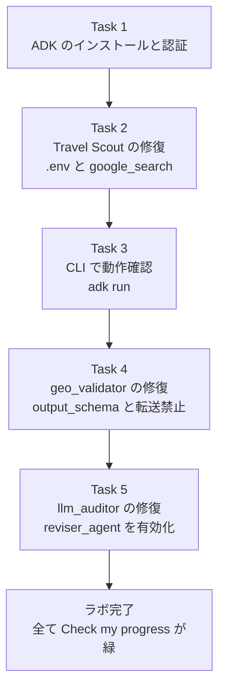
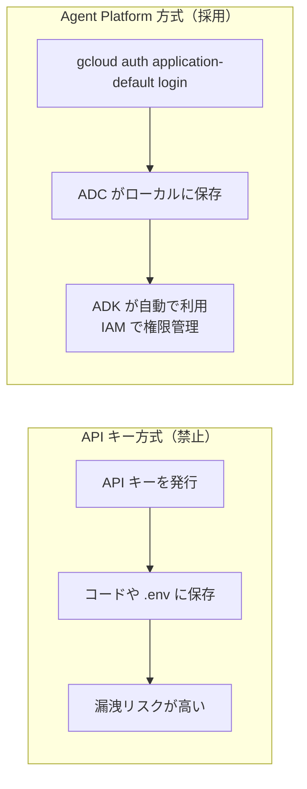
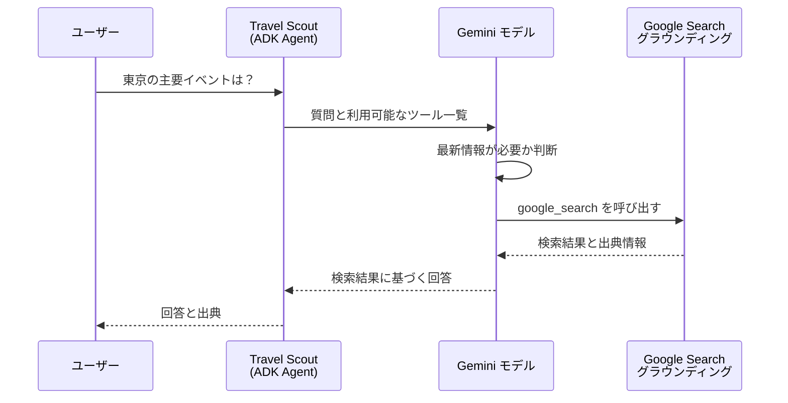
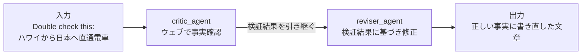
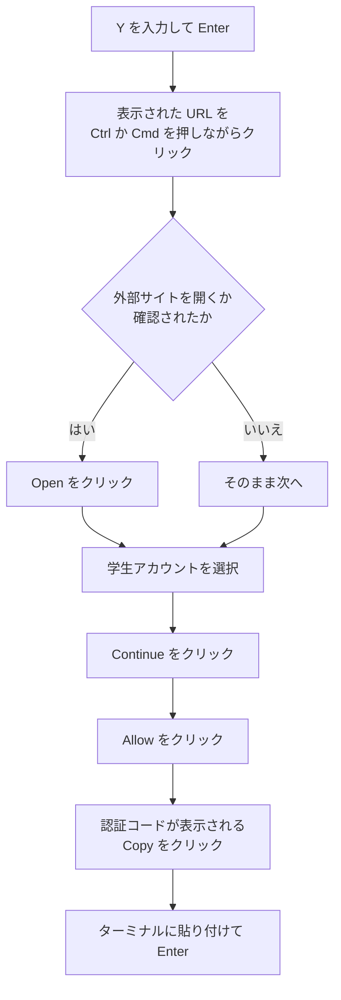
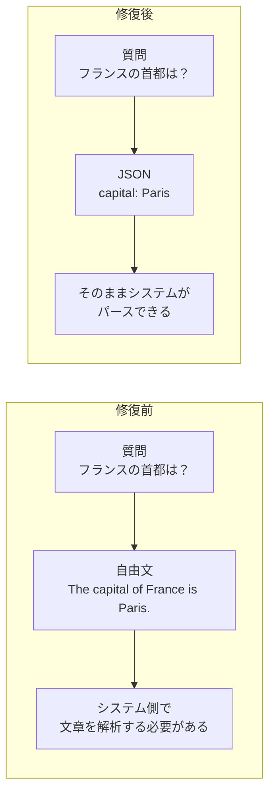
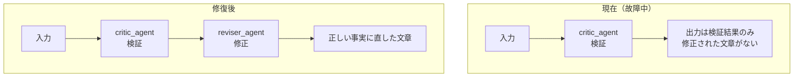
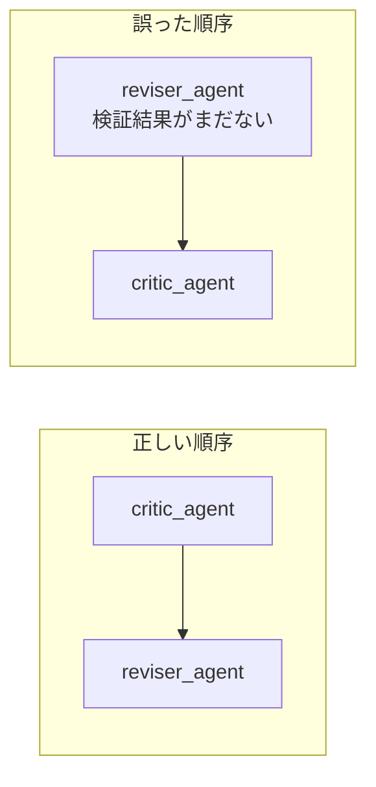
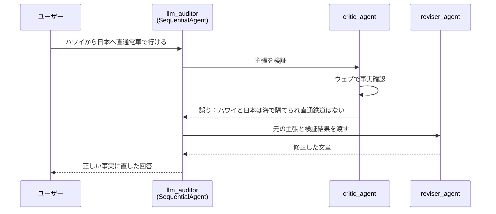
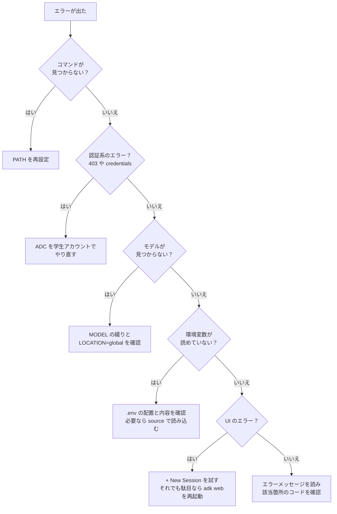

# Google Cloud チャレンジラボ完全ガイド：Cymbal Travel の AI エージェントを修復・デプロイする（ADK 初学者向け）

> **対象ラボ**：Agent Development Kit (ADK) コース向けチャレンジラボ（Cymbal Travel シナリオ）
> **想定読者**：Google Cloud と Python の基礎はあるが、ADK・AI エージェントは初めての方
> **情報の基準日**：2026年10月30日（ウェブ情報を確認した時点。末尾に出典 URL を記載）
> **この資料のゴール**：ラボの 5 つのタスクを「なぜその操作をするのか」まで理解したうえで、迷わず 100% スコアで完了できるようになること

---

## 0. 最初に読んでください（重要な注意点）

このラボは **チャレンジラボ** です。通常のラボと違い、「この通りに打てば終わり」という詳細手順は用意されていません。**ラボで学んだ知識を使って自力で解く** 形式なので、本ガイドでは次の 3 点を重視します。

1. **何をするのか**（目的）
2. **どうやるのか**（具体的な操作とコード）
3. **なぜそうするのか**（ベストプラクティスと理由）

### 0.1 本ガイドの読み替えルール（超重要）

ラボの手順書には、次のように **プレースホルダー（値が伏せられた箇所）** があります。ラボ画面の「Lab setup and access」パネルや各タスクの本文で実際の値を必ず確認してください。

| 手順書の表記 | 意味 | あなたがやること |
|---|---|---|
| `GOOGLE_CLOUD_PROJECT=` | プロジェクト ID が空欄 | ラボパネルに表示される **Project ID** を入れる |
| `MODEL=model_name` | モデル名が伏せられている | ラボ本文で指定されたモデル名を入れる。「最新の Flash モデル」と書かれている場合、2026年10月30日時点の最新 GA 版は **`gemini-3.8-flash`** |
| `gs://-bucket/adk_project.zip` | バケット名が伏せられている | ラボ画面に表示される **正確なコマンドをコピー** して使う |
| 「Agent Platform」 | Vertex AI 系サービスの現行名称 | 旧称 Vertex AI と同じ系統のサービス。ドキュメントでは「Gemini Enterprise Agent Platform」と表記される |

> **注意**：ラボ本文に別のモデル名が明記されている場合は、**ラボの指示を最優先** にしてください。採点システムはラボ側の想定に合わせて作られています。

### 0.2 絶対に守るルール

| ルール | 理由 |
|---|---|
| **API キーを作らない・使わない** | ラボが明示的に禁止している。認証は Agent Platform（ADC：Application Default Credentials）で行う |
| **ラボ用の学生アカウントだけを使う** | 個人アカウントを使うと、個人側に課金が発生する恐れがある |
| **シークレットウィンドウで作業する** | 個人アカウントとの競合を防ぐ |
| **`GOOGLE_CLOUD_LOCATION=global` にする** | ラボ成功の前提条件として明記されている |
| **タイマーを意識する** | ラボは一時停止できない。時間内に全タスクを完了しないと 100% にならない |

---

## 1. ラボ全体像

### 1.1 シナリオ

あなたは旅行会社 **Cymbal Travel** に入社した「エージェントエンジニア」です。前任者が作った 3 つの AI エージェントのプロトタイプが、設定ミス・未完成・故障の状態です。これを修復し、下流システムに **一貫した正確なデータ** を届けるのが仕事です。

### 1.2 3 つのエージェント

| エージェント（ディレクトリ名） | 愛称 | 役割 | 現在の問題 | 直すこと |
|---|---|---|---|---|
| `my_google_search_agent` | Travel Scout | ウェブを検索して旅行イベントを探す | 検索ツールが未設定で、検索できない | `google_search` ツールを有効化 |
| `geo_validator` | Destination Verifier | 国の首都を答える | 自由文で返すため、システム連携しづらい | Pydantic スキーマで JSON 出力を強制 |
| `llm_auditor` | Brochure Auditor | パンフレットの主張を検証し修正する | 「検証」だけで「修正」がない | `reviser_agent` を復活 |

### 1.3 タスクの流れ



### 1.4 採点（Check my progress）の対応表

| タスク | 採点される内容 | 確認方法 |
|---|---|---|
| Task 2 | Dev UI で Google Search に基づく回答が得られること | Check my progress：Run the agent using the ADK's Web UI |
| Task 3 | CLI でエージェントと対話できること | Check my progress：Chat with an agent via the command-line interface |
| Task 4 | geo_validator が JSON を返すこと | Check my progress：Run an agent programmatically |
| Task 5 | critic と reviser の両方が動くこと | Check my progress：Preview a multi-agent example |

> Task 1 には独立した採点ボタンはありませんが、**後続すべてのタスクの土台** です。ここでつまずくと全部が失敗します。

---

## 2. 前提知識：このラボで使う用語を先に理解する

先に用語を押さえると、手順の意味がぐっと分かりやすくなります。

### 2.1 用語集

| 用語 | 一言で言うと | このラボでの出番 |
|---|---|---|
| **ADK (Agent Development Kit)** | Google 製の AI エージェント開発フレームワーク（Python 版は `google-adk`） | 3 つのエージェントすべての土台 |
| **Agent（エージェント）** | 指示（instruction）と道具（tools）を持ち、LLM で考えて動くプログラム | `Agent(...)` で定義 |
| **Tool（ツール）** | エージェントが使える「道具」。検索や関数呼び出しなど | `google_search` |
| **Grounding（グラウンディング）** | モデルの回答を、検索結果など外部の事実に結びつけること | Travel Scout が最新情報を答えるため |
| **Structured Output（構造化出力）** | 出力形式をスキーマで固定すること | geo_validator の `output_schema` |
| **Pydantic** | Python のデータ検証ライブラリ。`BaseModel` を継承してスキーマを定義 | `CountryCapital` |
| **SequentialAgent** | 子エージェントを **決まった順番で** 実行する親エージェント | llm_auditor（critic → reviser） |
| **Agent Platform** | Google Cloud 上で Gemini などを使う基盤（旧 Vertex AI 系） | API キーの代わりに使う |
| **ADC (Application Default Credentials)** | 環境に保存された認証情報を、ライブラリが自動で使う仕組み | `gcloud auth application-default login` |
| **`.env` ファイル** | 環境変数を書いておく設定ファイル（隠しファイル） | 各エージェントに配置 |
| **`adk web`** | ブラウザで試せる開発用 UI を起動するコマンド | Task 2, 5 |
| **`adk run`** | ターミナルで対話するコマンド | Task 3 |

### 2.2 認証の仕組み：なぜ API キーを使わないのか

ADK から Gemini モデルを呼ぶ方法は大きく 2 つあります。

| 方式 | 認証手段 | このラボ |
|---|---|---|
| Gemini Developer API | API キー | **禁止** |
| Agent Platform（Google Cloud） | ADC（IAM に基づく認証） | **使用する** |



**ベストプラクティス**：キーを持たない認証（ADC / IAM）は、漏洩・ローテーション管理の負担を避けられるため、Google Cloud では推奨される方式です。

### 2.3 `.env` に書く 4 つの変数の意味

```env
GOOGLE_GENAI_USE_ENTERPRISE=true
GOOGLE_CLOUD_PROJECT=<あなたの Project ID>
GOOGLE_CLOUD_LOCATION=global
MODEL=<モデル名>
```

| 変数 | 意味 | 注意点 |
|---|---|---|
| `GOOGLE_GENAI_USE_ENTERPRISE` | 「API キーではなく Agent Platform を使う」スイッチ | 後述のとおり、旧名 `GOOGLE_GENAI_USE_VERTEXAI` と等価 |
| `GOOGLE_CLOUD_PROJECT` | 利用するプロジェクト | ラボパネルの Project ID と **完全一致** させる |
| `GOOGLE_CLOUD_LOCATION` | モデルを呼ぶエンドポイントの場所 | **必ず `global`**。global エンドポイントは単一リージョンより可用性が高く、429（リソース枯渇）エラーを減らしやすい |
| `MODEL` | 使うモデル名 | `MODEL` はラボ用の変数。コードが `os.getenv("MODEL")` で読む想定 |

> **豆知識**：ADK の公式ドキュメントによると、`GOOGLE_GENAI_USE_ENTERPRISE` と `GOOGLE_GENAI_USE_VERTEXAI` は **同じ働きをする別名** です。もし前者を設定しても Agent Platform に接続されない場合は、ADK のバージョンが古いので、**後者を使うか ADK を更新** します。

### 2.4 Google Search グラウンディングの仕組み

Travel Scout が「最新のイベント」を答えられるのは、次の流れで検索結果に基づいて回答するためです。



ポイントは、**ツールを渡すだけで、使うかどうかはモデルが判断する** ことです。だから Task 2 には「実際に検索アクションが実行されているか確認すること」という注意書きがあります。

### 2.5 構造化出力とエージェント転送の制御

| 設定 | 役割 | なぜ必要か |
|---|---|---|
| `output_schema=CountryCapital` | 応答を Pydantic スキーマに沿った JSON に固定 | 下流のシステムが確実にパースできるようにする |
| `disallow_transfer_to_parent=True` | 親エージェントへ制御を戻す転送を禁止 | 出力形式を崩す「別エージェントへの丸投げ」を防ぐ |
| `disallow_transfer_to_peers=True` | 兄弟エージェントへの転送を禁止 | 同上 |

両方を `True` にすると、そのエージェントは **単独で完結** し、転送ツールが注入されなくなります（ADK 公式ガイドの記述）。出力を厳密にしたいエージェントでは定石の設定です。

> **補足**：`output_schema` を指定すると、エージェントは **ツールを使えなくなる** のが ADK の仕様（バージョンによって挙動が異なる場合があります）。そのため geo_validator ではツールを持たせず、スキーマで出力を固定します。

### 2.6 SequentialAgent：パイプラインの考え方

llm_auditor は「検証 → 修正」を順番に行うパイプラインです。



`SequentialAgent` は `sub_agents` のリストを **先頭から順に** 実行し、前の出力が次の入力に引き継がれます。つまり、`sub_agents` に `reviser_agent` が入っていなければ、**検証だけで終わって修正されません**。これがラボの故障箇所です。

---

## 3. Task 1：ADK をインストールして環境を整える

### 3.1 やること

| 手順 | 目的 |
|---|---|
| ① Cloud Shell を開く | 作業用ターミナルの準備 |
| ② PATH 設定と ADK インストール | `adk` コマンドを使えるようにする |
| ③ ADC で認証 | Agent Platform（Gemini）を呼べるようにする |
| ④ ラボのソースを取得して展開 | 修復対象のコードを手に入れる |
| ⑤ 依存パッケージをインストール | プロジェクトが動く状態にする |

### 3.2 手順 1：PATH を通して ADK をインストール

```bash
export PATH="$PATH:$(python3 -m site --user-base)/bin"
python3 -m pip install google-adk
```

| 部分 | 意味 |
|---|---|
| `export PATH=$PATH:...` | `pip` がユーザー領域にインストールした実行ファイル（`adk` など）を、コマンドとして呼べるようにする |
| `python3 -m pip install google-adk` | `pip` を Python 経由で確実に呼び、ADK 本体をインストールする |

> **つまずきポイント**：`adk: command not found` と出たら、ほぼ 100% PATH 設定漏れです。新しいターミナルを開いた場合は **もう一度 `export PATH=...` を実行** してください。

### 3.3 手順 2：ADC で認証する

```bash
gcloud auth application-default login
```

ターミナルの質問に `Y` と入力して Enter を押します。続いて、次の流れで進めます。



**重要**：ここで選ぶのは **必ずラボの学生アカウント**（`student-...@qwiklabs.net` のような形式）です。個人アカウントを選ばないでください。

> **補足：`gcloud auth login` との違い**
> `gcloud auth login` は **gcloud コマンド自身** の認証、`gcloud auth application-default login` は **プログラム（ADK など）が使う認証情報（ADC）** の作成です。ADK は後者を使うため、Task 1 では ADC 側のコマンドを使います。

### 3.4 手順 3：ラボのソースコードを取得

ラボ画面に表示されているコマンドを使います（バケット名が手順書では伏せられているため）。

```bash
gcloud storage cp gs://<ラボ画面に表示されたバケット名>/adk_project.zip .
unzip adk_project.zip
cd adk_project
pip install -r requirements.txt
```

| コマンド | 意味 |
|---|---|
| `gcloud storage cp ... .` | Cloud Storage から zip を現在のディレクトリへコピー |
| `unzip adk_project.zip` | zip を展開 |
| `cd adk_project` | プロジェクトのルートへ移動 |
| `pip install -r requirements.txt` | プロジェクトが必要とするライブラリを一括インストール |

### 3.5 ディレクトリ構成の確認

展開すると `adk_project` ディレクトリができます。次のコマンドで確認できます。

```bash
ls -la adk_project
ls -la adk_project/my_google_search_agent
```

| 場所 | 中身（想定） | 役割 |
|---|---|---|
| `adk_project/my_google_search_agent/` | `agent.py`、`__init__.py`、`.env` | Travel Scout |
| `adk_project/geo_validator/` | `agent.py`、`__init__.py`、`.env` | Destination Verifier |
| `adk_project/llm_auditor/` | `agent.py`、`sub_agents/` など、`.env` | Brochure Auditor |
| `adk_project/requirements.txt` | 依存パッケージ一覧 | `pip install -r` で使う |

> **重要**：`.env` は **隠しファイル**（名前がドットで始まる）です。`ls` だけでは見えないので `ls -la` を使います。エディタでは **View → Toggle hidden files** で表示します。

### 3.6 Task 1 のチェックリスト

- [ ] `adk --version` でバージョンが表示される
- [ ] ADC の認証が完了した（認証コードを貼り付けた）
- [ ] `adk_project` が存在する
- [ ] `pip install -r requirements.txt` がエラーなく終わった

---

## 4. Task 2：Travel Scout を修復して起動する

### 4.1 目的

`my_google_search_agent` は、前任者の作業が途中で、**ツールが何も有効になっていません**。ここでは次の 3 点を行います。

1. `.env` を Agent Platform 用に設定する
2. `agent.py` で `google_search` ツールを有効にする
3. `adk web` で動作確認する

### 4.2 手順 1：エディタを開き、隠しファイルを表示する

1. Cloud Shell で **Open Editor** を選択
2. メニューの **View → Toggle hidden files** を選択
3. `adk_project/my_google_search_agent` を開く

### 4.3 手順 2：`.env` を設定する

`my_google_search_agent/.env` を次の内容に編集します。

```env
GOOGLE_GENAI_USE_ENTERPRISE=true
GOOGLE_CLOUD_PROJECT=<ラボパネルの Project ID>
GOOGLE_CLOUD_LOCATION=global
MODEL=gemini-3.8-flash
```

> **Project ID の調べ方**：ラボの「Lab setup and access」パネル、または次のコマンドで確認できます。
>
> ```bash
> gcloud config get-value project
> ```

#### 設定時のチェックポイント

| チェック項目 | NG 例 | OK 例 |
|---|---|---|
| `=` の前後に空白がない | `GOOGLE_CLOUD_PROJECT = my-proj` | `GOOGLE_CLOUD_PROJECT=my-proj` |
| 値にクォートを付けない（付けても動く場合があるが、揃えるのが無難） | `MODEL="gemini-3.8-flash"` | `MODEL=gemini-3.8-flash` |
| ロケーションは global | `us-central1` | `global` |
| Project ID が正確 | 手入力のミス | ラボパネルからコピー |

### 4.4 手順 3：`agent.py` で `google_search` を有効にする

`my_google_search_agent/agent.py` を開き、Agent の定義に `tools=[google_search]` を追加します。

#### 修正前（イメージ）

```python
from google.adk.agents import Agent

root_agent = Agent(
    name="my_google_search_agent",
    model=os.getenv("MODEL"),
    instruction="...",
    # tools が未設定 → 検索できない
)
```

#### 修正後（イメージ）

```python
from google.adk.agents import Agent
from google.adk.tools import google_search   # ← ① ツールをインポート

root_agent = Agent(
    name="my_google_search_agent",
    model=os.getenv("MODEL"),
    instruction="...",
    tools=[google_search],                    # ← ② ツールを渡す
)
```

| 変更点 | 意味 |
|---|---|
| ① `from google.adk.tools import google_search` | ADK が用意する組み込みの検索ツールを読み込む |
| ② `tools=[google_search]` | エージェントに検索ツールを持たせる。**リスト形式** で渡す点に注意 |

> **ポイント**：既存コードの `model=` や `instruction=` は **書き換えず、差分だけ追加** するのが安全です。ラボの `agent.py` の既存の書き方（例：`os.getenv("MODEL")` を使っているか）に合わせてください。

#### ベストプラクティス：Google Search ツールを使うときの注意

| 項目 | 内容 |
|---|---|
| 単独利用 | ADK 公式ドキュメントでは、`google_search` は **同じエージェント内で他のツールと併用できない** 制約があると説明されている（`one tool one agent`）。このラボは検索ツール 1 つだけなので問題なし |
| 検索候補の表示 | 本番アプリでは、グラウンディング時に返される **Search suggestions を表示する義務** がある。ラボでは不要だが、実務では必ず考慮する |
| instruction の工夫 | 「必要に応じて Google Search を使い、出典を示すこと」のように指示すると、検索の実行が安定しやすい |

### 4.5 手順 4：Dev UI（`adk web`）を起動する

```bash
cd adk_project
adk web --allow_origins "regex:https://.*\.cloudshell\.dev"
```

| 部分 | 意味 |
|---|---|
| `cd adk_project` | **プロジェクトのルート** へ移動。`adk web` はここにあるエージェント（サブディレクトリ）を一覧表示する |
| `adk web` | ブラウザ用の開発 UI を起動 |
| `--allow_origins "regex:..."` | Cloud Shell のプレビュー URL（`*.cloudshell.dev`）からのアクセスを許可する **CORS 設定**。これがないと UI が正しく動かないことがある |

起動後、ターミナルに表示される `http://127.0.0.1:8000` のリンクを選択して開きます。

### 4.6 手順 5：質問して、検索が実行されたか確認する

1. 左上のエージェント選択で **`my_google_search_agent`** を選ぶ
2. 次の質問を入力する

```text
What are some major events in Tokyo in 2025?
```

3. 回答を確認する

#### 「本当に検索されたか」を見分ける方法

| 確認ポイント | 見方 |
|---|---|
| 回答に出典や検索候補が付いている | グラウンディングされている証拠 |
| UI の **Events / Trace** タブ | `google_search` が呼ばれた形跡を確認できる |
| 回答が具体的で最新の情報を含む | 検索結果が反映されている |

> **エラーが出たら**：画面右上の **+ New Session** を選んで、もう一度質問します。これはラボの本文に明記された対処法です。

### 4.7 手順 6：Web サーバーを停止して Check my progress

1. Cloud Shell のターミナルで **Ctrl + C** を押して `adk web` を停止
2. ラボ画面の **Check my progress** をクリックして採点

### 4.8 Task 2 のチェックリスト

- [ ] `.env` の 4 変数を設定した（`LOCATION=global`）
- [ ] `agent.py` に `google_search` のインポートと `tools=[google_search]` を追加した
- [ ] `adk web` を **プロジェクトのルート** から起動した
- [ ] 検索結果に基づく回答が得られた
- [ ] Ctrl + C で停止し、Check my progress を押した

---

## 5. Task 3：CLI でエージェントを検証する

### 5.1 目的

`adk web` のようなブラウザ UI だけでなく、**ターミナルだけでもエージェントを試せる** ことを確認します。CI（自動テスト）や SSH 環境などでは、CLI が役立ちます。

### 5.2 手順

```bash
cd adk_project
adk run my_google_search_agent
```

対話画面が起動したら、次のように質問します。

```text
What is the currency exchange rate for Japan?
```

（日本語で「日本の為替レートを教えて」と聞いても構いません。ラボの文面は「通貨の為替レートについて尋ねる」です。）

| コマンド | 意味 |
|---|---|
| `adk run <エージェント名>` | 指定したエージェントを **ターミナルで対話実行** する。引数は **ディレクトリ名** |

終わったら **Ctrl + C** で終了し、**Check my progress** を押します。

### 5.3 `adk web` と `adk run` の比較

| 項目 | `adk web` | `adk run` |
|---|---|---|
| インターフェース | ブラウザの UI | ターミナル |
| 複数エージェントの切り替え | UI 上で選択可能 | 起動時に 1 つ指定 |
| 内部動作の可視化 | Events / Trace を見やすい | 簡易的 |
| 向いている場面 | 開発・デバッグ | 動作確認・自動化・軽い検証 |

### 5.4 Task 3 のチェックリスト

- [ ] `adk run my_google_search_agent` で対話を開始できた
- [ ] 為替レートについて質問し、回答が返った
- [ ] Ctrl + C で終了し、Check my progress を押した

---

## 6. Task 4：構造化出力を強制する（geo_validator）

### 6.1 目的

Booking Engine チーム（下流システム）は、**「首都名だけを含む厳密な JSON」** を必要としています。ところが現在は「パリです。」のような自由文を返してしまいます。これをスキーマで固定します。



### 6.2 手順 1：`.env` を設定する

`geo_validator/.env` も、Task 2 と同じ形式で設定します。**エージェントごとに `.env` は別ファイル** なので、忘れずに編集してください。

```env
GOOGLE_GENAI_USE_ENTERPRISE=true
GOOGLE_CLOUD_PROJECT=<ラボパネルの Project ID>
GOOGLE_CLOUD_LOCATION=global
MODEL=gemini-3.8-flash
```

> **ラボの指示**：「最新の Flash モデルを使うこと」とあります。2026年10月30日時点で、Agent Platform の最新の Flash は `gemini-3.8-flash`（2026年9月2日リリース、GA）です。ただし **ラボ本文で別のモデル名が指定されていれば、そちらを優先** してください。

### 6.3 手順 2：`agent.py` を修正する

`geo_validator/agent.py` に、次の 3 つの変更を加えます。

| # | 変更内容 | 目的 |
|---|---|---|
| 1 | `CountryCapital` モデルを定義（`BaseModel` を継承、`capital: str`） | 出力の「型」を決める |
| 2 | Agent に `output_schema=CountryCapital` を指定 | モデルの出力をスキーマに沿った JSON に強制 |
| 3 | `disallow_transfer_to_parent=True` と `disallow_transfer_to_peers=True` を指定 | 別エージェントへの転送を禁止 |
| 4 | モデルを最新の Flash（`MODEL` の値）にする | ラボの指示 |

#### 完成形（リファレンス）

```python
import os

from pydantic import BaseModel, Field
from google.adk.agents import Agent


# ① 出力スキーマ：首都名だけを持つ
class CountryCapital(BaseModel):
    capital: str = Field(description="The capital city of the given country")


# ② Agent 定義
root_agent = Agent(
    name="geo_validator",
    model=os.getenv("MODEL", "gemini-3.8-flash"),
    description="Returns the capital city of a country as strict JSON.",
    instruction=(
        "You are a destination verifier. "
        "When the user names a country, answer only with its capital city "
        "in the required JSON format."
    ),
    output_schema=CountryCapital,            # ← スキーマを強制
    disallow_transfer_to_parent=True,        # ← 親への転送を禁止
    disallow_transfer_to_peers=True,         # ← 兄弟への転送を禁止
)
```

> **注意**：これは **理解のためのリファレンス** です。ラボの `agent.py` には、既に Runner・セッション・実行用コード（`python3 geo_validator/agent.py` で動かすための部分）が含まれている可能性が高いです。**既存コードは消さず、上の 3 点（スキーマ定義・`output_schema`・転送禁止）とモデル名だけを反映** してください。

#### コードの読み解き

| コード | 意味 |
|---|---|
| `class CountryCapital(BaseModel)` | Pydantic モデルの定義。JSON の「設計図」 |
| `capital: str` | `capital` という文字列フィールドが必須 |
| `Field(description=...)` | フィールドの説明。**モデルへのヒント** としても働くため、書くと精度が上がる |
| `output_schema=CountryCapital` | 応答を `{"capital": "..."}` 形式に固定 |
| `disallow_transfer_to_*` | 出力が崩れる原因となる転送を封じる |

### 6.4 手順 3：プログラムから実行する

```bash
cd adk_project
python3 geo_validator/agent.py
```

期待される出力の例：

```json
{"capital": "Paris"}
```

文章（`The capital of France is Paris.`）ではなく、**JSON オブジェクト** であれば成功です。

#### 参考：Runner を使った実行コードの全体像

ラボの `agent.py` に既に含まれている想定ですが、仕組みを理解するための参考として載せます。

```python
import asyncio

from google.adk.runners import Runner
from google.adk.sessions import InMemorySessionService
from google.genai import types

APP_NAME = "geo_validator"
USER_ID = "user1"


async def main():
    session_service = InMemorySessionService()
    session = await session_service.create_session(app_name=APP_NAME, user_id=USER_ID)

    runner = Runner(agent=root_agent, app_name=APP_NAME, session_service=session_service)

    message = types.Content(role="user", parts=[types.Part(text="France")])

    async for event in runner.run_async(
        user_id=USER_ID, session_id=session.id, new_message=message
    ):
        if event.is_final_response():
            print(event.content.parts[0].text)


if __name__ == "__main__":
    asyncio.run(main())
```

| 部品 | 役割 |
|---|---|
| `InMemorySessionService` | 会話の状態をメモリ上に保持（開発・テスト用） |
| `Runner` | エージェントを実際に実行するエンジン |
| `types.Content` | ユーザーのメッセージ |
| `event.is_final_response()` | 最終回答のイベントかどうかの判定 |

> **つまずきポイント**：`python3 geo_validator/agent.py` のように **直接スクリプトとして実行** すると、`adk web` のように `.env` を自動で読んでくれない場合があります。`Missing key inputs` のようなエラーが出たら、次のように環境変数を読み込んでから実行してください。
>
> ```bash
> set -a
> source geo_validator/.env
> set +a
> python3 geo_validator/agent.py
> ```

### 6.5 Task 4 のチェックリスト

- [ ] `geo_validator/.env` を設定した
- [ ] `CountryCapital`（`BaseModel` 継承、`capital: str`）を定義した
- [ ] `output_schema=CountryCapital` を指定した
- [ ] `disallow_transfer_to_parent=True` と `disallow_transfer_to_peers=True` を指定した
- [ ] `python3 geo_validator/agent.py` の出力が JSON になった
- [ ] Check my progress を押した

---

## 7. Task 5：Brochure Auditor をデプロイする（llm_auditor）

### 7.1 目的

`llm_auditor` は「**批評（Critic）→ 修正（Reviser）**」の 2 段階で動くはずのパイプラインです。ところが前任者が `reviser_agent` のコードを **コメントアウト** したため、批評で止まり、修正されません。コメントを外して復活させます。



| エージェント | 役割 |
|---|---|
| **Critic Agent** | 主張をウェブで事実確認し、正しいか誤りかを評価する |
| **Reviser Agent** | Critic の指摘をもとに、文章を最小限の修正で正確にする |

### 7.2 手順 1：`.env` を設定する

`llm_auditor/.env` を設定します（Task 2・4 と同じ形式）。

```env
GOOGLE_GENAI_USE_ENTERPRISE=true
GOOGLE_CLOUD_PROJECT=<ラボパネルの Project ID>
GOOGLE_CLOUD_LOCATION=global
MODEL=gemini-3.8-flash
```

### 7.3 手順 2：`agent.py` で `reviser_agent` を有効にする

`llm_auditor/agent.py` に、次の **2 か所の変更** を加えます。

| # | 変更箇所 | 内容 |
|---|---|---|
| 1 | import 文 | コメントアウトされている `reviser_agent` のインポートを **コメント解除** |
| 2 | `sub_agents` リスト | `reviser_agent` を **`critic_agent` の後ろ** に追加 |

#### 修正前（イメージ）

```python
from google.adk.agents import SequentialAgent

from .sub_agents.critic import critic_agent
# from .sub_agents.reviser import reviser_agent      # ← コメントアウトされている

llm_auditor = SequentialAgent(
    name="llm_auditor",
    description="Evaluates and corrects marketing claims.",
    sub_agents=[critic_agent],                        # ← critic しかいない
)

root_agent = llm_auditor
```

#### 修正後（イメージ）

```python
from google.adk.agents import SequentialAgent

from .sub_agents.critic import critic_agent
from .sub_agents.reviser import reviser_agent         # ← コメントを外す

llm_auditor = SequentialAgent(
    name="llm_auditor",
    description="Evaluates and corrects marketing claims.",
    sub_agents=[critic_agent, reviser_agent],         # ← 順番が重要
)

root_agent = llm_auditor
```

> **注意**：実際のファイルの書き方（変数名や import のパス）は、ラボの `agent.py` に従ってください。上は ADK 公式サンプル（`adk-samples` の `llm-auditor`）の構造に基づくイメージです。

#### なぜ順番が重要なのか

`SequentialAgent` は、`sub_agents` を **リストの先頭から順に** 実行します。Reviser は Critic の結果を受け取って修正するので、**必ず Critic の後ろ** に置きます。逆にすると、検証前の文章を修正することになり、意味をなしません。



#### 補足：Reviser の仕組み（ADK 公式サンプルより）

公式サンプルの Reviser は、プロンプトで「出力の末尾に特別なマーカーを付ける」ように指示し、`after_model_callback` というコールバックでそのマーカーを除去して、**最終出力をきれいに整えます**。このラボでは触る必要はありませんが、「コールバックで出力を後処理する」という ADK の定番パターンとして知っておくと役立ちます。

### 7.4 手順 3：Dev UI で動作確認する

```bash
cd adk_project
adk web --allow_origins "regex:https://.*\.cloudshell\.dev"
```

ブラウザで開き、エージェントに **`llm_auditor`** を選択して、次の「誤った主張」を送信します。

```text
Double check this: You can take a direct train from Hawaii to Japan.
```

#### 期待される動き



| 確認ポイント | 期待される結果 |
|---|---|
| Critic が呼ばれた | 主張が誤りだと指摘される |
| Reviser が呼ばれた | 正しい事実に書き直した文章が出力される |
| UI 上の表示 | Events / Trace に **2 つのエージェントの実行** が見える |

> **エラーが出たら**：**+ New Session** を選んで、もう一度送信します。

### 7.5 手順 4：停止して採点

1. ターミナルで **Ctrl + C** を押して `adk web` を停止
2. **Check my progress** をクリック

### 7.6 Task 5 のチェックリスト

- [ ] `llm_auditor/.env` を設定した
- [ ] `reviser_agent` の import をコメント解除した
- [ ] `sub_agents=[critic_agent, reviser_agent]` の順で指定した
- [ ] 誤った主張を送り、Critic と Reviser の両方が動いた
- [ ] Check my progress を押した

---

## 8. トラブルシューティング

### 8.1 症状別早見表

| 症状 | 主な原因 | 対処 |
|---|---|---|
| `adk: command not found` | PATH 未設定 | `export PATH="$PATH:$(python3 -m site --user-base)/bin"` を再実行 |
| `.env` が見つからない・見えない | 隠しファイル | エディタで **Toggle hidden files**、または `ls -la` |
| `PERMISSION_DENIED` / 403 | ADC 未設定、または別アカウントで認証した | `gcloud auth application-default login` をやり直し、学生アカウントを選ぶ |
| 404 / model not found | モデル名やロケーションの誤り | `MODEL` の綴りと `LOCATION=global` を確認 |
| 429 / リソース枯渇 | 一時的な負荷 | **+ New Session**、少し待ってから再実行 |
| `Missing key inputs argument` 系 | 環境変数が読めていない／Agent Platform に切り替わっていない | `.env` の内容を確認。直接 `python3` 実行なら `source .env` する。それでも駄目なら `GOOGLE_GENAI_USE_VERTEXAI=true` を使う |
| `adk web` の UI が真っ白・動かない | CORS 設定漏れ | `--allow_origins "regex:https://.*\.cloudshell\.dev"` を付けて再起動 |
| エージェント一覧に何も出ない | 実行ディレクトリが違う | `cd adk_project`（ルート）から起動する |
| 検索されず、古い情報で答える | ツール未設定、または質問が検索不要と判断された | `tools=[google_search]` を確認。質問を最新情報が必要な内容にする |
| geo_validator が文章を返す | `output_schema` 未指定 | `output_schema=CountryCapital` を確認 |
| geo_validator でエラー | スキーマ定義やインポートの誤り | `BaseModel` の import と `capital: str` を確認 |
| Reviser が動かない | `sub_agents` に未追加、または import のコメントが残っている | 両方を確認 |
| `ImportError` | インポートパスの誤り | 既存のコメントアウトされた行を **そのまま** 解除する |

### 8.2 トラブル時の判断フロー



### 8.3 エラーメッセージの読み方（チャレンジラボのコツ）

チャレンジラボの冒頭に「エラーメッセージを読み、調べて、自分で直すスキルを使う」とあります。次の手順で読むと早く解決できます。

1. **最後の行** を読む（例外の種類と要約）
2. **ファイル名と行番号** を探す（自分が編集したファイルか？）
3. **キーワード** を拾う（`PERMISSION`、`not found`、`validation` など）
4. 直近で変えた箇所 **だけ** を疑う

---

## 9. ベストプラクティス集（実務に持ち帰ろう）

| # | プラクティス | このラボでの具体例 | 理由 |
|---|---|---|---|
| 1 | **キーレス認証（ADC / IAM）を使う** | API キーを作らず Agent Platform を使う | 鍵の漏洩・管理コストを避けられる |
| 2 | **シークレットは Git に入れない** | `.env` は `.gitignore` に追加する | 設定ファイルの流出を防ぐ（ADK の公式ガイドも「ソース管理に入れない」と注記） |
| 3 | **ロケーションは global を基本に** | `GOOGLE_CLOUD_LOCATION=global` | 可用性が高く、429 を減らしやすい。ただしデータレジデンシー要件があるなら地域指定を検討 |
| 4 | **出力はスキーマで固定する** | `output_schema=CountryCapital` | 下流システムの連携が壊れにくい |
| 5 | **不要な転送は禁止する** | `disallow_transfer_to_*=True` | 動作が予測可能になる |
| 6 | **段階的パイプラインで責務を分ける** | Critic と Reviser を分離 | 各エージェントを単純に保て、テストしやすい |
| 7 | **ツールで根拠を取る（グラウンディング）** | `google_search` | ハルシネーション（もっともらしい誤り）を減らす |
| 8 | **モデル名は設定で外出しする** | `MODEL` を `.env` で管理 | モデル更新時にコードを変えずに済む |
| 9 | **モデルの世代交代を意識する** | 旧モデルは廃止予定日がある | 例：`gemini-2.5-flash-lite` は 2026年10月16日に廃止予定と公式に記載 |
| 10 | **本番では ADK Web UI を使わない** | あくまで開発用 | 本番は Cloud Run や Agent Runtime などへデプロイする |
| 11 | **検索グラウンディングの表示義務** | Search suggestions の表示 | 本番アプリではライセンス上の要件 |
| 12 | **使い終わったらリソースを片付ける** | ラボ終了で自動削除 | 実務の検証環境では課金・権限の残存に注意 |

---

## 10. 理解度チェック

### Q1. このラボで API キーを使わない理由と、代わりに使う認証方式は？

<details>
<summary>答えを見る</summary>

ラボが禁止しているため、そして鍵の漏洩・管理リスクを避けるためです。代わりに **ADC（Application Default Credentials）** を使い、`.env` で **Agent Platform** を有効にします。

</details>

### Q2. `GOOGLE_CLOUD_LOCATION` は何にする？ なぜ？

<details>
<summary>答えを見る</summary>

**`global`** です。ラボの成功条件として明記されており、グローバルエンドポイントは単一リージョンより可用性が高く 429 エラーを減らしやすいためです。

</details>

### Q3. Travel Scout に Google 検索を使わせる 2 つのコード変更は？

<details>
<summary>答えを見る</summary>

`from google.adk.tools import google_search` でインポートし、Agent の定義に `tools=[google_search]` を渡します。

</details>

### Q4. geo_validator に必要な 3 つの変更は？

<details>
<summary>答えを見る</summary>

1. `BaseModel` を継承した `CountryCapital`（`capital: str`）を定義
2. `output_schema=CountryCapital` を指定
3. `disallow_transfer_to_parent=True` と `disallow_transfer_to_peers=True` を指定

</details>

### Q5. llm_auditor が「検証だけで修正しない」原因と直し方は？

<details>
<summary>答えを見る</summary>

`reviser_agent` の import がコメントアウトされ、`sub_agents` にも入っていなかったためです。import のコメントを外し、`sub_agents=[critic_agent, reviser_agent]` の順で指定します。

</details>

### Q6. `adk web` と `adk run` の違いは？

<details>
<summary>答えを見る</summary>

`adk web` はブラウザの開発 UI（Events や Trace も見られる）、`adk run` はターミナルでの対話実行です。

</details>

---

## 11. 全体の最終チェックリスト

| 区分 | 確認項目 | 完了 |
|---|---|---|
| 共通 | 学生アカウントで認証し、API キーは作っていない | [ ] |
| 共通 | 3 つのエージェントすべての `.env` を設定した | [ ] |
| Task 2 | `google_search` を有効化し、Web UI で検索に基づく回答を得た | [ ] |
| Task 3 | `adk run` で為替レートを質問できた | [ ] |
| Task 4 | `python3 geo_validator/agent.py` の出力が JSON になった | [ ] |
| Task 5 | critic と reviser の両方が動いた | [ ] |
| 採点 | すべての Check my progress が緑になった | [ ] |

---

## 12. 参考文献（2026年10月30日時点で確認）

| 内容 | URL |
|---|---|
| ADK：Google Cloud と Agent Platform への接続（環境変数、ADC） | https://adk.dev/get-started/google-cloud/ |
| ADK：Google Search グラウンディング | https://adk.dev/grounding/google_search_grounding/ |
| ADK：Google Search ツール（単独利用の制約、検索候補の表示） | https://adk.dev/integrations/google-search/ |
| Gemini Enterprise Agent Platform：Gen AI SDK の概要 | https://docs.cloud.google.com/gemini-enterprise-agent-platform/models/sdks/overview |
| Gemini 3.8 Flash（モデル ID・GA・リリース日） | https://docs.cloud.google.com/vertex-ai/generative-ai/docs/models/gemini/3-8-flash |
| Gemini 3.8 Flash 開発者ガイド（Agent Platform での呼び出し例） | https://docs.cloud.google.com/gemini-enterprise-agent-platform/models/guides/gemini-3-8-flash |
| モデルのバージョンと廃止予定 | https://docs.cloud.google.com/gemini-enterprise-agent-platform/models/model-versions.md.txt |
| グローバルエンドポイントとロケーション | https://docs.cloud.google.com/gemini-enterprise-agent-platform/resources/locations |
| Codelab：構造化出力と転送禁止（`output_schema`、`disallow_transfer_*`） | https://codelabs.developers.google.com/codelabs/production-ready-ai-roadshow/1-building-a-multi-agent-system/building-a-multi-agent-system |
| ADK LlmAgent の仕様（転送制御と `output_schema`） | https://codehalwell.github.io/AgentGuides/google-adk-guide/python/agents/ |
| ADK 公式サンプル解析：llm-auditor（SequentialAgent、critic と reviser） | https://code-repo.d4science.org/D4Science/dave_agent/src/branch/refactoring/docs/adk-samples-analysis/analysis_llm-auditor.md |

> **免責**：ラボの `agent.py` や `.env` の実際の中身（変数名、import パス、既存の実行コード）は、ラボ環境で配布されるファイルが正です。本ガイドのコードは、公式ドキュメントと公式サンプルに基づく **理解用のリファレンス** なので、必ず手元の既存コードに合わせて **差分のみ** 反映してください。モデル名・環境変数名などは変更される場合があるため、ラボ本文の記載を最優先してください。
