# AWS Certified Generative AI Developer - Professional (AIP-C01)
## Content Domain 4: Operational Efficiency and Optimization for GenAI Applications
### 初学者向け ステップバイステップ解説ガイド

| 項目 | 内容 |
|---|---|
| 対象試験 | AWS Certified Generative AI Developer - Professional (AIP-C01) |
| 対象ドメイン | Content Domain 4: Operational Efficiency and Optimization for GenAI Applications |
| 出題比率 | 12% of scored content |
| 構成 | 3 Task / 16 Skill |
| 作成日 | 2026-10-09 |
| 一次情報 | AWS 公式 試験ガイド (Domain 4 ページ) |

> **このガイドの読み方**
> 1. まず Step 0 と Step 1 で「全体像」と「3 つの最適化レバー」をつかみます。
> 2. Step 2 以降は、公式試験ガイドの Skill 1 つにつき 1 Step で、「何か」「なぜ重要か」「仕組み」「ベストプラクティス」「試験の狙われどころ」の順に説明します。
> 3. 最後に、サービス選択表、試験の罠、練習問題、チートシート、参考 URL をまとめています。
>
> **信頼性に関する注意**
> - 公式試験ガイドの Skill 文言は、2026-10-09 に取得した Domain 4 ページに基づきます。
> - サービスの仕様、対応モデル、料金、クォータは頻繁に変わります。数値や対応モデルは「考え方の例」として読み、最終確認は公式ドキュメントで行ってください。
> - 参考 URL は「今回の調査で実際に内容を確認できたもの」と「既知のパスで未確認のもの」を区別して、最終章に表示しています。

---

## 目次

- [Step 0: Domain 4 の全体像](#step-0-domain-4-の全体像)
- [Step 1: 前提知識 - トークンと 3 つの最適化レバー](#step-1-前提知識---トークンと-3-つの最適化レバー)
- [Task 4.1 コスト最適化とリソース効率](#task-41-コスト最適化とリソース効率)
  - [Step 2: Skill 4.1.1 トークン効率化](#step-2-skill-411-トークン効率化)
  - [Step 3: Skill 4.1.2 コスト効率のよいモデル選択](#step-3-skill-412-コスト効率のよいモデル選択)
  - [Step 4: Skill 4.1.3 高性能な FM システム (バッチ・容量・スケーリング)](#step-4-skill-413-高性能な-fm-システム-バッチ容量スケーリング)
  - [Step 5: Skill 4.1.4 インテリジェントなキャッシュ](#step-5-skill-414-インテリジェントなキャッシュ)
- [Task 4.2 アプリケーション性能の最適化](#task-42-アプリケーション性能の最適化)
  - [Step 6: Skill 4.2.1 応答性の高い AI システム](#step-6-skill-421-応答性の高い-ai-システム)
  - [Step 7: Skill 4.2.2 検索 (リトリーバル) 性能の向上](#step-7-skill-422-検索リトリーバル性能の向上)
  - [Step 8: Skill 4.2.3 FM スループットの最適化](#step-8-skill-423-fm-スループットの最適化)
  - [Step 9: Skill 4.2.4 FM 性能の調整 (パラメータと A/B テスト)](#step-9-skill-424-fm-性能の調整-パラメータと-ab-テスト)
  - [Step 10: Skill 4.2.5 FM ワークロード向けリソース配分](#step-10-skill-425-fm-ワークロード向けリソース配分)
  - [Step 11: Skill 4.2.6 GenAI ワークフロー全体の最適化](#step-11-skill-426-genai-ワークフロー全体の最適化)
- [Task 4.3 GenAI アプリのモニタリング](#task-43-genai-アプリのモニタリング)
  - [Step 12: Skill 4.3.1 包括的なオブザーバビリティ](#step-12-skill-431-包括的なオブザーバビリティ)
  - [Step 13: Skill 4.3.2 GenAI 固有のモニタリング](#step-13-skill-432-genai-固有のモニタリング)
  - [Step 14: Skill 4.3.3 統合オブザーバビリティと監査](#step-14-skill-433-統合オブザーバビリティと監査)
  - [Step 15: Skill 4.3.4 ツール性能フレームワーク](#step-15-skill-434-ツール性能フレームワーク)
  - [Step 16: Skill 4.3.5 ベクトルストアの運用管理](#step-16-skill-435-ベクトルストアの運用管理)
  - [Step 17: Skill 4.3.6 FM 固有のトラブルシューティング](#step-17-skill-436-fm-固有のトラブルシューティング)
- [Step 18: 症状から解決策を選ぶ早見表](#step-18-症状から解決策を選ぶ早見表)
- [Step 19: 試験の罠チェック表](#step-19-試験の罠チェック表)
- [Step 20: 練習問題](#step-20-練習問題)
- [Step 21: 最終チートシート](#step-21-最終チートシート)
- [Step 22: 参考 URL 一覧](#step-22-参考-url-一覧)

---

## Step 0: Domain 4 の全体像

### 0-1. このドメインで問われること

Domain 4 は、「動く GenAI アプリ」を **安く・速く・安定して・見える状態で** 運用するための知識を問います。配点は 12% と小さめですが、Domain 1 から 3 で作った仕組みを本番運用で磨く内容なので、他ドメインの問題にも関連語として頻出します。

| Task | テーマ | Skill 数 | 一言でいうと |
|---|---|---|---|
| 4.1 | コスト最適化とリソース効率 | 4 | 無駄なトークンと無駄な呼び出しを減らす |
| 4.2 | アプリケーション性能の最適化 | 6 | 速く、たくさん、的確に答えさせる |
| 4.3 | GenAI アプリのモニタリング | 6 | 何が起きているか見えるようにして、早く直す |

### 0-2. 16 Skill の一覧

| Skill | 一言要約 | 代表的なキーワード |
|---|---|---|
| 4.1.1 | トークン効率化 | トークン推定、コンテキスト最適化、プロンプト圧縮、max tokens |
| 4.1.2 | モデル選択フレームワーク | 階層化、ルーティング、価格性能比 |
| 4.1.3 | 高スループットな FM システム | バッチ、容量計画、Provisioned Throughput |
| 4.1.4 | キャッシュ | セマンティックキャッシュ、プロンプトキャッシュ、ハッシュ化 |
| 4.2.1 | 応答性 | ストリーミング、並列化、事前計算、低レイテンシモデル |
| 4.2.2 | 検索性能 | インデックス最適化、クエリ前処理、ハイブリッド検索 |
| 4.2.3 | スループット最適化 | バッチ推論、同時実行制御、スロットリング対策 |
| 4.2.4 | FM 性能調整 | temperature、top-p、top-k、A/B テスト |
| 4.2.5 | リソース配分 | トークン量ベースの容量計画、オートスケーリング |
| 4.2.6 | ワークフロー最適化 | API プロファイリング、ベクトル DB クエリ、サービス間通信 |
| 4.3.1 | 包括的オブザーバビリティ | メトリクス、トレース、ビジネス指標 |
| 4.3.2 | GenAI 固有モニタリング | トークン使用量、幻覚率、異常検知、呼び出しログ |
| 4.3.3 | 統合オブザーバビリティ | ダッシュボード、監査ログ、フォレンジック |
| 4.3.4 | ツール性能 | ツール呼び出しの追跡、マルチエージェント |
| 4.3.5 | ベクトルストア運用 | 性能監視、インデックス最適化、データ品質 |
| 4.3.6 | FM 固有のトラブルシューティング | ゴールデンデータセット、出力 diff、推論経路 |

### 0-3. ドメイン構造のマップ

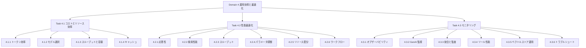

### 0-4. 学習の進め方

1. Step 1 で用語 (トークン、TTFT、TPM など) を押さえる。
2. Task 4.1 → 4.2 → 4.3 の順に読む。4.3 で「測る」ことを学ぶと、4.1 と 4.2 の改善の効果確認がつながります。
3. Step 18 と Step 19 で「問題文のキーワード → 正解の方向」をパターン化する。
4. Step 20 の練習問題を、解説を隠して解く。

---

## Step 1: 前提知識 - トークンと 3 つの最適化レバー

### 1-1. トークンとは

LLM は文字ではなく **トークン** という単位でテキストを処理します。課金、速度、上限 (コンテキストウィンドウ)、クォータのすべてがトークンを基準にします。

| 用語 | 意味 | 運用上のポイント |
|---|---|---|
| 入力トークン | プロンプト (システムプロンプト、履歴、検索結果、質問) | 長いほど高く、遅くなる |
| 出力トークン | モデルが生成する回答 | 一般に入力より単価が高く、生成時間の大半を占める |
| コンテキストウィンドウ | 1 回の呼び出しで扱える入出力の合計上限 | 超えるとエラーか切り捨てになる |
| TTFT | Time To First Token。最初のトークンが届くまでの時間 | 体感速度を決める |
| TPOT / 生成速度 | 1 トークンあたりの生成時間 | 長い回答ほど合計時間が伸びる |
| TPM / RPM | 1 分あたりのトークン数 / リクエスト数のクォータ | 超えるとスロットリング (429) |

> **日本語の注意**: 日本語は同じ意味でも英語よりトークン数が多くなりがちです。コスト見積もりと容量計画は、必ず **実際の日本語データで** 計測します。

### 1-2. 3 つの最適化レバー

GenAI アプリの最適化は、次の 3 つのレバーのトレードオフです。

| レバー | 測る指標 | 主な改善手段 |
|---|---|---|
| コスト | 1 リクエストあたり、1 タスク成功あたりの金額 | トークン削減、小さいモデル、キャッシュ、バッチ |
| レイテンシ | TTFT、全体応答時間 (p50 / p95 / p99) | ストリーミング、低レイテンシモデル、並列化、プロンプトキャッシュ |
| スループット | 1 秒あたりに処理できる量、スロットリング率 | クォータ管理、クロスリージョン推論、Provisioned Throughput、バッチ |

さらに「品質」が 4 つ目の軸としてあり、**品質を落とさずに** 上の 3 つを改善するのが Domain 4 の本質です。

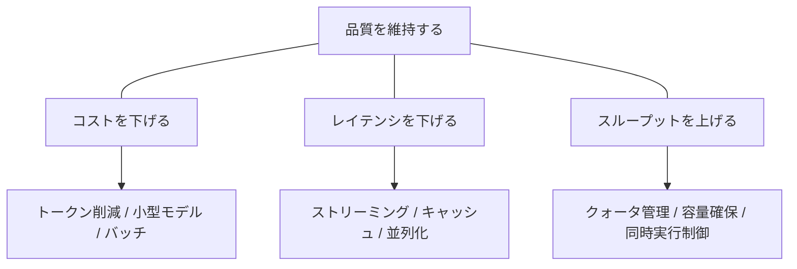

### 1-3. Amazon Bedrock の推論オプション比較

| 方式 | 特徴 | 向いている場面 | 注意点 |
|---|---|---|---|
| オンデマンド | 使った分だけ支払い。クォータの範囲で利用 | 開発、変動の大きい本番 | 需要ピークでスロットリングが起きうる |
| クロスリージョン推論 | 推論プロファイル経由で複数リージョンに振り分け、スループットと回復力を高める | ピーク時の 429 対策 | データの所在要件を確認する |
| Provisioned Throughput | 専用の推論容量を購入 (モデルユニット単位) | 安定した高負荷、一定の性能保証、カスタムモデル | 常時課金。使わない時間も費用が発生 |
| バッチ推論 | S3 の入力ファイルをまとめて非同期処理し、結果を S3 に出力 | 夜間の大量処理、評価、要約の一括生成 | リアルタイム用途には不向き |
| レイテンシ最適化推論 | `performanceConfig` で最適化を指定し、対応モデルで応答を速くする | 時間に敏感な対話 | 対応モデルとリージョンが限定的 (仕様は変化する) |
| プロンプトキャッシュ | 繰り返し使う長いプロンプト部分を再利用 | 長いシステムプロンプト、文書チャット | 対応モデル、最小トークン数、TTL の条件がある |

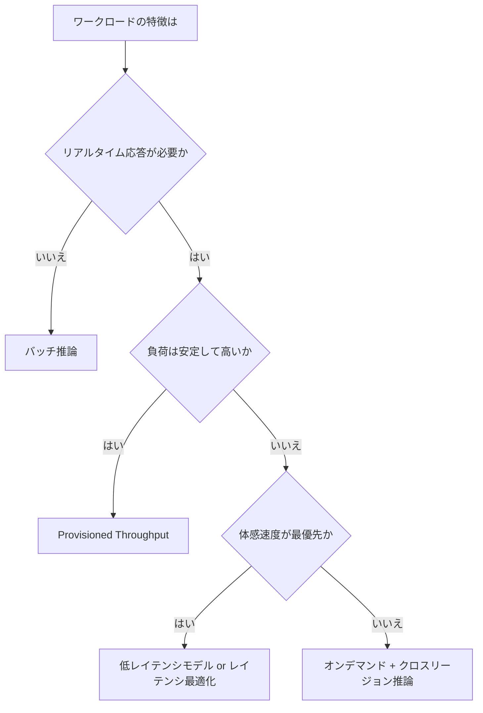

出典: Amazon Bedrock Scaling and throughput best practices / Optimize model inference for latency / Prompt caching (URL は Step 22 を参照)

---

# Task 4.1 コスト最適化とリソース効率

## Step 2: Skill 4.1.1 トークン効率化

> 公式 Skill: トークン効率システムを開発し、有効性を維持しながら FM のコストを下げる (トークン推定と追跡、コンテキストウィンドウ最適化、レスポンスサイズ制御、プロンプト圧縮、コンテキストの剪定、レスポンスの制限)。

### 2-1. 何をする Skill か

「**必要な情報だけを、必要な量だけ**」モデルに渡し、返してもらう仕組みを作ります。コストは基本的に `入力トークン × 入力単価 + 出力トークン × 出力単価` なので、トークンを減らすことがもっとも直接的な節約です。

### 2-2. 6 つの手法

| 手法 | 内容 | 具体例 |
|---|---|---|
| トークン推定 | 送る前に概算し、予算を超える場合は削減処理に回す | Bedrock のトークン数カウント API の利用、または過去ログの実測から日本語の係数を算出 |
| トークン追跡 | 呼び出しごとの実績を記録し、機能別、テナント別に集計する | Converse API の応答に含まれる使用量をカスタムメトリクスとして記録 |
| コンテキストウィンドウ最適化 | 履歴と検索結果の量を上限内で最適化する | 会話履歴の要約、スライディングウィンドウ、RAG の top-k 削減 |
| レスポンスサイズ制御 | 出力の最大長を制限し、冗長な回答を防ぐ | `maxTokens`、`stopSequences`、「3 文以内で」の指示、構造化出力 |
| プロンプト圧縮 | 同じ意味を短い表現で伝える | 冗長な前置きの削除、few-shot 例の厳選、小型モデルによる事前要約 |
| コンテキスト剪定 | 関連度の低い情報を取り除く | 再ランキング後に閾値未満を捨てる、重複チャンクの除去 |

### 2-3. 仕組みの流れ

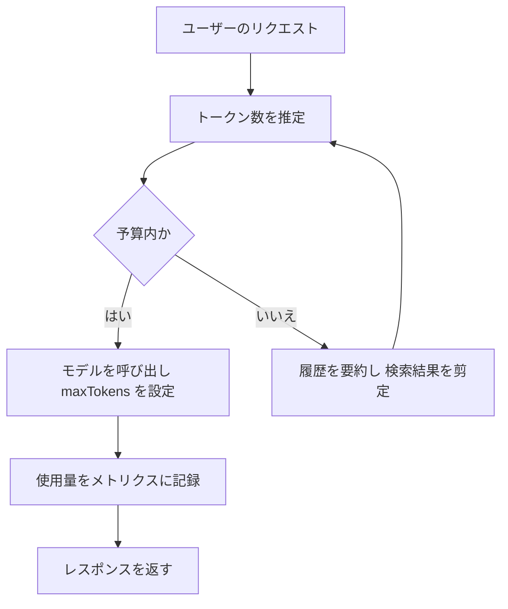

### 2-4. コード例 (使用量の記録)

```python
import boto3, json, time

bedrock = boto3.client("bedrock-runtime", region_name="us-east-1")

def invoke_with_budget(model_id: str, system: str, user_text: str, max_out: int = 400):
    resp = bedrock.converse(
        modelId=model_id,
        system=[{"text": system}],
        messages=[{"role": "user", "content": [{"text": user_text}]}],
        inferenceConfig={"maxTokens": max_out, "temperature": 0.2, "stopSequences": ["###END"]},
    )
    usage = resp["usage"]  # inputTokens, outputTokens, totalTokens (キャッシュ利用時は追加項目あり)
    latency_ms = resp["metrics"]["latencyMs"]
    # EMF 形式で標準出力 -> CloudWatch Logs -> カスタムメトリクス化
    print(json.dumps({
        "_aws": {
            "Timestamp": int(time.time() * 1000),
            "CloudWatchMetrics": [{
                "Namespace": "GenAIApp",
                "Dimensions": [["Feature", "ModelId"]],
                "Metrics": [
                    {"Name": "InputTokens", "Unit": "Count"},
                    {"Name": "OutputTokens", "Unit": "Count"},
                    {"Name": "LatencyMs", "Unit": "Milliseconds"},
                ],
            }],
        },
        "Feature": "faq-bot", "ModelId": model_id,
        "InputTokens": usage["inputTokens"], "OutputTokens": usage["outputTokens"],
        "LatencyMs": latency_ms,
    }))
    return resp["output"]["message"]["content"][0]["text"]
```

> ポイント: **機能別、テナント別のディメンション** を付けておくと、「どの機能がコストを食っているか」を後で特定できます。

### 2-5. ベストプラクティス

| # | ベストプラクティス | 理由 |
|---|---|---|
| 1 | `maxTokens` を用途に合わせて小さめに設定する | 出力の暴走を防ぐ。また、スループットのクォータ計算にも影響する (Step 8 を参照) |
| 2 | システムプロンプトは「短く・静的に」保つ | 短縮でコスト減、静的化でプロンプトキャッシュが効く |
| 3 | 会話履歴は全文を送らず、古い部分を要約する | 履歴は 1 ターンごとに入力トークンを雪だるま式に増やす |
| 4 | RAG の top-k とチャンクサイズを評価で決める | 多すぎるとコストと雑音が増え、少なすぎると回答漏れになる |
| 5 | 再ランキングしてから上位だけを渡す | 関連度の低い文脈は、コストを増やすうえに精度も下げうる |
| 6 | 出力形式を JSON スキーマや箇条書きで指定する | 冗長な前置きを避けられ、後処理もしやすい |
| 7 | 「トークン数 × 単価」を機能別に集計して予算アラームを設定する | 想定外の増加を早く検知する |
| 8 | 圧縮後も **品質評価** (ゴールデンデータセット) を必ず回す | 削りすぎによる品質低下を防ぐ |

### 2-6. よくある失敗

- 品質評価なしでプロンプトを削り、回答精度が落ちる。
- `maxTokens` を極端に大きく設定したまま運用し、クォータ消費とコストが増える。
- 履歴を全部送り続け、長い会話で急にコストが跳ね上がる。

### 2-7. 試験の狙われどころ

- 「コストを下げたいが品質は維持したい」→ **プロンプト圧縮、コンテキスト剪定、maxTokens 制御** の組み合わせ。
- 「どの機能がコストを使っているか知りたい」→ **使用量を機能別ディメンションでカスタムメトリクス化**。
- 「長い会話でコストが増える」→ **履歴の要約 / スライディングウィンドウ**。

出典: Amazon Bedrock Converse API / Inference parameters / CloudWatch Embedded Metric Format (Step 22 を参照)

---

## Step 3: Skill 4.1.2 コスト効率のよいモデル選択

> 公式 Skill: コスト効率のよいモデル選択フレームワークを作る (コストと能力のトレードオフ評価、クエリ複雑度に応じた FM の階層利用、応答品質に対する推論コストのバランス、価格性能比の測定、効率的な推論パターン)。

### 3-1. 基本の考え方

「すべてのリクエストを最高性能のモデルで処理する」のは、近所への買い物にトラックを使うようなものです。**簡単な質問は小さく安いモデル、難しい質問だけ大きいモデル** に振り分けると、品質をほぼ保ちつつコストを大きく下げられます。

### 3-2. 階層化 (ティアリング) の例

| ティア | 想定タスク | モデルの方向性 | 特徴 |
|---|---|---|---|
| ティア 1 | 分類、抽出、定型 FAQ、短い要約 | 小型 / 高速 / 低価格 | 件数が多く、コスト削減効果が大きい |
| ティア 2 | 一般的な文章生成、RAG 回答 | 中型 | 品質とコストのバランス |
| ティア 3 | 複雑な推論、長文分析、難しいコード | 大型 / 高性能 | 件数は少ないが品質が重要 |

### 3-3. ルーティング方式の比較

| 方式 | しくみ | 長所 | 短所 |
|---|---|---|---|
| Bedrock Intelligent Prompt Routing | Bedrock が各リクエストの難易度を予測し、**同じモデルファミリー内** の候補モデルへ自動で振り分ける。既定のルーターを使うか、自分で設定する | 実装が少ない。API のモデル ID にルーターの ARN を指定するだけ | 同一ファミリー内に限られる。自分のタスクでの効果は要検証 |
| 自作ルーター | 軽量な分類器 (小型モデルや簡易ルール) が難易度を判定して振り分ける | 複数ファミリーやプロバイダをまたげる。ルールを細かく制御できる | 実装と保守が必要。ルーター自体のコストと遅延が増える |
| カスケード | 小型モデルで試し、信頼度が低ければ大型モデルで再実行 | 品質を担保しやすい | 失敗時は 2 回呼ぶため遅くなりコストも二重にかかる |
| モデル蒸留 | 大型モデルの出力で小型モデルを特化させる | 特定用途で小型でも高精度になりうる | 準備と評価の手間がかかる |

> Intelligent Prompt Routing について AWS は、コストを最大 30% 削減できる (精度を損なわずに) と説明しています。ただし結果はタスクや分野で変わるため、**自分のデータで評価すること** が推奨されています。

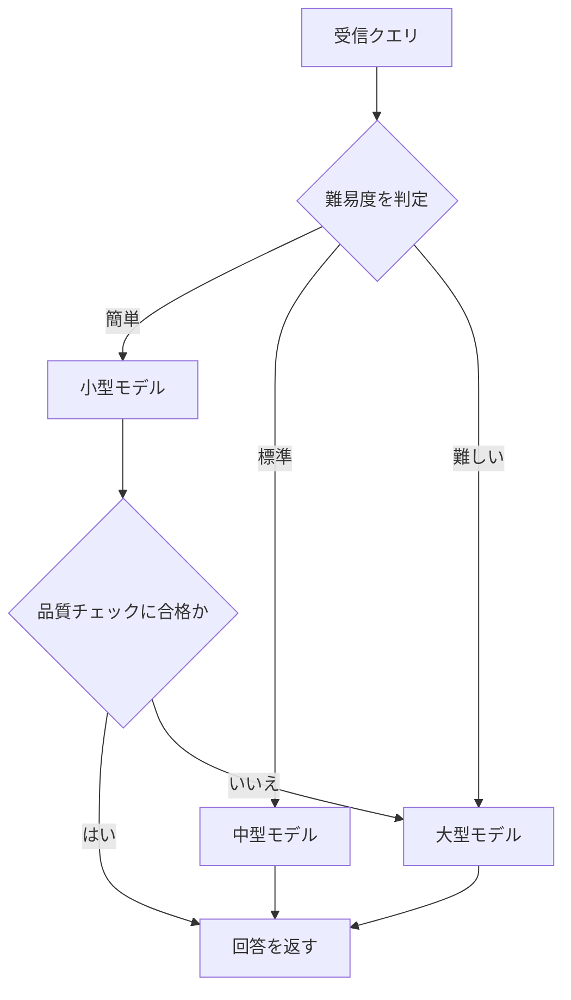

### 3-4. 価格性能比の測り方

「モデルの単価」だけで比べるのは危険です。**1 タスクを成功させる総コスト** で比べます。

| 指標 | 計算 | 意味 |
|---|---|---|
| リクエスト単価 | 入力トークン × 入力単価 + 出力トークン × 出力単価 | 基本コスト |
| 成功あたりコスト | 総コスト ÷ 成功タスク数 | 失敗や再試行を含めた実質コスト |
| 品質スコア | ゴールデンデータセットでの正答率や評価スコア | 品質の定量化 |
| 価格性能比 | 品質スコア ÷ 成功あたりコスト | 高いほど効率的 |

**仮想の計算例** (数字は説明用の架空値です)

| モデル | 1,000 件の総コスト | 正答率 | 成功あたりコスト |
|---|---|---|---|
| 小型 | 2 ドル | 80% | 2 ÷ 800 = 0.0025 ドル |
| 大型 | 20 ドル | 92% | 20 ÷ 920 = 約 0.0217 ドル |

小型は成功あたりコストが約 9 分の 1 です。正答率 80% で要件を満たすなら小型を選び、足りない 20% だけを大型に回す設計 (カスケード) が合理的です。

### 3-5. ベストプラクティス

| # | ベストプラクティス | 理由 |
|---|---|---|
| 1 | モデル選択を **評価データに基づいて** 決める (Amazon Bedrock の評価機能やゴールデンデータセット) | 感覚での選定は過剰スペックになりやすい |
| 2 | ワークロードをタスク種別で分け、タスクごとにモデルを選ぶ | 1 つのモデルですべてを処理しない |
| 3 | ルーターには「フォールバック先モデル」を必ず用意する | 判定失敗時の品質を守る |
| 4 | モデル ID は設定として外出しし、差し替え可能にする | 新モデルへの移行や A/B 比較が容易 |
| 5 | 継続的に再評価する (新モデルや価格改定のたび) | 価格性能比は時間とともに変わる |
| 6 | 大量・固定の用途は蒸留や特化を検討する | 小型で必要精度に届けば最も安い |

### 3-6. 試験の狙われどころ

- 「問い合わせの複雑さがばらばらでコストを下げたい」→ **Intelligent Prompt Routing または階層化ルーティング**。
- 「品質を落とさず」→ 評価データで確認し、**フォールバック** を設ける。
- 「単価が最も安いモデルを選ぶ」は多くの場合 **不正解** (成功あたりコストや品質を見ていない)。

出典: Amazon Bedrock Intelligent Prompt Routing / Bedrock cost optimization (Step 22 を参照)

---

## Step 4: Skill 4.1.3 高性能な FM システム (バッチ・容量・スケーリング)

> 公式 Skill: GenAI ワークロードのリソース使用率とスループットを最大化する高性能 FM システムを開発する (バッチ戦略、容量計画、使用率モニタリング、オートスケーリング構成、Provisioned Throughput の最適化)。

### 4-1. 4 つの柱

| 柱 | 目的 | 主な手段 |
|---|---|---|
| バッチ戦略 | 急がない処理を安く、まとめて処理する | Bedrock バッチ推論 (S3 入出力)、SQS による平準化 |
| 容量計画 | ピーク時に必要な処理量を事前に見積もる | ピークの 1 秒あたりリクエスト数と平均トークン数から TPM を算出 |
| 使用率モニタリング | 買った容量や割り当てを使い切れているか確認する | CloudWatch の呼び出し数、トークン数、スロットリング数 |
| オートスケーリング | アプリ側の処理能力を需要に追従させる | Lambda の同時実行、ECS のスケーリング、キュー長ベース |

### 4-2. 容量計画の考え方

```
必要な TPM ≒ ピーク時の毎分リクエスト数 × (平均入力トークン + 平均出力トークン)
```

**仮想の計算例**

| 項目 | 値 |
|---|---|
| ピーク時のリクエスト | 毎秒 10 件 = 毎分 600 件 |
| 平均入力トークン | 2,000 |
| 平均出力トークン | 400 |
| 必要な TPM の目安 | 600 × 2,400 = 1,440,000 |

> **落とし穴**: モデルによっては、クォータ上で出力トークンが入力より重く数えられる (burndown rate) 場合があります。また、リクエスト開始時には `maxTokens` を基準にクォータが予約される動作があるため、`maxTokens` を不必要に大きくすると実際より早く上限に達します。対象モデルの最新のクォータ説明を確認してください。

### 4-3. Provisioned Throughput の最適化

Provisioned Throughput は、一定の推論容量をモデルユニット単位で確保する方式です。

| 判断軸 | オンデマンド | Provisioned Throughput |
|---|---|---|
| 課金 | 使った分 | 確保した時間分 (使わなくても発生) |
| 性能の安定性 | クォータと混雑の影響を受ける | 専用容量で予測しやすい |
| 向いている負荷 | 変動が大きい、試験的 | 安定して高い、レイテンシ要件が厳しい |
| カスタム / 追加学習モデル | 利用できない場合がある | 必要になることがある |

**最適化のコツ**

1. 最初はオンデマンドで実測し、ベースライン需要を把握する。
2. **ベースライン分だけ** Provisioned Throughput を確保し、超過分はオンデマンドへ逃がす (後述の構成)。
3. 使用率が低ければモデルユニットを見直す。コミットメント期間は、需要が読めてから長期にする。

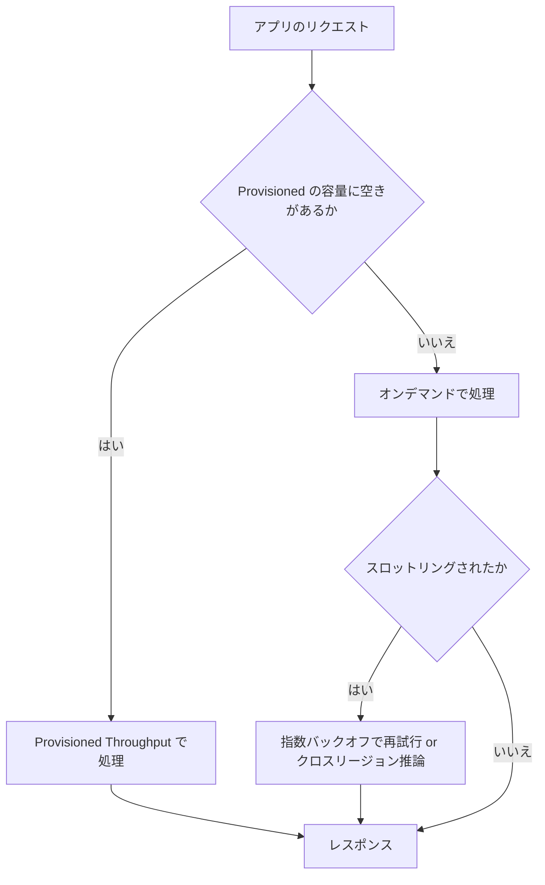

### 4-4. バッチ処理の使い分け

| 方式 | 使いどころ | 補足 |
|---|---|---|
| Bedrock バッチ推論 | 大量の文書要約、分類、評価データ生成など、数時間待てる処理 | 入力は S3 上の JSONL、結果は S3 に出力。対象モデルでオンデマンドより低価格で提供されることが多い (最新の料金を確認) |
| SQS + ワーカー | リアルタイムに近いが、スパイクを平準化したい処理 | キューの深さを見てワーカー数を調整 |
| Step Functions (Map) | 多数のアイテムを並列に処理し、同時実行数を制御 | 最大同時実行数でクォータを守る |

### 4-5. ベストプラクティス

| # | ベストプラクティス | 理由 |
|---|---|---|
| 1 | リアルタイムでない処理は **バッチ推論** に回す | コスト削減とクォータ競合の回避 |
| 2 | 容量計画は **トークン量** (リクエスト数ではなく) で行う | 制約は TPM であることが多い |
| 3 | ピーク値だけでなく、平均値と分布も見る | ピーク用に買いすぎない |
| 4 | Provisioned Throughput は **ベースライン分のみ** にし、超過をオンデマンドへ | 常時課金の無駄を減らす |
| 5 | スロットリング数と使用率を CloudWatch で継続監視 | 容量不足と過剰の両方を早期発見 |
| 6 | 開発、検証環境では Provisioned Throughput を常時確保しない | 不要な固定費を避ける |

### 4-6. 試験の狙われどころ

- 「夜間に大量の文書を安く処理」→ **バッチ推論**。
- 「負荷が安定して高く、性能を一定にしたい」→ **Provisioned Throughput**。
- 「スパイク時だけ 429 が出る」→ **クロスリージョン推論 / 再試行 / キューで平準化**。常時確保は過剰なことが多い。

出典: Amazon Bedrock Scaling and throughput best practices / Provisioned Throughput / Batch inference (Step 22 を参照)

---

## Step 5: Skill 4.1.4 インテリジェントなキャッシュ

> 公式 Skill: 不要な FM 呼び出しを避けてコスト削減と応答時間改善を実現するキャッシュを作る (セマンティックキャッシュ、結果のフィンガープリント、エッジキャッシュ、決定的リクエストハッシュ、プロンプトキャッシュ)。

### 5-1. キャッシュの 5 つの層

| 層 | しくみ | 効果 | 向いている場面 |
|---|---|---|---|
| エッジキャッシュ | CloudFront などで、同一の公開リクエストへの結果をエッジに保存 | FM 呼び出し自体と通信を省く | 全ユーザーに共通で、頻繁に同じ内容を返す API |
| 決定的リクエストハッシュ (完全一致) | プロンプトとパラメータを正規化してハッシュ化し、キーにして結果を保存 | FM 呼び出しを省く。高速で正確 | 同じ入力が繰り返される (定型質問、バッチ再実行) |
| セマンティックキャッシュ | 質問を埋め込みベクトルにし、類似度が閾値以上の過去質問の回答を返す | 言い換えにも対応して FM 呼び出しを省く | FAQ 的な問い合わせ。表現が揺れる |
| 結果フィンガープリント | 入力の指紋 (ハッシュ) と結果を対応付け、重複処理を検出 | 同じ文書や同じリクエストの再処理を避ける | 文書処理パイプラインの冪等性確保 |
| プロンプトキャッシュ (Bedrock の機能) | 長い共通プレフィックスの処理結果を再利用 | FM 呼び出しは行うが、**入力処理のコストと遅延を削減** | 長いシステムプロンプト、文書を前提にした連続質問 |

> **最重要の区別**: 上の 4 つは「FM を呼ばない」ためのキャッシュ。**プロンプトキャッシュは FM を呼ぶが、共通部分の処理を使い回す** キャッシュです。

### 5-2. プロンプトキャッシュの要点

| 項目 | 内容 |
|---|---|
| 目的 | 推論の応答遅延と入力トークンのコストを削減する |
| 仕組み | プロンプト内に **キャッシュチェックポイント** を設定し、そこまでの連続した部分 (プレフィックス) をキャッシュする |
| 課金 | キャッシュからの読み取りは割引料金。書き込み (キャッシュ作成) は通常入力より高い場合がある |
| 効果の目安 | AWS は、遅延を最大 85%、コストを最大 90% 削減できると説明している |
| TTL | 指定しない場合は 5 分が既定。モデルによって延長できる場合がある |
| 配置の原則 | **静的な内容を先頭に、動的な内容 (ユーザー固有情報、質問) を末尾に** 置く |
| 対応 | 対応モデルは限定的。Amazon Nova は自動で提供、Claude は簡素化された管理方式。クロスリージョン推論と併用できる |
| 注意 | モデルごとに最小トークン数やキャッシュ可能なフィールドの条件がある。ドキュメントで確認する |

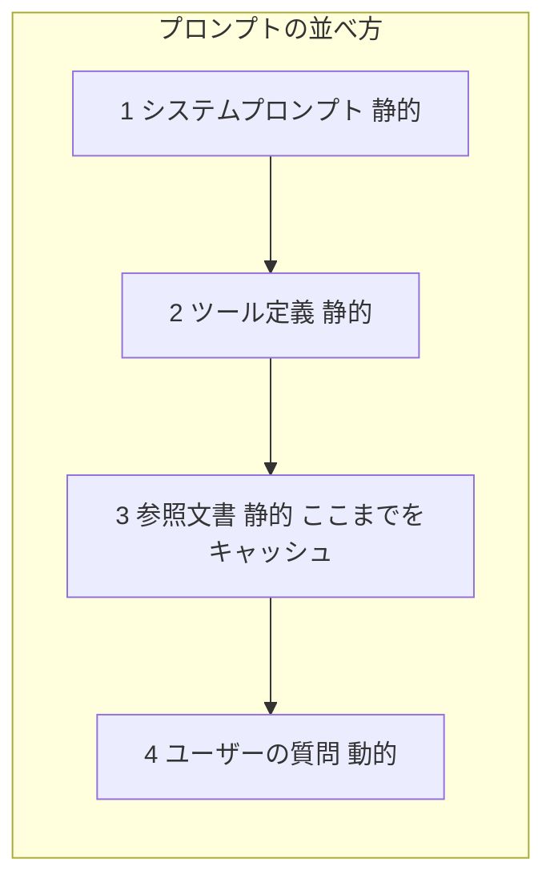

### 5-3. 多層キャッシュの検索フロー

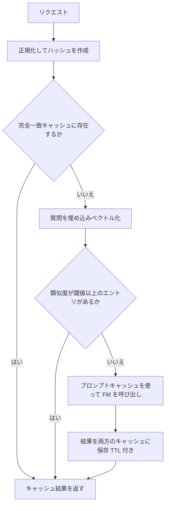

### 5-4. 実装に使うサービス

| 用途 | 候補サービス |
|---|---|
| 完全一致キャッシュ | Amazon DynamoDB (TTL 付き)、Amazon ElastiCache |
| セマンティックキャッシュ | ベクトル検索に対応した ElastiCache、Amazon MemoryDB、Amazon OpenSearch Service など |
| エッジキャッシュ | Amazon CloudFront、API Gateway のキャッシュ |
| プロンプトキャッシュ | Amazon Bedrock の機能 (対応モデルのみ) |

### 5-5. 決定的リクエストハッシュの設計

ハッシュのキーには、**回答に影響するすべての要素** を含めます。

| 含めるもの | 理由 |
|---|---|
| モデル ID とバージョン | モデルが変われば回答も変わる |
| 推論パラメータ (temperature、maxTokens など) | 出力が変わる |
| システムプロンプトのバージョン | プロンプト変更後に古い回答を返さないため |
| 正規化済みのユーザー入力 | 空白や大文字小文字の揺れを吸収する |
| テナント ID / 権限スコープ | **他ユーザーの情報が漏れるのを防ぐ** |
| 参照データのバージョン (RAG の場合) | 知識が更新されたら無効化する |

### 5-6. ベストプラクティス

| # | ベストプラクティス | 理由 |
|---|---|---|
| 1 | キャッシュキーにテナントや権限情報を含める | **データ漏えい防止** (最重要) |
| 2 | TTL を設定し、参照データやプロンプトの更新時に無効化する | 古い回答の提供を防ぐ |
| 3 | セマンティックキャッシュの類似度閾値は評価データで調整する | 低すぎると誤った回答を返し、高すぎるとヒット率が下がる |
| 4 | 個人情報を含む回答やパーソナライズ回答はキャッシュしない (または分離する) | プライバシー保護 |
| 5 | ヒット率、節約額、誤ヒットを監視する | キャッシュの費用対効果を確認する |
| 6 | 創造性や毎回異なる出力が必要な用途ではキャッシュしない | 多様性の要件と矛盾する |
| 7 | 長いプロンプトは **静的部分を先頭に** 置いてプロンプトキャッシュを使う | プレフィックス一致が条件 |

### 5-7. 試験の狙われどころ

- 「言い換えの質問でも同じ回答を再利用したい」→ **セマンティックキャッシュ**。
- 「完全に同じリクエストが繰り返される」→ **決定的ハッシュによる完全一致キャッシュ**。
- 「長いシステムプロンプトのコストと遅延を減らしたい」→ **プロンプトキャッシュ** (静的部分を先頭に)。
- 「全ユーザー共通の公開情報を世界中に低遅延で配信」→ **エッジキャッシュ (CloudFront)**。

出典: Amazon Bedrock Prompt caching / AWS Machine Learning Blog (Step 22 を参照)

---
# Task 4.2 アプリケーション性能の最適化

## Step 6: Skill 4.2.1 応答性の高い AI システム

> 公式 Skill: レイテンシとコストのトレードオフに対処し、FM を使ったユーザー体験を高める応答性の高い AI システムを作る (予測可能なクエリの事前計算、時間に敏感なアプリ向けの低レイテンシ Bedrock モデル、複雑なワークフロー向けの並列リクエスト、レスポンスストリーミング、性能ベンチマーク)。

### 6-1. レイテンシの内訳を知る

「遅い」と感じる原因は 1 つではありません。まず分解します。

| 区間 | 内容 | 主な改善手段 |
|---|---|---|
| ネットワーク / 認証 | クライアントから API までの往復 | リージョンの近接、接続の再利用、VPC エンドポイント |
| 前処理 | 検索、プロンプト組み立て、ガードレール | 検索の最適化、並列化 |
| TTFT | 最初のトークンが届くまで | 低レイテンシモデル、プロンプトキャッシュ、入力の短縮 |
| 生成 | 出力トークン数 × 1 トークンあたりの時間 | 出力の短縮、小型モデル |
| 後処理 | 整形、ログ、保存 | 非同期化 |

### 6-2. 5 つの手法

| 手法 | 説明 | 効果が出る場面 |
|---|---|---|
| 事前計算 (プリコンピュート) | よくある質問や定期レポートを **あらかじめ生成** して保存し、実行時は取り出すだけにする | 予測可能なクエリ。人気の質問、毎朝のサマリ |
| 低レイテンシモデルの選択 | 小型で高速なモデル、またはレイテンシ最適化推論 (`performanceConfig` で `optimized` を指定) を使う | 対話型、リアルタイム支援 |
| 並列リクエスト | 互いに依存しない複数の処理 (複数文書の要約、複数ツール呼び出し) を同時に実行 | 複雑なワークフロー |
| レスポンスストリーミング | 生成されたトークンを逐次クライアントへ流す | 体感速度の改善 (全体時間は変わらなくても) |
| 性能ベンチマーク | p50、p95、p99 と TTFT を継続計測し、変更の前後で比較 | 改善の効果確認、劣化の検知 |

> **ストリーミングの要点**: ストリーミングは「合計時間を短くする」のではなく、「最初の文字が出るまでを短くして **体感を改善する**」手法です。試験では「ユーザー体験を改善」の文脈で選ぶ手法です。

> **レイテンシ最適化推論の注意**: この機能は、対応するモデルやリージョンが限られ、仕様も更新されます (ドキュメントでは当面プレビュー扱いの記載があり、クォータを超えると標準レイテンシで処理され、標準料金で課金される旨が書かれています)。利用前に最新の対応表を確認してください。

### 6-3. ストリーミングの実装経路

| 経路 | 使いどころ |
|---|---|
| Bedrock の ConverseStream / InvokeModelWithResponseStream | モデルからの逐次受信 |
| Lambda のレスポンスストリーミング | サーバーレスでクライアントへ逐次返す |
| API Gateway の WebSocket API | 双方向のチャット UI |
| AWS AppSync のサブスクリプション | GraphQL ベースのリアルタイム更新 |

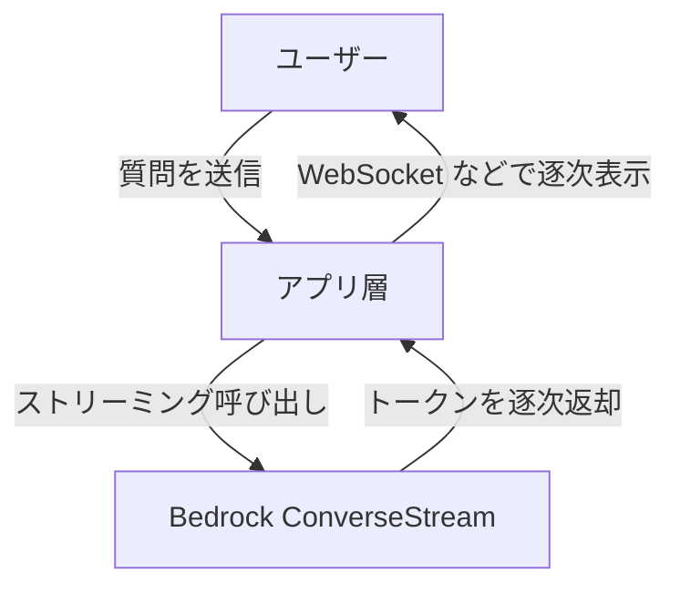

### 6-4. 並列化の例

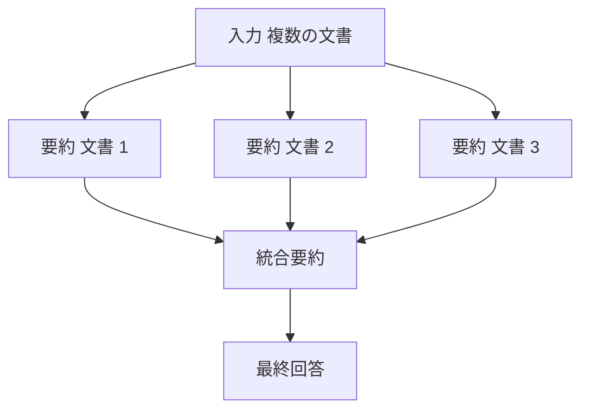

直列だと 3 回分の時間がかかりますが、並列なら最も遅い 1 回分 + 統合の時間で済みます。ただし **同時実行はクォータ (TPM、RPM) を消費する** ので、スロットリングに注意します (Step 8)。Step Functions の Parallel / Map 状態や、アプリ側の非同期処理で実装できます。

### 6-5. ベストプラクティス

| # | ベストプラクティス | 理由 |
|---|---|---|
| 1 | まず **計測して遅い区間を特定** してから対策を選ぶ | 当てずっぽうの最適化は効果が薄い |
| 2 | 対話 UI にはストリーミングを標準採用する | 体感速度が大きく改善する |
| 3 | 予測可能なクエリは事前計算して保存する | 実行時の FM 呼び出しをゼロにできる |
| 4 | 時間に敏感な処理は小型 / 低レイテンシモデルを選び、重い処理は別経路に分離する | 要件に合わせて使い分ける |
| 5 | 依存関係のない処理は並列化する | 全体の待ち時間を短縮 |
| 6 | 出力の長さを制限する | 生成時間は出力トークン数に比例する |
| 7 | レイテンシは平均ではなく **p95 / p99** で目標を決める | 遅い尾の部分がユーザー不満の原因 |

### 6-6. 試験の狙われどころ

- 「ユーザー体験を改善し、待ち時間の不満を減らしたい」→ **ストリーミング**。
- 「毎日同じ時間に同じ種類のレポート」→ **事前計算**。
- 「独立した複数の FM 呼び出しがあり全体が遅い」→ **並列化**。
- 「対話アプリで最速の応答が必要」→ **低レイテンシモデル / レイテンシ最適化**。

出典: Optimize model inference for latency / Amazon Bedrock ConverseStream (Step 22 を参照)

---

## Step 7: Skill 4.2.2 検索 (リトリーバル) 性能の向上

> 公式 Skill: FM のコンテキスト拡張のために、取得情報の関連性と速度を高める (インデックス最適化、クエリ前処理、カスタムスコアリングを使ったハイブリッド検索の実装)。

### 7-1. なぜ検索性能が重要か

RAG の回答品質は、**どの情報を FM に渡せたか** でほぼ決まります。検索が遅ければ全体も遅くなり、検索が外れれば幻覚の原因になります。

### 7-2. 検索パイプラインの全体像

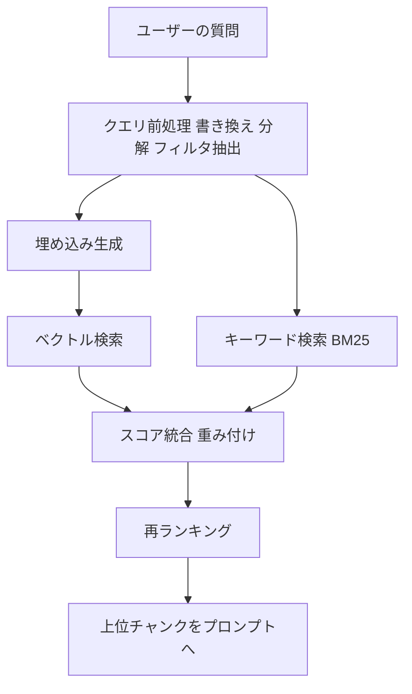

### 7-3. 3 つの改善領域

#### (1) インデックス最適化

| 項目 | 内容 | 効果 |
|---|---|---|
| チャンク戦略 | サイズ、オーバーラップ、構造 (見出し単位や意味単位) を評価で決める | 関連情報の取りこぼしと雑音の両方を減らす |
| ベクトル次元 | 次元数の小さい埋め込み設定を選ぶ (対応するモデルの場合) | ストレージとレイテンシを削減。精度とのトレードオフは評価で確認 |
| ANN パラメータ (HNSW など) | 検索時の探索幅や構築時のパラメータを調整する | 精度と速度のバランスを調整 |
| 量子化 | ベクトルを圧縮して保持する | メモリとコストを削減 (再現率への影響を評価) |
| メタデータとフィルタ | 属性 (部署、日付、文書種別) で候補を絞る | 検索範囲を狭めて高速化し、関連性も向上 |
| シャード / レプリカ設計 | データ量と検索負荷に合わせる | 検索スループットと可用性 |

#### (2) クエリ前処理

| 手法 | 内容 |
|---|---|
| クエリ書き換え | 曖昧な質問や会話の文脈依存表現を、単独で意味の通る検索クエリに直す |
| クエリ分解 | 複合的な質問を複数のサブクエリに分けて検索する |
| メタデータフィルタの抽出 | 「2025 年の」「営業部の」といった条件を、フィルタとして自動で取り出す |
| 正規化 | 表記揺れ、略語、不要語の整理 |

#### (3) ハイブリッド検索とカスタムスコアリング

| 検索方式 | 得意 | 苦手 |
|---|---|---|
| ベクトル (セマンティック) 検索 | 言い換え、意味の近さ | 固有名詞、型番、コード、正確な語句 |
| キーワード (語彙) 検索 | 固有名詞、型番、完全一致 | 言い換え、同義語 |
| **ハイブリッド** | 両方の長所を組み合わせる | スコアの統合設計が必要 |

ハイブリッド検索では、ベクトルとキーワードのスコアは **尺度が異なる** ため、正規化したうえで重み付けして統合します (これが「カスタムスコアリング」)。

- Amazon Bedrock Knowledge Bases の取得設定には、検索タイプを `HYBRID` または `SEMANTIC` に上書きする項目があります。**ハイブリッドは、フィルタ可能なテキストフィールドを持つ Amazon OpenSearch Serverless のベクトルストアで利用できる** と説明されています (他の構成では SEMANTIC のみ)。
- 取得結果には **リランカーモデルによる再ランキング** を設定できます。
- 取得件数 (`numberOfResults`) も調整項目です。
- 自分で OpenSearch を運用する場合は、ハイブリッドクエリと検索パイプラインの正規化処理 (最小最大正規化など) や重み設定で、キーワードとベクトルの比率を調整できます。

### 7-4. ベストプラクティス

| # | ベストプラクティス | 理由 |
|---|---|---|
| 1 | 型番、固有名詞、略語が多い文書では **ハイブリッド検索** を使う | ベクトル検索だけでは外しやすい |
| 2 | 検索後に **再ランキング** して上位だけを FM に渡す | 精度向上とトークン削減を同時に達成 |
| 3 | メタデータでフィルタし、検索範囲を絞る | 速度と関連性の向上、アクセス制御にも有効 |
| 4 | 検索の評価指標 (再現率、適合率、順位指標) を定義して測る | 改善効果を数値で確認 |
| 5 | チャンクサイズは文書種別ごとに実験で決める | 万能な値はない |
| 6 | 埋め込みモデルを変えたら **再インデックス** する | 異なるモデルのベクトルは比較できない |
| 7 | 検索の遅延と品質の両方を監視する | 片方だけでは劣化に気づけない |

### 7-5. 試験の狙われどころ

- 「製品型番や固有名詞の検索精度が低い」→ **ハイブリッド検索 (キーワード + ベクトル)**。
- 「検索結果の順位を改善したい」→ **再ランキング**。
- 「曖昧な質問で取得が外れる」→ **クエリ書き換え / 分解**。
- 「検索が遅い」→ **インデックス最適化 (メタデータフィルタ、量子化、パラメータ調整、シャード設計)**。

出典: Amazon Bedrock Knowledge Bases の取得設定 API リファレンス / Amazon OpenSearch Service ハイブリッド検索 (Step 22 を参照)

---

## Step 8: Skill 4.2.3 FM スループットの最適化

> 公式 Skill: GenAI ワークロード特有のスループット課題に対処する (トークン処理の最適化、バッチ推論戦略、同時モデル呼び出しの管理)。

### 8-1. GenAI 特有のスループット課題

従来の API と違い、GenAI の呼び出しは「**1 件ごとの重さ (トークン数) が大きく不均一**」で「**処理時間が長い**」ため、リクエスト数だけでなくトークン量で制限されます。

| 課題 | 原因 | 対策 |
|---|---|---|
| スロットリング (HTTP 429) | RPM または TPM のクォータ超過 | 再試行、キュー、クロスリージョン推論、クォータ引き上げ、Provisioned Throughput |
| 長い処理時間による同時実行の枯渇 | 生成に数秒から数十秒かかる | 同時実行数の制御、非同期化 |
| 突発的なスパイク | 業務の山、イベント | キューで平準化、事前スケール |
| クォータの無駄な消費 | `maxTokens` が過大、不要な再試行 | `maxTokens` の適正化、冪等な再試行 |

### 8-2. 3 つの最適化領域

| 領域 | 内容 |
|---|---|
| トークン処理の最適化 | 入力と出力のトークンを減らす (Step 2)、キャッシュを使う (Step 5)、`maxTokens` を現実的な値にする |
| バッチ推論戦略 | 急がない処理を Bedrock のバッチ推論や SQS と組み合わせて処理 (Step 4) |
| 同時呼び出しの管理 | セマフォなどで同時数を上限化し、バックオフ付き再試行、キューによる平準化、クロスリージョン推論 |

> Bedrock のスケーリングとスループットのドキュメントでは、**bedrock-runtime エンドポイントではモデルが対応していればクロスリージョン推論を使い、予測可能で持続的な負荷には Provisioned Throughput を検討する** ことが推奨されています。

### 8-3. スロットリング対策のフロー

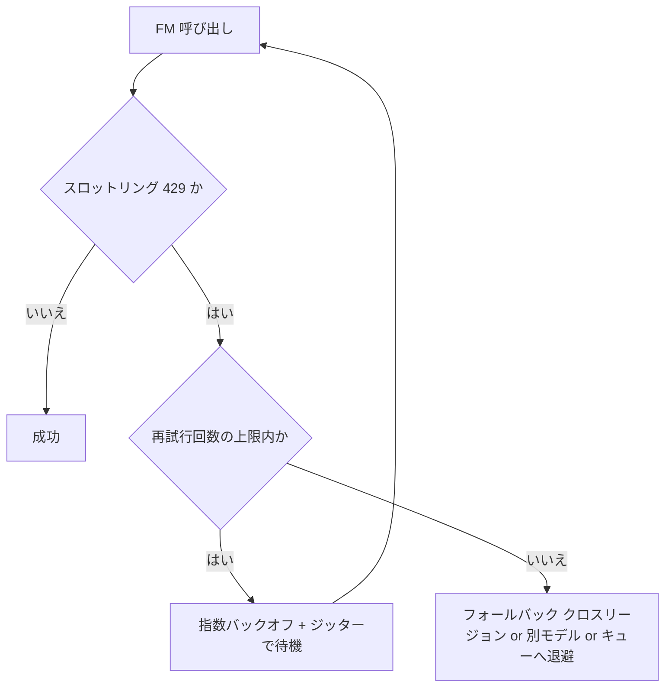

**ジッター (ランダムな揺らぎ)** を加える理由: 多数のクライアントが同じタイミングで再試行すると、再び同時にぶつかるためです。

### 8-4. 同時実行管理のパターン

| パターン | しくみ | 適する場面 |
|---|---|---|
| アプリ内セマフォ | 同時に実行する FM 呼び出し数を上限化 | 1 プロセス内の並列処理 |
| SQS + Lambda (最大同時実行数の設定) | キューで受け、消費側の並列数でクォータを守る | 非同期処理、スパイク吸収 |
| Step Functions Map の最大同時実行数 | 大量アイテムの並列度を制御 | バッチ的処理 |
| クロスリージョン推論プロファイル | 複数リージョンに分散して容量を確保 | ピーク時の 429 対策 |

### 8-5. ベストプラクティス

| # | ベストプラクティス | 理由 |
|---|---|---|
| 1 | 429 には **指数バックオフ + ジッター** で再試行する | 同時衝突を避ける |
| 2 | 同時実行数に上限を設けて、クォータ内に収める | 自分で自分を詰まらせない |
| 3 | `maxTokens` を必要最小限に設定する | クォータの予約消費を抑えられる (モデルの仕様を確認) |
| 4 | スロットリング数を CloudWatch で監視し、アラームを設定 | 容量不足の早期検知 |
| 5 | 非リアルタイム処理はバッチ推論に移す | オンデマンドのクォータをリアルタイム用に残せる |
| 6 | 恒常的な不足にはクォータ引き上げ申請か Provisioned Throughput | 再試行だけでは根本解決にならない |
| 7 | 冪等性を確保して再試行による二重処理を防ぐ | 重複課金や重複実行の回避 |

### 8-6. 試験の狙われどころ

- 「ピーク時に ThrottlingException が出る」→ **指数バックオフ、クロスリージョン推論、キューによる平準化** (まず低コストな対策)。恒常的なら Provisioned Throughput。
- 「数万件の文書を一括処理」→ **バッチ推論**。
- 「同時実行を制御してクォータ内に収めたい」→ **SQS + Lambda の同時実行上限 / Step Functions Map の同時実行数**。

出典: Amazon Bedrock Scaling and throughput best practices / 実務解説記事 (Step 22 を参照)

---

## Step 9: Skill 4.2.4 FM 性能の調整 (パラメータと A/B テスト)

> 公式 Skill: 特定のユースケースで最適な結果を出すために FM の性能を高める (モデル固有のパラメータ設定、改善を評価する A/B テスト、要件に基づく temperature と top-k / top-p の選択)。

### 9-1. 主要な推論パラメータ

| パラメータ | 働き | 値を下げると | 値を上げると |
|---|---|---|---|
| temperature | 出力のランダム性 | 決定的で一貫した出力 | 多様で創造的な出力 (ばらつきも増える) |
| top-p (nucleus) | 累積確率が p に達するまでの候補から選ぶ | 候補が絞られ安定 | 候補が広がり多様 |
| top-k | 確率上位 k 個の候補から選ぶ | 候補が絞られ安定 | 候補が広がり多様 |
| maxTokens | 出力の最大長 | 短く切れる (途中で終わることも) | 長い出力を許容 (コスト増) |
| stopSequences | 指定の文字列で生成を停止 | - | - |

> top-k は **モデル固有** の項目で、Converse API では共通の `inferenceConfig` ではなく、モデル固有の追加フィールドで渡す場合があります。モデルごとのパラメータ仕様を確認する必要があります (これが「モデル固有のパラメータ設定」の意味です)。

### 9-2. 用途別の設定の考え方

| 用途 | 方向性 | 理由 |
|---|---|---|
| 事実ベースの Q&A、RAG 回答 | temperature を低く | 一貫性と正確性を優先し、幻覚を抑える |
| 抽出、分類、構造化出力 (JSON) | temperature を低く (ほぼ 0) | 形式の安定が重要 |
| コード生成 | 低めから中程度 | 正確さが重要だが、解の探索も必要な場合あり |
| ブレインストーミング、コピー案 | temperature を高めに | 多様性が価値になる |
| 要約 | 低めから中程度 | 忠実さを保つ |

> **原則**: temperature と top-p の **両方を同時に大きく変えない**。1 つずつ変えて効果を確認します (多くのモデルのガイダンスで、どちらか一方の調整が推奨されています)。

### 9-3. A/B テストの進め方

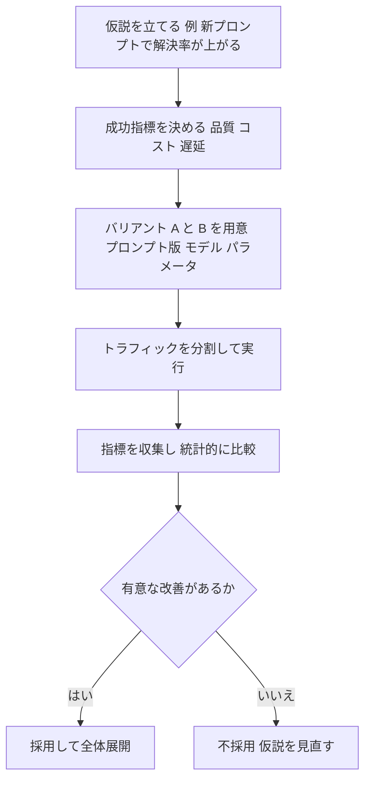

| 実装要素 | 候補 |
|---|---|
| プロンプトのバージョン管理 | Amazon Bedrock Prompt Management (バージョン) |
| トラフィック分割 | アプリ側の振り分け、AWS AppConfig の機能フラグ、API Gateway / Lambda のエイリアスによる重み付け |
| オフライン評価 | Amazon Bedrock の評価機能 (モデル評価、RAG 評価)、ゴールデンデータセット |
| オンライン指標 | CloudWatch カスタムメトリクス (ユーザーフィードバック、解決率、遅延、コスト) |

### 9-4. ベストプラクティス

| # | ベストプラクティス | 理由 |
|---|---|---|
| 1 | **1 回に 1 つの変数** だけを変えて比較する | 効果の原因を特定できる |
| 2 | 先に **成功指標とガードレール指標** (品質が落ちていないか) を定義する | 後付けの解釈を避ける |
| 3 | 十分なサンプル数で比較し、偶然の差を見分ける | 少数の結果で判断しない |
| 4 | プロンプトとパラメータをバージョン管理し、結果と紐づけて記録する | 再現性と巻き戻しが可能 |
| 5 | まずオフライン (ゴールデンデータセット) で絞り、有望なものだけオンライン A/B に進める | 本番ユーザーへの影響を最小化 |
| 6 | モデル更新時は、同じ評価セットで回帰テストをする | 新モデルでの品質低下を検知 |

### 9-5. 試験の狙われどころ

- 「事実に基づく一貫した回答」→ **temperature を低く**。
- 「より創造的な案がほしい」→ **temperature を高めに**。
- 「改善が本当に効果あるか確かめたい」→ **A/B テスト (指標を定義し、トラフィックを分割)**。
- 「プロンプトの版を管理し比較」→ **Bedrock Prompt Management**。

出典: Amazon Bedrock Inference parameters / Prompt Management / Evaluations (Step 22 を参照)

---

## Step 10: Skill 4.2.5 FM ワークロード向けリソース配分

> 公式 Skill: FM ワークロードに特化した効率的なリソース配分システムを作る (トークン処理要件に基づく容量計画、プロンプトと補完のパターンの使用率モニタリング、GenAI のトラフィックパターンに最適化したオートスケーリング)。

### 10-1. 従来のスケーリングとの違い

| 観点 | 従来の Web アプリ | GenAI アプリ |
|---|---|---|
| 負荷の単位 | リクエスト数、CPU | **トークン量**、同時生成数 |
| 1 件の処理時間 | ミリ秒から数百ミリ秒 | 数秒から数十秒 (ストリーミング接続が長く続く) |
| ボトルネック | アプリの CPU やメモリ | **FM のクォータ**、外部呼び出しの待ち |
| スケール指標 | CPU 使用率 | **キュー長、同時実行数、トークン消費率** |

> アプリ側は「FM の応答待ち」で止まっていることが多く、CPU 使用率はほとんど上がりません。そのため **CPU ベースのオートスケーリングは効きにくい** のがポイントです。

### 10-2. 容量計画: トークン処理量から逆算する

| 手順 | 内容 |
|---|---|
| 1 | 機能ごとに、平均入力トークンと平均出力トークンを実測する |
| 2 | ピーク時の毎分リクエスト数を見積もる |
| 3 | 機能ごとのピーク TPM を合算する |
| 4 | クォータ、Provisioned Throughput、クロスリージョン推論のどれで賄うか決める |
| 5 | 余裕度 (ヘッドルーム) を持たせ、成長を見込んで定期的に見直す |

### 10-3. 使用率モニタリング: プロンプトと補完のパターン

| 観察する指標 | わかること | 打つ手 |
|---|---|---|
| 入力トークン対出力トークンの比 | 入力過多 (長い文脈) か 出力過多 (冗長) か | 入力過多なら剪定とキャッシュ、出力過多なら制限 |
| 機能別、テナント別のトークン消費 | コストとクォータを使っている主体 | 配分の調整、課金や上限の設定 |
| 時間帯別の分布 | ピークと谷 | スケジュールスケーリング、バッチの時間帯移動 |
| スロットリング率 | 容量不足の兆候 | 容量追加、平準化 |

### 10-4. GenAI のトラフィックに合うスケーリング構成

| 構成要素 | スケーリング方法 |
|---|---|
| Lambda | 同時実行数の予約 / 上限で FM クォータを守る。長い処理はタイムアウトに注意 |
| ECS / Fargate | キュー長や同時接続数などの **カスタムメトリクス** でスケール (ターゲット追跡) |
| SQS + ワーカー | キューの深さ (処理待ち件数) に比例してワーカーを増減 |
| Bedrock (オンデマンド) | アプリ側ではなく、クォータと推論プロファイルで管理 |
| Provisioned Throughput | モデルユニット数で容量を調整 (すぐに増減できない前提で計画) |
| 自己ホスト (SageMaker AI のエンドポイントなど) | Application Auto Scaling で、同時リクエスト数などの指標でスケール |

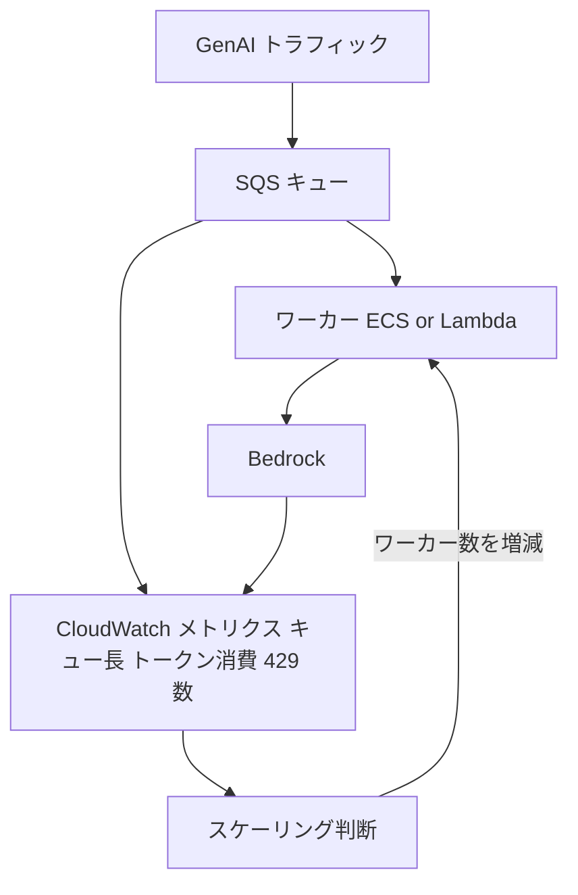

### 10-5. ベストプラクティス

| # | ベストプラクティス | 理由 |
|---|---|---|
| 1 | スケール指標を **キュー長や同時実行数** にする (CPU 一辺倒にしない) | FM 待ちでは CPU が上がらない |
| 2 | ワーカーの増加が **FM のクォータを超えない** ように上限を設ける | スケールアウトが 429 を悪化させる |
| 3 | 需要の予測できる山には **スケジュールスケーリング** を使う | スパイクに事前対応できる |
| 4 | 容量計画を定期的に見直す (機能追加、プロンプト長の変化) | 平均トークン数は変わりやすい |
| 5 | 非同期化できる処理は非同期化する | 同時接続数とタイムアウトの問題を緩和 |
| 6 | 機能別のトークン配分や上限 (クォータ分配) を設計する | 1 機能が全体の容量を食いつぶさない |

### 10-6. 試験の狙われどころ

- 「GenAI アプリのオートスケーリング」→ **CPU ではなく、キュー長 / 同時実行数 / カスタムメトリクス** が正解の方向。
- 「ワーカーを増やしたら 429 が増えた」→ **FM クォータを考慮した上限設定**。
- 「毎朝 9 時にスパイク」→ **スケジュールスケーリング / 事前確保**。

出典: Amazon Bedrock Scaling and throughput best practices / Application Auto Scaling (Step 22 を参照)

---

## Step 11: Skill 4.2.6 GenAI ワークフロー全体の最適化

> 公式 Skill: GenAI ワークフロー全体で FM システムの性能を最適化する (プロンプトと補完パターンの API 呼び出しプロファイリング、検索拡張のためのベクトルデータベースのクエリ最適化、LLM 推論特有のレイテンシ削減技術、効率的なサービス間通信パターン)。

### 11-1. 部分最適から全体最適へ

ここまでは個々の手法でしたが、実際のアプリは「**認証 → ガードレール → 検索 → プロンプト生成 → FM → 後処理 → 保存**」という複数ステップの連鎖です。全体の時間とコストは **最も遅いステップ** と **ステップ間の無駄** で決まります。

### 11-2. 4 つの観点

| 観点 | やること | ツールや手法 |
|---|---|---|
| API 呼び出しのプロファイリング | 各呼び出しの所要時間、入力と出力のトークン数、エラーを計測する | AWS X-Ray や OpenTelemetry (ADOT) のスパン、CloudWatch の GenAI 可観測性 |
| ベクトル DB のクエリ最適化 | 検索の遅延を分析し、フィルタ、インデックス設定、取得件数を調整する | OpenSearch のスロークエリ分析、Step 7 の手法 |
| LLM 推論特有のレイテンシ削減 | 出力短縮、プロンプトキャッシュ、小型モデル、ストリーミング、不要な連鎖の削除 | Step 5 と Step 6 の手法 |
| サービス間通信の効率化 | 呼び出し回数と待ちを減らす | 下表 |

### 11-3. サービス間通信の最適化

| 課題 | 改善 |
|---|---|
| ステップが直列で遅い | 依存関係のない処理は並列化 (Step Functions の Parallel など) |
| 小さな呼び出しを大量に行う (おしゃべりな通信) | まとめて 1 回で処理する、バッチ化する |
| 接続のたびに確立し直す | SDK クライアントを再利用し、接続を維持する |
| 同期で待つ必要のない処理 | EventBridge や SQS で **非同期化** (ログ、保存、通知) |
| 不要なネットワーク経路 | VPC エンドポイント (PrivateLink) でインターネット経由を避ける。リージョンを近接させる |
| ペイロードが大きい | 必要な情報だけを渡し、大きなデータは S3 参照にする |

### 11-4. 最適化前後のイメージ

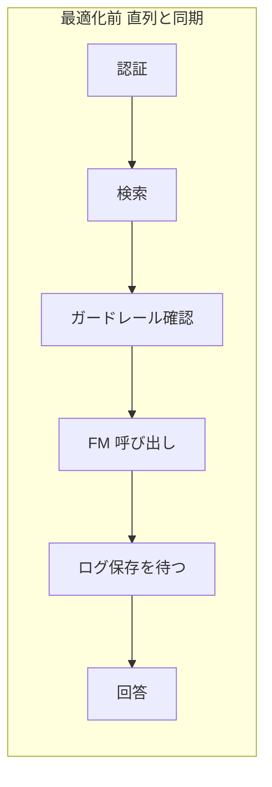

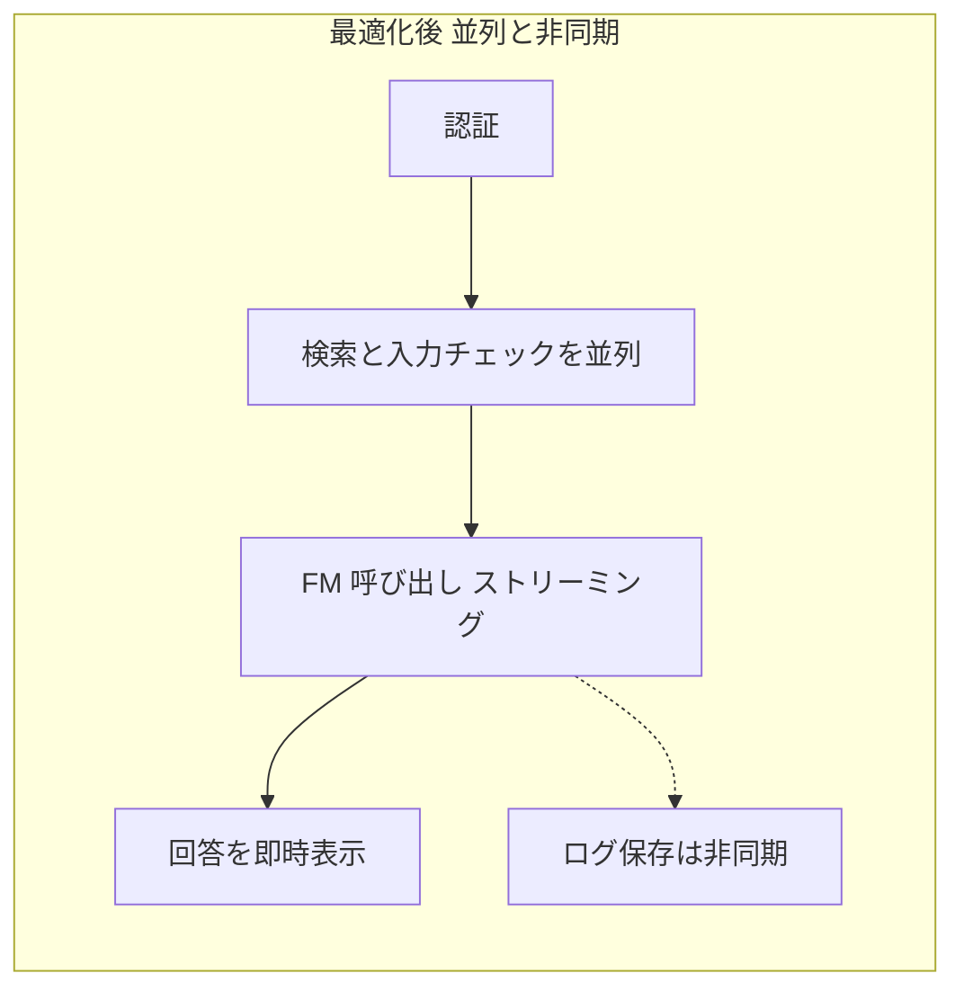

### 11-5. 改善の進め方 (プロファイル → 仮説 → 検証)

| 手順 | 内容 |
|---|---|
| 1 | トレースで全体の時間内訳を可視化する |
| 2 | もっとも時間かコストを使っているステップを特定する |
| 3 | そのステップに対応する手法を選ぶ (表 11-2) |
| 4 | 変更前後を **同じ条件のベンチマーク** で比較する |
| 5 | 品質が落ちていないかゴールデンデータセットで確認する |

### 11-6. ベストプラクティス

| # | ベストプラクティス | 理由 |
|---|---|---|
| 1 | 各ステップにトレース ID を通し、**エンドツーエンドで計測** する | 部分的な計測では真のボトルネックが見えない |
| 2 | 最適化は **ボトルネックから** 着手する | 速いところを磨いても全体は速くならない |
| 3 | 同期が必須でない処理は非同期にする | ユーザーの待ち時間を減らす |
| 4 | SDK クライアントは再利用する | 接続確立のオーバーヘッドを減らす |
| 5 | 不要な LLM 呼び出し (連鎖の中の冗長な呼び出し) を削る | 遅延とコストの両方を削減 |
| 6 | 変更のたびに品質評価を回す | 速くなったが精度が落ちた、を防ぐ |

### 11-7. 試験の狙われどころ

- 「どのステップが遅いのか分からない」→ **分散トレーシング (X-Ray / OpenTelemetry) によるプロファイリング**。
- 「複数の独立した呼び出しで遅い」→ **並列化**。
- 「ログ保存で応答が遅れる」→ **非同期化**。

出典: CloudWatch Generative AI observability / AWS X-Ray / AWS Step Functions (Step 22 を参照)

---
# Task 4.3 GenAI アプリのモニタリング

## Step 12: Skill 4.3.1 包括的なオブザーバビリティ

> 公式 Skill: FM アプリケーション性能の全体を見渡せる、包括的なオブザーバビリティシステムを作る (運用メトリクス、性能トレーシング、FM とのやり取りのトレーシング、カスタムダッシュボードによるビジネス影響メトリクス)。

### 12-1. 「モニタリング」と「オブザーバビリティ」

| 用語 | 意味 | 例 |
|---|---|---|
| モニタリング | **事前に決めた指標** を見て、異常を検知する | 「エラー率が 5% を超えたら通知」 |
| オブザーバビリティ | 出力 (メトリクス、ログ、トレース) から **未知の問題の原因を調べられる** 状態 | 「なぜこの回答だけ遅かったのか」をトレースで追う |

### 12-2. GenAI アプリで見る 4 つの層

| 層 | 見るもの | 代表的な手段 |
|---|---|---|
| 運用メトリクス | 呼び出し数、レイテンシ、エラー、スロットリング、トークン数 | Amazon CloudWatch の Bedrock メトリクス |
| 性能トレーシング | リクエスト全体の流れと、各ステップの所要時間 | AWS X-Ray、OpenTelemetry (ADOT)、CloudWatch の GenAI 可観測性 |
| FM とのやり取りのトレーシング | プロンプト、応答、検索結果、ツール呼び出し、推論ステップ | モデル呼び出しログ、エージェントのトレース、AgentCore の可観測性 |
| ビジネス影響メトリクス | 解決率、コンバージョン、コスト / 会話、ユーザー満足度、オペレーター削減 | カスタムメトリクスとダッシュボード |

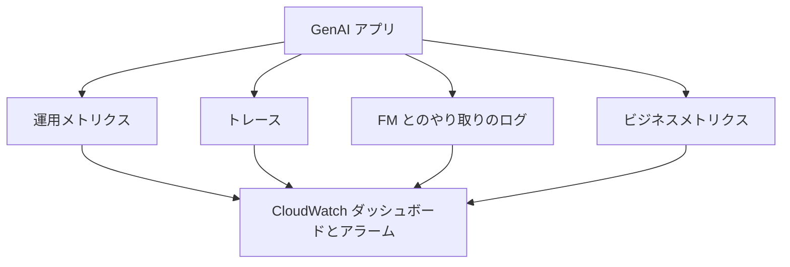

### 12-3. Amazon CloudWatch の GenAI 可観測性

AWS 公式ドキュメントでは、CloudWatch の **生成 AI 可観測性** について次のように説明されています。

| 項目 | 内容 |
|---|---|
| 対象 | Amazon Bedrock AgentCore のエージェントを含む生成 AI ワークロード |
| 提供する画面 | レイテンシ、使用量、エラーの事前構成ビュー |
| トレーシング | ナレッジベース、ツール、モデルなどのコンポーネントをまたぐ **エンドツーエンドのプロンプトトレース** |
| フレームワーク | Strands Agents、LangChain、LangGraph などと互換 |
| 組み込みの機能 | モデル呼び出しダッシュボード (Bedrock の任意のモデルで利用可)、AgentCore エージェントのダッシュボード |
| 料金 | この機能自体の追加料金はなく、収集したテレメトリの既存の CloudWatch 料金が適用 |
| 前提設定 | AgentCore のトレースやスパンを見るには、CloudWatch の Transaction Search の有効化が必要。エージェントのコードには ADOT SDK を追加する |

### 12-4. ビジネス影響メトリクスの例

技術指標だけでは「投資に見合うか」を説明できません。次のような **ビジネス指標をカスタムメトリクス化** します。

| ビジネス指標 | 計測方法の例 |
|---|---|
| 一次解決率 (問い合わせ解決率) | 「解決した」ボタンや、人への引き継ぎがなかった割合 |
| 1 会話あたりのコスト | トークンコスト ÷ 会話数 |
| 平均処理時間 | 従来手順との比較 |
| ユーザー満足度 | 評価ボタン、アンケート |
| 業務時間の削減 | 作業時間の前後比較 |

### 12-5. ベストプラクティス

| # | ベストプラクティス | 理由 |
|---|---|---|
| 1 | 4 つの層すべてを計装する | 1 層だけでは原因を追えない |
| 2 | **相関 ID** (リクエスト ID、セッション ID) をすべてのログとトレースに通す | 1 件の回答を、検索、プロンプト、FM、後処理まで追跡できる |
| 3 | 技術指標とビジネス指標を **同じダッシュボード** に並べる | 劣化の影響を事業視点で判断できる |
| 4 | 構造化ログ (JSON) で出力する | Logs Insights で検索と集計がしやすい |
| 5 | しきい値アラームと、**異常検知アラーム** を併用する | 固定しきい値で拾えない変化も拾える |
| 6 | ログには機密情報が入ることを前提に、暗号化とマスキングを設計する | プロンプトや応答に個人情報が含まれうる |

### 12-6. 試験の狙われどころ

- 「エージェントの各ステップ (検索、ツール、モデル) を横断して追いたい」→ **エンドツーエンドのトレース (CloudWatch GenAI 可観測性 / AgentCore 可観測性 / X-Ray / OpenTelemetry)**。
- 「事業への影響を経営層に示したい」→ **ビジネス影響メトリクスをカスタムダッシュボードで可視化**。

出典: CloudWatch Generative AI observability / AgentCore observability / What's New (Step 22 を参照)

---

## Step 13: Skill 4.3.2 GenAI 固有のモニタリング

> 公式 Skill: FM 実装に固有の問題を先回りして見つけ、KPI を評価する、包括的な GenAI モニタリングを実装する (CloudWatch によるトークン使用量、プロンプトの有効性、幻覚率、応答品質の追跡。トークンバーストと応答ドリフトの異常検知。リクエストとレスポンスの詳細分析のための Bedrock モデル呼び出しログ。性能ベンチマーク。コスト異常検知)。

### 13-1. Bedrock が自動で出すメトリクス

Bedrock (bedrock-runtime) は、CloudWatch の **AWS/Bedrock 名前空間** にメトリクスを出力します。AWS のドキュメントでは、呼び出し量、レイテンシ、トークン消費、エラー率、モデル呼び出しログの配信状況の監視に使うと説明されています。**追加設定なしで** モデル ID ごとに取得できます。

| 代表的なメトリクス | 意味 | 使い方 |
|---|---|---|
| Invocations | 呼び出し数 | 需要の把握 |
| InvocationLatency | 呼び出しの遅延 | 性能劣化の検知 (p95 / p99 で見る) |
| InputTokenCount / OutputTokenCount | 入出力トークン数 | コストの監視、トークンバーストの検知 |
| クライアントエラー / サーバーエラー / スロットリング | エラー系の指標 | 障害と容量不足の検知 |

> 最新のメトリクス一覧 (最初のトークンまでの時間など、新しく追加されうるもの) は、公式の「Monitor bedrock-runtime inference using CloudWatch metrics」で確認してください。

### 13-2. 「Bedrock のメトリクスでは見えないもの」を自前で測る

標準メトリクスは **インフラ視点** です。GenAI 固有の次の指標は、自分で計測してカスタムメトリクス化します。

| 指標 | 計測方法の例 |
|---|---|
| プロンプトの有効性 | プロンプトのバージョン別に、評価スコア、成功率、再質問率を比較する |
| 幻覚率 | 根拠チェック (Bedrock Guardrails の contextual grounding check など) や、LLM を審判にした自動評価、ゴールデンデータセットでの検証 |
| 応答品質 | LLM-as-a-judge の評価スコア、ユーザーフィードバック (高評価 / 低評価) |
| 応答の長さ、拒否率 | 応答トークン数の分布、「答えられません」の割合 |

### 13-3. 異常検知

| 対象 | 異常の例 | 手段 |
|---|---|---|
| トークンバースト | 特定ユーザー、暴走ループ、プロンプトインジェクションで入出力トークンが急増 | CloudWatch の **異常検知アラーム** (過去パターンから期待バンドを学習) |
| 応答ドリフト | 応答の長さ、品質スコア、拒否率の分布が時間とともに変わる | 品質メトリクスの異常検知、定期的なゴールデンデータセット評価 |
| コスト異常 | 予想外の請求増 | AWS Cost Anomaly Detection、AWS Budgets、コスト配分タグ (推論プロファイルへのタグ付けなど) |

### 13-4. モデル呼び出しログ (Model Invocation Logs)

| 項目 | 内容 |
|---|---|
| 目的 | リクエストとレスポンスの **本文を含む** 詳細な記録を残し、分析、監査、デバッグに使う |
| 出力先 | Amazon S3 と CloudWatch Logs (どちらか、または両方) |
| 初期状態 | **有効化が必要** (自動では記録されない) |
| 分析 | CloudWatch Logs Insights、Amazon Athena (S3 の場合) |
| 記録される例 | 入力、出力、使用トークン数、モデル ID、リクエスト ID など |
| 注意 | 本文に個人情報や機密が含まれうる。**暗号化 (KMS)、アクセス制御、保持期間、マスキング** を設計する |

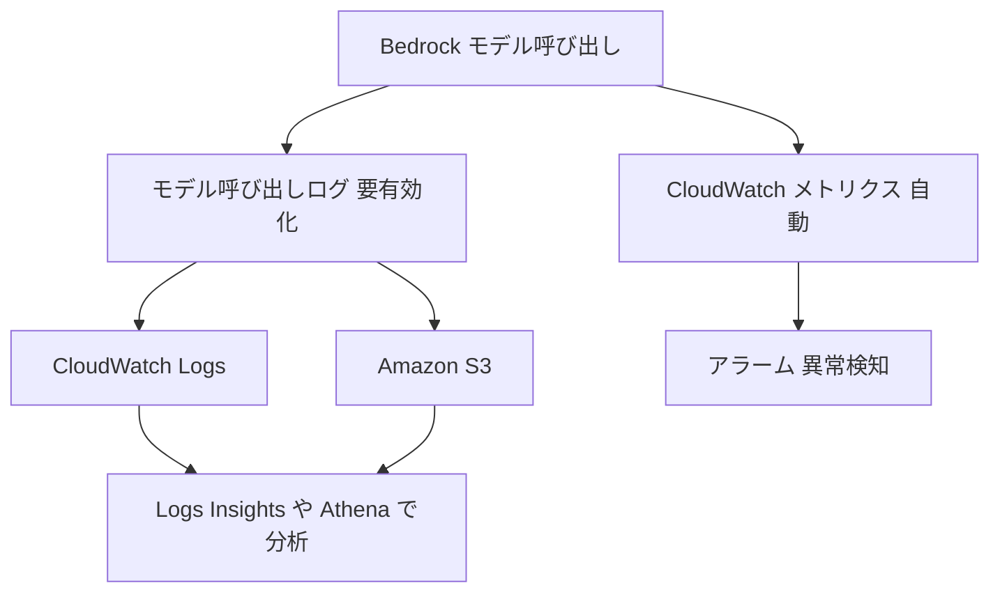

### 13-5. ベストプラクティス

| # | ベストプラクティス | 理由 |
|---|---|---|
| 1 | モデル呼び出しログを **本番で有効化** し、保存先、保持期間、暗号化を決める | 事後調査と監査に必要 |
| 2 | 入力と出力のトークン数に **異常検知アラーム** を設定する | 暴走やコスト急増を早く検知 |
| 3 | 品質指標 (幻覚、満足度) を **継続評価** し、メトリクス化する | インフラ指標だけでは品質劣化に気づけない |
| 4 | プロンプトのバージョンと品質メトリクスを紐づける | どの変更が影響したか特定できる |
| 5 | ベンチマーク (ゴールデンデータセット) を定期実行し、ドリフトを検出 | モデル更新やデータ変化への備え |
| 6 | コストは AWS Cost Anomaly Detection と Budgets で別系統でも監視 | CloudWatch とは違う視点の保険 |
| 7 | ログ内の機密情報を CloudWatch Logs のデータ保護機能などでマスキングする | 個人情報の流出リスク低減 |

### 13-6. 試験の狙われどころ

- 「プロンプトと応答の中身まで詳細に分析したい」→ **モデル呼び出しログ** (有効化が必要)。
- 「トークン使用量の急増を自動で検知」→ **CloudWatch 異常検知アラーム**。
- 「幻覚率の追跡」→ **根拠チェック、LLM-as-a-judge、ゴールデンデータセットをカスタムメトリクス化**。
- 「想定外のコスト増を検知」→ **Cost Anomaly Detection**。

出典: Monitor bedrock-runtime inference using CloudWatch metrics / Model invocation logging / Cost Anomaly Detection (Step 22 を参照)

---

## Step 14: Skill 4.3.3 統合オブザーバビリティと監査

> 公式 Skill: FM アプリケーションに対して実用的なインサイトを提供する統合オブザーバビリティを開発する (運用メトリクスのダッシュボード、ビジネス影響の可視化、コンプライアンス監視、フォレンジックの追跡可能性と監査ログ、ユーザーインタラクションの追跡、モデル挙動パターンの追跡)。

### 14-1. 「見える」から「使える」へ

Step 12 と 13 で集めたデータを **目的別に統合** して、意思決定に使える形にします。

| 目的 | 見る人 | 見せ方 |
|---|---|---|
| 運用の健全性 | SRE、開発者 | 運用メトリクスのダッシュボード (レイテンシ、エラー、トークン、スロットリング) |
| 事業への影響 | 事業責任者 | ビジネス影響の可視化 (解決率、コスト / 会話、満足度) |
| コンプライアンス | セキュリティ、法務、監査 | ガードレールの介入数、ポリシー違反の傾向、アクセス監査 |
| 事後の追跡 | 調査担当 | フォレンジック: 誰が、いつ、何を入力し、何が出力されたか |
| 利用状況 | プロダクト担当 | ユーザーの操作、フィードバック、利用パターン |
| モデル挙動 | ML / AI 担当 | 応答パターンの変化、拒否率、ツール選択傾向 |

### 14-2. 「誰が何をしたか」と「中身は何か」は別のログ

| 問い | 主な情報源 |
|---|---|
| 誰が、いつ、どの API を呼んだか (操作の監査) | AWS CloudTrail |
| 入力と出力の中身は何か | Bedrock モデル呼び出しログ、アプリのログ |
| 設定が規定どおりか | AWS Config |
| どの回答がどのユーザー、どのセッションで発生したか | 相関 ID (リクエスト ID、セッション ID) をアプリのログに記録 |
| ガードレールが何を止めたか | Bedrock Guardrails のメトリクスと介入ログ |

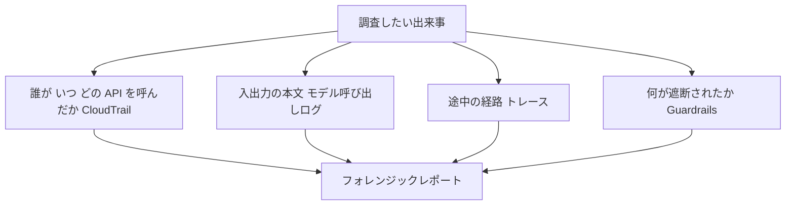

### 14-3. ベストプラクティス

| # | ベストプラクティス | 理由 |
|---|---|---|
| 1 | ダッシュボードを **対象者別** に分ける (運用用、事業用、監査用) | 見る人ごとに必要な情報が違う |
| 2 | 監査ログは **改ざん防止と長期保管** (S3 のオブジェクトロック、アクセス制限、KMS 暗号化) を考える | フォレンジックでの証拠性 |
| 3 | すべての記録に **相関 ID と、ユーザー / テナント識別子** を含める | 追跡可能性の確保 |
| 4 | 個人情報はマスキングし、必要最小限の保持にする | プライバシーと規制対応 |
| 5 | ガードレールの介入率と傾向を監視する | 攻撃の兆候や、ポリシーの過不足を把握 |
| 6 | モデル挙動 (拒否率、応答長、ツール選択) の分布を時系列で記録する | ドリフトや想定外の挙動を検出 |
| 7 | 保持期間と削除の方針を、規制要件に合わせて定義する | 長期保存と削除要求の両立 |

### 14-4. 試験の狙われどころ

- 「事後調査 (誰が何を入力し、何が返ったか) をできるようにする」→ **CloudTrail + モデル呼び出しログ + 相関 ID**。
- 「コンプライアンス監視」→ **Guardrails の介入メトリクス、AWS Config、CloudTrail**。
- 「経営層向けに投資効果を示す」→ **ビジネス影響ダッシュボード**。

出典: AWS CloudTrail / Model invocation logging / Amazon Bedrock Guardrails (Step 22 を参照)

---

## Step 15: Skill 4.3.4 ツール性能フレームワーク

> 公式 Skill: FM がツールを最適に使えるようにするための、ツール性能フレームワークを作る (呼び出しパターンの追跡、性能メトリクスの収集、ツール呼び出しのオブザーバビリティとマルチエージェント連携の追跡、異常検知のための使用量ベースライン)。

### 15-1. なぜツールを監視するのか

エージェントは、FM が **ツール (API、Lambda、データベース検索など)** を選んで呼び出して仕事を進めます。ツールの失敗や誤用は、そのまま回答の失敗につながります。

| ツール由来の問題 | 症状 |
|---|---|
| ツールが遅い、失敗する | 全体の遅延、エラー、タイムアウト |
| FM が **間違ったツール** を選ぶ | 的外れな回答 |
| 引数が不正 | ツールエラー、再試行の連発 |
| ツールを **呼びすぎる / ループする** | コストと遅延の急増 |
| 呼ぶべきツールを呼ばない | 幻覚、古い情報 |
| 複数エージェント間の連携不全 | 作業の重複、停滞 |

### 15-2. 収集する指標

| カテゴリ | 指標 |
|---|---|
| 呼び出しパターン | ツール別の呼び出し回数、呼び出し順序、1 リクエストあたりの呼び出し数 |
| 性能 | ツール別のレイテンシ (p50、p95、p99)、タイムアウト数 |
| 信頼性 | 成功率、エラー種別、再試行回数 |
| 選択の適切さ | 期待ツールと実際のツールの一致率 (評価データで確認) |
| コスト | ツール呼び出し 1 回あたりの追加トークンやコスト |
| 連携 (マルチエージェント) | エージェント間のメッセージ数、引き継ぎ回数、全体の所要時間 |

### 15-3. ツール呼び出しの可観測性

| 手段 | 内容 |
|---|---|
| Bedrock Agents のトレース | エージェントの推論ステップ、ツール (アクショングループ) 呼び出し、ナレッジベース検索を確認できる |
| Bedrock AgentCore の可観測性 | AgentCore のランタイム、メモリ、ゲートウェイ、組み込みツールの性能やスパンを CloudWatch で確認 (CloudWatch Transaction Search の有効化が必要) |
| ツール側 (Lambda など) のメトリクス | 実行時間、エラー、スロットリング |
| 分散トレース (X-Ray / OpenTelemetry) | エージェント → ツール → 外部 API の呼び出しを 1 本のトレースで追跡 |

### 15-4. マルチエージェントの連携追跡

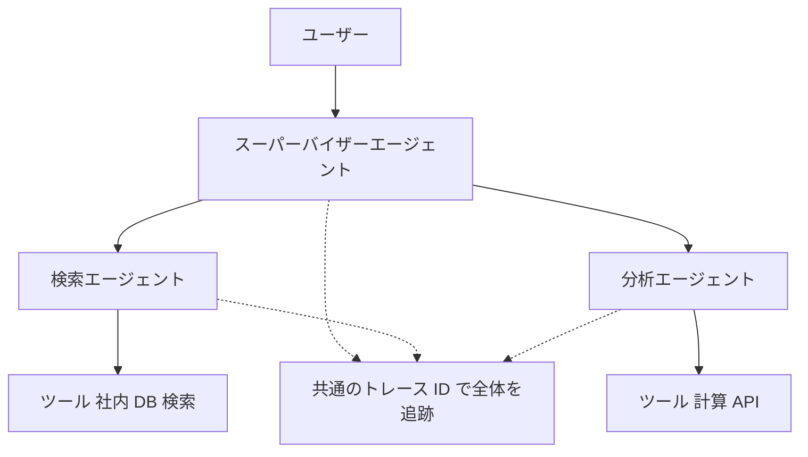

**ポイント**: すべてのエージェントとツールが **同じトレース ID** を引き継ぐことで、「どのエージェントのどのツール呼び出しが原因か」を 1 本の流れで追えます。

### 15-5. 使用量ベースラインと異常検知

| 手順 | 内容 |
|---|---|
| 1 | 正常時のツール呼び出し回数、レイテンシ、成功率を **ベースライン** として記録 |
| 2 | CloudWatch の **異常検知アラーム** で、ベースラインからの逸脱を検知 |
| 3 | 逸脱 (呼び出し急増、特定ツールの失敗率上昇、呼び出しループ) の際に通知し、調査する |
| 4 | ツール定義 (説明、引数スキーマ) やプロンプトを改善し、ベースラインを更新 |

### 15-6. ベストプラクティス

| # | ベストプラクティス | 理由 |
|---|---|---|
| 1 | ツール呼び出しごとに、**ツール名、引数、結果、所要時間、成否** を構造化ログに残す | 原因分析の基礎データ |
| 2 | エージェントの **最大反復回数 / ツール呼び出し回数の上限** を設ける | 暴走とコスト爆発の防止 |
| 3 | ツールの説明と引数スキーマを明確にする | 誤選択と不正引数を減らす最大の要因 |
| 4 | ツールにタイムアウトと再試行、サーキットブレーカーを設ける | 1 つの遅いツールが全体を止めない |
| 5 | 正常時のベースラインを持ち、逸脱を自動検知する | 変化の早期発見 |
| 6 | 全コンポーネントでトレース ID を伝播する | マルチエージェントでも追跡可能 |

### 15-7. 試験の狙われどころ

- 「エージェントがツールを呼びすぎてコストが急増」→ **呼び出しパターンの追跡 + 異常検知 + 呼び出し回数の上限**。
- 「複数エージェントのどこで失敗したか特定」→ **共通トレース ID によるマルチエージェント追跡 (AgentCore 可観測性 / X-Ray)**。
- 「ツールの選択ミスが多い」→ **ツール説明とスキーマの改善 + 選択の評価**。

出典: Amazon Bedrock AgentCore observability / CloudWatch Generative AI observability / Bedrock Agents trace (Step 22 を参照)

---

## Step 16: Skill 4.3.5 ベクトルストアの運用管理

> 公式 Skill: FM の拡張に使うベクトルストアが最適かつ信頼性高く動くための運用管理システムを作る (ベクトルデータベースの性能監視、インデックスの自動最適化ルーチン、データ品質の検証プロセス)。

### 16-1. 3 つの運用領域

| 領域 | 目的 | 内容 |
|---|---|---|
| 性能監視 | 検索が速く安定して動いているかを確認する | 検索レイテンシ、インデックス作成のレイテンシ、リソース使用率 (CPU、メモリ)、エラー、スロットリング |
| インデックス最適化ルーチン | 時間とともに劣化する構成を **自動で整える** | 再構築、セグメント統合、パラメータの見直し、不要データの削除 |
| データ品質検証 | **入っているデータが正しい** ことを保証する | 重複排除、空チャンクの検出、メタデータの欠落チェック、次元の整合、鮮度確認 |

### 16-2. 監視すべき指標

| 指標 | 見る理由 | 対応の例 |
|---|---|---|
| 検索レイテンシ (p95 / p99) | ユーザー体験に直結 | インデックスやクエリの調整、リソース追加 |
| 検索のスループットとスロットリング | 容量の限界 | スケールアウト、キャッシュ |
| メモリ使用率 (ベクトルグラフ用) | ベクトルインデックスがメモリを大量に使う | 量子化、次元削減、ノード増強 |
| インデックス / 取り込みの遅延と失敗 | 最新データが反映されない | 取り込みジョブの再実行とアラート |
| ストレージ使用量 | コストと容量 | 古いデータの整理、ライフサイクル管理 |
| 検索品質 (再現率や評価スコア) | 速くても外れていたら意味がない | 評価データで定期測定 |

> 具体的なメトリクス名は、使うベクトルストア (Amazon OpenSearch Service / Serverless、Aurora PostgreSQL の pgvector、その他) ごとに異なります。試験では **「ベクトルストアの性能を CloudWatch などで監視する」「インデックスを定期的に最適化する」** という考え方を押さえてください。

### 16-3. インデックス最適化ルーチンの例

| タイミング | ルーチン |
|---|---|
| 定期 (週次など) | セグメントの統合、不要ドキュメントの削除、使用状況に応じたパラメータ見直し |
| 埋め込みモデル変更時 | **全データの再埋め込みと新インデックスへの切り替え** (旧インデックスと並行運用して切り替え) |
| データ量が大きく増えたとき | シャード数やレプリカ数の再設計、量子化の導入 |
| 品質劣化を検知したとき | 検索パラメータの調整、チャンク戦略の再評価 |

自動化の手段は、Amazon EventBridge のスケジュール → AWS Lambda / AWS Step Functions で実行、という構成が一般的です。

### 16-4. データ品質検証パイプライン

```mermaid
flowchart TB
    SRC["ソースデータ S3 など"]
    CHK1["重複排除と空チャンクの検出"]
    CHK2["メタデータの必須項目チェック"]
    EMB["埋め込み生成 と 次元チェック"]
    IDX["ベクトルストアへ登録"]
    QA["サンプル質問で検索品質を確認"]
    OK{"基準を満たすか"}
    PUB["本番インデックスに反映"]
    FIX["隔離して原因を修正"]
    SRC --> CHK1 --> CHK2 --> EMB --> IDX --> QA --> OK
    OK -->|"はい"| PUB
    OK -->|"いいえ"| FIX
```

Amazon Bedrock Knowledge Bases を使う場合は、データソースの **同期 (取り込みジョブ)** の成否とステータスを確認し、失敗を通知する仕組みを組み込みます。

### 16-5. ベストプラクティス

| # | ベストプラクティス | 理由 |
|---|---|---|
| 1 | 検索レイテンシと品質の **両方** を監視する | 速いが外れる、を見逃さない |
| 2 | データの取り込み時に **品質チェック** を自動化する | ゴミのデータは検索品質を直接下げる |
| 3 | 埋め込みモデル変更時は **再埋め込みして切り替え** る | 異なるモデルのベクトルは混在させない |
| 4 | 更新と削除を確実に反映する (古い情報を残さない) | 古い回答や削除すべき情報の漏えいを防ぐ |
| 5 | アクセス制御用のメタデータ (権限) を検証する | 見せてはいけない情報の混入防止 |
| 6 | 取り込みジョブの失敗にアラームを設定する | 静かな失敗でデータが古くなるのを防ぐ |
| 7 | 容量とコストを定期的に確認し、不要データを整理する | 肥大化を防ぐ |

### 16-6. 試験の狙われどころ

- 「ベクトルストアの検索が徐々に遅くなる」→ **性能メトリクス監視 + インデックス最適化ルーチン (定期再構築、パラメータ調整)**。
- 「検索結果に古い、重複、破損したデータが混ざる」→ **データ品質検証プロセス (重複排除、メタデータ検証、鮮度確認)**。
- 「埋め込みモデルを変更した」→ **再埋め込みと再インデックス**。

出典: Amazon OpenSearch Service / Bedrock Knowledge Bases (Step 22 を参照)

---

## Step 17: Skill 4.3.6 FM 固有のトラブルシューティング

> 公式 Skill: 従来の ML システムにはない GenAI 特有の障害モードを特定するための FM 固有のトラブルシューティングフレームワークを開発する (幻覚を検出するゴールデンデータセット、応答の一貫性を分析する出力 diff 手法、論理エラーを特定する推論経路のトレース、専用のオブザーバビリティパイプライン)。

### 17-1. GenAI 特有の障害モード

従来の ML や Web システムでは「エラーが出る / 出ない」で障害を判断できました。GenAI は **エラーなしで、間違った内容を自信たっぷりに返す** のが最大の違いです。

| 障害モード | 内容 | 従来システムとの違い |
|---|---|---|
| 幻覚 (ハルシネーション) | 事実でない内容、根拠のない内容を生成 | HTTP 200 で成功して見える |
| 応答の不一致 | 同じ質問で毎回違う答え | 決定的でない出力 |
| ドリフト | モデルの更新、データ変化で挙動が変わる | 入力が同じでも出力が変わる |
| 推論の誤り | 途中の論理が破綻して結論が間違う | 最終出力だけ見ても原因が分からない |
| 検索の失敗 (RAG) | 必要な文書が取得されない | モデルは悪くないのに誤答 |
| コンテキストの溢れ / 欠落 | 重要情報が入らない、切り捨てられる | 入力の設計問題 |
| ツールの誤用 | 誤ったツールや引数 | エージェント特有 |
| プロンプトインジェクション | 外部入力で指示が乗っ取られる | セキュリティと品質の混在 |

### 17-2. 4 つの手法

| 手法 | 内容 | 使いどころ |
|---|---|---|
| **ゴールデンデータセット** | 「質問と期待される正しい回答 (または根拠)」のセットを用意し、定期的に実行して比較する | 幻覚、回帰、モデル変更時の品質確認 |
| **出力 diff** | 同じ入力の複数回の出力、またはバージョン間の出力を比較する (文字列の差分、埋め込みの類似度、LLM の審判) | 応答の一貫性分析、変更の影響確認 |
| **推論経路のトレース** | 検索、プロンプト、ツール呼び出し、中間推論の各ステップを記録し、どこで誤ったかを特定する | 論理エラー、エージェントの失敗 |
| **専用のオブザーバビリティパイプライン** | プロンプトと応答を収集し、自動評価 (根拠チェック、LLM 審判) を回してメトリクス化する | 継続的な品質監視 |

### 17-3. 不具合の切り分けフロー (誤った回答が出たとき)

```mermaid
flowchart TB
    BAD["誤った回答が報告された"]
    T["トレースとログで該当リクエストを特定"]
    R{"検索結果に正しい根拠は含まれていたか"}
    RFIX["検索の改善 チャンク ハイブリッド 再ランキング"]
    P{"プロンプトに根拠と指示は正しく入っていたか"}
    PFIX["プロンプトとコンテキストの改善"]
    M{"根拠があるのに誤ったか"}
    MFIX["温度を下げる 根拠チェック有効化 モデル見直し"]
    G["ゴールデンデータセットに追加して回帰テスト化"]
    BAD --> T --> R
    R -->|"いいえ"| RFIX
    R -->|"はい"| P
    P -->|"いいえ"| PFIX
    P -->|"はい"| M
    M -->|"はい"| MFIX
    RFIX --> G
    PFIX --> G
    MFIX --> G
```

> **重要な習慣**: 見つけた不具合は **ゴールデンデータセットに追加** し、同じ問題が再発しないよう回帰テストにします。

### 17-4. 出力 diff の考え方

| 比較の種類 | 方法 |
|---|---|
| 同じ入力を複数回実行 (一貫性) | temperature を固定 / 低くして複数回実行し、出力の類似度のばらつきを測る |
| 変更前後 (プロンプトやモデルの更新) | 同じ評価セットを新旧で実行し、差分が大きい項目を重点確認 |
| 意味的な比較 | 文字列一致ではなく、埋め込みの類似度や LLM による「意味が同じか」の判定 |

文字列の完全一致は、GenAI の出力比較には **不向き** です (言い回しが変わるだけで不一致になるため)。

### 17-5. 利用できる AWS の機能

| 目的 | 機能 |
|---|---|
| ゴールデンデータセットでの評価 | Amazon Bedrock の評価機能 (モデル評価、RAG 評価、LLM-as-a-judge) |
| 幻覚の抑制と検出 | Bedrock Guardrails の contextual grounding check (根拠と関連性の確認) |
| 推論経路の確認 | Bedrock Agents のトレース、AgentCore の可観測性、アプリ側のステップログ |
| 一連の流れの追跡 | CloudWatch GenAI 可観測性、X-Ray、OpenTelemetry |
| 詳細調査 | モデル呼び出しログ + Logs Insights / Athena |

### 17-6. ベストプラクティス

| # | ベストプラクティス | 理由 |
|---|---|---|
| 1 | 本番の失敗事例から **ゴールデンデータセットを育てる** | 実際のユーザーの質問に近い評価ができる |
| 2 | モデル、プロンプト、データ変更のたびに **回帰テスト** を実行する | 気づかない品質低下を防ぐ |
| 3 | 切り分けは **検索 → プロンプト → モデル** の順に行う | 原因の多くは検索かコンテキスト |
| 4 | 中間ステップ (検索結果、ツール結果、中間推論) を記録する | 最終出力だけでは原因が分からない |
| 5 | 評価の自動化 (LLM-as-a-judge) には、人手評価による **較正** も併用する | 審判モデル自体の偏りを補正 |
| 6 | 出力比較は文字列一致ではなく **意味ベース** で行う | 言い回しの揺れに強い |
| 7 | 幻覚が許されない用途では、根拠の引用と根拠チェックを必須にする | 検出と抑制を両立 |

### 17-7. 試験の狙われどころ

- 「幻覚を検出し、新しいバージョンで悪化していないか確認したい」→ **ゴールデンデータセット + 回帰テスト**。
- 「同じ質問で答えが毎回違う」→ **出力 diff による一貫性分析 + temperature の見直し**。
- 「エージェントの結論が間違うが、どのステップが原因か不明」→ **推論経路のトレース**。
- 「エラーは出ていないのに品質が悪い」→ **GenAI 専用の品質オブザーバビリティ (自動評価をメトリクス化)**。

出典: Amazon Bedrock Evaluations / Guardrails contextual grounding check / Bedrock Agents trace (Step 22 を参照)

---
## Step 18: 症状から解決策を選ぶ早見表

| 症状 / 要件 | 第一候補 | 補足 |
|---|---|---|
| 入力が長くコストが高い | プロンプト圧縮、コンテキスト剪定、履歴の要約 | 品質評価を必ず併用 |
| 出力が冗長でコストが高い | `maxTokens`、`stopSequences`、出力形式の指定 | 途中で切れないよう適正値を評価 |
| 簡単な質問にも高価なモデルを使っている | 階層化ルーティング / Intelligent Prompt Routing | フォールバックを用意 |
| 同じ質問が繰り返される | 完全一致キャッシュ (決定的ハッシュ) | キーにテナントとバージョンを含める |
| 言い換えの質問が多い | セマンティックキャッシュ | 閾値を評価で調整 |
| 長い共通プロンプトのコストと遅延 | プロンプトキャッシュ | 静的部分を先頭に置く |
| 夜間に大量の文書を処理 | Bedrock バッチ推論 | リアルタイム要件がないとき |
| 安定した高負荷で性能を保証したい | Provisioned Throughput | ベースライン分のみ確保 |
| ピーク時だけ 429 が出る | 指数バックオフ + ジッター、クロスリージョン推論、キューで平準化 | 恒常的ならクォータ引き上げか Provisioned Throughput |
| 体感が遅い (対話 UI) | ストリーミング | 全体時間は変わらないが体感は改善 |
| 時間に敏感なアプリ | 低レイテンシモデル / レイテンシ最適化推論 | 対応モデルとリージョンを確認 |
| 独立した複数の FM 呼び出しが直列 | 並列化 | クォータ消費に注意 |
| 定番の質問やレポートが毎回生成される | 事前計算 | 更新タイミングを設計 |
| 型番や固有名詞の検索が外れる | ハイブリッド検索 | ベクトルとキーワードの重み付け |
| 検索結果の順位が悪い | 再ランキング | 上位だけを渡してトークンも削減 |
| 曖昧な質問で検索が外れる | クエリ書き換え / 分解 | 会話文脈を補う |
| 事実重視の回答で出力が安定しない | temperature を下げる | top-p は同時に大きく動かさない |
| 改善効果を確かめたい | A/B テスト | 指標とガードレール指標を先に定義 |
| ワーカーを増やしたら 429 が増えた | 同時実行数に上限、キューで制御 | FM のクォータを意識する |
| 全体のどこが遅いか不明 | 分散トレーシングによるプロファイリング | ボトルネックから最適化 |
| トークン使用量の急増を検知したい | CloudWatch 異常検知アラーム | コストは Cost Anomaly Detection も併用 |
| プロンプトと応答の中身を調べたい | モデル呼び出しログ (要有効化) | 暗号化とマスキングを設計 |
| 誰が何を入力したか事後調査したい | CloudTrail + モデル呼び出しログ + 相関 ID | 監査ログの改ざん防止 |
| エージェントの失敗位置を特定 | トレース (AgentCore 可観測性 / X-Ray / OpenTelemetry) | 共通のトレース ID |
| エージェントがツールを呼びすぎる | 呼び出しパターン監視 + 回数上限 | ツール説明の改善 |
| ベクトル検索が徐々に遅くなる | 性能監視 + インデックス最適化ルーチン | 再構築、パラメータ調整、量子化 |
| 検索結果に古い、重複データが混ざる | データ品質検証と同期の監視 | 取り込みジョブの失敗アラーム |
| 幻覚が増えていないか確認したい | ゴールデンデータセット + 根拠チェック | 回帰テスト化 |
| 同じ質問で答えが毎回違う | 出力 diff、temperature の見直し | 意味ベースの比較 |

---

## Step 19: 試験の罠チェック表

| # | 罠の内容 | 正しい考え方 |
|---|---|---|
| 1 | 「プロンプトキャッシュ = FM を呼ばないキャッシュ」と思い込む | プロンプトキャッシュは FM を呼ぶ。共通プレフィックスの **処理を再利用** して入力のコストと遅延を下げる。FM を呼ばないのは完全一致 / セマンティックキャッシュ |
| 2 | プロンプトキャッシュで動的情報を先頭に置く | **静的を先頭、動的を末尾**。プレフィックスが一致しないとキャッシュが効かない |
| 3 | キャッシュキーにテナントや権限を含めない | 他ユーザーの情報が漏れる。キーに識別子と権限スコープを含める |
| 4 | 最も安価なモデルを選べば最適と考える | **成功あたりコスト** と品質で比較。必要ならカスケードやルーティング |
| 5 | Intelligent Prompt Routing を、異なるプロバイダ間で振り分けるものと考える | 同じモデルファミリー内の振り分け。ファミリーをまたぐなら自作ルーター |
| 6 | ストリーミングで全体の処理時間が短くなると考える | 体感 (TTFT) を改善する手法。全体の生成時間は基本的に同じ |
| 7 | 429 に対して即 Provisioned Throughput を購入 | まず再試行、平準化、クロスリージョン推論。恒常的で安定した負荷なら Provisioned Throughput |
| 8 | Provisioned Throughput でピークに合わせて常時確保 | 常時課金。ベースライン分のみ確保し、超過はオンデマンドへ |
| 9 | GenAI のオートスケーリングを CPU 使用率で行う | FM の応答待ちでは CPU が上がらない。キュー長、同時実行数、カスタムメトリクス |
| 10 | 並列化すれば常に良いと考える | クォータを消費し、429 を招く。同時実行数の上限が必要 |
| 11 | 型番、固有名詞の検索をベクトル検索だけで解決 | **ハイブリッド検索** (キーワードも併用) と再ランキング |
| 12 | モデル呼び出しログは自動で記録されると考える | **有効化が必要**。本文に機密が入りうるので暗号化と保持を設計 |
| 13 | CloudWatch の標準メトリクスだけで幻覚率を追える | 標準メトリクスはインフラ視点。品質指標は自前で測定してカスタムメトリクス化 |
| 14 | temperature と top-p を同時に大きく変更 | 1 回に 1 変数。効果の原因を特定できなくなる |
| 15 | 出力比較を文字列の完全一致で行う | 言い回しの揺れで不一致になる。意味ベースの比較 (埋め込み類似度、LLM 審判) |
| 16 | 埋め込みモデルを変更しても既存のインデックスを使い続ける | ベクトル空間が異なるため、**全件の再埋め込みと再インデックス** が必要 |
| 17 | 圧縮や剪定の後に品質評価をしない | 削りすぎで品質低下。ゴールデンデータセットで必ず確認 |
| 18 | レイテンシを平均値だけで監視 | p95、p99 を見る。遅い尾の部分が不満の原因 |
| 19 | バッチ推論をリアルタイム用途に使う | バッチは非同期。リアルタイムには不向き |
| 20 | 仕様や数値を暗記して選ぶ | 試験は **要件 (コスト、遅延、スループット、品質) に最も合う手段** を選ぶ力を問う。数値は変わりうる |

---

## Step 20: 練習問題

> 解答は各問題の直後にあります。まず自分で考えてから確認してください。

### 問題 1
社内 FAQ ボットで、長い社内規程 (約 20,000 トークン) を毎回システムプロンプトに含めて質問に答えています。応答が遅く、入力トークンのコストが高いのが課題です。コストと遅延を下げる最も適切な方法はどれですか。

- A. temperature を 0 にする
- B. 規程を静的な先頭部分としてまとめ、Bedrock のプロンプトキャッシュを使う
- C. maxTokens を 10 にする
- D. すべてのリクエストを Provisioned Throughput に移す

**答え: B**
解説: 長い共通プレフィックスの再利用が目的なのでプロンプトキャッシュが適切です。静的部分を先頭、ユーザーの質問を末尾に置きます。A は出力のランダム性、C は出力を壊す、D はコスト増になる可能性が高く、直接の解決になりません。

### 問題 2
顧客サポートで、問い合わせの 70% が定型の簡単な質問、30% が複雑な問い合わせです。現在はすべてを最上位モデルで処理しており、コストが高い状態です。品質を維持しつつコストを下げるには何をしますか。

- A. すべてを最小モデルに切り替える
- B. 複雑さに応じて小型モデルと大型モデルに振り分け、失敗時のフォールバックを設ける
- C. 回答を毎回 1 文に制限する
- D. 夜間のバッチ推論に切り替える

**答え: B**
解説: 階層化 (または Intelligent Prompt Routing や自作ルーター) が正解の方向です。A は複雑な質問の品質が落ちます。C は品質を損なう可能性があり、D はリアルタイム要件を満たしません。

### 問題 3
「配送状況はどうなっていますか」「荷物はどこですか」のように、表現が違っても意味が同じ質問が大量に届きます。FM の呼び出し回数を減らしたいです。最適なものはどれですか。

- A. 完全一致のキャッシュ
- B. セマンティックキャッシュ
- C. CloudFront のキャッシュ
- D. ストリーミング

**答え: B**
解説: 言い換えを同一視して回答を再利用するには、埋め込みの類似度で照合するセマンティックキャッシュが適切です。完全一致は表現が違うとヒットしません。なお、ユーザー固有の配送状況をキャッシュする場合は、テナントやユーザーをキャッシュキーに含めて情報漏えいを防ぐ必要があります。

### 問題 4
毎朝 9 時に短時間だけアクセスが集中し、Bedrock のオンデマンド呼び出しで ThrottlingException が発生します。それ以外の時間帯は余裕があります。コスト効率のよい対策として最も適切なものを 2 つ選んでください。

- A. 24 時間 365 日分の Provisioned Throughput を最大ピークに合わせて確保する
- B. 指数バックオフとジッターを使った再試行を実装する
- C. SQS で受けてワーカーの同時実行数を制御し、スパイクを平準化する
- D. すべてのリクエストでモデルを最大のものに変更する

**答え: B と C**
解説: 短時間のスパイクには、再試行と平準化 (必要ならクロスリージョン推論) が低コストです。A は常時課金で無駄が大きく、D は問題を悪化させます。

### 問題 5
製品型番 (例: AB-1234-X) での検索で、関連する文書が上位に出てきません。意味検索は十分に機能しています。改善策として最も適切なものはどれですか。

- A. temperature を上げる
- B. キーワード検索とベクトル検索を組み合わせたハイブリッド検索を導入する
- C. maxTokens を増やす
- D. 埋め込みの次元を増やすだけにする

**答え: B**
解説: 型番や固有名詞はキーワード (語彙) 検索が得意です。ハイブリッド検索で両方の強みを使い、必要に応じて再ランキングで順位を整えます。

### 問題 6
チャットアプリで、回答の生成に数秒かかり、ユーザーが「固まった」と感じています。全体の生成内容は変えずに、体感の待ち時間を改善したいです。

- A. 回答を全文生成後に一括で返す
- B. ストリーミングで生成されたトークンを逐次表示する
- C. Provisioned Throughput を購入する
- D. ログ出力を無効にする

**答え: B**
解説: ストリーミングは最初の文字が出るまでの時間を短くし、体感を改善します。

### 問題 7
事実に基づく社内ポリシー回答で、同じ質問への回答が日によって異なり、ときどき事実と違う表現が混じります。まず調整すべき設定として最も適切なものはどれですか。

- A. temperature を高くする
- B. temperature を低くし、根拠に基づいて回答するようプロンプトを調整する
- C. maxTokens を最大にする
- D. top-p と temperature を同時に大きく変更する

**答え: B**
解説: 事実重視の用途では、ランダム性を下げて一貫性を高めます。変数は 1 つずつ変更して効果を確認します。

### 問題 8
プロンプトを変更して回答品質が上がったと思われますが、確証はありません。本番で安全に効果を確認するには何をしますか。

- A. 全ユーザーに即時展開し、問い合わせの増減を見る
- B. 成功指標とガードレール指標を定義し、トラフィックを分割した A/B テストを行う
- C. 開発者の感覚で判断する
- D. 古いプロンプトを削除する

**答え: B**
解説: 事前に指標を決め、トラフィックを分割して比較し、統計的に判断します。オフライン評価 (ゴールデンデータセット) で絞ってからオンライン A/B に進むのが安全です。

### 問題 9
夜間に、あるテナントのトークン使用量が通常の 20 倍になり、予想外のコストが発生しました。同様の事象を早く検知したいです。最も適切な組み合わせはどれですか。

- A. 月次の請求書を確認する
- B. 入出力トークン数に対する CloudWatch 異常検知アラームと、AWS Cost Anomaly Detection
- C. モデル呼び出しログを無効にする
- D. maxTokens を 1 にする

**答え: B**
解説: トークンバーストは異常検知アラームで早期に検知し、コストは Cost Anomaly Detection で別系統の監視を併用します。機能別、テナント別のディメンションを持つカスタムメトリクスがあるとさらに原因特定が早くなります。

### 問題 10
あるエージェントが、複数のツールを何十回も呼び出す動作をして、コストと遅延が急増しました。原因分析と再発防止のために、最も適切な対応はどれですか。

- A. ツールをすべて削除する
- B. ツール呼び出しの構造化ログとトレースで呼び出しパターンを追跡し、ベースラインからの逸脱を異常検知し、呼び出し回数の上限を設ける
- C. temperature を最大にする
- D. 呼び出しログを削除する

**答え: B**
解説: ツール呼び出しパターンの追跡と使用量ベースライン、上限設定が Skill 4.3.4 の要点です。ツール説明やスキーマの改善も効果的です。

### 問題 11
RAG の運用中、最近になって検索の遅延が増え、古い情報や重複した文書が回答に混ざるようになりました。最も適切な対応はどれですか。

- A. FM を大きいモデルに変更する
- B. ベクトルストアの性能メトリクスを監視し、インデックスの最適化ルーチンと、取り込み時のデータ品質検証 (重複排除、メタデータ検証、鮮度確認) を自動化する
- C. temperature を 0 にする
- D. キャッシュをすべて削除する

**答え: B**
解説: 原因はモデルではなくベクトルストアの運用とデータ品質です。Skill 4.3.5 の 3 領域 (性能監視、最適化ルーチン、データ品質検証) に対応します。

### 問題 12
新しいモデルバージョンへ更新した後、ユーザーから「以前より誤った回答が増えた」と報告がありました。エラーログはありません。原因の確認と再発防止に最も適切な方法はどれですか。

- A. HTTP エラー率だけを確認する
- B. ゴールデンデータセットで新旧を比較して回帰を確認し、出力 diff と推論経路のトレースで原因を特定し、不具合事例を評価セットに追加する
- C. 新モデルを使い続けて様子を見る
- D. すべてのログを削除する

**答え: B**
解説: GenAI は「エラーなしで誤る」ため、品質の評価とトレースが必要です (Skill 4.3.6)。切り分けは「検索 → プロンプト → モデル」の順に行い、事例は回帰テストに追加します。

---

## Step 21: 最終チートシート

### 21-1. Task 4.1 コストとリソース効率

| Skill | 覚えること |
|---|---|
| 4.1.1 トークン効率 | 推定と追跡 / 履歴要約 / 剪定 / プロンプト圧縮 / maxTokens と stopSequences / 品質評価とセット |
| 4.1.2 モデル選択 | 階層化 / Intelligent Prompt Routing (同一ファミリー内) / 自作ルーター / カスケード / 成功あたりコスト / 蒸留 |
| 4.1.3 高性能システム | バッチ推論 / TPM ベースの容量計画 / Provisioned Throughput はベースライン分のみ / 超過はオンデマンド |
| 4.1.4 キャッシュ | エッジ / 完全一致 (決定的ハッシュ) / セマンティック / フィンガープリント / プロンプトキャッシュ (静的を先頭) / キーにテナント |

### 21-2. Task 4.2 性能最適化

| Skill | 覚えること |
|---|---|
| 4.2.1 応答性 | 事前計算 / 低レイテンシモデル / 並列化 / ストリーミング (体感改善) / p95、p99 のベンチマーク |
| 4.2.2 検索性能 | インデックス最適化 / クエリ書き換えと分解 / ハイブリッド検索 + 重み付け / 再ランキング |
| 4.2.3 スループット | バックオフ + ジッター / クロスリージョン推論 / バッチ推論 / 同時実行制御 / maxTokens の適正化 |
| 4.2.4 性能調整 | temperature / top-p / top-k / 事実系は低く創造系は高く / 1 変数ずつ / A/B テスト |
| 4.2.5 リソース配分 | トークン量で容量計画 / CPU ではなくキュー長と同時実行数 / スケジュールスケーリング / FM クォータ内に収める |
| 4.2.6 ワークフロー | トレースでプロファイル / ボトルネックから / 並列化と非同期化 / 接続再利用 / VPC エンドポイント |

### 21-3. Task 4.3 モニタリング

| Skill | 覚えること |
|---|---|
| 4.3.1 観測性 | 運用 / トレース / FM のやり取り / ビジネスの 4 層 / 相関 ID / CloudWatch GenAI 可観測性 |
| 4.3.2 GenAI 監視 | AWS/Bedrock メトリクス / モデル呼び出しログ (要有効化) / 異常検知 / 品質指標は自前 / Cost Anomaly Detection |
| 4.3.3 統合と監査 | 対象者別ダッシュボード / CloudTrail + 本文ログ / 改ざん防止 / ガードレール介入の監視 |
| 4.3.4 ツール性能 | 呼び出しパターン / 成功率とレイテンシ / 共通トレース ID / ベースライン / 呼び出し回数上限 |
| 4.3.5 ベクトルストア | 性能監視 / 最適化ルーチン / データ品質検証 / 埋め込みモデル変更時は再インデックス |
| 4.3.6 トラブルシュート | ゴールデンデータセット / 出力 diff (意味ベース) / 推論経路トレース / 検索 → プロンプト → モデルの順で切り分け |

### 21-4. 合言葉

1. **削る (トークン) → 振り分ける (モデル) → 使い回す (キャッシュ) → まとめる (バッチ)**。
2. **測ってから直す**。ボトルネックを特定してから最適化する。
3. **品質を落とさない**。最適化のたびにゴールデンデータセットで確認する。
4. **エラーなしで間違えるのが GenAI**。品質は自前で測る。
5. **キャッシュキーとログには、権限と機密の設計を**。

---

## Step 22: 参考 URL 一覧

> **区分の意味**
> - **確認済み**: 2026-10-09 の調査で、実際に内容を取得して確認できた URL
> - **既知のパス (未確認)**: AWS 公式ドキュメントの一般的な構成にもとづく URL。今回は内容を開いていないため、リンク切れや内容変更の可能性があります。試験前に最新の内容を確認してください。
> - **二次情報**: AWS 以外の解説。補助的な参考として扱い、一次情報で裏取りしてください。

### 22-1. 試験ガイド (一次情報)

| 区分 | 内容 | URL |
|---|---|---|
| 確認済み | AIP-C01 試験ガイド (全体) | https://docs.aws.amazon.com/aws-certification/latest/ai-professional-01/ai-professional-01.html |
| 確認済み | AIP-C01 Content Domain 4 (本ガイドの出題範囲) | https://docs.aws.amazon.com/aws-certification/latest/ai-professional-01/ai-professional-01-domain4.html |
| 確認済み | AIP-C01 認定ページ (試験ガイド内のリンク) | https://aws.amazon.com/certification/certified-generative-ai-developer-professional/ |

### 22-2. Task 4.1 コストとリソース効率

| 区分 | Skill | 内容 | URL |
|---|---|---|---|
| 確認済み | 4.1.4 | Amazon Bedrock プロンプトキャッシュ | https://docs.aws.amazon.com/bedrock/latest/userguide/prompt-caching.html |
| 確認済み | 4.1.2 | Amazon Bedrock Intelligent Prompt Routing (製品ページ) | https://aws.amazon.com/bedrock/intelligent-prompt-routing |
| 確認済み | 4.1.2 | Intelligent Prompt Routing の一般提供ブログ | https://aws.amazon.com/blogs/machine-learning/use-amazon-bedrock-intelligent-prompt-routing-for-cost-and-latency-benefits/ |
| 確認済み | 4.1.2 | Intelligent Prompt Routing とプロンプトキャッシュ (プレビュー時の発表) | https://aws.amazon.com/blogs/aws/reduce-costs-and-latency-with-amazon-bedrock-intelligent-prompt-routing-and-prompt-caching-preview/ |
| 確認済み | 4.1.1 から 4.1.4 | Amazon Bedrock のコスト、レイテンシ、精度の最適化 (概要) | https://aws.amazon.com/bedrock/cost-optimization |
| 確認済み | 4.1.3 | Bedrock のスケーリングとスループットのベストプラクティス | https://docs.aws.amazon.com/bedrock/latest/userguide/scaling-throughput-best-practices.html |
| 既知のパス (未確認) | 4.1.3 | Bedrock バッチ推論 | https://docs.aws.amazon.com/bedrock/latest/userguide/batch-inference.html |
| 既知のパス (未確認) | 4.1.3 | Bedrock Provisioned Throughput | https://docs.aws.amazon.com/bedrock/latest/userguide/prov-throughput.html |
| 既知のパス (未確認) | 4.1.3 / 4.2.3 | Bedrock クロスリージョン推論 | https://docs.aws.amazon.com/bedrock/latest/userguide/cross-region-inference.html |
| 既知のパス (未確認) | 4.1.1 | Bedrock の価格ページ | https://aws.amazon.com/bedrock/pricing/ |
| 二次情報 | 4.1.4 | プロンプトキャッシュの使い方 (AWS ブログの転載ページ) | https://aihub.hkuspace.hku.hk/?p=3248 |
| 二次情報 | 4.1.3 / 4.2.3 | Bedrock の推論スループットとレイテンシ最適化の実務解説 | https://hidekazu-konishi.com/entry/amazon_bedrock_inference_throughput_and_latency_optimization.html |

### 22-3. Task 4.2 性能最適化

| 区分 | Skill | 内容 | URL |
|---|---|---|---|
| 確認済み | 4.2.1 | Bedrock のレイテンシ最適化推論 | https://docs.aws.amazon.com/bedrock/latest/userguide/latency-optimized-inference.html |
| 確認済み | 4.2.2 | Knowledge Bases の検索設定 (HYBRID / SEMANTIC、再ランキング) を含む API リファレンス (EU ソブリンクラウド版ドキュメント) | https://docs.aws.eu/bedrock/latest/APIReference/API_agent-runtime_KnowledgeBaseVectorSearchConfiguration.html |
| 既知のパス (未確認) | 4.2.2 | 同 API リファレンスの標準版 | https://docs.aws.amazon.com/bedrock/latest/APIReference/API_agent-runtime_KnowledgeBaseVectorSearchConfiguration.html |
| 既知のパス (未確認) | 4.2.2 | OpenSearch のハイブリッド検索 | https://docs.opensearch.org/latest/vector-search/ai-search/hybrid-search/ |
| 既知のパス (未確認) | 4.2.4 | Bedrock の推論パラメータ | https://docs.aws.amazon.com/bedrock/latest/userguide/inference-parameters.html |
| 既知のパス (未確認) | 4.2.4 | Bedrock Prompt Management | https://docs.aws.amazon.com/bedrock/latest/userguide/prompt-management.html |
| 既知のパス (未確認) | 4.2.4 / 4.3.6 | Bedrock の評価機能 | https://docs.aws.amazon.com/bedrock/latest/userguide/evaluation.html |
| 既知のパス (未確認) | 4.2.5 | Application Auto Scaling | https://docs.aws.amazon.com/autoscaling/application/userguide/what-is-application-auto-scaling.html |
| 既知のパス (未確認) | 4.2.6 | AWS X-Ray | https://docs.aws.amazon.com/xray/latest/devguide/aws-xray.html |

### 22-4. Task 4.3 モニタリング

| 区分 | Skill | 内容 | URL |
|---|---|---|---|
| 確認済み | 4.3.1 / 4.3.2 | bedrock-runtime の CloudWatch メトリクス監視 | https://docs.aws.amazon.com/bedrock/latest/userguide/monitoring-runtime-metrics.html |
| 確認済み | 4.3.1 / 4.3.4 | CloudWatch の生成 AI 可観測性 | https://docs.aws.amazon.com/AmazonCloudWatch/latest/monitoring/GenAI-observability.html |
| 確認済み | 4.3.1 | 生成 AI 可観測性の一般提供発表 (2025-10-13) | https://aws.amazon.com/about-aws/whats-new/2025/10/generative-ai-observability-amazon-cloudwatch |
| 確認済み | 4.3.4 | Bedrock AgentCore の可観測性の設定 | https://docs.aws.amazon.com/bedrock-agentcore/latest/devguide/observability-configure.html |
| 確認済み | 4.3.1 | CloudWatch 生成 AI 可観測性の導入ブログ (プレビュー時) | https://aws.amazon.com/blogs/mt/launching-amazon-cloudwatch-generative-ai-observability-preview/ |
| 既知のパス (未確認) | 4.3.2 / 4.3.3 | モデル呼び出しログ | https://docs.aws.amazon.com/bedrock/latest/userguide/model-invocation-logging.html |
| 既知のパス (未確認) | 4.3.2 | AWS Cost Anomaly Detection | https://docs.aws.amazon.com/cost-management/latest/userguide/manage-ad.html |
| 既知のパス (未確認) | 4.3.2 | CloudWatch の異常検知 | https://docs.aws.amazon.com/AmazonCloudWatch/latest/monitoring/CloudWatch_Anomaly_Detection.html |
| 既知のパス (未確認) | 4.3.3 | AWS CloudTrail | https://docs.aws.amazon.com/awscloudtrail/latest/userguide/cloudtrail-user-guide.html |
| 既知のパス (未確認) | 4.3.5 | Amazon OpenSearch Service | https://docs.aws.amazon.com/opensearch-service/latest/developerguide/what-is.html |
| 既知のパス (未確認) | 4.3.6 | Bedrock Guardrails | https://docs.aws.amazon.com/bedrock/latest/userguide/guardrails.html |
| 既知のパス (未確認) | 全般 | AWS Well-Architected Generative AI Lens | https://docs.aws.amazon.com/wellarchitected/latest/generative-ai-lens/generative-ai-lens.html |

### 22-5. このガイドの根拠の範囲について

- 試験範囲 (3 Task と 16 Skill の文言) は、上記の試験ガイド Domain 4 ページが根拠です。
- 次の記述は、**確認済み** の公式ドキュメントまたは公式ブログの内容にもとづきます。
  - プロンプトキャッシュの目的、チェックポイント、既定の 5 分 TTL、静的部分を先頭に置く原則、Nova の自動キャッシュ、クロスリージョン推論との併用
  - Intelligent Prompt Routing の目的、同一ファミリー内の振り分け、ルーター ARN をモデル ID に指定する使い方、最大 30% のコスト削減という公式の説明
  - レイテンシ最適化推論の `performanceConfig`、クォータ超過時の標準レイテンシでの処理
  - Bedrock のスケーリングに関する推奨 (クロスリージョン推論、Provisioned Throughput)
  - Bedrock の CloudWatch メトリクス (AWS/Bedrock 名前空間)
  - CloudWatch の生成 AI 可観測性と AgentCore の可観測性の概要
  - Knowledge Bases の検索タイプ (HYBRID / SEMANTIC) の条件と再ランキング設定
- 一般的な設計原則 (指数バックオフとジッター、キャッシュキーの設計、A/B テストの進め方、容量計画の計算式、ツール呼び出しの監視設計など) は、AWS のドキュメントや一般的なアーキテクチャの考え方にもとづく解説であり、試験の出題パターンを理解するための整理です。
- 料金、クォータ、対応モデル、リージョン、メトリクス名の追加などは変わるため、**試験直前と実装前に公式ドキュメントで再確認** してください。

---

**以上で Content Domain 4 のガイドは完了です。**
次は、同じ形式で Content Domain 5 (Testing, Validation, and Troubleshooting) に進むと、Step 17 の内容がさらに深まります。
