# AWS Certified Generative AI Developer - Professional (AIP-C01) Content Domain 5: Testing, Validation, and Troubleshooting 初学者向けステップバイステップ解説

> 対象: AIP-C01 受験者(生成AIアプリ開発の初学者〜中級者)
> 試験ドメイン配点: **Domain 5 = 全体の 11%**(Task 5.1 と Task 5.2 の 2 タスク、合計 14 スキル)
> 作成基準日: 2026-10-10
> アンカーソース(出題範囲の一次情報): [AIP-C01 Exam Guide - Content Domain 5](https://docs.aws.amazon.com/aws-certification/latest/ai-professional-01/ai-professional-01-domain5.html)

---

## 目次

- [0. このガイドの使い方](#0-このガイドの使い方)
- [1. Domain 5 の全体像](#1-domain-5-の全体像)
- [2. 前提知識: なぜ生成AIのテストは従来と違うのか](#2-前提知識-なぜ生成aiのテストは従来と違うのか)
- [3. Task 5.1 生成AIの評価システムを実装する](#3-task-51-生成aiの評価システムを実装する)
  - [Skill 5.1.1 評価フレームワーク(品質指標)](#skill-511-評価フレームワーク品質指標)
  - [Skill 5.1.2 モデル評価システムと構成の最適化](#skill-512-モデル評価システムと構成の最適化)
  - [Skill 5.1.3 ユーザー中心の評価](#skill-513-ユーザー中心の評価)
  - [Skill 5.1.4 品質保証(QA)プロセス](#skill-514-品質保証qaプロセス)
  - [Skill 5.1.5 多角的な評価(RAG評価 / LLM-as-a-Judge / 人間評価)](#skill-515-多角的な評価rag評価--llm-as-a-judge--人間評価)
  - [Skill 5.1.6 検索品質テスト](#skill-516-検索品質テスト)
  - [Skill 5.1.7 エージェント性能フレームワーク](#skill-517-エージェント性能フレームワーク)
  - [Skill 5.1.8 レポーティング](#skill-518-レポーティング)
  - [Skill 5.1.9 デプロイ検証](#skill-519-デプロイ検証)
- [4. Task 5.2 生成AIアプリをトラブルシュートする](#4-task-52-生成aiアプリをトラブルシュートする)
  - [Skill 5.2.1 コンテンツ処理の問題](#skill-521-コンテンツ処理の問題)
  - [Skill 5.2.2 FM 統合(API)の問題](#skill-522-fm-統合apiの問題)
  - [Skill 5.2.3 プロンプトエンジニアリングの問題](#skill-523-プロンプトエンジニアリングの問題)
  - [Skill 5.2.4 検索システムの問題](#skill-524-検索システムの問題)
  - [Skill 5.2.5 プロンプト保守の問題](#skill-525-プロンプト保守の問題)
- [5. 横断まとめ](#5-横断まとめ)
- [6. 練習問題](#6-練習問題)
- [7. 学習チェックリスト](#7-学習チェックリスト)
- [8. 参考URL一覧](#8-参考url一覧)

---

## 0. このガイドの使い方

### 各スキルの読み方

各 Skill は次の同じ型で書いてあります。迷ったらこの順に読んでください。

| 順番 | 見出し | 中身 |
|---|---|---|
| 1 | やさしい説明 | 初学者向けの「そもそも何か」 |
| 2 | ステップで理解する | 実際にどう作るか(手順) |
| 3 | 関連サービス・機能 | 試験に出る AWS サービス名と役割 |
| 4 | ベストプラクティス | 設計・運用で守る原則 |
| 5 | 試験での狙われ方 | 「こう問われたらこう選ぶ」 |
| 6 | 根拠ソース | 参照 URL |

### 注意事項

- 試験範囲は公式の Exam Guide が正です。サービス名・機能・提供リージョンは更新が早いため、最終確認は必ず公式ドキュメントで行ってください。
- 根拠ソースは AWS 公式(docs / What's New / AWS Blog)を優先し、補足として第三者記事を付けています。第三者記事は「補足」と明記しています。
- 図は Mermaid(フローチャート)と Markdown 表のみを使っています。

---

## 1. Domain 5 の全体像

### 1.1 ドメイン構造

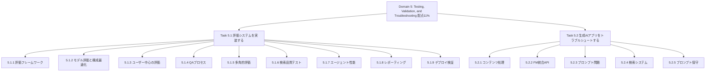

### 1.2 スキル早見表(出題キーワードと主要サービス)

| スキル | 一言でいうと | 主なキーワード | 主な AWS サービス・機能 |
|---|---|---|---|
| 5.1.1 | 良い回答とは何かを数値化する枠組み | relevance, factual accuracy, consistency, fluency | Bedrock Evaluations |
| 5.1.2 | 最適なモデル・設定を比較して選ぶ | A/B, canary, multi-model, token efficiency, latency-to-quality | Bedrock Model Evaluation, Lambda エイリアス, API Gateway |
| 5.1.3 | 利用者の声を品質改善に使う | feedback, rating, annotation | 人間評価ワークフロー, DynamoDB, S3 |
| 5.1.4 | 品質を継続的に守る仕組み | continuous evaluation, regression, quality gate | CodePipeline, CodeBuild, Step Functions |
| 5.1.5 | 複数の視点で評価する | RAG evaluation, LLM-as-a-Judge, human feedback | Bedrock Evaluations, Knowledge Bases |
| 5.1.6 | 検索部分だけを切り出して測る | relevance scoring, context matching, retrieval latency | Knowledge Bases 検索評価 |
| 5.1.7 | エージェントがちゃんと仕事をしたか測る | task completion, tool usage, reasoning quality | AgentCore Evaluations, Bedrock Agents トレース |
| 5.1.8 | 結果を関係者に伝える | visualization, automated report, comparison | CloudWatch ダッシュボード, QuickSight, Athena |
| 5.1.9 | 更新前後で壊れていないか確認する | synthetic workflow, hallucination rate, semantic drift | CloudWatch Synthetics, CloudWatch アラーム |
| 5.2.1 | 入力が多すぎる・切れる問題 | context window overflow, dynamic chunking, truncation | Converse API の stopReason, トークン数管理 |
| 5.2.2 | API 呼び出しが失敗する問題 | error logging, request validation, response analysis | Bedrock エラーコード, 呼び出しログ, CloudTrail |
| 5.2.3 | プロンプトの品質・安定性の問題 | prompt testing, version comparison | Bedrock Prompt Management |
| 5.2.4 | 検索が外れる問題 | embedding quality, drift, chunking, vector search tuning | Knowledge Bases, OpenSearch |
| 5.2.5 | プロンプトの継続的な保守 | template testing, CloudWatch Logs, X-Ray, schema validation | CloudWatch Logs Insights, X-Ray |

---

## 2. 前提知識: なぜ生成AIのテストは従来と違うのか

### 2.1 従来の ML 評価との違い

従来の機械学習(分類・回帰)は、正解ラベルが 1 つに決まるため「正解率(accuracy)」「F1」などで機械的に採点できました。生成AIは同じ質問に対して何通りもの正しい文章があり得るため、同じやり方では評価できません。

| 観点 | 従来の ML 評価 | 生成AI(FM)の評価 |
|---|---|---|
| 正解 | 1 つに決まる | 複数の許容回答がある |
| 主な指標 | accuracy, precision, recall, F1 | relevance(関連性), factual accuracy(事実性), consistency(一貫性), fluency(流暢さ), safety(安全性) |
| 採点方法 | 自動計算 | 自動指標 + LLM による採点 + 人間による採点の組み合わせ |
| 再現性 | 同じ入力なら同じ出力 | 同じ入力でも出力が揺れる(temperature など) |
| 失敗の型 | 誤分類 | ハルシネーション, 有害出力, 形式崩れ, 文脈切れ |
| 評価対象 | モデル単体 | モデル + プロンプト + 検索(RAG) + ツール + ガードレールの全体 |

### 2.2 評価とトラブルシュートの関係

評価(Task 5.1)は「問題を見つける仕組み」、トラブルシュート(Task 5.2)は「見つけた問題の原因を特定して直す手順」です。両者は 1 つのループになっています。

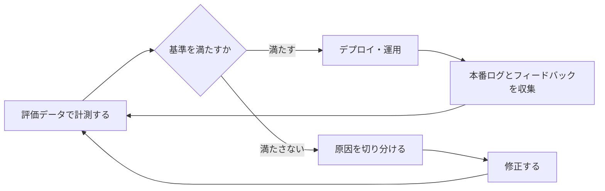

### 2.3 最初に覚える用語

| 用語 | 意味 |
|---|---|
| FM (Foundation Model) | 基盤モデル。Amazon Bedrock 上で呼び出す LLM など |
| ゴールデンデータセット | 質問と期待される回答(または評価観点)をセットにした、評価用の基準データ |
| LLM-as-a-Judge | 別の LLM に採点役をさせる評価方法 |
| RAG | 検索で取得した文書を根拠にして回答を生成する構成 |
| ハルシネーション | 根拠のない内容や事実と異なる内容をもっともらしく生成すること |
| セマンティックドリフト | 出力の意味内容が、時間や更新によって以前の基準からずれていくこと |
| リグレッションテスト | 変更後に、以前できていたことが壊れていないか確認するテスト |
| 品質ゲート | 基準を満たさなければ次の工程(デプロイ)に進ませない関門 |
| コンテキストウィンドウ | モデルが 1 回の呼び出しで扱える入力+出力のトークン上限 |
| チャンク | RAG で文書を分割した検索の単位 |

---

## 3. Task 5.1 生成AIの評価システムを実装する

### Task 5.1 の全体フロー

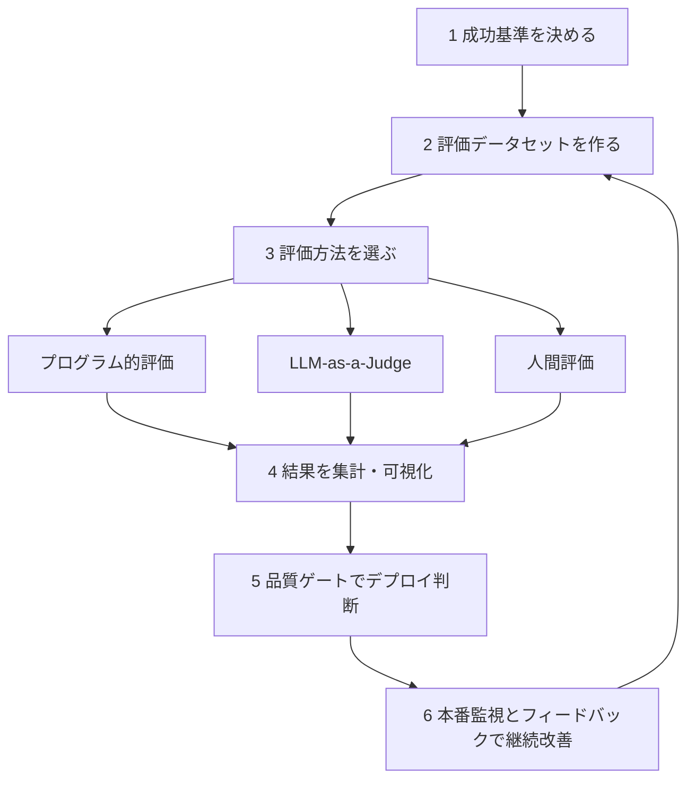

---

### Skill 5.1.1 評価フレームワーク(品質指標)

> 公式の出題文: 従来の ML 評価を超えて FM 出力の品質と有効性を評価する包括的な評価フレームワークを作る(例: relevance, factual accuracy, consistency, fluency の指標)。

#### やさしい説明

「この AI の回答は良いのか?」を、感覚ではなく**物差し(指標)**で測れるようにする設計図が評価フレームワークです。生成AIは正解が 1 つではないため、「何を良いとするか」を最初に言葉と数値で決めておく必要があります。

#### ステップで理解する

| Step | やること | 具体例(社内FAQボット) |
|---|---|---|
| 1 | 成功の定義を決める | 「社内規程に基づく正しい回答を、1回で解決できる」 |
| 2 | 指標を選ぶ | 関連性・事実性・一貫性・流暢さ・安全性・応答時間・コスト |
| 3 | 評価データを作る | 実際の問い合わせ 100〜500 件 + 期待回答(または評価観点) |
| 4 | 採点者を決める | 自動指標、LLM 採点、人間レビューの役割分担 |
| 5 | 合格基準(閾値)を決める | 事実性 0.9 以上、有害出力 0 件 など |
| 6 | ベースラインを測る | 現行のモデル+プロンプトで一度測り、基準値にする |
| 7 | 変更ごとに再測定 | プロンプトやモデルを変えるたびに同じデータで比較 |

#### 主な品質指標

| 指標 | 何を見るか | 測り方の例 |
|---|---|---|
| Relevance(関連性) | 質問に対して的を射た回答か | LLM 採点、人間評価 |
| Factual accuracy(事実性) | 事実や根拠文書と矛盾していないか | 参照回答との比較、faithfulness(根拠への忠実性)の採点 |
| Consistency(一貫性) | 同じ質問・言い換えに対して回答がぶれないか | 同一プロンプトを複数回実行して回答の類似度や判定のばらつきを比較 |
| Fluency / Coherence(流暢さ・論理的一貫性) | 文として自然で、話の筋が通っているか | LLM 採点 |
| Completeness(網羅性) | 必要な情報が抜けていないか | LLM 採点 |
| Safety(安全性) | 有害・偏見・不適切な内容がないか | Guardrails の判定、LLM 採点(harmfulness, stereotyping など) |
| Format compliance(形式遵守) | 指定した JSON などの形式を守るか | スキーマ検証(プログラム的) |
| Latency / Cost | 応答時間とトークンコスト | CloudWatch メトリクス |

#### 関連サービス・機能

| サービス・機能 | 役割 |
|---|---|
| Amazon Bedrock Evaluations | 自動評価(プログラム的)、LLM-as-a-Judge、人間評価を提供。カスタムメトリクスも作成可能 |
| Amazon S3 | 評価用データセット(JSONL など)と結果の保管 |
| Amazon CloudWatch | レイテンシ・トークン数などの運用指標 |

Bedrock のプログラム的な自動評価では、accuracy・robustness・toxicity などの定義済み指標を、用意済みまたはカスタムのデータセットで測れます。主観的な指標には人間評価ワークフローを設定できます。

#### ベストプラクティス

1. **指標は 1 つに絞らず複数にする。** 関連性が高くても事実が間違っていれば使えません。品質・安全・コストをセットで見ます。
2. **評価データは実際の利用ログから作る。** 開発者が思いつく質問だけでは偏ります。低評価だった実例や境界ケース(曖昧な質問、範囲外の質問)も入れます。
3. **評価データはバージョン管理する。** S3 のバージョニングや Git で履歴を残し、「どのデータで測った結果か」を追えるようにします。
4. **評価実行時は条件を固定する。** temperature などの推論パラメータとプロンプトのバージョンを記録し、比較の公平性を保ちます。
5. **ビジネス KPI と結びつける。** 「解決率」「問い合わせ削減数」など、事業成果に対応づけます。

#### 試験での狙われ方

- 「従来の精度指標だけでは不十分。FM 出力を評価するには?」→ relevance / factual accuracy / consistency / fluency など**複数観点の指標と、LLM・人間を含む評価**を組み合わせる。
- 「ハルシネーションを検出したい」→ 根拠文書との整合性(faithfulness / groundedness)を測る評価を設計する。

#### 根拠ソース

- [Exam Guide Domain 5(Skill 5.1.1)](https://docs.aws.amazon.com/aws-certification/latest/ai-professional-01/ai-professional-01-domain5.html)
- [Amazon Bedrock Evaluations(製品ページ)](https://aws.amazon.com/bedrock/evaluations/)
- [Amazon Bedrock モデル評価(ユーザーガイド)](https://docs.aws.amazon.com/bedrock/latest/userguide/evaluation.html)

---

### Skill 5.1.2 モデル評価システムと構成の最適化

> 公式の出題文: 最適な構成を特定する体系的なモデル評価システムを作る(例: Bedrock Model Evaluations、FM の A/B テストとカナリアテスト、マルチモデル評価、トークン効率・レイテンシ対品質比・ビジネス成果のコストパフォーマンス分析)。

#### やさしい説明

「どのモデル」「どのプロンプト」「どのパラメータ」が、自分たちの用途で最も良いかを**同じ条件で比べて決める**仕組みです。品質だけでなく、コストと速度も同時に比べるのがポイントです。

#### 評価方法の選び方

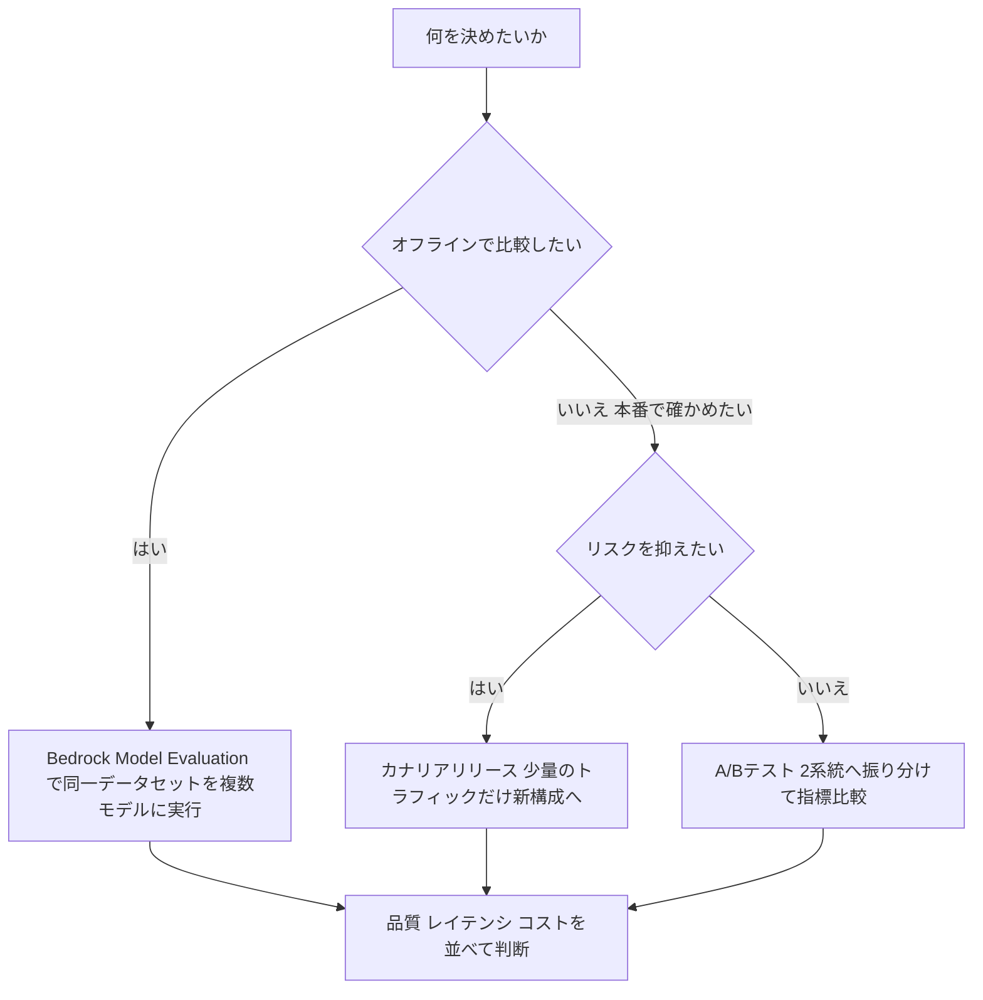

| 手法 | 何をする | いつ使う |
|---|---|---|
| Bedrock Model Evaluation(自動) | 用意したデータセットでモデルを採点 | 導入前のモデル選定、プロンプト変更の事前確認 |
| Bedrock Model Evaluation(人間) | 人が回答を比較・評価 | 文体・好みなど主観的な品質 |
| マルチモデル評価 | 同一データを複数モデルで実行して比較 | モデル選定、世代更新の影響確認 |
| A/B テスト | 利用者を 2 グループに分けて並行比較 | 本番でユーザー行動(解決率・満足度)を比較したい |
| カナリアテスト | 新構成を少量(例: 数%)の本番トラフィックに限定公開 | 安全に段階展開したい。異常時は即ロールバック |

#### A/B・カナリアを実現する AWS の仕組み(例)

| 仕組み | 使い方 |
|---|---|
| AWS Lambda エイリアスの加重ルーティング | 同じ関数の 2 バージョンへ重み付けでトラフィックを分ける |
| Amazon API Gateway のカナリアリリース | ステージ単位で一部のリクエストを新バージョンへ |
| AWS AppConfig | 機能フラグでモデル ID・プロンプトバージョンを切り替え、段階展開 |
| Amazon CloudWatch アラーム | カナリア中のエラー率・レイテンシ・品質スコアを監視して自動ロールバックの判断材料にする |

#### コストパフォーマンス分析の指標

| 指標 | 意味 | 見る場所 |
|---|---|---|
| Token efficiency(トークン効率) | 同じ品質を何トークンで達成したか | Bedrock の入出力トークン数メトリクス(InputTokenCount, OutputTokenCount) |
| Latency-to-quality ratio | 速度に対する品質のバランス | InvocationLatency と評価スコアを同じ表で比較 |
| Cost per successful task | 成功 1 件あたりのコスト | 成功率 ÷ 総コスト |
| Business outcome | 事業成果 | 解決率、CVR、問い合わせ削減など |

> 補足: 「一番高性能なモデル」が最適とは限りません。要件を満たす最も安価・高速なモデルを選ぶのが原則です。

#### ベストプラクティス

1. **同一データ・同一プロンプト・同一パラメータで比較する。** 条件が違うと比較になりません。
2. **品質・速度・コストの 3 軸で表にする。** 一軸だけで判断しません。
3. **カナリアは「小さく始めて広げる」。** 異常を検知したら自動で元に戻せる仕組み(アラーム連動)を先に用意します。
4. **本番では指標が揃うまで十分な件数を確保する。** 少数のサンプルで勝敗を判断しません。
5. **LLM-as-a-Judge を使う場合は 1 評価ジョブ 1 モデル。** 複数モデル比較は評価ジョブを分けて実施し、同じ評価データ・同じジャッジで揃えます。

#### 試験での狙われ方

- 「新しいモデル候補を本番影響なしで比較したい」→ Bedrock Model Evaluation による事前評価。
- 「本番で少量のトラフィックだけ新プロンプトを試し、問題があればすぐ戻したい」→ カナリア(Lambda エイリアス重み付け / API Gateway カナリア / AppConfig)+ CloudWatch アラーム。
- 「コストと品質のバランスを定量化したい」→ トークン数、レイテンシ、品質スコアを並べたコストパフォーマンス分析。

#### 根拠ソース

- [Exam Guide Domain 5(Skill 5.1.2)](https://docs.aws.amazon.com/aws-certification/latest/ai-professional-01/ai-professional-01-domain5.html)
- [Amazon Bedrock Evaluations(製品ページ)](https://aws.amazon.com/bedrock/evaluations/)
- [AWS News Blog: New RAG evaluation and LLM-as-a-judge capabilities in Amazon Bedrock](https://aws.amazon.com/blogs/aws/new-rag-evaluation-and-llm-as-a-judge-capabilities-in-amazon-bedrock)
- [Use custom metrics to evaluate your generative AI application with Amazon Bedrock(1 ジョブ 1 モデルの記述あり)](https://aws.amazon.com/blogs/machine-learning/use-custom-metrics-to-evaluate-your-generative-ai-application-with-amazon-bedrock/)
- [AWS Lambda エイリアス(加重ルーティング)](https://docs.aws.amazon.com/lambda/latest/dg/configuration-aliases.html)
- [Amazon CloudWatch Bedrock メトリクス・生成AIオブザーバビリティ](https://docs.aws.amazon.com/AmazonCloudWatch/latest/monitoring/GenAI-observability.html)

---

### Skill 5.1.3 ユーザー中心の評価

> 公式の出題文: ユーザー体験に基づいて FM の性能を継続的に改善する、ユーザー中心の評価の仕組みを作る(例: フィードバック UI、出力の評価システム、回答品質を評価するアノテーションワークフロー)。

#### やさしい説明

自動評価では拾えない「使っている人が本当に役に立ったと感じたか」を集めて、改善に回す仕組みです。

#### ステップで理解する

| Step | やること | 実装のヒント |
|---|---|---|
| 1 | フィードバック収集 UI を付ける | 回答ごとの 👍 / 👎、5 段階評価、自由記述コメント |
| 2 | リクエストと結びつけて保存 | リクエスト ID / トレース ID、プロンプトバージョン、モデル ID と一緒に DynamoDB や S3 に保存 |
| 3 | 暗黙のシグナルも集める | 再質問・やり直し・離脱・コピー操作など |
| 4 | 低評価をサンプリングしてアノテーション | 人間が回答を採点(正確性、有用性、トーン等) |
| 5 | 評価データセットに還元 | 問題のあった質問をゴールデンデータセットに追加 |
| 6 | 改善して再評価 | プロンプト・検索設定・モデルを修正し、リグレッション確認 |

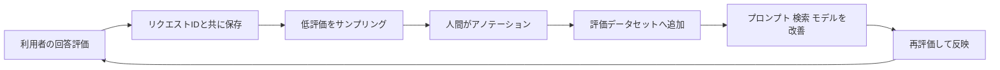

#### 関連サービス・機能

| サービス・機能 | 役割 |
|---|---|
| Amazon Bedrock の人間評価 | 自社チームまたは AWS 管理のチームで回答を評価するワークフロー |
| Amazon DynamoDB / Amazon S3 | フィードバックと評価結果の保存 |
| Amazon API Gateway + AWS Lambda | フィードバック受付 API |
| Amazon SageMaker Ground Truth / Amazon Augmented AI(A2I) | アノテーション・人間レビューの作業フロー(補助的な選択肢) |
| Amazon Athena / Amazon QuickSight | フィードバックの集計・可視化 |

#### ベストプラクティス

1. **フィードバックは「どの回答に対するものか」を必ず紐づける。** リクエスト ID・プロンプトバージョン・モデル ID・取得文書 ID を一緒に保存します。
2. **評価基準(ルーブリック)を文章で定義する。** アノテーター間で採点がぶれないよう、基準と例を渡します。
3. **個人情報を扱う場合はマスキングと権限分離を行う。** フィードバックやログにはユーザー入力が含まれます。
4. **低評価だけでなく高評価もサンプリングする。** 良い例を「守るべき挙動」としてリグレッションテストに使えます。
5. **フィードバックの収集コストを下げる。** 入力の負担が少ないほど回収率が上がります。

#### 試験での狙われ方

- 「ユーザー体験を継続的に改善したい」→ フィードバック UI + 評価保存 + アノテーション + 評価データセットへの還元、というループを選ぶ。

#### 根拠ソース

- [Exam Guide Domain 5(Skill 5.1.3)](https://docs.aws.amazon.com/aws-certification/latest/ai-professional-01/ai-professional-01-domain5.html)
- [Amazon Bedrock Evaluations(人間評価の記述)](https://aws.amazon.com/bedrock/evaluations/)
- [Amazon Augmented AI(A2I)人間レビュー](https://docs.aws.amazon.com/sagemaker/latest/dg/a2i-use-augmented-ai-a2i-human-review-loops.html)

---

### Skill 5.1.4 品質保証(QA)プロセス

> 公式の出題文: FM の一貫した性能基準を維持する体系的な QA プロセスを作る(例: 継続的評価ワークフロー、モデル出力のリグレッションテスト、デプロイ時の自動品質ゲート)。

#### やさしい説明

通常のソフトウェアの CI/CD に「回答の品質テスト」を組み込み、基準を下回る変更は自動で止める仕組みです。

#### ステップで理解する

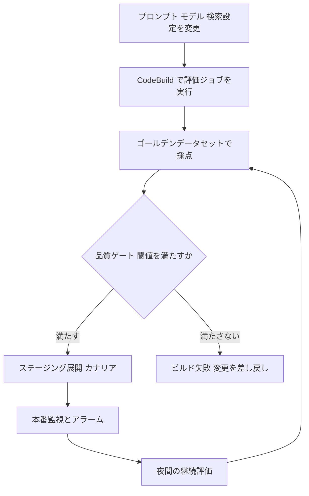

| Step | やること |
|---|---|
| 1 | リグレッション用の評価セットを固定する(過去に問題があった質問・守るべき回答を含める) |
| 2 | 変更のたびに CI で評価を自動実行する |
| 3 | 品質ゲートの閾値を数値で決める(例: 事実性スコア・形式遵守率・有害出力ゼロ) |
| 4 | 閾値未達ならデプロイを止める(CodePipeline のステージ失敗、承認待ち) |
| 5 | デプロイ後も定期的(夜間など)に継続評価を回す |
| 6 | 結果を保存し、前回との差分(劣化)を検知する |

#### 関連サービス・機能

| サービス | 役割 |
|---|---|
| AWS CodePipeline / AWS CodeBuild | 評価をパイプラインに組み込み、ゲートで停止 |
| AWS Step Functions | 評価の複数ステップ(実行→採点→集計→判定)のオーケストレーション |
| Amazon EventBridge Scheduler | 夜間・定期の継続評価のトリガー |
| Amazon Bedrock Evaluations | 自動評価ジョブ |
| Amazon S3 | 評価データセット・結果の保管とバージョニング |
| Amazon CloudWatch アラーム | 品質メトリクスの劣化通知 |

#### ベストプラクティス

1. **プロンプトもコードと同じく変更管理する。** バージョン管理し、変更のたびにテストを走らせます。
2. **リグレッションセットは育てる。** 本番で見つかった失敗は必ずテストに追加します。
3. **ゲートは「平均」だけでなく「最悪ケース」も見る。** 有害出力ゼロ、重要質問の正答など、個別の必須条件を設けます。
4. **評価の揺らぎを考慮する。** 生成の非決定性があるため、複数回実行や統計的な余裕を持たせた閾値にします。
5. **継続評価で「モデル側の更新」も検知する。** モデルバージョンが変わった場合も同じ評価を自動実行します。

#### 試験での狙われ方

- 「プロンプト変更で品質が劣化しないよう自動で防ぎたい」→ CI/CD に評価ジョブとゲートを組み込む。
- 「モデルのバージョン更新後に出力が変わっていないか確認したい」→ リグレッションテスト(ゴールデンデータセットで比較)。

#### 根拠ソース

- [Exam Guide Domain 5(Skill 5.1.4)](https://docs.aws.amazon.com/aws-certification/latest/ai-professional-01/ai-professional-01-domain5.html)
- [Amazon Bedrock AgentCore Evaluations GA(CI/CD でのリグレッションテスト対応の記述)](https://aws.amazon.com/about-aws/whats-new/2026/03/agentcore-evaluations-generally-available)
- [AWS CodePipeline ドキュメント](https://docs.aws.amazon.com/codepipeline/latest/userguide/welcome.html)

---

### Skill 5.1.5 多角的な評価(RAG評価 / LLM-as-a-Judge / 人間評価)

> 公式の出題文: FM 出力を複数の視点から徹底的に評価する(例: RAG 評価、LLM-as-a-Judge による自動品質評価、人間のフィードバック収集インターフェース)。

#### やさしい説明

1 つの採点方法だけでは必ず盲点ができます。そこで「機械的な自動指標」「LLM による採点」「人間による採点」を組み合わせ、さらに RAG の場合は「検索」と「生成」を分けて評価します。

#### 3 つの評価者の比較

| 評価者 | 長所 | 短所 | 向いている場面 |
|---|---|---|---|
| プログラム的(自動指標) | 速い・安い・再現性が高い | 意味の良し悪しは測りにくい | 形式遵守、定型の正誤、毒性判定、大量の回帰テスト |
| LLM-as-a-Judge | 人間に近い観点を大量・低コストで採点 | ジャッジの癖(偏り)がある | 正確性・網羅性・有用性・忠実性などの日常的な評価 |
| 人間評価 | 最も信頼でき、主観的な品質も測れる | 遅い・高い・基準がぶれる | 最終判断、ジャッジの校正、ブランドトーン |

#### Amazon Bedrock Evaluations でできること

| 機能 | 内容 |
|---|---|
| モデル評価(LLM-as-a-Judge) | カスタムのプロンプトデータセットに対して、正確性・網羅性・有害性などの指標で評価 |
| RAG 検索のみの評価 | 検索品質を context relevance(文脈の関連性)・context coverage(文脈のカバー率)などで評価 |
| RAG 検索+生成の評価 | エンドツーエンドの回答品質を評価。Knowledge Bases 以外の自前 RAG の出力も評価可能 |
| カスタムメトリクス | 独自の評価観点をジャッジ用プロンプトとして定義して追加 |
| 引用系の指標 | citation precision / citation coverage(引用の精度・網羅性)が RAG 評価に追加されている |

> 評価はジャッジとなる LLM を選び、データセットを S3 に置き、指標を選んで実行する流れです。評価ジョブには Bedrock と S3 にアクセスできる IAM サービスロールが必要です。

#### RAG は「2 段階」に分けて評価する

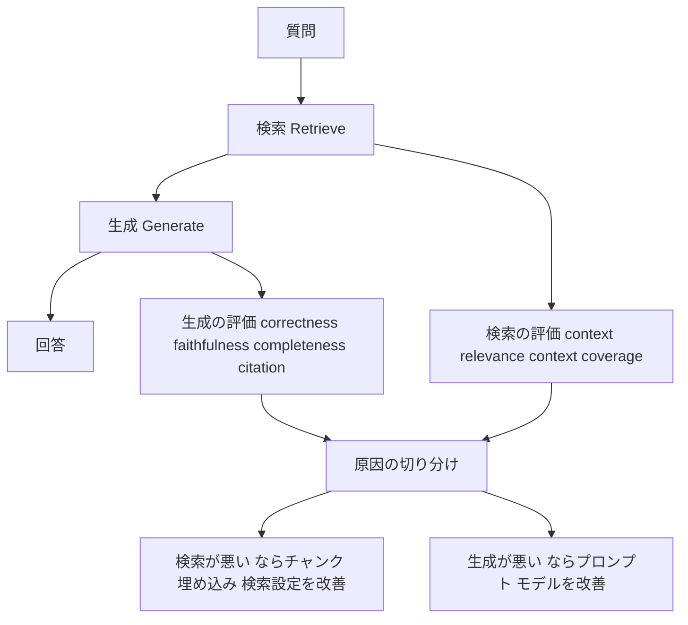

| 結果 | 疑うべき場所 |
|---|---|
| 検索スコアが低い | チャンク分割、埋め込みモデル、検索方式、メタデータフィルタ |
| 検索は良いが回答が悪い | プロンプト、モデル選択、コンテキストの詰め込み方 |
| 回答は流暢だが根拠がない | faithfulness(忠実性)が低い。根拠提示の指示や引用の要求を強化 |

#### LLM-as-a-Judge のベストプラクティス

1. **ジャッジのプロンプトに明確な基準とスケールを書く。** 曖昧な基準は採点のぶれにつながります。
2. **ジャッジを人間評価で校正する。** 少数のサンプルで人間とジャッジの一致度を確認します。
3. **ジャッジの偏りに注意する。** 長い回答を好む、順序で結果が変わる、自分と同系統のモデルを好む、といった傾向が知られています。順序を入れ替えて再評価するなど対策します。
4. **評価対象と別のモデルをジャッジにするのが無難。** 自己評価の甘さを避けます。
5. **評価コストを見積もる。** RAG 評価は 1 テストケースにつき複数回の LLM 呼び出しが発生するため、データセットの規模とジャッジモデルの価格を事前に確認します。
6. **人間フィードバックの収集 UI を併設する。** 本番の低評価をアノテーションに回します(Skill 5.1.3)。

#### 試験での狙われ方

- 「RAG の回答が悪い。検索と生成のどちらが原因か切り分けたい」→ 検索のみの評価と、検索+生成のエンドツーエンド評価を分けて実行。
- 「大量の出力を人間に近い基準で低コストに採点したい」→ LLM-as-a-Judge。
- 「主観的な品質(トーン等)の最終確認」→ 人間評価。

#### 根拠ソース

- [Exam Guide Domain 5(Skill 5.1.5)](https://docs.aws.amazon.com/aws-certification/latest/ai-professional-01/ai-professional-01-domain5.html)
- [Amazon Bedrock Evaluations(製品ページ)](https://aws.amazon.com/bedrock/evaluations/)
- [AWS News Blog: New RAG evaluation and LLM-as-a-judge capabilities in Amazon Bedrock](https://aws.amazon.com/blogs/aws/new-rag-evaluation-and-llm-as-a-judge-capabilities-in-amazon-bedrock)
- [AWS ML Blog: Use custom metrics to evaluate your generative AI application with Amazon Bedrock](https://aws.amazon.com/blogs/machine-learning/use-custom-metrics-to-evaluate-your-generative-ai-application-with-amazon-bedrock/)
- 補足(第三者): [Evaluating RAG using Bedrock's built-in LLM-as-a-Judge(Part 2)](https://medium.com/@shawn-jiang/evaluating-llms-on-amazon-bedrock-part-2-9d90a9672ebe)

---

### Skill 5.1.6 検索品質テスト

> 公式の出題文: FM を補強する情報検索コンポーネントを評価・最適化する検索品質テストを実装する(例: 関連性スコア、コンテキスト一致の検証、検索レイテンシの測定)。

#### やさしい説明

RAG では「正しい文書が取れていなければ、どんなに賢いモデルでも正しく答えられません」。そこで、生成を切り離して**検索だけ**を測ります。

#### 測る 3 つの観点

| 観点 | 問い | 指標の例 |
|---|---|---|
| 関連性 | 取れた文書は質問に関係あるか | context relevance、Precision@k(上位 k 件のうち関連する割合) |
| 網羅性 | 必要な情報は全部取れているか | context coverage、Recall@k |
| 順位の良さ | 重要な文書が上位に来ているか | MRR、nDCG(順位を考慮した指標) |
| 速度 | 検索に何ミリ秒かかるか | 検索レイテンシ(p50 / p95 / p99) |

#### ステップで理解する

| Step | やること |
|---|---|
| 1 | 質問と「取れるべき文書(正解チャンク)」のペアを作る |
| 2 | 検索のみの評価を実行する(Bedrock の RAG 検索評価、または自前スクリプト) |
| 3 | 関連性・網羅性・順位・レイテンシを集計する |
| 4 | チャンクサイズ・検索方式・件数・リランカーなどを 1 つずつ変えて再測定する |
| 5 | 改善した設定を本番に反映し、継続的に監視する |

#### 検索品質を改善する主なつまみ(Bedrock Knowledge Bases)

| つまみ | 効果 |
|---|---|
| チャンク戦略(固定長 / 階層 / セマンティック / カスタム Lambda) | 検索単位の質が変わる |
| ハイブリッド検索 | 意味検索とキーワード検索を併用して、固有名詞・型番などの取りこぼしを減らす |
| リランカーモデル | 取得結果を質問への関連度で並べ替える |
| メタデータフィルタ | 部署・日付・文書種別で候補を絞り込む |
| 取得件数の調整 | 既定では少数のチャンクを返す。増やすと再現率は上がるがコストとノイズも増える |
| クエリ分解 | 複数観点の質問を分割して検索する |

#### ベストプラクティス

1. **検索を単体で評価する。** 生成の揺らぎを排除でき、原因が特定しやすくなります。
2. **「1 つずつ変更」して比較する。** 複数同時に変えると効果の要因が不明になります。
3. **品質とレイテンシのトレードオフを見る。** リランキングは品質を上げる一方で遅延が増えます。両方を測って判断します。
4. **評価データに難しい質問(言い換え、略語、複数文書にまたがる質問)を含める。**
5. **文書更新後も定期的に再評価する。** 内容の古さや追加文書による劣化(ドリフト)を検出します。

#### 試験での狙われ方

- 「RAG の検索精度を定量的にテストしたい」→ 検索のみの評価(context relevance / coverage)+ レイテンシ測定。
- 「型番や固有名詞が検索で外れる」→ ハイブリッド検索(キーワード併用)。
- 「上位に関連性の低い文書が混じる」→ リランカー、メタデータフィルタ。

#### 根拠ソース

- [Exam Guide Domain 5(Skill 5.1.6)](https://docs.aws.amazon.com/aws-certification/latest/ai-professional-01/ai-professional-01-domain5.html)
- [Amazon Bedrock Evaluations(RAG 検索評価)](https://aws.amazon.com/bedrock/evaluations/)
- [AWS re:Post: Amazon Bedrock Knowledge Bases の検索精度を改善するには](https://repost.aws/knowledge-center/bedrock-knowledge-bases-accurate-results-filters)
- [Amazon Bedrock Knowledge Bases ユーザーガイド](https://docs.aws.amazon.com/bedrock/latest/userguide/knowledge-base.html)
- 補足(第三者): [Amazon Bedrock Knowledge Bases Retrieval Quality Engineering](https://hidekazu-konishi.com/entry/amazon_bedrock_knowledge_bases_retrieval_quality_engineering.html)

---

### Skill 5.1.7 エージェント性能フレームワーク

> 公式の出題文: エージェントがタスクを正しく効率的に遂行することを確認する性能フレームワークを作る(例: タスク完了率の測定、ツール使用の有効性評価、Amazon Bedrock Agent の評価、マルチステップワークフローでの推論品質の評価)。

#### やさしい説明

エージェントは「考える → ツールを呼ぶ → 結果を見て次を考える」を繰り返します。最終回答だけでなく、**途中の判断(どのツールを、どんな引数で呼んだか)**も評価する必要があります。

#### 評価する 3 つの層

| 層 | 問い | 指標の例 |
|---|---|---|
| 結果 | ユーザーの目的を達成したか | タスク完了率、Goal success rate |
| 過程(ツール) | 正しいツールを正しい引数で呼んだか | Tool selection accuracy(ツール選択精度)、Tool parameter accuracy(引数精度)、Tool call error rate(呼び出し失敗率) |
| 過程(推論) | 筋道立てて考えられたか、無駄な手順はないか | 推論の質、ステップ数、無限ループの有無、レイテンシ・コスト |

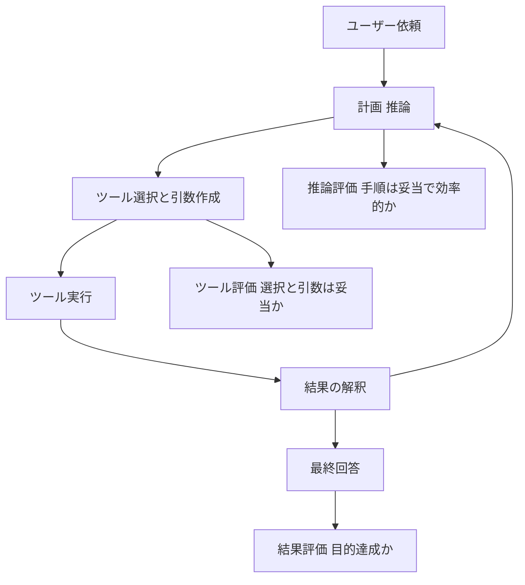

#### 関連サービス・機能

| サービス・機能 | 内容 |
|---|---|
| Amazon Bedrock AgentCore Evaluations | エージェント向けのマネージド評価。2026 年 3 月 31 日に一般提供開始。オンライン評価(本番トラフィックをサンプリングして継続採点)とオンデマンド評価(CI/CD でのリグレッションテスト等)の 2 種類 |
| 組み込み評価器(13 種) | 応答品質、安全性、タスク完了、ツール使用などを評価 |
| Ground Truth | 参照回答、セッション単位の期待行動(アサーション)、期待するツール実行順序などを基準として評価 |
| カスタム評価器 | LLM ベース(プロンプトとモデルを指定)または Lambda ホストのコードベース(Python / JavaScript) |
| AgentCore Observability / CloudWatch | 評価結果を観測データと同じ場所で可視化し、アラートも設定可能 |
| Amazon Bedrock Agents のトレース | エージェントの各ステップ(推論・ツール呼び出し)を確認 |
| オープンソース手法 | Ragas などで RAG 部分、LLM-as-a-judge で推論やテキスト→SQL を評価する構成例が AWS ブログで公開されている |

> 試験ガイドの表現は「Amazon Bedrock Agent evaluations」です。AgentCore Evaluations は 2026 年の GA 機能なので、学習時は「Bedrock のエージェント評価全般」として両方(Bedrock Agents のトレース確認と AgentCore Evaluations)を押さえてください。

#### ベストプラクティス

1. **最終回答だけで合否を決めない。** ツール選択や引数ミスが隠れた失敗の原因になります。
2. **期待するツール呼び出し順序を Ground Truth として用意する。** 重要なワークフローは手順まで検証します。
3. **本番ではオンライン評価でサンプリング監視、変更時はオンデマンド評価でリグレッション確認。** 役割を分けます。
4. **ステップ数・トークン・レイテンシも指標にする。** 正しくても無駄に長いエージェントは運用コストが高くなります。
5. **ツール側のエラー(タイムアウト、権限不足)とエージェントの判断ミスを切り分ける。** ツール呼び出し失敗率と選択精度を別々に見ます。

#### 試験での狙われ方

- 「エージェントが正しいツールを選んでいるか測りたい」→ Tool selection accuracy / Tool parameter accuracy。
- 「本番のエージェント品質を継続的に監視したい」→ AgentCore Evaluations のオンライン評価 + CloudWatch アラート。
- 「リリース前にエージェントの回帰テストを CI/CD で回したい」→ オンデマンド評価。

#### 根拠ソース

- [Exam Guide Domain 5(Skill 5.1.7)](https://docs.aws.amazon.com/aws-certification/latest/ai-professional-01/ai-professional-01-domain5.html)
- [What's New: Amazon Bedrock AgentCore Evaluations is now generally available(日本語版)](https://aws.amazon.com/jp/about-aws/whats-new/2026/03/agentcore-evaluations-generally-available/)
- [AWS News Blog: Amazon Bedrock AgentCore adds quality evaluations and policy controls](https://aws.amazon.com/blogs/aws/amazon-bedrock-agentcore-adds-quality-evaluations-and-policy-controls-for-deploying-trusted-ai-agents/)
- [AWS ML Blog: Evaluating AI agents: Real-world lessons from building agentic systems at Amazon](https://aws.amazon.com/blogs/machine-learning/evaluating-ai-agents-real-world-lessons-from-building-agentic-systems-at-amazon)
- [AWS ML Blog: Evaluate Amazon Bedrock Agents with Ragas and LLM-as-a-judge](https://aws.amazon.com/blogs/machine-learning/evaluate-amazon-bedrock-agents-with-ragas-and-llm-as-a-judge)

---

### Skill 5.1.8 レポーティング

> 公式の出題文: FM 実装の性能指標とインサイトを関係者に効果的に伝える総合的なレポーティングシステムを作る(例: 可視化ツール、自動レポート、モデル比較の可視化)。

#### やさしい説明

評価結果は、見られて判断に使われて初めて価値があります。読む人(経営層・プロダクト担当・エンジニア)ごとに見せ方を変え、自動で定期配信する仕組みを作ります。

#### 読み手ごとの見せ方

| 読み手 | 知りたいこと | 見せる指標 | 形式 |
|---|---|---|---|
| 経営層・事業責任者 | 投資対効果は出ているか | 解決率、問い合わせ削減数、コスト | 週次・月次の要約レポート |
| プロダクト担当 | 利用者は満足しているか | 満足度、低評価の理由分類 | ダッシュボード |
| エンジニア | どこが劣化したか、原因は何か | 品質スコア、検索指標、エラー率、レイテンシ、トークン | 詳細ダッシュボード、アラート |
| リスク・ガバナンス | 安全性・コンプライアンスは守られているか | 有害出力件数、ガードレール介入数 | 監査用レポート |

#### 自動レポートの構成

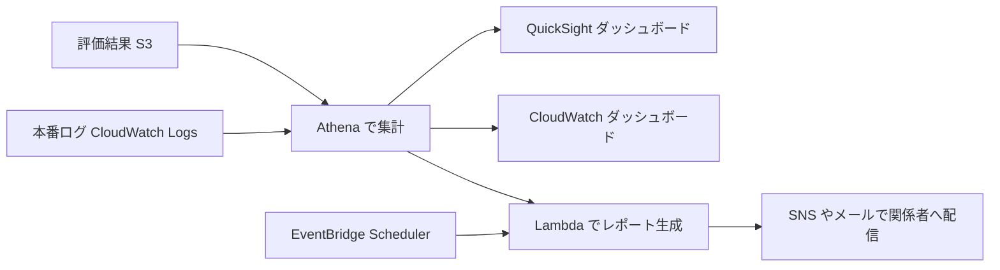

| サービス | 役割 |
|---|---|
| Amazon S3 + AWS Glue / Amazon Athena | 評価結果を SQL で集計 |
| Amazon QuickSight | 経営・プロダクト向けの可視化 |
| Amazon CloudWatch ダッシュボード・アラーム | 運用メトリクスの可視化と通知 |
| Amazon EventBridge Scheduler + AWS Lambda | 定期的な自動レポート生成 |
| Amazon SNS / Amazon SES | レポート配信 |
| Bedrock Evaluations のレポート画面 | 評価ジョブごとの指標を確認(モデル比較にも利用) |

#### モデル比較を伝えるときの可視化の例

| 見せたいこと | 向いている表現 |
|---|---|
| 複数モデルの品質差 | 指標ごとの棒グラフ、比較表 |
| 品質とコストのトレードオフ | 散布図(横軸: コスト、縦軸: 品質) |
| 時系列の劣化・改善 | 折れ線グラフ(バージョン変更点に注釈) |
| 失敗の内訳 | 失敗カテゴリ別の積み上げ棒グラフ |

#### ベストプラクティス

1. **指標には必ず「基準値」と「前回比」を併記する。** 数字だけでは良し悪しが分かりません。
2. **レポートに評価条件(データセットのバージョン、モデル ID、プロンプトバージョン)を載せる。** 再現可能性を担保します。
3. **アラートとレポートを分ける。** 緊急事態はアラート、傾向は定期レポートで伝えます。
4. **ビジネス指標と技術指標を並べて見せる。** 技術的な改善が事業成果につながっているかを示します。

#### 試験での狙われ方

- 「評価結果を定期的にステークホルダーへ自動共有したい」→ EventBridge Scheduler + Lambda + Athena / QuickSight(または SNS 配信)。
- 「複数モデルの比較結果を可視化したい」→ QuickSight や CloudWatch ダッシュボードでの比較可視化。

#### 根拠ソース

- [Exam Guide Domain 5(Skill 5.1.8)](https://docs.aws.amazon.com/aws-certification/latest/ai-professional-01/ai-professional-01-domain5.html)
- [Amazon CloudWatch 生成AIオブザーバビリティ](https://docs.aws.amazon.com/AmazonCloudWatch/latest/monitoring/GenAI-observability.html)
- [Amazon QuickSight ユーザーガイド](https://docs.aws.amazon.com/quicksight/latest/user/welcome.html)
- [Amazon Athena ユーザーガイド](https://docs.aws.amazon.com/athena/latest/ug/what-is.html)

---

### Skill 5.1.9 デプロイ検証

> 公式の出題文: FM の更新時にも信頼性を維持するデプロイ検証システムを作る(例: 合成ユーザーワークフロー、ハルシネーション率とセマンティックドリフトの AI 特有の出力検証、応答の一貫性を確認する自動品質チェック)。

#### やさしい説明

モデルやプロンプトを更新した直後に、「本番で期待どおりに動いているか」を自動で確かめる仕組みです。通常のヘルスチェック(動いているか)に加えて、**答えの中身が劣化していないか**も検証します。

#### 検証の流れ

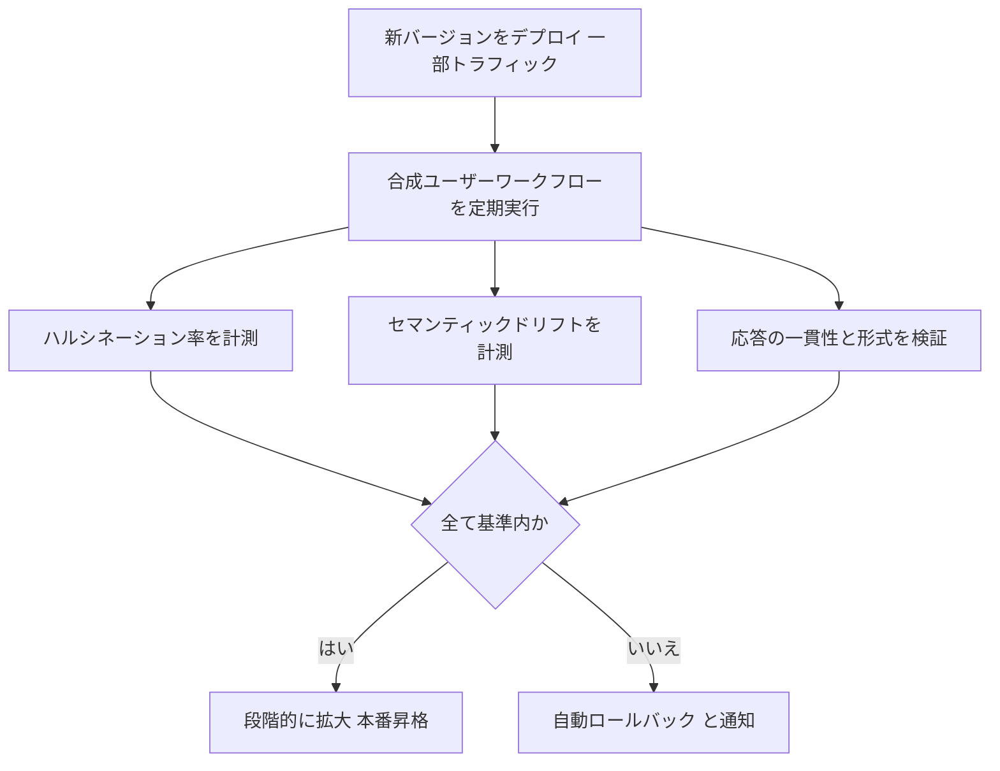

#### 検証項目

| 項目 | 内容 | 方法の例 |
|---|---|---|
| 合成ユーザーワークフロー | 実際の利用者の操作を模した定型シナリオを本番に流す | CloudWatch Synthetics のカナリア(API を定期的に呼び出し応答を検証)、独自の Lambda |
| ハルシネーション率 | 根拠のない回答の割合 | 根拠文書との整合性を LLM-as-a-Judge で採点(faithfulness) |
| セマンティックドリフト | 回答の意味が基準からずれていないか | 基準回答と新回答の埋め込みベクトルの類似度を比較し、閾値以下で警告 |
| 応答の一貫性 | 同じ質問に同じ傾向で答えるか | 同一質問の複数回実行での判定ばらつき |
| 形式・スキーマ | JSON などの構造が壊れていないか | JSON スキーマ検証 |
| 運用指標 | エラー率、レイテンシ、トークン使用量 | CloudWatch メトリクスとアラーム |

> 「セマンティックドリフト」は、単語が違っても意味が同じなら問題ないため、文字列一致ではなく**意味(埋め込み)の類似度**で測るのがポイントです。

#### ベストプラクティス

1. **デプロイ前の評価(オフライン)とデプロイ後の検証(オンライン)を両方行う。** どちらか片方では不十分です。
2. **ロールバック手段を先に用意する。** Lambda エイリアスの切り戻し、AppConfig の機能フラグ、モデル ID の旧版固定など。
3. **モデル ID は「最新」に自動追従させず明示的に固定する。** 意図しない挙動変化を防ぎ、更新時に評価してから切り替えます。
4. **合成ワークフローは「重要な業務シナリオ」を網羅する。** 正常系だけでなく、範囲外の質問・拒否すべき質問も含めます。
5. **ベースライン(基準回答・基準スコア)を保存し、更新のたびに比較する。**

#### 試験での狙われ方

- 「モデル更新後にハルシネーションが増えていないか自動で確認したい」→ 合成ワークフロー + faithfulness 評価 + アラーム。
- 「回答の意味がじわじわ変化していないか検知したい」→ 埋め込み類似度によるセマンティックドリフト監視。
- 「問題が出たらすぐ元に戻したい」→ カナリア展開 + CloudWatch アラーム連動のロールバック。

#### 根拠ソース

- [Exam Guide Domain 5(Skill 5.1.9)](https://docs.aws.amazon.com/aws-certification/latest/ai-professional-01/ai-professional-01-domain5.html)
- [Amazon CloudWatch Synthetics(カナリア)](https://docs.aws.amazon.com/AmazonCloudWatch/latest/monitoring/CloudWatch_Synthetics_Canaries.html)
- [AWS Lambda エイリアス(加重ルーティング)](https://docs.aws.amazon.com/lambda/latest/dg/configuration-aliases.html)
- [Amazon CloudWatch 生成AIオブザーバビリティ](https://docs.aws.amazon.com/AmazonCloudWatch/latest/monitoring/GenAI-observability.html)

---

## 4. Task 5.2 生成AIアプリをトラブルシュートする

### 4.0 トラブルシュートの基本方針

生成AIアプリは「入力 → プロンプト → 検索 → モデル → 後処理 → 出力」と多くの部品がつながっています。**どの部品の問題かを切り分ける**ことが最初の仕事です。

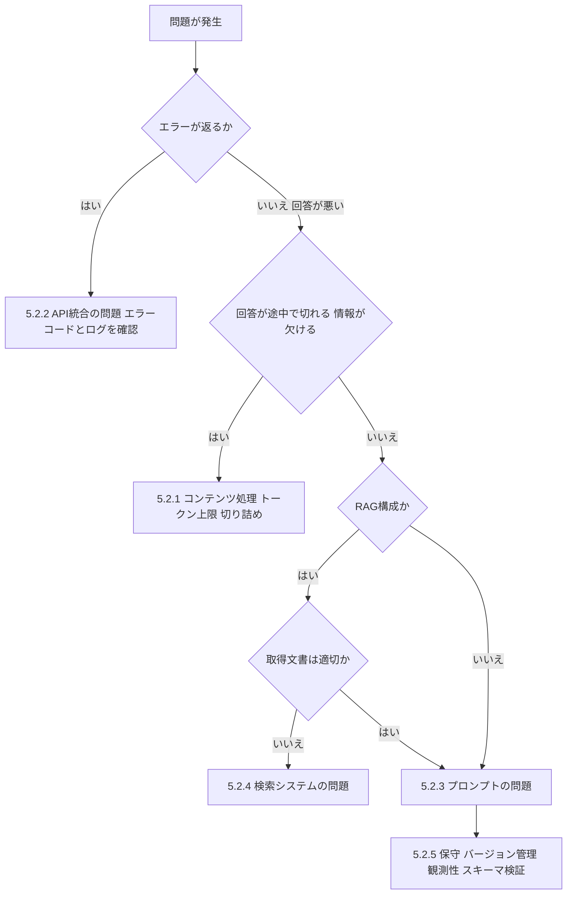

| 症状 | 最初に疑う場所 | 最初に見るもの |
|---|---|---|
| ThrottlingException など API エラー | 5.2.2 | エラーコード、クォータ、リトライ設定 |
| 出力が途中で切れる | 5.2.1 | Converse API の stopReason、maxTokens |
| 入力が長すぎるというエラー | 5.2.1 | 入力トークン数、コンテキストウィンドウ |
| 回答が根拠と合わない(RAG) | 5.2.4 | 取得されたチャンクの内容 |
| 形式が崩れる、指示を無視する | 5.2.3 / 5.2.5 | プロンプト本文、スキーマ検証結果 |
| 以前より急に品質が落ちた | 5.2.5 | プロンプトのバージョン、モデルのバージョン、変更履歴 |

---

### Skill 5.2.1 コンテンツ処理の問題

> 公式の出題文: FM とのやり取りで必要な情報が完全に処理されるようにコンテンツ処理の問題を解決する(例: コンテキストウィンドウ溢れの診断、動的チャンキング戦略、プロンプト設計の最適化、切り詰め(truncation)関連エラーの分析)。

#### やさしい説明

モデルが 1 回に読める量(コンテキストウィンドウ)には上限があります。入力が多すぎると**エラーになる**か、**一部が読まれない・出力が途中で切れる**ことがあります。「必要な情報が最後まで処理されているか」を確認し直す作業です。

#### 用語

| 用語 | 意味 |
|---|---|
| トークン | モデルが文章を処理する最小単位。日本語は文字数より多くのトークンになる場合がある |
| コンテキストウィンドウ | 1 回の呼び出しで扱える入力+出力の上限トークン数(モデルごとに異なる) |
| maxTokens | 生成する出力の上限。小さすぎると途中で止まる |
| stopReason | 生成が止まった理由。Converse API の応答で確認できる |

Converse API の `stopReason` には `end_turn`(正常終了)、`tool_use`、`max_tokens`、`stop_sequence`、`guardrail_intervened`、`content_filtered` などがあります。`max_tokens` は、生成が maxTokens の指定、またはモデルが扱える最大トークン数を超えて止まったことを示します。

#### 診断の手順

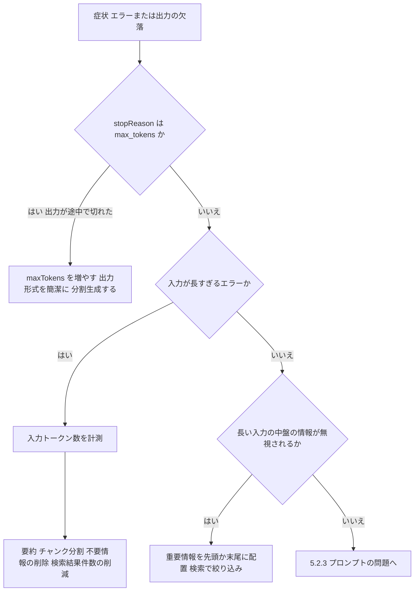

| 症状 | 原因 | 対処 |
|---|---|---|
| 回答が文の途中で終わる | 出力が maxTokens に到達(stopReason = max_tokens) | maxTokens を引き上げる、出力を簡潔にする指示、複数回に分割 |
| 入力の検証エラー | 入力が上限超過、またはパラメータ不正 | トークン数を事前計測し、上限内に収める |
| 長い文書の一部しか反映されない | 入力過多・重要情報が中間に埋もれる | 重要部分を先頭か末尾に置く、検索で関連部分だけを渡す |
| 会話が長くなると前の内容を忘れる | 履歴の蓄積でウィンドウを圧迫、または古い履歴の切り捨て | 履歴の要約、直近 N ターン+要約の保持 |
| RAG で関連チャンクが多すぎる | 取得件数・チャンクサイズが大きい | 件数削減、リランカーで上位だけ渡す、チャンクサイズ見直し |

#### 動的チャンキング戦略

| 戦略 | 概要 | 向く場面 |
|---|---|---|
| 固定長 | 一定のサイズで分割 | 構造が単純な文書 |
| 階層型 | 親(大きい)と子(小さい)で分割し、検索は子、文脈は親で補う | 長い構造化文書 |
| セマンティック | 意味のまとまりで分割 | 明確な区切りがない文書(契約書・技術マニュアル等) |
| 入力長に応じた動的分割 | 入力が上限を超えるときに分割して順次処理(Map-Reduce 要約など) | 長文の要約・分析 |

> 長文を扱う典型パターン: 文書を分割 → 各チャンクを並列に要約(Map)→ 要約を統合(Reduce)。AWS Step Functions の Map 状態で並列化できます。

#### ベストプラクティス

1. **呼び出し前にトークン数を見積もる。** 上限超過を事前に検出して、要約や分割にフォールバックします。
2. **応答の stopReason を必ずログに残す。** `max_tokens` を検知して再生成や警告に使います。
3. **プロンプトの構成を最適化する。** 重要な指示は先頭、参照情報は区切り(タグ等)で明確に分けます。
4. **RAG では「取得件数 × チャンクサイズ」で入力量を設計する。**
5. **会話履歴は全部送らない。** 要約+直近のやり取りに絞ります。

#### 試験での狙われ方

- 「応答が途中で切れる」→ stopReason が max_tokens → maxTokens の調整。
- 「長文ドキュメントの要約でコンテキスト上限を超える」→ チャンク分割+Map-Reduce、または階層的要約。
- 「入力が長すぎてエラーになる」→ 入力トークン数の事前計測と、要約・分割・件数削減。

#### 根拠ソース

- [Exam Guide Domain 5(Skill 5.2.1)](https://docs.aws.amazon.com/aws-certification/latest/ai-professional-01/ai-professional-01-domain5.html)
- [Amazon Bedrock API Reference: Converse(stopReason の値)](https://docs.aws.amazon.com/bedrock/latest/APIReference/API_runtime_Converse.html)
- [Amazon Bedrock モデルパラメータ(max_tokens と stopReason の説明の例)](https://docs.aws.amazon.com/bedrock/latest/userguide/model-parameters-deepseek.html)
- [AWS re:Post: Knowledge Bases の検索結果を改善する(セマンティック / 階層チャンキング)](https://repost.aws/knowledge-center/bedrock-knowledge-bases-accurate-results-filters)

---

### Skill 5.2.2 FM 統合(API)の問題

> 公式の出題文: GenAI サービス特有の API 統合問題を特定・修正する(例: エラーログ、リクエスト検証、レスポンス分析)。

#### やさしい説明

アプリから Amazon Bedrock などの API を呼ぶときに起きる**エラーを読み解いて直す**スキルです。まずエラーの種類で「自分の入力が悪いのか」「一時的な混雑か」「権限か」を分けます。

#### Bedrock Runtime の主なエラー

| エラー | HTTP | 意味 | 典型的な対処 |
|---|---|---|---|
| ValidationException | 400 | 入力が制約を満たさない(形式不正、パラメータ範囲外、入力過大など) | リクエスト本文・パラメータ・モデル固有の形式を確認 |
| AccessDeniedException | 403 | 権限なし(IAM、モデルアクセス、リソースポリシー) | IAM ポリシー、モデルへのアクセス設定、SCP を確認 |
| ResourceNotFoundException | 404 | モデル ID・リソースが存在しない | モデル ID、リージョン、推論プロファイルの指定を確認 |
| ModelTimeoutException | 408 | モデル処理がタイムアウト | 入力・出力を短くする、クライアントのタイムアウト設定を見直す |
| ModelErrorException | 424 | モデル処理中にエラー | リトライ、入力の見直し |
| ThrottlingException | 429 | アカウントのクォータ超過 | リトライ(指数バックオフ+ジッター)、クォータ引き上げ、リージョン分散 |
| InternalServerException | 500 | サービス内部エラー | リトライ、継続する場合はサポートへ |
| ServiceUnavailableException | 503 | サービスが一時的に利用不可 | リトライ、フォールバックモデル |

> Bedrock のユーザーガイドにエラーコード別のトラブルシュートページがあります(下記 URL)。試験前に一度目を通してください。

#### 切り分けの流れ

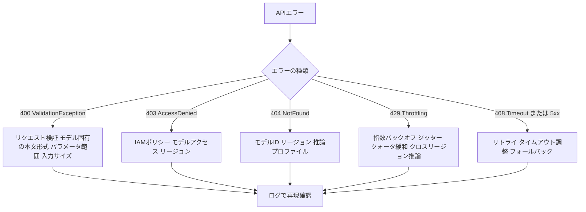

#### 3 つの技術: エラーログ・リクエスト検証・レスポンス分析

| 技術 | 内容 | 実装のヒント |
|---|---|---|
| エラーログ | 失敗したリクエストの文脈を残す | リクエスト ID、モデル ID、リージョン、エラーコード、メッセージを構造化ログ(JSON)で CloudWatch Logs に出力。入力そのものは機微情報になり得るためマスキング |
| リクエスト検証 | 送信前に自分で検証する | スキーマ検証、入力トークン数の確認、InvokeModel のモデル固有 JSON と Converse の共通形式の取り違い防止 |
| レスポンス分析 | 返ってきた内容を確認する | stopReason、usage(入出力トークン数)、metrics(latencyMs)をログ化し、異常値で警告 |

#### 呼び出しのトラブルを減らす設計

| 対策 | 内容 |
|---|---|
| リトライ戦略 | 一時的エラー(429 / 5xx / タイムアウト)のみ、指数バックオフ+ジッターで再試行。400 系(入力不正)はリトライしても直らない |
| SDK のリトライモード | AWS SDK の標準・アダプティブなリトライ設定を利用 |
| スロットリング対策 | クォータ(リクエスト数・トークン数/分)の監視、クロスリージョン推論プロファイルの活用、Provisioned Throughput、SQS などによるキューイング・平準化 |
| フォールバック | 代替モデル・縮退応答(簡易回答)への切替 |
| Converse API の利用 | モデル間で共通のリクエスト形式にして、モデル固有形式の取り違いを減らす |
| 監査・調査 | モデル呼び出しログ(入出力・メタデータを S3 / CloudWatch Logs へ)、CloudTrail(API 呼び出しの監査) |

#### ベストプラクティス

1. **エラーを「再試行してよいもの」と「してはいけないもの」に分類して実装する。**
2. **リクエスト ID を発行してアプリ・API ゲートウェイ・Bedrock 呼び出しを横断して追跡できるようにする。**
3. **クォータの使用率をメトリクスで監視し、上限に近づく前にアラームを出す。**
4. **モデル呼び出しログは機微データを含み得る。** 暗号化(KMS)、アクセス制御、保持期間を設計します。
5. **タイムアウトはモデルの応答時間に合わせる。** 長い生成にはストリーミング(ConverseStream)を検討します。

#### 試験での狙われ方

- 「ピーク時に ThrottlingException が出る」→ 指数バックオフ+ジッター、クォータ緩和申請、クロスリージョン推論、キューによる平準化。
- 「ValidationException が出る」→ リクエスト本文・パラメータ・入力サイズの検証(リトライでは直らない)。
- 「特定ユーザーだけ AccessDenied」→ IAM ポリシー・モデルアクセス・リソースポリシーの確認。

#### 根拠ソース

- [Exam Guide Domain 5(Skill 5.2.2)](https://docs.aws.amazon.com/aws-certification/latest/ai-professional-01/ai-professional-01-domain5.html)
- [Troubleshooting Amazon Bedrock API Error Codes(Bedrock ユーザーガイド)](https://docs.aws.amazon.com/bedrock/latest/userguide/troubleshooting-api-error-codes.html)
- [Amazon Bedrock API Reference: Converse](https://docs.aws.amazon.com/bedrock/latest/APIReference/API_runtime_Converse.html)
- [Amazon Bedrock モデル呼び出しのログ記録](https://docs.aws.amazon.com/bedrock/latest/userguide/model-invocation-logging.html)

---

### Skill 5.2.3 プロンプトエンジニアリングの問題

> 公式の出題文: 基本的なプロンプト調整を超えて、FM の応答品質と一貫性を改善するプロンプトエンジニアリングの問題をトラブルシュートする(例: プロンプトテストフレームワーク、バージョン比較、体系的な改善)。

#### やさしい説明

「プロンプトを何となく書き換えて様子を見る」状態から卒業し、**テストデータで測りながら、変更点を 1 つずつ比較して改善する**やり方です。

#### よくあるプロンプトの問題と対処

| 問題 | 例 | 対処 |
|---|---|---|
| 指示が曖昧 | 「簡単に説明して」で毎回長さが違う | 長さ・形式・対象読者を具体的に指定 |
| 形式が崩れる | JSON に余計な文章が混ざる | 出力スキーマを明示、例(few-shot)を提示、出力検証と再試行 |
| 指示の無視 | 長い入力で冒頭の制約が守られない | 重要な制約を末尾でも再掲、区切りタグで構造化 |
| 回答のぶれ | 同じ質問で毎回結論が違う | temperature を下げる、判断基準を明記 |
| ハルシネーション | 資料にない内容を断定 | 「資料にない場合は分からないと答える」と明記、根拠引用を要求、RAG と併用 |
| 拒否が多すぎる/少なすぎる | 正当な質問を断る、不適切な依頼に応じる | 役割・許可範囲を明記、ガードレールと併用 |
| 例への過剰適合 | few-shot の例と同じ内容を返す | 例の多様化、例の数を調整 |

#### 体系的な改善サイクル

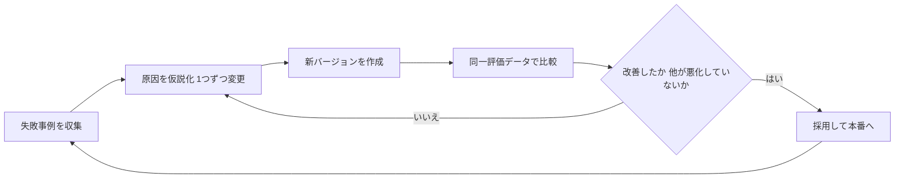

| Step | やること |
|---|---|
| 1 | 失敗した入出力を集めて分類する(形式崩れ、事実誤り、拒否過多など) |
| 2 | 仮説を立て、**1 回の変更は 1 点だけ**にする |
| 3 | プロンプトに新しいバージョンを付ける |
| 4 | 同じ評価データ・同じパラメータで新旧を比較する(平均だけでなく、悪化したケースも見る) |
| 5 | 改善かつ副作用なしなら採用する |
| 6 | 失敗事例をリグレッションセットに追加する |

#### 関連サービス・機能

| サービス・機能 | 役割 |
|---|---|
| Amazon Bedrock Prompt Management | プロンプトを保存・バージョン管理。2 つのバージョンを選んで比較でき、JSON の差分が並べて表示される。テスト変数を埋めて実行すれば、各バージョンの出力も比較できる |
| Amazon Bedrock Evaluations | プロンプト変更の効果を同一データセットで定量比較 |
| Bedrock のプロンプト最適化機能 | プロンプトの書き換え支援(補助的に利用) |
| 出力検証(スキーマ・ルール) | 形式の合否を自動判定 |

#### ベストプラクティス

1. **プロンプトはコードと同様にバージョン管理する。** 変更理由と評価結果を紐づけます。
2. **変更は 1 点ずつ。** 複数同時に変えると効果の原因が不明になります。
3. **平均スコアだけで判断しない。** 一部の重要ケースが悪化していないかを確認します。
4. **プロンプトで解決できる問題かを見極める。** 事実の欠落は検索(RAG)、安全性はガードレール、能力不足はモデル変更が適切な場合があります。
5. **例(few-shot)は実際の失敗事例から作る。**

#### 試験での狙われ方

- 「プロンプト変更の影響を安全に比較したい」→ Prompt Management のバージョン比較+共通評価データセットでの評価。
- 「出力が JSON にならないことがある」→ スキーマの明示+出力検証+再試行(Skill 5.2.5 とも連動)。

#### 根拠ソース

- [Exam Guide Domain 5(Skill 5.2.3)](https://docs.aws.amazon.com/aws-certification/latest/ai-professional-01/ai-professional-01-domain5.html)
- [Compare versions of a prompt in Prompt management - Amazon Bedrock](https://docs.aws.amazon.com/bedrock/latest/userguide/prompt-management-version-compare.html)
- [Amazon Bedrock Prompt Management](https://docs.aws.amazon.com/bedrock/latest/userguide/prompt-management.html)
- [Amazon Bedrock Evaluations(製品ページ)](https://aws.amazon.com/bedrock/evaluations/)

---

### Skill 5.2.4 検索システムの問題

> 公式の出題文: FM を補強する情報検索の有効性に影響する問題を特定・解決する(例: モデル応答の関連性分析、埋め込み品質の診断、ドリフト監視、ベクトル化問題の解決、チャンキングと前処理の是正、ベクトル検索の性能最適化)。

#### やさしい説明

RAG の回答が悪いとき、原因の多くは**検索側**にあります。「正しい文書がインデックスにあるか」「正しく分割・ベクトル化されているか」「検索設定が適切か」を順に確認します。

#### RAG パイプラインと問題が起きやすい箇所

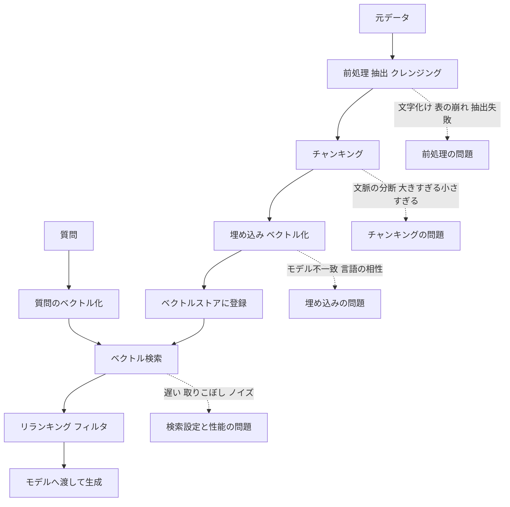

#### 症状 → 原因 → 対処

| 症状 | 考えられる原因 | 対処 |
|---|---|---|
| 関連文書が取れない | 文書が取り込まれていない、取り込みジョブ失敗、同期漏れ | データソースの同期状態・取り込みジョブのエラーを確認、再同期 |
| 文脈が足りない回答 | チャンクが小さすぎて意味が分断 | チャンクサイズ拡大、階層型・セマンティック、オーバーラップ |
| 無関係な内容が混ざる | チャンクが大きすぎる、取得件数が多い | チャンク縮小、件数削減、リランカー、メタデータフィルタ |
| 型番・固有名詞が検索で外れる | 意味検索だけでキーワード一致が弱い | ハイブリッド検索 |
| 日本語など言語で精度が低い | 埋め込みモデルがその言語に弱い | 多言語対応の埋め込みモデルへ変更 → 全文書を再インデックス |
| 質問と文書で結果が極端に悪い | 取り込み時と検索時で埋め込みモデルが異なる、次元数の不一致 | 同一モデル・同一次元に統一 |
| 表・図・PDF の内容が欠ける | 前処理(テキスト抽出)の失敗 | パーサの見直し、前処理で構造を保持、カスタム Lambda による変換 |
| 古い情報が返る | 更新が反映されていない(ドリフト) | 定期同期、更新イベント連動、取り込み日時メタデータで絞り込み |
| 検索が遅い | インデックス規模、検索パラメータ、フィルタ、リソース不足 | 検索パラメータ調整、フィルタの併用、リソース(OCU 等)と構成の見直し、件数削減、リランキングの必要性を再評価 |

#### 診断で使う 5 つの視点

| 視点 | やること |
|---|---|
| 応答の関連性分析 | 質問ごとに「取得されたチャンク」を目視確認し、関連・無関連を分類。検索のみの評価(Skill 5.1.6)で定量化 |
| 埋め込み品質の診断 | 似た質問が似たベクトルになっているか、既知の関連ペアの類似度を確認。モデル・次元・言語の整合を点検 |
| ドリフト監視 | データ側(更新の遅れ)と質問側(新しい話題の増加)の変化を監視。検索評価を定期実行して劣化を検知 |
| ベクトル化の問題解決 | 取り込みジョブの失敗ログ、空のチャンク、極端に長い・短いチャンクを確認 |
| ベクトル検索の性能最適化 | レイテンシ(p95 など)を計測し、件数・フィルタ・インデックス設定・リソースを調整 |

#### Knowledge Bases で効くつまみ(再掲)

- 取得件数の増減(既定では少数のチャンクを返す)
- チャンク戦略(固定長 / 階層 / セマンティック / カスタム Lambda)
- ハイブリッド検索(意味+キーワード)
- リランカーモデル
- メタデータフィルタ
- クエリ分解

> セマンティックチャンキングは追加コストが発生します。品質向上と費用のバランスを評価して選びます。

#### ベストプラクティス

1. **「取れた文書を見る」を最初の手順にする。** 検索結果を見ずにプロンプトだけ直しても解決しません。
2. **埋め込みモデルを変えたら全文書を再ベクトル化する。** 新旧を混在させません。
3. **チャンク戦略は文書の種類ごとに選ぶ。** FAQ、契約書、マニュアルでは最適が異なります。
4. **検索評価を定期ジョブにして、劣化を早期に検知する。**
5. **メタデータ(日付・部署・種別)を付与して絞り込みと鮮度管理に使う。**

#### 試験での狙われ方

- 「RAG が古い情報を返す」→ データ同期・更新パイプライン、取り込み日時メタデータ。
- 「検索時と取り込み時で結果が噛み合わない」→ 埋め込みモデルの不一致。
- 「型番検索が弱い」→ ハイブリッド検索。
- 「文脈が分断された回答」→ チャンクサイズ・階層/セマンティックチャンキング。

#### 根拠ソース

- [Exam Guide Domain 5(Skill 5.2.4)](https://docs.aws.amazon.com/aws-certification/latest/ai-professional-01/ai-professional-01-domain5.html)
- [AWS re:Post: Knowledge Bases の検索精度と取得結果を改善する](https://repost.aws/knowledge-center/bedrock-knowledge-bases-accurate-results-filters)
- [Amazon Bedrock Knowledge Bases ユーザーガイド](https://docs.aws.amazon.com/bedrock/latest/userguide/knowledge-base.html)
- [AWS Community: 7 Failure Points of a RAG and Assessment Methodology](https://community.aws/content/2mtDG9fTNk4R75eKRx1HsfynvEr/7-failure-points-of-a-retrieval-augmented-generation-and-assessment-methodology)
- 補足(第三者): [Amazon Bedrock Knowledge Bases Retrieval Quality Engineering](https://hidekazu-konishi.com/entry/amazon_bedrock_knowledge_bases_retrieval_quality_engineering.html)

---

### Skill 5.2.5 プロンプト保守の問題

> 公式の出題文: FM とのやり取りの性能を継続的に改善するため、プロンプトの保守問題をトラブルシュートする(例: テンプレートテストと CloudWatch Logs によるプロンプト混乱の診断、X-Ray によるプロンプトの可観測性パイプライン、スキーマ検証による形式不整合の検出、体系的なプロンプト改善ワークフロー)。

#### やさしい説明

プロンプトは一度作って終わりではなく、運用の中で**変更され、劣化し、再発する問題**を抱えます。変更履歴・ログ・トレース・出力検証を整備して「何を変えたら何が起きたか」を追えるようにします。

#### 4 本柱

| 柱 | 目的 | 使うもの |
|---|---|---|
| テンプレートテスト | プロンプトテンプレートに変数を埋めたときの組み立て不具合を事前に見つける | 単体テスト、テスト変数(Prompt Management)、境界値(空・超長文・特殊文字) |
| ログによる診断 | 「プロンプトが混乱した」ケースを後から調べる | Bedrock のモデル呼び出しログ、CloudWatch Logs、Logs Insights |
| 可観測性パイプライン | リクエストごとにどのプロンプト版・モデル・検索結果で処理されたかを追跡 | AWS X-Ray(トレース)、CloudWatch 生成AIオブザーバビリティ |
| スキーマ検証 | 出力形式の不整合を機械的に検出 | JSON スキーマ検証、再試行ロジック |

#### 可観測性パイプライン

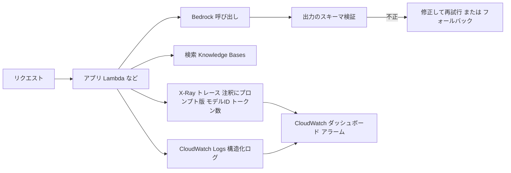

CloudWatch の生成AIオブザーバビリティは、プロンプトのエンドツーエンドのトレースで、ナレッジベース・ツール・モデルなどの構成要素のどこに問題があるかを特定する助けになります。Strands Agents、LangChain、LangGraph などのフレームワークにも対応しています。

#### X-Ray でプロンプトの文脈を残す例(Python)

```python
from aws_xray_sdk.core import xray_recorder

def invoke_with_trace(client, model_id, prompt_version, messages):
    with xray_recorder.in_subsegment("bedrock_converse") as seg:
        # 注釈はフィルタ検索できる。キーは英数字とアンダースコア
        seg.put_annotation("prompt_version", prompt_version)
        seg.put_annotation("model_id", model_id)
        resp = client.converse(modelId=model_id, messages=messages)
        usage = resp.get("usage", {})
        seg.put_annotation("stop_reason", resp.get("stopReason", "unknown"))
        seg.put_annotation("input_tokens", usage.get("inputTokens", 0))
        seg.put_annotation("output_tokens", usage.get("outputTokens", 0))
        return resp
```

> 注意: 注釈に利用者の入力そのもの(個人情報)を入れないでください。バージョン・ID・件数などのメタデータに留めます。

#### CloudWatch Logs Insights でプロンプト問題を調べる例

呼び出しログを CloudWatch Logs に出力している前提で、プロンプトバージョンごとの失敗傾向を集計する例です(フィールド名は実際のログ構造に合わせて調整してください)。

```text
fields @timestamp, input.inputTokenCount, output.outputTokenCount, modelId
| filter ispresent(output.outputTokenCount)
| stats avg(output.outputTokenCount) as avg_out, max(output.outputTokenCount) as max_out, count(*) as n by modelId, bin(1h)
| sort @timestamp desc
```

| 見るポイント | 示唆 |
|---|---|
| 出力トークンが急に増減した | プロンプト変更の副作用、冗長化、または途中切れ |
| 特定のプロンプト版だけエラー・低評価が多い | 直近の変更が原因 |
| 入力トークンが上限に近い | 5.2.1 のコンテンツ溢れの予兆 |

#### スキーマ検証のパターン

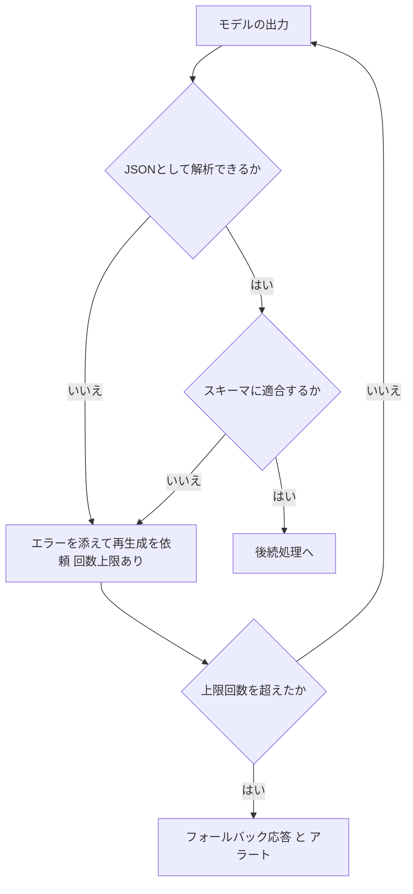

| 実装のポイント | 内容 |
|---|---|
| 検証 | JSON Schema や Pydantic などで型・必須項目・列挙値を検証 |
| 再試行 | 検証エラー内容をプロンプトに添えて再生成(回数上限を設ける) |
| 記録 | 不適合の発生率をメトリクス化(プロンプト版ごと) |
| 予防 | プロンプトでスキーマを明示、例を提示、ツール利用(function calling)による構造化出力を検討 |

#### 体系的な改善ワークフロー

1. 不適合・低評価・混乱の事例をログとトレースから収集する
2. プロンプト版・モデル・検索結果で層別して傾向を確認する
3. 仮説に基づき 1 点だけ変更して新しい版を作る
4. テンプレートテストと評価データセットで検証する
5. カナリアで段階展開し、スキーマ適合率・品質スコア・コストを監視する
6. 問題があれば前の版へ戻す(ロールバック)

#### ベストプラクティス

1. **すべてのリクエストにプロンプト版・モデル ID・取得文書 ID を記録する。** 後から原因を絞り込めます。
2. **テンプレートの変数埋め込みを単体テストする。** 空・長文・引用符や改行の混入などの境界値を含めます。
3. **出力は信頼せず検証する。** 形式検証は必ず通してから後続処理へ渡します。
4. **ログは機微情報を含む。** マスキング、暗号化、アクセス制御、保持期間を設計します(Sensitive Data Protection も検討)。
5. **品質メトリクスにアラームを設定する。** スキーマ不適合率、再試行率などが上がったら通知します。

#### 試験での狙われ方

- 「プロンプトのどの版で問題が起きたか追跡したい」→ X-Ray 注釈 / ログへのプロンプト版記録 + Prompt Management のバージョン管理。
- 「出力形式がときどき崩れて後続処理が失敗する」→ スキーマ検証+再試行、構造化出力の指示。
- 「プロンプトが原因の品質劣化をログから診断したい」→ モデル呼び出しログ+CloudWatch Logs Insights。

#### 根拠ソース

- [Exam Guide Domain 5(Skill 5.2.5)](https://docs.aws.amazon.com/aws-certification/latest/ai-professional-01/ai-professional-01-domain5.html)
- [Generative AI observability - Amazon CloudWatch](https://docs.aws.amazon.com/AmazonCloudWatch/latest/monitoring/GenAI-observability.html)
- [What's New: Generative AI observability now generally available for Amazon CloudWatch](https://aws.amazon.com/about-aws/whats-new/2025/10/generative-ai-observability-amazon-cloudwatch)
- [Amazon Bedrock モデル呼び出しのログ記録](https://docs.aws.amazon.com/bedrock/latest/userguide/model-invocation-logging.html)
- [AWS X-Ray 開発者ガイド](https://docs.aws.amazon.com/xray/latest/devguide/aws-xray.html)
- [Compare versions of a prompt in Prompt management - Amazon Bedrock](https://docs.aws.amazon.com/bedrock/latest/userguide/prompt-management-version-compare.html)

---

## 5. 横断まとめ

### 5.1 「こう問われたらこのサービス」早見表

| 問われ方(キーワード) | 答えの方向 |
|---|---|
| FM を複数候補から選ぶ / 事前に比較 | Bedrock Model Evaluation(自動・LLM-as-a-Judge・人間) |
| 主観的な品質を評価 | 人間評価ワークフロー |
| 大量の出力を低コストで採点 | LLM-as-a-Judge(ジャッジ校正と偏り対策付き) |
| RAG の検索と生成を切り分け | RAG 検索のみの評価 / 検索+生成の評価 |
| エージェントのツール選択を評価 | Tool selection / parameter accuracy(AgentCore Evaluations) |
| 本番エージェントの継続監視 | AgentCore Evaluations オンライン評価 + CloudWatch |
| 変更時の回帰テストを CI/CD に | オンデマンド評価 / 評価ジョブ + 品質ゲート(CodePipeline) |
| 新構成を少量だけ本番投入 | カナリア(Lambda エイリアス / API Gateway / AppConfig)+ アラーム |
| 更新後の意味の変化を検知 | セマンティックドリフト(埋め込み類似度) |
| ハルシネーション率を継続測定 | faithfulness 評価+合成ワークフロー |
| 出力が途中で切れる | stopReason = max_tokens → maxTokens 調整 |
| 入力が長すぎる | トークン計測、要約・分割(Map-Reduce)、検索件数削減 |
| 429 ThrottlingException | 指数バックオフ+ジッター、クォータ、クロスリージョン推論、キュー |
| 400 ValidationException | リクエスト検証(リトライでは直らない) |
| プロンプトの版比較 | Bedrock Prompt Management の比較機能+共通評価データ |
| 型番・固有名詞が検索で外れる | ハイブリッド検索 |
| 検索上位にノイズ | リランカー、メタデータフィルタ |
| プロンプト版ごとの原因追跡 | X-Ray 注釈、構造化ログ、CloudWatch Logs Insights |
| 出力 JSON が崩れる | スキーマ検証+再試行 |

### 5.2 評価・監視の全体設計(総まとめ)

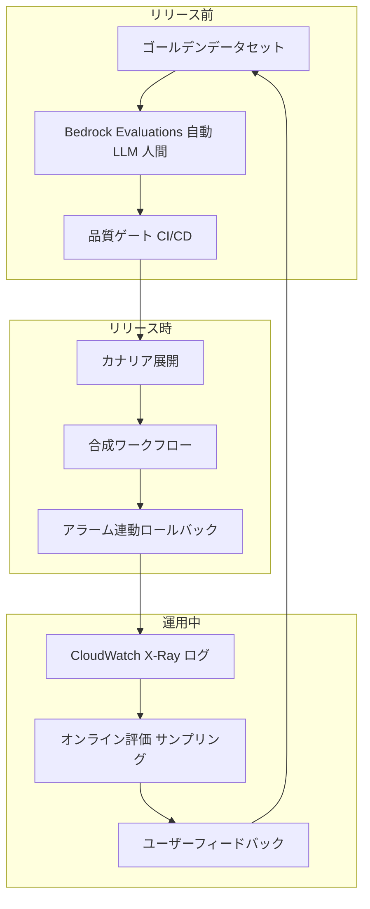

### 5.3 よくある勘違い

| 勘違い | 正しい理解 |
|---|---|
| 精度(accuracy)だけで評価できる | 生成AIは関連性・事実性・一貫性・流暢さ・安全性など複数観点が必要 |
| 最も高性能なモデルが最適 | 要件を満たす品質で、コストと速度が最良のモデルが最適 |
| LLM のジャッジは常に正しい | 偏りがあるため、人間評価で校正する |
| RAG の問題はプロンプトで直す | まず検索(取得された文書)を確認する |
| どのエラーもリトライすれば直る | 400 系(入力不正・権限)はリトライしても直らない |
| 評価は一度やれば終わり | 継続評価・リグレッションテスト・本番監視が必要 |
| 平均スコアが上がれば OK | 重要ケースの悪化や安全性の最悪ケースも確認する |

---

## 6. 練習問題

実際の試験形式(単一選択 / 複数選択)に近いシナリオです。解答は各問の下にあります。

### 問題 1

社内ヘルプデスクの RAG チャットボットで、回答が不正確という苦情が増えている。開発チームは、原因が「検索」か「生成」かを切り分けたい。最も適切な方法はどれか。

- A. プロンプトをすべて書き直して再度テストする
- B. モデルを最も大きいものに変更する
- C. 検索のみの評価と、検索+生成のエンドツーエンド評価を別々に実行して指標を比較する
- D. 取得件数を一律で最大にする

<details>
<summary>解答と解説</summary>

**C**。RAG は検索と生成の 2 段階です。検索のみの評価(context relevance / coverage など)で検索品質を、エンドツーエンド評価(correctness / faithfulness など)で最終回答の品質を測れば、どちらが原因か切り分けられます。A、B、D は原因を特定せずに変更を加える対応です。

</details>

### 問題 2

あるアプリで Amazon Bedrock の呼び出し時に、トラフィックのピーク時だけ ThrottlingException が頻発する。適切な対応を **2 つ** 選べ。

- A. 指数バックオフとジッターを用いたリトライを実装する
- B. ValidationException と同様に、すべてのエラーを即座に再試行する
- C. クォータの引き上げを申請し、クォータ使用率にアラームを設定する
- D. temperature を 0 にする
- E. 入力プロンプトを全て英語に翻訳する

<details>
<summary>解答と解説</summary>

**A と C**。ThrottlingException はアカウントのクォータ超過を示す一時的なエラーで、指数バックオフ+ジッターによるリトライと、クォータの緩和・監視が有効です(クロスリージョン推論やキューによる平準化も選択肢)。B は誤り(400 系の入力不正はリトライしても直らない)。D と E はスロットリングと無関係です。

</details>

### 問題 3

モデルの応答が文の途中で終わってしまう。Converse API の応答の `stopReason` を確認すると `max_tokens` だった。最初に行うべき対応はどれか。

- A. ガードレールを無効化する
- B. maxTokens の設定値を見直し、必要に応じて引き上げる(または出力を簡潔にする指示を加える)
- C. 埋め込みモデルを変更する
- D. 検索結果の件数を増やす

<details>
<summary>解答と解説</summary>

**B**。`max_tokens` は生成が出力トークン上限に達して止まったことを示します。maxTokens の調整、出力を簡潔にする指示、分割生成で対処します。ガードレール介入は `guardrail_intervened` / `content_filtered` で区別されます。

</details>

### 問題 4

モデルを新しいバージョンに更新した後、回答の意味が少しずつ変わっていないかを自動で検知したい。最も適切な仕組みはどれか。

- A. 文字列の完全一致で新旧の回答を比較する
- B. 基準回答と新しい回答の埋め込みの類似度を測り、閾値を下回ったらアラームを出す
- C. 月 1 回、担当者が目視で確認する
- D. CPU 使用率だけを監視する

<details>
<summary>解答と解説</summary>

**B**。セマンティックドリフトは「意味のずれ」なので、文字列一致ではなく意味(埋め込み)の類似度で測ります。合成ワークフローで定期的に実行し、CloudWatch アラームと連動させます。

</details>

### 問題 5

マルチステップのエージェントが、最終回答は一見もっともらしいが、誤ったツールを選んだり引数を間違えたりして、まれに誤った結果を返している。この問題を継続的に検出するために最も適切なのはどれか。

- A. 最終回答の文章の流暢さだけを評価する
- B. ツール選択精度・ツール引数精度・タスク完了率を含むエージェント評価を、本番のサンプリング(オンライン評価)とリリース前(オンデマンド評価)で実施する
- C. ユーザーが苦情を言うまで待つ
- D. エージェントを使わず、すべて固定の分岐ロジックに置き換える

<details>
<summary>解答と解説</summary>

**B**。エージェントは結果だけでなく過程(ツール選択・引数)も評価する必要があります。AgentCore Evaluations のオンライン評価で本番を継続監視し、オンデマンド評価で CI/CD のリグレッションテストに使えます。

</details>

---

## 7. 学習チェックリスト

自分の言葉で説明できたらチェックしてください。

### Task 5.1

- [ ] 従来の ML 評価と生成AI評価の違いを説明できる
- [ ] relevance / factual accuracy / consistency / fluency / safety を区別して説明できる
- [ ] Bedrock Evaluations の 3 種類(自動・LLM-as-a-Judge・人間)の使い分けを説明できる
- [ ] A/B テストとカナリアテストの違いと、実現手段(Lambda エイリアス等)を言える
- [ ] トークン効率・レイテンシ対品質比・ビジネス成果でコストパフォーマンスを分析する方法を説明できる
- [ ] フィードバック収集からアノテーション、評価データへの還元までのループを説明できる
- [ ] CI/CD に評価を組み込み、品質ゲートで止める流れを説明できる
- [ ] RAG を検索と生成に分けて評価する理由を説明できる
- [ ] LLM-as-a-Judge の偏りと、人間評価による校正の必要性を説明できる
- [ ] 検索品質の指標(関連性・網羅性・順位・レイテンシ)を言える
- [ ] エージェント評価の 3 層(結果・ツール・推論)を説明できる
- [ ] AgentCore Evaluations のオンライン評価とオンデマンド評価の違いを説明できる
- [ ] 読み手別のレポート設計と自動配信の構成を説明できる
- [ ] 合成ワークフロー・ハルシネーション率・セマンティックドリフトによるデプロイ検証を説明できる

### Task 5.2

- [ ] stopReason が max_tokens のときの意味と対処を説明できる
- [ ] コンテキストウィンドウ溢れの診断と、チャンキング・要約での対処を説明できる
- [ ] Bedrock の主要エラー(400 / 403 / 404 / 408 / 424 / 429 / 500 / 503)の意味と、リトライの可否を言える
- [ ] 指数バックオフ+ジッターを説明できる
- [ ] プロンプトを「1 点ずつ変更・同一データで比較・バージョン管理」で改善する流れを説明できる
- [ ] Prompt Management のバージョン比較機能を説明できる
- [ ] 検索の不具合を「前処理・チャンキング・埋め込み・検索設定・鮮度」に切り分けられる
- [ ] 埋め込みモデルの不一致が起こす問題を説明できる
- [ ] X-Ray の注釈、CloudWatch Logs Insights、スキーマ検証でプロンプト保守を行う方法を説明できる

---

## 8. 参考URL一覧

### 8.1 出題範囲(一次情報)

| 内容 | URL |
|---|---|
| AIP-C01 Exam Guide(トップ) | https://docs.aws.amazon.com/aws-certification/latest/ai-professional-01/ai-professional-01.html |
| Content Domain 5: Testing, Validation, and Troubleshooting | https://docs.aws.amazon.com/aws-certification/latest/ai-professional-01/ai-professional-01-domain5.html |

### 8.2 評価(Task 5.1)

| 内容 | URL |
|---|---|
| Amazon Bedrock Evaluations(製品ページ) | https://aws.amazon.com/bedrock/evaluations/ |
| Amazon Bedrock モデル評価(ユーザーガイド) | https://docs.aws.amazon.com/bedrock/latest/userguide/evaluation.html |
| New RAG evaluation and LLM-as-a-judge capabilities in Amazon Bedrock | https://aws.amazon.com/blogs/aws/new-rag-evaluation-and-llm-as-a-judge-capabilities-in-amazon-bedrock |
| Use custom metrics to evaluate your generative AI application with Amazon Bedrock | https://aws.amazon.com/blogs/machine-learning/use-custom-metrics-to-evaluate-your-generative-ai-application-with-amazon-bedrock/ |
| Amazon Bedrock AgentCore Evaluations GA(What's New) | https://aws.amazon.com/about-aws/whats-new/2026/03/agentcore-evaluations-generally-available |
| Amazon Bedrock AgentCore adds quality evaluations and policy controls | https://aws.amazon.com/blogs/aws/amazon-bedrock-agentcore-adds-quality-evaluations-and-policy-controls-for-deploying-trusted-ai-agents/ |
| Evaluating AI agents: Real-world lessons from building agentic systems at Amazon | https://aws.amazon.com/blogs/machine-learning/evaluating-ai-agents-real-world-lessons-from-building-agentic-systems-at-amazon |
| Evaluate Amazon Bedrock Agents with Ragas and LLM-as-a-judge | https://aws.amazon.com/blogs/machine-learning/evaluate-amazon-bedrock-agents-with-ragas-and-llm-as-a-judge |
| Amazon Augmented AI(A2I)人間レビュー | https://docs.aws.amazon.com/sagemaker/latest/dg/a2i-use-augmented-ai-a2i-human-review-loops.html |
| AWS Lambda エイリアス | https://docs.aws.amazon.com/lambda/latest/dg/configuration-aliases.html |
| Amazon CloudWatch Synthetics | https://docs.aws.amazon.com/AmazonCloudWatch/latest/monitoring/CloudWatch_Synthetics_Canaries.html |
| AWS CodePipeline | https://docs.aws.amazon.com/codepipeline/latest/userguide/welcome.html |
| Amazon QuickSight | https://docs.aws.amazon.com/quicksight/latest/user/welcome.html |
| Amazon Athena | https://docs.aws.amazon.com/athena/latest/ug/what-is.html |

### 8.3 トラブルシュート(Task 5.2)

| 内容 | URL |
|---|---|
| Troubleshooting Amazon Bedrock API Error Codes | https://docs.aws.amazon.com/bedrock/latest/userguide/troubleshooting-api-error-codes.html |
| Amazon Bedrock API Reference: Converse | https://docs.aws.amazon.com/bedrock/latest/APIReference/API_runtime_Converse.html |
| Amazon Bedrock モデルパラメータ(max_tokens / stopReason の説明の例) | https://docs.aws.amazon.com/bedrock/latest/userguide/model-parameters-deepseek.html |
| Amazon Bedrock モデル呼び出しのログ記録 | https://docs.aws.amazon.com/bedrock/latest/userguide/model-invocation-logging.html |
| Compare versions of a prompt in Prompt management | https://docs.aws.amazon.com/bedrock/latest/userguide/prompt-management-version-compare.html |
| Amazon Bedrock Prompt Management | https://docs.aws.amazon.com/bedrock/latest/userguide/prompt-management.html |
| Amazon Bedrock Knowledge Bases ユーザーガイド | https://docs.aws.amazon.com/bedrock/latest/userguide/knowledge-base.html |
| AWS re:Post: How do I improve search results and retrieval accuracy in Amazon Bedrock Knowledge Bases | https://repost.aws/knowledge-center/bedrock-knowledge-bases-accurate-results-filters |
| Generative AI observability - Amazon CloudWatch | https://docs.aws.amazon.com/AmazonCloudWatch/latest/monitoring/GenAI-observability.html |
| Generative AI observability now generally available for Amazon CloudWatch | https://aws.amazon.com/about-aws/whats-new/2025/10/generative-ai-observability-amazon-cloudwatch |
| AWS X-Ray 開発者ガイド | https://docs.aws.amazon.com/xray/latest/devguide/aws-xray.html |
| AWS Community: 7 Failure Points of a RAG and Assessment Methodology | https://community.aws/content/2mtDG9fTNk4R75eKRx1HsfynvEr/7-failure-points-of-a-retrieval-augmented-generation-and-assessment-methodology |

### 8.4 補足(第三者記事)

| 内容 | URL |
|---|---|
| Evaluating RAG using Bedrock's built-in LLM-as-a-Judge(Part 2) | https://medium.com/@shawn-jiang/evaluating-llms-on-amazon-bedrock-part-2-9d90a9672ebe |
| Amazon Bedrock Knowledge Bases Retrieval Quality Engineering | https://hidekazu-konishi.com/entry/amazon_bedrock_knowledge_bases_retrieval_quality_engineering.html |
| Observability for GenAI Applications on AWS(CloudThat) | https://www.cloudthat.com/resources/blog/observability-for-genai-applications-on-aws-whats-really-happening-behind-your-prompts |

> 上記のうち、Exam Guide、Bedrock Evaluations 製品ページ、AWS ブログ、What's New、Converse API リファレンス、CloudWatch 生成AIオブザーバビリティ、Prompt Management のバージョン比較、re:Post は本ガイド作成時に内容を確認した URL です。それ以外の AWS ドキュメント URL(Lambda エイリアス、Synthetics、X-Ray、CodePipeline、QuickSight、Athena、A2I、Prompt Management トップ、モデル評価ガイド、モデル呼び出しログ)は各サービスの公式ドキュメントの入口として記載しています。ページ構成が変わっている可能性があるため、最新版をご確認ください。
