# AWS Certified Advanced Networking - Specialty (ANS-C01)
# Content Domain 2: Network Implementation(ネットワークの実装)初学者向けステップバイステップ解説

> 対象試験: AWS Certified Advanced Networking - Specialty (ANS-C01)
> 想定受験: Pearson VUE(テストセンターまたはオンライン)での受験。受験言語は英語・日本語・韓国語・中国語(簡体字)から選択でき、本ガイドは日本国内から**日本語または英語**で受験する読者を想定
> 受験可能期間(2026年10月17日確認): 英語版の公式認定ページは「最終受験日 2026年12月31日」と記載しており、この時点では予約・受験が可能です。一方、日本語版の公式ページは「最終受験日 2026年8月25日」のままで、記載が食い違っています。本ガイドは更新が新しい英語版ページの **2026年12月31日** を適用日として扱います。言語・地域ごとの予約枠は、予約前に Pearson VUE の予約画面で必ず確認してください(出典: [英語版](https://aws.amazon.com/certification/certified-advanced-networking-specialty/) / [日本語版](https://aws.amazon.com/jp/certification/certified-advanced-networking-specialty/))
> 対象ドメイン: **Content Domain 2: Network Implementation(出題比率 26%)**
> 想定読者: ネットワークの基礎(IPアドレス、サブネット、ルーティング)をざっくり知っている初学者〜中級者
> 根拠(アンカー): [ANS-C01 試験ガイド Domain 2](https://docs.aws.amazon.com/aws-certification/latest/advanced-networking-specialty-01/advanced-networking-specialty-01-domain2.html)

---

## 目次

- [0. このガイドの使い方](#0-このガイドの使い方)
- [1. 前提知識の整理(L1/L2/L3・BGP・CIDR)](#1-前提知識の整理l1l2l3bgpcidr)
- [2. Task 2.1: オンプレミスとAWSのルーティングと接続](#2-task-21-オンプレミスとawsのルーティングと接続)
- [3. Task 2.2: 複数アカウント・リージョン・VPC間の接続](#3-task-22-複数アカウントリージョンvpc間の接続)
- [4. Task 2.3: ハイブリッド/マルチアカウントDNS](#4-task-23-ハイブリッドマルチアカウントdns)
- [5. Task 2.4: ネットワークインフラの自動化と構成](#5-task-24-ネットワークインフラの自動化と構成)
- [6. ベストプラクティス総まとめ](#6-ベストプラクティス総まとめ)
- [7. 出題パターン早見表](#7-出題パターン早見表)
- [8. 確認問題](#8-確認問題)
- [9. 参考URL(根拠ソース一覧)](#9-参考url根拠ソース一覧)

---

## 0. このガイドの使い方

### 0.1 Domain 2 の位置づけ

ANS-C01 は4つのドメインで構成されます。Domain 2 は「設計(Domain 1)で決めた構成を**実際に作って繋ぐ**」領域で、出題比率は26%です。

| ドメイン | 内容 | 比率 |
|---|---|---|
| Domain 1 | Network Design(設計) | 30% |
| **Domain 2** | **Network Implementation(実装)** | **26%** |
| Domain 3 | Network Management and Operation(運用) | 20% |
| Domain 4 | Network Security, Compliance, and Governance(セキュリティ) | 24% |

試験形式の要点(試験ガイドより): 出題形式は**複数選択(Multiple response)**と**マッチング(Matching)**のみで、スコア対象は50問(別途、採点対象外の問題が15問)。合格は**スケールスコア750以上(100〜1,000)**、合否は試験全体で判定される補償型スコアリングです。

### 0.2 4つのタスクと学習の順番

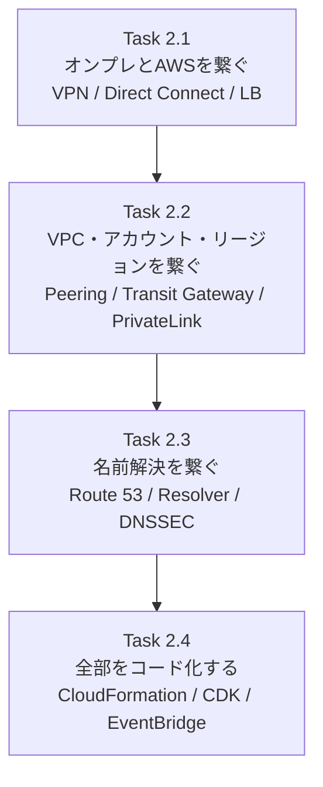

この順番は「物理回線 → 論理的なネットワーク → 名前 → 自動化」と、下から上へ積み上げる順序です。初学者はこの順で読むと理解しやすくなります。

### 0.3 各タスクの「知識」と「スキル」(試験ガイドの要約)

| タスク | 主な知識 | 主なスキル |
|---|---|---|
| 2.1 | ルーティングプロトコル、VPN、L1(LOA、コロケーション、Direct Connect)、L2/L3、Transit Gateway Connect、DNS、ファイアウォール、L4/L7ロードバランシング、AWS Organizations/RAM、Reachability Analyzer | 物理要件の構成、静的/動的ルーティング、既存オンプレとの接続、名前解決、LB構成、監視とログ、接続性テスト |
| 2.2 | VPC Peering、Transit Gateway、VPN、SD-WAN、MPLS、PrivateLink、SAML/AD、SG/NACL/Network Firewall | 単一/複数VPC設計、サードパーティ連携、ハブ&スポーク、DNS、境界のセキュリティ、監視 |
| 2.3 | プライベート/パブリックホストゾーン、ルーティングポリシー、委任と転送、レコードタイプ、DNSSEC、RAM共有、インバウンド/アウトバウンドエンドポイント | ゾーンと条件付き転送、トラフィック管理、ハイブリッドDNS、DNSSEC、集中/分散DNS、監視 |
| 2.4 | IaC(CDK/CloudFormation/CLI/SDK)、イベント駆動自動化、ハードコードの問題点 | 再利用可能な構成、イベント連携、ハイブリッド自動化、コスト最適化 |

> 試験ガイド自体が「網羅的な一覧ではない」と明記しています。本ガイドは各項目を実務レベルまで掘り下げ、関連する周辺知識も補っています。

### 0.4 表記ルール

- 図は **Mermaid(フローチャート)** と **Markdownの表** のみ使用しています(ASCII図は使いません)。
- 数値(クォータ、帯域など)は変更されることがあります。**必ず最新の公式ドキュメントで確認**してください(§9にURLあり)。
- ベストプラクティスは各節の末尾に「✅ ベストプラクティス」として整理しています。

---

## 1. 前提知識の整理(L1/L2/L3・BGP・CIDR)

### 1.1 OSI参照モデルとAWSサービスの対応

| 層 | 名前 | 主な概念 | 試験で登場するAWSの要素 |
|---|---|---|---|
| L1 | 物理層 | 光ファイバー、ポート、クロスコネクト | Direct Connect ロケーション、LOA-CFA、コロケーション |
| L2 | データリンク層 | VLAN、MACアドレス、スイッチング | Direct Connect の VIF(802.1Q VLAN ID) |
| L3 | ネットワーク層 | IPアドレス、ルーティング | VPC ルートテーブル、BGP、Transit Gateway、GWLB(L3) |
| L4 | トランスポート層 | TCP/UDP、ポート | NLB、セキュリティグループ、NACL |
| L7 | アプリケーション層 | HTTP、DNS | ALB、Route 53、AWS WAF |

### 1.2 ルーティングの基本

ルーターは「宛先IPアドレス → 次に渡す相手(ネクストホップ)」の対応表(ルーティングテーブル)で転送先を決めます。

| 方式 | 説明 | 長所 | 短所 |
|---|---|---|---|
| 静的ルーティング | 管理者が手動で経路を書く | 単純、BGP不要 | 障害時の自動切替ができない、変更が手作業 |
| 動的ルーティング(BGP) | ルーター同士が経路情報を交換する | 自動で経路を学習・切替できる | BGPの設定と理解が必要 |

AWSで使う動的ルーティングは**BGP(Border Gateway Protocol)**です。BGPの最低限の用語は次の通りです。

| 用語 | 意味 |
|---|---|
| ASN(自律システム番号) | ネットワーク運営者を識別する番号。プライベートASNの範囲は 64512〜65534(2バイト)と 4200000000〜4294967294(4バイト) |
| eBGP | 異なるASN同士のBGP。AWSとオンプレのピアリングはeBGP |
| AS_PATH | 経路が通過したASNの列。**短いほど優先**される |
| MED / Local Preference | 経路の優先度を調整する属性 |
| BGPコミュニティ | 経路に付けるタグ。Direct Connectでは優先度制御に使う |
| BFD | 高速な障害検知プロトコル。BGP単独のタイムアウトより早く切り替えられる |

### 1.3 CIDRと重複の問題

CIDR(例: `10.0.0.0/16`)で表すアドレス範囲が、**接続したい相手と重複すると多くの接続方式が使えません**(VPC Peering は重複不可、Transit Gateway も同一ルートテーブル内で曖昧になる)。実装前に必ずIPアドレス計画(IPAM)を確認します。

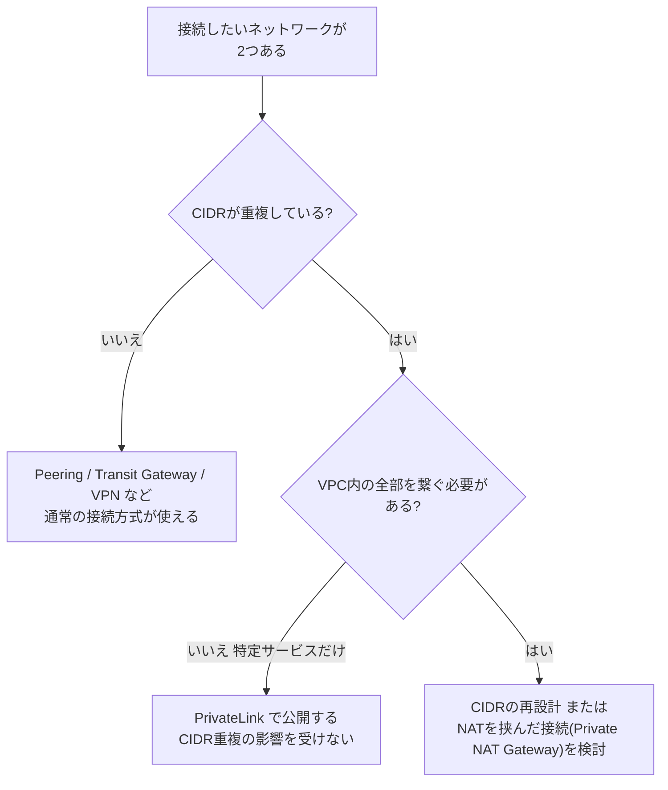

> PrivateLink は「サービス単位で一方向に」公開する仕組みなので、CIDRが重複していても使える、というのが試験の定番ポイントです(§3.4)。

---

## 2. Task 2.1: オンプレミスとAWSのルーティングと接続

> 試験ガイド: Implement routing and connectivity between on-premises networks and the AWS Cloud

### 2.1 ハイブリッド接続の全体像

オンプレミスとAWSを繋ぐ主な手段は3つです。

| 手段 | 通信経路 | 帯域 | 暗号化 | 開通までの時間 | 主な用途 |
|---|---|---|---|---|---|
| Site-to-Site VPN | インターネット経由(IPsec) | 標準トンネルは1トンネルあたり最大1.25 Gbps。Large Bandwidth Tunnel(Transit Gateway / Cloud WAN接続時のみ)は1トンネルあたり最大5 Gbps | IPsecで暗号化 | 数分〜数時間 | 素早い開通、バックアップ回線 |
| Direct Connect | 専用線(AWSバックボーン) | 1/10/100/400 Gbps(専有)など | 既定は暗号化なし(MACsec/VPN併用で暗号化) | 数週間〜数か月 | 大容量、低遅延、安定した品質 |
| Direct Connect + VPN | 専用線の上にIPsec | VPN側の上限に依存 | 暗号化あり | Direct Connect次第 | 専用線で暗号化も必須の場合 |

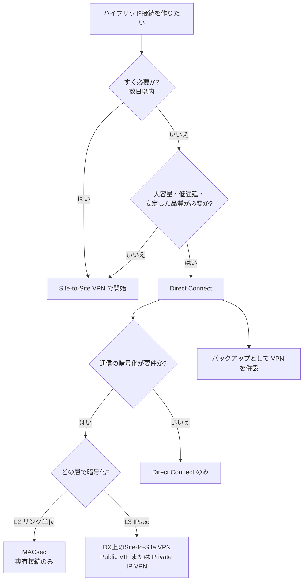

### 2.2 Site-to-Site VPN(IPsec VPN)

#### 2.2.1 構成要素

Site-to-Site VPN は、AWS側の終端(ゲートウェイ)とオンプレ側のカスタマーゲートウェイ(CGW)の間にIPsecトンネルを張ります。**1つのVPN接続は、冗長化のため必ず2本のトンネル**(別々のAZのエンドポイント)で構成されます。

| 用語 | 説明 |
|---|---|
| Virtual Private Gateway(VGW) | 1つのVPCに付ける、AWS側のVPN終端 |
| Transit Gateway(TGW) | 複数VPCとVPN/DXを束ねるハブ。VPNの終端にもなる |
| Customer Gateway(CGW) | オンプレ側のVPN装置を表すAWS上のリソース(IPアドレスとASNを登録) |
| トンネル | IPsecトンネル。1接続あたり2本(AWS側は別AZ) |

#### 2.2.2 VGW と TGW の違い

| 観点 | VGW 終端 | TGW 終端 |
|---|---|---|
| 接続できるVPC | 1つのVPC | 多数のVPC(アタッチメント) |
| ECMP(複数トンネルの同時利用) | 不可 | **可能**(BGP動的VPNのみ。帯域を束ねられる) |
| 帯域の考え方 | 1トンネル最大1.25 Gbps、2本のうち通常1本を使用 | ECMPで複数トンネル合算が可能 |
| Accelerated VPN | 不可 | **可能** |
| 向く構成 | 小規模・単一VPC | ハブ&スポーク、大規模、帯域拡張 |

#### 2.2.3 静的ルーティング と 動的ルーティング(BGP)

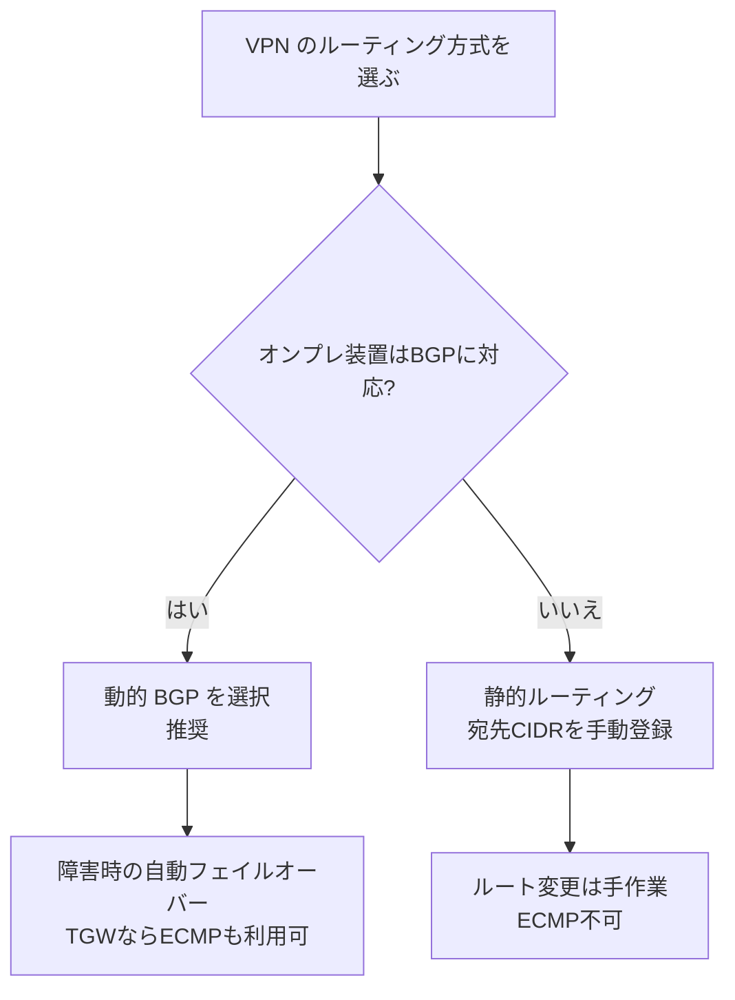

> 試験の定番: 「BGPに対応していない古いオンプレ装置」→ 静的VPN、「1トンネルあたり最大5 Gbpsまで帯域を増やしたい」→ Transit Gateway または Cloud WAN に終端する Large Bandwidth Tunnel、「複数トンネルを束ねて合計帯域を増やしたい」→ TGW + BGP動的VPN + ECMP。

#### 2.2.4 Accelerated VPN(高速化VPN)

Accelerated Site-to-Site VPN は、通信を**AWS Global Acceleratorのエッジロケーション**経由でAWSバックボーンに乗せ、インターネット区間を短くして遅延・ジッターを減らす機能です。

- **Transit Gateway に終端した接続のみ**で利用できます(VGW終端では不可)。
- 作成時に「アクセラレーション有効化」を選びます(あとから切替はできないため、作り直しが必要)。
- アクセラレーターが割り当てるIPは、VPN接続ごとのトンネルエンドポイントになります。

#### 2.2.5 VPNの設定項目(試験でよく問われる)

| 項目 | 内容 |
|---|---|
| IKEバージョン | IKEv1 / IKEv2(IKEv2 推奨) |
| 暗号化・認証・DHグループ | 既定は複数許可。**トンネルオプションで厳格に制限可能**(例: AES256、SHA2-256以上、DHグループ14以上) |
| NAT-T(NATトラバーサル) | UDP 4500。オンプレ側がNAT配下の場合に必要 |
| 事前共有キー(PSK) | 既定は自動生成。Secrets Manager連携や証明書認証(ACM Private CA)も選択可能 |
| トンネル内アドレス | `169.254.0.0/16` のリンクローカル `/30` |
| 外側/内側のIPバージョン | VGWではIPv6トラフィック非対応。外側トンネルアドレスにIPv6を使うにはTransit GatewayまたはCloud WANが必要。1つのVPN接続でIPv4とIPv6のパケットを同時には運べない(両方必要ならVPN接続を分ける) |
| DPD(Dead Peer Detection) | トンネル死活検知。タイムアウト時のアクション(clear / restart / none)を設定 |
| MTU | IPsecのオーバーヘッドで実効MTUが小さくなる。Site-to-Site VPN は **PMTUD(Path MTU Discovery)に対応しない**ため、使用する暗号スイートに合わせてオンプレ側の MTU / MSS を調整し、**MSS clamping** を検討する |

構成の設定例(CLIでトンネルオプションを指定)です。

```bash
# BGP動的VPN接続をTGW終端で作成(トンネルオプションで暗号スイートを制限)
aws ec2 create-vpn-connection \
  --type ipsec.1 \
  --customer-gateway-id cgw-0123456789abcdef0 \
  --transit-gateway-id tgw-0123456789abcdef0 \
  --options '{
    "StaticRoutesOnly": false,
    "EnableAcceleration": true,
    "TunnelOptions": [
      {
        "IKEVersions": [{"Value": "ikev2"}],
        "Phase1EncryptionAlgorithms": [{"Value": "AES256"}],
        "Phase1IntegrityAlgorithms": [{"Value": "SHA2-256"}],
        "Phase1DHGroupNumbers": [{"Value": 14}],
        "Phase2EncryptionAlgorithms": [{"Value": "AES256"}],
        "Phase2IntegrityAlgorithms": [{"Value": "SHA2-256"}],
        "Phase2DHGroupNumbers": [{"Value": 14}]
      },
      {
        "IKEVersions": [{"Value": "ikev2"}],
        "Phase1EncryptionAlgorithms": [{"Value": "AES256"}],
        "Phase1IntegrityAlgorithms": [{"Value": "SHA2-256"}],
        "Phase1DHGroupNumbers": [{"Value": 14}],
        "Phase2EncryptionAlgorithms": [{"Value": "AES256"}],
        "Phase2IntegrityAlgorithms": [{"Value": "SHA2-256"}],
        "Phase2DHGroupNumbers": [{"Value": 14}]
      }
    ]
  }'
```

#### 2.2.6 ✅ ベストプラクティス(VPN)

1. **2本のトンネルを両方とも使えるようにオンプレ側を設定**する(片方だけ設定すると冗長性がなくなる)。
2. 可能なら**オンプレ側の装置も2台(CGW 2つ)**にして装置障害に備える。
3. ルーティングは**BGPを優先**し、静的は互換性のためだけに使う。
4. 帯域が必要なら**TGW + ECMP**で複数のVPN接続を束ねる(ただしECMPは同一TGW・BGPのみ)。
5. 遅延の安定が必要なら**Accelerated VPN**、さらに通信が重要なら**Direct Connect + VPNバックアップ**。
6. トンネルオプションで**暗号スイートを必要最小限に制限**し、IKEv2を使う。
7. CloudWatchの `TunnelState` などのメトリクスとVPNログで**トンネル状態を監視**する。

---

### 2.3 AWS Direct Connect(専用線接続)

#### 2.3.1 レイヤー1: 物理接続の流れ

Direct Connect は「AWSのDirect Connectロケーション(コロケーション施設)」と「お客様の拠点」を専用回線で繋ぐサービスです。物理層(L1)の作業が試験範囲に含まれます。

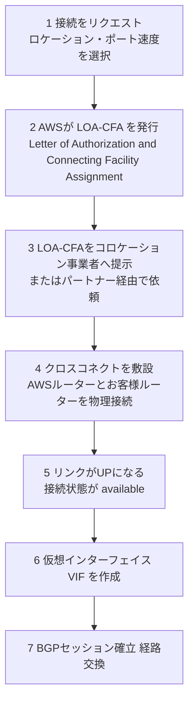

| 用語 | 説明 |
|---|---|
| Direct Connect ロケーション | AWSのルーターが置かれた第三者のコロケーション施設 |
| LOA-CFA | 「このポートにクロスコネクトしてよい」という許可書。コロケーション事業者に渡す |
| クロスコネクト | 施設内のAWSルーターとお客様(またはパートナー)ルーターを繋ぐ物理ケーブル |
| 専有接続(Dedicated) | AWSから直接ポートを割り当て。1/10/100/400 Gbps等 |
| ホスト接続(Hosted) | Direct Connect パートナーが提供。小さい帯域から選べる |
| LAG | 同じ速度の専有接続を束ねて1本の論理接続にする(1/10 Gbpsは最大4本、100/400 Gbpsは最大2本が目安) |
| MACsec | 専有接続(対応ポート)でのL2暗号化(IEEE 802.1AE) |

> 光ファイバーの種類(例: 1000BASE-LX、10GBASE-LR など)やオンプレルーター側のポート要件は、Direct Connect ユーザーガイドの接続要件に記載されています。**オンプレ側の光モジュールの規格が合わない**のが開通トラブルの典型です。

#### 2.3.2 仮想インターフェイス(VIF)の3種類

物理接続の上に、**802.1Q VLAN**でL2を分割して仮想インターフェイス(VIF)を作ります。VIFごとにVLAN IDとBGPセッションを持ちます。

| VIF の種類 | 接続先 | 用途 | ポイント |
|---|---|---|---|
| Private VIF | VGW または Direct Connect Gateway | VPCのプライベートIPへ到達 | 1 VIFで複数VPC(DXGW経由)に接続可能 |
| Public VIF | AWSのパブリックIP(S3など) | AWSパブリックサービスへの到達 | AWSが広告するパブリックプレフィックスを受信。オンプレ側は**自分が所有するパブリックIP**を広告 |
| Transit VIF | Direct Connect Gateway 経由で Transit Gateway | 多数のVPCをTGW経由で束ねる | 専有接続または一部のホスト接続で利用。1接続につきTransit VIFは1つが基本 |

#### 2.3.3 Direct Connect Gateway(DXGW)

DXGWは、グローバルなリソースで、**どのリージョンのVPC/TGWにも1つのVIFから到達**させる仕組みです(中国リージョンを除く)。

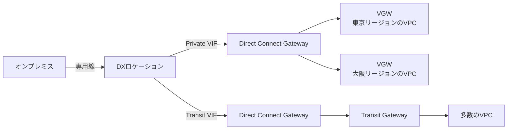

注意点(試験頻出):

- DXGWに関連付けた**VPC同士は、DXGW経由では通信できません**(DXGWは「オンプレ ↔ VPC」の中継であり、VPC間ルーターではない)。VPC間はPeeringやTGWで繋ぎます。
- Transit VIF 経由の場合、TGWとDXGWの関連付け時に**許可するプレフィックス(Allowed prefixes)**を指定します。これはDXGWからオンプレミスへ広告されるプレフィックスです(TGWが広告する経路ではありません)。
- DXGWは**リージョンをまたいで**使えます。VGW向けでもTGW向けでも、ロケーションの場所とVPCのリージョンは一致している必要はありません。

#### 2.3.4 冗長性モデル(Resiliency)

Direct Connect は、可用性の目標に応じた3つの推奨モデルがあります(Direct Connect Resiliency Toolkit でウィザード構成できます)。

| モデル | 構成の概要 | 想定ワークロード |
|---|---|---|
| **Maximum Resiliency** | 2つ以上の**別ロケーション**に、それぞれ**別デバイス**で接続(合計4接続以上が目安) | 重要な本番 |
| High Resiliency | 2つの**別ロケーション**にそれぞれ1接続 | 本番 |
| Development and Test | **1つのロケーション**の別デバイスに2接続(ロケーション障害に弱い) | 開発・検証 |

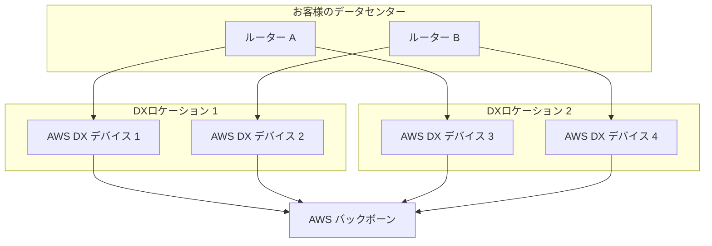

追加の冗長手段:

| 手段 | 説明 |
|---|---|
| Site-to-Site VPN バックアップ | DX障害時にVPNへ切り替える。TGW終端のVPNなら同じTGWで両方を扱える |
| BFD | BGPより高速な障害検知。DX側ではBFDを有効にするとフェイルオーバーが速くなる |
| LAG | 同一ロケーション内での帯域拡張と部分障害耐性(ロケーション障害には耐えない) |
| Direct Connect SiteLink | オンプレ拠点間をAWSバックボーン経由で直接繋ぐ(VPCを経由しない)機能 |

#### 2.3.5 BGPによる経路制御(Direct Connect)

AWS → オンプレ方向、オンプレ → AWS方向のどちらも制御できるのがポイントです。

| 方向 | 制御手段 |
|---|---|
| AWS → オンプレ(オンプレ宛て通信でAWSが選ぶ経路の優先度) | オンプレからAWSへ広告する経路に **BGPコミュニティ(Local Preference)** を付与: `7224:7100` 低 / `7224:7200` 中 / `7224:7300` 高。同じ優先度なら AS_PATH の短い方が選ばれる(AS_PATH プリペンドで調整可能) |
| オンプレ → AWS(AWS宛て通信で顧客側が選ぶ経路) | オンプレ側ルーターで、AWSから受信した経路に **Local Preference** などを設定して送信経路を選ぶ。これは顧客側の経路選択であり、AWS側の経路選択には影響しない |
| Public VIF の広告範囲 | スコープコミュニティで制御: `7224:9100` 同一リージョン / `7224:9200` 同一大陸 / `7224:9300` グローバル |

> AWSの経路選択の基本: ①**最長プレフィックス一致**が最優先。②同じプレフィックスなら、ルートテーブルへ伝播した経路のうち**Direct Connect(BGP) > 静的VPN > BGP VPN** の順(VGWの場合)。TGWでは、同じCIDRの経路が複数あるとき、静的ルート > プレフィックスリスト参照ルート > VPC伝播 > DXGW伝播 > TGW Connect > プライベートDirect Connect上のSite-to-Site VPN > Site-to-Site VPN(BGP)の順で選ばれます。試験では「VPNをDXのバックアップにしたい → DXの方が優先されるので特別な設定は不要、ただし**同じプレフィックス**を広告すること」と問われることがあります。

#### 2.3.6 Direct Connect の設定例

```bash
# 1) 仮想インターフェイス(Private VIF)の作成
aws directconnect create-private-virtual-interface \
  --connection-id dxcon-xxxxxxxx \
  --new-private-virtual-interface '{
    "virtualInterfaceName": "prod-private-vif",
    "vlan": 101,
    "asn": 65001,
    "authKey": "your-bgp-md5-key",
    "mtu": 9001,
    "addressFamily": "ipv4",
    "directConnectGatewayId": "11111111-2222-3333-4444-555555555555"
  }'

# 2) DXGW と TGW を関連付け(許可プレフィックスを指定)
aws directconnect create-direct-connect-gateway-association \
  --direct-connect-gateway-id 11111111-2222-3333-4444-555555555555 \
  --gateway-id tgw-0123456789abcdef0 \
  --add-allowed-prefixes-to-direct-connect-gateway cidr=10.0.0.0/16
```

#### 2.3.7 ✅ ベストプラクティス(Direct Connect)

1. 重要な本番は**Maximum Resiliency**: 別ロケーション・別デバイス・別ルーターで冗長化し、**動的(BGP)ルーティング**を使う。
2. **Site-to-Site VPN をバックアップ**として用意する(TGW終端で同じ経路を広告)。
3. **BFD** を有効にして障害検知を高速化する。
4. 暗号化が要件なら、専有接続なら**MACsec**、それ以外は**DX上のIPsec VPN**を使う。
5. BGPセッションには**MD5認証**を設定する。
6. ジャンボフレームを使う場合、VIFのMTU(Private VIFは1500/9001、Transit VIFは1500/8500)と経路全体のMTUを揃える。途中に小さいMTUの区間(VPNなど)があるとPMTUDの問題が起きる。
7. 設計時にクォータ(1BGPセッションで広告できるプレフィックス数など)を**最新の公式ドキュメントで確認**する。
8. CloudWatchの接続メトリクス(`ConnectionState` など)でリンク状態を**常時監視**する。

---

### 2.4 Transit Gateway Connect と SD-WAN

**Transit Gateway Connect** は、SD-WAN(Software-Defined WAN)アプライアンスをTGWに繋ぐためのアタッチメントです。**GREトンネル + BGP**で、SD-WANの仮想アプライアンスと経路を交換します。

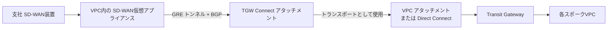

| 項目 | 内容 |
|---|---|
| 通信方式 | GRE(トンネル)+ BGP(経路交換)。IPsecではない |
| トランスポート | 既存の**VPCアタッチメント**または**Direct Connectアタッチメント**を土台にする |
| 帯域 | GREピアあたり最大5 Gbps。Connect アタッチメントあたり複数のピア(GREトンネル)を持てる。標準VPNトンネル(最大1.25 Gbps)よりは高帯域だが、Large Bandwidth VPNトンネル(最大5 Gbps)とは1本あたりの上限が同等 |
| 向く用途 | サードパーティSD-WANとの統合、VPNでは足りない帯域の実現 |

### 2.5 ロードバランシング(L3/L4/L7)

実装タスクの「ロードバランシングソリューションの構成」に対応します。ELBには4種類あり、試験では**層の違い**が最重要です。

| 種類 | 層 | プロトコル | 主な特徴 |
|---|---|---|---|
| Application Load Balancer(ALB) | L7 | HTTP/HTTPS/gRPC/WebSocket | パス・ホストベースのルーティング、WAF連携、OIDC/Cognito認証 |
| Network Load Balancer(NLB) | L4 | TCP/UDP/TLS | 超低遅延・高スループット、**AZごとの固定IP/Elastic IP**、クライアントIPの保持、PrivateLinkの前段 |
| Gateway Load Balancer(GWLB) | L3 | IPパケット(GENEVE、UDP 6081) | サードパーティのセキュリティアプライアンスを透過的に挿入 |
| Classic Load Balancer(CLB) | L4/L7 | 旧世代 | 新規では非推奨 |

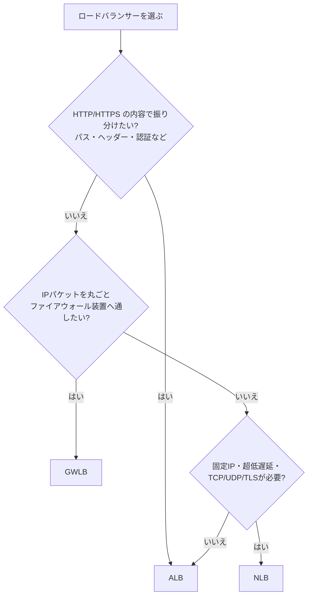

| 観点 | 試験での考え方 |
|---|---|
| 固定IPで公開したい | NLB(AZごとに固定/Elastic IP)。ALBはIPが変わるので、固定が必要なら**Global Accelerator + ALB**または NLB |
| クライアントの送信元IPを見たい | ALBは `X-Forwarded-For` ヘッダー。NLBは既定でクライアントIPを保持(ターゲットタイプによる) |
| クロスゾーン負荷分散 | ALBは既定で有効(無効化可)。NLB/GWLBは既定で無効(有効にするとAZ間データ転送料に注意) |
| リバースプロキシ | ALBは(L7)リバースプロキシとして動作。TLS終端・パスルーティングを担当 |
| オンプレのサーバーをターゲットに | **IPターゲット**でオンプレのIP(Direct Connect/VPN経由)を登録できる |

> ✅ ベストプラクティス(ELB): 複数AZに配置する/ヘルスチェックを適切に設定する/NLBにはセキュリティグループを付ける(現在はNLBもSGに対応)/TLSはACM証明書で終端する/アクセスログを有効にする。

### 2.6 セキュリティアプライアンス(ファイアウォール)

| 実現方法 | 概要 | 向く場面 |
|---|---|---|
| AWS Network Firewall | マネージドのステートフル/ステートレスFW。Suricata互換ルール | 手間をかけず検査したい |
| GWLB + サードパーティ | Palo Alto、Fortinet等の仮想FWを透過的に挿入 | 既存FWの機能・運用を継続したい |
| セキュリティグループ/NACL | インスタンス/サブネット単位のフィルタ(§3.7) | 基本の境界制御 |

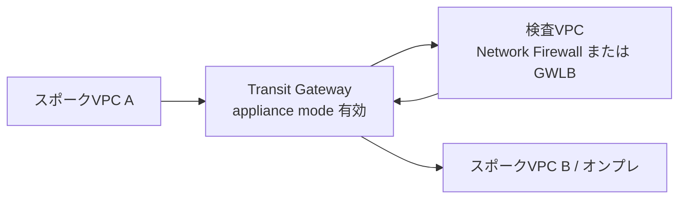

> **appliance mode** は、TGWが同一フロー(往路・復路)を**同じAZのアプライアンス**に送る設定です。これを有効にしないと、往路と復路で異なるAZのFWを通りステートフル検査が壊れます。試験の定番です。

### 2.7 AWS Organizations と AWS RAM(マルチアカウント共有)

AWS Resource Access Manager(RAM)は、**リソースを他のアカウントやOrganizationに共有**する仕組みです。Organizationsと連携すると、**招待なし**で組織内に共有できます。

| 共有できる主なネットワークリソース | 用途 |
|---|---|
| Transit Gateway | 中央のTGWに他アカウントのVPCをアタッチ |
| VPC サブネット(共有VPC) | 複数アカウントが同じVPCのサブネットにリソースを配置 |
| Route 53 Resolver ルール | 転送ルールを全アカウントで利用 |
| Direct Connect Gateway(関連付けの許可) | アカウントを跨いだDXGW運用(許可モデル) |

実装手順(Organizations有効 → RAMで組織共有を有効化 → リソース共有を作成)です。

```bash
# Organizationsとの共有を有効化(管理アカウントで1回)
aws ram enable-sharing-with-aws-organization

# TGWを組織全体に共有するリソース共有を作成
aws ram create-resource-share \
  --name shared-tgw \
  --resource-arns arn:aws:ec2:ap-northeast-1:111122223333:transit-gateway/tgw-0123456789abcdef0 \
  --principals arn:aws:organizations::111122223333:organization/o-exampleorgid
```

> ✅ ベストプラクティス: ネットワーク専用アカウント(Network Account)にTGW/DXGW/Resolverを集約し、RAMで各ワークロードアカウントへ共有する。

### 2.8 接続性の確認とテスト

| ツール | できること | 使いどころ |
|---|---|---|
| **Reachability Analyzer** | 送信元と宛先を指定して**設定上の到達可能性**を分析(パケットは送らない)。到達不可なら原因コンポーネントを特定 | 「なぜ繋がらない?」の切り分け |
| **Transit Gateway Route Analyzer** | TGWルートテーブル内の経路を分析し、経路の有無・ブラックホールを確認 | TGW経路の確認 |
| Network Access Analyzer | 意図しないアクセス経路を検出(セキュリティ要件の検証) | ネットワークの**到達可能性ポリシー**検証 |
| VPC Flow Logs | 通信のメタデータ(許可/拒否、バイト数)を記録 | 実際の通信の確認、SG/NACLの拒否確認 |
| Traffic Mirroring | パケットのコピーをアプライアンスに送る | 詳細なパケット解析、IDS |
| Network Manager / CloudWatch | TGW・VPN・DXの状態、メトリクス | 継続的な監視 |

> Reachability Analyzer は**設定を静的に解析**するもので、実際のパケットは送りません(ファイアウォールの外側やOS内部の設定は見えない)。「実通信での確認」にはFlow LogsやCloudWatch、Network Synthetic Monitor(後述)を使います。

### 2.9 監視とログ(Task 2.1のスキル)

| 対象 | 監視手段 |
|---|---|
| Site-to-Site VPN | CloudWatch `TunnelState`、`TunnelDataIn/Out`。VPN接続ログをCloudWatch Logsに出力 |
| Direct Connect | CloudWatch `ConnectionState`、`ConnectionBpsEgress/Ingress`、光レベル(Light Level)、BFD状態 |
| Transit Gateway | TGW Flow Logs、CloudWatchメトリクス(`BytesIn/Out`、`PacketDropCountBlackhole` など) |
| VPC | VPC Flow Logs(ENI/サブネット/VPC単位) |
| ELB | アクセスログ、CloudWatchメトリクス |
| 疎通・遅延の継続監視 | Network Synthetic Monitor(ハイブリッド区間の遅延/パケットロス) |

---

## 3. Task 2.2: 複数アカウント・リージョン・VPC間の接続

> 試験ガイド: Implement routing and connectivity across multiple AWS accounts, Regions, and VPCs to support different connectivity patterns

### 3.1 単一VPCの基本構成(DHCP・ルーティング・SG)

複数VPCに進む前に、1つのVPCの実装要素を押さえます。

| 要素 | 説明 | 試験のポイント |
|---|---|---|
| ルートテーブル | サブネットごとに1つ関連付け。最長プレフィックス一致で転送先を決定 | `local` ルートは削除できない。サブネットは明示関連付けがなければメインルートテーブルを使う |
| インターネットゲートウェイ(IGW) | パブリック通信の出入口 | パブリックサブネット = IGWへのルートがあるサブネット |
| NATゲートウェイ | プライベートサブネットから外部への**送信のみ**を許可 | AZごとに配置して冗長化。AZ間通信を避ける |
| Egress-only IGW | **IPv6**のプライベート送信用(NATのIPv6版の位置づけ) | IPv6は「NATではなくEgress-only IGW」 |
| DHCPオプションセット | DNSサーバー、ドメイン名、NTPなどをVPC内に配布 | 1VPCに1つ関連付け。変更不可で、新規作成して差し替える |
| VPCのDNS属性 | `enableDnsSupport`(Amazon提供DNSの有効化)、`enableDnsHostnames` | **プライベートホストゾーンとInterface Endpointのプライベート DNS には両方が `true`** が必要 |
| セキュリティグループ(SG) | インスタンス(ENI)単位の**ステートフル**フィルタ。許可ルールのみ | SG同士を参照できる(同一リージョンのPeering先でも参照可) |
| NACL | サブネット単位の**ステートレス**フィルタ。許可/拒否ルール、番号順に評価 | 戻りの通信(エフェメラルポート)も明示許可が必要 |

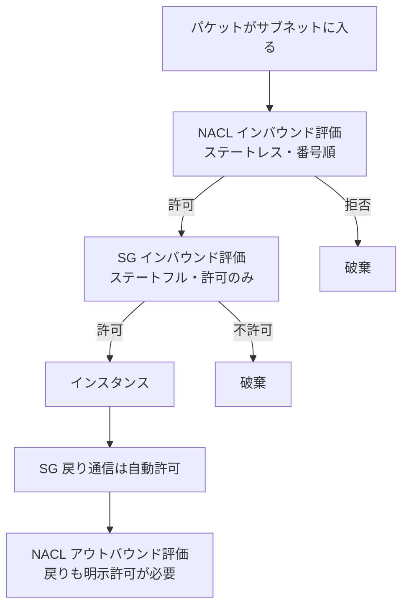

### 3.2 VPC間・アカウント間接続の選択

| 方式 | 概要 | 推移的ルーティング | 規模 | 主な制約 |
|---|---|---|---|---|
| VPC Peering | 2つのVPCを1対1で接続 | **不可** | 少数VPC | CIDR重複不可、Peeringの先のVPNやIGWを使えない(Edge to Edge不可) |
| Transit Gateway | リージョナルなハブ。多数のVPC/VPN/DXを集約 | ルートテーブルで制御 | 大規模 | データ処理料金あり |
| PrivateLink | サービス単位で一方向に公開 | 対象外(サービス公開) | 任意 | クライアント→サービスの一方向のみ |
| Site-to-Site VPN(VPC間) | VPCごとにVPN | 構成次第 | 小規模 | 管理が煩雑・帯域制限 |
| サードパーティ/Transit VPC | ルーター仮想アプライアンスを中心に接続(旧来の方式) | アプライアンス次第 | 以前の標準 | 運用負荷が高く、現在はTGWが推奨 |
| AWS Cloud WAN | グローバルな広域ネットワークをポリシーで構成 | ポリシーで制御 | グローバル | コアネットワークポリシーの理解が必要 |

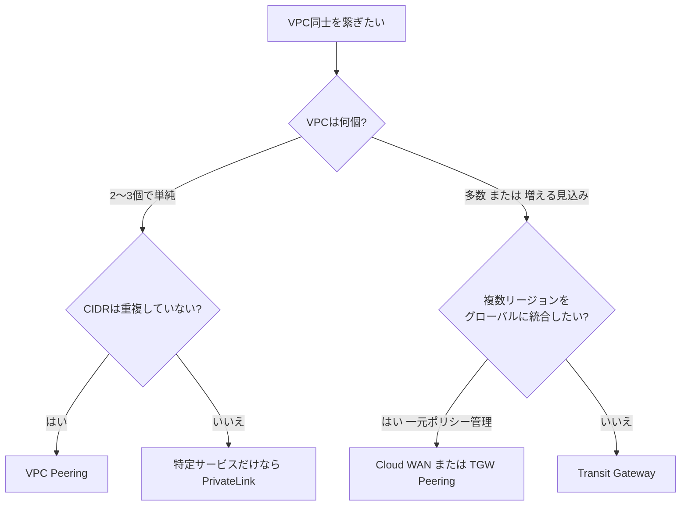

### 3.3 VPC Peering

| 項目 | 内容 |
|---|---|
| 作成手順 | リクエスター → アクセプター(別アカウント/別リージョンでも可)→ **両側のルートテーブルに相手のCIDRを追加** |
| 非推移 | A-B、B-CをPeeringしても、AとCは通信できない |
| CIDR | 重複不可(IPv4)。後から重複するCIDRを追加することもできない |
| DNS | 「DNS解決(Allow DNS resolution from peer VPC)」を有効にすると、相手のパブリックDNS名をプライベートIPに解決できる |
| SG参照 | 同一リージョンならPeering先のSGを参照可能。リージョン間Peeringでは不可 |
| 非対応 | 相手VPCの**IGW・NAT・VPN・Direct Connect を経由する通信(Edge to Edge)** |

```bash
# リージョン間のVPC Peeringを作成(リクエスター側)
aws ec2 create-vpc-peering-connection \
  --vpc-id vpc-aaaa1111 \
  --peer-vpc-id vpc-bbbb2222 \
  --peer-owner-id 444455556666 \
  --peer-region us-east-1

# 承諾(アクセプター側)
aws ec2 accept-vpc-peering-connection \
  --vpc-peering-connection-id pcx-0123456789abcdef0 \
  --region us-east-1

# ルートを追加(両側のVPCで)
aws ec2 create-route \
  --route-table-id rtb-0123456789abcdef0 \
  --destination-cidr-block 10.20.0.0/16 \
  --vpc-peering-connection-id pcx-0123456789abcdef0
```

### 3.4 AWS PrivateLink(プライベートなアプリケーション接続)

PrivateLink は、**VPCのプライベートIPアドレス(ENI)経由で、サービスにだけ**接続できるようにする機能です。インターネット、NAT、VPN、Peeringを使わずに済み、**CIDRが重複していても**使えます。

| エンドポイントの種類 | 説明 | 主な用途 |
|---|---|---|
| Interface Endpoint | サブネットにENIを作成し、プライベートIPでサービスへ接続 | AWSサービス、他アカウントのサービス、SaaS |
| Gateway Endpoint | **ルートテーブルのエントリ**で到達(**S3とDynamoDBのみ**)。無料 | S3/DynamoDBへのプライベート接続 |
| Gateway Load Balancer Endpoint | GWLBへトラフィックを透過的に送る | 検査VPCへの挿入 |
| Resource / Service Network Endpoint | VPC Lattice のリソースやサービスネットワークへ接続 | 新しいアプリ接続パターン |

自分のサービスを他アカウントに公開する(エンドポイントサービス)流れです。

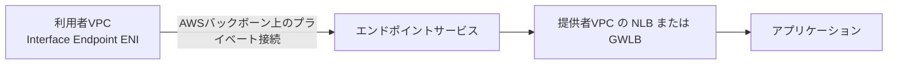

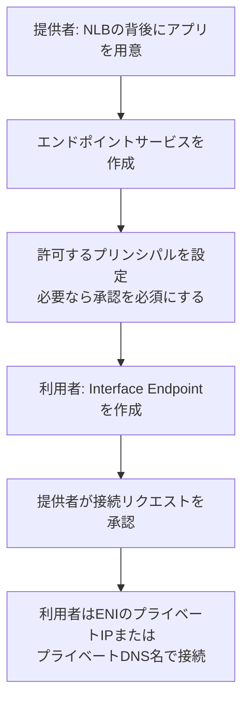

| 重要ポイント | 内容 |
|---|---|
| 方向性 | **一方向**(利用者 → 提供者)。提供者から利用者VPCへの開始はできない |
| DNS | Interface Endpoint の**プライベートDNS**を有効にすると、サービスの標準DNS名がエンドポイントのプライベートIPに解決される(VPCの `enableDnsSupport` と `enableDnsHostnames` が必須) |
| エンドポイントポリシー | エンドポイントポリシーに対応するAWSサービスのエンドポイントに限り、アクセス可能なプリンシパル/リソースをIAMポリシー形式で制限できる。AWS以外の提供者によるエンドポイントサービス(PrivateLink経由のSaaS等)では利用者側のエンドポイントポリシーは非対応で、エンドポイントはフルアクセスとなる(提供者側で制御する) |
| 可用性 | 複数AZにエンドポイントを置く |
| オンプレからの利用 | Direct Connect/VPN経由でオンプレからエンドポイントのプライベートIPに到達できる(DNS解決は§4のResolverで) |

> ✅ ベストプラクティス: S3/DynamoDBはまず**Gateway Endpoint**(無料)。それ以外のAWSサービスやSaaS公開は**Interface Endpoint**。ログ・ECR・SSMなどを使うプライベートサブネットのワークロードには必要なエンドポイントを揃える。

### 3.5 Transit Gateway(ハブ&スポーク)

#### 3.5.1 構成要素

| 用語 | 説明 |
|---|---|
| アタッチメント | TGWに繋ぐもの。VPC、VPN、Direct Connect Gateway、Connect、Peering(別TGW) |
| TGWルートテーブル | アタッチメントごとの経路表。**関連付け(Association)**と**伝播(Propagation)**で制御 |
| 関連付け(Association) | あるアタッチメントから来たパケットが**どのルートテーブルで検索されるか**を決める(1アタッチメントにつき1つ) |
| 伝播(Propagation) | アタッチメントの経路を、指定したルートテーブルに**自動で登録**する(複数のテーブルへ可) |
| ブラックホールルート | 該当する宛先のトラフィックを破棄(分離のために使う) |
| appliance mode | 同一フローを同じAZのアプライアンスへ送る(§2.6) |

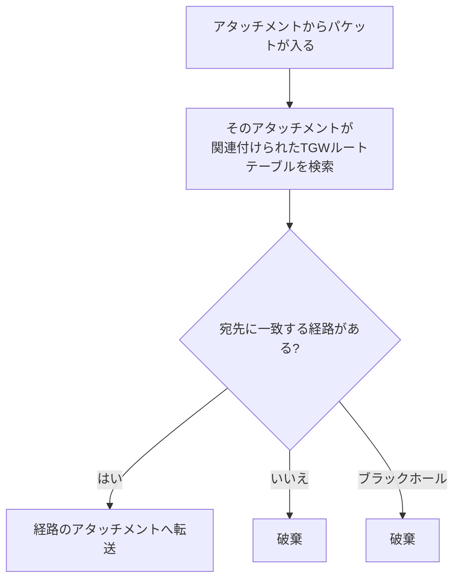

> 覚え方: 「**Association = 入口で見る表**」「**Propagation = 自分の経路をどの表に載せるか**」。

#### 3.5.2 ルートテーブル設計パターン

| パターン | 設計 | 用途 |
|---|---|---|
| 全て接続(フラット) | 1つのルートテーブルに全アタッチメントを関連付け・伝播 | 小規模・全面通信を許可 |
| 環境分離 | `prod` と `dev` のルートテーブルを分け、相互に伝播させない。共有サービスだけ両方へ伝播 | 環境ごとに隔離 |
| 集中型検査 | スポーク用テーブルは**0.0.0.0/0 → 検査VPCアタッチメント**。検査VPC用テーブルは各スポークへの経路を持つ | 全通信をFW検査 |
| 集中型エグレス | スポークは**0.0.0.0/0 → エグレスVPC**(NATゲートウェイ)に向ける | NATの共有でコスト削減 |

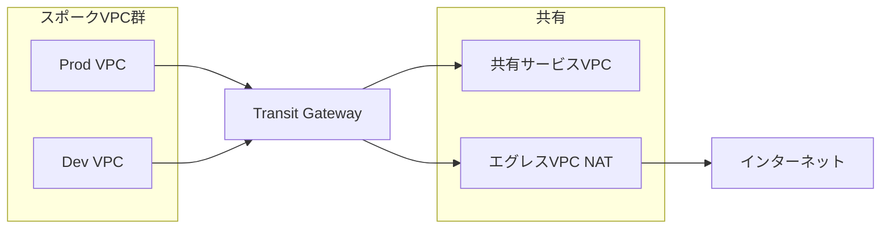

#### 3.5.3 TGWの主な仕様

| 項目 | 内容 |
|---|---|
| 範囲 | **リージョナル**リソース。リージョン間は**TGW Peering**(経路は**静的ルートのみ**、動的伝播不可) |
| 共有 | RAMでアカウントを跨いで共有可能(アタッチメントは各アカウントが作成し、TGW所有者が承認/自動承認) |
| ECMP | BGP VPNで複数トンネルに負荷分散(VPN接続を複数束ねて帯域拡張) |
| VPCアタッチメント | アタッチメントに**各AZのサブネットを1つ**指定。指定していないAZのリソースからはTGWに到達できない |
| マルチキャスト | 対応(必要なときだけ有効化) |
| 課金 | アタッチメント時間料金 + 処理データ量料金。**VPC Peeringはデータ転送料のみ**で、大量通信の2VPC間ではPeeringの方が安くなることがある |

```yaml
# CloudFormation: TGW とVPCアタッチメントの基本(ルートテーブル分離の準備)
# 抜粋(フラグメント): ProdVpc と ProdAttachSubnetIds は省略したテンプレート部分で
# 定義する前提(例: 同テンプレート内の AWS::EC2::VPC リソースと List<AWS::EC2::Subnet::Id> 型のパラメータ)
Resources:
  Tgw:
    Type: AWS::EC2::TransitGateway
    Properties:
      AmazonSideAsn: 64512
      DefaultRouteTableAssociation: disable   # 自動関連付けを無効化して明示制御する
      DefaultRouteTablePropagation: disable
      Tags:
        - Key: Name
          Value: core-tgw

  ProdRouteTable:
    Type: AWS::EC2::TransitGatewayRouteTable
    Properties:
      TransitGatewayId: !Ref Tgw

  ProdAttachment:
    Type: AWS::EC2::TransitGatewayAttachment
    Properties:
      TransitGatewayId: !Ref Tgw
      VpcId: !Ref ProdVpc
      SubnetIds: !Ref ProdAttachSubnetIds

  ProdAssociation:
    Type: AWS::EC2::TransitGatewayRouteTableAssociation
    Properties:
      TransitGatewayRouteTableId: !Ref ProdRouteTable
      TransitGatewayAttachmentId: !Ref ProdAttachment
```

#### 3.5.4 ✅ ベストプラクティス(Transit Gateway)

1. 各VPCのTGWアタッチメントには**専用の小さなサブネット**(例: `/28`)を使い、そのサブネットのNACLは広く許可する。
2. **既定の関連付け/伝播を無効化**し、明示的に設計したルートテーブルで分離する。
3. 検査VPCのアタッチメントでは **appliance mode** を有効にする。
4. 各スポークVPCへの経路は**集約(サマライズ)**し、ルート数の上限に備える。
5. TGW所有はネットワークアカウントに集約し、**RAMで共有**する。
6. 大量データが2VPC間だけで流れるなら、**VPC Peeringの併用**でコストを抑える。
7. **TGW Flow Logs** と CloudWatch でトラフィックと破棄(ブラックホール)を監視する。

### 3.6 サードパーティ・SD-WAN・MPLSとの接続

| 構成 | 概要 |
|---|---|
| MPLS + Direct Connect | 既存のMPLS網の拠点を、MPLS事業者/Direct Connectパートナー経由でAWSに接続(パートナーが用意するホスト接続やVIF) |
| SD-WAN + TGW Connect | SD-WAN仮想アプライアンスとTGWをGRE+BGPで接続(§2.4) |
| サードパーティVPN/Transit VPC | ルーター仮想アプライアンスをVPCに置き、VPNで接続(旧来の方式。ライセンス・運用負荷が高く、現在はTGW/Cloud WANが推奨) |
| Cloud WAN + SD-WAN | Cloud WANの**Connect(トンネルレスまたはGRE)**アタッチメントでSD-WANと統合 |

### 3.7 SG・NACL・Network Firewall の使い分け(境界のセキュリティ)

| 項目 | セキュリティグループ | NACL | Network Firewall |
|---|---|---|---|
| 適用単位 | ENI(インスタンス等) | サブネット | VPC(ファイアウォールサブネット経由) |
| ステート | ステートフル | ステートレス | ステートフル/ステートレス両方 |
| ルール | 許可のみ | 許可・拒否 | 許可・拒否・アラート。ドメイン名(FQDN)、IPS(Suricata互換)対応 |
| 主な用途 | 基本のアクセス制御 | サブネット境界の粗いブロック | 深いパケット検査、FQDNフィルタ、集中型検査 |

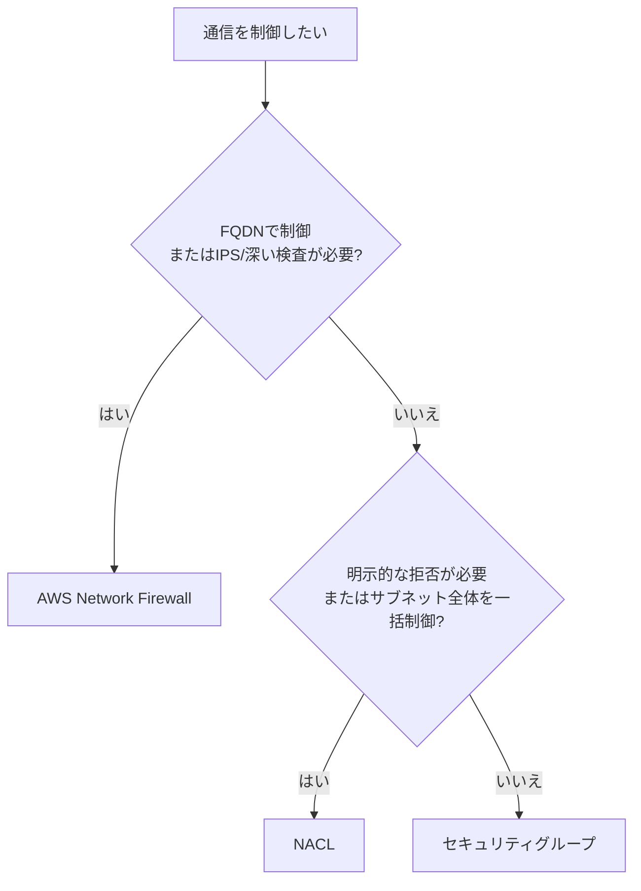

### 3.8 認証・認可(SAML、Active Directory)

ネットワークへの**ユーザー単位のアクセス**には AWS Client VPN を使います。

| 認証方式 | 内容 |
|---|---|
| 相互認証(証明書) | クライアント証明書とサーバー証明書(ACM)。小規模・単純 |
| Active Directory | AWS Directory Service(Managed Microsoft AD / AD Connector)でAD認証 |
| SAML 2.0 フェデレーション | IdP(IAM Identity Center、Okta、Entra ID等)によるSSO |
| 認可ルール | **グループ/ネットワークCIDRごとに許可**(ADグループやSAMLグループに紐づけ可能) |

> 試験では「社員のPCからVPCへ、SSOで接続したい」→ **Client VPN + SAML**、「ADのグループごとにアクセス範囲を変えたい」→ **Client VPN の認可ルール(Authorization rules)** という流れが典型です。

### 3.9 DNSで接続を成立させる(ハイブリッド接続のDNS)

VPCを繋いでもDNS名が引けないと通信できません。詳しくは§4で扱いますが、Task 2.2では次の接続とDNSの組み合わせが問われます。

| 状況 | 必要な設定 |
|---|---|
| Peering先のプライベートDNS名を引きたい | PeeringでDNS解決を有効化。プライベートホストゾーンを**相手VPCにも関連付け** |
| 複数VPC・複数アカウントでプライベートホストゾーンを共有 | VPC関連付けの**認可(authorization)**後にクロスアカウントで関連付け、またはRoute 53 Profiles |
| オンプレとVPCで互いに名前解決 | Route 53 Resolverのインバウンド/アウトバウンドエンドポイント |

### 3.10 ネットワーク監視とログ(Task 2.2)

| 対象 | 手段 |
|---|---|
| VPC内外のトラフィック | VPC Flow Logs(CloudWatch Logs / S3 / Firehose へ出力) |
| TGW | Transit Gateway Flow Logs |
| Network Firewall | アラートログ・フローログ(S3/CloudWatch Logs/Firehose) |
| 全体の可視化 | Network Manager(TGW、Cloud WAN、VPN、SD-WANを一元表示) |
| 経路の検証 | Reachability Analyzer、TGW Route Analyzer |

---

## 4. Task 2.3: ハイブリッド/マルチアカウントDNS

> 試験ガイド: Implement complex hybrid and multi-account DNS architectures

### 4.1 DNSの基礎と Route 53 の全体像

DNSは「名前(例: `app.example.com`)→ IPアドレス」を引く仕組みです。Route 53 は次の3つの機能を持ちます。

| 機能 | 説明 |
|---|---|
| ドメイン登録 | ドメイン名の取得・更新 |
| 権威DNS(ホストゾーン) | ドメインのレコードを保持して応答する |
| Route 53 Resolver | VPC内やオンプレからの**再帰的な名前解決**(リゾルバー) |
| ヘルスチェックとルーティング | 死活監視と、DNSレベルのトラフィック制御 |

### 4.2 パブリックホストゾーンとプライベートホストゾーン

| 観点 | パブリックホストゾーン | プライベートホストゾーン(PHZ) |
|---|---|---|
| 応答する相手 | インターネット上の誰でも | **関連付けたVPCからのみ** |
| 用途 | 公開サービスのDNS | VPC内部の名前(内部サービス、DB等) |
| VPC要件 | なし | VPCに `enableDnsSupport` と `enableDnsHostnames` が必要 |
| 同名の公開/非公開 | **スプリットホライズンDNS**が可能(同じドメインで内部と外部で別の応答を返す) | PHZ が優先(関連付けたVPCからは PHZ の応答が使われる) |

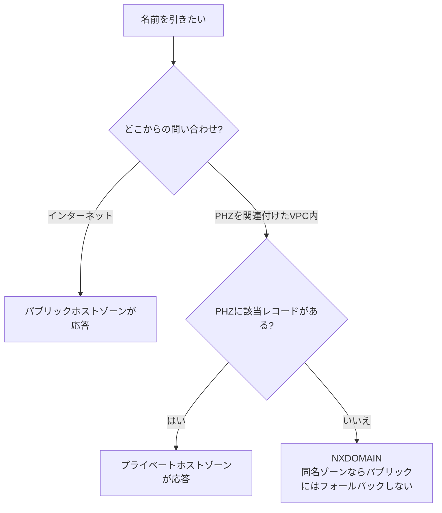

> スプリットホライズン時の落とし穴: PHZ に `example.com` を作ると、そのVPCからは `example.com` 配下を**PHZ の内容だけ**で解決します。PHZ に無いレコード(例: `www`)は引けなくなるため、公開側と同じレコードも PHZ に複製する必要があります。

### 4.3 レコードタイプ

| タイプ | 内容 | 補足 |
|---|---|---|
| A | 名前 → IPv4アドレス | |
| AAAA | 名前 → IPv6アドレス | |
| CNAME | 名前 → 別の名前(別名) | **ゾーンの頂点(ルートドメイン、例: `example.com`)には作れない**。他のレコードと同名で共存不可 |
| **Alias** | 名前 → AWSリソース(ELB、CloudFront、S3静的サイト、API Gateway等) | Route 53 独自の拡張。**ゾーン頂点にも作成可能**、Aliasクエリは**無料**、ターゲットの変更に自動追従。ヘルスの評価(Evaluate Target Health)も可能 |
| TXT | 任意の文字列 | ドメイン所有確認、SPF/DKIM、DMARC |
| PTR | IPアドレス → 名前(逆引き) | 逆引きゾーン `in-addr.arpa`(IPv4)/`ip6.arpa`(IPv6)に作成 |
| MX | メールサーバー | 優先度付き |
| NS | ゾーンの権威DNSサーバー/**サブドメインの委任** | |
| SOA | ゾーンの管理情報 | |
| CAA | 証明書を発行できるCAを制限 | |

> 試験の定番: 「`example.com` の頂点でELBを指したい」→ **CNAMEは不可、Aliasを使う**。

### 4.4 ルーティングポリシー(DNSによるトラフィック管理)

| ポリシー | 動作 | 主な用途 |
|---|---|---|
| Simple | 1つのレコードに1つ以上の値。ヘルスチェックなし | 単純な構成 |
| Weighted | 重みに比例して応答を分配 | カナリアリリース、A/Bテスト、段階移行 |
| Latency | **ユーザーから最も遅延の小さいリージョン**の応答 | マルチリージョンの性能最適化 |
| Failover | プライマリが異常ならセカンダリを返す(ヘルスチェック必須) | アクティブ/スタンバイ |
| Geolocation | **ユーザーの所在地(国・大陸・州)**で応答を変える | 地域別コンテンツ、法規制、言語。デフォルトレコードを置く |
| Geoproximity | 地理的な近さ+バイアスで配分(Traffic Flow が必要) | 負荷の地理的な偏りの調整 |
| IP-based | クライアントの**IPアドレス範囲(CIDR)**で応答を変える | 特定のISP・拠点を特定のエンドポイントへ |
| Multivalue answer | ヘルシーな複数の値(最大8個)をランダムに返す | 簡易的な負荷分散+ヘルスチェック |

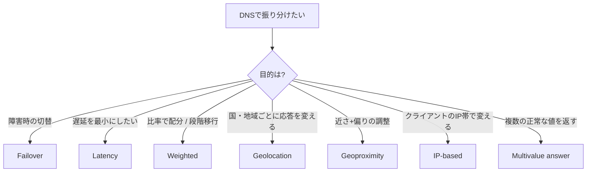

> 区別の落とし穴: **Latency**は「ネットワーク遅延」、**Geolocation**は「ユーザーの所在地」、**Geoproximity**は「リソースとの距離+バイアス」です。ヘルスチェックの有無で動作が変わるのは Failover/Multivalue/Weighted などです。

ヘルスチェックの種類: エンドポイント監視(HTTP/HTTPS/TCP)、他のヘルスチェックを**組合せ**る計算型、**CloudWatchアラームを監視**する型(プライベートなリソース向け。Route 53のヘルスチェッカーはインターネット側から到達するため、プライベートIPのリソースを直接は監視できない)。

### 4.5 Route 53 Resolver とハイブリッドDNS

#### 4.5.1 VPCの標準リゾルバー(`.2` アドレス)

各VPCには、VPC CIDRのベースアドレス+2(例: `10.0.0.2`)と `169.254.169.253` で**Route 53 Resolver**が提供されます。VPC内のリソースはこれで、PHZ・VPC内部DNS名・パブリックDNSを解決できます。**VPCの外(オンプレなど)からは、このアドレスにはそのままでは問い合わせできません**。

#### 4.5.2 インバウンドエンドポイントとアウトバウンドエンドポイント

| エンドポイント | 方向 | 用途 | 設定 |
|---|---|---|---|
| **インバウンド** | オンプレ → AWS | オンプレのDNSが、AWSのPHZやVPC内部名を引く | VPC内にENI(IP)を作成。オンプレDNSからそのIPへ**条件付き転送** |
| **アウトバウンド** | AWS → オンプレ | VPCのリソースが、オンプレのドメイン(例: `corp.example.com`)を引く | **転送ルール(Forwarding rule)**でドメインごとにオンプレDNSのIPを指定 |

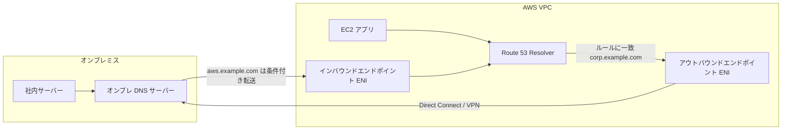

実装の流れ(フロー):

```mermaid
flowchart TD
    A["1 DXまたはVPNでオンプレとVPCが疎通"] --> B["2 インバウンドエンドポイントを作成<br/>2つ以上のIPを別AZに"]
    B --> C["3 オンプレDNSに条件付き転送を設定<br/>AWSドメイン → インバウンドのIP"]
    C --> D["4 アウトバウンドエンドポイントを作成"]
    D --> E["5 転送ルールを作成<br/>オンプレドメイン → オンプレDNSのIP"]
    E --> F["6 ルールをVPCに関連付け"]
    F --> G["7 双方向の名前解決を確認"]
```

エンドポイントの要件と制約:

| 項目 | 内容 |
|---|---|
| IPアドレス | **最低2つ(別AZ推奨)**。1つあたり**秒間約10,000クエリ**が目安 |
| セキュリティグループ | インバウンド: オンプレのDNSからの TCP/UDP 53。アウトバウンド: オンプレDNSへの TCP/UDP 53 |
| 通信経路 | Direct Connect または VPN(プライベート経路) |
| ルールの種類 | **Forward**(指定先へ転送)、**System**(転送しない例外を作る:より具体的なドメインで標準解決へ戻す)、Autodefined(AWS内部名用の自動ルール) |
| ルールの一致 | **最も具体的(最長一致)なドメイン**のルールが優先 |

```bash
# アウトバウンドエンドポイントの作成
aws route53resolver create-resolver-endpoint \
  --name outbound-to-onprem \
  --creator-request-id outbound-001 \
  --direction OUTBOUND \
  --security-group-ids sg-0123456789abcdef0 \
  --ip-addresses SubnetId=subnet-aaaa1111 SubnetId=subnet-bbbb2222

# 転送ルール(corp.example.com をオンプレのDNSへ)
aws route53resolver create-resolver-rule \
  --name fwd-corp \
  --creator-request-id rule-001 \
  --rule-type FORWARD \
  --domain-name corp.example.com \
  --resolver-endpoint-id rslvr-out-0123456789abcdef0 \
  --target-ips Ip=192.168.10.10,Port=53 Ip=192.168.20.10,Port=53

# ルールをVPCに関連付け
aws route53resolver associate-resolver-rule \
  --resolver-rule-id rslvr-rr-0123456789abcdef0 \
  --vpc-id vpc-0123456789abcdef0
```

### 4.6 マルチアカウントでのDNS共有

#### 4.6.1 3つの共有方法

| 共有対象 | 方法 |
|---|---|
| Resolver転送ルール | **AWS RAM**で他アカウント/Organizationに共有し、受け取った側がVPCに関連付ける |
| プライベートホストゾーン | **クロスアカウントのVPC関連付け**(認可 → 関連付け)。**RAMではPHZ自体は共有しない** |
| 一括管理 | **Route 53 Profiles**(PHZ、Resolverルール、DNS Firewallのルールグループ等をまとめて共有し、VPCに適用) |

PHZのクロスアカウント関連付け(これはCLIのみで可能な操作がある):

```bash
# 1) PHZ所有アカウントで: 別アカウントのVPCに関連付けを認可
aws route53 create-vpc-association-authorization \
  --hosted-zone-id Z0123456789ABCDEFGHIJ \
  --vpc VPCRegion=ap-northeast-1,VPCId=vpc-0aaaa1111

# 2) VPC所有アカウントで: 関連付けを実行
aws route53 associate-vpc-with-hosted-zone \
  --hosted-zone-id Z0123456789ABCDEFGHIJ \
  --vpc VPCRegion=ap-northeast-1,VPCId=vpc-0aaaa1111

# 3) (任意)PHZ所有アカウントで認可を削除
aws route53 delete-vpc-association-authorization \
  --hosted-zone-id Z0123456789ABCDEFGHIJ \
  --vpc VPCRegion=ap-northeast-1,VPCId=vpc-0aaaa1111
```

#### 4.6.2 集中型 と 分散型 のDNSアーキテクチャ

| 観点 | 集中型(Centralized) | 分散型(Distributed) |
|---|---|---|
| 構成 | 共有サービスVPCにResolverエンドポイントを集約。他VPCはルール共有+PHZ関連付けで利用 | 各VPC/アカウントが自前のResolverルール・エンドポイント |
| 長所 | 管理とコストの集約、ルールの一貫性 | 障害の局所化、アカウントごとの独立性 |
| 短所 | 集約VPCが障害点・クエリ上限に注意 | 構成の重複、運用負荷 |
| 推奨 | 多くの大規模環境で出発点 | 隔離要件が強い場合 |

```mermaid
flowchart TD
    A["DNS構成を選ぶ"] --> B{"アカウント/VPCの数は多い?<br/>統一運用したい?"}
    B -->|"はい"| C["集中型<br/>共有VPCにResolverエンドポイント<br/>ルールはRAMまたはProfilesで共有"]
    B -->|"いいえ・強い隔離が必要"| D["分散型<br/>各アカウントで独立して構成"]
    C --> E["注意: エンドポイントIPあたりのクエリ上限<br/>複数AZ・複数IPで分散"]
```

### 4.7 DNS の委任と条件付き転送

| 用語 | 説明 |
|---|---|
| 委任(Delegation) | 親ゾーンに**サブドメインのNSレコード**を置き、サブドメインの管理を別のゾーン(別アカウント・別サーバー)に任せる |
| 条件付き転送(Conditional Forwarding) | 特定のドメイン宛の問い合わせだけを指定のDNSへ転送する |
| 使い分け | 権威ゾーンを分けたい → **委任**。ハイブリッドで名前空間を重ねたくない → **条件付き転送**(Resolver) |

### 4.8 DNSSEC(Route 53)

DNSSECは、DNS応答が**改ざんされていないこと**を電子署名で検証できるようにする仕組みです。

| 項目 | 内容 |
|---|---|
| 目的 | DNSキャッシュポイズニング等への対策(応答の真正性・完全性) |
| 署名 | パブリックホストゾーンで有効化。**KSK(Key Signing Key)**を使って署名 |
| KMS | KSKの元になる**非対称KMSキー(ECC_NIST_P256、署名/検証用)**を、**米国東部(N. Virginia、us-east-1)に作成**する必要がある |
| 信頼の連鎖 | 親ゾーン(例: `.com`)に、ゾーンの**DSレコード**を登録して信頼の連鎖(chain of trust)を完成させる |
| 対象 | **パブリックホストゾーンの署名**。ResolverのDNSSEC検証(VPC内でのレスポンス検証)も別途有効化できる |

```mermaid
flowchart TD
    A["1 KMS 非対称キーを us-east-1 に作成<br/>ECC_NIST_P256"] --> B["2 ホストゾーンで DNSSEC署名を有効化<br/>KSK を作成"]
    B --> C["3 ドメインの DSレコードを取得"]
    C --> D["4 親ゾーン/レジストラに DS を登録"]
    D --> E["5 信頼の連鎖が成立<br/>検証リゾルバーが応答を検証"]
```

DNSSEC運用上の注意:

- DS登録後に**KMSキーを削除/無効化・KSKを不適切に扱うと、名前解決が失敗**します(署名検証エラー)。
- 有効化の前に**TTLを短縮**し、問題が出たら**DSを先に削除**してから署名を無効化する、というロールバック順序を守ります。
- CloudWatchアラーム(`DNSSECInternalFailure`、`DNSSECKeySigningKeysNeedingAction`)で署名の異常を監視します。

### 4.9 DNSの監視とログ

| 種類 | 内容 | 出力先 |
|---|---|---|
| パブリックDNSクエリログ | パブリックホストゾーンへのクエリ | **CloudWatch Logs(us-east-1)** |
| Resolverクエリログ | VPC内からのクエリ(VPC・インスタンス・結果等) | CloudWatch Logs / S3 / Kinesis Data Firehose |
| ヘルスチェックの監視 | ヘルスチェックのステータス | CloudWatchメトリクス/アラーム、SNS通知 |
| Route 53 Resolver DNS Firewall | 悪意のあるドメインへのクエリをブロック/アラート | ログはResolverクエリログ等 |

### 4.10 ✅ ベストプラクティス(DNS)

1. ハイブリッドDNSは**Resolverエンドポイント(インバウンド/アウトバウンド)**で構築し、各エンドポイントに**2つ以上のIP(別AZ)**を割り当てる。
2. 転送ルールは**RAM(またはProfiles)で共有**し、アカウントごとに重複作成しない。
3. ゾーン頂点のAWSリソース指定は**Alias**。同一リージョンのELB等はAliasで**クエリ料金を節約**。
4. 重要サービスは**ヘルスチェック + Failover/Latency**を組み合わせ、TTLを適切に短くする。
5. 本番のパブリックゾーンには**DNSSEC**を検討し、KMSキーの管理・監視を徹底する。
6. **DNS Firewall** で悪意のあるドメインを制限し、**クエリログ**を保管する。
7. 集中型DNSではエンドポイントのクエリ上限(IPあたり)に注意し、キャッシュとTTLを活用する。

---

## 5. Task 2.4: ネットワークインフラの自動化と構成

> 試験ガイド: Automate and configure network infrastructure

### 5.1 なぜIaC(Infrastructure as Code)か

手作業(コンソール操作)のネットワーク構築は、**再現性がなく、レビューできず、ドリフト(設定のずれ)を生みます**。IaCにすると、構成がコードとしてバージョン管理され、同じ構成を複数のアカウント・リージョンに繰り返し展開できます。

| IaCの選択肢 | 特徴 | 向く場面 |
|---|---|---|
| AWS CloudFormation | JSON/YAMLの宣言型。スタック単位で作成/更新/削除。AWS公式 | 標準的なAWS構築、StackSetsでマルチアカウント展開 |
| AWS CDK | TypeScript/Python等のプログラミング言語でインフラを記述し、CloudFormationへ変換 | ループ・条件分岐・再利用部品(Construct)を多用する場合 |
| AWS CLI | コマンドラインでAPIを呼ぶ | 運用の自動化、スクリプト、ワンショット作業 |
| AWS SDK / API | アプリやLambdaからリソースを操作 | イベント駆動の動的な変更 |
| (参考)Terraform | マルチクラウド対応のIaC | 試験の主役ではないが実務では頻出 |

```mermaid
flowchart LR
    DEV["開発者がコードを記述"] --> GIT["Gitでレビュー・版管理"]
    GIT --> CI["CI/CD パイプライン<br/>cfn-lint や cdk synth で検証"]
    CI --> CS["変更セットを作成して確認"]
    CS --> DEP["デプロイ<br/>CloudFormation / StackSets"]
    DEP --> DRIFT["ドリフト検出で<br/>手動変更を検知"]
```

### 5.2 ハードコードの問題(試験で明示されている論点)

試験ガイドは「IaCテンプレートにハードコードした値を使うことで起こる一般的な問題」を挙げています。

| ハードコードされがちな値 | 起こる問題 | 解決策 |
|---|---|---|
| AZ名(`ap-northeast-1a`) | アカウントごとにAZのマッピングが異なる/AZが使えない場合に失敗 | `Fn::GetAZs`、`Fn::Select` で動的に取得 |
| AMI ID | リージョンごとに異なり、古くなる | **SSMパラメータ**(公開AMIのパラメータ)を参照 |
| リージョン名・アカウントID・ARN | 別環境へ流用できない | **疑似パラメータ**(`AWS::Region`、`AWS::AccountId`、`AWS::Partition`) |
| CIDR・サブネット数 | 環境ごとの違いに対応できない | **パラメータ**、`Mappings`、`Fn::Cidr`、IPAM連携 |
| リソースの物理名 | 名前の衝突で再作成・複数デプロイができない | 名前を**自動生成**に任せる(必要ならパラメータで接頭辞) |
| 他スタックのリソースID | 結合が硬く、更新が困難 | **Outputs/Export + `Fn::ImportValue`**、またはSSMパラメータで受け渡し |

```yaml
# CloudFormation: ハードコードを避けたVPC(AZ/CIDR/AMIを動的に決める例)
AWSTemplateFormatVersion: "2010-09-09"
Parameters:
  VpcCidr:
    Type: String
    Default: 10.10.0.0/16
  LatestAmiId:
    Type: AWS::SSM::Parameter::Value<AWS::EC2::Image::Id>
    Default: /aws/service/ami-amazon-linux-latest/al2023-ami-kernel-default-x86_64
Resources:
  Vpc:
    Type: AWS::EC2::VPC
    Properties:
      CidrBlock: !Ref VpcCidr
      EnableDnsSupport: true
      EnableDnsHostnames: true
  SubnetA:
    Type: AWS::EC2::Subnet
    Properties:
      VpcId: !Ref Vpc
      AvailabilityZone: !Select [0, !GetAZs ""]            # AZ名を直書きしない
      CidrBlock: !Select [0, !Cidr [!GetAtt Vpc.CidrBlock, 4, 8]]  # /24を自動分割
Outputs:
  VpcId:
    Value: !Ref Vpc
    Export:
      Name: !Sub "${AWS::StackName}-VpcId"                 # 他スタックから参照
```

### 5.3 CloudFormationの運用機能

| 機能 | 内容 | ネットワークでの使いどころ |
|---|---|---|
| 変更セット(Change Set) | 適用前に**差分**を確認 | ルートテーブル/TGWの変更で影響を事前確認 |
| ドリフト検出 | 実際の構成とテンプレートのずれを検出 | コンソールで直接変更された設定の検知 |
| StackSets | 複数アカウント/リージョンへ**同一スタックを展開** | 全アカウントへVPC Flow Logs/標準ルール/DNSルールを配布 |
| DeletionPolicy / Termination Protection | 誤削除の防止 | TGW、DXGW、ホストゾーンなど重要リソース |
| ネストスタック/モジュール | テンプレートの再利用 | VPC部品、エンドポイント部品を共通化 |
| CloudFormation Hooks / Guard | デプロイ前にポリシー検証 | 「0.0.0.0/0のSSH許可を禁止」などをコードで強制 |
| cfn-lint | テンプレートの静的解析 | CIで構文・ベストプラクティスを検査 |

### 5.4 AWS CDK

CDK は**Construct**という部品を組み合わせます。L1(CloudFormationそのまま)、L2(意味のある既定値を持つ高レベル)、L3(パターン=複数リソースの組合せ)の3階層があります。

```typescript
// AWS CDK (TypeScript): 3AZのVPCとGateway Endpointを数行で作る
import * as cdk from "aws-cdk-lib";
import * as ec2 from "aws-cdk-lib/aws-ec2";
import { Construct } from "constructs";

export class NetworkStack extends cdk.Stack {
  constructor(scope: Construct, id: string, props?: cdk.StackProps) {
    super(scope, id, props);

    const vpc = new ec2.Vpc(this, "CoreVpc", {
      ipAddresses: ec2.IpAddresses.cidr("10.10.0.0/16"),
      maxAzs: 3, // AZ名は直書きしない
      natGateways: 1, // コスト最適化: 本番はAZごとに推奨
      subnetConfiguration: [
        { name: "public", subnetType: ec2.SubnetType.PUBLIC, cidrMask: 24 },
        { name: "private", subnetType: ec2.SubnetType.PRIVATE_WITH_EGRESS, cidrMask: 24 },
      ],
    });

    // S3 Gateway Endpoint(無料)
    vpc.addGatewayEndpoint("S3Endpoint", {
      service: ec2.GatewayVpcEndpointAwsService.S3,
    });
  }
}
```

### 5.5 イベント駆動のネットワーク自動化

ネットワークの状態変化(VPNトンネル断、設定変更、異常検知)を**イベントとして捉え、自動で対処**する構成です。

```mermaid
flowchart LR
    SRC["イベント源<br/>CloudWatchアラーム / AWS Config / CloudTrail / ヘルスチェック"] --> EB["Amazon EventBridge<br/>ルールでフィルタ"]
    EB --> L["AWS Lambda"]
    EB --> SSM["Systems Manager Automation"]
    EB --> SNS["SNS 通知"]
    L --> ACT["ルート切替 / SG修正 / チケット作成"]
    SSM --> ACT
```

| 構成要素 | 役割 |
|---|---|
| Amazon EventBridge | イベントのルーティング(パターンでフィルタし、ターゲットへ) |
| AWS Lambda | 自動対処のロジック(ルート更新、タグ付け、通知など) |
| Systems Manager Automation | 承認付き・定義済みの運用手順(Runbook)の実行 |
| AWS Config + 修復アクション | 設定違反(例: SGが全開放)を検知し自動修復 |
| CloudWatch アラーム | メトリクス(VPNトンネル状態、DX接続状態)をトリガーに |
| Route 53 ヘルスチェック + Failover | DNSレベルの自動切替(アプリの死活監視) |

EventBridgeルールの例(SGに `0.0.0.0/0` のSSH許可を追加した操作を検知):

```json
{
  "source": ["aws.ec2"],
  "detail-type": ["AWS API Call via CloudTrail"],
  "detail": {
    "eventSource": ["ec2.amazonaws.com"],
    "eventName": ["AuthorizeSecurityGroupIngress"]
  }
}
```

Lambdaでの自動対処の例(違反したルールの取り消し):

```python
import boto3

ec2 = boto3.client("ec2")

def handler(event, context):
    detail = event["detail"]
    group_id = detail["requestParameters"]["groupId"]
    for perm in detail["requestParameters"]["ipPermissions"]["items"]:
        if not exposes_ssh(perm):
            continue
        for rng in perm.get("ipRanges", {}).get("items", []):
            if rng.get("cidrIp") != "0.0.0.0/0":
                continue
            # 既存ルールと一致させるため、元のプロトコルとポート範囲のまま取り消す
            ip_permission = {
                "IpProtocol": perm["ipProtocol"],
                "IpRanges": [{"CidrIp": "0.0.0.0/0"}],
            }
            if "fromPort" in perm:
                ip_permission["FromPort"] = perm["fromPort"]
                ip_permission["ToPort"] = perm["toPort"]
            ec2.revoke_security_group_ingress(
                GroupId=group_id,
                IpPermissions=[ip_permission],
            )

def exposes_ssh(perm):
    """TCPの22番を含むルール(0-65535 などの範囲指定、全プロトコル -1 を含む)か判定する"""
    protocol = str(perm.get("ipProtocol"))
    if protocol == "-1":
        return True
    if protocol not in ("tcp", "6"):
        return False
    return perm.get("fromPort", 0) <= 22 <= perm.get("toPort", 65535)
```

### 5.6 ハイブリッドネットワーク自動化とAWSネイティブIaCの統合

| 課題 | アプローチ |
|---|---|
| オンプレのルーター/ファイアウォール設定を自動化したい | Ansible等の構成管理ツールを併用し、**AWS側のIaC(CloudFormation/CDK)と同じパイプライン**で実行 |
| VPNのCGW装置の設定ファイルを自動生成したい | `get-vpn-connection-device-sample-configuration` APIで装置用のサンプル設定を取得し、テンプレートに流し込む |
| オンプレとAWSでIPを一元管理したい | **VPC IPAM**でプールを定義し、IaCからCIDRを払い出す |
| 変更を検証してから適用したい | Reachability Analyzer / Network Access Analyzer を**パイプラインのテスト工程**に入れる |
| 複数アカウントへ統一的に展開したい | StackSets、**AWS Control Tower**、Service Catalog(承認済みテンプレートを提供) |

### 5.7 リスクの排除・効率化・コスト最適化

試験ガイドは「リスクを排除し、効率を上げながら、最小限のコストを維持する」を求めています。ネットワークで効くコスト最適化の要点です。

| コスト要因 | 最適化の考え方 |
|---|---|
| NATゲートウェイ | 時間料金+処理データ量料金。**S3/DynamoDBはGateway Endpoint**(無料)でNATを回避。AZ内のNATを使いAZ間転送を避ける。**集中型エグレス**で台数を絞る(可用性とのトレードオフ) |
| Interface Endpoint | 時間料金+処理料金。必要なエンドポイントを精査し、**共有サービスVPCに集約**する構成も検討 |
| Transit Gateway | アタッチメント時間+処理データ量。2VPC間の大量通信は**Peering**も比較 |
| AZ間データ転送 | クロスゾーン負荷分散の有効化、AZをまたぐ通信設計に注意 |
| 未使用リソース | 未関連付けのElastic IP、使われていないNAT/エンドポイント/ロードバランサー→ **タグ+自動クリーンアップ** |
| Direct Connect | データ転送料(DXのアウトバウンドはインターネットより安価)と、ポート時間課金のバランス |

```mermaid
flowchart TD
    A["コスト最適化の流れ"] --> B["1 Cost ExplorerとCUR等で<br/>ネットワーク費用の内訳を可視化"]
    B --> C{"NAT / エンドポイント / TGW / AZ間転送<br/>どこが大きい?"}
    C -->|"NAT"| D["Gateway Endpointの導入<br/>AZ内NATの徹底"]
    C -->|"AZ間転送"| E["同一AZ優先の設計<br/>クロスゾーンの見直し"]
    C -->|"TGW"| F["大量通信ペアのPeering化を検討"]
    D --> G["変更をIaCで反映 → 継続的に監視"]
    E --> G
    F --> G
```

### 5.8 ✅ ベストプラクティス(自動化)

1. ネットワーク設定は**すべてコード化**し、コンソールでの手動変更は禁止する(ドリフト検出で担保)。
2. **ハードコードを避ける**(AZ・AMI・Region・ARNはパラメータ/疑似パラメータ/SSMで)。
3. **ネットワーク層(VPC/TGW/DNS)とアプリ層のスタックを分離**し、更新頻度と影響範囲を分ける。
4. **変更セット/プルリクエストレビュー**を必須にして、本番適用前に差分を確認する。
5. **StackSets / Control Tower** で全アカウントに共通のネットワークガードレールを展開する。
6. 設定違反は**AWS Config + EventBridge + Lambda/SSM**で自動検知・自動修復する。
7. 重要リソース(TGW、DXGW、ホストゾーン)には**削除保護**を設定する。
8. パイプラインに**cfn-lint、Guard/Hooks、Reachability Analyzer**によるテストを組み込む。

---

## 6. ベストプラクティス総まとめ

| 分野 | ベストプラクティス |
|---|---|
| ハイブリッド接続全般 | Direct Connect(主)+ VPN(バックアップ)。動的ルーティング(BGP)を基本にする |
| VPN | 2トンネルとも使う/TGW + ECMPで帯域拡張/Accelerated VPNで遅延を安定化/暗号スイートを制限 |
| Direct Connect | 別ロケーション・別デバイスで冗長化/BFD/MACsecまたはIPsecで暗号化/BGP MD5認証 |
| ルーティング | 最長プレフィックス一致を理解し、経路は集約する/コミュニティとAS_PATHで制御する |
| ロードバランサー | L7はALB、L4/固定IPはNLB、アプライアンス挿入はGWLB。複数AZ+ヘルスチェック |
| マルチVPC接続 | 少数・単純はPeering、多数はTGW、サービス単位の公開はPrivateLink、グローバルはCloud WAN |
| Transit Gateway | 既定ルートテーブルを使わず明示的に分離/appliance mode/RAMで共有/専用サブネット |
| セキュリティ境界 | SG(ステートフル)+NACL(粗いブロック)+Network Firewall(深い検査) |
| DNS | Resolverエンドポイントは2IP以上・別AZ/ルールはRAMかProfilesで共有/Aliasを活用/DNSSEC |
| 自動化 | IaCで再現可能に/ハードコード禁止/イベント駆動で自動修復/StackSetsで横展開 |
| テストと監視 | Reachability Analyzer、Flow Logs、TGW Flow Logs、CloudWatch、Network Manager、クエリログ |
| コスト | Gateway Endpoint、AZ内通信、不要リソースの削除、Peeringの併用検討 |

---

## 7. 出題パターン早見表

試験は**複数選択**と**マッチング**です。次のキーワードで反射的に選べるようにしておくと有効です。

| 問題文のキーワード | 想定される正解の方向 |
|---|---|
| 「数日以内に」「すぐ」 + 暗号化 | Site-to-Site VPN |
| 「1 Gbps以上が安定して」「低遅延」 | Direct Connect |
| 「専用線 + 暗号化(L2)」 | MACsec(専有接続) |
| 「専用線 + 暗号化(IPsec)」 | DX上のVPN(Public VIF または Private IP VPN) |
| 「VPNの1トンネルあたりの帯域を最大5 Gbpsまで増やしたい」 | Large Bandwidth Tunnel(Transit Gateway / Cloud WAN終端) |
| 「複数のVPNトンネルを束ねて合計帯域を増やしたい」 | TGW + BGP + ECMP(複数VPN接続) |
| 「VPNの遅延・ジッターを減らしたい」 | Accelerated VPN(TGW終端) |
| 「古いオンプレ装置がBGP非対応」 | 静的ルーティングVPN |
| 「複数リージョンのVPCにDirect Connectで」 | Direct Connect Gateway(Private VIF または Transit VIF) |
| 「DXGWに繋いだVPC同士を通信させたい」 | DXGWでは不可 → TGW / Peering |
| 「DXのバックアップ」 | VPN(同じ経路を広告)、または別ロケーションの冗長DX |
| 「SD-WAN装置をTGWに」 | Transit Gateway Connect(GRE + BGP) |
| 「CIDRが重複しているVPC同士でサービスだけ共有」 | PrivateLink |
| 「S3にNATを使わずに(無料)」 | Gateway Endpoint |
| 「VPC間を推移的に接続」 | Transit Gateway(Peeringは非推移) |
| 「検査VPCで往路と復路が別のFWを通る」 | TGWの appliance mode を有効化 |
| 「環境(prod/dev)を分離したTGW」 | ルートテーブルを分け、関連付け/伝播を設計 |
| 「ゾーン頂点にELBを指す」 | Aliasレコード(CNAME不可) |
| 「国ごとに異なる応答」 | Geolocation |
| 「最も遅延が小さいリージョンへ」 | Latency |
| 「オンプレからAWSのPHZを引く」 | インバウンドエンドポイント + 条件付き転送 |
| 「VPCからオンプレのドメインを引く」 | アウトバウンドエンドポイント + 転送ルール |
| 「転送ルールを全アカウントで共有」 | AWS RAM(または Route 53 Profiles) |
| 「PHZを別アカウントのVPCで使う」 | 認可(create-vpc-association-authorization)→ 関連付け |
| 「DNSSEC のKMSキー」 | 非対称キー(ECC_NIST_P256)、us-east-1 |
| 「なぜ疎通しない?原因コンポーネントを特定」 | Reachability Analyzer |
| 「テンプレートがリージョンで失敗(AMI/AZ)」 | ハードコードをやめ、SSMパラメータ・`Fn::GetAZs`・疑似パラメータ |
| 「SGの全開放を自動で戻す」 | Config / EventBridge + Lambda(または SSM Automation) |

---

## 8. 確認問題

実際の試験は難易度が高く、複数選択が中心です。ここでは理解確認用です。折りたたみの中に解答があります。

**問1.** オンプレミスの拠点から東京リージョンの10個のVPCへ、VPCごとにVPNを張らずに集約した経路でアクセスしたい。複数のVPN接続を束ねて帯域も増やしたい。最も適切な構成を2つ選べ。
- A. 各VPCにVGWを作成し、10本のVPN
- B. Transit Gatewayを作成し、VPCをアタッチ
- C. BGPを使う動的VPNを複数作成し、TGWでECMPを有効にする
- D. 静的ルーティングのVPNを複数作成し、ECMPを有効にする
- E. VPC Peeringでメッシュ構成

<details><summary>解答と解説</summary>

**B、C。** 多数のVPCはTGWで集約します。ECMPによる帯域の拡張は**BGP動的VPN**かつ**TGW終端**のときのみ可能です(Dは不可)。Aは運用が煩雑で、EのPeeringはEdge to Edge(VPN経由)ができません。
</details>

**問2.** プライベートサブネットのEC2が、NATゲートウェイを使わずに、無料でS3にアクセスするには?
- A. Interface Endpoint
- B. Gateway Endpoint
- C. Transit Gateway
- D. Egress-only IGW

<details><summary>解答と解説</summary>

**B。** S3とDynamoDBはGateway Endpoint(ルートテーブルのエントリ、無料)が使えます。
</details>

**問3.** 検査VPC(Network Firewall)を通すため、全スポークの通信をTGW経由にした。ところがステートフル検査で一部のセッションが切断される。原因として最も適切なものは?
- A. TGWのECMPが無効
- B. 検査VPCのアタッチメントで appliance mode が無効
- C. DXGWの許可プレフィックス不足
- D. NACLのエフェメラルポート不足

<details><summary>解答と解説</summary>

**B。** appliance mode が無効だと、往路と復路が別AZのファイアウォールを通ることがあり、ステートフル検査が破綻します。
</details>

**問4.** `example.com` のゾーン頂点を、ALBに向けたい。正しい方法は?
- A. CNAMEレコード
- B. Aliasレコード
- C. TXTレコード
- D. PTRレコード

<details><summary>解答と解説</summary>

**B。** ゾーン頂点にはCNAMEは作れません。AliasはAWSリソース(ALB等)を頂点に指定でき、クエリ料金も無料です。
</details>

**問5.** オンプレのDNSサーバーから、AWSのプライベートホストゾーンの名前を解決したい。必要な構成を2つ選べ。
- A. Route 53 Resolverのインバウンドエンドポイント
- B. Route 53 Resolverのアウトバウンドエンドポイント
- C. オンプレDNSでの条件付き転送(転送先はインバウンドエンドポイントのIP)
- D. パブリックホストゾーンへの全レコード複製
- E. オンプレDNSからVPCの`.2`アドレスへ直接問い合わせ

<details><summary>解答と解説</summary>

**A、C。** オンプレ→AWSの解決は、インバウンドエンドポイントと条件付き転送です。Bは逆方向(AWS→オンプレ)、Eは`.2`アドレスはVPC外から到達できません。
</details>

**問6.** 複数アカウントで、同じオンプレドメイン向けのResolver転送ルールを使いたい。運用負荷を最小にする方法は?
- A. アカウントごとにルールを手動作成
- B. ルールをAWS RAMで共有し、各VPCに関連付ける
- C. ルールをSlack経由で配布
- D. PHZをRAMで共有

<details><summary>解答と解説</summary>

**B。** Resolverルールは**RAMで共有**できます。PHZ自体はRAMで共有せず、VPC関連付け(認可方式)やProfilesで扱います(Dは誤り)。
</details>

**問7.** CloudFormationテンプレートが別リージョンへのデプロイで、AMI IDとAZ名の不一致により失敗する。最も適切な修正は?
- A. リージョンごとにテンプレートを複製する
- B. AMIはSSMパラメータ参照、AZは`Fn::GetAZs`で動的に取得する
- C. AZ名とAMI IDをテンプレート内で変更する
- D. スタックを手動で作成する

<details><summary>解答と解説</summary>

**B。** ハードコードを排除し、パラメータ/SSM/組込み関数で動的に決めるのがIaCの基本です。
</details>

**問8.** DNSSECをRoute 53のパブリックホストゾーンで有効にする。KSKに使うKMSキーとして正しいものは?
- A. 対称キー(任意のリージョン)
- B. 非対称キー(ECC_NIST_P256、us-east-1)
- C. RSA 4096の対称キー
- D. Secrets Managerのシークレット

<details><summary>解答と解説</summary>

**B。** 署名/検証用の非対称キー(ECC_NIST_P256)をus-east-1に作成します。
</details>

---

## 9. 参考URL(根拠ソース一覧)

> 取得状況の注記: 試験ガイド(★)と、Direct Connectの耐障害性推奨ページ(★)・最大耐障害性の設定手順(★)は、本ガイド作成時に内容を直接確認しました。それ以外のURLはAWS公式ドキュメントの標準的な構成にもとづく入口です。**リンク切れや記述の更新(クォータ・仕様)があり得るため、数値や上限は必ず最新の公式ページで確認してください。**

### 9.1 試験ガイド

- ★ ANS-C01 試験ガイド(アンカー): https://docs.aws.amazon.com/aws-certification/latest/advanced-networking-specialty-01/advanced-networking-specialty-01.html
- ★ Content Domain 2: Network Implementation: https://docs.aws.amazon.com/aws-certification/latest/advanced-networking-specialty-01/advanced-networking-specialty-01-domain2.html
- 対象サービス(In-scope): https://docs.aws.amazon.com/aws-certification/latest/advanced-networking-specialty-01/ans-01-in-scope-services.html

### 9.2 Task 2.1(オンプレミス接続・LB・テスト)

| 項目 | URL |
|---|---|
| Site-to-Site VPN ユーザーガイド | https://docs.aws.amazon.com/vpn/latest/s2svpn/VPC_VPN.html |
| Accelerated Site-to-Site VPN | https://docs.aws.amazon.com/vpn/latest/s2svpn/accelerated-vpn.html |
| VPN トンネルオプション | https://docs.aws.amazon.com/vpn/latest/s2svpn/VPNTunnels.html |
| ★ Direct Connect の耐障害性推奨 | https://aws.amazon.com/directconnect/resiliency-recommendation |
| ★ Direct Connect 最大耐障害性の設定 | https://docs.aws.amazon.com/directconnect/latest/UserGuide/max-resiliency-set-up.html |
| ★ Direct Connect Gateway | https://docs.aws.amazon.com/directconnect/latest/UserGuide/direct-connect-gateways.html |
| Direct Connect ユーザーガイド | https://docs.aws.amazon.com/directconnect/latest/UserGuide/Welcome.html |
| ハイブリッド接続ホワイトペーパー | https://docs.aws.amazon.com/whitepapers/latest/hybrid-connectivity/hybrid-connectivity.html |
| AWS VPC 接続オプション ホワイトペーパー | https://docs.aws.amazon.com/whitepapers/latest/aws-vpc-connectivity-options/introduction.html |
| Transit Gateway Connect | https://docs.aws.amazon.com/vpc/latest/tgw/tgw-connect.html |
| Elastic Load Balancing | https://docs.aws.amazon.com/elasticloadbalancing/latest/userguide/what-is-load-balancing.html |
| Gateway Load Balancer | https://docs.aws.amazon.com/elasticloadbalancing/latest/gateway/introduction.html |
| AWS Network Firewall | https://docs.aws.amazon.com/network-firewall/latest/developerguide/what-is-aws-network-firewall.html |
| AWS RAM | https://docs.aws.amazon.com/ram/latest/userguide/what-is.html |
| Reachability Analyzer | https://docs.aws.amazon.com/vpc/latest/reachability/what-is-reachability-analyzer.html |
| VPC Flow Logs | https://docs.aws.amazon.com/vpc/latest/userguide/flow-logs.html |

### 9.3 Task 2.2(VPC・アカウント・リージョン間接続)

| 項目 | URL |
|---|---|
| Amazon VPC ユーザーガイド | https://docs.aws.amazon.com/vpc/latest/userguide/what-is-amazon-vpc.html |
| VPC Peering | https://docs.aws.amazon.com/vpc/latest/peering/what-is-vpc-peering.html |
| Transit Gateway | https://docs.aws.amazon.com/vpc/latest/tgw/what-is-transit-gateway.html |
| Transit Gateway ルートテーブル | https://docs.aws.amazon.com/vpc/latest/tgw/tgw-route-tables.html |
| Transit Gateway の設計ベストプラクティス | https://docs.aws.amazon.com/vpc/latest/tgw/tgw-best-design-practices.html |
| AWS PrivateLink | https://docs.aws.amazon.com/vpc/latest/privatelink/what-is-privatelink.html |
| マルチVPCネットワーク基盤のホワイトペーパー | https://docs.aws.amazon.com/whitepapers/latest/building-scalable-secure-multi-vpc-network-infrastructure/welcome.html |
| AWS Cloud WAN | https://docs.aws.amazon.com/network-manager/latest/cloudwan/what-is-cloudwan.html |
| AWS Client VPN | https://docs.aws.amazon.com/vpn/latest/clientvpn-admin/what-is.html |
| Network Manager(Transit Gateway) | https://docs.aws.amazon.com/network-manager/latest/tgwnm/what-are-tgnm.html |

### 9.4 Task 2.3(DNS)

| 項目 | URL |
|---|---|
| Route 53 デベロッパーガイド | https://docs.aws.amazon.com/Route53/latest/DeveloperGuide/Welcome.html |
| ルーティングポリシーの選択 | https://docs.aws.amazon.com/Route53/latest/DeveloperGuide/routing-policy.html |
| Route 53 Resolver | https://docs.aws.amazon.com/Route53/latest/DeveloperGuide/resolver.html |
| Route 53 Profiles | https://docs.aws.amazon.com/Route53/latest/DeveloperGuide/profiles.html |
| DNSSEC の設定 | https://docs.aws.amazon.com/Route53/latest/DeveloperGuide/dns-configuring-dnssec.html |
| Route 53 レコードタイプ | https://docs.aws.amazon.com/Route53/latest/DeveloperGuide/ResourceRecordTypes.html |
| ハイブリッドクラウドDNSオプション ホワイトペーパー | https://docs.aws.amazon.com/whitepapers/latest/hybrid-cloud-dns-options-for-vpc/hybrid-cloud-dns-options-for-vpc.html |

### 9.5 Task 2.4(自動化・IaC)

| 項目 | URL |
|---|---|
| AWS CloudFormation ユーザーガイド | https://docs.aws.amazon.com/AWSCloudFormation/latest/UserGuide/Welcome.html |
| CloudFormation ベストプラクティス | https://docs.aws.amazon.com/AWSCloudFormation/latest/UserGuide/best-practices.html |
| AWS CDK v2 デベロッパーガイド | https://docs.aws.amazon.com/cdk/v2/guide/home.html |
| Amazon EventBridge | https://docs.aws.amazon.com/eventbridge/latest/userguide/eb-what-is.html |

---

> 本ガイドは試験ガイド(Domain 2)の4タスクを、初学者が段階的に理解できるよう再構成したものです。公式の試験ガイドが更新された場合は、アンカーURLで最新の出題範囲を確認してください。
