# AWS Certified Advanced Networking - Specialty (ANS-C01)
# Content Domain 3: Network Management and Operation
## 初学者向けステップバイステップ解説ガイド

> **対象試験**: AWS Certified Advanced Networking - Specialty (ANS-C01)
> **対象範囲**: Content Domain 3（試験全体の **20%**）
> **最終確認日**: 2026-10-16（上限値・仕様は変更されることがあるため、受験前に必ず公式ドキュメントで再確認してください）
> **アンカー情報源**: [ANS-C01 Exam Guide – Domain 3](https://docs.aws.amazon.com/aws-certification/latest/advanced-networking-specialty-01/advanced-networking-specialty-01-domain3.html)

---

## 目次

- [0. このガイドの使い方](#0-このガイドの使い方)
- [1. Domain 3 の全体像](#1-domain-3-の全体像)
- [2. 前提知識：まず押さえる用語集](#2-前提知識まず押さえる用語集)
- [Part A. Task 3.1 ルーティングと接続性の維持](#part-a-task-31-ルーティングと接続性の維持)
- [Part B. Task 3.2 トラフィックの監視・分析とトラブルシューティング](#part-b-task-32-トラフィックの監視分析とトラブルシューティング)
- [Part C. Task 3.3 性能・信頼性・コストの最適化](#part-c-task-33-性能信頼性コストの最適化)
- [Part D. 横断チートシートと確認問題](#part-d-横断チートシートと確認問題)
- [Part E. 参考URL一覧（根拠となるソース）](#part-e-参考url一覧根拠となるソース)

---

## 0. このガイドの使い方

このガイドは、試験ガイドが示す Domain 3 の **3つのタスク** を、次の順番で学べるように構成しています。

| ステップ | 何をするか | 目的 |
|---|---|---|
| ① 全体像を知る | Domain 3 が何を問うているかを地図で把握する | 迷子にならない |
| ② 用語を揃える | BGP・VIF・MTU などの言葉を先に理解する | 後の説明を読みやすくする |
| ③ タスクごとに学ぶ | 「なぜ必要か → 仕組み → 設定 → ベストプラクティス」の順 | 暗記ではなく理解で覚える |
| ④ 確認問題を解く | シナリオ問題で判断力を確認する | 本番形式に慣れる |
| ⑤ 根拠URLを読む | 公式ドキュメントで裏付けを取る | 正確な知識にする |

### 表記ルール

- 図解は **Mermaid（フローチャート）** と **Markdown の表** のみを使用しています。
- 数値（上限値など）は 2026-10-16 時点で公式ドキュメントを確認したものです。
- 「**試験ポイント**」と書かれた囲みは、問われやすい判断基準です。
- コマンド例は構文ハイライト付きのコードブロックで示します。

---

## 1. Domain 3 の全体像

Domain 3 は「作った（Domain 2）ネットワークを **運用し続ける** ための知識」を問います。構築後に起きる、経路の変更・障害・性能劣化・コスト増加にどう対処するかが中心です。

### 1.1 3つのタスク

| タスク | 一言でいうと | 主なサービス・機能 |
|---|---|---|
| **3.1** ルーティングと接続性の維持 | 「正しい道を通っているか」を保つ | Direct Connect, Site-to-Site VPN, Transit Gateway, BGP, ルートテーブル, PrivateLink, VPC ピアリング |
| **3.2** 監視・分析・トラブルシューティング | 「なぜ通じないか・遅いか」を調べる | CloudWatch, VPC Flow Logs, Traffic Mirroring, Reachability Analyzer, Network Manager |
| **3.3** 最適化 | 「速く・止まらず・安く」する | Route 53, Global Accelerator, ENA/EFA, ジャンボフレーム, マルチキャスト, サブネット設計 |

### 1.2 タスク間の関係

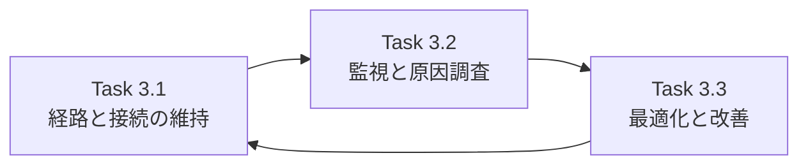

運用は **「維持する → 観測する → 改善する → また維持する」** の循環です。試験でも「障害を調べて（3.2）、設定を直し（3.1）、再発しにくい構成にする（3.3）」のように、複数タスクをまたぐシナリオが出ます。

### 1.3 試験形式の基本情報（公式 Exam Guide より）

| 項目 | 内容 |
|---|---|
| 出題形式 | 複数選択（正解が2つ以上）と マッチング |
| 採点対象の問題数 | 50 問（ほかに採点対象外の 15 問が混在） |
| 合格スコア | 100〜1,000 のスケールスコアで **750 以上** |
| 採点方式 | 補償型（ドメインごとの合格点はなく、全体で合格すればよい） |
| Domain 3 の比重 | 20% |

---

## 2. 前提知識：まず押さえる用語集

初学者がつまずきやすい用語を先に整理します。以降の章で何度も登場します。

| 用語 | 意味 | 初学者向けの例え |
|---|---|---|
| **BGP** | 組織間（AS 間）で経路情報を交換するプロトコル | 郵便局同士が「この住所はうちが届けます」と教え合う仕組み |
| **ASN** | BGP で使う自律システム番号 | 組織の識別番号 |
| **VIF（仮想インターフェイス）** | Direct Connect 上の論理的な接続口 | 1本の専用線を用途別に区切った出入口 |
| **Direct Connect Gateway (DXGW)** | 複数の VPC/TGW を専用線につなぐグローバルなゲートウェイ | 専用線の「ハブ駅」 |
| **Transit Gateway (TGW)** | 多数の VPC やオンプレミスをつなぐ中継ルーター | ネットワークの「ターミナル駅」 |
| **VGW / CGW** | VPN の AWS 側 / お客様側の終端 | 橋の両端の橋台 |
| **ECMP** | 同じコストの複数経路に負荷を分散する方式 | 同じ距離の道を複数車線で使う |
| **BFD** | 経路障害を高速に検知する仕組み | 生存確認を1秒単位で行う |
| **MTU** | 一度に送れる最大パケットサイズ | 荷物の最大サイズ |
| **MSS** | TCP で1パケットに載せられるデータ量 | 箱の中身の最大量 |
| **PMTUD** | 経路上の最小 MTU を自動で調べる仕組み | 道の一番狭い所を測る |
| **CIDR** | IP アドレス範囲の表記（例: 10.0.0.0/16） | 住所の「市区町村」の範囲 |
| **ENI / ENA / EFA** | 仮想NIC / 高性能NIC / HPC 向け NIC | 普通の玄関 / 広い玄関 / 専用搬入口 |

> **試験ポイント**: Specialty 試験は用語の意味ではなく「**この状況でどれを選ぶか**」を問います。用語は、判断の材料として使えるようにしておきます。

---

# Part A. Task 3.1 ルーティングと接続性の維持

> **公式のタスク文**: Maintain routing and connectivity on AWS and hybrid networks

## A-0. このタスクで問われること

| 区分 | 内容（Exam Guide の要旨） |
|---|---|
| 知識 | ハイブリッド網で使うルーティングプロトコル（例: Direct Connect 上の BGP）／接続方式（DXGW、TGW、VIF）／上限と クォータ（帯域、ルート数）／カスタムサービスへのプライベート・パブリックなアクセス手段（PrivateLink、VPC ピアリング）／リージョン間・リージョン内の通信パターン |
| スキル | ルーティングプロトコルの管理／カスタムサービスへのプライベートアクセスの維持／ルートテーブルによるトラフィック制御（自動伝播・BGP）／AWS サービスへのプライベート/パブリックアクセスの設定／静的・動的ルーティングの最適化（ルート集約、CIDR 重複） |

---

## A-1. Step 1：ルートテーブルの基本ルールを理解する

### なぜ必要か

通信が「どこへ流れるか」を決めるのはルートテーブルです。トラブルの大半は **ルートの優先順位を誤解している** ことから起きます。

### 仕組み：判断の順番

ルーターは、宛先 IP に対し次の順番で行き先を決めます。

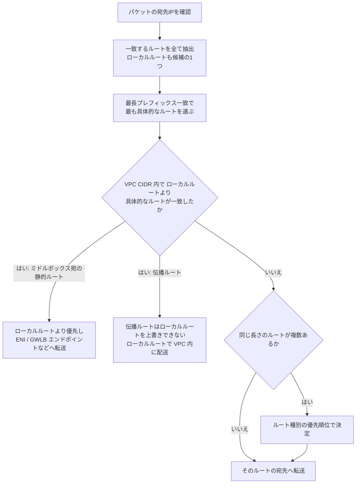

**最長プレフィックス一致**とは、より細かい範囲（例: `/24`）を、広い範囲（例: `/16`）より優先する規則です。`10.10.2.15/32` は `10.10.2.0/24` より優先されます。

### VPC ルートテーブルでの優先順位（同じ宛先の場合）

| 優先度 | ルートの種類 |
|---|---|
| 1 | 静的ルート（VPC ピアリング、インターネットゲートウェイ、TGW、ゲートウェイ型 VPC エンドポイントなど） |
| 2 | プレフィックスリストを参照するルート |
| 3 | 伝播されたルート：Direct Connect の BGP ルート → VPN の静的ルート → VPN の BGP ルート の順 |

> **補足**: 宛先が **完全に同じ** ときの順位です。範囲の広さが違えば、常に最長プレフィックス一致が先に適用されます。
> **注意**: VPC 自身の CIDR に対する **ローカルルートは最優先** で、より具体的な伝播ルートでも上書きできません。

### Transit Gateway ルートテーブルでの優先順位（同じ宛先の場合）

| 優先度 | ルートの種類 |
|---|---|
| 1 | 静的ルート |
| 2 | プレフィックスリスト参照ルート |
| 3 | VPC アタッチメントの伝播ルート |
| 4 | Direct Connect ゲートウェイの伝播ルート |
| 5 | Transit Gateway Connect の伝播ルート |
| 6 | Site-to-Site VPN の伝播ルート |
| 7 | ピアリングアタッチメントのルート |

> **試験ポイント**: 「静的ルートと伝播ルートが同じ宛先なら **静的が勝つ**」は頻出です。意図せず静的ルートが残っていて、BGP で学習した経路が使われない、というトラブルがよく出題されます。

### ベストプラクティス

| # | ベストプラクティス | 理由 |
|---|---|---|
| 1 | 可能な限り **動的ルーティング（BGP）** を使う | 障害時に自動で経路が切り替わり、運用負荷が下がる |
| 2 | 静的ルートは「意図が明確なもの」だけに限定し、説明をタグに残す | 古い静的ルートが動的経路を隠すのを防ぐ |
| 3 | ルートの変更前に Reachability Analyzer で影響を確認する（→ Part B） | 本番での誤設定を防ぐ |

---

## A-2. Step 2：Direct Connect と BGP を管理する

### なぜ必要か

Direct Connect (DX) は、オンプレミスと AWS を **専用線** で結ぶ接続です。経路の交換には **BGP** を使うため、BGP の動きを理解していないと、遠回りの経路・片方向だけ通らない通信・突然のセッション切断といった問題を調べられません。

### 仕組み①：3種類の VIF

| VIF の種類 | つなぐ先 | 典型的な用途 |
|---|---|---|
| **プライベート VIF** | VPC（VGW 経由）または Direct Connect ゲートウェイ | 1つまたは少数の VPC との接続 |
| **トランジット VIF** | Direct Connect ゲートウェイ経由で **Transit Gateway** または Cloud WAN | 多数の VPC との接続 |
| **パブリック VIF** | AWS のパブリックエンドポイント（S3 など VPC 外のサービス） | S3 や DynamoDB への専用線経由アクセス |

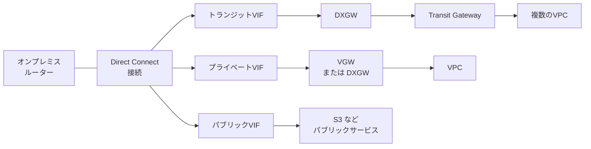

### 仕組み②：BGP による経路制御

BGP では、オンプレミスと AWS がお互いに「自分の持つ経路」を広告します。次の3つを使い分けて経路を操作します。

| 手段 | 向き | 効果 |
|---|---|---|
| **ローカルプリファレンス用 BGP コミュニティ** | AWS から オンプレミスへ向かう通信 | お客様が広告する経路に付けて、AWS 側の優先度を指定する |
| **AS_PATH プリペンド** | 同上 | 経路を「遠く」見せて優先度を下げる |
| **より具体的なプレフィックスの広告** | 同上 | 最長プレフィックス一致で必ず優先させる |

AWS が複数経路から1つを選ぶ順番は、おおむね次のとおりです。

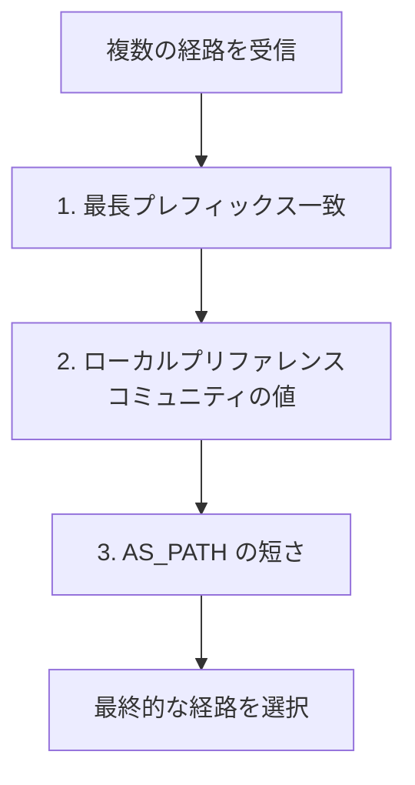

**ローカルプリファレンス用コミュニティ（Direct Connect）**

| コミュニティ | 意味 |
|---|---|
| `7224:7100` | 低い優先度 |
| `7224:7200` | 中程度の優先度 |
| `7224:7300` | 高い優先度 |

> **重要**: 「AWS →オンプレミス」の戻り経路は上の方法で制御しますが、「オンプレミス → AWS」の経路は **お客様のルーターのポリシーが決めます**。往路と復路は別々に設計する必要があります。

### 仕組み③：障害検知を速くする（BFD）

BGP 単体の障害検知は、既定のホールドタイマーに依存し、数十秒〜数分かかります。**BFD (Bidirectional Forwarding Detection)** を有効にすると、秒単位で障害を検知してフェイルオーバーできます。AWS 側は BFD に対応していますが、**お客様のルーター側でも有効化が必要** です。

### 仕組み④：Direct Connect ゲートウェイ（DXGW）

| 項目 | 内容 |
|---|---|
| 役割 | 1つの専用線から、複数リージョンの VPC / TGW に到達できるようにする |
| TGW との関連付け | DXGW に TGW を関連付ける。DXGW と TGW の **ASN は異なる値** にする必要がある（同じだと関連付けに失敗する） |
| 許可プレフィックス | TGW 関連付け時に「AWS からオンプレミスへ広告するプレフィックス」を指定する |
| 注意 | トランジット VIF を使う DXGW では、プライベート VIF を併用できない |

### ステップ手順：新しい拠点を DX で接続する流れ

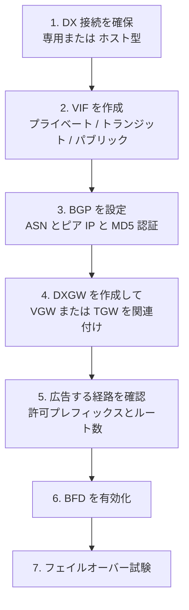

### ベストプラクティス

| # | ベストプラクティス | 理由 |
|---|---|---|
| 1 | 重要な通信は **複数ロケーションに別々の DX 接続** を用意する（最大の回復性モデル） | 1か所の障害・メンテナンスでも通信が継続する |
| 2 | DX の **バックアップとして Site-to-Site VPN** を用意する | 専用線が落ちても、インターネット経由で継続できる |
| 3 | **BFD を有効化** する | 障害検知を秒単位に短縮する |
| 4 | BGP セッションに **MD5 認証** を設定する | 不正なピアからの経路注入を防ぐ |
| 5 | 広告するルートを **集約** し、VIF のプレフィックス割り当て（既定 100）以内に収める | プライベート/トランジット VIF の上限を超えると BGP セッションが切れる（A-5 参照） |
| 6 | 経路制御は **コミュニティ・AS_PATH・具体的プレフィックス** を組み合わせ、設計書に残す | 属人化を防ぎ、障害調査を速くする |

---

## A-3. Step 3：Site-to-Site VPN を管理する

### 仕組み

Site-to-Site VPN は、インターネット（または DX 上）に IPsec トンネルを作る接続です。1つの VPN 接続には **2本のトンネル**（異なる AZ のエンドポイント）が含まれます。

| 項目 | 内容 |
|---|---|
| ルーティング | **動的（BGP）** または **静的** |
| AWS 側の終端 | VGW、または Transit Gateway |
| 帯域 | 標準トンネルで最大 **1.25 Gbps**。大容量帯域トンネル（Large Bandwidth Tunnel）なら最大 **5 Gbps** |
| 帯域を増やす方法 | Transit Gateway にアタッチした VPN は **ECMP** で複数トンネルを束ねる |
| MTU | VPN トンネルの上限は **1500 バイト**。IPsec のオーバーヘッドで実効パケット MTU は **1446 バイト**（TCP MSS **1406**）。ジャンボフレーム不可 |

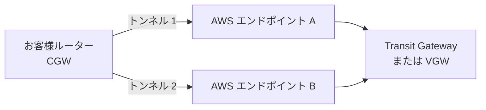

### 動的 と 静的 の選び方

| 比較 | 動的 (BGP) | 静的 |
|---|---|---|
| 障害時の自動切替 | できる | できない（手動対応や別の仕組みが必要） |
| ルート変更の反映 | 自動 | 手動 |
| TGW での ECMP | 使える | 使えない |
| 向いている場面 | **基本はこちら** | BGP 非対応の機器を使う場合 |

> **試験ポイント**: 「VPN の帯域を超えてしまう → TGW + 動的ルーティング + **ECMP**」「1トンネルが 1.25 Gbps を超える → **大容量帯域トンネル**」が定番の答えです。

### ベストプラクティス

| # | ベストプラクティス | 理由 |
|---|---|---|
| 1 | **2本のトンネルを両方有効** にし、お客様側でも両方を設定する | 片方のトンネルのメンテナンス中も通信が続く |
| 2 | 動的ルーティング（BGP）を使う | 切替が自動になる |
| 3 | 大容量が必要なら TGW で ECMP を使う | 帯域を水平に拡張できる |
| 4 | VPN 経路の MSS を適切に設定（クランプ）する | IPsec のオーバーヘッドによる断片化・欠落を防ぐ（→ Part B） |
| 5 | DX と VPN を併用する場合、優先する経路を BGP 属性で明示する | 意図しない経路への切替を防ぐ |

---

## A-4. Step 4：Transit Gateway で多数の接続をまとめる

### なぜ必要か

VPC やオンプレミス拠点が増えると、1対1でつなぐ方式は管理できなくなります。Transit Gateway (TGW) は **ハブ&スポーク** の中継点です。

### 仕組み

| 概念 | 説明 |
|---|---|
| **アタッチメント** | TGW への接続口（VPC、VPN、DXGW、ピアリング、Connect） |
| **関連付け (Association)** | アタッチメントが **どのルートテーブルで経路を引くか** を決める |
| **伝播 (Propagation)** | アタッチメントの経路を **どのルートテーブルに広告するか** を決める |

> **ポイント**: 「関連付け」は **出ていく方向の引き先**、「伝播」は **入ってくる経路の広告先** です。この2つを分けて考えると、ルートテーブルを分離した設計（本番と開発の分離など）が理解できます。

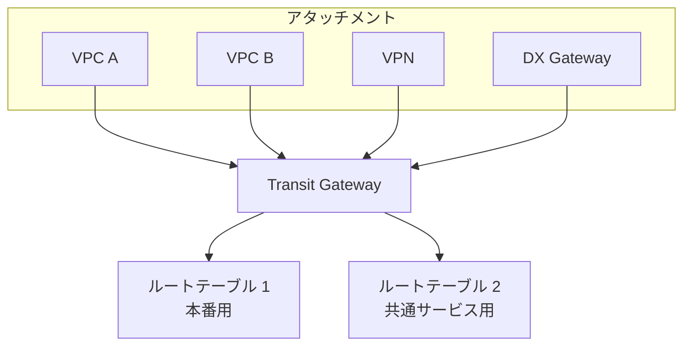

### 重要な上限値（2026-10-16 時点の公式値）

| 項目 | 値 |
|---|---|
| 1つの TGW あたりのアタッチメント数 | 5,000 |
| 1つの TGW あたりのルートテーブル数 | 20 |
| 1つの TGW の全ルートテーブル合計ルート数（動的+静的） | 10,000 |
| VPC アタッチメントの帯域（AZ あたり） | 最大 100 Gbps |
| VPC アタッチメントの PPS（AZ あたり） | 最大 7,500,000 |
| Connect ピア（GRE トンネル）の帯域 | 最大 5 Gbps／1アタッチメントあたり最大 4 ピア（合計 20 Gbps） |
| VPN で TGW → お客様機器へ広告するルート数 | 5,000 |
| VPN で お客様機器 → TGW へ広告できる動的ルート数 | 1,000 |
| TGW 間ピアリングのアタッチメント数 | 50 |
| マルチキャストドメイン数 | 20 |

> **注意**: 上限の中には引き上げ申請ができるものとできないものがあります。必ず [Transit Gateway クォータ](https://docs.aws.amazon.com/vpc/latest/tgw/transit-gateway-quotas.html) の「調整可能」列を確認してください。

### ベストプラクティス

| # | ベストプラクティス | 理由 |
|---|---|---|
| 1 | VPC アタッチメントには **AZ ごとに1つのサブネット** を指定する（専用の小さなサブネット推奨） | 各 AZ から TGW に到達できるようにし、管理しやすくする |
| 2 | 環境（本番／開発）の分離は **ルートテーブルを分けて** 実現する | 関連付けと伝播で通信可否を制御できる |
| 3 | **ルート数を監視** し、上限の手前でアラートを出す | 上限超過時はルートが取り込まれず障害になる |
| 4 | オンプレミス経路は集約して広告する | ルート数と BGP の負荷を減らす |
| 5 | アプライアンス（検査用）を経由する構成では **アプライアンスモード** を有効にする | 往復で同じ AZ を通し、ステートフルな検査が崩れるのを防ぐ |

---

## A-5. Step 5：クォータ（上限）が運用に与える影響

### なぜ必要か

構成が正しくても、**上限に達すると突然つながらなくなります**。運用では「どの上限に近づいているか」を常に把握します。

### Direct Connect の主な上限（公式値）

| 項目 | 値 | 上限に達すると |
|---|---|---|
| プライベート/トランジット VIF で お客様 → AWS に広告できるルート数（BGP セッションあたり） | 既定 **100**（IPv4・IPv6 それぞれ）。プレフィックス割り当てで最大 1,000 まで設定可能 | **BGP セッションが Idle になり、切断される** |
| パブリック VIF で広告できるルート数 | 1,000（引き上げ不可） | 同様にセッション異常 |
| ホスト型接続あたりの VIF 数 | 1 | 追加不可 |
| 専用接続あたりの VIF 数 | プライベート/パブリック VIF は最大 50、トランジット VIF は最大 4。すべての VIF の合計は最大 51 | 合計 51 は引き上げ不可。トランジット VIF は SA/TAM に相談可能 |
| DXGW あたりの VIF 数（プライベート/トランジット） | 30 | 追加不可 |
| DXGW あたりの TGW 数 | 6 | 追加不可 |
| DXGW あたりの VGW 数 | 20 | 追加不可 |
| TGW あたりの AWS → オンプレミスへ広告するプレフィックス数 | 200 | 超過分は広告されない |

> **試験ポイント**: 「オンプレミスから 100 を超えるルートを広告したら BGP が切れた」→ まず VIF の **プレフィックス割り当て** を必要数まで増やします（CreatePrivateVirtualInterface / UpdateVirtualInterfaceAttributes で最大 1,000）。Service Quotas の申請ではありません。割り当てを増やせない場合に **ルート集約**（またはデフォルトルートの広告）を使います。

### 上限に備える運用の流れ

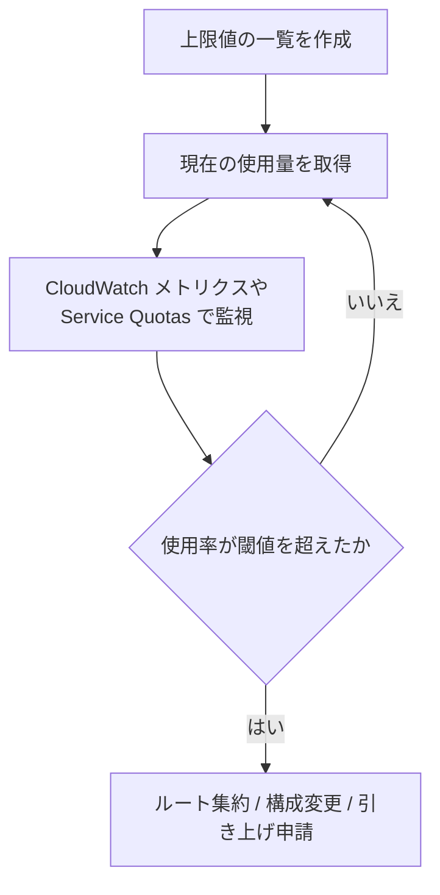

### ベストプラクティス

| # | ベストプラクティス | 理由 |
|---|---|---|
| 1 | **Service Quotas** で使用率アラームを設定する | 上限到達の前に気づける |
| 2 | 引き上げ不可の上限は **設計段階** で回避する（集約、構成分割） | 後から変えられない |
| 3 | 新しい拠点・VPC を追加する前に、ルート数への影響を試算する | 追加が原因の障害を防ぐ |

---

## A-6. Step 6：カスタムサービスへのプライベートアクセスを維持する（PrivateLink と VPC ピアリング）

### なぜ必要か

別の VPC やアカウントにあるサービスに、インターネットを経由せず安全にアクセスしたい場面は多くあります。主な手段は **PrivateLink** と **VPC ピアリング** です。

### 仕組みの違い

| 比較 | **AWS PrivateLink** | **VPC ピアリング** |
|---|---|---|
| つなぐ範囲 | **特定のサービス** だけを公開 | **VPC 全体**どうしを接続 |
| 方向 | 利用者 → サービス提供者（**一方向**） | 双方向 |
| CIDR の重複 | **重複していても利用可能** | 重複していると **作成できない** |
| 推移的ルーティング | 該当しない | **できない**（A↔B、B↔C でも A↔C は不可） |
| 構成要素 | サービス提供側: NLB または GWLB／利用側: インターフェイス VPC エンドポイント | ルートテーブルにピアリング接続を追加 |
| 規模の拡大 | 多数の利用者でも管理しやすい | 接続数が増えると管理が煩雑 |
| 向いている場面 | SaaS 的な提供、**CIDR 重複**、公開範囲を絞りたい | 少数の VPC を広く接続したい |

### 選択フロー

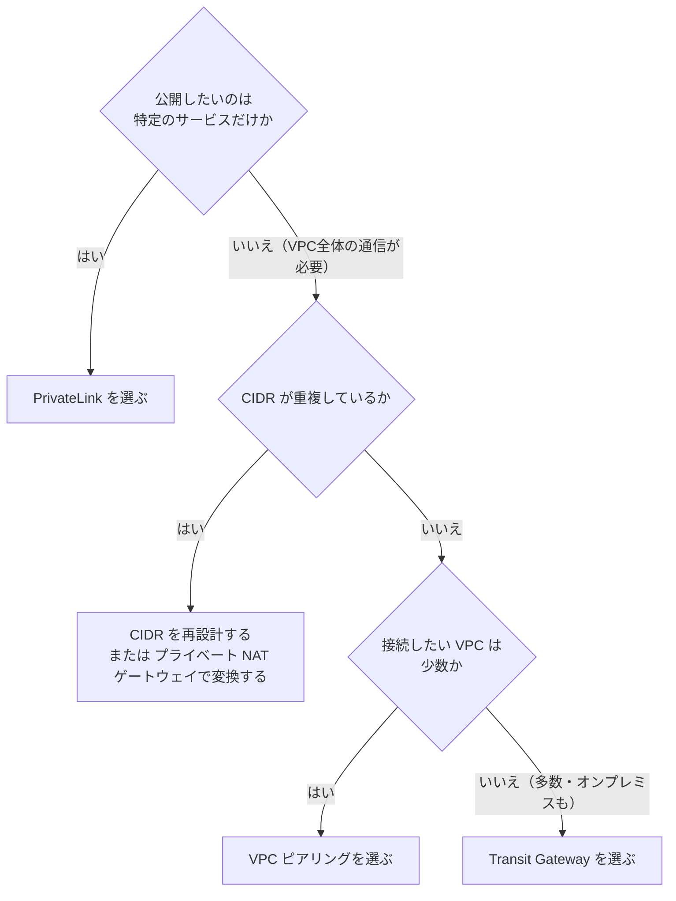

### PrivateLink の運用ポイント

| 項目 | 内容 |
|---|---|
| 可用性 | インターフェイスエンドポイントは **使用する AZ ごと** にサブネットを指定する。複数 AZ に配置して冗長化する |
| 承認 | サービス提供側で、接続リクエストの **承認** を必須にできる |
| DNS | カスタムサービス（エンドポイントサービス）では、サービス提供側がプライベート DNS 名を設定し、そのドメインの所有権を検証した場合に限り、利用側でプライベート DNS を有効にしてその名前でエンドポイントに解決できる。これらの前提がない場合、利用側はエンドポイント固有の DNS 名を使う |
| セキュリティ | エンドポイントのセキュリティグループで送信元を絞り、サービス提供側でも認可（許可するプリンシパルの指定やアプリケーション側の認証）を行う。エンドポイントポリシーはカスタムサービスではなく、エンドポイントポリシーに対応する AWS サービスで使う |

> **補足**: PrivateLink は **リージョンをまたいだ接続** にも対応しています（クロスリージョン PrivateLink）。詳細・対応状況は公式ドキュメントで確認してください。

### ベストプラクティス

| # | ベストプラクティス | 理由 |
|---|---|---|
| 1 | サービス提供は **PrivateLink を優先** する | 公開範囲が最小で、CIDR 重複も問題にならない |
| 2 | ピアリング使用時は、**CIDR 計画を最初に行う** | 後から重複が見つかると作り直しになる |
| 3 | ピアリングのルートテーブル更新を **自動化（IaC）** する | 追加漏れによる片方向通信を防ぐ |
| 4 | エンドポイントは **複数 AZ** に作成する | AZ 障害に備える |

---

## A-7. Step 7：ルートテーブルで通信を正しく向ける（伝播・BGP・集約・CIDR 重複）

### 7.1 ルート伝播（Route Propagation）

VGW または TGW を使う場合、オンプレミスから学習した経路を **VPC ルートテーブルに自動で追加（伝播）** できます。

| 項目 | 内容 |
|---|---|
| 設定場所 | VPC のルートテーブルで「ルート伝播」を有効化 |
| 伝播されるもの | VPN（静的/動的）や Direct Connect の経路 |
| 手動のルート | 同じ宛先に手動ルートがあると **手動（静的）が優先** |
| TGW の場合 | VPC ルートテーブルには **手動で TGW 宛のルートを追加** が必要（TGW 側のルートが VPC に自動伝播されることはない） |

> **試験ポイント**: TGW を使う場合、**VPC のサブネットルートテーブルに TGW 宛のルートを追加し忘れる** のが典型的な原因です。

### 7.2 ルート集約（Summarization）

複数の細かい経路を、1つの広い経路にまとめます。

| 集約前 | 集約後 |
|---|---|
| `10.1.0.0/24`, `10.1.1.0/24`, `10.1.2.0/24`, `10.1.3.0/24` | `10.1.0.0/22` |

| メリット | 注意点 |
|---|---|
| ルート数が減る（上限回避） | 集約範囲に **存在しない宛先** が含まれると、通信が吸い込まれる（ブラックホール）可能性がある |
| BGP の更新が安定する | 集約後も、**より具体的な経路で例外制御** できるよう設計する |

### 7.3 CIDR 重複への対処

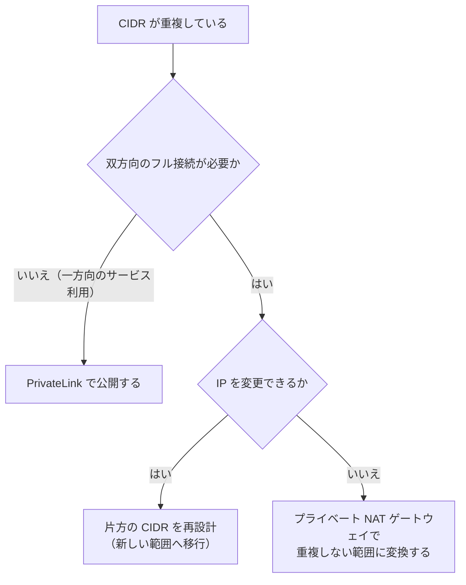

| 手段 | 向いている場面 | 注意点 |
|---|---|---|
| **PrivateLink** | 一方向のサービス利用 | 双方向通信には不向き |
| **プライベート NAT ゲートウェイ** | IP の変更が難しい既存環境 | 設計と運用が複雑になる |
| **CIDR の再設計** | 長期的に最善 | 移行作業が必要 |
| **TGW のルートテーブル分離** | 重複する VPC を互いに隔離する | 重複 CIDR の VPC 間通信はできない |

> **補足**: TGW に重複する CIDR の VPC をアタッチした場合、後からアタッチした VPC のルートは **伝播されません**。

### 7.4 ベストプラクティス

| # | ベストプラクティス | 理由 |
|---|---|---|
| 1 | 組織全体で **IP アドレス計画** を管理する（Amazon VPC IPAM の活用） | 重複を設計段階で防げる |
| 2 | オンプレミス側と AWS 側の **経路広告の方針** を文書化する | 変更時の影響範囲が分かる |
| 3 | 集約は「**広い範囲を広告し、特別な通信だけ具体的に広告**」の方針にする | ルート数と制御性を両立できる |

---

## A-8. Step 8：AWS サービスへのプライベート／パブリックアクセスを設定する

### 選択肢の比較

| アクセス方法 | 経路 | 主な対象 | 特徴 |
|---|---|---|---|
| **ゲートウェイ型 VPC エンドポイント** | VPC 内のルート（AWS ネットワーク内） | S3、DynamoDB | **無料**。ルートテーブルにエントリを追加して使う |
| **インターフェイス型 VPC エンドポイント** | VPC 内の ENI（PrivateLink） | 多くの AWS サービス | 時間と処理量で課金。オンプレミスからも DX/VPN 経由で到達可能 |
| **パブリック VIF（DX）** | 専用線 → AWS パブリックエンドポイント | S3 など | インターネットを通さず専用線で到達 |
| **インターネット経由（IGW/NAT）** | インターネット | パブリックエンドポイント | 追加の保護（暗号化・認証）が必要 |
| **VPN（パブリック）** | インターネット上の IPsec | VPC 内のリソース（S3 へはインターフェイス型 S3 エンドポイントと、そこへ向けるルーティング / DNS が別途必要） | 暗号化。帯域に上限あり |

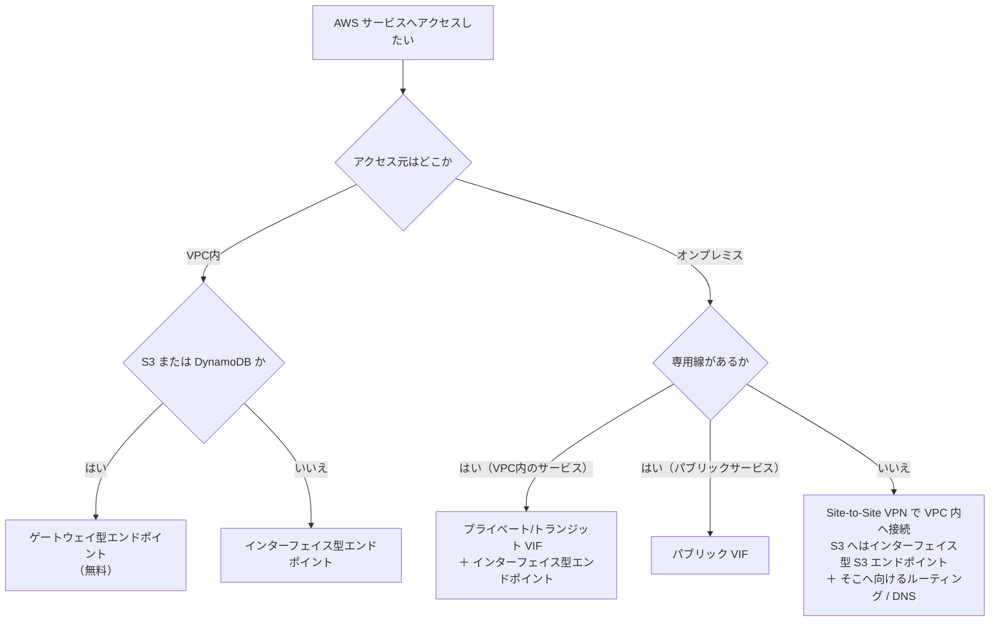

> **試験ポイント**: 「**オンプレミスから S3 へ、コストを抑え、かつインターネットを経由せず**」は、一般に **パブリック VIF**、または **プライベート VIF/VPN ＋ インターフェイス型 S3 エンドポイント** が答えになります。要件（帯域・コスト・VPC 内の制御）を見て選びます。

### ベストプラクティス

| # | ベストプラクティス | 理由 |
|---|---|---|
| 1 | S3/DynamoDB へは **ゲートウェイ型エンドポイント** を第一候補にする | 無料で、NAT ゲートウェイのデータ処理料金も削減できる |
| 2 | エンドポイントポリシーで **アクセス先を絞る** | 意図しないバケットへの流出を防ぐ |
| 3 | パブリック VIF では **広告するプレフィックスを必要最小限** にする | 不要な経路の流入を防ぐ |

---

## A-9. Step 9：リージョン間・リージョン内の通信パターン

### リージョン内（Intra-Region）

| 方式 | 特徴 |
|---|---|
| VPC ピアリング | 低コスト・低遅延。推移的ルーティング不可 |
| Transit Gateway | ハブ&スポーク。多数の VPC に適する |
| PrivateLink | サービス単位の公開 |
| VPC 共有（AWS RAM） | 同一サブネットを複数アカウントで共有 |

### リージョン間（Inter-Region）

| 方式 | 特徴 | 注意点 |
|---|---|---|
| **リージョン間 VPC ピアリング** | AWS のバックボーン上で暗号化される | ルートは手動、推移的ルーティング不可 |
| **TGW ピアリング** | TGW どうしを接続 | ルートは **静的のみ**（動的伝播なし） |
| **AWS Cloud WAN** | ポリシーで広域ネットワークを管理 | 大規模・多リージョン向け |
| **PrivateLink（クロスリージョン）** | サービス単位の公開 | 対応状況を要確認 |
| **Global Accelerator / CloudFront** | ユーザーとリージョン間の最適化 | 用途がユーザー向けトラフィック中心 |

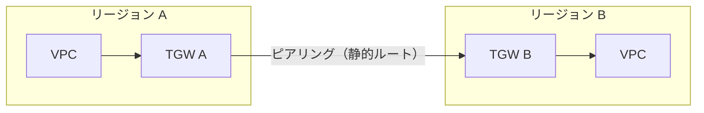

### ベストプラクティス

| # | ベストプラクティス | 理由 |
|---|---|---|
| 1 | リージョン間は **TGW ピアリング** か **Cloud WAN** で一元管理する | VPC ピアリングを網目状に増やすと管理が破綻する |
| 2 | TGW ピアリングの静的ルートは **IaC で管理** する | 変更漏れによる片方向通信を防ぐ |
| 3 | 帯域・遅延要件を事前に測定する | 想定外の遅延による性能劣化を防ぐ |

---

## A-10. Task 3.1 まとめ：判断早見表

| シナリオ | 推奨する対応 |
|---|---|
| 専用線の障害検知を速くしたい | **BFD** を有効化 |
| 専用線が落ちたら自動でバックアップへ切り替えたい | **DX + VPN** の併用（BGP 動的） |
| オンプレミスから 100 を超えるルートを広告したい | **プレフィックス割り当て** の引き上げ（最大 1,000）。増やせない場合はルート集約またはデフォルトルート |
| VPN の帯域が足りない（TGW 利用） | **ECMP** で複数トンネルを束ねる／**大容量帯域トンネル** |
| 静的ルートと BGP の経路が競合する | **静的ルートが優先** される点を確認し、不要な静的ルートを削除 |
| CIDR が重複した VPC のサービスを使いたい | **PrivateLink** |
| 多数の VPC とオンプレミスを接続したい | **Transit Gateway**（DXGW + トランジット VIF） |
| TGW 経由でも VPC 側から通じない | VPC のルートテーブルに **TGW 宛のルート** があるか確認 |
| 異なるリージョンの TGW を接続したい | **TGW ピアリング**（静的ルート） |

---

# Part B. Task 3.2 トラフィックの監視・分析とトラブルシューティング

> **公式のタスク文**: Monitor and analyze network traffic to troubleshoot and optimize connectivity patterns

## B-0. このタスクで問われること

| 区分 | 内容（Exam Guide の要旨） |
|---|---|
| 知識 | ネットワーク性能指標と到達性の制約（ルーティング、パケットサイズ）／性能・到達性の問題を評価するログとメトリクス（パケットロスなど）／収集・分析ツール（CloudWatch、VPC Flow Logs、VPC Traffic Mirroring）／経路分析ツール（Reachability Analyzer、Transit Gateway Network Manager） |
| スキル | ツール出力の分析／トポロジーの把握／パケット分析／設定ミスによる接続障害の調査／ネットワーク設計要件の検証／接続意図の検証の自動化／VPC 内のパケットサイズ不一致の調査 |

## B-1. Step 1：「どのツールを使うか」の全体地図

### なぜ必要か

ネットワーク調査ツールは多く、**目的に合わないツールを使うと原因に辿り着けません**。まず「何を知りたいか」で選びます。

| 知りたいこと | 使うツール | 種類 |
|---|---|---|
| 設定上、通信が **通るはずか** を知りたい | **Reachability Analyzer** | 設定の静的分析（実パケットは送らない） |
| 実際に **誰が誰と通信し、許可/拒否されたか** を知りたい | **VPC Flow Logs** | 通信の記録（メタデータ） |
| パケットの **中身（ヘッダ・ペイロード）** を見たい | **VPC Traffic Mirroring** | パケットコピー |
| 帯域・パケロス・遅延・状態の **数値推移** を見たい | **Amazon CloudWatch** メトリクス/アラーム | 数値監視 |
| **全体構成・経路・イベント** を俯瞰したい | **Transit Gateway Network Manager** | トポロジーと可視化 |
| EC2 間やサービス宛の **TCP の遅延・パケロス** を見たい | **CloudWatch Network Flow Monitor** | エージェントによる受動監視 |
| オンプレミス宛のハイブリッド回線を **能動的に測りたい** | **CloudWatch Network Synthetic Monitor** | プローブによる能動監視 |
| **インターネット側** の性能・可用性を知りたい | **CloudWatch Internet Monitor** | 基準値との比較 |

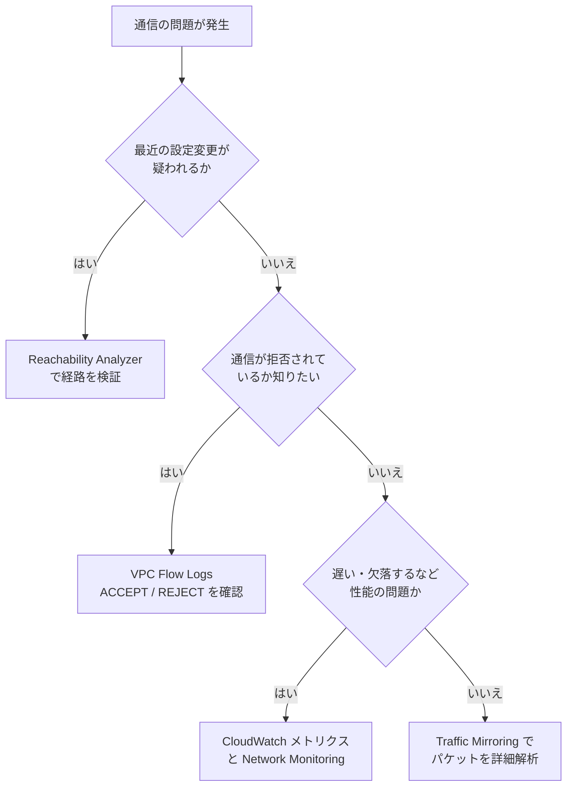

## B-2. Step 2：性能指標と到達性の制約を理解する

### 主な性能指標

| 指標 | 意味 | 悪化したときに疑うこと |
|---|---|---|
| **帯域（スループット）** | 単位時間に流せるデータ量 | インスタンス/回線/ゲートウェイの上限 |
| **遅延（レイテンシ）** | 往復にかかる時間 | 経路の遠回り、リージョン距離 |
| **パケットロス** | 届かなかった割合 | 輻輳、上限超過、回線品質 |
| **ジッタ** | 遅延のばらつき | 輻輳、経路切替 |
| **PPS** | 1秒あたりのパケット数 | 小さなパケットの大量送信 |

### 到達性を妨げる典型要因

| 分類 | 具体例 |
|---|---|
| **ルーティング** | ルートがない／優先順位の誤解／ブラックホール／戻りの経路がない（非対称） |
| **フィルタ** | セキュリティグループ、ネットワーク ACL（**ステートレス**、戻りも許可が必要）、ファイアウォール |
| **パケットサイズ** | MTU 不一致、PMTUD の ICMP が遮断されている |
| **上限** | 帯域、PPS、コネクション数、ルート数の超過 |
| **名前解決** | DNS の設定誤り（Route 53 Resolver、プライベートホストゾーン） |

> **試験ポイント**: 「**小さい通信（ping、ログイン）は通るが、大きなデータ転送だけ止まる**」はほぼ **MTU / MSS（パケットサイズ）** の問題です（B-7 参照）。

## B-3. Step 3：Amazon CloudWatch でメトリクスとログを監視する

### 仕組み

CloudWatch は、各サービスが自動送信するメトリクスを集め、アラームや ダッシュボードにします。

| 対象 | 主なメトリクス（例） | 見るポイント |
|---|---|---|
| **Direct Connect** | `ConnectionState`、`ConnectionBpsEgress/Ingress`、`ConnectionPpsEgress/Ingress`、`ConnectionErrorCount`、`ConnectionLightLevelTx/Rx` | 接続の up/down、帯域の使用率、エラー、光レベルの劣化 |
| **Site-to-Site VPN** | `TunnelState`、`TunnelDataIn/Out` | 2本のトンネルの状態（片方だけ down を検知） |
| **Transit Gateway** | `BytesIn/Out`、`PacketsIn/Out`、`PacketDropCountBlackhole`、`PacketDropCountNoRoute` | ブラックホール（行き先なし）や ルートなしで捨てられた数 |
| **NAT ゲートウェイ** | `ErrorPortAllocation`、`PacketsDropCount`、`ConnectionAttemptCount` | ポート枯渇や 同時接続の限界 |
| **ELB（ALB/NLB）** | `UnHealthyHostCount`、`TargetResponseTime`、`TargetConnectionErrorCount`（※NLB は `UnHealthyHostCount`、`TCP_Target_Reset_Count` など） | ターゲットの健全性と遅延 |
| **EC2 の ENA** | `ethtool` の `bw_in_allowance_exceeded`、`bw_out_allowance_exceeded`、`pps_allowance_exceeded`、`conntrack_allowance_exceeded`、`linklocal_allowance_exceeded` | **インスタンスの帯域・PPS・接続追跡の上限超過によるドロップ** |

> **試験ポイント**: 「EC2 の ネットワーク性能が突然落ちた。CPU は余裕がある」→ ENA のネットワーク許容量超過メトリクス（`*_allowance_exceeded`）を確認し、**より大きなインスタンスタイプ**、または **ENA Express/EFA** を検討します。

### CloudWatch の使い方（ベストプラクティス込み）

| # | ベストプラクティス | 理由 |
|---|---|---|
| 1 | DX の `ConnectionState`、VPN の `TunnelState` に **アラーム** を設定する | 障害を利用者より先に検知できる |
| 2 | 帯域使用率が **目安 70〜80%** を超えたら通知する | 輻輳前に増強を計画できる |
| 3 | TGW の `PacketDropCountBlackhole` / `NoRoute` を **ダッシュボード化** する | ルート不備を早期に発見できる |
| 4 | Logs の **メトリクスフィルタ** で、REJECT などを数値化する | ログを数値監視へ変換できる |
| 5 | **クロスアカウント/クロスリージョンのダッシュボード** を作る | 多数の VPC を一括で見られる |

## B-4. Step 4：VPC Flow Logs で通信の記録を分析する

### なぜ必要か

Flow Logs は **「誰が（送信元）誰に（宛先）どのポートで、許可/拒否されたか」** を記録します。拒否された通信の特定に最適です。

### 仕組み

| 項目 | 内容 |
|---|---|
| 取得できる粒度 | VPC、サブネット、ENI のいずれか |
| 保存先 | CloudWatch Logs、Amazon S3、Amazon Data Firehose |
| 集約間隔 | 1分 または 10分（既定は10分） |
| 記録内容 | **メタデータのみ**（ペイロードは含まない） |
| 主なフィールド | `srcaddr`、`dstaddr`、`srcport`、`dstport`、`protocol`、`packets`、`bytes`、`action`（ACCEPT/REJECT）、`log-status` |
| 拡張フィールド（カスタム形式） | `pkt-srcaddr`、`pkt-dstaddr`、`flow-direction`、`tcp-flags`、`vpc-id`、`subnet-id`、`az-id` など |

**記録されない通信（例）**: Amazon の DNS サーバーとの通信、DHCP、インスタンスメタデータ（169.254.169.254）、Amazon Time Sync、Windows のライセンス認証、VPC ルーターの予約 IP への通信、Traffic Mirroring のミラートラフィック。

### ログの読み方（例）

```text
2 123456789010 eni-0a1b2c3d 10.0.1.10 10.0.2.20 49152 443 6 20 4000 1700000000 1700000060 ACCEPT OK
2 123456789010 eni-0a1b2c3d 10.0.1.10 10.0.2.20 49153 22  6 1  40   1700000000 1700000060 REJECT OK
```

| 読み取り | 判断 |
|---|---|
| 1行目: 宛先ポート 443、`ACCEPT` | HTTPS は許可されている |
| 2行目: 宛先ポート 22、`REJECT` | SSH は拒否。セキュリティグループか ネットワーク ACL を確認 |

### SG と NACL のどちらが拒否したかの見分け方

| 観察 | 疑う箇所 |
|---|---|
| **往路は ACCEPT、戻りが REJECT** | **ネットワーク ACL**（ステートレスなので戻りの許可が必要） |
| 往路から REJECT | セキュリティグループ、または ネットワーク ACL の許可不足 |
| ログに **そもそも出ない** | ルーティングの問題（パケットが届いていない）、または記録対象外の通信 |

### Athena での分析例

S3 に保存した Flow Logs を Athena で集計すると、拒否上位の通信を調べられます。

```sql
SELECT srcaddr, dstaddr, dstport, COUNT(*) AS rejects
FROM vpc_flow_logs
WHERE action = 'REJECT'
GROUP BY srcaddr, dstaddr, dstport
ORDER BY rejects DESC
LIMIT 20;
```

### Flow Logs を作成する例（AWS CLI）

```bash
aws ec2 create-flow-logs \
  --resource-type VPC \
  --resource-ids vpc-0123456789abcdef0 \
  --traffic-type ALL \
  --log-destination-type s3 \
  --log-destination arn:aws:s3:::my-flow-logs-bucket/vpc/ \
  --max-aggregation-interval 60 \
  --log-format '${version} ${vpc-id} ${srcaddr} ${dstaddr} ${dstport} ${protocol} ${bytes} ${action} ${tcp-flags} ${flow-direction}'
```

### ベストプラクティス

| # | ベストプラクティス | 理由 |
|---|---|---|
| 1 | 長期保存と分析は **S3 + Athena**、リアルタイム検知は **CloudWatch Logs** を使い分ける | コストと用途の最適化 |
| 2 | **カスタム形式** で必要なフィールド（`tcp-flags`、`pkt-srcaddr` など）を含める | NAT やエンドポイント経由の実際の送信元が分かる |
| 3 | 全 VPC で有効化し、**集約アカウント** に保管する | 監査・調査の漏れを防ぐ |
| 4 | 調査時は集約間隔を **1分** にする | 事象の発生時刻を精密に追える |
| 5 | ログのライフサイクル（保存期間）を設定する | 保管コストを抑える |

## B-5. Step 5：VPC Traffic Mirroring でパケットを解析する

### なぜ必要か

Flow Logs は中身を見られません。**パケットの中身（TCP のフラグ、再送、ペイロード）を詳しく見たいとき** は Traffic Mirroring を使います。

### 仕組み

| 構成要素 | 説明 |
|---|---|
| **ミラーソース** | コピー元の ENI（Nitro ベースのインスタンスが対象） |
| **ミラーフィルタ** | コピーするトラフィックの条件（プロトコル・ポート・CIDR、方向） |
| **ミラーターゲット** | コピー先（ENI、**Network Load Balancer**、Gateway Load Balancer エンドポイント） |
| **ミラーセッション** | ソース・フィルタ・ターゲットの組み合わせ |
| **カプセル化** | コピーは **VXLAN（UDP 4789）** で送られる |

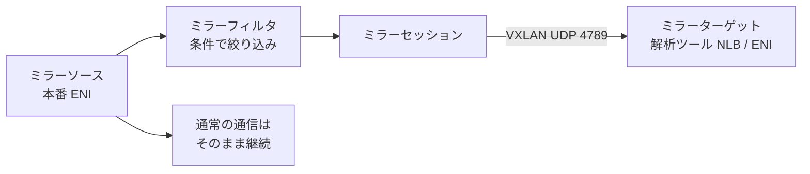

### 使いどころ

| 用途 | 内容 |
|---|---|
| **パケット整形（Packet Shaping）の分析** | 再送、ウィンドウサイズ、遅延などを解析 |
| セキュリティ検知（IDS） | 不正通信の検知 |
| 性能調査 | アプリ層の遅延の原因特定 |

### ベストプラクティス

| # | ベストプラクティス | 理由 |
|---|---|---|
| 1 | **フィルタで必要な通信だけ** に絞る | ターゲットの負荷とコストを減らす |
| 2 | ターゲットは **NLB の背後に複数台** 置く | 解析側の可用性とスケールを確保する |
| 3 | ミラーセッションの **パケット長を制限（切り詰め）** する | ヘッダだけを見たい場合に帯域を節約できる |
| 4 | **ミラー用トラフィックの帯域を考慮** する | ソースの ENI の帯域を圧迫する可能性がある |
| 5 | 常時ではなく **調査時に有効化** する | コストとリスクの低減 |

> **試験ポイント**: 「**ペイロードを含むパケットレベルの解析が必要**」→ Traffic Mirroring。「**拒否された通信を探す**」→ Flow Logs。この対比が定番です。

## B-6. Step 6：Reachability Analyzer と Network Manager で経路を可視化・検証する

### 6.1 Reachability Analyzer（到達性分析）

| 項目 | 内容 |
|---|---|
| 何をするか | 送信元と宛先を指定し、**設定（ルート、SG、NACL、ゲートウェイなど）を解析して、到達可能か** を判定する |
| 重要な特徴 | **実際にパケットを送らない**（設定を静的に分析する） |
| 結果 | 到達可能: 経路の各ホップを表示／到達不可: **ブロックしている構成要素と説明コード** を表示 |
| 対象の例 | ENI、インスタンス、IGW、VPN ゲートウェイ、TGW、VPC エンドポイント、VPC ピアリングなど |
| 制限の例 | 経路の途中にインターネットゲートウェイがある分析など、対応しないケースがある（説明コードで通知される） |

CLI の流れ:

```bash
# 1. パス（調べたい送信元と宛先）を作成
aws ec2 create-network-insights-path \
  --source eni-0aaa1111bbb2222cc \
  --destination eni-0ddd3333eee4444ff \
  --protocol tcp \
  --destination-port 443

# 2. 分析を実行
aws ec2 start-network-insights-analysis \
  --network-insights-path-id nip-0abc123def456789

# 3. 結果を確認（NetworkPathFound が false なら ExplanationCode が出る）
aws ec2 describe-network-insights-analyses \
  --network-insights-analysis-ids nia-0abc123def456789
```

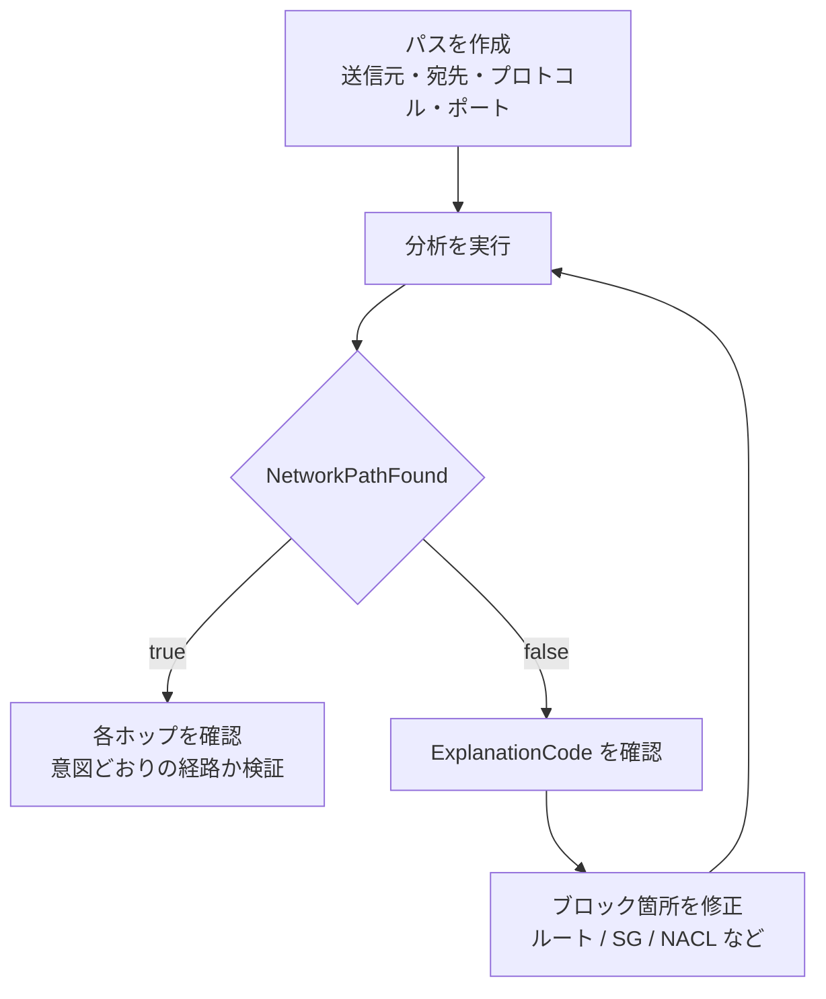

#### 「接続意図の検証を自動化する」方法（試験の指定スキル）

変更のたびに手作業で確認する代わりに、**パスと分析を IaC・パイプラインに組み込みます**。

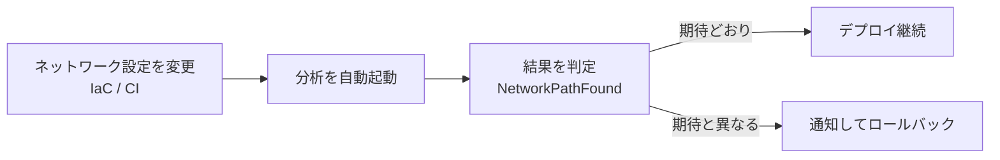

| # | ベストプラクティス | 理由 |
|---|---|---|
| 1 | **重要な通信パス（本番→DB、オンプレミス→共通サービス）を「期待値」として保存** する | 変更の影響を毎回自動で確認できる |
| 2 | 変更のパイプラインに分析を組み込む | 本番で壊す前に検出できる |
| 3 | 障害時は、**まず Reachability Analyzer で設定を確認 → 設定に問題がなければ Flow Logs / Traffic Mirroring で実トラフィックを確認** | 調査の順番を決めると速い |
| 4 | **Network Access Analyzer**（意図しないアクセス経路の検出）と使い分ける | 前者は「通るか」、後者は「通ってはいけない経路がないか」 |

> **試験ポイント**: Reachability Analyzer は「**設定が原因か**」を確かめます。設定上は通るのに通信できないなら、OS 設定・アプリ・MTU・負荷など設定以外が原因です。

### 6.2 Transit Gateway Network Manager

| 機能 | 内容 |
|---|---|
| **グローバルネットワーク** | TGW・VPN・SD-WAN 機器・Cloud WAN を1つの論理ネットワークとして登録し、**トポロジーを可視化** |
| **ルートアナライザー** | TGW のルートテーブル上で、送信元から宛先への **経路を分析**（ルートの有無や不一致を発見） |
| **イベントと メトリクス** | 接続状態の変化（アタッチメントの障害、ルート変更など）を **EventBridge / CloudWatch** で通知 |
| **リージョン間の性能** | AWS リージョン間の遅延を確認できる |

> **ベストプラクティス**: 複数リージョン・複数アカウントの TGW を運用する場合、**Network Manager に登録して全体を1画面で把握** し、イベントを通知に接続します。

## B-7. Step 7：パケットサイズ不一致（MTU/MSS）を解決する

### 仕組み

**MTU** は1回に送れる最大パケットサイズです。経路の途中に **MTU の小さい区間** があると、大きなパケットは分割（断片化）されるか、破棄されます。

| 通信の種類 | MTU の目安（公式値） |
|---|---|
| 一般的なインスタンス間（同一 VPC 内など） | 最大 **9001**（ジャンボフレーム） |
| **インターネットゲートウェイ** 経由 | **1500** |
| **Site-to-Site VPN** 経由 | トンネル上限 **1500**／実効パケット MTU **1446**（MSS **1406**） |
| **Direct Connect プライベート VIF** | 1500 または **9001** |
| **Direct Connect トランジット VIF** | 1500 または **8500** |
| **Transit Gateway**（VPC・DX・Connect・ピアリング間） | 最大 **8500** |

### 典型的な障害の流れ

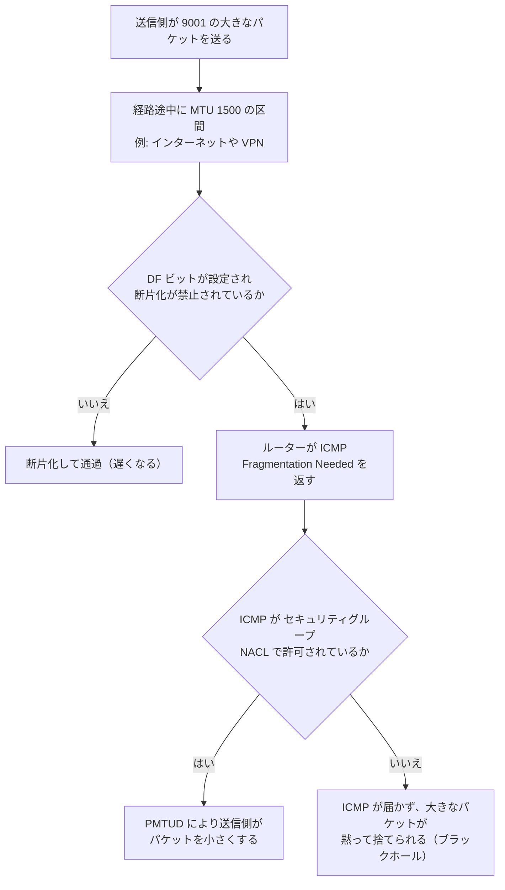

### 症状と対処

| 症状 | 原因 | 対処 |
|---|---|---|
| ping や ログイン、小さな HTTP は通る／大きな転送や TLS ハンドシェイクで止まる | **パスMTU の不一致 + ICMP 遮断** | **ICMP タイプ3・コード4（Fragmentation Needed）** を許可（IPv6 は ICMPv6 Packet Too Big） |
| VPN 経由だけ遅い／再送が多い | IPsec のオーバーヘッドで実効 MTU が下がる | お客様ルーターで **TCP MSS クランプ（最大 1406）** を設定、または MTU を最大値 **1446** 以下に下げる。暗号化・ハッシュアルゴリズム、NAT トラバーサル、IP ファミリー（IPv4/IPv6）の設定に応じて、さらに低い値を選ぶ |
| ジャンボフレーム設定後に一部の通信が失敗 | 経路上に 1500 の区間がある | 経路上の **全ホップで MTU を揃える**、インターネット向け通信は 1500、VPN 向け通信は 1446（MSS 1406）に |

### 確認コマンド（Linux）

```bash
# 現在の MTU を確認
ip link show eth0

# DF ビットを立てて、パケットサイズ別に疎通確認（1472 + 28 = 1500）
ping -M do -s 1472 10.0.2.20

# 経路上の MTU を調べる
tracepath 10.0.2.20
```

```bash
# 一時的に MTU を 1500 に設定する例（検証用）
sudo ip link set dev eth0 mtu 1500
```

### ベストプラクティス

| # | ベストプラクティス | 理由 |
|---|---|---|
| 1 | **セキュリティグループ/NACL で ICMP の Fragmentation Needed を許可** する | PMTUD が機能する前提 |
| 2 | インターネット方向を含む通信では **MTU 1500**、VPN 方向では **MTU 1446（MSS 1406）** を前提にする | 経路上の最小値に合わせる |
| 3 | ジャンボフレームを使うなら、**閉じた経路（同一 VPC・TGW・DX）に限定** する | 意図しない断片化や欠落を防ぐ |
| 4 | VPN の MSS を 1406 以下にクランプする | 断片化を避ける定番の対処 |

---

## B-8. Step 8：AWS Network Monitoring（Flow / Synthetic / Internet Monitor）

CloudWatch の Network Monitoring には、目的の異なる3つの機能があります。

| 機能 | 何を測るか | 仕組み |
|---|---|---|
| **Network Flow Monitor** | EC2 間や、S3・DynamoDB など AWS サービス宛の **TCP の遅延・パケットロス** | インスタンスに **軽量エージェント** を導入し、TCP 接続の統計を収集（受動的） |
| **Network Synthetic Monitor** | AWS とオンプレミス間の **ハイブリッド接続の遅延・パケットロス** | AWS 上のリソースから、オンプレミス宛の **プローブ** を送信（能動的） |
| **Internet Monitor** | インターネット経由のアクセスの **性能・可用性** | AWS のグローバルな接続データから基準値を算出し、**障害イベント** を通知 |

> **試験ポイント**: 「**問題の原因がアプリ側か、AWS インフラ側か切り分けたい**」→ Network Flow Monitor。「**専用線やVPN の遅延・ロスを継続監視したい**」→ Network Synthetic Monitor。

---

## B-9. Task 3.2 まとめ：障害切り分けの標準手順

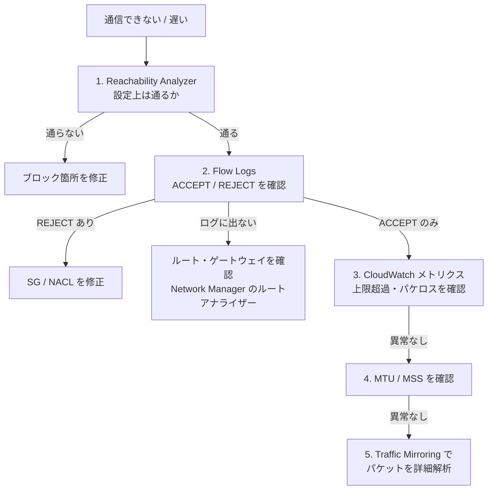

| 症状 | まず疑うこと | 使うツール |
|---|---|---|
| 新しく作った VPC 間で通信できない | ルートの不足、SG の許可不足 | Reachability Analyzer |
| 特定の通信だけ REJECT | SG/NACL | Flow Logs |
| 往路は ACCEPT で戻りが REJECT | NACL（ステートレス） | Flow Logs |
| 大きなデータだけ止まる | MTU/MSS、ICMP の遮断 | `ping -M do`、`tracepath` |
| EC2 の性能が上がらない | ENA の上限超過 | `ethtool -S`、CloudWatch |
| 専用線の遅延・ロスを監視したい | ― | Network Synthetic Monitor |
| 多数の TGW の全体像を把握したい | ― | Transit Gateway Network Manager |
| パケットの中身を見たい | ― | Traffic Mirroring |

---

# Part C. Task 3.3 性能・信頼性・コストの最適化

> **公式のタスク文**: Optimize AWS networks for performance, reliability, and cost-effectiveness

## C-0. このタスクで問われること

| 区分 | 内容（Exam Guide の要旨） |
|---|---|
| 知識 | VPC ピアリングと TGW の使い分け／帯域削減の方法（ユニキャスト対マルチキャスト、CloudFront）／VPC とオンプレミス間のコスト効率の良い接続／ネットワークインターフェイスの種類／Route 53 の高可用性機能（ヘルスチェック、レイテンシー・加重レコード）／負荷分散パターン／サブネットの最適化／フレームサイズの最適化 |
| スキル | スループット最適化／最適なネットワークインターフェイスの選択（ENI・ENA・EFA）／ピアリング・プロキシ・TGW の選択／マルチキャスト実装／Route 53 のパブリック/プライベートホストゾーンとレコード作成／Auto Scaling 向けサブネット最適化／IP 枯渇の防止（セカンダリ CIDR）／ジャンボフレーム設定／Global Accelerator による最適化 |

---

## C-1. Step 1：VPC ピアリング・プロキシ・Transit Gateway を使い分ける

### なぜ必要か

接続方式は、**VPC の数・必要な通信・コスト・運用負荷** で最適解が変わります。試験では「要件から最適な方式を選ぶ」問題が頻出です。

### 比較表

| 観点 | **VPC ピアリング** | **Transit Gateway** | **プロキシ / PrivateLink 型** |
|---|---|---|---|
| 接続形態 | 1対1 | ハブ&スポーク | サービス単位 |
| 推移的ルーティング | **不可** | **可能** | 該当なし |
| 接続数が増えると | 接続数が **n(n-1)/2** で増える | アタッチメントを足すだけ | 利用側の追加が容易 |
| オンプレミス接続の共有 | 不可（エッジ間ルーティング不可） | **可能**（VPN/DX を共有） | 別途構成 |
| 帯域 | AWS ネットワーク内で **帯域の集約ボトルネックなし** | VPC アタッチメントあたりの上限あり（AZ あたり最大 100 Gbps） | NLB/エンドポイントの性能に依存 |
| コスト | **ピアリング自体の追加料金なし**（データ転送料金は発生） | アタッチメント時間課金 + 処理データ量課金 | エンドポイント時間 + 処理データ量課金 |
| 向く場面 | 少数 VPC、大量転送、低コスト | 多数 VPC、オンプレミス統合、集中管理 | CIDR 重複、サービス公開 |

> **注意**: 料金は リージョンや時期で変わります。最新は [Transit Gateway の料金ページ](https://aws.amazon.com/transit-gateway/pricing/) などで確認してください。

### 選択フロー

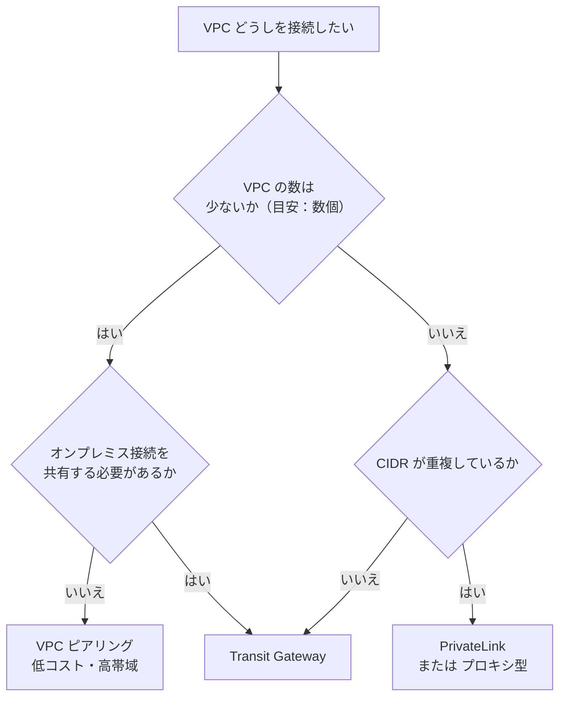

> **試験ポイント**: 「**大量のデータを 2つの VPC 間で、できるだけ低コストで転送**」は **VPC ピアリング**。「**数十の VPC とオンプレミスを一元的に接続**」は **Transit Gateway**。

### ベストプラクティス

| # | ベストプラクティス | 理由 |
|---|---|---|
| 1 | 通信量の多い特定ペアだけ **ピアリングで直結**、それ以外は TGW という **併用** も検討する | TGW のデータ処理料金を削減できる |
| 2 | VPC 数が増える見込みなら **最初から TGW** にする | 後でピアリング網を作り直すのは大変 |
| 3 | 検査（ファイアウォール）が必要なら **TGW + 検査 VPC（アプライアンスモード）** | 中央で通信を検査できる |

---

## C-2. Step 2：VPC とオンプレミスのコスト効率の良い接続

| 接続方式 | 特徴 | コスト面のポイント | 向く場面 |
|---|---|---|---|
| **Site-to-Site VPN** | 短期間で導入。暗号化。インターネット品質に依存 | 接続時間 + データ転送 | 小〜中規模、バックアップ、早期開始 |
| **Direct Connect** | 専用線。帯域が安定、遅延が小さい | ポート時間 + **データ転送（AWS からの送信）が一般に インターネット経由より割安** | 大量・継続的な転送、安定性が重要 |
| **DX + VPN（バックアップ）** | 専用線を主、VPN を副 | 専用線の補完として低コスト | 回復性が必要 |
| **VPN over DX（プライベート IP VPN）** | DX 上で IPsec 暗号化 | DX 帯域の上に暗号化を追加 | 専用線でも暗号化が必要な要件 |
| **DX（MACsec）** | 専用接続のレイヤー2暗号化 | 対応ポートが必要 | 回線レベルの暗号化要件 |

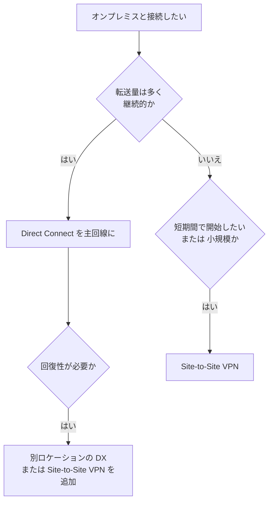

### その他のコスト最適化の要点

| # | 施策 | 効果 |
|---|---|---|
| 1 | S3/DynamoDB へは **ゲートウェイ型エンドポイント**（無料）を使う | NAT ゲートウェイのデータ処理料金を削減 |
| 2 | **同一 AZ 内** の通信に寄せる（AZ 間転送は課金されるため） | AZ 間データ転送料金の削減 |
| 3 | 不要になった TGW アタッチメント、EIP、NAT ゲートウェイを整理する | 時間課金の削減 |
| 4 | **CloudFront** でキャッシュし、オリジンからの転送を減らす | インターネット向け転送料金・帯域の削減 |
| 5 | データ転送コストを **Cost Explorer / CUR** で可視化する | 無駄な通信の発見 |

---

## C-3. Step 3：帯域使用量を減らす（ユニキャスト対マルチキャスト、CloudFront）

### 3.1 ユニキャストとマルチキャスト

| 方式 | 動作 | 特徴 |
|---|---|---|
| **ユニキャスト** | 1対1。受信者の数だけ同じデータを送る | 受信者が増えると送信側の負荷と帯域が増える |
| **マルチキャスト** | 1対多。1回の送信を、グループ参加者へ複製して配る | 同じデータを多数に配るときに **送信帯域を節約** |

### 3.2 AWS でのマルチキャスト（Transit Gateway マルチキャスト）

| 項目 | 内容 |
|---|---|
| 仕組み | TGW に **マルチキャストドメイン** を作り、VPC サブネットを関連付ける。ドメインの上限は TGW あたり 20 |
| グループ管理 | **IGMPv2** で参加・離脱するか、**静的** にメンバーを登録する |
| 送信元/受信者 | 対応する **Nitro** ベースのインスタンスの ENI など |
| 対象 | VPC 内のマルチキャスト。オンプレミスとの間は、構成要件を公式ドキュメントで確認する |

```mermaid
flowchart LR
    SRC["マルチキャスト送信元"] --> TGW["Transit Gateway<br/>マルチキャストドメイン"]
    TGW --> R1["受信者 1<br/>サブネット A"]
    TGW --> R2["受信者 2<br/>サブネット B"]
    TGW --> R3["受信者 3<br/>サブネット C"]
```

| # | ベストプラクティス | 理由 |
|---|---|---|
| 1 | マルチキャストが必要なアプリ（市場データ配信、映像配信など）だけに使う | 通常のアプリには不要で、設計が複雑になる |
| 2 | **IGMP と静的登録** をアプリの要件で選ぶ | 動的な参加が必要か、固定メンバーかで決まる |
| 3 | ドメインごとに **サブネットの関連付けとグループの設定を IaC 管理** する | 設定漏れで配信が届かない事故を防ぐ |

### 3.3 CloudFront による帯域削減

| 効果 | 説明 |
|---|---|
| キャッシュ | エッジにコンテンツを置き、**オリジンへのリクエストと転送量を削減** |
| 近接配信 | ユーザーに近い拠点から配信し、遅延を短縮 |
| 接続の最適化 | オリジンとの接続を再利用し、効率化 |

> **試験ポイント**: 「**同じ静的コンテンツを世界中の多数のユーザーへ配る、オリジンの負荷と転送量を下げたい**」→ CloudFront。「**TCP/UDP の非 HTTP トラフィックを高速化したい／固定 IP が必要**」→ Global Accelerator（C-9 参照）。

---

## C-4. Step 4：ネットワークインターフェイスの種類と選び方

### 比較表

| 種類 | 概要 | 向く用途 |
|---|---|---|
| **ENI**（Elastic Network Interface） | VPC 内の仮想 NIC。IP・SG・MAC を持ち、インスタンス間で付け替え可能 | 基本。管理用ネットワーク分離、フェイルオーバー用の IP 付け替え |
| **ENA**（Elastic Network Adapter） | 高性能な準仮想化ドライバー。多くの現行世代インスタンスで利用 | **標準的な高スループット・低遅延** |
| **ENA Express** | ENA 上で **SRD（Scalable Reliable Datagram）** を使い、パケットの経路を分散して 1 フローの性能と テイルレイテンシーを改善 | 同一 AZ 内の 1 フローの大きな転送 |
| **EFA**（Elastic Fabric Adapter） | **OS バイパス** による低遅延通信を提供（libfabric、MPI、NCCL） | **HPC、機械学習の分散学習** |

> **注意**: ENA Express は、同一 AZ 内など利用条件があります。対応インスタンスタイプ・条件・帯域の数値は変更があるため、[公式ドキュメント](https://docs.aws.amazon.com/AWSEC2/latest/UserGuide/ena-express.html) で確認してください。

```mermaid
flowchart TD
    A["性能要件を確認"] --> B{"HPC や 分散学習で<br/>ノード間の超低遅延が必要か"}
    B -- "はい" --> EFA["EFA を選ぶ<br/>（クラスタープレイスメントグループ併用）"]
    B -- "いいえ" --> C{"1つのフローで<br/>より高い帯域・低いテイル遅延が必要か"}
    C -- "はい" --> EX["ENA Express を検討<br/>（同一 AZ など条件を確認）"]
    C -- "いいえ" --> ENA["ENA（標準）を使う"]
```

### スループットを最適化する要点

| # | 施策 | 理由 |
|---|---|---|
| 1 | **ネットワーク性能の高いインスタンスタイプ** を選ぶ | 帯域・PPS・接続追跡の上限はインスタンスサイズに依存する |
| 2 | **クラスタープレイスメントグループ** を使う | 同一ラック近傍に配置され、低遅延・高帯域 |
| 3 | **ジャンボフレーム（MTU 9001）** を閉じた経路で使う | 同じデータ量でも パケット数が減り、効率が上がる |
| 4 | **複数フロー（並列接続）** にする | 1フローの上限を超えて合計帯域を使える |
| 5 | 最新の ENA ドライバーを使う | 性能・機能の改善を得られる |
| 6 | `*_allowance_exceeded` を監視する | 上限超過を検知する（B-3 参照） |

---

## C-5. Step 5：ジャンボフレームを設定する（接続タイプ別）

### 接続タイプ別の可否（再掲）

| 経路 | ジャンボフレーム | MTU |
|---|---|---|
| 同一 VPC / ピアリング / TGW 内 | 使える | 9001（TGW 経由は最大 8500） |
| Direct Connect プライベート VIF | 使える | 9001 |
| Direct Connect トランジット VIF | 使える | **8500** |
| インターネットゲートウェイ経由 | 使えない | 1500 |
| Site-to-Site VPN | 使えない | トンネル上限 1500／実効パケット MTU 1446（MSS 1406） |

### 設定の流れ

```mermaid
flowchart TD
    A["経路の MTU 上限を確認"] --> B["1. DX の VIF で<br/>ジャンボ MTU を選択"]
    B --> C["2. お客様ルーターの<br/>インターフェイス MTU を合わせる"]
    C --> D["3. EC2 の MTU を設定<br/>既定は 9001"]
    D --> E["4. ping -M do で<br/>大きなサイズの疎通を確認"]
    E --> F{"成功したか"}
    F -- "はい" --> G["完了"]
    F -- "いいえ" --> H["経路上の MTU の低い区間を探す"]
```

> **重要**: DX の VIF の MTU を 8500 または 9001 に変更すると、**物理接続の更新が行われ、一時的な影響が出る可能性** があります。DX コンソールの「Jumbo Frame Capable」で対応可否を確認できます。

### 疎通確認（トランジット VIF 経由で 8500 の場合）

```bash
# 8500 - 28(ICMP+IP ヘッダ) = 8472 バイトのペイロードで確認
ping -M do -s 8472 10.0.2.20
```

### ベストプラクティス

| # | ベストプラクティス | 理由 |
|---|---|---|
| 1 | ジャンボフレームは **経路全体で MTU を揃えられる場合のみ** 使う | 1か所でも小さいと ICMP 遮断時に通信が黙って失敗する |
| 2 | インターネット宛の通信は **1500**、VPN 宛の通信は最大 **1446**（MSS 最大 **1406**）とし、暗号化・ハッシュアルゴリズム、NAT トラバーサル、IP ファミリー（IPv4/IPv6）の設定に応じてさらに低い値にする | インターネットの経路上限は 1500、VPN は IPsec のオーバーヘッドで実効 1446 |
| 3 | 変更はメンテナンスウィンドウで実施する | VIF の更新による影響を避ける |

---

## C-6. Step 6：Route 53 で高可用性を実現する

### 6.1 ホストゾーン

| 種類 | 用途 |
|---|---|
| **パブリックホストゾーン** | インターネットからの名前解決 |
| **プライベートホストゾーン** | 指定した **VPC 内だけ** の名前解決（内部サービス名） |

> **プライベートホストゾーンの前提**: 関連付ける VPC で **DNS 解決** と **DNS ホスト名** の両方を有効にする必要があります。

### 6.2 ルーティングポリシー

| ポリシー | 動作 | 使いどころ |
|---|---|---|
| **シンプル** | 1つの値を返す | 単一リソース |
| **加重（Weighted）** | 重みの比率で振り分け | **カナリアリリース、段階的移行**、負荷の比率調整 |
| **レイテンシー（Latency）** | 利用者に **最も遅延が小さい** リージョンへ | 複数リージョンの性能最適化 |
| **フェイルオーバー（Failover）** | プライマリが異常ならセカンダリへ | **アクティブ/パッシブ** の災害対策 |
| **位置情報（Geolocation）** | 利用者の **所在地** に基づく | 地域ごとのコンテンツ、規制対応 |
| **地理的近接性（Geoproximity）** | 物理的な近さ（バイアスで調整可） | リソース位置と利用者位置に基づく配分 |
| **IP ベース** | 利用者の **CIDR** に基づく | 特定のネットワークを特定のエンドポイントへ |
| **複数値回答（Multivalue）** | 最大 8 つの正常なレコードを返す | 簡易的な DNS ロードバランシング（ヘルスチェック付き） |

### 6.3 ヘルスチェック

| 種類 | 内容 |
|---|---|
| **エンドポイントの監視** | HTTP/HTTPS/TCP でエンドポイントを定期確認 |
| **算出されたヘルスチェック** | 複数のヘルスチェックを AND/OR/しきい値で結合 |
| **CloudWatch アラームの監視** | アラームの状態を基に判定。**プライベートな（インターネットから見えない）リソースにも使える** |

> **試験ポイント**: Route 53 のヘルスチェッカーは **パブリックな エンドポイント** を監視します。**プライベートな VPC 内リソース** は、**CloudWatch アラームに基づくヘルスチェック** を使います。

### 6.4 組み合わせ設計例：「レイテンシー + ヘルスチェック + フェイルオーバー」

```mermaid
flowchart TD
    U["利用者の DNS クエリ"] --> R53["Route 53<br/>レイテンシーベースのレコード"]
    R53 --> R1["東京リージョンのレコード<br/>ヘルスチェックあり"]
    R53 --> R2["バージニアリージョンのレコード<br/>ヘルスチェックあり"]
    R1 -- "異常" --> X["そのレコードを除外し<br/>正常なリージョンを返す"]
    R2 --> OK["正常なら最も近いリージョンへ"]
```

### 6.5 AZ をまたぐプライベート DNS の設計

プライベートホストゾーンで、**複数 AZ のターゲットを返す** と、AZ 障害に強くなります。

| 方法 | 内容 |
|---|---|
| 加重レコード + ヘルスチェック | AZ ごとに重みを付け、異常な AZ を除外する |
| **ELB（ALB/NLB）のエイリアスレコード** | ELB が複数 AZ のターゲットへ分散する。**エイリアスレコードはクエリ課金なし**（AWS リソース宛） |
| Resolver エンドポイント | オンプレミスと VPC の間で名前解決を連携する |

### ベストプラクティス

| # | ベストプラクティス | 理由 |
|---|---|---|
| 1 | AWS リソースへは **エイリアスレコード** を使う | 追加料金なし・IP 変更に追随・ヘルスの評価に対応 |
| 2 | 重要なレコードに **ヘルスチェック** を付ける | 障害時に自動で切り替わる |
| 3 | **TTL を適切に短く** する（フェイルオーバー対象は短め） | 切り替えの反映が速くなる |
| 4 | 複数リージョンでは **レイテンシー + ヘルスチェック** を基本にする | 性能と可用性を両立 |
| 5 | プライベートホストゾーンは、必要な **すべての VPC に関連付け** る | 関連付けのない VPC は名前解決できない |

---

## C-7. Step 7：負荷分散とトラフィック分散パターン

### Elastic Load Balancing の比較

| 種類 | レイヤー | 特徴 | 向く場面 |
|---|---|---|---|
| **ALB** | L7（HTTP/HTTPS/gRPC） | パス・ホスト・ヘッダーによるルーティング | Web アプリ、マイクロサービス |
| **NLB** | L4（TCP/UDP/TLS） | **超低遅延・高スループット**、**AZ ごとの固定 IP（EIP）**、送信元 IP の保持 | 高性能、固定 IP が必要、PrivateLink のバックエンド |
| **GWLB** | L3（GENEVE） | **セキュリティアプライアンス** の透過的な挿入・スケール | ファイアウォール、IDS/IPS の集中検査 |

### ベストプラクティス

| # | ベストプラクティス | 理由 |
|---|---|---|
| 1 | ロードバランサーは **複数 AZ** に配置する | AZ 障害への耐性 |
| 2 | **クロスゾーン負荷分散** の既定値を理解する（ALB は有効、NLB は 既定で無効） | AZ 間のターゲット数が偏ると、負荷も偏る |
| 3 | ヘルスチェックの閾値・間隔を **アプリの起動時間** に合わせる | 誤検知や遅い検知を防ぐ |
| 4 | 登録解除の遅延（コネクションドレイニング）を設定する | デプロイ時の通信断を防ぐ |
| 5 | 固定 IP や 送信元 IP の保持が必要なら **NLB** | ALB は IP が変動する |

> **試験ポイント**: 「**ファイアウォールアプライアンスを中央に置き、複数 VPC のトラフィックを透過的に検査**」→ **GWLB**（+ TGW）。「**静的 IP が必要で、高性能な TCP**」→ **NLB**。

---

## C-8. Step 8：VPC サブネットの最適化

### 8.1 Auto Scaling に備えたサブネット設計

| 観点 | 内容 |
|---|---|
| **IP の確保** | サブネットのサイズに、**スケールアウト時の最大台数 + 予備** を見込む。サブネットでは **先頭4つと末尾1つ（計5つ）の IP が予約** されている |
| **複数 AZ** | Auto Scaling グループに **複数 AZ のサブネット** を指定する |
| **サブネットの用途分離** | ワークロードの種類（Web・アプリ・DB）、LB、エンドポイント、TGW アタッチメントを分ける |
| **余裕** | 他のサービスが ENI として IP を使う（ELB、Lambda、EKS、エンドポイント）ことも見込む |

### 8.2 IP アドレス枯渇の防止

```mermaid
flowchart TD
    A["サブネットの空き IP が不足"] --> B{"VPC の CIDR に<br/>空き範囲があるか"}
    B -- "はい" --> C["新しいサブネットを追加"]
    B -- "いいえ" --> D["セカンダリ CIDR を VPC に追加"]
    D --> E["新しい CIDR に<br/>サブネットを作成"]
    E --> F["ルートテーブル・SG・NACL を更新"]
    F --> G["ワークロードを新サブネットへ配置"]
```

| 手段 | 内容 |
|---|---|
| **セカンダリ CIDR の追加** | VPC に追加の IPv4 CIDR を関連付け、新しいサブネットを作る（VPC あたりの CIDR 数には上限あり） |
| **100.64.0.0/10 の利用** | 重複しにくい範囲として、コンテナ（EKS のカスタムネットワーキング）等で活用されることが多い |
| **IPv6 の導入** | 事実上、枯渇しない アドレス空間 |
| **IPAM** | 組織全体の CIDR を一元管理し、重複・枯渇を予防 |
| **プレフィックス委任** | ENI に /28 単位でアドレスを割り当て、Pod 数が多い環境の IP 効率を上げる |

> **試験ポイント**: 「**既存 VPC の IPv4 が枯渇した。再構築なしで解決したい**」→ **セカンダリ CIDR の追加**（+ 新しいサブネット）。

### ベストプラクティス

| # | ベストプラクティス | 理由 |
|---|---|---|
| 1 | VPC 作成時に **大きめの CIDR** を確保する（後から縮小できない） | 拡張余地 |
| 2 | **IPAM** で CIDR を一元管理する | 重複・枯渇の予防 |
| 3 | サブネット使用率を **監視**（CloudWatch などで空き IP を確認）する | 枯渇の前に対応 |
| 4 | TGW アタッチメント用に **小さな専用サブネット** を用意する | 他のワークロードと IP を取り合わない |

---

## C-9. Step 9：AWS Global Accelerator で性能と可用性を高める

### 仕組み

| 項目 | 内容 |
|---|---|
| **静的エニーキャスト IP** | 2つの固定 IP を提供し、世界中のエッジロケーションから広告される |
| 経路 | 利用者は最寄りのエッジから **AWS のグローバルバックボーン** に入り、エンドポイントへ到達する（インターネットの経路を通る区間が短い） |
| エンドポイント | ALB、NLB、EC2、Elastic IP |
| 障害対応 | **ヘルスチェック** で異常なエンドポイントを除外し、**高速にフェイルオーバー** |
| 制御 | **トラフィックダイヤル**（リージョン単位の割合）、**エンドポイントの重み** |
| プロトコル | **TCP / UDP**（HTTP に限らない） |

```mermaid
flowchart LR
    U["世界中の利用者"] --> E["最寄りのエッジ<br/>静的エニーキャスト IP"]
    E --> BB["AWS グローバル<br/>バックボーン"]
    BB --> R1["東京リージョン<br/>ALB"]
    BB --> R2["バージニアリージョン<br/>ALB"]
```

### CloudFront との使い分け

| 比較 | **Global Accelerator** | **CloudFront** |
|---|---|---|
| 主目的 | **性能と可用性** の向上（経路の最適化、高速フェイルオーバー） | **キャッシュ配信**（帯域とオリジン負荷の削減） |
| 対象プロトコル | TCP / UDP | HTTP/HTTPS（および WebSocket など） |
| 固定 IP | **あり**（静的エニーキャスト IP） | なし（ドメイン名で利用） |
| キャッシュ | なし | あり |
| 向く場面 | ゲーム、IoT、VoIP、固定 IP が必要な通信、**リージョン間の高速切替** | 静的/動的コンテンツ配信 |

### Route 53 との使い分け

| 比較 | Global Accelerator | Route 53（DNS） |
|---|---|---|
| 切り替えの仕組み | **IP は変わらない**ので、DNS キャッシュに左右されない | DNS の **TTL とクライアントのキャッシュ** に依存 |
| 障害時の切り替え速度 | **速い** | TTL 次第 |

> **試験ポイント**: 「**DNS キャッシュのせいでフェイルオーバーが遅い／クライアントが IP を固定で許可リストに登録している**」→ **Global Accelerator**。

### ベストプラクティス

| # | ベストプラクティス | 理由 |
|---|---|---|
| 1 | アクセラレーターは **複数リージョンのエンドポイント** で構成する | リージョン障害に耐える |
| 2 | **トラフィックダイヤル** で、段階的なリリース/切替を行う | リスクを抑えて切り替えられる |
| 3 | **クライアント IP の保持** が必要か要件を確認する | エンドポイントの種類で挙動が異なる |
| 4 | ヘルスチェックの設定を、アプリの状態を反映するパスにする | 本当に異常なときだけ切り替える |

---

## C-10. Task 3.3 まとめ：判断早見表

| 要件 | 選択肢 |
|---|---|
| 2つの VPC 間の大量転送を低コストに | **VPC ピアリング** |
| 数十の VPC + オンプレミスを統合 | **Transit Gateway** |
| CIDR が重複した VPC のサービスを使う | **PrivateLink** |
| 継続的な大量転送のコストを下げる | **Direct Connect**（+ VPN バックアップ） |
| S3 へのアクセスで NAT のコストを下げたい | **ゲートウェイ型 VPC エンドポイント** |
| HPC のノード間通信の超低遅延 | **EFA** + クラスタープレイスメントグループ |
| 1 フローの性能・テイル遅延を改善（同一 AZ） | **ENA Express** |
| 同じデータを多数の受信者へ効率よく配る | **TGW マルチキャスト** |
| 静的コンテンツを世界中へ配信 | **CloudFront** |
| TCP/UDP の高速化 + 固定 IP + 高速切替 | **Global Accelerator** |
| 複数リージョンで遅延が小さい所へ誘導 | **Route 53 レイテンシー + ヘルスチェック** |
| カナリアリリース（段階的な切替） | **Route 53 加重** または **Global Accelerator のトラフィックダイヤル** |
| VPC の IPv4 が枯渇 | **セカンダリ CIDR**（+ IPAM） |
| ファイアウォールを集中配置 | **GWLB + TGW** |
| ジャンボフレームを使いたい | **DX・VPC・TGW 内のみ**（インターネットは 1500、VPN は実効 1446） |

---

# Part D. 横断チートシートと確認問題

## D-1. 数値チートシート（2026-10-16 時点・公式値）

| カテゴリ | 項目 | 値 |
|---|---|---|
| **Direct Connect** | プライベート/トランジット VIF の BGP 広告ルート数（お客様 → AWS） | 既定 100（IPv4・IPv6 各、最大 1,000 まで割り当て可能）。超過で **BGP 切断** |
| | パブリック VIF の BGP 広告ルート数 | 1,000 |
| | DXGW あたりの TGW 数 / VGW 数 / VIF 数 | 6 / 20 / 30 |
| | ホスト型接続の VIF 数 | 1 |
| | プライベート VIF の MTU | 1500 または 9001 |
| | トランジット VIF の MTU | 1500 または 8500 |
| | TGW あたり AWS → オンプレミスの広告プレフィックス数 | 200 |
| **Site-to-Site VPN** | 標準トンネルの最大帯域 | 1.25 Gbps |
| | 大容量帯域トンネルの最大帯域 | 5 Gbps |
| | VPN の MTU（トンネル上限 / 実効パケット MTU） | 1500 / 1446（MSS 1406） |
| | TGW 上で お客様機器 → AWS の動的ルート数 | 1,000 |
| | TGW 上で AWS → お客様機器のルート数 | 5,000 |
| **Transit Gateway** | アタッチメント数 | 5,000 |
| | ルートテーブル数 | 20 |
| | 全ルートテーブル合計のルート数 | 10,000 |
| | VPC アタッチメントの帯域（AZ あたり） | 最大 100 Gbps |
| | Connect ピアの帯域 | 最大 5 Gbps（1アタッチメントあたり最大4ピア、合計 20 Gbps） |
| | TGW の MTU | 最大 8500 |
| **VPC / EC2** | インターネットゲートウェイ経由の MTU | 1500 |
| | 同一 VPC 内のジャンボフレーム MTU | 9001 |
| | サブネットで予約される IP 数 | 5（先頭4 + 末尾1） |

> **注意**: 上限値は変更されることがあります。**受験直前に必ず公式のクォータページを再確認** してください（Part E を参照）。

## D-2. 「何を使う？」超早見表（試験の決まり文句）

| キーワード | 答えの候補 |
|---|---|
| BGP セッションが突然切れた／100 ルート | プレフィックス割り当ての引き上げ／ルート集約 |
| 障害検知を速くしたい（DX） | BFD |
| 静的と動的の経路が競合 | 静的が優先 |
| VPN の帯域不足 | TGW + ECMP／大容量帯域トンネル |
| CIDR 重複 | PrivateLink／プライベート NAT ゲートウェイ |
| 小さい通信は通るが大きい通信が止まる | MTU/MSS、ICMP の許可 |
| 設定上通るか知りたい | Reachability Analyzer |
| 拒否された通信を探したい | VPC Flow Logs |
| パケットの中身を見たい | Traffic Mirroring |
| 全体のトポロジーを見たい | Transit Gateway Network Manager |
| オンプレミス回線の遅延・ロスを継続監視 | Network Synthetic Monitor |
| 原因が アプリか AWS 基盤か切り分けたい | Network Flow Monitor |
| 固定 IP・TCP/UDP の高速化・高速フェイルオーバー | Global Accelerator |
| 静的コンテンツの配信と転送量の削減 | CloudFront |
| IP 枯渇 | セカンダリ CIDR |
| HPC・分散学習 | EFA |
| 多数受信者への同報 | TGW マルチキャスト |

## D-3. 確認問題（シナリオ形式）

### 問題 1
オンプレミスのルーターから Direct Connect のプライベート VIF 経由で、IPv4 のルートを 150 件広告したところ、BGP セッションがダウンしました。最も適切な対処はどれですか。

- A. ルートを集約して 100 件以内にする
- B. VIF の IPv4 プレフィックス割り当てを 150 以上に設定する
- C. VIF の種類をパブリック VIF に変更する
- D. VIF の MTU を 9001 に変更する

<details>
<summary>解答と解説</summary>

**B**。プライベート/トランジット VIF で受信できるプレフィックス数は既定で IPv4・IPv6 各 100 で、超過するとセッションが Idle になります。割り当ては CreatePrivateVirtualInterface / UpdateVirtualInterfaceAttributes で最大 1,000 まで設定でき、Service Quotas の申請は不要です。A のルート集約（またはデフォルトルート）は、割り当てを増やせない場合の代替策です。C はサービスの対象が変わるため不適切です。D は無関係です。

</details>

### 問題 2
Transit Gateway にアタッチしたサイト間 VPN の帯域が不足しています。ルーターは BGP に対応しています。**追加の接続を増やさずに** 帯域を増やす方法はどれですか。（2つ選択）

- A. 動的ルーティングで複数トンネルに ECMP を有効にする
- B. 大容量帯域トンネルを使う
- C. VPN の MTU を 9001 にする
- D. 静的ルーティングに切り替える
- E. VPC ピアリングを追加する

<details>
<summary>解答と解説</summary>

**A と B**。TGW 上の VPN は ECMP で複数トンネルを束ねられ、標準 1.25 Gbps のところ、大容量帯域トンネルは最大 5 Gbps です。C は VPN トンネルの MTU 上限が 1500（実効パケット MTU は 1446）のため不可。D は ECMP が使えなくなります。

</details>

### 問題 3
VPC A（`10.0.0.0/16`）と VPC B（`10.0.0.0/16`）で CIDR が重複しています。A の アプリケーションから、B にある **1つの API サービス** だけを、プライベートに利用したい場合、最も適切なのはどれですか。

- A. VPC ピアリング
- B. Transit Gateway
- C. PrivateLink（B 側で NLB 経由のエンドポイントサービスを公開）
- D. インターネットゲートウェイ

<details>
<summary>解答と解説</summary>

**C**。PrivateLink は CIDR が重複していても、特定サービスを一方向で公開できます。ピアリングは重複 CIDR では作成できません。TGW でも重複する CIDR の経路は伝播されません。

</details>

### 問題 4
新しく構築した VPC のインスタンスから、別 VPC のデータベース（ポート 5432）に接続できません。ネットワークの設定変更が直前に行われました。**最初に** 実施すべき調査はどれですか。

- A. Traffic Mirroring を有効にして、パケットを取得する
- B. Reachability Analyzer で、送信元と宛先の経路を分析する
- C. Direct Connect の光レベルを確認する
- D. インスタンスタイプを大きくする

<details>
<summary>解答と解説</summary>

**B**。設定変更が疑われる場合、まず設定を静的に分析する Reachability Analyzer で、ブロックしている構成要素と説明コードを確認します。パケット取得は、設定に問題がないときの次の手段です。

</details>

### 問題 5
VPC Flow Logs を確認すると、あるサブネットのインスタンスへの **往路は ACCEPT、戻りの通信が REJECT** になっています。原因として最も可能性が高いものはどれですか。

- A. セキュリティグループのアウトバウンドが全許可になっている
- B. ネットワーク ACL で、戻りの通信（エフェメラルポート）が許可されていない
- C. ルートテーブルに TGW 宛のルートがない
- D. DNS の設定誤り

<details>
<summary>解答と解説</summary>

**B**。セキュリティグループはステートフルで戻りが自動許可されますが、ネットワーク ACL はステートレスのため、戻りの通信を明示的に許可する必要があります。

</details>

### 問題 6
オンプレミスから AWS へのファイル転送で、ping と SSH は成功しますが、大きなファイルの転送が途中で止まります。経路には Site-to-Site VPN が含まれ、サーバーはジャンボフレーム（MTU 9001）で構成されています。最も適切な対処はどれですか。（2つ選択）

- A. カスタマーゲートウェイで DF フラグをクリアし、暗号化前に IP パケットを断片化する
- B. 経路を Direct Connect のトランジット VIF に変更するだけで解決する
- C. VPN 経路向けに TCP MSS をクランプ（または MTU を 1446 以下に設定）する
- D. VPN トンネルの数を増やす
- E. ENA Express を有効にする

<details>
<summary>解答と解説</summary>

**A と C**。VPN トンネルの MTU 上限は 1500 ですが、IPsec のオーバーヘッドにより実効パケット MTU は 1446（MSS 1406）のため、9001 の大きなパケットはそのままでは通りません。Site-to-Site VPN では ICMP を許可しても PMTUD を前提にできないため、トンネル向けに MSS をクランプ（1406 以下）または MTU を 1446 以下に設定し、カスタマーゲートウェイでは DF フラグをクリアして暗号化前に断片化します。

</details>

### 問題 7
グローバルに展開するゲームサービスが、TCP/UDP の両方を使います。クライアントは固定 IP を許可リストに登録しており、リージョン障害時には DNS キャッシュに依存せず素早く別リージョンへ切り替えたい要件です。最も適切なサービスはどれですか。

- A. Amazon CloudFront
- B. Route 53 のフェイルオーバーレコード
- C. AWS Global Accelerator
- D. Application Load Balancer のみ

<details>
<summary>解答と解説</summary>

**C**。Global Accelerator は静的エニーキャスト IP を提供し、TCP/UDP に対応し、IP が変わらないため DNS キャッシュに左右されずヘルスチェックで素早くフェイルオーバーできます。

</details>

### 問題 8
既存 VPC の `10.0.0.0/24` のサブネットで、Auto Scaling により IP が不足しそうです。VPC 全体の CIDR にも空きがありません。**既存環境を作り直さず** に対処する方法はどれですか。

- A. VPC のプライマリ CIDR を `/16` に変更する
- B. セカンダリ CIDR を VPC に追加し、新しいサブネットを作成する
- C. サブネットのマスクを広げる
- D. 新しい VPC を作り、ピアリングする以外に方法はない

<details>
<summary>解答と解説</summary>

**B**。既存のプライマリ CIDR やサブネットの範囲は変更できません。セカンダリ CIDR を追加して新しいサブネットを作り、ワークロードを移します。

</details>

---

# Part E. 参考URL一覧（根拠となるソース）

> 凡例: ✔ = 2026-10-16 の作成時に内容を確認した公式ページ。その他は AWS 公式ドキュメントの安定したページですが、受験前にあわせて最新の記載を確認してください。

## E-1. 試験ガイド

| 内容 | URL |
|---|---|
| ✔ ANS-C01 Exam Guide（トップ） | https://docs.aws.amazon.com/aws-certification/latest/advanced-networking-specialty-01/advanced-networking-specialty-01.html |
| ✔ Content Domain 3: Network Management and Operation | https://docs.aws.amazon.com/aws-certification/latest/advanced-networking-specialty-01/advanced-networking-specialty-01-domain3.html |

## E-2. Task 3.1 関連

| 内容 | URL |
|---|---|
| ✔ VPC ルート優先順位 | https://docs.aws.amazon.com/vpc/latest/userguide/route-tables-priority.html |
| ✔ Transit Gateway の仕組みとルート評価順 | https://docs.aws.amazon.com/vpc/latest/tgw/how-transit-gateways-work.html |
| ✔ Transit Gateway クォータ | https://docs.aws.amazon.com/vpc/latest/tgw/transit-gateway-quotas.html |
| ✔ Direct Connect クォータ | https://docs.aws.amazon.com/directconnect/latest/UserGuide/limits.html |
| ✔ Direct Connect エンドポイントとクォータ（General Reference） | https://docs.aws.amazon.com/general/latest/gr/dc.html |
| ✔ Direct Connect VIF の作成（MTU・DXGW の ASN） | https://docs.aws.amazon.com/directconnect/latest/UserGuide/create-vif.html |
| ✔ プライベート VIF の作成（MTU） | https://docs.aws.amazon.com/directconnect/latest/UserGuide/create-private-vif.html |
| ✔ Site-to-Site VPN クォータ | https://docs.aws.amazon.com/vpn/latest/s2svpn/vpn-limits.html |
| Direct Connect のルーティングと BGP | https://docs.aws.amazon.com/directconnect/latest/UserGuide/routing-and-bgp.html |
| AWS PrivateLink | https://docs.aws.amazon.com/vpc/latest/privatelink/what-is-privatelink.html |
| VPC ピアリング | https://docs.aws.amazon.com/vpc/latest/peering/what-is-vpc-peering.html |
| ✔ TGW のルート上限を監視する（ブログ） | https://aws.amazon.com/blogs/networking-and-content-delivery/monitoring-aws-transit-gateway-route-limits-using-a-serverless-architecture |

## E-3. Task 3.2 関連

| 内容 | URL |
|---|---|
| ✔ Reachability Analyzer の CLI 手順 | https://docs.aws.amazon.com/vpc/latest/reachability/getting-started-cli.html |
| ✔ Reachability Analyzer の説明コード | https://docs.aws.amazon.com/vpc/latest/reachability/explanation-codes.html |
| ✔ CloudWatch Network Monitoring（Flow / Synthetic / Internet） | https://docs.aws.amazon.com/AmazonCloudWatch/latest/monitoring/CloudWatch-Network-Monitoring-Sections.html |
| ✔ CloudWatch Network Monitoring の発表（2024-12） | https://aws.amazon.com/about-aws/whats-new/2024/12/amazon-cloudwatch-network-monitoring-workloads-monitors |
| ✔ EC2 のネットワーク MTU | https://docs.aws.amazon.com/AWSEC2/latest/UserGuide/network_mtu.html |
| VPC Flow Logs | https://docs.aws.amazon.com/vpc/latest/userguide/flow-logs.html |
| VPC Traffic Mirroring | https://docs.aws.amazon.com/vpc/latest/mirroring/what-is-traffic-mirroring.html |
| Transit Gateway Network Manager | https://docs.aws.amazon.com/network-manager/latest/tgwnm/what-are-global-networks.html |

## E-4. Task 3.3 関連

| 内容 | URL |
|---|---|
| Route 53 ルーティングポリシー | https://docs.aws.amazon.com/Route53/latest/DeveloperGuide/routing-policy.html |
| AWS Global Accelerator | https://docs.aws.amazon.com/global-accelerator/latest/dg/what-is-global-accelerator.html |
| ENA Express | https://docs.aws.amazon.com/AWSEC2/latest/UserGuide/ena-express.html |
| Elastic Fabric Adapter（EFA） | https://docs.aws.amazon.com/AWSEC2/latest/UserGuide/efa.html |
| Transit Gateway マルチキャスト | https://docs.aws.amazon.com/vpc/latest/tgw/tgw-multicast-overview.html |
| VPC の CIDR ブロック（セカンダリ CIDR） | https://docs.aws.amazon.com/vpc/latest/userguide/vpc-cidr-blocks.html |
| Elastic Load Balancing | https://docs.aws.amazon.com/elasticloadbalancing/latest/userguide/what-is-load-balancing.html |
| Transit Gateway の料金 | https://aws.amazon.com/transit-gateway/pricing/ |

---

## 付録：学習の進め方（目安）

| 順番 | 学習内容 | 目安 |
|---|---|---|
| 1 | 2章の用語集と Task 3.1（ルーティング・DX・VPN・TGW） | 2〜3 日 |
| 2 | Task 3.2（ツールの使い分け・MTU） | 2 日 |
| 3 | Task 3.3（最適化・Route 53・Global Accelerator） | 2 日 |
| 4 | チートシートと確認問題の反復 | 1〜2 日 |
| 5 | 実際に AWS 上で Reachability Analyzer / Flow Logs / TGW を触る | 随時 |

> **最後に**: Specialty 試験は暗記ではなく「要件から最適な構成を選ぶ」力を問います。各ステップの「試験ポイント」を、自分の言葉で説明できるようになれば合格に近づきます。