# AWS Certified Advanced Networking - Specialty (ANS-C01)
## Content Domain 4: Network Security, Compliance, and Governance
### 初学者向けステップバイステップ解説ガイド

> **対象**: ネットワークの基礎(IP・ルーティング・TLS の概念)を一通り学んだことがあり、AWS のネットワークセキュリティを体系的に学びたい方
> **配点**: Domain 4 は **スコア対象の 24%**(全 4 ドメイン中 3 番目)
> **作成日**: 2026-10-16 / 根拠となる公式情報は各セクション末尾および巻末の「参考 URL 一覧」に記載

---

## 目次

- [0. この試験ドメインの全体像](#p0)
- [1. 基礎: セキュリティの考え方(共有責任・多層防御)](#p1)
- **Task 4.1 ネットワーク機能の実装・保守(セキュリティ/コンプライアンス要件)**
  - [2. 脅威モデルと一般的な脅威](#p2)
  - [3. インバウンド通信の保護(WAF / Shield / Network Firewall)](#p3)
  - [4. アウトバウンド通信の保護(Network Firewall / プロキシ / GWLB / DNS Firewall)](#p4)
  - [5. VPC 間・VPC 内通信の保護(SG / NACL / VPC エンドポイントポリシー)](#p5)
  - [6. セキュリティ・コンプライアンスを満たすアーキテクチャ](#p6)
  - [7. コンプライアンスのテストとインシデント自動通知](#p7)
- **Task 4.2 ネットワーク監視・ログによる検証と監査**
  - [8. 監視・ログサービスの全体像](#p8)
  - [9. VPC Flow Logs](#p9)
  - [10. VPC Traffic Mirroring](#p10)
  - [11. CloudWatch(アラーム・カスタムメトリクス・Logs Insights)](#p11)
  - [12. CloudTrail と各サービスのログ](#p12)
  - [13. ログ配信と複数ソースの相関分析](#p13)
  - [14. ネットワーク監査戦略(Firewall Manager / Config / Trusted Advisor ほか)](#p14)
- **Task 4.3 データ・通信の機密性**
  - [15. ネットワーク暗号化の全体像](#p15)
  - [16. VPN・Direct Connect の暗号化](#p16)
  - [17. TLS 終端と各サービスでの転送中データ暗号化](#p17)
  - [18. 証明書管理(ACM / AWS Private CA)](#p18)
  - [19. DNS のセキュリティ(DNSSEC / DNS Firewall)](#p19)
- [20. 試験対策: 頻出パターン早見表](#p20)
- [21. 確認問題](#p21)
- [22. 参考 URL 一覧](#p22)

---

<a id="p0"></a>
## 0. この試験ドメインの全体像

公式試験ガイドでは、Domain 4 は次の **3 つのタスク** で構成されています。

| タスク | 公式タイトル(英語) | 本ガイドでの章 | ひとことで言うと |
|---|---|---|---|
| **4.1** | Implement and maintain network features to meet security and compliance needs and requirements | 2〜7 | 「守る」: 入口・出口・内部をどう守るか、構成をどう作るか |
| **4.2** | Validate and audit security by using network monitoring and logging services | 8〜14 | 「見る」: ログ・監視で守れているかを検証・監査する |
| **4.3** | Implement and maintain confidentiality of data and communications of the network | 15〜19 | 「隠す」: 暗号化・証明書・DNS 保護で通信の機密性を保つ |

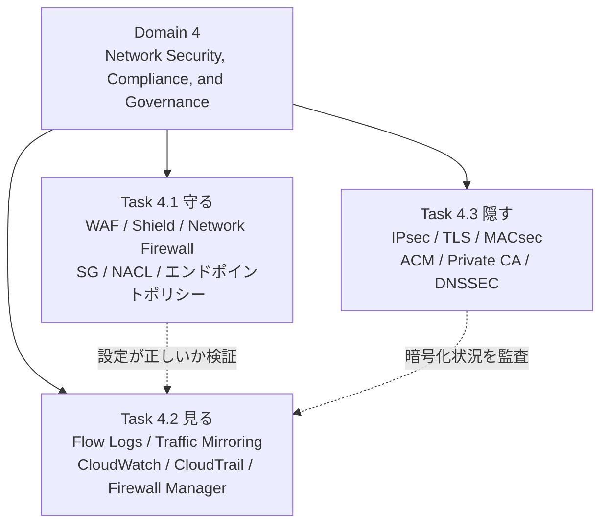

### 試験形式のおさらい(公式ガイドより)

| 項目 | 内容 |
|---|---|
| 問題形式 | 複数選択(2つ以上の正解)・マッチング |
| 問題数 | スコア対象 50 問 + 採点対象外 15 問 |
| 合格スコア | 100〜1,000 のスケールスコアで 750 以上 |
| 採点方式 | 補償型(セクションごとの合格は不要。全体で合格すればよい) |

> **学習のコツ**: Domain 4 の問題は「要件(例: 外部への通信は特定ドメインだけ許可)」→「最小の運用負荷で満たす AWS サービスの組み合わせ」を選ぶ形式が中心です。サービス単体の知識より **「どのサービスをどの場所に置くか」** を意識して読み進めてください。

---

<a id="p1"></a>
## 1. 基礎: セキュリティの考え方

### 1-1. 共有責任モデル(Shared Responsibility Model)

AWS は「**クラウドのセキュリティ(Security *of* the cloud)**」、お客様は「**クラウド内のセキュリティ(Security *in* the cloud)**」に責任を持ちます。

| 領域 | AWS の責任 | お客様の責任 |
|---|---|---|
| 物理・ハードウェア | データセンター、ネットワーク機器、ハイパーバイザ | なし |
| ネットワーク基盤 | リージョン間・AZ 間の物理回線、Nitro による基盤の分離 | VPC 設計、SG/NACL、ルートテーブル、ファイアウォール設定 |
| 転送中データの暗号化 | 一部の自動暗号化(Nitro 間通信、リージョン間ピアリング等) | アプリ層の TLS、VPN/IPsec、証明書の管理 |
| ログと監視 | ログ機能の提供 | ログの有効化・保管・分析・アラート設定 |

> **試験ポイント**: 「AWS が自動でやってくれること」と「お客様が設定しないと有効にならないこと」を区別する問題が出ます。**VPC Flow Logs・CloudTrail データイベント・WAF・TLS 設定などは基本的に自分で有効化** します。

### 1-2. 多層防御(Defense in Depth)

1 つの対策が破られても次の層で止める考え方です。

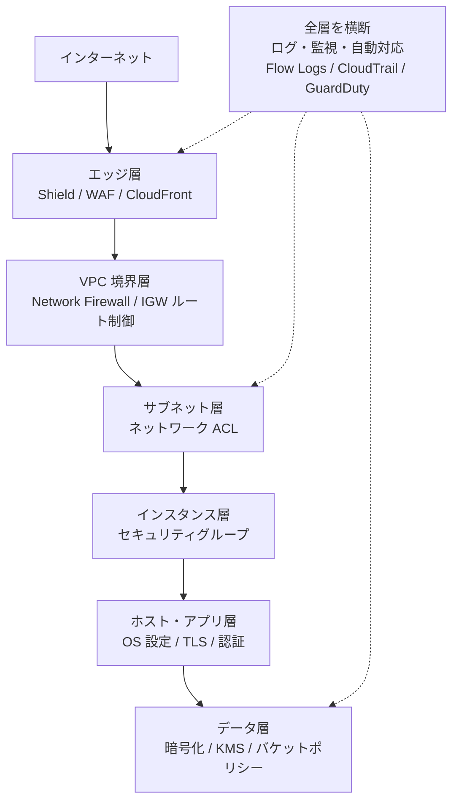

### 1-3. ベストプラクティスの原則(Domain 4 全体に共通)

| 原則 | 具体例 |
|---|---|
| **最小権限・最小通信** | SG は必要なポート・送信元だけ許可。0.0.0.0/0 の SSH/RDP は禁止 |
| **デフォルト拒否** | NACL・Network Firewall の既定アクションを drop 系にする(strict order) |
| **すべてログを残す** | Flow Logs・ALB ログ・WAF ログ・Network Firewall ログ・Resolver ログ・CloudTrail |
| **自動化** | Config ルール・EventBridge・Lambda・Systems Manager Automation による自動是正 |
| **一元管理** | AWS Organizations + Firewall Manager + Security Hub で複数アカウントを統制 |
| **すべて暗号化** | TLS 1.2 以上、IPsec、MACsec、DNSSEC、KMS |

**根拠 URL**
- 共有責任モデル: https://aws.amazon.com/compliance/shared-responsibility-model/
- AWS Well-Architected Framework セキュリティの柱(ネットワーク保護): https://docs.aws.amazon.com/wellarchitected/latest/security-pillar/protecting-networks.html

---

# Task 4.1 ネットワーク機能の実装・保守(セキュリティ/コンプライアンス要件)

<a id="p2"></a>
## 2. 脅威モデルと一般的な脅威

### 2-1. 脅威モデリングとは

「**何を守るか → どこから攻撃されうるか → どう防ぐか**」をアーキテクチャ図に沿って洗い出す手法です。試験の Skills in に「Developing a threat model and identifying appropriate mitigation strategies for a given network architecture」が含まれています。

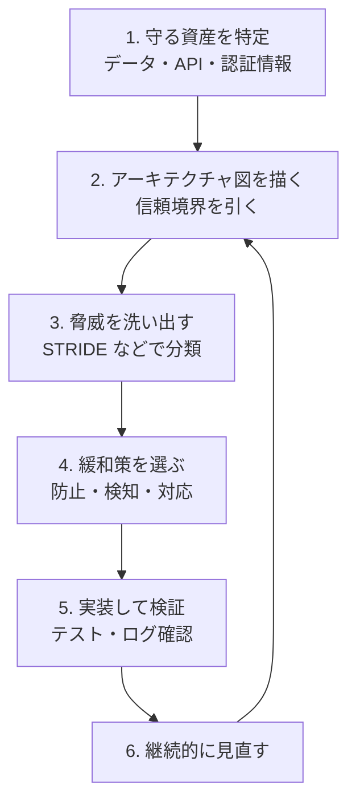

### 2-2. STRIDE と AWS の対策マッピング

| 脅威(STRIDE) | ネットワークでの例 | 主な AWS の緩和策 |
|---|---|---|
| **S**poofing(なりすまし) | 偽の DNS 応答、偽サーバ | DNSSEC、ACM 証明書、mTLS、IAM 認証 |
| **T**ampering(改ざん) | 通信内容の書き換え | TLS / IPsec、CloudTrail ログ整合性検証 |
| **R**epudiation(否認) | 操作の証拠がない | CloudTrail、Flow Logs、WAF ログ |
| **I**nformation disclosure(情報漏えい) | 盗聴、データ持ち出し | 暗号化、Network Firewall の egress 制御、VPC エンドポイントポリシー |
| **D**enial of service(サービス拒否) | DDoS、大量リクエスト | Shield、WAF レートベースルール、CloudFront、Auto Scaling |
| **E**levation of privilege(権限昇格) | 侵害後の横展開 | SG の最小化、サブネット分離、GuardDuty、IAM 最小権限 |

### 2-3. 一般的なネットワーク脅威と対策

| 脅威 | 説明 | 対策サービス |
|---|---|---|
| ボリューメトリック DDoS(L3/L4) | UDP フラッド、SYN フラッド、反射増幅 | **Shield Standard/Advanced**、CloudFront、Global Accelerator |
| アプリケーション層 DDoS(L7) | HTTP フラッド | **WAF** レートベースルール、Shield Advanced の自動 L7 緩和 |
| SQL インジェクション / XSS | アプリ脆弱性の悪用 | **WAF** マネージドルール(Core、SQLi) |
| ボット / 認証情報の総当たり | スクレイピング、ログイン攻撃 | WAF Bot Control、ATP(アカウント乗っ取り防止) |
| データ持ち出し(Exfiltration) | 侵害ホストが外部へ送信 | **Network Firewall**(ドメイン許可リスト)、DNS Firewall、VPC エンドポイントポリシー |
| 横展開(Lateral movement) | 侵害後に内部へ拡大 | SG の参照指定、サブネット分離、TGW ルートテーブル分離 |
| DNS トンネリング / DGA | DNS を悪用した C2 通信 | **Route 53 Resolver DNS Firewall(Advanced)**、GuardDuty |
| 中間者攻撃(MITM) | 経路上での盗聴・改ざん | TLS、IPsec、MACsec、DNSSEC |
| ポートスキャン・偵察 | 開いているポートの探索 | SG/NACL、GuardDuty、Network Firewall IPS |

**根拠 URL**
- AWS DDoS Resiliency ホワイトペーパー: https://docs.aws.amazon.com/whitepapers/latest/aws-best-practices-ddos-resiliency/aws-best-practices-ddos-resiliency.html
- GuardDuty の検出タイプ: https://docs.aws.amazon.com/guardduty/latest/ug/guardduty_finding-types-active.html

---

<a id="p3"></a>
## 3. インバウンド通信の保護(AWS WAF / AWS Shield / Network Firewall)

> **Skills**: Securing inbound traffic flows into AWS (for example, AWS WAF, AWS Shield, Network Firewall)

### 3-1. 全体像: 外から内へ、層ごとに守る

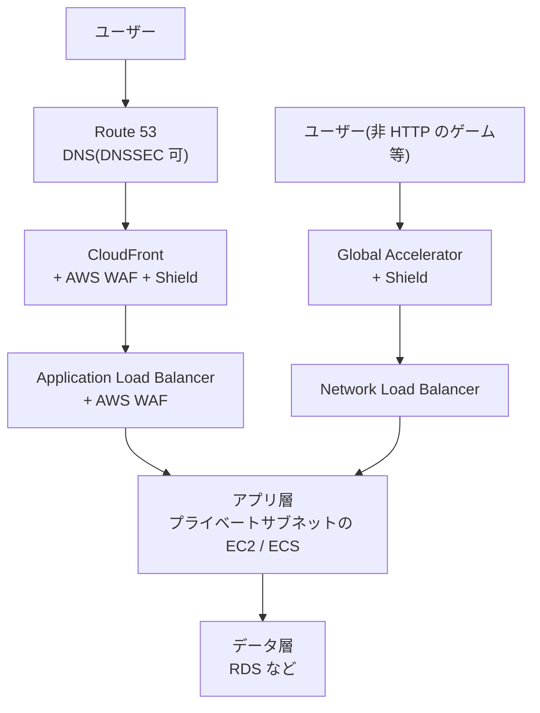

### 3-2. AWS Shield(DDoS 対策)

| 項目 | Shield Standard | Shield Advanced |
|---|---|---|
| 料金 | **無料・全顧客に自動適用** | 有料(月額固定 + データ転送料、1 年契約) |
| 保護レイヤ | L3 / L4 | L3 / L4 / **L7**(WAF と併用) |
| 対象 | CloudFront・Route 53 などの AWS エッジ | CloudFront、Route 53、Global Accelerator、ALB、CLB、Elastic IP(EC2/NLB) |
| 追加機能 | なし | 高度な検出、**SRT(Shield Response Team)** による支援、**DDoS コスト保護**、プロアクティブ・エンゲージメント、ヘルスベース検出、**自動アプリケーション層 DDoS 緩和** |

**ベストプラクティス**
- DDoS 耐性のある構成にする: **CloudFront / Route 53 / Global Accelerator などエッジ経由**にし、オリジンを直接公開しない(CloudFront のマネージドプレフィックスリストを使い ALB の SG を CloudFront からのみに絞る、またはカスタムヘッダーで検証)。
- Shield Advanced は **Route 53 ヘルスチェック** と関連付けるとヘルスベース検出が有効になり、検知が早くなる。
- 重要な環境では **Auto Scaling** と組み合わせてスケールで吸収し、DDoS コスト保護も活用する。

### 3-3. AWS WAF(L7 のウェブ攻撃対策)

**保護対象にできるリソース**: CloudFront、ALB、API Gateway(REST API)、AppSync、Cognito ユーザープール、App Runner、Verified Access など。**NLB には直接アタッチできません**(試験頻出)。

| 概念 | 説明 |
|---|---|
| **Web ACL** | ルールの集合。リソースに関連付ける。既定アクション(Allow / Block)を持つ |
| **ルール / ルールグループ** | 条件(IP、国、ヘッダー、URI、ボディ、レート等)とアクション |
| **アクション** | Allow、Block、**Count**(様子見)、CAPTCHA、Challenge |
| **マネージドルールグループ** | AWS 提供(Core rule set、Known bad inputs、SQL database、Amazon IP reputation list、Anonymous IP list、Bot Control、ATP など) |
| **レートベースルール** | 送信元ごとのリクエスト数が閾値を超えたら Block(L7 DDoS・総当たり対策) |
| **WCU(Web ACL capacity unit)** | ルールの複雑さを示す容量。Web ACL ごとに上限あり |

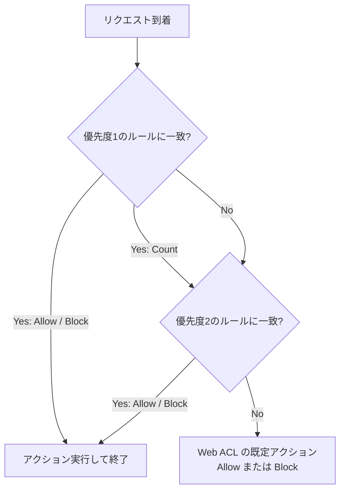

**ベストプラクティス**
1. 新しいルールはまず **Count モード** で導入し、ログで誤検知を確認してから Block に切り替える。
2. **AWS マネージドルール** を基本とし、独自ルールで補う。
3. **レートベースルール** をログイン・API エンドポイントに適用する。
4. **WAF ログを有効化**(送信先は CloudWatch Logs / S3 / Firehose。**宛先名は `aws-waf-logs-` で始める必要あり**)。機密ヘッダーは **フィールド編集(redaction)** で隠す。
5. CloudFront に使う Web ACL は **スコープ CLOUDFRONT(米国東部バージニア北部リージョンで作成)**。ALB 用は **REGIONAL**(ALB と同じリージョン)。
6. 複数アカウントは **Firewall Manager** の WAF ポリシーで一括適用。

```bash
# 例: Web ACL に ALB を関連付ける(AWS CLI)
aws wafv2 associate-web-acl \
  --web-acl-arn arn:aws:wafv2:ap-northeast-1:111122223333:regional/webacl/my-acl/xxxx \
  --resource-arn arn:aws:elasticloadbalancing:ap-northeast-1:111122223333:loadbalancer/app/my-alb/yyyy
```

### 3-4. AWS Network Firewall(VPC の入口・出口・VPC 間を検査)

**マネージド型のステートフル ファイアウォール + IPS**。VPC 内の **ファイアウォールサブネット** に **ファイアウォールエンドポイント** を作り、ルートテーブルでそこへ通信を向けて検査します。

| コンポーネント | 説明 |
|---|---|
| **ファイアウォール** | VPC とサブネット(AZ ごと)に紐付く実体。エンドポイントが作られる |
| **ファイアウォールポリシー** | ルールグループの集合と既定動作を定義 |
| **ステートレスルールグループ** | パケット単位で評価(pass / drop / **forward to stateful**) |
| **ステートフルルールグループ** | 接続単位で評価。**Suricata 互換**ルール、ドメインリスト(HTTP ホスト/TLS SNI)、標準 5-tuple ルール、AWS マネージドの脅威シグネチャ |
| **ルール評価順** | **Strict order**(定義した優先度どおり。**既定アクション drop を設定可能**)と Action order(pass → drop → reject → alert) |
| **TLS インスペクション** | TLS を復号して検査し、再暗号化(ACM の証明書を使用) |
| **ログ** | alert / flow / TLS の 3 種類を S3・CloudWatch Logs・Firehose へ |

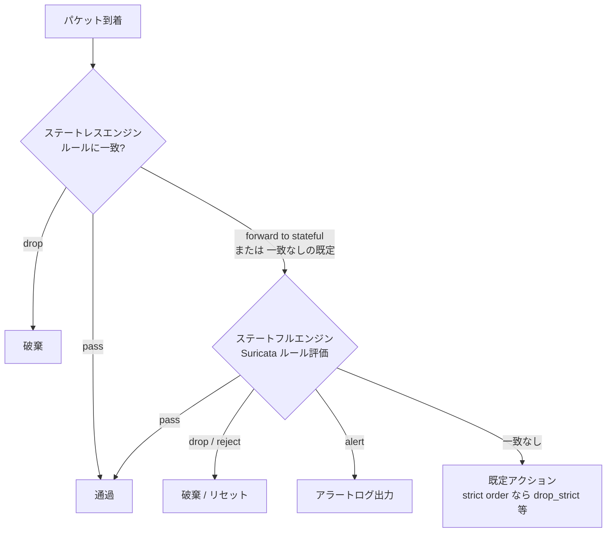

**ベストプラクティス**(AWS 公式ベストプラクティスガイドの要旨)
- **ステートレスの既定アクションは「Forward to stateful rule groups」** にし、フィルタリングはステートフルエンジンに集約する(ステートレスの pass ルールがあると、ステートフル検査をすり抜けてしまうため)。
- **Strict rule order** を使い、ドメイン許可リスト方式では **ステートフル既定アクションを Drop established** にする(TCP ハンドシェイクを通して TLS SNI を検査できるようにするため。Drop all では SNI を検査する前にハンドシェイクが破棄される)。
- 出口制御は **ドメインリスト(許可リスト)** で HTTPS の SNI を検査。
- 一般的な脆弱性対策に **AWS マネージドルールグループ**(脅威シグネチャ)を併用。
- **AZ ごとに 1 つ以上のエンドポイント** を配置し、可用性を確保(AZ 間で非対称ルーティングにならないよう AZ 内で完結させる)。
- ログ(alert / flow)を必ず有効化する。

```bash
# 例: 許可ドメインだけを通すルールグループ(ドメインリスト型・許可リスト)
aws network-firewall create-rule-group \
  --rule-group-name allow-approved-domains \
  --type STATEFUL \
  --capacity 100 \
  --rule-group '{
    "RulesSource": {
      "RulesSourceList": {
        "Targets": [".amazonaws.com", ".example.com"],
        "TargetTypes": ["HTTP_HOST", "TLS_SNI"],
        "GeneratedRulesType": "ALLOWLIST"
      }
    },
    "StatefulRuleOptions": { "RuleOrder": "STRICT_ORDER" }
  }'
```

### 3-5. Network Firewall でインバウンド通信を検査する構成(ingress routing)

インターネットからの通信を **IGW のルートテーブル(エッジ関連付け)** で一度ファイアウォールエンドポイントに通し、その後ワークロードへ届けます。

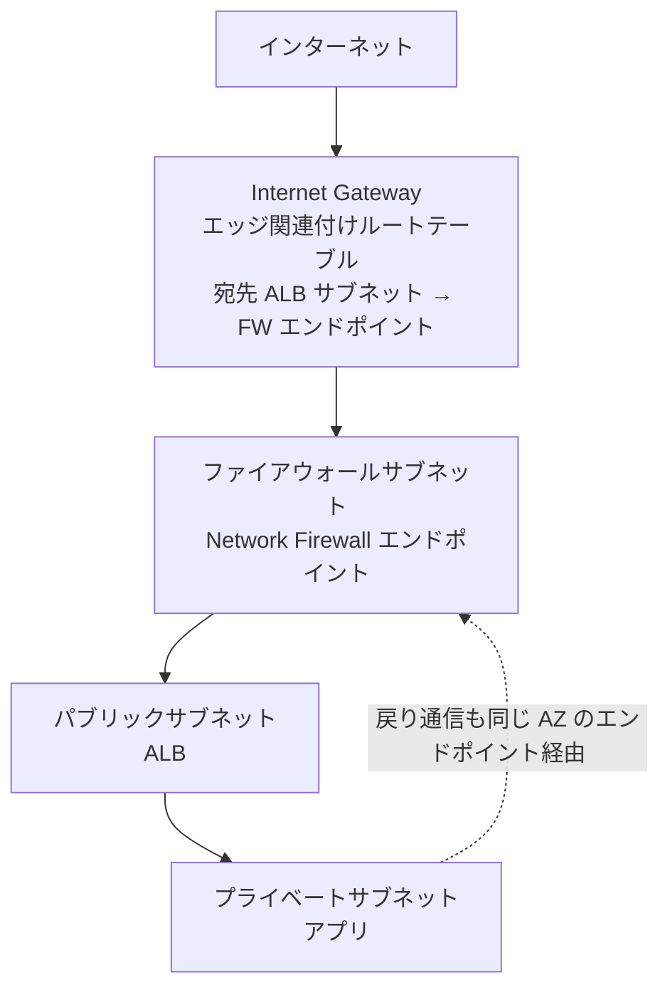

### 3-6. Gateway Load Balancer(GWLB)で第三者アプライアンスを使う

| 項目 | 説明 |
|---|---|
| 役割 | サードパーティ製ファイアウォール/IPS を **透過的に** 挿入し、スケール・冗長化する |
| プロトコル | **GENEVE(UDP 6081)** でパケットをカプセル化してアプライアンスへ転送 |
| 接続点 | **GWLB エンドポイント(GWLBe)** をルートテーブルのターゲットに指定 |
| 特徴 | フロー単位で同じアプライアンスに固定(フロースティッキネス)。ヘルスチェックで障害アプライアンスを除外 |

**ベストプラクティス**: 複数 AZ にアプライアンスを配置し、**クロスゾーン負荷分散**と **TGW のアプライアンスモード**(後述)で **行きと戻りを同じアプライアンスに通す(対称ルーティング)**。

### 3-7. 選択の目安(インバウンド)

| 要件 | 選ぶもの |
|---|---|
| SQLi/XSS/ボット対策など HTTP レベルの防御 | **WAF**(CloudFront or ALB に) |
| L3/L4 の DDoS を自動で防ぎたい | **Shield Standard**(自動) |
| 高度な DDoS 対策・コスト保護・専門チーム支援 | **Shield Advanced** |
| 非 HTTP(TCP/UDP)も含めた VPC 入口での IPS/ドメイン/ポート検査 | **Network Firewall** |
| 既存の他社製 NGFW を使いたい | **Gateway Load Balancer** |
| グローバルにアクセスを加速しつつ DDoS 対策 | **Global Accelerator + Shield** |

**根拠 URL**
- AWS WAF 開発者ガイド: https://docs.aws.amazon.com/waf/latest/developerguide/waf-chapter.html
- AWS Shield 開発者ガイド: https://docs.aws.amazon.com/waf/latest/developerguide/shield-chapter.html
- Network Firewall 開発者ガイド: https://docs.aws.amazon.com/network-firewall/latest/developerguide/what-is-aws-network-firewall.html
- Network Firewall ルール評価順: https://docs.aws.amazon.com/network-firewall/latest/developerguide/suricata-rule-evaluation-order.html
- Network Firewall ベストプラクティス(GitHub 公式): https://aws.github.io/aws-security-services-best-practices/guides/network-firewall/
- Gateway Load Balancer: https://docs.aws.amazon.com/elasticloadbalancing/latest/gateway/introduction.html

---
<a id="p4"></a>
## 4. アウトバウンド通信の保護

> **Skills**: Securing outbound traffic flows from AWS (for example, Network Firewall, proxies, Gateway Load Balancers)

### 4-1. なぜ出口制御が必要か

侵害されたホストは、**外部の C2 サーバーへ通信したりデータを持ち出したり** します。入口だけでなく **出口を「許可リスト方式」で絞る** ことが、情報漏えい対策の要です。

### 4-2. 出口制御の選択肢

| 手段 | 検査レイヤ | 特徴 | 向いているケース |
|---|---|---|---|
| **Network Firewall** | L3〜L7(SNI / HTTP ホスト、Suricata) | マネージド。ドメイン許可リスト、IPS、TLS 検査 | 標準的な出口フィルタリング |
| **プロキシ(Squid 等)** | L7(HTTP/HTTPS) | EC2 / コンテナで自前運用。URL・認証・キャッシュ | 詳細な URL 制御、ユーザー認証が必要 |
| **GWLB + 第三者 NGFW** | L3〜L7(製品依存) | 既存製品の機能・ポリシーを継続利用 | 既存セキュリティ製品の標準化 |
| **Route 53 Resolver DNS Firewall** | DNS | 悪性・不許可ドメインの名前解決をブロック | DNS 経由の持ち出し・C2 の遮断 |
| **VPC エンドポイント + エンドポイントポリシー** | AWS API | インターネットを経由せず AWS サービスへ。許可する操作・リソースを限定 | AWS サービス向け通信 |
| **NAT ゲートウェイ** | L3/L4 | 送信元 NAT のみ(**フィルタ機能なし**) | 単に出口を提供する(制御は他で) |

> **試験ポイント**: NAT ゲートウェイ自体には **ドメインやコンテンツでの制御機能がありません**。「特定のドメインだけ許可」→ **Network Firewall(ドメインリスト)またはプロキシ** が答えになります。

### 4-3. 集中型の出口(Centralized egress)

複数の VPC(スポーク)の出口を **検査用 VPC** に集約します。

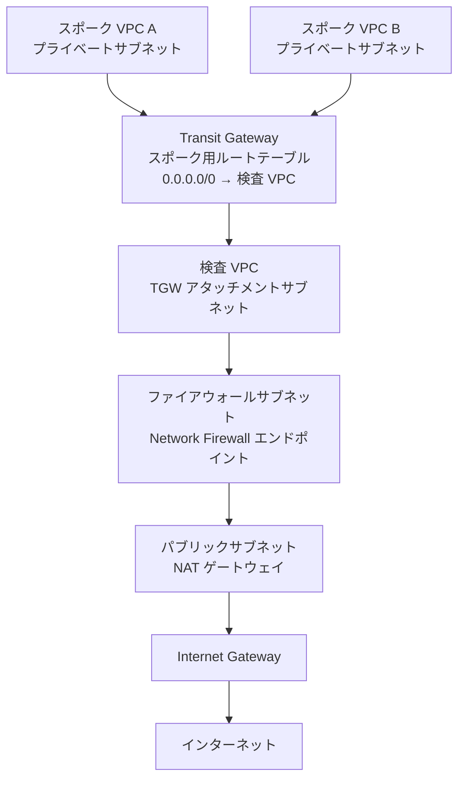

**ベストプラクティス**
- **AZ ごとに** ファイアウォールエンドポイントと NAT ゲートウェイを置き、**AZ をまたぐ通信を避ける**(コストと可用性)。
- TGW の VPC アタッチメントで **アプライアンスモード(Appliance Mode)を有効化** し、行きと戻りを同じ AZ のファイアウォールに通す(**対称ルーティング**)。
- ファイアウォールポリシーは **「許可ドメインのみ」+ 既定 drop**。
- 出口の許可ドメインは **ログ(alert/flow)で実際の利用を把握してから** 絞り込む。

### 4-4. DNS による持ち出しを防ぐ

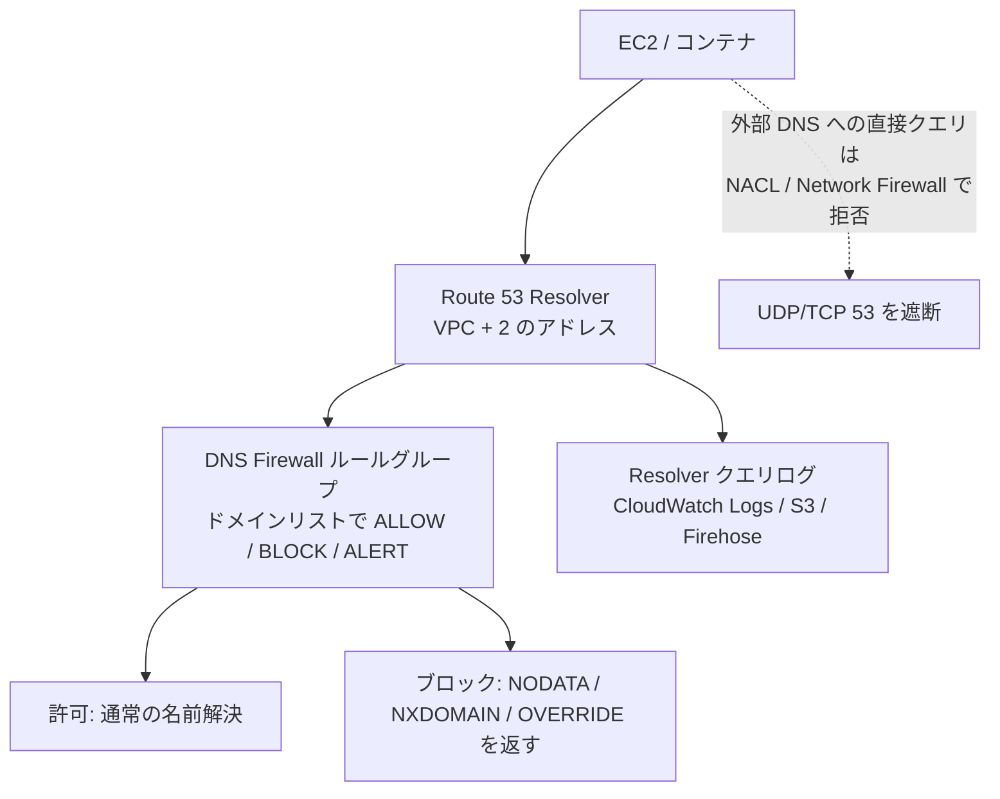

| 設定項目 | 内容 |
|---|---|
| ドメインリスト | 自作リスト、または **AWS マネージドドメインリスト**(マルウェア、ボットネット C2 など) |
| アクション | ALLOW / BLOCK(応答は NODATA・NXDOMAIN・OVERRIDE) / ALERT |
| フェイルクローズ / フェイルオープン | DNS Firewall が判定できない場合に **名前解決を止める(クローズ)か通す(オープン)か** を VPC ごとに選択 |
| DNS Firewall Advanced | DGA(ドメイン生成アルゴリズム)や DNS トンネリングを **検出してブロック** |
| 管理 | **Firewall Manager** で組織全体に適用可能 |

**ベストプラクティス**: 外部 DNS リゾルバー(8.8.8.8 など)へのポート 53 通信を **ネットワーク ACL や Network Firewall で拒否** し、必ず Route 53 Resolver を経由させる。そうしないと DNS Firewall をすり抜けられます。

**根拠 URL**
- Network Firewall の導入パターン(AWS ブログ): https://aws.amazon.com/blogs/networking-and-content-delivery/deployment-models-for-aws-network-firewall/
- Route 53 Resolver DNS Firewall: https://docs.aws.amazon.com/Route53/latest/DeveloperGuide/resolver-dns-firewall.html
- Transit Gateway アプライアンスモード: https://docs.aws.amazon.com/vpc/latest/tgw/transit-gateway-appliance-scenario.html
- 集中型の出口(Whitepaper): https://docs.aws.amazon.com/whitepapers/latest/building-scalable-secure-multi-vpc-network-infrastructure/centralized-egress-to-internet.html

---

<a id="p5"></a>
## 5. VPC 間・VPC 内通信の保護

> **Skills**: Securing inter-VPC traffic within an account or across multiple accounts (for example, security groups, network ACLs, VPC endpoint policies)

### 5-1. セキュリティグループ(SG)とネットワーク ACL(NACL)

| 比較項目 | セキュリティグループ | ネットワーク ACL |
|---|---|---|
| 適用単位 | **ENI(インスタンス)** | **サブネット** |
| 状態 | **ステートフル**(戻り通信は自動許可) | **ステートレス**(戻り通信も明示的に許可) |
| ルール種別 | **許可のみ**(拒否ルールなし) | **許可と拒否** |
| 評価 | 全ルールを評価 | **ルール番号の小さい順**に評価し、最初に一致したもので決定 |
| 既定 | 受信: すべて拒否、送信: すべて許可 | 既定 NACL: すべて許可 / **カスタム NACL: 作成直後はすべて拒否** |
| 送信元指定 | IP、プレフィックスリスト、**他の SG** | IP の CIDR のみ |

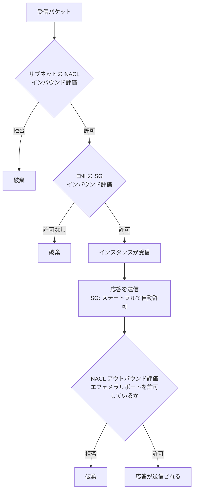

> **よくある落とし穴**: NACL はステートレスなので、**戻り通信用のエフェメラルポート(例: 1024–65535)** を明示的に許可しないと通信が成立しません。

**ベストプラクティス**
1. **SG を主たる制御手段** にする。送信元には **他の SG を参照**(例: アプリ層 SG は「Web 層 SG からのみ」許可)し、IP 変更に強くする。
2. NACL は **サブネット単位の粗い拒否(特定 IP のブロックなど)の補助** として使う。ルール番号は 100 刻みで余裕を持たせる。
3. SSH(22)/RDP(3389) を `0.0.0.0/0` に開けない。**Session Manager** で踏み台を不要にする。
4. **AWS マネージドプレフィックスリスト / カスタムプレフィックスリスト** で CIDR 群を一元管理し、複数 SG・ルートテーブルで再利用する。
5. 既定 SG は **すべてのルールを削除** して使わない(Config ルール `vpc-default-security-group-closed`)。

### 5-2. VPC エンドポイントとエンドポイントポリシー

| 種類 | 対象 | 特徴 |
|---|---|---|
| **ゲートウェイエンドポイント** | **S3、DynamoDB** | ルートテーブルにエントリを追加。無料。VPC 外(オンプレ・他リージョン)からは使えない |
| **インターフェイスエンドポイント(PrivateLink)** | 多くの AWS サービス、自社/他社サービス | サブネットに **ENI** を作成。**SG を適用可能**。オンプレからも利用可 |

**エンドポイントポリシー** は、エンドポイントにアタッチする **リソースベースポリシー**で、**そのエンドポイント経由で許可する主体・操作・リソースを限定**します。

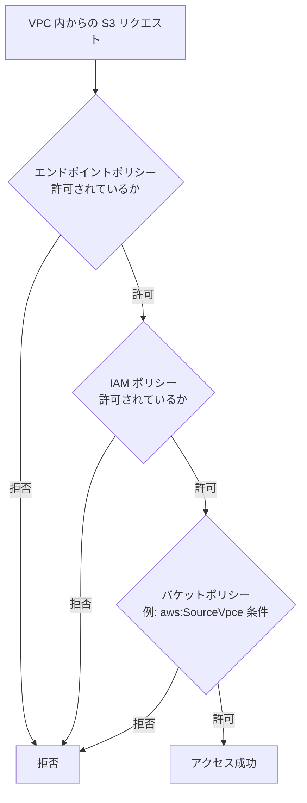

> **重要**: エンドポイントポリシーは **IAM ポリシーやバケットポリシーを「置き換える」のではなく、追加の制限層** です。**最終的な権限は、これらの共通部分(すべてが許可した場合のみ許可)**。既定のエンドポイントポリシーは「フルアクセス」です。

```json
{
  "Version": "2012-10-17",
  "Statement": [
    {
      "Sid": "AllowOnlyOrgBucketsViaEndpoint",
      "Effect": "Allow",
      "Principal": "*",
      "Action": ["s3:GetObject", "s3:PutObject"],
      "Resource": "arn:aws:s3:::my-company-data/*",
      "Condition": {
        "StringEquals": { "aws:PrincipalOrgID": "o-exampleorgid" }
      }
    }
  ]
}
```

```json
{
  "Version": "2012-10-17",
  "Statement": [
    {
      "Sid": "DenyAccessUnlessFromMyVpcEndpoint",
      "Effect": "Deny",
      "Principal": "*",
      "Action": "s3:*",
      "Resource": ["arn:aws:s3:::my-company-data", "arn:aws:s3:::my-company-data/*"],
      "Condition": {
        "StringNotEquals": { "aws:SourceVpce": "vpce-0123456789abcdef0" }
      }
    }
  ]
}
```

**ベストプラクティス(データ境界: Data Perimeter)**
- **ID 境界**: `aws:PrincipalOrgID` で「自組織の ID のみ」。
- **リソース境界**: `aws:ResourceOrgID` で「自組織のリソースのみ」にアクセス(データ持ち出し先の制限)。
- **ネットワーク境界**: `aws:SourceVpce` / `aws:SourceVpc` で「自社の VPC エンドポイント経由のみ」。
- PrivateLink の **インターフェイスエンドポイントにも SG を付与**し、アクセス元を限定する。

### 5-3. VPC 間接続でのセキュリティ

| 接続方式 | セキュリティ上のポイント |
|---|---|
| **VPC ピアリング** | 推移的ルーティング不可。SG で他 VPC の SG / CIDR を参照可能(同一リージョン内)。ルートは必要な CIDR のみ |
| **Transit Gateway** | **ルートテーブルの分離(セグメンテーション)**。関連付け(association)と伝播(propagation)を制御。**ブラックホールルール**で通信遮断。RAM でアカウント間共有 |
| **PrivateLink** | **サービス単位**で公開(ネットワーク全体を接続しない)。CIDR 重複でも可。エンドポイントポリシーと SG で制御 |
| **VPC Lattice** | サービス間通信を **認証ポリシー(IAM)** で制御 |

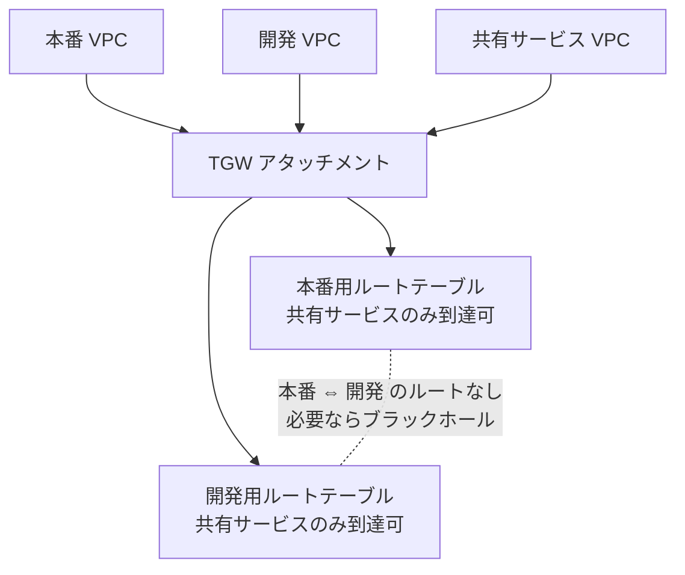

### 5-4. Firewall Manager による一元管理

| 項目 | 内容 |
|---|---|
| 前提 | **AWS Organizations** + Firewall Manager 管理者アカウント(委任可)。**AWS Config の有効化が必要** |
| 管理できるポリシー | WAF、Shield Advanced、**セキュリティグループ**(共通 SG・コンテンツ監査・使用状況監査)、**ネットワーク ACL**、**Network Firewall**、**DNS Firewall**、サードパーティ FW |
| 特徴 | **新規アカウント/リソースへ自動適用**、非準拠リソースの検出と **自動修復(auto remediation)** |

**根拠 URL**
- SG: https://docs.aws.amazon.com/vpc/latest/userguide/vpc-security-groups.html
- NACL: https://docs.aws.amazon.com/vpc/latest/userguide/vpc-network-acls.html
- VPC エンドポイントポリシー: https://docs.aws.amazon.com/vpc/latest/privatelink/vpc-endpoints-access.html
- データ境界ホワイトペーパー: https://docs.aws.amazon.com/whitepapers/latest/building-a-data-perimeter-on-aws/building-a-data-perimeter-on-aws.html
- Transit Gateway ルートテーブル: https://docs.aws.amazon.com/vpc/latest/tgw/tgw-route-tables.html
- Firewall Manager: https://docs.aws.amazon.com/waf/latest/developerguide/fms-chapter.html

---

<a id="p6"></a>
## 6. セキュリティ・コンプライアンスを満たすアーキテクチャ

> **Skills**: Implementing an AWS network architecture to meet security and compliance requirements (for example, untrusted network, perimeter VPC, three-tier architecture)

### 6-1. 3 層アーキテクチャ(Three-tier)

Web / アプリ / データを **サブネットと SG で分離** する基本形です。

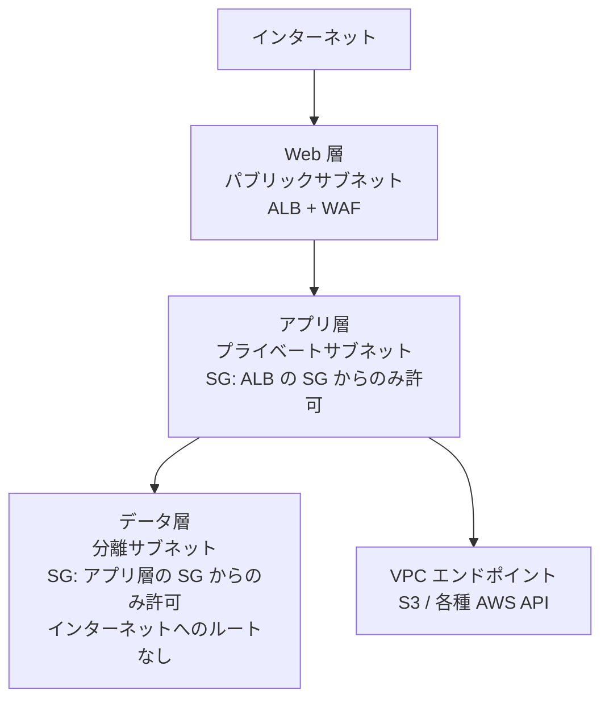

| 層 | サブネット | 主な制御 |
|---|---|---|
| Web | パブリック(IGW へのルートあり) | WAF、ALB の SG は 443 を公開 |
| アプリ | プライベート(NAT / FW 経由で出口) | SG は **Web 層 SG のみ** 許可 |
| データ | 分離(IGW・NAT へのルートなし) | SG は **アプリ層 SG のみ** 許可、暗号化(KMS + TLS) |

### 6-2. 境界(Perimeter)VPC / 信頼できないネットワーク(Untrusted)

**インターネット、パートナー、オンプレミス**といった「信頼できないネットワーク」との接点を **専用の境界 VPC(DMZ・Inspection VPC)** に集約し、内部 VPC へは **検査を通過した通信だけ** を渡します。

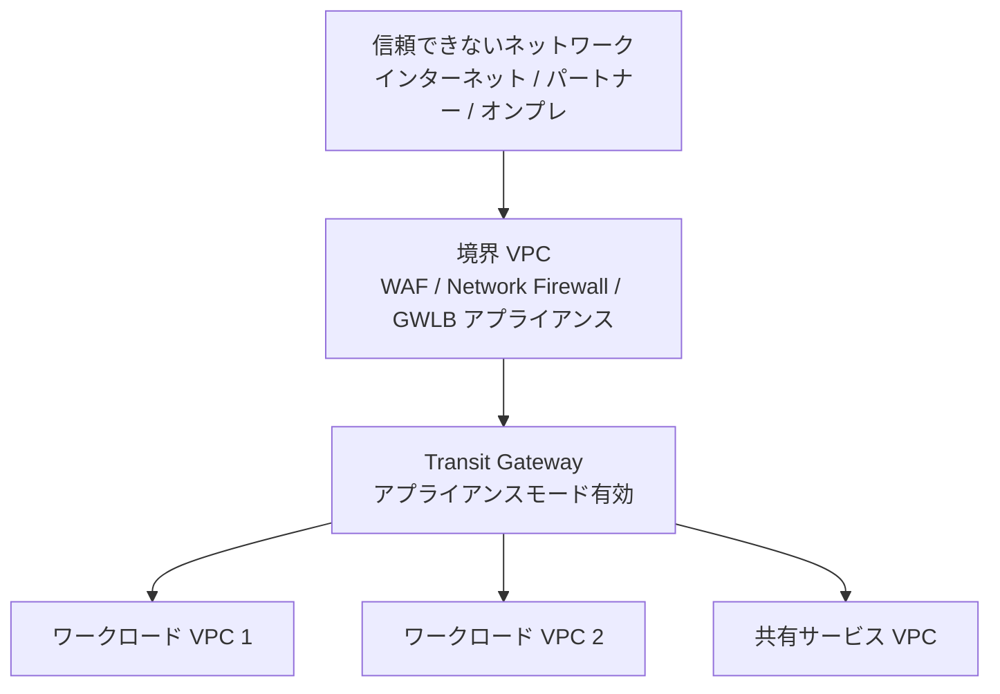

### 6-3. 集中型検査(East-West も含む)

| 通信方向 | 説明 | 検査の置き場所 |
|---|---|---|
| North-South(Ingress) | インターネット → AWS | 境界 VPC / ALB の WAF / FW の ingress routing |
| North-South(Egress) | AWS → インターネット | 検査 VPC の Network Firewall + NAT |
| East-West | VPC ⇔ VPC、VPC ⇔ オンプレ | **TGW 経由で検査 VPC を通す** |

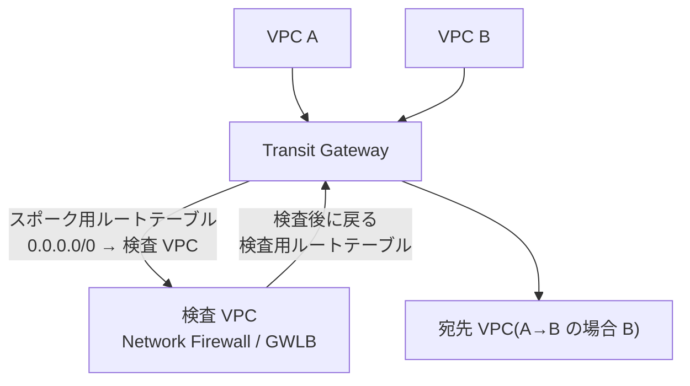

> **アプライアンスモード**: 有効にしない場合、TGW は AZ をまたいだ非対称なパスを選ぶことがあり、**ステートフルな検査が失敗(戻りパケットが別のアプライアンスに到達)** します。ステートフルな検査 VPC では **必ず有効化** してください。

### 6-4. 要件別の設計ガイド

| コンプライアンス要件の例 | 実装 |
|---|---|
| インターネットに直接出さない | プライベート/分離サブネット + VPC エンドポイント + NAT/FW 経由の出口 |
| 特定ドメインだけ外部通信可 | Network Firewall ドメインリスト(出口) |
| 全通信の記録(PCI DSS 等) | Flow Logs、ALB/WAF/FW ログ、CloudTrail を S3 へ長期保存(オブジェクトロック) |
| 転送中データの暗号化 | TLS 1.2+、IPsec、MACsec、VPC Encryption Controls |
| 他アカウントへの持ち出し禁止 | エンドポイントポリシー + SCP + `aws:ResourceOrgID` |
| 設定逸脱の検知・是正 | Config ルール / コンフォーマンスパック + 自動修復 |

**根拠 URL**
- Building a Scalable and Secure Multi-VPC AWS Network Infrastructure: https://docs.aws.amazon.com/whitepapers/latest/building-scalable-secure-multi-vpc-network-infrastructure/welcome.html
- Network Firewall と TGW の統合(AWS ブログ): https://aws.amazon.com/blogs/networking-and-content-delivery/centralized-inspection-architecture-with-aws-gateway-load-balancer-and-aws-transit-gateway/
- AWS Security Reference Architecture: https://docs.aws.amazon.com/prescriptive-guidance/latest/security-reference-architecture/welcome.html

---

<a id="p7"></a>
## 7. コンプライアンスのテストとインシデント自動通知

> **Skills**: Testing compliance with the initial requirements (for example, failover test, resiliency) / Automating security incident reporting and alerting using AWS

### 7-1. 要件が満たされているかのテスト

| テスト | 内容 | ツール |
|---|---|---|
| **到達性の検証** | 「A から B へ到達できる/できない」を設定ベースで確認(パケットは送らない) | **VPC Reachability Analyzer** |
| **意図しないアクセスの検出** | 「インターネットから DB へ到達可能な経路がないか」などを検査 | **Network Access Analyzer**(Network Access Scope) |
| **フェイルオーバーテスト** | AZ・ファイアウォールエンドポイント・VPN トンネル・Direct Connect の障害時に切り替わるか | 手動停止、**AWS Fault Injection Service(FIS)**、DX の **フェイルオーバーテスト機能**(BGP セッションの意図的停止) |
| **レジリエンステスト** | 負荷・障害下でも要件を維持するか | FIS(ネットワーク切断系アクション)、Auto Scaling の確認 |
| **構成の継続評価** | ルール違反の検出 | **AWS Config** ルール / コンフォーマンスパック、**Security Hub** |
| **証跡の収集** | 監査向けの証拠 | **Audit Manager**、**AWS Artifact**(AWS 側のコンプライアンスレポート) |

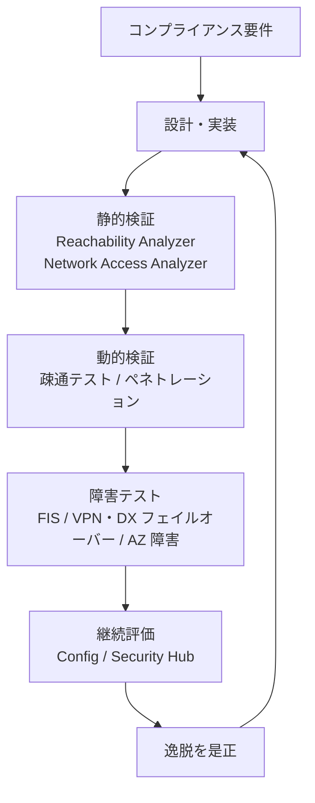

**ベストプラクティス**
- 構成変更のたびに **Reachability Analyzer** を CI/CD やパイプラインに組み込み、「到達してはならない経路」が回帰しないようにする。
- VPN は **2 本のトンネル(別 AZ のエンドポイント)** の片側を停止して切り替えを確認。DX は **冗長接続(別ロケーション 2 本 + VPN バックアップ)** と BFD を設定し、フェイルオーバーテストを定期実施。
- **ペネトレーションテスト** は AWS のポリシーに従う(多くのサービスで事前承認は不要だが、禁止行為(DDoS シミュレーション等)は別途ポリシーあり)。

### 7-2. セキュリティインシデントの自動検出・通知・対応

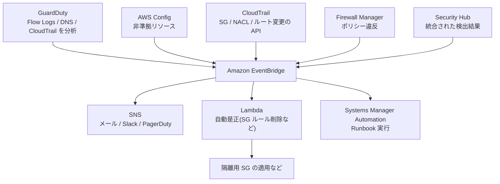

| サービス | 役割 | 試験でのキーワード |
|---|---|---|
| **Amazon GuardDuty** | **Flow Logs・DNS ログ・CloudTrail** を自動分析して脅威を検出(Flow Logs を自分で有効化しなくても分析対象) | ポートスキャン、C2 通信、暗号通貨マイニング、DNS 持ち出し |
| **Amazon EventBridge** | イベントをルールで振り分け、各ターゲットを起動 | 変更検知 → 自動通知・是正 |
| **AWS Config** | リソース設定の評価と **自動修復(SSM Automation)** | `restricted-ssh`、`vpc-flow-logs-enabled` |
| **AWS Security Hub** | 複数サービスの検出結果を集約・標準チェック | 一元的なダッシュボード |
| **Amazon Detective** | Flow Logs 等から調査用のグラフを構築 | 根本原因の調査 |
| **Amazon Inspector** | EC2 のネットワーク到達性(Network reachability)の検出 | 意図しない公開ポート |
| **Amazon SNS** | 通知 | メール、SMS、HTTPS |

**例: SG が 0.0.0.0/0 の SSH 許可に変更されたら自動で元に戻す**

```json
{
  "source": ["aws.ec2"],
  "detail-type": ["AWS API Call via CloudTrail"],
  "detail": {
    "eventSource": ["ec2.amazonaws.com"],
    "eventName": ["AuthorizeSecurityGroupIngress"]
  }
}
```

上記の EventBridge ルールをトリガーに、Lambda で追加されたルールを検査し、違反していれば `RevokeSecurityGroupIngress` を実行して SNS で通知します。

```python
import boto3

ec2 = boto3.client("ec2")

def handler(event, context):
    detail = event["detail"]
    group_id = detail["requestParameters"]["groupId"]
    for perm in detail["requestParameters"]["ipPermissions"]["items"]:
        for rng in perm.get("ipRanges", {}).get("items", []):
            if rng.get("cidrIp") == "0.0.0.0/0" and any(perm.get("fromPort", -1) <= port <= perm.get("toPort", -1) for port in (22, 3389)):
                ec2.revoke_security_group_ingress(
                    GroupId=group_id,
                    IpPermissions=[{
                        "IpProtocol": perm["ipProtocol"],
                        "FromPort": perm["fromPort"],
                        "ToPort": perm["toPort"],
                        "IpRanges": [{"CidrIp": "0.0.0.0/0"}],
                    }],
                )
```

**ベストプラクティス**
- **検知 → 通知 → 自動是正** の 3 点セットで設計し、重大度に応じて「通知のみ」と「自動是正」を使い分ける。
- GuardDuty は **全リージョン・全アカウント(Organizations の委任管理者)** で有効にし、結果は Security Hub に集約する。
- 自動是正は **誤検知で本番を止めない** よう、まず通知のみで運用して精度を確認する。

**根拠 URL**
- Reachability Analyzer: https://docs.aws.amazon.com/vpc/latest/reachability/what-is-reachability-analyzer.html
- Network Access Analyzer: https://docs.aws.amazon.com/vpc/latest/network-access-analyzer/what-is-vpc-network-access-analyzer.html
- AWS Fault Injection Service: https://docs.aws.amazon.com/fis/latest/userguide/what-is.html
- Direct Connect フェイルオーバーテスト: https://docs.aws.amazon.com/directconnect/latest/UserGuide/resiliency_failover.html
- GuardDuty: https://docs.aws.amazon.com/guardduty/latest/ug/what-is-guardduty.html
- Config マネージドルール一覧: https://docs.aws.amazon.com/config/latest/developerguide/managed-rules-by-aws-config.html
- Security Hub: https://docs.aws.amazon.com/securityhub/latest/userguide/what-is-securityhub.html

---
# Task 4.2 ネットワーク監視・ログによる検証と監査

<a id="p8"></a>
## 8. 監視・ログサービスの全体像

セキュリティは「設定したら終わり」ではなく、**ログで実際の通信を確認して初めて検証できます**。Task 4.2 では「どのサービスで何が見えるか」を整理することが第一歩です。

| サービス | 見えるもの | 主な用途 |
|---|---|---|
| **VPC Flow Logs** | IP トラフィックのメタデータ(5-tuple、バイト数、ACCEPT/REJECT) | 通信の可視化、拒否原因調査、異常検知 |
| **VPC Traffic Mirroring** | **パケットの中身(ペイロード含む)** | IDS/IPS、深いパケット検査、トラブルシュート |
| **CloudWatch**(メトリクス / アラーム / Logs) | 数値指標、ログの検索・集計 | 監視・アラート・可視化 |
| **CloudTrail** | **API 呼び出し**(誰がいつ何を変更したか) | 構成変更の監査 |
| **ELB / CloudFront / WAF / Network Firewall / Resolver のログ** | 各サービスのリクエスト単位の記録 | アプリ・攻撃の分析 |
| **Transit Gateway Network Manager** | グローバルネットワークのトポロジ、イベント、メトリクス | ハイブリッド/マルチリージョンの監視 |
| **Firewall Manager / Config / Trusted Advisor** | 構成の準拠状況 | 監査・コンプライアンス |

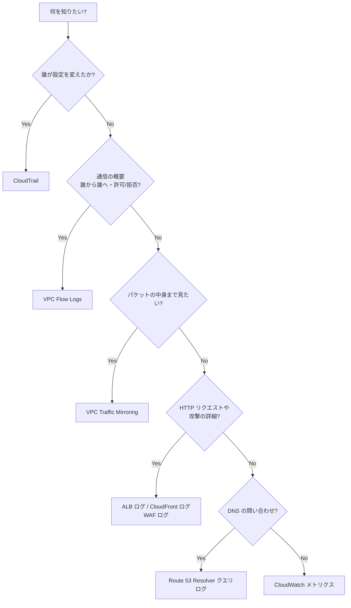

---

<a id="p9"></a>
## 9. VPC Flow Logs

> **Skills**: Creating and analyzing a VPC flow log (including base and extended fields of flow logs)

### 9-1. 基本

| 項目 | 内容 |
|---|---|
| 取得範囲 | **VPC / サブネット / ENI** のいずれか(上位を指定すると配下の ENI すべて)。**Transit Gateway(アタッチメント)** にも Flow Logs あり |
| 取得内容 | トラフィックの **メタデータのみ**(ペイロードは含まない) |
| 配信先 | **CloudWatch Logs / S3 / Kinesis Data Firehose** |
| トラフィック種別 | ACCEPT / REJECT / ALL から選択 |
| 集約間隔 | 既定 **10 分**。**1 分** を指定可能(Nitro ベースのインスタンスの ENI は常に 1 分以内) |
| 配信遅延 | CloudWatch Logs へは通常およそ 5 分、S3 へはおよそ 10 分 |
| パフォーマンス影響 | ネットワークのスループットやレイテンシには影響しない |

### 9-2. 基本フィールド(バージョン 2・既定フォーマット)

既定フォーマットは次の **14 フィールド** です。

| # | フィールド | 意味 |
|---|---|---|
| 1 | `version` | Flow Logs のバージョン |
| 2 | `account-id` | アカウント ID |
| 3 | `interface-id` | ENI の ID |
| 4 | `srcaddr` | 送信元アドレス |
| 5 | `dstaddr` | 宛先アドレス |
| 6 | `srcport` | 送信元ポート |
| 7 | `dstport` | 宛先ポート |
| 8 | `protocol` | IANA プロトコル番号(6=TCP、17=UDP、1=ICMP) |
| 9 | `packets` | パケット数 |
| 10 | `bytes` | バイト数 |
| 11 | `start` | 開始時刻(Unix 秒) |
| 12 | `end` | 終了時刻(Unix 秒) |
| 13 | `action` | **ACCEPT** または **REJECT** |
| 14 | `log-status` | OK / NODATA / SKIPDATA |

```bash
# 既定フォーマットのレコード例(SSH が REJECT された例)
2 123456789010 eni-1235b8ca123456789 203.0.113.12 10.0.1.5 44844 22 6 20 4249 1418530010 1418530070 REJECT OK
```

### 9-3. 拡張フィールド(カスタムフォーマットで追加)

| 追加されたバージョン | 主なフィールド | 用途 |
|---|---|---|
| **v3** | `vpc-id`, `subnet-id`, `instance-id`, `tcp-flags`, `type`, `pkt-srcaddr`, `pkt-dstaddr` | 所属の特定、TCP フラグ(SYN/FIN/RST)、**NAT 前後の実アドレス** |
| **v4** | `region`, `az-id`, `sublocation-type`, `sublocation-id` | リージョン・AZ ごとの分析(Outposts 等) |
| **v5** | `pkt-src-aws-service`, `pkt-dst-aws-service`, `flow-direction`, `traffic-path` | AWS サービス宛の識別、**ingress / egress の方向**、**通信経路(IGW・VGW・ピアリング等)** |
| **v7 以降** | ECS 関連フィールド、`reject-reason` など | コンテナの可視化、拒否理由の識別 |

> **試験ポイント**
> - **`srcaddr` / `dstaddr`** は ENI 上のアドレス、**`pkt-srcaddr` / `pkt-dstaddr`** は **パケット自体の元のアドレス**。**NAT ゲートウェイ、TGW、ロードバランサー経由** では両者が異なるため、`pkt-*` を併用して実際の送信元を調べる。
> - `tcp-flags` で **SYN だけが大量に来ていないか**(SYN フラッド)などを分析できる。
> - `flow-direction` と `traffic-path` で、**どの経路(インターネット、VPN、ピアリング)から来たか**を確認できる。
> - 新しいフィールドは **新しいバージョン番号のカスタムフォーマット** でのみ利用可能。最新のフィールド一覧は公式ドキュメントで確認。

### 9-4. Flow Logs に記録されないトラフィック(試験頻出)

- **Amazon DNS サーバー**(VPC の +2 アドレス)への通信(独自の DNS サーバーを使う場合は記録される)
- Windows ライセンス認証用の通信
- **インスタンスメタデータ**(169.254.169.254)への通信
- **Amazon Time Sync Service**(169.254.169.123)への通信
- DHCP の通信
- **VPC ルーターの予約 IP アドレス**への通信
- **Traffic Mirroring** のミラーされた通信
- **PrivateLink のエンドポイント ENI と NLB の ENI の間** の通信

→ DNS の可視化には **Route 53 Resolver クエリログ** を使います。

### 9-5. 作成と分析の流れ

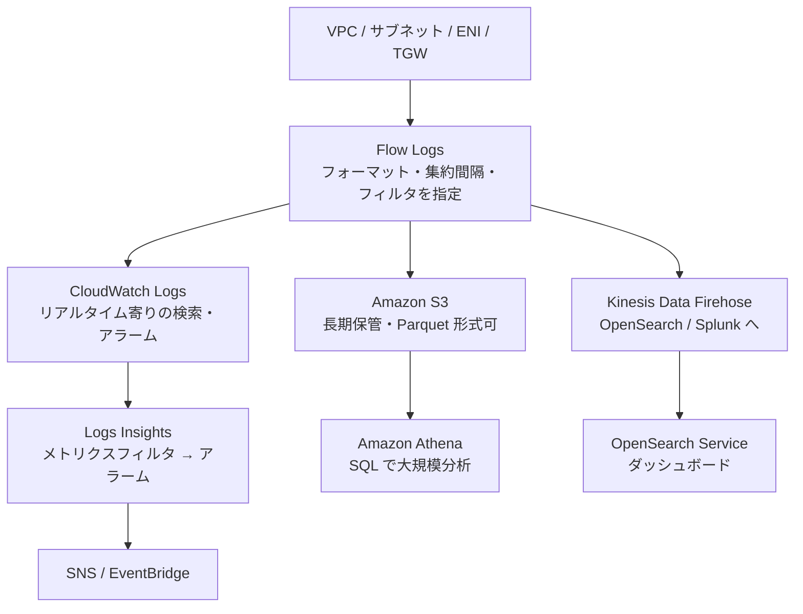

**CLI での作成例(S3 へ、カスタムフォーマット、1 分間隔)**

```bash
aws ec2 create-flow-logs \
  --resource-type VPC \
  --resource-ids vpc-0123456789abcdef0 \
  --traffic-type ALL \
  --log-destination-type s3 \
  --log-destination arn:aws:s3:::my-flowlogs-bucket/vpc/ \
  --max-aggregation-interval 60 \
  --log-format '${version} ${account-id} ${vpc-id} ${subnet-id} ${interface-id} ${srcaddr} ${dstaddr} ${pkt-srcaddr} ${pkt-dstaddr} ${srcport} ${dstport} ${protocol} ${tcp-flags} ${packets} ${bytes} ${start} ${end} ${action} ${log-status} ${flow-direction} ${traffic-path}'
```

**CloudWatch Logs Insights での分析(拒否された通信の送信元 Top10)**

```sql
fields @timestamp, srcAddr, dstAddr, dstPort, action
| filter action = "REJECT"
| stats count(*) as rejectCount by srcAddr
| sort rejectCount desc
| limit 10
```

**Athena での分析(S3 に保存した Flow Logs で、ポート 22 への拒否を集計)**

```sql
SELECT srcaddr, dstaddr, dstport, COUNT(*) AS cnt
FROM vpc_flow_logs
WHERE action = 'REJECT'
  AND dstport = 22
  AND day >= '2026/10/01'
GROUP BY srcaddr, dstaddr, dstport
ORDER BY cnt DESC
LIMIT 20;
```

### 9-6. ACCEPT / REJECT の読み方

| 観測 | 考えられる原因 |
|---|---|
| インバウンドが **REJECT** | SG で許可されていない、または NACL で拒否 |
| インバウンドは **ACCEPT** なのに応答が **REJECT** | **NACL(ステートレス)** で戻り通信のエフェメラルポートが拒否されている |
| ACCEPT だが接続できない | OS のファイアウォール、アプリが待ち受けていない、ルート不備 |
| 同一 5-tuple の REJECT が大量 | スキャンや攻撃の可能性 → GuardDuty と併せて確認 |

> SG は許可ルールのみなので、「SG が拒否した」というログは出ません。**許可ルールに一致しなかった通信が REJECT** と記録されます。

### 9-7. ベストプラクティス

1. **すべての VPC で Flow Logs を有効化**(Config ルール `vpc-flow-logs-enabled` で検査、Firewall Manager や宣言型ポリシーで強制も可能)。
2. 長期保管と大規模分析は **S3(Parquet + Hive 形式のパーティション)+ Athena**、リアルタイムの検知は **CloudWatch Logs + メトリクスフィルタ**。
3. 必要なフィールドだけを選ぶ **カスタムフォーマット** でコストとデータ量を抑える。
4. **S3 のライフサイクルポリシー** でストレージクラスを移行し、保存期間をコンプライアンス要件に合わせる。
5. 配信先バケットは **暗号化(SSE-KMS)・パブリックアクセスブロック・バケットポリシー(`delivery.logs.amazonaws.com` に限定)** を設定する。
6. 調査を速くするため、**1 分間隔** は重要な VPC/サブネットに絞って利用する(データ量が増えるため)。

**根拠 URL**
- VPC Flow Logs: https://docs.aws.amazon.com/vpc/latest/userguide/flow-logs.html
- Flow Logs レコード(フィールド一覧): https://docs.aws.amazon.com/vpc/latest/userguide/flow-log-records.html
- Flow Logs の制限事項(記録されないトラフィック): https://docs.aws.amazon.com/vpc/latest/userguide/flow-logs-limitations.html
- Athena での Flow Logs 分析: https://docs.aws.amazon.com/athena/latest/ug/vpc-flow-logs.html
- Transit Gateway Flow Logs: https://docs.aws.amazon.com/vpc/latest/tgw/tgw-flow-logs.html

---

<a id="p10"></a>
## 10. VPC Traffic Mirroring

> **Skills**: Creating and analyzing network traffic mirroring (for example, using VPC Traffic Mirroring)

### 10-1. 何ができるか

EC2 インスタンス等の **ENI を通るパケットを複製** し、**検査用の宛先に送る** 機能です。Flow Logs が「メタデータ」なのに対し、こちらは **ペイロードを含むパケット全体** を取得できます。

| 構成要素 | 説明 |
|---|---|
| **ミラーソース** | ミラー対象の **ENI**(対応する Nitro ベースのインスタンス等) |
| **ミラーターゲット** | 複製したパケットの送信先。**ENI / Network Load Balancer / Gateway Load Balancer エンドポイント** |
| **ミラーフィルタ** | 対象トラフィックを絞るルール(ACCEPT/REJECT、方向、プロトコル、ポート範囲、CIDR) |
| **ミラーセッション** | ソース・ターゲット・フィルタを結び付ける。**セッション番号**(優先順位)、**パケット長の切り詰め**、**VNI** を指定 |

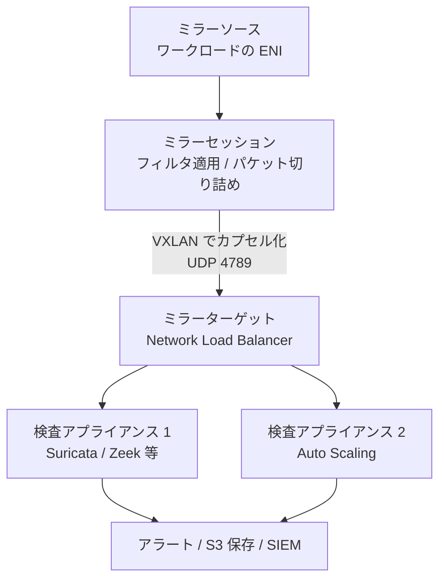

### 10-2. 重要な仕様

| 項目 | 内容 |
|---|---|
| カプセル化 | **VXLAN(UDP 4789)**。ターゲットの SG・NACL で **UDP 4789 のインバウンドを許可** する必要あり |
| ソースとターゲットの場所 | **同じ VPC に限らず**、VPC ピアリングや Transit Gateway で接続された別 VPC にも送れる |
| 帯域 | ミラーされたトラフィックは **ソース ENI の帯域を消費** する |
| 切り詰め | **パケット長(Packet Length)** を指定すると、ヘッダーだけなど一部だけ送れる |
| Flow Logs との関係 | **ミラーされたトラフィックは Flow Logs に記録されない** |
| 検査アプライアンス | 自前または Marketplace の IDS/IPS、Suricata、Zeek、Wireshark など |

### 10-3. Flow Logs と Traffic Mirroring の使い分け

| 観点 | Flow Logs | Traffic Mirroring |
|---|---|---|
| 取得内容 | メタデータ(誰から誰へ、量、許可/拒否) | パケット全体(ペイロード含む) |
| 用途 | 広範囲の可視化・監査・コスト効率の良い常時監視 | **深いパケット解析**、IDS、フォレンジック、アプリ障害の原因調査 |
| コスト | 比較的低い | ミラー分の帯域 + 検査基盤のコスト |
| 導入負荷 | 設定のみ | ターゲット(NLB・検査基盤)の構築が必要 |

**ベストプラクティス**
1. 常時ミラーせず、**フィルタで対象を絞る**(特定ポート・特定サブネット)。
2. ターゲットは **NLB の背後に Auto Scaling グループ** を置き、検査基盤の冗長性と拡張性を確保する。
3. 通常は **Flow Logs で異常を検知 → 該当 ENI だけ Traffic Mirroring で深掘り** する運用にする。
4. **暗号化された通信(TLS)** の中身は復号しないと見えない。必要ならターゲット側で復号方法を検討する。

**根拠 URL**
- Traffic Mirroring: https://docs.aws.amazon.com/vpc/latest/mirroring/what-is-traffic-mirroring.html
- ミラーターゲット/フィルタ/セッション: https://docs.aws.amazon.com/vpc/latest/mirroring/traffic-mirroring-targets.html

---

<a id="p11"></a>
## 11. Amazon CloudWatch(アラーム・カスタムメトリクス・Logs Insights)

> **Skills**: Implementing automated alarms by using CloudWatch / Implementing customized metrics by using CloudWatch

### 11-1. セキュリティ/ネットワーク監視でよく使う標準メトリクス

| サービス | 代表的なメトリクス(名前空間) | 見るポイント |
|---|---|---|
| **WAF**(AWS/WAFV2) | `BlockedRequests`, `AllowedRequests`, `CountedRequests` | ブロック急増 = 攻撃の兆候 |
| **Network Firewall**(AWS/NetworkFirewall) | `DroppedPackets`, `PassedPackets`, `ReceivedPackets` | ドロップ急増 |
| **Shield Advanced**(AWS/DDoSProtection) | `DDoSDetected`, `DDoSAttackBitsPerSecond` 等 | DDoS 検知 |
| **NAT ゲートウェイ**(AWS/NATGateway) | `ErrorPortAllocation`, `PacketsDropCount` | ポート枯渇・ドロップ |
| **Transit Gateway**(AWS/TransitGateway) | `PacketDropCountBlackhole`, `PacketDropCountNoRoute` | ルート不備・ブラックホール |
| **Site-to-Site VPN**(AWS/VPN) | `TunnelState`, `TunnelDataIn/Out` | トンネルのダウン |
| **Direct Connect**(AWS/DX) | `ConnectionState`, `ConnectionLightLevelTx/Rx` | 接続断・光レベル |
| **ELB**(AWS/ApplicationELB 等) | `HTTPCode_ELB_5XX_Count`, `TargetResponseTime` | エラー・遅延 |

### 11-2. アラームの種類

| 種類 | 説明 |
|---|---|
| **静的しきい値アラーム** | 固定値を超えたら ALARM |
| **異常検知アラーム** | 機械学習で期待範囲を学習し、外れたら ALARM |
| **複合アラーム** | 複数アラームを AND/OR で組み合わせ、ノイズを削減 |
| **メトリクス数式** | 複数メトリクスを計算した結果で判定 |

アクション先は **SNS**、EC2 アクション、Auto Scaling、Systems Manager(OpsItem/Incident)などです。

### 11-3. ログからカスタムメトリクスを作る(メトリクスフィルタ)

**例: Flow Logs の REJECT をメトリクス化してアラーム**

```bash
# 1. メトリクスフィルタを作成(Flow Logs の CloudWatch Logs ロググループ)
aws logs put-metric-filter \
  --log-group-name /vpc/flowlogs \
  --filter-name RejectedSshConnections \
  --filter-pattern '[version, account, eni, source, destination, srcport, destport="22", protocol="6", packets, bytes, windowstart, windowend, action="REJECT", flowlogstatus]' \
  --metric-transformations \
      metricName=RejectedSsh,metricNamespace=NetworkSecurity,metricValue=1,defaultValue=0

# 2. アラームを作成
aws cloudwatch put-metric-alarm \
  --alarm-name High-Rejected-SSH \
  --namespace NetworkSecurity \
  --metric-name RejectedSsh \
  --statistic Sum \
  --period 300 \
  --evaluation-periods 1 \
  --threshold 100 \
  --comparison-operator GreaterThanThreshold \
  --alarm-actions arn:aws:sns:ap-northeast-1:111122223333:security-alerts
```

**カスタムメトリクスの送り方は 3 種類**

| 方法 | 内容 |
|---|---|
| **PutMetricData API** | アプリや Lambda から直接送信 |
| **メトリクスフィルタ** | ログのパターンに一致した件数・値をメトリクス化 |
| **Embedded Metric Format(EMF)** | 構造化ログに埋め込んで、ログとメトリクスを同時生成 |

### 11-4. その他の便利機能

| 機能 | 用途 |
|---|---|
| **Logs Insights** | ログのアドホックなクエリ(例: REJECT の Top 送信元) |
| **Contributor Insights** | 「Top N の貢献者」(送信元 IP 別のトラフィック量など)をリアルタイムに可視化 |
| **サブスクリプションフィルタ** | ログをリアルタイムに Kinesis / Firehose / Lambda に転送 |
| **CloudWatch Internet Monitor / Network Monitor** | インターネット経由・ハイブリッド接続の遅延・可用性の監視 |
| **クロスアカウント・クロスリージョン** オブザーバビリティ | 複数アカウントのメトリクス・ログを 1 つのモニタリングアカウントで閲覧 |

**ベストプラクティス**
- アラームは **「実際に人が対応する事象」** に絞り、複合アラームでノイズを減らす。
- **ロググループの保持期間** を設定し(無期限は費用増)、長期保管は S3 へエクスポート/配信。
- 重要なアラームの **通知先は SNS の別系統(複数経路)** にし、通知の単一障害点を避ける。

**根拠 URL**
- CloudWatch アラーム: https://docs.aws.amazon.com/AmazonCloudWatch/latest/monitoring/AlarmThatSendsEmail.html
- メトリクスフィルタ: https://docs.aws.amazon.com/AmazonCloudWatch/latest/logs/MonitoringLogData.html
- カスタムメトリクス(PutMetricData / EMF): https://docs.aws.amazon.com/AmazonCloudWatch/latest/monitoring/publishingMetrics.html
- Logs Insights: https://docs.aws.amazon.com/AmazonCloudWatch/latest/logs/AnalyzingLogData.html

---

<a id="p12"></a>
## 12. CloudTrail と各サービスのログ

### 12-1. AWS CloudTrail(誰が何を変えたか)

| 項目 | 内容 |
|---|---|
| 管理イベント | ネットワーク設定変更の API(`AuthorizeSecurityGroupIngress`、`CreateNetworkAclEntry`、`ReplaceRoute`、`CreateVpcEndpoint`、`ModifyVpcEndpoint` など)。**既定で記録(直近 90 日はイベント履歴で閲覧可)** |
| データイベント | S3 オブジェクトレベルなど。**既定では無効**(有効化が必要) |
| Insights イベント | 通常と異なる API 呼び出しパターンの検出 |
| 組織の証跡 | **Organizations 全アカウントを 1 つの証跡で集約** |
| ログ整合性検証 | **SHA-256 ハッシュ + 電子署名** のダイジェストファイルで改ざんを検出 |
| CloudTrail Lake | 証跡データを SQL で長期保存・分析 |

**ベストプラクティス**
- **全リージョン・組織全体の証跡** を作成し、**管理アカウントとは別のログアーカイブアカウントの S3** に集約。
- **ログファイル整合性検証を有効化**、バケットは **SSE-KMS・MFA Delete/オブジェクトロック・パブリックアクセスブロック**。
- ネットワークの変更(SG・NACL・ルート・IGW)を **EventBridge で検知して通知** する。

### 12-2. サービス別アクセスログ一覧(試験頻出)

| ログ | 取得できる内容 | 有効化 | 配信先 |
|---|---|---|---|
| **ALB アクセスログ** | リクエスト単位(クライアント IP、ターゲット、レイテンシ、ステータス、TLS 情報) | **既定は無効** | **S3** |
| **NLB アクセスログ** | **TLS リスナー** の接続情報 | 既定は無効 | **S3** |
| **CloudFront 標準ログ** | ビューワーリクエスト | 既定は無効 | S3(最新では CloudWatch Logs / Firehose も選択可) |
| **CloudFront リアルタイムログ** | ほぼリアルタイムのリクエスト(サンプリング率を指定) | 既定は無効 | **Kinesis Data Streams** |
| **WAF ログ** | Web ACL で評価されたリクエストの詳細(一致ルール・アクション) | 既定は無効 | CloudWatch Logs / S3 / Firehose(**`aws-waf-logs-` で始まる名前**) |
| **Network Firewall ログ** | alert / flow / TLS | 既定は無効 | S3 / CloudWatch Logs / Firehose |
| **Route 53 Resolver クエリログ** | VPC 内からの DNS クエリ | 既定は無効 | CloudWatch Logs / S3 / Firehose |
| **Route 53 パブリック DNS クエリログ** | パブリックホストゾーンへのクエリ | 既定は無効 | **CloudWatch Logs のみ(ロググループは米国東部バージニア北部)** |
| **VPC Flow Logs / TGW Flow Logs** | 前章参照 | 既定は無効 | CloudWatch Logs / S3 / Firehose |
| **Site-to-Site VPN トンネルログ** | IKE・DPD などの接続状態 | 既定は無効 | CloudWatch Logs |
| **Global Accelerator フローログ** | アクセラレーター経由のトラフィック | 既定は無効 | S3 |
| **S3 サーバーアクセスログ / API Gateway アクセスログ** | リクエスト記録 | 既定は無効 | S3 / CloudWatch Logs |

> **試験ポイント**: 「**ALB のログは S3 のみ**」「**パブリック DNS クエリログは CloudWatch Logs のみ**」「**CloudFront リアルタイムログは Kinesis Data Streams**」など、**「サービス ↔ 配信先」の組み合わせ** がよく出ます。

**根拠 URL**
- CloudTrail: https://docs.aws.amazon.com/awscloudtrail/latest/userguide/cloudtrail-user-guide.html
- ALB アクセスログ: https://docs.aws.amazon.com/elasticloadbalancing/latest/application/load-balancer-access-logs.html
- NLB アクセスログ: https://docs.aws.amazon.com/elasticloadbalancing/latest/network/load-balancer-access-logs.html
- CloudFront ログ: https://docs.aws.amazon.com/AmazonCloudFront/latest/DeveloperGuide/logging.html
- WAF ログ: https://docs.aws.amazon.com/waf/latest/developerguide/logging.html
- Network Firewall ログ: https://docs.aws.amazon.com/network-firewall/latest/developerguide/firewall-logging.html
- Resolver クエリログ: https://docs.aws.amazon.com/Route53/latest/DeveloperGuide/resolver-query-logs.html
- Route 53 パブリックホストゾーンのクエリログ: https://docs.aws.amazon.com/Route53/latest/DeveloperGuide/query-logs.html
- VPN ログ: https://docs.aws.amazon.com/vpn/latest/s2svpn/monitoring-logs.html

---

<a id="p13"></a>
## 13. ログ配信と複数ソースの相関分析

> **Skills**: Implementing log delivery solutions / Correlating and analyzing information across single or multiple AWS log sources

### 13-1. 配信メカニズムの選び方

| 配信先 | 特徴 | 向いている用途 |
|---|---|---|
| **CloudWatch Logs** | 即時検索、メトリクスフィルタ、サブスクリプション | リアルタイム監視・アラーム |
| **Amazon S3** | 低コスト・長期保管・Athena で分析 | 監査用の長期保存、大規模分析 |
| **Kinesis Data Firehose** | バッファリングして S3 / OpenSearch / Splunk / HTTP エンドポイントへ配信、形式変換 | SIEM や外部分析基盤への連携 |
| **Kinesis Data Streams** | 低遅延・複数コンシューマ | リアルタイム処理(CloudFront リアルタイムログ等) |
| **Amazon Security Lake** | OCSF 形式でセキュリティログを正規化・集約 | マルチソース・マルチアカウントの統合分析 |

### 13-2. マルチアカウントの集約ログ構成

```mermaid
flowchart TD
    subgraph WL["ワークロードアカウント群"]
        FL["VPC Flow Logs"]
        WAFL["WAF / ALB / NFW ログ"]
        DNSL["Resolver クエリログ"]
        CT["CloudTrail 組織の証跡"]
    end
    FL --> S3["ログアーカイブアカウント<br/>S3 バケット<br/>SSE-KMS / オブジェクトロック"]
    WAFL --> S3
    DNSL --> S3
    CT --> S3
    S3 --> ATH["Athena / Glue<br/>SQL 分析"]
    S3 --> SL["Security Lake / OpenSearch<br/>SIEM"]
    CT --> EBR["EventBridge<br/>リアルタイム検知"]
    EBR --> NOTI["SNS / Lambda"]
```

**ベストプラクティス**
- **ログ専用アカウント** にログを集約し、ワークロードアカウントからは **書き込みのみ** にして削除・改ざんを防ぐ(バケットポリシー + SCP)。
- S3 は **バージョニング・オブジェクトロック・ライフサイクル** を設定。
- **共通のタイムスタンプ(UTC)・アカウント ID・リソース ID** をキーにして相関できるようにする。

### 13-3. 相関分析の考え方(例: 不審な外部通信の調査)

```mermaid
flowchart TD
    ALERT["GuardDuty が不審な外向き通信を検出<br/>対象 ENI と時刻を特定"] --> FL["Flow Logs<br/>宛先 IP・ポート・バイト数・方向を確認<br/>pkt-dstaddr で NAT 後の実際の宛先"]
    FL --> DNS["Resolver クエリログ<br/>同時刻のドメイン名を確認"]
    DNS --> NFW["Network Firewall ログ<br/>SNI・アクションを確認"]
    NFW --> CT["CloudTrail<br/>直前の SG / ルート / 認証情報の変更"]
    CT --> ACT["対応: 隔離 SG の適用 / ルール追加<br/>→ DNS Firewall・FW ルールで恒久対策"]
```

Athena で複数テーブルを JOIN する例(ENI を軸に Flow Logs と Resolver ログを突き合わせる):

```sql
SELECT f.srcaddr, f.dstaddr, f.dstport, d.query_name, COUNT(*) AS cnt
FROM vpc_flow_logs f
JOIN resolver_query_logs d
  ON f.srcaddr = d.srcaddr
CROSS JOIN UNNEST(d.answers) AS a (answer)
WHERE f.dstaddr = answer.rdata AND f.action = 'ACCEPT'
  AND f.day = '2026/10/16'
GROUP BY f.srcaddr, f.dstaddr, f.dstport, d.query_name
ORDER BY cnt DESC
LIMIT 50;
```

**根拠 URL**
- Kinesis Data Firehose: https://docs.aws.amazon.com/firehose/latest/dev/what-is-this-service.html
- CloudWatch Logs サブスクリプションフィルタ: https://docs.aws.amazon.com/AmazonCloudWatch/latest/logs/Subscriptions.html
- Amazon Security Lake: https://docs.aws.amazon.com/security-lake/latest/userguide/what-is-security-lake.html
- AWS のログ集約のガイダンス: https://docs.aws.amazon.com/prescriptive-guidance/latest/security-reference-architecture/log-archive.html

---

<a id="p14"></a>
## 14. ネットワーク監査戦略

> **Skills**: Implementing a network audit strategy across single or multiple AWS network services and accounts (for example, Firewall Manager, security groups, network ACLs)

### 14-1. 監査ツールの役割分担

| ツール | 監査できること | 範囲 |
|---|---|---|
| **AWS Firewall Manager** | SG・NACL・WAF・Shield・Network Firewall・DNS Firewall のポリシー準拠(**SG のコンテンツ監査 / 使用状況監査**) | Organizations 全体 |
| **AWS Config** | 設定履歴、ルールによる準拠評価、**コンフォーマンスパック**、**アグリゲーター**(複数アカウント・リージョン集約) | 単一〜組織 |
| **AWS Trusted Advisor** | セキュリティチェック(**SG の特定ポートが無制限に開いている**、公開 IP など) | アカウント単位(全チェックは Business / Enterprise サポート) |
| **Network Access Analyzer** | 「意図しないネットワークアクセス」の検出 | VPC |
| **Reachability Analyzer** | 2 点間の到達可否と、どこで止まるかの分析 | VPC |
| **Security Hub** | セキュリティ標準(AWS Foundational Security Best Practices、CIS、PCI DSS)の自動チェック | 組織 |
| **Transit Gateway Network Manager** | ハイブリッドネットワークのトポロジ・イベント・メトリクス、ルートアナライザー | グローバル |
| **IAM Access Analyzer** | リソースの外部公開(ネットワーク起点の条件を含む)の検出 | アカウント/組織 |
| **CloudTrail** | 構成変更の履歴 | 組織 |

### 14-2. Firewall Manager の SG ポリシー 3 種類

| ポリシー種別 | 内容 | 例 |
|---|---|---|
| **共通セキュリティグループ** | 指定した SG を全対象リソースに **自動適用** | 全 EC2 に管理用 SG を付与 |
| **コンテンツ監査** | SG ルールの内容を **ポリシー** で評価し、違反を検出/是正 | 0.0.0.0/0 の SSH、許可していないポート範囲 |
| **使用状況監査** | **未使用・冗長な SG** を検出して削除 | SG の肥大化防止 |

### 14-3. Transit Gateway Network Manager

| 機能 | 説明 |
|---|---|
| グローバルネットワーク | TGW・Cloud WAN・オンプレ拠点・VPN/DX を **1 つのビュー** で管理 |
| トポロジ / イベント | 接続状態の変化(VPN トンネルダウン、ルート変更など)を **EventBridge/CloudWatch Logs** に通知 |
| ルートアナライザー | TGW ルートテーブル間の **経路を分析** |
| メトリクス | CloudWatch に接続やトラフィックの指標を提供 |

### 14-4. 複数アカウントでの監査戦略

```mermaid
flowchart TD
    ORG["AWS Organizations<br/>管理アカウント"] --> SEC["セキュリティ(委任管理者)アカウント"]
    ORG --> LOGA["ログアーカイブアカウント"]
    SEC --> FMS["Firewall Manager<br/>SG / NACL / WAF / NFW / DNS FW ポリシー"]
    SEC --> CFGA["Config アグリゲーター<br/>コンフォーマンスパック"]
    SEC --> SH["Security Hub / GuardDuty<br/>全アカウント集約"]
    LOGA --> TRAIL["CloudTrail 組織の証跡<br/>Flow Logs / ALB ログ"]
    FMS --> MEM["メンバーアカウント<br/>新規リソースにも自動適用"]
    CFGA --> MEM
    SH --> MEM
```

**ベストプラクティス**
1. **「予防(SCP・Firewall Manager)」「検知(Config・GuardDuty)」「是正(自動修復)」** の 3 点で設計する。
2. **SCP** で「Flow Logs の削除禁止」「ログ設定の変更禁止」「特定リージョン以外の利用禁止」などのガードレールを敷く。
3. 監査人に **読み取り専用の証跡**(Audit Manager、Config、CloudTrail Lake)を提供。
4. 定期的に **Trusted Advisor / Config で「0.0.0.0/0 を許可している SG」** を棚卸しする。
5. **CloudFormation / Terraform で SG・NACL をコード管理** し、手動変更はドリフト検出で検知する。

**根拠 URL**
- Firewall Manager のセキュリティグループポリシー: https://docs.aws.amazon.com/waf/latest/developerguide/security-group-policies.html
- AWS Config: https://docs.aws.amazon.com/config/latest/developerguide/WhatIsConfig.html
- Trusted Advisor のチェック: https://docs.aws.amazon.com/awssupport/latest/user/trusted-advisor-check-reference.html
- Transit Gateway Network Manager: https://docs.aws.amazon.com/network-manager/latest/tgwnm/what-are-global-networks.html
- Audit Manager: https://docs.aws.amazon.com/audit-manager/latest/userguide/what-is.html

---
# Task 4.3 データ・通信の機密性

<a id="p15"></a>
## 15. ネットワーク暗号化の全体像

> **Knowledge**: Network encryption options available on AWS / Network encryption under the AWS shared responsibility model

### 15-1. 通信経路ごとの暗号化手段

```mermaid
flowchart TD
    CL["クライアント"] -- "TLS<br/>ビューワープロトコルポリシー" --> CF["CloudFront"]
    CF -- "TLS<br/>オリジンプロトコルポリシー HTTPS のみ" --> ALB["ALB / NLB"]
    ALB -- "TLS<br/>エンドツーエンドの再暗号化" --> EC2["EC2 / コンテナ"]
    EC2 -- "Nitro による自動暗号化<br/>またはアプリ層 TLS" --> EC2B["他の EC2"]
    EC2 -- "TLS / 接続時 SSL 必須" --> DB["RDS / Aurora"]
    EC2 -- "HTTPS / VPC エンドポイント" --> S3["S3"]
    ONP["オンプレミス"] -- "IPsec VPN<br/>または DX + MACsec / VPN over DX" --> TGW["Transit Gateway / VGW"]
```

| 区間 | 暗号化の方法 | 備考 |
|---|---|---|
| クライアント ⇔ エッジ/LB | **TLS**(ACM 証明書) | TLS 1.2 以上を推奨。セキュリティポリシーで最低バージョンを指定 |
| LB ⇔ ターゲット | TLS の再暗号化(ALB)/ TLS パススルーまたは TLS リスナー(NLB) | 「エンドツーエンド暗号化」の要件で必須 |
| インスタンス ⇔ インスタンス | **Nitro System による AES-256 の自動暗号化**(対応インスタンスタイプ同士)+ アプリ層 TLS | 中間ホップ(LB、TGW 等)を挟む場合は別途 TLS が必要。最新は **VPC Encryption Controls** で監査・強制 |
| VPC ⇔ VPC(リージョン内) | 対応 Nitro 間の自動暗号化 / TLS | VPC Encryption Controls で可視化・強制可能 |
| リージョン間(VPC ピアリング、TGW ピアリング、Cloud WAN) | **AWS が物理レイヤーで自動暗号化** | お客様の設定不要 |
| オンプレ ⇔ AWS | **IPsec(Site-to-Site VPN)**、**MACsec(Direct Connect)** | DX 自体は **既定では暗号化されない** |
| アプリ ⇔ AWS API | HTTPS(TLS)が標準 | VPC エンドポイント + ポリシー |

### 15-2. VPC Encryption Controls(新しい機能)

| 項目 | 内容 |
|---|---|
| 目的 | VPC 内および VPC 間の **転送中暗号化を監査・強制** する |
| **モニターモード** | 各トラフィックの **暗号化状況を可視化**し、平文を許す資源を特定。監視には `${encryption-status}` を明示的に含むカスタム形式の Flow Log を新規作成する(**既存の Flow Log にはこのフィールドが自動追加されない**) |
| **エンフォースモード** | 暗号化に対応しないリソースの作成などを **防止** し、暗号化を強制 |
| 進め方 | **既存 VPC はまずモニターモードで開始**、平文のリソースを移行してからエンフォースへ切り替える |
| 組織管理 | **宣言型ポリシー(Organizations)** でアカウント/OU 単位に一括適用が可能 |

> 新しい機能のため、**対応リソース・リージョン・制約は最新の公式ドキュメントで確認** してください。

### 15-3. 共有責任モデルにおける暗号化

| 項目 | AWS | お客様 |
|---|---|---|
| 物理・リージョン間の自動暗号化 | ✔ | — |
| Nitro のハードウェア暗号化 | ✔(対応インスタンスの提供) | 対応インスタンスタイプを選択する |
| アプリ層の TLS / 証明書 | 証明書管理サービスの提供 | **TLS の有効化、証明書の発行・更新、セキュリティポリシー選択** |
| VPN / MACsec | サービス提供 | **IPsec・MACsec の設定、鍵・認証情報の管理** |
| DNSSEC | Route 53 の署名機能 | **署名の有効化、KMS キー管理、DS レコードの登録** |

**根拠 URL**
- 転送中の暗号化(VPC ユーザーガイド): https://docs.aws.amazon.com/vpc/latest/userguide/data-protection.html
- VPC Encryption Controls(ブログ): https://aws.amazon.com/blogs/aws/introducing-vpc-encryption-controls-enforce-encryption-in-transit-within-and-across-vpcs-in-a-region/
- 新機能の告知: https://aws.amazon.com/about-aws/whats-new/2025/11/aws-vpc-encryption-controls
- 宣言型ポリシーへの対応(2026-07): https://aws.amazon.com/about-aws/whats-new/2026/07/vpc-encryption-controls-declarative-controls/
- AWS 上の転送中暗号化のホワイトペーパー: https://docs.aws.amazon.com/whitepapers/latest/logical-separation/encrypting-data-at-rest-and-in-transit.html

---

<a id="p16"></a>
## 16. VPN・Direct Connect の暗号化

> **Knowledge**: VPN connectivity over Direct Connect / Encryption methods for data in transit (for example, IPsec)

### 16-1. Site-to-Site VPN(IPsec)

| 項目 | 内容 |
|---|---|
| 構成 | 1 つの VPN 接続に **2 本のトンネル**(AWS 側は別 AZ のエンドポイント)。冗長化のため両方を使う |
| 終端 | **仮想プライベートゲートウェイ(VGW)** または **Transit Gateway** |
| IKE | IKEv1 / **IKEv2** |
| 暗号化 | AES-128 / AES-256 / AES-GCM などをトンネルオプションで指定 |
| 完全性 | SHA-1 / SHA-2 系 |
| DH グループ | 複数選択可(より強いグループを選ぶ) |
| 認証 | **事前共有キー(PSK)** または **証明書(AWS Private CA 発行)** |
| 高速化 | **Accelerated VPN**(Global Accelerator を使い AWS のバックボーンへ早く入る。TGW が必要) |
| ログ | トンネルログを **CloudWatch Logs** に出力 |

**ベストプラクティス**
- **強い暗号アルゴリズム(AES-256、SHA-2、強い DH グループ、IKEv2)** のみに制限する。
- 2 本のトンネルを **別々の顧客ゲートウェイ(別の機器)** に接続し、機器障害にも耐える。
- 証明書認証を使うと **PSK の管理負担が減る**(ACM Private CA と連携)。
- CloudWatch の `TunnelState` でトンネルダウンを監視する。

### 16-2. Direct Connect + 暗号化

**Direct Connect は専用線ですが、既定では暗号化されません。** 暗号化が必要な場合は次の 3 つです。

| 方式 | 暗号化レイヤー | 仕組み | 向いているケース |
|---|---|---|---|
| **MACsec** | **L2**(イーサネット) | **専用接続(Dedicated)** のお客様機器 ⇔ AWS の DX ロケーション機器の間を暗号化。MACsec 対応ポート(高速ポート)と対応機器が必要。鍵は CKN/CAK で管理 | 高スループット・低レイテンシで暗号化したい(**ライン速度で暗号化**) |
| **パブリック VIF 上の IPsec VPN** | **L3** | DX のパブリック VIF 経由で **VPN のパブリックエンドポイント** へ IPsec を張る | 既存の DX で VPN を重ねたい |
| **Private IP VPN(DX のトランジット VIF 上)** | **L3** | **TGW のプライベート IP VPN**。VPN の外側 IP にもプライベート IP を使い、**インターネットに出ずに** IPsec | 通信を完全にプライベートに保ちつつ暗号化したい |

```mermaid
flowchart TD
    START["Direct Connect 上の通信を暗号化したい"] --> Q1{"専用接続で<br/>MACsec 対応ポート・機器を<br/>使えるか?"}
    Q1 -- "Yes かつ L2 で十分" --> MAC["MACsec<br/>ライン速度で暗号化"]
    Q1 -- "No または E2E の IPsec が必要" --> Q2{"通信をインターネットの<br/>IP 空間に出したくない?"}
    Q2 -- "Yes" --> PRIV["Private IP VPN<br/>トランジット VIF + TGW"]
    Q2 -- "No でよい" --> PUB["パブリック VIF 上の IPsec VPN<br/>VPN パブリックエンドポイント"]
```

| 比較 | MACsec | VPN over DX |
|---|---|---|
| 暗号化の範囲 | **DX 区間(お客様機器⇔AWS の DX 機器)の L2** | **終端間(オンプレ ⇔ VGW/TGW)の IPsec(L3)** |
| スループット | 高い(ライン速度) | VPN トンネルあたりの上限あり(複数トンネル + ECMP で拡張) |
| 要件 | 専用接続 + 対応機器 | VGW/TGW、VPN 設定 |

**ベストプラクティス**
- DX は **冗長構成(複数ロケーション・複数接続)** にし、**VPN を DX のバックアップ** として併用(暗号化が必要な場合は VPN 自体の暗号化も確認)。
- MACsec の **CKN/CAK は Secrets Manager 等で安全に管理**し、定期的にローテーションする。

**根拠 URL**
- Site-to-Site VPN: https://docs.aws.amazon.com/vpn/latest/s2svpn/VPC_VPN.html
- VPN トンネルオプション: https://docs.aws.amazon.com/vpn/latest/s2svpn/VPNTunnels.html
- Direct Connect の MACsec: https://docs.aws.amazon.com/directconnect/latest/UserGuide/MACsec.html
- Private IP VPN over Direct Connect: https://docs.aws.amazon.com/vpn/latest/s2svpn/private-ip-dx.html
- AWS Direct Connect + VPN(ホワイトペーパー): https://docs.aws.amazon.com/whitepapers/latest/aws-vpc-connectivity-options/aws-direct-connect-plus-vpn-network-to-amazon.html

---

<a id="p17"></a>
## 17. TLS 終端と各サービスでの転送中データ暗号化

> **Skills**: Implementing network encryption methods to meet application compliance requirements (for example, IPsec, TLS) / Implementing encryption solutions to secure data in transit

### 17-1. TLS 終端パターン

```mermaid
flowchart TD
    subgraph P1["パターン A: ALB で終端(標準)"]
        A1["クライアント"] -- "HTTPS" --> A2["ALB<br/>ACM 証明書で復号"]
        A2 -- "HTTP(VPC 内)" --> A3["ターゲット"]
    end
    subgraph P2["パターン B: エンドツーエンド暗号化"]
        B1["クライアント"] -- "HTTPS" --> B2["ALB<br/>復号して検査"]
        B2 -- "HTTPS 再暗号化" --> B3["ターゲット<br/>自己署名可・Private CA 推奨"]
    end
    subgraph P3["パターン C: NLB パススルー"]
        C1["クライアント"] -- "TLS" --> C2["NLB<br/>TCP リスナーで素通し"]
        C2 -- "TLS のまま" --> C3["ターゲットが終端"]
    end
```

| パターン | 使いどころ |
|---|---|
| A. ALB で終端 | 一般的な Web。WAF 適用・ヘッダーベースのルーティングが必要 |
| B. 再暗号化 | **コンプライアンス上「VPC 内も暗号化」が必須**。WAF の検査も維持したい |
| C. NLB パススルー | 非 HTTP プロトコル、**クライアント証明書をターゲットで検証**、ターゲットで復号したい |
| NLB の TLS リスナー | NLB で終端(ACM 証明書)してオフロードしたい |

### 17-2. 各サービスでの暗号化ポイント

| サービス | 実装 | ベストプラクティス |
|---|---|---|
| **CloudFront** | **ビューワープロトコルポリシー**(HTTP を HTTPS にリダイレクト / HTTPS のみ)、**オリジンプロトコルポリシー**(HTTPS のみ)、最小 TLS バージョン(セキュリティポリシー)、フィールドレベル暗号化、OAC(S3 オリジン保護) | カスタムドメインの証明書は **ACM の米国東部バージニア北部リージョン** で発行 |
| **ALB** | HTTPS リスナー、**セキュリティポリシー**(例: TLS 1.2 以上 / TLS 1.3 対応ポリシー)、**SNI で複数証明書**、**mTLS**(クライアント証明書検証。検証モード/パススルー) | HTTP→HTTPS の **リダイレクトルール**、古い TLS/暗号スイートを無効にするポリシー |
| **NLB** | TLS リスナー(ACM 証明書、ALPN、SNI)、または TCP/TLS パススルー | 極低遅延・固定 IP が必要な暗号化通信に |
| **S3** | **HTTPS のみ許可するバケットポリシー**(`aws:SecureTransport`)、エンドポイント経由 | `Deny` + `aws:SecureTransport = false` |
| **RDS / Aurora** | 接続の **SSL/TLS 必須化**(PostgreSQL: `rds.force_ssl`、MySQL: `require_secure_transport`)、CA 証明書の更新管理 | アプリ側でも **CA 検証** を有効にする |
| **Redshift / DynamoDB 等** | Redshift: `require_ssl` パラメータ。DynamoDB は常に HTTPS | パラメータグループで強制 |
| **Transit Gateway** | **TGW 自体はデータプレーンを暗号化しない**。VPN アタッチメントは IPsec。VPC アタッチメント間は対応 Nitro の自動暗号化 / アプリ層 TLS / VPC Encryption Controls | 暗号化要件がある場合は上記で担保 |
| **EC2 上の独自アプリ** | アプリの TLS(nginx 等)、**ACM for Nitro Enclaves**、Private CA 発行の証明書 | 証明書の自動更新を設計に組み込む |

```json
{
  "Version": "2012-10-17",
  "Statement": [
    {
      "Sid": "DenyInsecureTransport",
      "Effect": "Deny",
      "Principal": "*",
      "Action": "s3:*",
      "Resource": ["arn:aws:s3:::my-bucket", "arn:aws:s3:::my-bucket/*"],
      "Condition": { "Bool": { "aws:SecureTransport": "false" } }
    }
  ]
}
```

```bash
# ALB のリスナーを TLS 1.3 対応のセキュリティポリシーで作成する例
aws elbv2 create-listener \
  --load-balancer-arn arn:aws:elasticloadbalancing:ap-northeast-1:111122223333:loadbalancer/app/my-alb/xxxx \
  --protocol HTTPS --port 443 \
  --ssl-policy ELBSecurityPolicy-TLS13-1-2-2021-06 \
  --certificates CertificateArn=arn:aws:acm:ap-northeast-1:111122223333:certificate/abcd-1234 \
  --default-actions Type=forward,TargetGroupArn=arn:aws:elasticloadbalancing:ap-northeast-1:111122223333:targetgroup/my-tg/yyyy
```

### 17-3. クライアント接続(参考)

| 方式 | 暗号化 | 認証 |
|---|---|---|
| **AWS Client VPN** | TLS(OpenVPN) | Active Directory、相互証明書、SAML(IdP 連携) |

**根拠 URL**
- ALB の HTTPS リスナー / セキュリティポリシー: https://docs.aws.amazon.com/elasticloadbalancing/latest/application/describe-ssl-policies.html
- ALB の相互 TLS: https://docs.aws.amazon.com/elasticloadbalancing/latest/application/mutual-authentication.html
- NLB の TLS リスナー: https://docs.aws.amazon.com/elasticloadbalancing/latest/network/create-tls-listener.html
- CloudFront での HTTPS: https://docs.aws.amazon.com/AmazonCloudFront/latest/DeveloperGuide/using-https.html
- S3 のセキュリティベストプラクティス: https://docs.aws.amazon.com/AmazonS3/latest/userguide/security-best-practices.html
- RDS の SSL/TLS: https://docs.aws.amazon.com/AmazonRDS/latest/UserGuide/UsingWithRDS.SSL.html
- Client VPN: https://docs.aws.amazon.com/vpn/latest/clientvpn-admin/what-is.html

---

<a id="p18"></a>
## 18. 証明書管理(ACM / AWS Private CA)

> **Skills**: Implementing a certificate management solution by using a certificate authority (for example, ACM, AWS Private Certificate Authority [ACM PCA])

### 18-1. サービスの違い

| 項目 | **AWS Certificate Manager(ACM)** | **AWS Private CA** |
|---|---|---|
| 役割 | 証明書の発行・デプロイ・更新 | **プライベート認証局(CA)を運用** |
| 証明書の種類 | **パブリック証明書**(ブラウザが信頼)/ ACM 経由のプライベート証明書 | **プライベート証明書**(自社内でのみ信頼) |
| 料金 | パブリック証明書は **無料**(統合サービス用) | CA ごとの月額 + 証明書ごとの料金 |
| 検証 | **DNS 検証(推奨)** / メール検証 | CA が自社ポリシーで発行 |
| 用途 | ALB・NLB・CloudFront・API Gateway などの TLS | 社内サービス、mTLS、VPN の証明書認証、IoT、サーバー/デバイス認証 |

### 18-2. ACM の重要ポイント(試験頻出)

- **リージョンサービス**: ELB 用は **そのリージョンで発行**。**CloudFront 用は米国東部バージニア北部リージョンで発行**。
- **自動更新**: ACM が発行した証明書は、**DNS 検証レコードが残っていて、かつ AWS のサービスに関連付けられている場合に自動更新**。**インポートした証明書は自動更新されない**(更新と再インポートが必要)。
- **統合サービス**: ELB、CloudFront、API Gateway、Elastic Beanstalk、App Runner など。**EC2 に直接インストールはできない**(通常。Nitro Enclaves 向けなどの例外あり。最新の「エクスポート可能なパブリック証明書」機能は公式ドキュメントで条件を確認)。
- **有効期限の監視**: **EventBridge の ACM 期限切れ間近イベント**、**CloudWatch メトリクス `DaysToExpiry`**、**Config ルール `acm-certificate-expiration-check`**。

### 18-3. AWS Private CA の階層設計

```mermaid
flowchart TD
    ROOT["ルート CA<br/>AWS Private CA<br/>運用は最小限・厳重管理"] --> SUB1["下位 CA(部門 A)<br/>日常の発行用"]
    ROOT --> SUB2["下位 CA(部門 B)<br/>日常の発行用"]
    SUB1 --> C1["サーバー証明書<br/>社内サービス"]
    SUB1 --> C2["クライアント証明書<br/>mTLS・VPN"]
    SUB2 --> C3["デバイス証明書"]
    SUB1 -. "失効情報" .-> REV["CRL(S3)/ OCSP"]
```

| 項目 | 内容 |
|---|---|
| 階層 | **ルート CA** と **下位 CA**。**ルート CA は日常の発行に使わず**、下位 CA が発行する(ルートの露出を最小化) |
| CA モード | 一般用途 / **短期証明書モード**(有効期間が短い証明書を大量発行。失効管理が不要になる) |
| 失効 | **CRL(S3 に公開)** または **OCSP** |
| 共有 | **AWS RAM** でアカウント/組織間に CA を共有し、各アカウントから発行 |
| 統合 | **ACM**(プライベート証明書の発行・自動更新)、**Site-to-Site VPN の証明書認証**、**Kubernetes(cert-manager)**、Active Directory / SCEP コネクタ、IoT |
| 監査 | 監査レポート(発行・失効の記録)を S3 に出力、CloudTrail で API を記録 |
| 保護 | CA の秘密鍵は AWS が **FIPS 140 検証済みの HSM** で保護 |

### 18-4. 証明書戦略の選び方

```mermaid
flowchart TD
    N["証明書が必要"] --> Q1{"インターネットの<br/>ブラウザ・外部クライアントが<br/>信頼する必要がある?"}
    Q1 -- "Yes" --> Q2{"ELB / CloudFront /<br/>API Gateway で使う?"}
    Q2 -- "Yes" --> ACMPUB["ACM パブリック証明書<br/>DNS 検証 + 自動更新"]
    Q2 -- "No(EC2 等に直接)" --> OTHER["外部 CA の証明書を利用<br/>または ACM の新しい<br/>エクスポート機能を確認"]
    Q1 -- "No(社内・mTLS・デバイス)" --> PCA["AWS Private CA<br/>ルート CA + 下位 CA"]
    PCA --> Q3{"ACM 統合サービスで使う?"}
    Q3 -- "Yes" --> ACMPRI["ACM 経由で発行・自動更新"]
    Q3 -- "No" --> DIRECT["Private CA から直接発行<br/>またはコネクタで自動化"]
```

**ベストプラクティス**
1. **DNS 検証 + Route 53 の CNAME 自動作成** で、更新を完全自動化する。
2. **ルート CA はオフライン運用に近い扱い**(使う頻度を最小化)、**下位 CA で発行**。
3. 内部通信の mTLS・VPN 証明書は **Private CA で一元化** し、短期証明書で失効管理を簡素化する。
4. **証明書の期限切れ監視** を EventBridge / Config で必ず設定する。
5. 組織全体で使う場合は **RAM で Private CA を共有**。

**根拠 URL**
- ACM: https://docs.aws.amazon.com/acm/latest/userguide/acm-overview.html
- ACM の更新: https://docs.aws.amazon.com/acm/latest/userguide/managed-renewal.html
- ACM の統合サービス: https://docs.aws.amazon.com/acm/latest/userguide/acm-services.html
- AWS Private CA: https://docs.aws.amazon.com/privateca/latest/userguide/PcaWelcome.html
- 短期証明書 CA モード: https://docs.aws.amazon.com/privateca/latest/userguide/short-lived-certificates.html
- CA 階層の計画: https://docs.aws.amazon.com/privateca/latest/userguide/ca-hierarchy.html
- 証明書失効(CRL / OCSP): https://docs.aws.amazon.com/privateca/latest/userguide/revocation-setup.html

---

<a id="p19"></a>
## 19. DNS のセキュリティ

> **Knowledge**: Security methods for DNS communications (for example, DNSSEC) / **Skills**: Implementing secure DNS communications

### 19-1. DNSSEC とは

DNS の応答に **デジタル署名** を付け、**応答が改ざんされていないこと・正当なサーバーからのものであること** を検証できるようにする仕組みです(**なりすまし・キャッシュポイズニング対策**)。DNSSEC は **署名による完全性/真正性** であり、**通信内容の暗号化(盗聴防止)ではありません**。

```mermaid
flowchart TD
    ROOT["ルートゾーン<br/>信頼の起点(トラストアンカー)"] --> TLD[".com などの TLD<br/>DS レコードで下位を保証"]
    TLD --> ZONE["お客様のドメインのゾーン<br/>KSK が ZSK を保証・ZSK がレコードに署名"]
    ZONE --> REC["署名付きの DNS 応答"]
    REC --> RESV["DNSSEC 検証対応のリゾルバー<br/>署名を検証し 不正なら SERVFAIL"]
```

### 19-2. Route 53 での DNSSEC 署名の手順

| ステップ | 内容 |
|---|---|
| 1 | **KMS で非対称カスタマー管理キー** を作成。**米国東部バージニア北部(us-east-1)リージョン**、**ECC_NIST_P256**、署名/検証用途。**キーポリシーで Route 53(`dnssec-route53.amazonaws.com`)の利用を許可** |
| 2 | ホストゾーンで **DNSSEC 署名を有効化** し、**KSK(鍵署名鍵)** を KMS キーから作成(ZSK は Route 53 が管理) |
| 3 | 親ゾーン(TLD)に **DS レコードを登録**(レジストラ側。Route 53 をレジストラにしている場合はコンソール/API で登録) |
| 4 | **CloudWatch メトリクス/アラーム** を設定(`DNSSECInternalFailure`、`DNSSECKeySigningKeysNeedingAction`) |

**重要な制約・注意点**
- 対象は **パブリックホストゾーン**(**プライベートホストゾーンの DNSSEC 署名は非対応**)。
- **DS レコードを親に登録しないとチェーン・オブ・トラストが成立しない**。
- DNSSEC の **無効化手順は順序が重要**(先に DS レコードを削除し、TTL の経過を待ってから署名を無効化。順序を誤ると名前解決できなくなる)。
- KMS キーを **無効化・削除すると署名できず障害** になる。キーの管理を厳重にする。

### 19-3. Route 53 Resolver の DNSSEC 検証

VPC 内のクライアントの DNS 問い合わせについて、**Route 53 Resolver で DNSSEC 検証を有効化** できます。署名の検証に失敗した応答は **SERVFAIL** になります。

### 19-4. 安全な DNS 通信の全体設計

```mermaid
flowchart TD
    subgraph PUB["パブリック DNS"]
        PZ["Route 53 パブリックホストゾーン<br/>DNSSEC 署名"] --> PL["クエリログ<br/>CloudWatch Logs"]
    end
    subgraph VPCDNS["VPC 内の DNS"]
        WL["ワークロード"] --> RV["Route 53 Resolver<br/>DNSSEC 検証"]
        RV --> FW["DNS Firewall<br/>悪性ドメインのブロック"]
        RV --> QL["Resolver クエリログ"]
        RV --> PHZ["プライベートホストゾーン<br/>内部名の解決"]
    end
    subgraph HYB["ハイブリッド DNS"]
        OUT["アウトバウンド Resolver エンドポイント<br/>オンプレの DNS へ転送"]
        INB["インバウンド Resolver エンドポイント<br/>オンプレからの問い合わせ受付"]
    end
    RV --> OUT
    INB --> RV
```

| 対策 | 内容 |
|---|---|
| **DNSSEC(署名)** | パブリックゾーンの応答の完全性を保証 |
| **Resolver の DNSSEC 検証** | VPC のクライアントが受け取る応答を検証 |
| **DNS Firewall** | 悪性/不許可ドメインの名前解決を遮断、DGA・トンネリング検出 |
| **クエリログ** | 不審な問い合わせの調査・GuardDuty との連携 |
| **Resolver エンドポイントの SG** | インバウンド/アウトバウンドエンドポイントの ENI に SG を設定し、**DNS(UDP/TCP 53)のみを許可元に限定** |
| **外部リゾルバーの禁止** | NACL / Network Firewall で外部 DNS への 53 番ポートを遮断 |
| **プライベートホストゾーン** | 内部名をインターネットに露出しない(スプリットホライズン) |
| **Resolver ルールの共有(RAM)** | 転送ルールを組織で一元管理し、設定ミスを防ぐ |

**ベストプラクティス**
1. パブリックゾーンは **DNSSEC を検討**(特に金融・公共・高保証の要件)。**KMS キーの保護と監視** を必須にする。
2. すべての VPC で **Resolver クエリログと DNS Firewall** を有効化(Firewall Manager で一括)。
3. DNS を **Route 53 Resolver に一本化** し、外部リゾルバーへの直接アクセスを遮断する。
4. ハイブリッド環境では **Resolver エンドポイントを複数 AZ に配置**(最低 2 AZ)。

**根拠 URL**
- Route 53 の DNSSEC 署名の設定: https://docs.aws.amazon.com/Route53/latest/DeveloperGuide/dns-configuring-dnssec.html
- DNSSEC 署名の KMS キー要件: https://docs.aws.amazon.com/Route53/latest/DeveloperGuide/dns-configuring-dnssec-cmk-requirements.html
- Route 53 Resolver の DNSSEC 検証: https://docs.aws.amazon.com/Route53/latest/DeveloperGuide/resolver-dnssec-validation.html
- Resolver エンドポイント: https://docs.aws.amazon.com/Route53/latest/DeveloperGuide/resolver.html
- Route 53 Resolver DNS Firewall: https://docs.aws.amazon.com/Route53/latest/DeveloperGuide/resolver-dns-firewall.html

---

<a id="p20"></a>
## 20. 試験対策: 頻出パターン早見表

### 20-1. 要件 → 答え

| 要件(問題文のキーワード) | 答え |
|---|---|
| SQLi / XSS を防ぎたい | **AWS WAF**(CloudFront / ALB)+ マネージドルール |
| HTTP フラッド(L7 DDoS)、ログイン試行の総当たり | **WAF レートベースルール**(+ Bot Control / ATP) |
| L3/L4 DDoS を自動で防ぎたい | **Shield Standard**(既定で有効) |
| DDoS によるコスト急増の払い戻し、専門チーム | **Shield Advanced**(コスト保護、SRT) |
| NLB に WAF を直接付けたい | **不可**(NLB は非対応)→ CloudFront / ALB など |
| 特定ドメインにだけ出口通信を許可 | **Network Firewall のドメインリスト(許可リスト)**、またはプロキシ |
| NAT ゲートウェイでドメインを制御したい | **NAT GW では不可**(Network Firewall を併用) |
| 既存の他社製 NGFW を AWS に導入・スケール | **Gateway Load Balancer**(GENEVE / UDP 6081) |
| 検査 VPC でステートフル検査が失敗する(戻りが別 AZ) | **TGW のアプライアンスモードを有効化** |
| S3 へのアクセスを自社 VPC 経由のみに限定 | **ゲートウェイエンドポイント + バケットポリシー(`aws:SourceVpce`)** |
| 他組織の S3 へのデータ持ち出しを防ぐ | **エンドポイントポリシー + `aws:ResourceOrgID`** |
| 戻り通信がブロックされる(SG は OK) | **NACL のエフェメラルポート許可漏れ**(NACL はステートレス) |
| 全アカウントの SG・WAF・NFW を一元管理 | **AWS Firewall Manager**(Organizations + Config 必須) |
| 到達性を設定ベースで確認(パケットは送らない) | **Reachability Analyzer** |
| 意図しないインターネット到達経路を検出 | **Network Access Analyzer** |
| 通信のメタデータ(誰から誰へ・ACCEPT/REJECT) | **VPC Flow Logs** |
| パケットの中身を IDS で検査 | **VPC Traffic Mirroring**(VXLAN / UDP 4789、NLB ターゲット) |
| NAT 経由の実際の送信元を Flow Logs で知りたい | **`pkt-srcaddr` / `pkt-dstaddr`**(v3 以降のフィールド) |
| DNS クエリの可視化 | **Route 53 Resolver クエリログ**(Flow Logs には載らない) |
| ログの攻撃パターンからアラーム | **メトリクスフィルタ → CloudWatch アラーム → SNS** |
| 誰が SG を変更したか | **CloudTrail**(EventBridge で通知) |
| 脅威の自動検出(C2・ポートスキャン) | **GuardDuty** → EventBridge → 自動対応 |
| ALB のアクセスログの保存先 | **S3 のみ** |
| 転送中データ暗号化の強制と監査(VPC 内) | **VPC Encryption Controls**(モニター → エンフォース) |
| DX 上の通信を暗号化(L2・ライン速度) | **MACsec**(専用接続) |
| DX 上でインターネットを経由せず IPsec | **Private IP VPN(トランジット VIF + TGW)** |
| DX 上でパブリックエンドポイントへ IPsec | **パブリック VIF 上の VPN** |
| 社内用の証明書基盤・mTLS・VPN 証明書認証 | **AWS Private CA**(階層: ルート + 下位) |
| ELB / CloudFront の公開証明書を自動更新 | **ACM パブリック証明書 + DNS 検証** |
| CloudFront 用の ACM 証明書のリージョン | **米国東部バージニア北部(us-east-1)** |
| DNS 応答のなりすまし・改ざん対策 | **Route 53 DNSSEC 署名**(KMS: us-east-1 / ECC_NIST_P256 + DS レコード登録) |
| VPC 内のクライアントの DNSSEC 検証 | **Route 53 Resolver の DNSSEC 検証** |
| DNS トンネリング・DGA 対策 | **DNS Firewall(Advanced)**、GuardDuty |

### 20-2. 問題の解き方(フロー)

```mermaid
flowchart TD
    Q["問題文を読む"] --> K1["キーワード抽出<br/>通信方向 / 保護対象 / 運用負荷 / 規制"]
    K1 --> D1{"通信方向は?"}
    D1 -- "インバウンド" --> I1["WAF / Shield / NFW ingress / CloudFront"]
    D1 -- "アウトバウンド" --> I2["NFW ドメインリスト / プロキシ / DNS Firewall"]
    D1 -- "VPC 間・内部" --> I3["SG / NACL / TGW ルート分離 / エンドポイントポリシー"]
    D1 -- "オンプレ接続" --> I4["IPsec / MACsec / Private IP VPN"]
    I1 --> F["「マネージド・最小運用・既存要件」で絞り込み"]
    I2 --> F
    I3 --> F
    I4 --> F
    F --> V{"検証・監査の設問か?"}
    V -- "Yes" --> L["Flow Logs / Mirroring / CloudTrail / Config / Firewall Manager"]
    V -- "No" --> ANS["最も要件に合う選択肢を選ぶ"]
    L --> ANS
```

> **コツ**: 「**運用負荷を最小に**」→ マネージドサービス(Network Firewall、Firewall Manager、ACM)。「**コンプライアンス要件を満たす**」→ ログ・暗号化・監査の 3 点が揃っているかを確認。「**複数アカウント**」→ Organizations 連携のサービス(Firewall Manager、組織の証跡、Config アグリゲーター)。

---

<a id="p21"></a>
## 21. 確認問題

各問題は初学者向けの確認用です。答えと解説は最後にまとめています。

**Q1.** 会社は VPC の本番ワークロードから、承認された外部ドメイン(例: 決済 API)にだけ HTTPS で接続を許可する必要があります。運用負担を最小限にしながらこの要件を満たす構成はどれですか。
- A. NAT ゲートウェイのルートテーブルで許可ドメインの IP を指定する
- B. Network Firewall のステートフルドメインリスト(許可リスト)で SNI を検査し、既定アクションを Drop established にする
- C. セキュリティグループで許可ドメインのホスト名を指定する
- D. ネットワーク ACL で許可ドメインの FQDN を指定する

**Q2.** 集中型の検査 VPC で、Transit Gateway 経由の通信が断続的に失敗します。Network Firewall はステートフル検査を行っており、行きと戻りのパケットが異なる AZ のエンドポイントを通っているようです。最も適切な対処はどれですか。
- A. NACL のルールを追加する
- B. TGW の VPC アタッチメントでアプライアンスモードを有効にする
- C. Flow Logs の集約間隔を短くする
- D. WAF のレートベースルールを調整する

**Q3.** あるサブネットの NACL でインバウンド 443 を許可しましたが、クライアントが応答を受け取れません。SG は 443 を許可済みです。原因として最も可能性が高いものはどれですか。
- A. SG はステートレスなので戻り通信の許可が必要
- B. NACL はステートレスで、戻り通信のエフェメラルポートのアウトバウンドが許可されていない
- C. Flow Logs が無効になっている
- D. WAF が NLB に関連付けられていない

**Q4.** セキュリティチームは、VPC 内の EC2 から送信される不審な通信を **パケットの内容まで** 分析して IDS で検査したいと考えています。最も適切なサービスはどれですか。
- A. VPC Flow Logs
- B. VPC Traffic Mirroring(NLB を介した検査アプライアンス)
- C. CloudTrail
- D. Trusted Advisor

**Q5.** NAT ゲートウェイ経由の通信を Flow Logs で分析する際、NAT 前の実際の送信元 IP アドレスを知るために使用するフィールドはどれですか。
- A. `srcaddr`
- B. `pkt-srcaddr`
- C. `interface-id`
- D. `log-status`

**Q6.** 企業はオンプレミスと AWS を Direct Connect で接続しており、**インターネットに通信を出さずに** 終端間で IPsec 暗号化を行いたいと考えています。最も適切な構成はどれですか。
- A. パブリック VIF 上の VPN
- B. トランジット VIF 上の Private IP VPN(Transit Gateway)
- C. インターネット VPN への切り替え
- D. NACL による暗号化

**Q7.** Route 53 のパブリックホストゾーンで DNSSEC 署名を有効にする際の説明として正しいものはどれですか(2 つ選択)。
- A. KMS の非対称キー(ECC_NIST_P256)を **us-east-1** で作成する
- B. 親ゾーンに DS レコードを登録する必要はない
- C. プライベートホストゾーンにも DNSSEC 署名を設定できる
- D. KMS キーポリシーで Route 53 のサービスプリンシパルに利用を許可する
- E. DNSSEC は DNS クエリの内容を暗号化する

**Q8.** 組織の全アカウントで、0.0.0.0/0 からの SSH を許可するセキュリティグループを自動で検出・是正したいと考えています。最も適切な管理方法はどれですか。
- A. 各アカウントで手動の Trusted Advisor 確認
- B. Firewall Manager の SG コンテンツ監査ポリシー(自動修復)
- C. VPC Flow Logs で 22 番ポートの ACCEPT を検索
- D. CloudFront のカスタムヘッダー

<details>
<summary>答えと解説(クリックで展開)</summary>

| 問 | 答え | 解説 |
|---|---|---|
| Q1 | **B** | SG/NACL/NAT GW は FQDN での制御ができない。**Network Firewall のドメインリスト + strict order + 既定アクション Drop established** が正解。Drop all では TLS SNI を検査する前に TCP ハンドシェイクが破棄される。 |
| Q2 | **B** | 非対称ルーティングの典型。**アプライアンスモード** で行きと戻りを同じ AZ のアプライアンスに通す。 |
| Q3 | **B** | NACL はステートレス。**戻りのエフェメラルポート(1024–65535)のアウトバウンド許可** が必要。SG はステートフル。 |
| Q4 | **B** | ペイロードの検査は **Traffic Mirroring**。Flow Logs はメタデータのみ。 |
| Q5 | **B** | **`pkt-srcaddr`**(v3 以降)がパケット自体の送信元。`srcaddr` は NAT 後の ENI のアドレスになりうる。 |
| Q6 | **B** | インターネットを経由しない IPsec は **Private IP VPN**(トランジット VIF + TGW)。 |
| Q7 | **A, D** | DNSSEC は **us-east-1 の ECC_NIST_P256 KMS キー**、キーポリシーで Route 53 を許可。**DS レコードの登録が必要**、プライベートゾーンは非対応、暗号化ではなく署名。 |
| Q8 | **B** | **Firewall Manager のコンテンツ監査ポリシー** で組織全体を継続的に評価・自動是正できる。 |

</details>

---

<a id="p22"></a>
## 22. 参考 URL 一覧

> 記載の URL は AWS 公式ドキュメント、AWS ブログ、AWS 公式 GitHub を中心にまとめています。**サービスの仕様は更新される** ため、受験前には必ず最新の公式ドキュメントを確認してください。

### 22-1. 試験ガイド(アンカー)

| 内容 | URL |
|---|---|
| ANS-C01 試験ガイド | https://docs.aws.amazon.com/aws-certification/latest/advanced-networking-specialty-01/advanced-networking-specialty-01.html |
| Content Domain 4(本ガイドの対象) | https://docs.aws.amazon.com/aws-certification/latest/advanced-networking-specialty-01/advanced-networking-specialty-01-domain4.html |
| 出題範囲内のサービス | https://docs.aws.amazon.com/aws-certification/latest/advanced-networking-specialty-01/ans-01-in-scope-services.html |
| 出題範囲外のサービス | https://docs.aws.amazon.com/aws-certification/latest/advanced-networking-specialty-01/ans-01-out-of-scope-services.html |

### 22-2. Task 4.1 関連

| トピック | URL |
|---|---|
| 共有責任モデル | https://aws.amazon.com/compliance/shared-responsibility-model/ |
| Well-Architected: ネットワーク保護 | https://docs.aws.amazon.com/wellarchitected/latest/security-pillar/protecting-networks.html |
| AWS WAF | https://docs.aws.amazon.com/waf/latest/developerguide/waf-chapter.html |
| AWS Shield | https://docs.aws.amazon.com/waf/latest/developerguide/shield-chapter.html |
| DDoS 耐性ベストプラクティス | https://docs.aws.amazon.com/whitepapers/latest/aws-best-practices-ddos-resiliency/aws-best-practices-ddos-resiliency.html |
| Network Firewall | https://docs.aws.amazon.com/network-firewall/latest/developerguide/what-is-aws-network-firewall.html |
| Network Firewall ルール評価順 | https://docs.aws.amazon.com/network-firewall/latest/developerguide/suricata-rule-evaluation-order.html |
| Network Firewall ベストプラクティス(公式 GitHub) | https://aws.github.io/aws-security-services-best-practices/guides/network-firewall/ |
| Network Firewall のデプロイモデル(ブログ) | https://aws.amazon.com/blogs/networking-and-content-delivery/deployment-models-for-aws-network-firewall/ |
| Gateway Load Balancer | https://docs.aws.amazon.com/elasticloadbalancing/latest/gateway/introduction.html |
| TGW アプライアンスモード | https://docs.aws.amazon.com/vpc/latest/tgw/transit-gateway-appliance-scenario.html |
| 集中型の出口(ホワイトペーパー) | https://docs.aws.amazon.com/whitepapers/latest/building-scalable-secure-multi-vpc-network-infrastructure/centralized-egress-to-internet.html |
| マルチ VPC ネットワーク設計(ホワイトペーパー) | https://docs.aws.amazon.com/whitepapers/latest/building-scalable-secure-multi-vpc-network-infrastructure/welcome.html |
| セキュリティグループ | https://docs.aws.amazon.com/vpc/latest/userguide/vpc-security-groups.html |
| ネットワーク ACL | https://docs.aws.amazon.com/vpc/latest/userguide/vpc-network-acls.html |
| VPC エンドポイントポリシー | https://docs.aws.amazon.com/vpc/latest/privatelink/vpc-endpoints-access.html |
| データ境界(ホワイトペーパー) | https://docs.aws.amazon.com/whitepapers/latest/building-a-data-perimeter-on-aws/building-a-data-perimeter-on-aws.html |
| TGW ルートテーブル | https://docs.aws.amazon.com/vpc/latest/tgw/tgw-route-tables.html |
| Firewall Manager | https://docs.aws.amazon.com/waf/latest/developerguide/fms-chapter.html |
| Route 53 Resolver DNS Firewall | https://docs.aws.amazon.com/Route53/latest/DeveloperGuide/resolver-dns-firewall.html |
| Reachability Analyzer | https://docs.aws.amazon.com/vpc/latest/reachability/what-is-reachability-analyzer.html |
| Network Access Analyzer | https://docs.aws.amazon.com/vpc/latest/network-access-analyzer/what-is-vpc-network-access-analyzer.html |
| Fault Injection Service | https://docs.aws.amazon.com/fis/latest/userguide/what-is.html |
| Direct Connect フェイルオーバーテスト | https://docs.aws.amazon.com/directconnect/latest/UserGuide/resiliency_failover.html |
| GuardDuty | https://docs.aws.amazon.com/guardduty/latest/ug/what-is-guardduty.html |
| Security Hub | https://docs.aws.amazon.com/securityhub/latest/userguide/what-is-securityhub.html |
| Security Reference Architecture | https://docs.aws.amazon.com/prescriptive-guidance/latest/security-reference-architecture/welcome.html |

### 22-3. Task 4.2 関連

| トピック | URL |
|---|---|
| VPC Flow Logs | https://docs.aws.amazon.com/vpc/latest/userguide/flow-logs.html |
| Flow Logs レコード / フィールド | https://docs.aws.amazon.com/vpc/latest/userguide/flow-log-records.html |
| Flow Logs の制限 | https://docs.aws.amazon.com/vpc/latest/userguide/flow-logs-limitations.html |
| Athena で Flow Logs を分析 | https://docs.aws.amazon.com/athena/latest/ug/vpc-flow-logs.html |
| Transit Gateway Flow Logs | https://docs.aws.amazon.com/vpc/latest/tgw/tgw-flow-logs.html |
| Traffic Mirroring | https://docs.aws.amazon.com/vpc/latest/mirroring/what-is-traffic-mirroring.html |
| CloudWatch アラーム | https://docs.aws.amazon.com/AmazonCloudWatch/latest/monitoring/AlarmThatSendsEmail.html |
| CloudWatch メトリクスフィルタ | https://docs.aws.amazon.com/AmazonCloudWatch/latest/logs/MonitoringLogData.html |
| カスタムメトリクス | https://docs.aws.amazon.com/AmazonCloudWatch/latest/monitoring/publishingMetrics.html |
| Logs Insights | https://docs.aws.amazon.com/AmazonCloudWatch/latest/logs/AnalyzingLogData.html |
| CloudTrail | https://docs.aws.amazon.com/awscloudtrail/latest/userguide/cloudtrail-user-guide.html |
| ALB アクセスログ | https://docs.aws.amazon.com/elasticloadbalancing/latest/application/load-balancer-access-logs.html |
| NLB アクセスログ | https://docs.aws.amazon.com/elasticloadbalancing/latest/network/load-balancer-access-logs.html |
| CloudFront ログ | https://docs.aws.amazon.com/AmazonCloudFront/latest/DeveloperGuide/logging.html |
| WAF ログ | https://docs.aws.amazon.com/waf/latest/developerguide/logging.html |
| Network Firewall ログ | https://docs.aws.amazon.com/network-firewall/latest/developerguide/firewall-logging.html |
| Resolver クエリログ | https://docs.aws.amazon.com/Route53/latest/DeveloperGuide/resolver-query-logs.html |
| パブリック DNS クエリログ | https://docs.aws.amazon.com/Route53/latest/DeveloperGuide/query-logs.html |
| VPN ログ | https://docs.aws.amazon.com/vpn/latest/s2svpn/monitoring-logs.html |
| Kinesis Data Firehose | https://docs.aws.amazon.com/firehose/latest/dev/what-is-this-service.html |
| CloudWatch Logs サブスクリプション | https://docs.aws.amazon.com/AmazonCloudWatch/latest/logs/Subscriptions.html |
| Security Lake | https://docs.aws.amazon.com/security-lake/latest/userguide/what-is-security-lake.html |
| ログアーカイブ(SRA) | https://docs.aws.amazon.com/prescriptive-guidance/latest/security-reference-architecture/log-archive.html |
| Firewall Manager SG ポリシー | https://docs.aws.amazon.com/waf/latest/developerguide/security-group-policies.html |
| AWS Config | https://docs.aws.amazon.com/config/latest/developerguide/WhatIsConfig.html |
| Config マネージドルール | https://docs.aws.amazon.com/config/latest/developerguide/managed-rules-by-aws-config.html |
| Trusted Advisor チェック一覧 | https://docs.aws.amazon.com/awssupport/latest/user/trusted-advisor-check-reference.html |
| TGW Network Manager | https://docs.aws.amazon.com/network-manager/latest/tgwnm/what-are-global-networks.html |
| Audit Manager | https://docs.aws.amazon.com/audit-manager/latest/userguide/what-is.html |

### 22-4. Task 4.3 関連

| トピック | URL |
|---|---|
| VPC のデータ保護(転送中暗号化) | https://docs.aws.amazon.com/vpc/latest/userguide/data-protection.html |
| VPC Encryption Controls(ブログ) | https://aws.amazon.com/blogs/aws/introducing-vpc-encryption-controls-enforce-encryption-in-transit-within-and-across-vpcs-in-a-region/ |
| VPC Encryption Controls(発表) | https://aws.amazon.com/about-aws/whats-new/2025/11/aws-vpc-encryption-controls |
| 宣言型ポリシー対応(2026-07) | https://aws.amazon.com/about-aws/whats-new/2026/07/vpc-encryption-controls-declarative-controls/ |
| 転送中暗号化(ホワイトペーパー) | https://docs.aws.amazon.com/whitepapers/latest/logical-separation/encrypting-data-at-rest-and-in-transit.html |
| Site-to-Site VPN | https://docs.aws.amazon.com/vpn/latest/s2svpn/VPC_VPN.html |
| VPN トンネルオプション | https://docs.aws.amazon.com/vpn/latest/s2svpn/VPNTunnels.html |
| Direct Connect MACsec | https://docs.aws.amazon.com/directconnect/latest/UserGuide/MACsec.html |
| Private IP VPN over DX | https://docs.aws.amazon.com/vpn/latest/s2svpn/private-ip-dx.html |
| DX + VPN(ホワイトペーパー) | https://docs.aws.amazon.com/whitepapers/latest/aws-vpc-connectivity-options/aws-direct-connect-plus-vpn-network-to-amazon.html |
| ALB セキュリティポリシー | https://docs.aws.amazon.com/elasticloadbalancing/latest/application/describe-ssl-policies.html |
| ALB 相互 TLS | https://docs.aws.amazon.com/elasticloadbalancing/latest/application/mutual-authentication.html |
| NLB TLS リスナー | https://docs.aws.amazon.com/elasticloadbalancing/latest/network/create-tls-listener.html |
| CloudFront の HTTPS | https://docs.aws.amazon.com/AmazonCloudFront/latest/DeveloperGuide/using-https.html |
| S3 セキュリティベストプラクティス | https://docs.aws.amazon.com/AmazonS3/latest/userguide/security-best-practices.html |
| RDS の SSL/TLS | https://docs.aws.amazon.com/AmazonRDS/latest/UserGuide/UsingWithRDS.SSL.html |
| Client VPN | https://docs.aws.amazon.com/vpn/latest/clientvpn-admin/what-is.html |
| ACM | https://docs.aws.amazon.com/acm/latest/userguide/acm-overview.html |
| ACM 更新 | https://docs.aws.amazon.com/acm/latest/userguide/managed-renewal.html |
| ACM 統合サービス | https://docs.aws.amazon.com/acm/latest/userguide/acm-services.html |
| AWS Private CA | https://docs.aws.amazon.com/privateca/latest/userguide/PcaWelcome.html |
| Private CA 短期証明書 | https://docs.aws.amazon.com/privateca/latest/userguide/short-lived-certificates.html |
| Private CA 階層 | https://docs.aws.amazon.com/privateca/latest/userguide/ca-hierarchy.html |
| Private CA 失効 | https://docs.aws.amazon.com/privateca/latest/userguide/revocation-setup.html |
| Route 53 DNSSEC 設定 | https://docs.aws.amazon.com/Route53/latest/DeveloperGuide/dns-configuring-dnssec.html |
| DNSSEC の KMS キー要件 | https://docs.aws.amazon.com/Route53/latest/DeveloperGuide/dns-configuring-dnssec-cmk-requirements.html |
| Resolver の DNSSEC 検証 | https://docs.aws.amazon.com/Route53/latest/DeveloperGuide/resolver-dnssec-validation.html |
| Resolver | https://docs.aws.amazon.com/Route53/latest/DeveloperGuide/resolver.html |

---

*本ガイドは学習用の解説です。試験内容・サービス仕様は変更されることがあります。必ず最新の試験ガイドと公式ドキュメントで確認してください。*
