# AWS Certified Advanced Networking - Specialty (ANS-C01) 初学者向けステップバイステップ完全ガイド

> 対象読者: AWS のネットワークを体系的に学びたい初学者〜中級者
> 根拠: AWS 公式 Exam Guide (ANS-C01) の 4 ドメイン・全 16 タスクと、各サービスの AWS 公式ドキュメント
> 表記ルール: 図解は Mermaid(フローチャート)と Markdown(表)のみを使用し、ASCII アートは使いません

---

## 目次

- [0. この資料の使い方](#0-この資料の使い方)
- [1. 試験の全体像](#1-試験の全体像)
- [2. まず押さえるネットワーク基礎](#2-まず押さえるネットワーク基礎)
- [3. 学習ロードマップとサービス全体像](#3-学習ロードマップとサービス全体像)
- [Domain 1: Network Design (30%)](#domain-1-network-design-30)
  - [Task 1.1 エッジサービス (CloudFront / Global Accelerator)](#task-11-エッジサービス)
  - [Task 1.2 DNS 設計 (Route 53)](#task-12-dns-設計)
  - [Task 1.3 ロードバランシング (ELB)](#task-13-ロードバランシング)
  - [Task 1.4 ログとモニタリングの要件定義](#task-14-ログとモニタリングの要件定義)
  - [Task 1.5 オンプレミス接続の設計 (Direct Connect / VPN / BGP)](#task-15-オンプレミス接続の設計)
  - [Task 1.6 マルチアカウント・マルチ VPC 接続の設計](#task-16-マルチアカウントマルチ-vpc-接続の設計)
- [Domain 2: Network Implementation (26%)](#domain-2-network-implementation-26)
  - [Task 2.1 ハイブリッド接続の実装](#task-21-ハイブリッド接続の実装)
  - [Task 2.2 マルチアカウント・Region・VPC 接続の実装](#task-22-マルチアカウントregionvpc-接続の実装)
  - [Task 2.3 複雑な DNS アーキテクチャの実装](#task-23-複雑な-dns-アーキテクチャの実装)
  - [Task 2.4 ネットワークの自動化 (IaC)](#task-24-ネットワークの自動化)
- [Domain 3: Network Management and Operation (20%)](#domain-3-network-management-and-operation-20)
  - [Task 3.1 ルーティングと接続性の維持](#task-31-ルーティングと接続性の維持)
  - [Task 3.2 トラフィックの監視・分析・トラブルシューティング](#task-32-トラフィックの監視分析トラブルシューティング)
  - [Task 3.3 性能・信頼性・コストの最適化](#task-33-性能信頼性コストの最適化)
- [Domain 4: Network Security, Compliance, and Governance (24%)](#domain-4-network-security-compliance-and-governance-24)
  - [Task 4.1 セキュリティ・コンプライアンス要件を満たす機能](#task-41-セキュリティコンプライアンス要件を満たす機能)
  - [Task 4.2 監視・ログによる検証と監査](#task-42-監視ログによる検証と監査)
  - [Task 4.3 通信データの機密性](#task-43-通信データの機密性)
- [5. 横断チートシート (サービス選定フロー・比較表)](#5-横断チートシート)
- [6. 学習プランと試験当日の戦略](#6-学習プランと試験当日の戦略)
- [7. 参考 URL 一覧](#7-参考-url-一覧)

---

## 0. この資料の使い方

この資料は、公式 Exam Guide に書かれた **タスク (Task)** の順に進みます。各タスクは次の型で統一しています。

| 見出し | 内容 |
|---|---|
| 何が問われるか | 公式 Exam Guide の Knowledge / Skills を初学者向けに言い換えたもの |
| 用語とやさしい仕組み | 初めて出てくる用語の説明と、動きの理解 |
| ベストプラクティス | 設計・運用での「こうするのが良い」という指針 |
| 試験の着眼点 | 問題文のキーワードから正解を絞る考え方 |
| 出典 | 根拠となる AWS 公式ドキュメントの URL |

> **注意**: AWS はサービス仕様や上限値 (クォータ) を頻繁に更新します。数値は「目安」として覚え、最終確認は必ず出典の公式ドキュメントで行ってください。本資料で数値を挙げる箇所は、変更されにくい基本仕様に限っています。

---

## 1. 試験の全体像

公式 Exam Guide に記載されている内容を表にまとめます。

### 1.1 試験の基本情報

| 項目 | 内容 |
|---|---|
| 試験名 | AWS Certified Advanced Networking - Specialty (ANS-C01) |
| 想定受験者 | ネットワーク経験 5 年以上、うちクラウド・ハイブリッドのネットワーク経験 2 年以上 |
| 検証される力 | AWS とハイブリッドのネットワークを、大規模に設計・実装・管理・保護する力 |
| 問題形式 | 複数選択 (正解が 2 つ以上) と マッチング (3〜7 個の項目の組み合わせ) |
| 採点対象の問題 | 50 問 (これ以外に、採点されない評価用問題が 15 問含まれる) |
| 合否 | スケールスコア 100〜1,000、合格最低点は 750 |
| 採点方式 | 補償型 (各ドメインで合格点を取る必要はなく、全体で合格すればよい) |
| 未回答 | 不正解扱い。ただし誤答による減点はないため、必ず何か選ぶ |

### 1.2 出題ドメインと配点

| ドメイン | 配点 | タスク数 |
|---|---|---|
| Domain 1: Network Design | 30% | 6 |
| Domain 2: Network Implementation | 26% | 4 |
| Domain 3: Network Management and Operation | 20% | 3 |
| Domain 4: Network Security, Compliance, and Governance | 24% | 3 |

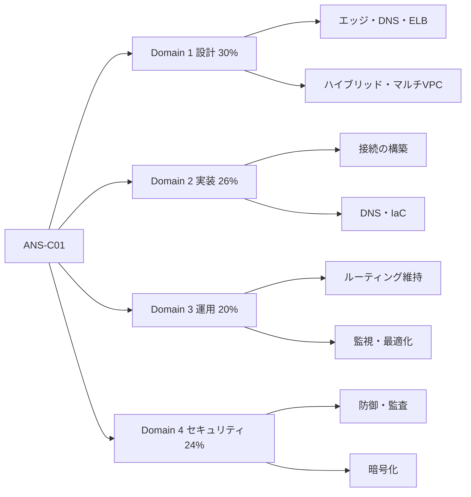

### 1.3 「補償型採点」の意味

どれか 1 つのドメインが苦手でも、他で点を取れば合格できます。ただし配点の大きい Domain 1 (30%) と Domain 2 (26%) で全体の半分以上を占めるため、まずここを固めるのが効率的です。

> **出典**
> - 公式 Exam Guide (ANS-C01): https://docs.aws.amazon.com/aws-certification/latest/advanced-networking-specialty-01/advanced-networking-specialty-01.html
> - 試験の公式ページ: https://aws.amazon.com/certification/certified-advanced-networking-specialty/

---

## 2. まず押さえるネットワーク基礎

初学者がつまずきやすい基礎を、試験で使う範囲に絞って整理します。ここは飛ばさず読んでください。

### 2.1 OSI 参照モデルと AWS サービスの対応

通信を 7 つの層に分けた考え方です。ロードバランサーなどを選ぶとき「どの層を見て振り分けるか」が重要になります。

| 層 | 名前 | 扱うもの | 代表的な AWS サービス |
|---|---|---|---|
| L7 | アプリケーション | HTTP, HTTPS, gRPC, DNS | ALB, CloudFront, WAF, API Gateway, Route 53 |
| L6〜L5 | プレゼンテーション, セッション | TLS, セッション | ALB / NLB の TLS 終端 |
| L4 | トランスポート | TCP, UDP, ポート番号 | NLB, Global Accelerator, セキュリティグループ |
| L3 | ネットワーク | IP アドレス, ルーティング | GWLB, ルートテーブル, Transit Gateway, VPN (IPsec) |
| L2 | データリンク | MAC アドレス, VLAN, フレーム | Direct Connect (VLAN, LAG, MACsec) |
| L1 | 物理 | ケーブル, 光ファイバー | Direct Connect ロケーション (光ファイバー, ポート) |

### 2.2 CIDR とサブネット

- **CIDR 表記**: `10.0.0.0/16` のように「ネットワーク部のビット数」を `/` の後ろに書きます。数字が大きいほど小さなネットワークです。
- `/16` は約 65,536 個、`/24` は 256 個、`/28` は 16 個のアドレスを持ちます。
- **VPC のサブネットでは、先頭 4 つと末尾 1 つの合計 5 アドレスが AWS に予約**されます。たとえば `/28` (16 個) の場合、実際に使えるのは 11 個です。

| CIDR | アドレス総数 | VPC サブネットで使える数 |
|---|---|---|
| /24 | 256 | 251 |
| /26 | 64 | 59 |
| /28 | 16 | 11 |

### 2.3 ルーティングの基本

- **静的ルーティング**: 人が手で経路を書く。小規模・単純な構成向き。
- **動的ルーティング**: ルーター同士が経路情報を自動交換する。AWS のハイブリッド接続では **BGP (Border Gateway Protocol)** を使う。
- **ロンゲストマッチ (最長一致)**: 複数の経路が当てはまるとき、**プレフィックス長が最も長い (より具体的な) 経路が優先**される。これは VPC ルートテーブル、Transit Gateway、BGP すべてに共通する最重要ルール。

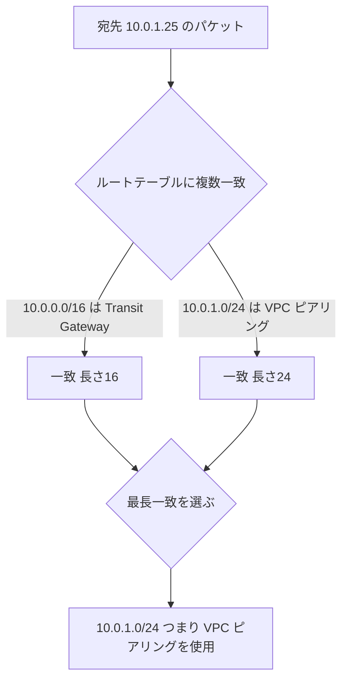

### 2.4 BGP 超入門

| 用語 | やさしい説明 | 試験での使いどころ |
|---|---|---|
| AS (自律システム) | 1 つの組織が管理するネットワークのまとまり。AS 番号 (ASN) で識別 | Direct Connect / VPN で、AWS 側とお客様側それぞれに ASN を設定 |
| AS_PATH | 経路が通過した AS の一覧。短いほど優先 | **AS_PATH プリペンド** (自 ASN を余分に足して経路を不利にする) で、使いたくない経路を後回しにする |
| Local Preference | 自 AS 内での優先度。大きいほど優先 | AWS が受け取る側の優先度は、Direct Connect の BGP コミュニティタグで制御できる |
| MED | 隣接 AS に「こちらの入口を使って」と伝える弱い指標。小さいほど優先 | 同一 AS への複数リンクの優先付け |
| BGP コミュニティ | 経路に付けるタグ | Direct Connect で、広告範囲 (Region 内・大陸内・全体) や優先度の制御に使用 |
| BFD | 双方向フォワーディング検出。障害を高速検出 | BGP のデフォルトの保持時間より速く切り替えたいとき |

> **覚えるポイント**: 「経路の優先順位を変えたい」は、**自分から出ていく向き**と**AWS から戻ってくる向き**で使う手段が違います。次の表で整理しておきましょう。

| 制御したい向き | 主な手段 |
|---|---|
| オンプレミス → AWS (AWS が受け取る) | Direct Connect の Local Preference コミュニティ、より具体的なプレフィックスの広告 |
| AWS → オンプレミス (お客様ルーターが受け取る) | お客様ルーター側の Local Preference、AS_PATH プリペンドで AWS 側へ送る経路を調整 |

### 2.5 MTU とジャンボフレーム

- **MTU (Maximum Transmission Unit)**: 1 パケットで運べる最大サイズ。**標準は 1,500 バイト**。
- **ジャンボフレーム**: 約 9,000 バイトの大きなフレーム。EC2 では VPC 内で **9,001 バイト**まで対応。
- 経路上に MTU の小さい箇所があると、パケットが落ちたり分割されたりします。これが「小さい通信は通るのに、大きい通信だけ失敗する」という典型的な障害の原因です (Task 3.2 で詳しく扱います)。

| 経路 | MTU の目安 |
|---|---|
| VPC 内 (同一 Region) | 9,001 |
| インターネットゲートウェイ経由、VPN | 1,500 (VPN は IPsec のオーバーヘッド分さらに小さくなる) |
| Transit Gateway の VPC アタッチメント | 8,500 |
| Direct Connect プライベート VIF | 9,001 に対応 (設定が必要) |
| Direct Connect トランジット VIF | 8,500 に対応 |

> **出典**
> - Amazon VPC 概要: https://docs.aws.amazon.com/vpc/latest/userguide/what-is-amazon-vpc.html
> - VPC の CIDR ブロック: https://docs.aws.amazon.com/vpc/latest/userguide/vpc-cidr-blocks.html
> - EC2 のネットワーク MTU: https://docs.aws.amazon.com/AWSEC2/latest/UserGuide/network_mtu.html
> - Direct Connect のルーティングと BGP: https://docs.aws.amazon.com/directconnect/latest/UserGuide/routing-and-bgp.html

---

## 3. 学習ロードマップとサービス全体像

### 3.1 学習の進め方

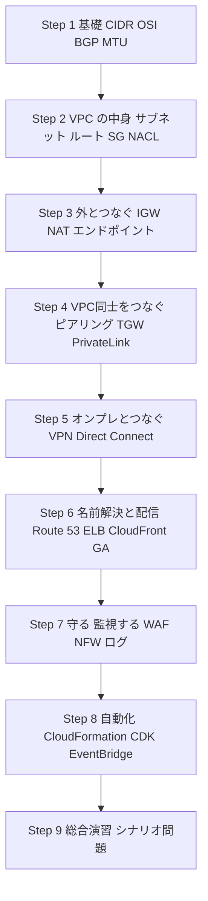

### 3.2 試験範囲の主要サービス

公式の「In-Scope AWS Services」(非網羅的で変更される可能性あり) から、ネットワークに特に関係するものを分類しました。

| カテゴリ | サービス |
|---|---|
| 接続 | Amazon VPC, AWS Transit Gateway, AWS PrivateLink, AWS Direct Connect, AWS Site-to-Site VPN, AWS Client VPN |
| 名前解決・配信 | Amazon Route 53, Amazon CloudFront, AWS Global Accelerator, Elastic Load Balancing, Amazon API Gateway, AWS Cloud Map, AWS App Mesh |
| セキュリティ | AWS WAF, AWS Shield, AWS Network Firewall, AWS Firewall Manager, AWS IAM, AWS RAM |
| 監視・管理 | Amazon CloudWatch, AWS CloudTrail, AWS Config, AWS Organizations, AWS Control Tower, AWS Trusted Advisor, AWS Health Dashboard, AWS Well-Architected Tool |
| 自動化 | AWS CloudFormation, AWS CLI, Amazon EventBridge, AWS Lambda, Amazon SNS, Amazon SQS |
| コンピュート・コンテナ | Amazon EC2, EC2 Auto Scaling, Amazon ECS, Amazon EKS, AWS Fargate, Amazon ECR |
| ストレージ・コスト | Amazon S3 (ログ保管先), AWS Cost Explorer |

### 3.3 全体アーキテクチャの俯瞰

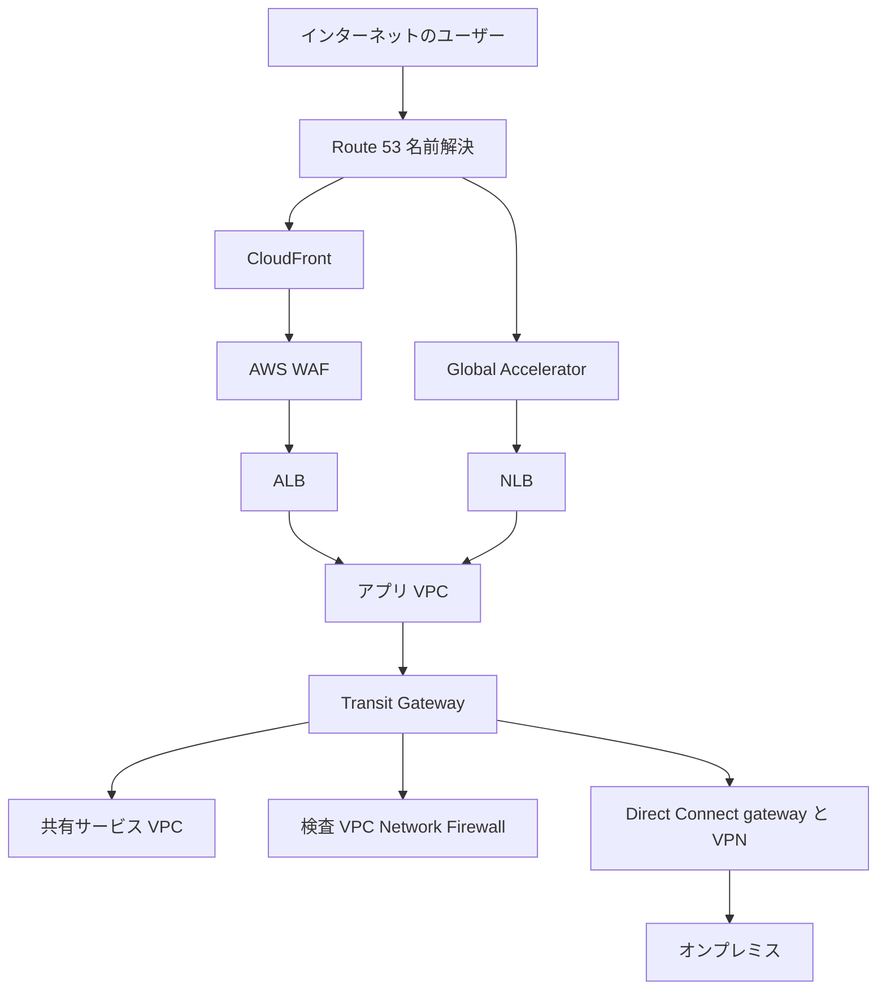

> **出典**
> - In-Scope AWS Services: https://docs.aws.amazon.com/aws-certification/latest/advanced-networking-specialty-01/ans-01-in-scope-services.html
> - AWS Well-Architected Framework: https://docs.aws.amazon.com/wellarchitected/latest/framework/welcome.html
> - AWS ホワイトペーパー「Building a Scalable and Secure Multi-VPC AWS Network Infrastructure」: https://docs.aws.amazon.com/whitepapers/latest/building-scalable-secure-multi-vpc-network-infrastructure/welcome.html

---

# Domain 1: Network Design (30%)

最も配点の高いドメインです。「要件を読み取って、最適なサービスの組み合わせを選ぶ」問題が中心です。

---

## Task 1.1 エッジサービス

**公式タスク**: グローバルなアーキテクチャで、ユーザー体験とトラフィック管理を最適化するエッジネットワークサービスを設計する。

### 何が問われるか

- CloudFront (CDN) の設計パターン
- Global Accelerator (グローバルなトラフィック管理) の設計パターン
- それらと ELB、API Gateway などとの連携パターン
- グローバルな**インバウンド / アウトバウンド**トラフィックの要件から、適切な配信方式を選ぶ力

### 用語とやさしい仕組み

#### (1) Amazon CloudFront

世界中の**エッジロケーション**に、コンテンツのコピー (キャッシュ) を置いて配信する CDN です。ユーザーに近い場所から返せるので速く、オリジンへの負荷も減ります。

| 概念 | 説明 |
|---|---|
| ディストリビューション | CloudFront の配信設定の単位 |
| オリジン | 元のコンテンツの置き場所 (S3, ALB, EC2, API Gateway, オンプレミスなど) |
| キャッシュビヘイビア | パスパターンごとに、オリジンやキャッシュ方法を切り替える設定 |
| キャッシュポリシー / オリジンリクエストポリシー | キャッシュキーに含める要素 (ヘッダー、クエリ、Cookie) と、オリジンへ転送する要素を分けて管理 |
| Origin Shield | エッジとオリジンの間に置く追加のキャッシュ層。オリジンへのリクエストを集約して負荷を下げる |
| Origin Access Control (OAC) | S3 オリジンへ CloudFront 経由のアクセスだけを許可する仕組み (S3 を直接公開しない) |
| VPC オリジン | VPC 内のプライベートな ALB / NLB / EC2 を、インターネットに公開せずにオリジンにできる機能 |
| 署名付き URL / Cookie | 有料コンテンツなど、アクセスを限定したいときに使う |
| CloudFront Functions / Lambda@Edge | エッジで軽量な処理を実行 (書き換え、認可など) |
| 料金クラス | 使うエッジロケーションの範囲を絞ってコストを下げる |

> **重要な暗記事項**: CloudFront で使う ACM 証明書は、**米国東部 (バージニア北部) リージョン (us-east-1)** で発行したものである必要があります。

#### (2) AWS Global Accelerator

CloudFront が「キャッシュを近くに置く」のに対し、Global Accelerator は **AWS のグローバルバックボーンネットワーク上で、ユーザーに近いエッジから最適なエンドポイントまで通信を運ぶ**サービスです。

| 特徴 | 内容 |
|---|---|
| 固定の入口 | **2 つの静的エニーキャスト IP アドレス**が割り当てられる (IP アドレスの許可リストが必要な場合に便利) |
| 対応プロトコル | TCP / UDP (L4)。キャッシュはしない |
| エンドポイント | ALB, NLB, EC2 インスタンス, Elastic IP |
| 高速フェイルオーバー | ヘルスチェックで異常を検知し、正常なエンドポイントへ自動で切り替え |
| トラフィックダイヤル | Region ごとに受け入れる割合を調整 (段階的な切り替えやメンテナンスに便利) |
| エンドポイントの重み | 同一エンドポイントグループ内の振り分け比率を調整 |
| カスタムルーティングアクセラレーター | 特定のポートを特定の EC2 インスタンスにマッピング (ゲームなど、セッションの決定論的な振り分けが必要な用途) |
| クライアント IP の保持 | ALB / EC2 などのエンドポイントで、元のクライアント IP を維持できる |

#### CloudFront と Global Accelerator の使い分け

| 観点 | CloudFront | Global Accelerator |
|---|---|---|
| 主な対象 | HTTP / HTTPS (静的・動的コンテンツ) | TCP / UDP 全般 (ゲーム, IoT, VoIP, HTTP 以外も) |
| キャッシュ | あり | なし |
| 入口の IP | エッジごとに変動 (DNS で解決) | **固定のエニーキャスト IP 2 つ** |
| 向いている要件 | 配信高速化, 帯域削減, WAF 連携, エッジでの処理 | 静的 IP 要求, 高速フェイルオーバー, 非 HTTP, 決定論的な Region 切り替え |
| 両方使う場合 | CloudFront のオリジンに Global Accelerator を置くのではなく、通常は用途で使い分ける (動的アプリの TCP/UDP 加速は GA、キャッシュ可能な Web は CF) | 同左 |

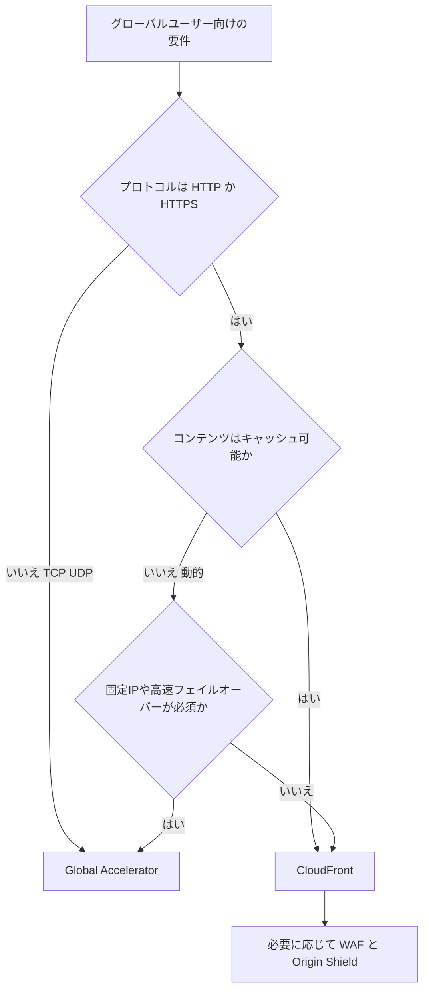

#### 他サービスとの連携パターン

| 組み合わせ | 目的・ポイント |
|---|---|
| CloudFront + ALB | Web アプリの標準構成。ALB のセキュリティグループで **CloudFront のマネージドプレフィックスリスト**だけを許可し、さらに**カスタムヘッダー**で CloudFront 経由のみを受け付ける |
| CloudFront + S3 (OAC) | 静的サイト。S3 は非公開のまま |
| CloudFront + API Gateway | API のエッジ最適化と WAF 連携。API Gateway には「エッジ最適化」「リージョン」「プライベート」のエンドポイントタイプがある |
| Global Accelerator + NLB / ALB | 固定 IP + 高速フェイルオーバー。複数 Region の ALB / NLB を束ねる |
| Route 53 + CloudFront / GA | エイリアスレコードで、独自ドメインを割り当てる |

### ベストプラクティス

1. **オリジンを直接公開しない**: S3 は OAC、ALB は VPC オリジン (または CloudFront のマネージドプレフィックスリスト + カスタムヘッダー) で保護する。
2. **キャッシュヒット率を上げる**: キャッシュキーに含める要素を最小限にし、オリジンリクエストポリシーと分離する。静的ファイルには長めの TTL、バージョン付きファイル名を利用する。
3. **オリジンの負荷を守る**: Origin Shield を検討する。
4. **エッジで WAF と Shield**: 攻撃をオリジンに届く前に止める (Domain 4 参照)。
5. **HTTPS を強制**: ビューアーからの接続を HTTPS にリダイレクトし、オリジンへの接続も HTTPS にする。
6. **Global Accelerator は複数 Region で使う**: 単一 Region では効果が限定的。ヘルスチェックとトラフィックダイヤルで運用する。
7. **コスト**: 料金クラスの見直しや、アクセスログの分析で不要な配信を減らす。

### 試験の着眼点

| 問題文のキーワード | 想定される答え |
|---|---|
| 「静的 IP アドレスをファイアウォールで許可したい」「固定の入口」 | Global Accelerator |
| 「HTTP 以外 (UDP, ゲーム, VoIP) を高速化」 | Global Accelerator |
| 「キャッシュ」「S3 の静的コンテンツ配信」「帯域削減」 | CloudFront |
| 「S3 への直接アクセスを禁止し CDN 経由に限定」 | CloudFront + OAC |
| 「ALB を CloudFront 経由のみに制限」 | マネージドプレフィックスリスト、カスタムヘッダー、または VPC オリジン |
| 「リージョン障害時に数十秒〜1 分程度で切り替え (DNS の TTL 待ちを避けたい)」 | Global Accelerator (DNS キャッシュに依存しない) |

> **出典**
> - Amazon CloudFront 開発者ガイド: https://docs.aws.amazon.com/AmazonCloudFront/latest/DeveloperGuide/Introduction.html
> - AWS Global Accelerator 開発者ガイド: https://docs.aws.amazon.com/global-accelerator/latest/dg/what-is-global-accelerator.html
> - Amazon API Gateway 開発者ガイド: https://docs.aws.amazon.com/apigateway/latest/developerguide/welcome.html

---

## Task 1.2 DNS 設計

**公式タスク**: パブリック・プライベート・ハイブリッドの要件を満たす DNS ソリューションを設計する。

### 何が問われるか

- DNS プロトコルの基本 (レコード, TTL, DNSSEC, 委任, ゾーン)
- Route 53 の機能 (エイリアスレコード, トラフィックポリシー, Resolver, ヘルスチェック)
- Route 53 と VPC、ハイブリッド、マルチアカウント、マルチ Region との統合
- ドメイン登録

### 用語とやさしい仕組み

#### DNS の基本

| 用語 | 説明 |
|---|---|
| ゾーン | あるドメイン名 (例 `example.com`) 配下のレコードをまとめて管理する単位 |
| レコード | 名前と値の対応。A (IPv4), AAAA (IPv6), CNAME (別名), MX (メール), TXT (任意の文字列), PTR (逆引き), NS (ネームサーバー), SOA |
| TTL | 結果をキャッシュしてよい秒数。短いと切り替えが速いが問い合わせが増える |
| 委任 | 親ゾーンが NS レコードで「この下は別のネームサーバーが管理」と指示すること |
| DNSSEC | DNS の応答に電子署名を付け、改ざんや偽応答を検知できるようにする仕組み |

#### Route 53 の主な機能

| 機能 | 説明 |
|---|---|
| パブリックホストゾーン | インターネットから名前解決できるゾーン |
| プライベートホストゾーン (PHZ) | 関連付けた VPC の中だけで名前解決できるゾーン。VPC の `enableDnsSupport` と `enableDnsHostnames` を有効にする必要がある |
| エイリアスレコード | AWS リソース (CloudFront, ELB, S3 静的サイト, Global Accelerator など) を指す Route 53 独自のレコード。**ゾーンのルート (apex) にも設定できる**。CNAME は apex に置けない |
| ヘルスチェック | エンドポイント監視、他のヘルスチェックの組み合わせ (計算型)、CloudWatch アラーム連動の 3 種類 |
| ドメイン登録 | Route 53 でドメインを登録・更新・移管できる |
| Route 53 Resolver | VPC に標準で付属する DNS リゾルバー (VPC の「+2」アドレス) |
| Resolver エンドポイント | インバウンド: オンプレミス → AWS の問い合わせを受ける。アウトバウンド: AWS → オンプレミスへ転送する |
| Resolver DNS Firewall | VPC からの DNS 問い合わせをドメイン単位でフィルタリング |

#### ルーティングポリシー (トラフィック管理)

| ポリシー | 動き | 典型的な用途 |
|---|---|---|
| シンプル | 1 つ (または複数の値) をそのまま返す | 単一リソース |
| 加重 (Weighted) | 比率で振り分け | カナリアリリース, 段階移行 |
| レイテンシー | 最もレイテンシーの低い Region を返す | マルチ Region の性能最適化 |
| フェイルオーバー | プライマリが異常ならセカンダリを返す | Active / Passive の DR |
| 位置情報 (Geolocation) | ユーザーの所在地 (国・大陸) で返す | 地域ごとのコンテンツ, 法規制 |
| 地理的近接性 (Geoproximity) | 場所とバイアス値で近さを調整 | リソース位置を基準にした振り分け |
| IP ベース | クライアントの IP 範囲 (CIDR) で返す | 特定ネットワークからのトラフィックの制御 |
| 複数値回答 | 最大 8 件の正常な値を返す (簡易的な負荷分散) | ヘルスチェック付きの簡易分散 |

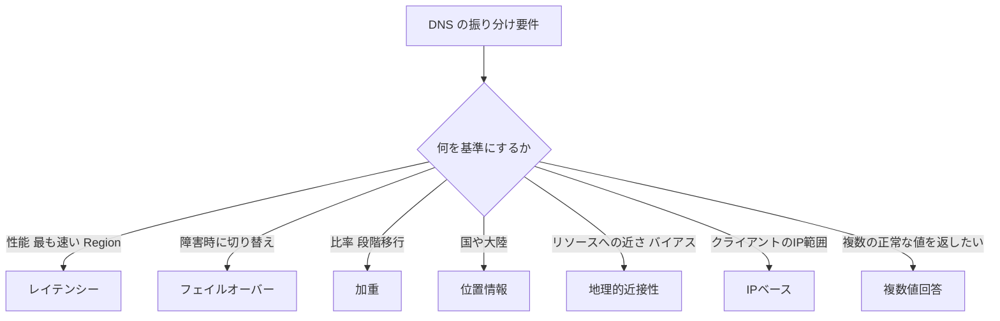

#### ハイブリッド DNS の仕組み

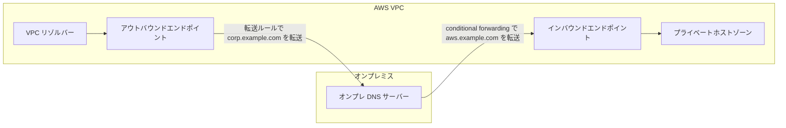

- **インバウンドエンドポイント**: オンプレミスのクライアントが、AWS 内の名前 (PHZ やプライベート DNS 名) を引けるようにする。
- **アウトバウンドエンドポイント + 転送ルール**: AWS の EC2 などが、オンプレミスのドメインを引けるようにする。
- エンドポイントには、**可用性のため異なる AZ に 2 つ以上の IP アドレス**を割り当てる。

### ベストプラクティス

1. **AWS リソースにはエイリアスレコードを使う**: エイリアスへの問い合わせは Route 53 で課金されず、ターゲットの IP 変化にも追随する。
2. **ヘルスチェックと組み合わせる**: フェイルオーバー、レイテンシー、加重ポリシーはヘルスチェックと組み合わせて初めて「正常な先だけ」を返せる。
3. **TTL の設計**: 切り替えが予想されるレコードは事前に TTL を短くしておく。
4. **Resolver エンドポイントは冗長に**: 2 つ以上の AZ に配置し、セキュリティグループで DNS (TCP/UDP 53) だけを許可する。
5. **ルールは集中管理して共有**: Resolver の転送ルールは AWS RAM で他アカウントと共有する。
6. **DNS Firewall でデータ持ち出しを抑止**: 既知の悪性ドメインや、許可リスト外のドメインを遮断する。
7. **DNS のログを取る**: Resolver クエリログ、パブリックホストゾーンのクエリログを有効にする (Task 4.2 参照)。

### 試験の着眼点

| 問題文のキーワード | 想定される答え |
|---|---|
| 「apex ドメイン (`example.com`) を ALB / CloudFront に向けたい」 | エイリアスレコード |
| 「VPC 内からのみ解決できる名前」 | プライベートホストゾーン |
| 「オンプレミスから AWS の名前を解決」 | Resolver インバウンドエンドポイント |
| 「AWS からオンプレミスのドメインを解決」 | Resolver アウトバウンドエンドポイント + 転送ルール |
| 「国ごとに別のコンテンツ / 法規制」 | 位置情報ルーティング |
| 「Region を跨いで最も速いエンドポイント」 | レイテンシールーティング |
| 「DNS 応答の改ざん防止」 | DNSSEC |

> **出典**
> - Route 53 開発者ガイド: https://docs.aws.amazon.com/Route53/latest/DeveloperGuide/Welcome.html
> - ルーティングポリシーの選択: https://docs.aws.amazon.com/Route53/latest/DeveloperGuide/routing-policy.html
> - エイリアスレコードと非エイリアスレコード: https://docs.aws.amazon.com/Route53/latest/DeveloperGuide/resource-record-sets-choosing-alias-non-alias.html
> - Route 53 Resolver: https://docs.aws.amazon.com/Route53/latest/DeveloperGuide/resolver.html
> - ヘルスチェックと DNS フェイルオーバー: https://docs.aws.amazon.com/Route53/latest/DeveloperGuide/dns-failover.html

---

## Task 1.3 ロードバランシング

**公式タスク**: 高可用性・スケーラビリティ・セキュリティ要件を満たすロードバランシングを設計する。

### 何が問われるか

- L3 / L4 / L7 でのロードバランシングの仕組み
- ロードバランサーの種類と選定
- 内部 / 外部ロードバランサーの接続パターン
- スケーリング要因、他サービスとの統合 (Global Accelerator, CloudFront, WAF, Route 53, EKS, ACM)
- 設定オプション (Proxy Protocol, クロスゾーン, スティッキーセッション, ルーティングアルゴリズム)
- ターゲットグループ (TCP, GENEVE, IP とインスタンス)
- AWS Load Balancer Controller
- 暗号化・認証 (TLS 終端と TLS パススルー)

### 用語とやさしい仕組み

#### ロードバランサーの種類

| 種類 | 層 | 主なプロトコル | 特徴 |
|---|---|---|---|
| Application Load Balancer (ALB) | L7 | HTTP, HTTPS, gRPC, WebSocket | パス / ホスト / ヘッダー / クエリによるルーティング, WAF 連携, OIDC や Cognito 認証, Lambda をターゲットにできる |
| Network Load Balancer (NLB) | L4 | TCP, UDP, TLS | 超低レイテンシーで高スループット, AZ ごとの静的 IP (Elastic IP 割り当て可), クライアント IP を保持, PrivateLink のバックエンドになれる |
| Gateway Load Balancer (GWLB) | L3 (+L4) | IP パケット (GENEVE, UDP 6081) | ファイアウォールや IDS / IPS などの**仮想アプライアンスを透過的に挟む** |
| Classic Load Balancer | L4 / L7 | 旧世代 | 新規設計では使わない (試験では「移行対象」として登場) |

#### 接続パターン

| 種類 | 説明 |
|---|---|
| インターネット向け (外部) | パブリックサブネットに配置し、パブリック IP で受ける |
| 内部 (Internal) | プライベート IP のみ。社内アプリ, 多層構成の中間層, VPN / Direct Connect 経由のアクセス向け |

#### 設定オプション

| 設定 | 内容 | 注意点 |
|---|---|---|
| クロスゾーン負荷分散 | 全 AZ のターゲットに均等に振り分ける | **ALB は常に有効 (ロードバランサー単位では無効にできない)。NLB / GWLB は既定で無効** で、有効にすると AZ 間データ転送料が発生しうる |
| スティッキーセッション | 同じクライアントを同じターゲットに送る | ALB は Cookie ベース (期間ベース / アプリケーションベース)。NLB は送信元 IP ベースのアフィニティ |
| ルーティングアルゴリズム | ALB は ラウンドロビン / 最小未処理リクエスト / 加重ランダム。NLB はフローハッシュ | ターゲットごとに処理時間の差が大きい場合は最小未処理リクエストが有効 |
| Proxy Protocol v2 | NLB が、元のクライアント情報をターゲットに伝える | ターゲット側が対応している必要がある |
| ターゲットタイプ | インスタンス / IP / Lambda (ALB) / ALB (NLB のターゲット) | **IP ターゲット**: ピアリングされた VPC やオンプレミスのサーバー、コンテナ (EKS の Pod など) も指定可能 |
| ヘルスチェック | ターゲットの正常性を確認 | ヘルスチェック用のパスとポートを適切に設計する |

#### TLS 終端とパススルー

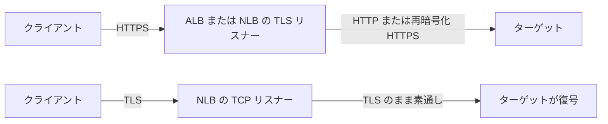

| 方式 | 内容 | 向いている要件 |
|---|---|---|
| TLS 終端 | ロードバランサーで復号。証明書は ACM で管理 | 証明書の一元管理, WAF による検査, ターゲットの CPU 負荷削減 |
| TLS パススルー | 暗号化されたままターゲットまで届ける (NLB の TCP リスナー) | エンドツーエンドの暗号化が要件, クライアント証明書をターゲットで検証 |
| 再暗号化 | LB で復号して検査したあと、ターゲットへ再度 TLS | 検査とエンドツーエンド暗号化の両立 |
| 相互 TLS (mTLS) | クライアント証明書の検証 (ALB が対応) | 認証付きの API |

#### AWS Load Balancer Controller (Kubernetes)

EKS などの Kubernetes クラスターから、ALB / NLB を作って管理するコントローラーです。

| Kubernetes のリソース | 作成される AWS リソース |
|---|---|
| `Ingress` | ALB (L7) |
| `Service` (type: LoadBalancer) | NLB (L4) |

- ターゲットタイプは **`ip`** (Pod へ直接) と **`instance`** (ノードの NodePort 経由) を選べる。VPC CNI を使う EKS では `ip` が Pod に直接届き、ホップが減って効率的。

```yaml
# Ingress の例 (AWS Load Balancer Controller が ALB を作成する)
apiVersion: networking.k8s.io/v1
kind: Ingress
metadata:
  name: web
  annotations:
    alb.ingress.kubernetes.io/scheme: internet-facing
    alb.ingress.kubernetes.io/target-type: ip
    alb.ingress.kubernetes.io/listen-ports: '[{"HTTPS":443}]'
    alb.ingress.kubernetes.io/certificate-arn: arn:aws:acm:ap-northeast-1:111122223333:certificate/example
spec:
  ingressClassName: alb
  rules:
    - http:
        paths:
          - path: /
            pathType: Prefix
            backend:
              service:
                name: web
                port:
                  number: 80
```

#### ロードバランサーの選定フロー

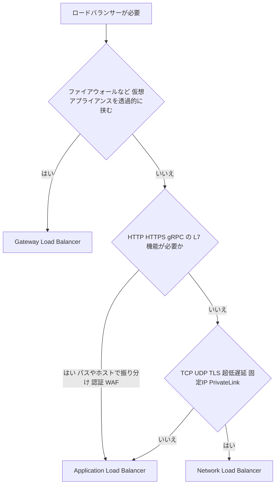

#### スケーリングの考え方

- ALB / NLB は負荷に応じて**自動でスケール**する (LCU / NLCU の単位で課金)。
- **急激なスパイク**が事前にわかっている場合は、AWS サポートに事前のスケーリング (ウォームアップ) を相談する。
- ELB は**複数 AZ のサブネットに配置**し、各サブネットには十分な空き IP を確保する。
- Auto Scaling グループをターゲットグループに関連付けると、インスタンスの増減が自動で登録 / 解除される。**ヘルスチェックのタイプを ELB にする**と、LB が異常と判断したインスタンスも置き換えられる。

### ベストプラクティス

1. **複数 AZ に配置**し、ターゲットも複数 AZ に分散する。NLB のクロスゾーンは、ターゲット数が AZ 間で偏る場合に検討する (料金に注意)。
2. **セキュリティグループを活用**: ターゲットのセキュリティグループで「ロードバランサーのセキュリティグループからの通信のみ」を許可する (SG 参照)。
3. **ACM で証明書を一元管理**し、TLS ポリシーは新しい (安全な) ものを選ぶ。
4. **WAF は ALB に関連付け**て、L7 攻撃を防ぐ。
5. **アクセスログを有効化**して S3 に保存する (Task 4.2)。
6. **コネクションドレイニング (登録解除の遅延) を適切に設定**し、デプロイ時の接続切断を防ぐ。
7. **ヘルスチェックを実態に合わせる**: 依存サービスまで確認する深いヘルスチェックは、障害の連鎖を招くことがあるので注意する。

### 試験の着眼点

| 問題文のキーワード | 想定される答え |
|---|---|
| 「パスベース / ホストベースのルーティング」「WAF」 | ALB |
| 「静的 IP」「ホワイトリスト」「UDP」「超低レイテンシー」 | NLB (または Global Accelerator) |
| 「サードパーティのファイアウォールを透過的に挿入」「GENEVE」 | GWLB |
| 「クライアントの送信元 IP をそのままターゲットに」 | NLB (IP 保持), ALB なら `X-Forwarded-For` ヘッダー |
| 「PrivateLink でサービスを公開」 | NLB (または GWLB) の背後にサービスを置く |
| 「エンドツーエンドの暗号化 + LB でクライアント証明書をそのまま」 | NLB の TCP リスナーでパススルー |
| 「Kubernetes の Ingress から ALB」 | AWS Load Balancer Controller |

> **出典**
> - Elastic Load Balancing ユーザーガイド: https://docs.aws.amazon.com/elasticloadbalancing/latest/userguide/what-is-load-balancing.html
> - Application Load Balancer: https://docs.aws.amazon.com/elasticloadbalancing/latest/application/introduction.html
> - Network Load Balancer: https://docs.aws.amazon.com/elasticloadbalancing/latest/network/introduction.html
> - Gateway Load Balancer: https://docs.aws.amazon.com/elasticloadbalancing/latest/gateway/introduction.html
> - AWS Load Balancer Controller (EKS): https://docs.aws.amazon.com/eks/latest/userguide/aws-load-balancer-controller.html

---

## Task 1.4 ログとモニタリングの要件定義

**公式タスク**: AWS とハイブリッドのネットワーク全体で、ログとモニタリングの要件を定義する。

### 何が問われるか

- CloudWatch (メトリクス, エージェント, ログ, アラーム, ダッシュボード, Insights) による可視化
- Transit Gateway Network Manager、VPC Reachability Analyzer による可視化
- VPC フローログとトラフィックミラーリング
- アクセスログ (ロードバランサー, CloudFront)
- 要件の洗い出し、見るべきメトリクスの選定、**ベースライン (平常時の性能) の取得**

### 用語とやさしい仕組み

#### ツールの役割分担

| ツール | 何がわかるか | 向いている質問 |
|---|---|---|
| CloudWatch メトリクス | 数値の時系列 (帯域, パケット数, 接続状態) | 「帯域は足りているか」「リンクは UP か」 |
| CloudWatch Logs / Logs Insights | ログの保管と検索・集計 | 「どの IP がどれだけ拒否されたか」 |
| CloudWatch アラーム | しきい値超過で通知・自動アクション | 「異常を自動で知りたい」 |
| VPC フローログ | ENI / サブネット / VPC 単位の通信メタデータ (誰から誰へ, ポート, 許可 / 拒否, バイト数) | 「どの通信が拒否されたか」 |
| トラフィックミラーリング | パケットそのもののコピー (ペイロード含む) | 「パケットの中身を IDS で検査したい」 |
| Reachability Analyzer | 設定から導く 2 点間の**到達可能性の分析** (パケットは実際には送らない) | 「A から B へ届くはずか、どこで止まるか」 |
| Transit Gateway Network Manager | グローバルネットワークのトポロジー、イベント、メトリクスの可視化 | 「拠点・VPC・VPN の全体像を一枚で見たい」 |
| ロードバランサー / CloudFront アクセスログ | リクエスト単位の詳細 | 「どのクライアントがどの URL に来たか」 |

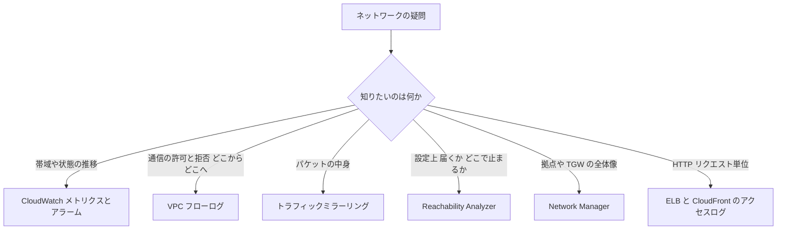

#### VPC フローログの要点

- 取得範囲: VPC / サブネット / ENI のいずれか。出力先: CloudWatch Logs, S3, Data Firehose。
- 記録は **ACCEPT / REJECT / ALL** から選べる。
- 既定のフォーマットのほか、**カスタムフォーマット**で拡張フィールド (例: `pkt-srcaddr`, `pkt-dstaddr`, `tcp-flags`, `flow-direction`, `traffic-path`) を追加できる。NAT 越しの本来の送信元を調べるときは `pkt-srcaddr` が役立つ。
- **記録されない通信**がある: Amazon のDNS サーバーへの通信、インスタンスメタデータ (169.254.169.254)、DHCP、Amazon Time Sync、Windows のライセンス認証など。
- フローログは**パケットのリアルタイム監視ではない** (集約期間があり、数分の遅れがある)。

#### トラフィックミラーリングの要点

- Nitro ベースのインスタンスの ENI から、コピーしたパケットを **VXLAN (UDP 4789)** で送る。
- ミラー先 (ターゲット) は ENI / NLB / Gateway Load Balancer エンドポイント。
- フィルター (プロトコル, 送受信方向, CIDR, ポート) で量を絞る。全パケットを送ると帯域・コストが膨らむ。

#### ベースラインとは

「正常なときの値」を事前に取っておき、異常かどうかを比較できるようにすることです。

| 取る対象 | 例 |
|---|---|
| 帯域 | Direct Connect 接続の平均・ピーク使用率 |
| レイテンシー | 拠点間 / Region 間の往復遅延 |
| パケットロス | VPN トンネルの損失 |
| 接続数 | NLB のアクティブフロー数, NAT ゲートウェイの接続数 |
| エラー率 | ALB の 5xx 率, ターゲット応答時間 |

### ベストプラクティス

1. **目的から逆算して要件を決める**: 「障害の検知」「性能の劣化の検知」「セキュリティ調査」「監査」のどれかで、必要なツールと保存期間が変わる。
2. **ログの保管先を設計する**: 長期保管は S3 (ライフサイクルで安価なクラスへ移行)、検索・即時分析は CloudWatch Logs。
3. **フローログは全 VPC で有効化**し、拒否ログの調査にはカスタムフォーマットを使う。
4. **ミラーリングは必要な通信だけに絞る**。
5. **アラームは「症状」と「原因」の両方に**: 例えば Direct Connect の接続状態 (UP / DOWN) と、帯域使用率の両方を監視する。
6. **ダッシュボードで可視化**し、変更前後で比較できるようにする。
7. **ベースラインを先に取る**: 移行後の性能が「悪化したのか、元からか」を判断できる。

### 試験の着眼点

| 問題文のキーワード | 想定される答え |
|---|---|
| 「パケットのペイロードを検査」「IDS に送る」 | トラフィックミラーリング |
| 「どの通信が拒否 (REJECT) されたか」 | VPC フローログ |
| 「設定を変えずに、到達できない原因を特定」 | Reachability Analyzer |
| 「TGW・VPN・拠点を含む全体トポロジー」 | Transit Gateway Network Manager |
| 「リクエスト URL・クライアント・レイテンシーを調査」 | ALB アクセスログ / CloudFront アクセスログ |

> **出典**
> - CloudWatch ユーザーガイド: https://docs.aws.amazon.com/AmazonCloudWatch/latest/monitoring/WhatIsCloudWatch.html
> - VPC フローログ: https://docs.aws.amazon.com/vpc/latest/userguide/flow-logs.html
> - トラフィックミラーリング: https://docs.aws.amazon.com/vpc/latest/mirroring/what-is-traffic-mirroring.html
> - Reachability Analyzer: https://docs.aws.amazon.com/vpc/latest/reachability/what-is-reachability-analyzer.html
> - Network Manager: https://docs.aws.amazon.com/network-manager/latest/tgwnm/what-is-network-manager.html

---

## Task 1.5 オンプレミス接続の設計

**公式タスク**: オンプレミスネットワークと AWS クラウドをつなぐルーティング戦略と接続アーキテクチャを設計する。

### 何が問われるか

- ルーティングの基礎 (動的 / 静的, BGP)
- L1 / L2 の概念 (VLAN, LAG, 光トランシーバー, ジャンボフレーム)
- カプセル化と暗号化 (GRE, IPsec)、オーバーレイネットワーク
- 冗長なハイブリッド接続の設計 (Direct Connect, Site-to-Site VPN)
- **BGP 属性による経路制御** (負荷分散 / Active-Passive)
- SD-WAN との統合 (Transit Gateway Connect)

### 用語とやさしい仕組み

#### 接続方式の比較

| 項目 | Site-to-Site VPN | Direct Connect (DX) |
|---|---|---|
| 経路 | インターネット上の IPsec トンネル | 専用線 (閉じた物理回線) |
| 立ち上げ | 数分〜 (すぐ) | 数週間〜 (回線手配が必要) |
| 帯域 | トンネルあたり最大約 1.25 Gbps | ポート速度に依存 (専用接続は 1 / 10 / 100 Gbps など、ホスト型はより細かい帯域) |
| レイテンシー | インターネット経由で変動 | 安定・低め |
| 暗号化 | IPsec (標準で暗号化) | **標準では暗号化されない** (MACsec や VPN を重ねる) |
| コスト | 比較的安価 | 回線費用 + ポート料金。大量転送ではデータ転送料が安くなる |
| 主な用途 | 迅速な接続, DX のバックアップ | 大容量・安定性・コンプライアンス |

> **試験の定石**: 「DX を主、VPN をバックアップ」は定番の構成です。

#### Direct Connect の構成要素

| 用語 | 説明 |
|---|---|
| DX ロケーション | AWS と接続できるコロケーション施設 |
| 専用接続 / ホスト型接続 | 専用接続は AWS から直接ポートを割り当て。ホスト型は AWS パートナー経由で、より小さい帯域で利用 |
| LOA-CFA | 施設に対してクロスコネクトを依頼するための許可書 (Letter of Authorization - Connecting Facility Assignment) |
| 仮想インターフェイス (VIF) | 物理回線の上に作る論理的な接続。**VLAN** で区別 |
| プライベート VIF | VPC (VGW / DX gateway 経由) へのプライベートアクセス |
| パブリック VIF | AWS のパブリックサービス (S3 など) のパブリック IP へアクセス |
| トランジット VIF | DX gateway 経由で **Transit Gateway** へ接続 |
| Direct Connect gateway | 複数 Region の VPC / TGW と、DX をグローバルにつなぐ中継点 |
| LAG | 同一速度・同一ロケーションの複数接続を 1 本の論理リンクにまとめる (L2) |
| MACsec | L2 (イーサネット) の暗号化。対応する専用接続で利用できる |

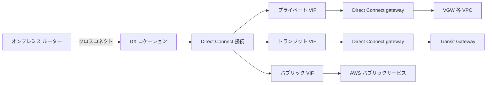

#### 冗長性の設計 (Direct Connect レジリエンシー)

| モデル | 構成 | 想定する障害への耐性 |
|---|---|---|
| 最大レジリエンシー | 2 つ以上の DX ロケーションに、それぞれ 2 本以上の接続 | デバイス、接続、ロケーション全体の障害 |
| 高レジリエンシー | 2 つの DX ロケーションに、それぞれ 1 本ずつ | 接続・ロケーションの障害 |
| 開発 / テスト | 1 つのロケーションに別デバイスで 2 本 | デバイス障害 (ロケーション障害には耐えない) |

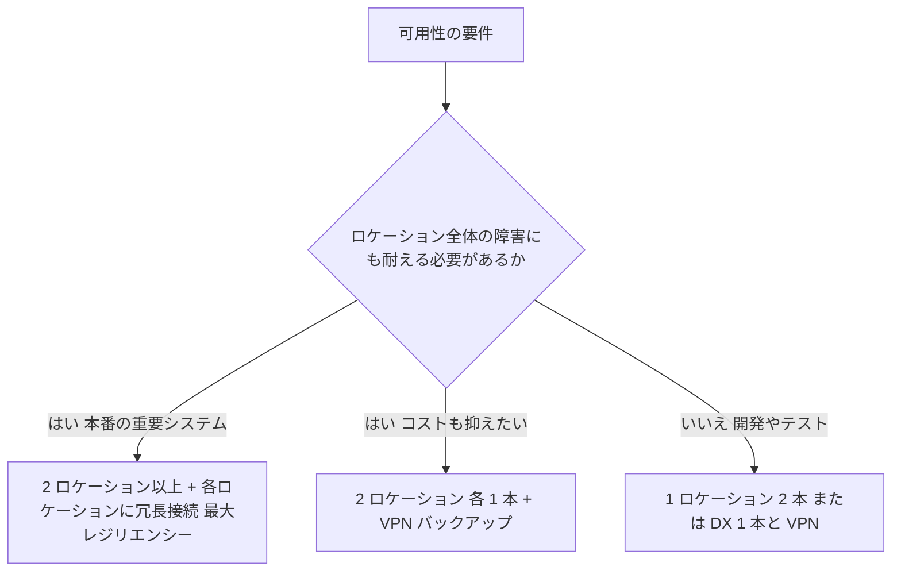

> **補足**: 「DX 1 本 + Site-to-Site VPN バックアップ」も現実的な選択肢です。ただし VPN は帯域が小さいので、フェイルオーバー時の帯域が足りるか確認します。

#### Site-to-Site VPN の要点

- 1 つの VPN 接続には、**2 本のトンネル** (異なる AZ のエンドポイント) がある。
- ルーティングは **BGP (動的)** または静的。**動的 (BGP) を推奨**。
- **Transit Gateway に終端**する VPN では **ECMP** により、複数の VPN 接続を束ねて帯域を増やせる。VGW 終端では ECMP は使えない。
- **アクセラレーテッド VPN**: VPN のトンネルを Global Accelerator 経由にして、インターネット上の経路の不安定さを減らす (Transit Gateway 終端のみ)。
- **プライベート IP VPN**: Direct Connect の上に VPN を載せ、パブリック IP を使わずに暗号化する。
- NAT-T (NAT トラバーサル) に対応。

#### SD-WAN との統合: Transit Gateway Connect

| 用語 | 説明 |
|---|---|
| Connect アタッチメント | 既存の VPC (または DX) アタッチメントを「トランスポート」として使い、その上に **GRE トンネル + BGP** を張る |
| 効果 | SD-WAN アプライアンス (EC2 上のサードパーティ製品) と TGW を、高い帯域・BGP で連携 |
| オーバーレイネットワーク | 物理 (アンダーレイ) の上に、GRE や IPsec などで作る論理ネットワーク |

#### BGP による経路制御

AWS 側が複数の経路から「どれを選ぶか」の主な判断:

| 優先順 (概念) | ルール |
|---|---|
| 1 | **最長一致 (より具体的なプレフィックス)** |
| 2 | 同じ長さなら、**Direct Connect が VPN より優先**されることが多い (静的ルートより BGP 等の細かい順序は公式ドキュメントで確認) |
| 3 | Local Preference (DX では BGP コミュニティで調整) |
| 4 | AS_PATH の短さ |

> 細かい順序は更新されうるため、「**最長一致が最優先、次に DX > VPN の傾向、その後に BGP 属性**」と理解し、詳細は出典で確認しましょう。

| やりたいこと | 方法 |
|---|---|
| Active / Passive | バックアップ側の経路に AS_PATH プリペンドを足す、または Local Preference を下げる |
| Active / Active (負荷分散) | 同じ属性 (同一プレフィックス長) で両方の経路を広告し、ECMP を使う |
| AWS からの戻りを制御 | オンプレ側のルーターで MED / AS_PATH を調整、または特定プレフィックスを分割して広告 |
| 高速な障害検知 | BFD を有効化 |

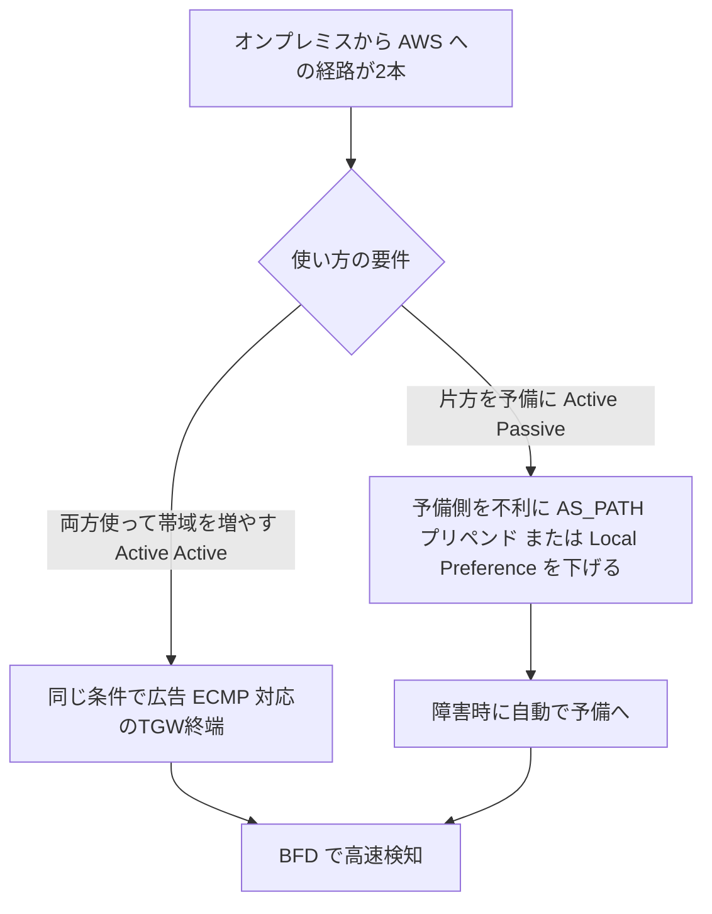

### ベストプラクティス

1. **Direct Connect は 2 ロケーション以上で冗長化**し、バックアップに VPN も検討する。
2. **BGP を使う**: 静的ルートより自動フェイルオーバーが可能。BFD で検知を高速化。
3. **ルートを要約**して、経路数の上限 (クォータ) に当たらないようにする。
4. **暗号化が必要なら**: MACsec (L2)、DX 上の IPsec VPN (プライベート IP VPN など)、またはアプリケーション層の TLS を使う。DX は**標準では暗号化されない**。
5. **Transit VIF + DX gateway + TGW** で、複数 VPC を 1 本の DX で効率的に共有する。
6. **MTU** を意識する (DX プライベート VIF はジャンボフレーム対応、VPN は 1,500 未満)。
7. **ホスト型接続の帯域**は、将来の拡張を見込んで選ぶ。

### 試験の着眼点

| 問題文のキーワード | 想定される答え |
|---|---|
| 「すぐに接続したい」「暫定」 | Site-to-Site VPN |
| 「安定した帯域・低レイテンシー・大量データ転送」 | Direct Connect |
| 「DX の暗号化」 | MACsec、または DX 上の VPN |
| 「複数 Region の VPC を 1 本の DX で」 | Direct Connect gateway |
| 「多数の VPC / TGW を DX で」 | トランジット VIF + DX gateway + TGW |
| 「VPN 帯域を増やしたい」 | TGW 終端の VPN で ECMP |
| 「VPN の安定性を高めたい」 | アクセラレーテッド VPN |
| 「SD-WAN アプライアンスと TGW」 | Transit Gateway Connect (GRE + BGP) |
| 「DX を優先して、VPN は障害時のみ」 | 同じプレフィックスなら DX を優先 (VPN はバックアップ) |

> **出典**
> - Direct Connect ユーザーガイド: https://docs.aws.amazon.com/directconnect/latest/UserGuide/Welcome.html
> - Direct Connect レジリエンシーの推奨: https://docs.aws.amazon.com/directconnect/latest/UserGuide/resiliency_toolkit.html
> - Direct Connect gateway: https://docs.aws.amazon.com/directconnect/latest/UserGuide/direct-connect-gateways.html
> - LAG: https://docs.aws.amazon.com/directconnect/latest/UserGuide/lags.html
> - MACsec: https://docs.aws.amazon.com/directconnect/latest/UserGuide/MACsec.html
> - Site-to-Site VPN: https://docs.aws.amazon.com/vpn/latest/s2svpn/VPC_VPN.html
> - アクセラレーテッド VPN: https://docs.aws.amazon.com/vpn/latest/s2svpn/accelerated-vpn.html
> - Transit Gateway Connect: https://docs.aws.amazon.com/vpc/latest/tgw/tgw-connect.html
> - Amazon VPC 接続オプション (ホワイトペーパー): https://docs.aws.amazon.com/whitepapers/latest/aws-vpc-connectivity-options/introduction.html

---

## Task 1.6 マルチアカウント・マルチ VPC 接続の設計

**公式タスク**: 複数の AWS アカウント、Region、VPC にまたがる接続パターンに対応する、ルーティング戦略と接続アーキテクチャを設計する。

### 何が問われるか

- 接続パターン (VPC ピアリング, Transit Gateway, PrivateLink) と使い分け
- VPC 共有の利点
- IP アドレスの重複 (オーバーラップ) への対処 (NAT, PrivateLink, Transit Gateway ルーティング)

### 用語とやさしい仕組み

#### 3 つの接続方式

| 項目 | VPC ピアリング | Transit Gateway (TGW) | PrivateLink |
|---|---|---|---|
| 形 | 1 対 1 の直接接続 | ハブ & スポーク (中央のルーター) | 特定サービスだけを公開 (一方向) |
| 推移的ルーティング | **不可** | **可能** (ルートテーブルで制御) | 該当なし |
| CIDR の重複 | **不可** | 不可 (同一 TGW ルートテーブル内) | **可能** |
| 接続範囲 | VPC 全体 | VPC 全体, VPN, DX, 他 Region | 特定のサービス (NLB / GWLB の背後) |
| 帯域の制約 | 特になし (VPC 内と同等) | アタッチメントごとの上限あり | エンドポイントの帯域に依存 |
| 規模 | 数が増えると管理が大変 (n × (n-1) / 2 本) | 数千の VPC までスケール | 多数のコンシューマーに対応 |
| コストの傾向 | 安い (データ転送のみ) | アタッチメント料金 + 処理データ量の料金 | エンドポイント時間料金 + データ処理料金 |
| 向いている用途 | 少数の VPC の高帯域接続 | 大規模なネットワーク統合、ハイブリッド | SaaS 的なサービス提供、重複 CIDR、最小権限の公開 |

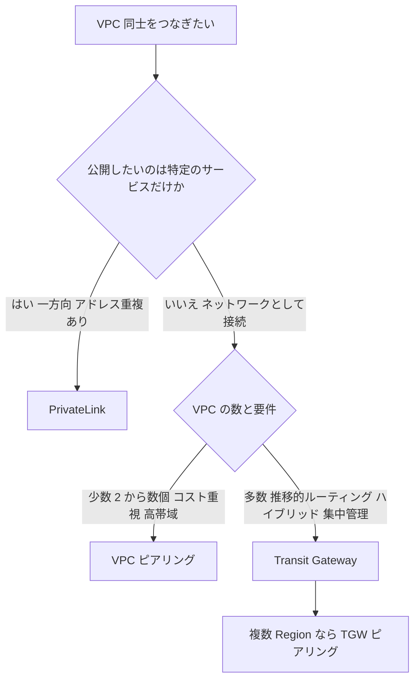

#### Transit Gateway の理解

| 用語 | 説明 |
|---|---|
| アタッチメント | TGW に接続するもの: VPC, VPN, Direct Connect gateway, TGW ピアリング, Connect |
| TGW ルートテーブル | アタッチメントごとに「どこへ送るか」を定義。複数作って分離できる |
| アソシエーション | アタッチメントが**どのルートテーブルを参照するか** (1 つのアタッチメントに 1 つ) |
| プロパゲーション | アタッチメントが自分のルート (CIDR) を、**どのルートテーブルへ広告するか** |
| アプライアンスモード | ステートフルな検査 (ファイアウォール等) のため、行きと戻りを**同じ AZ のアプライアンス**に通す |
| TGW ピアリング | 別 Region (または別アカウント) の TGW と接続。**静的ルートのみ** (動的伝播は不可) |
| マルチキャスト | TGW のマルチキャストドメインで VPC 内のマルチキャストに対応 (Task 3.3) |

**典型例: 本番と開発を分離しつつ、共有サービスだけ共通利用する**

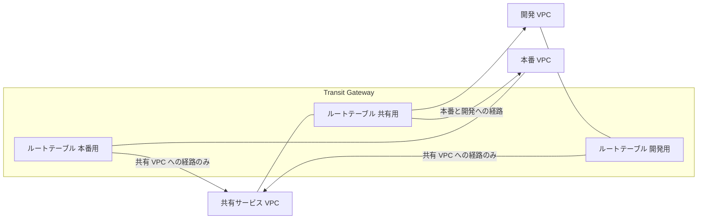

- 本番と開発のルートテーブルは「共有 VPC」の経路だけを持つので、**本番と開発の間は通信できない** (分離)。
- この「アソシエーション (参照) とプロパゲーション (広告) の分離」が試験の頻出テーマです。

#### 中央集権型の検査 (集中型エグレス / インスペクション)

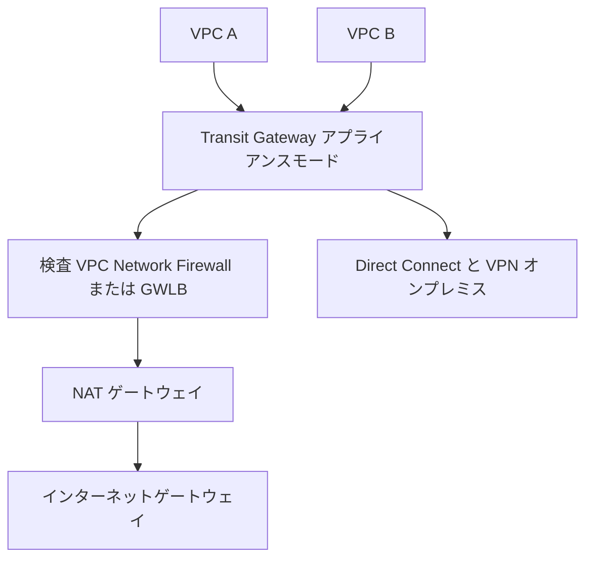

#### PrivateLink の仕組み

| 用語 | 説明 |
|---|---|
| エンドポイントサービス | サービス提供側が NLB (または GWLB) の背後で公開するもの |
| インターフェイス型エンドポイント | 利用側 VPC に作る ENI (プライベート IP)。ここへ接続すると提供側へ届く |
| ゲートウェイ型エンドポイント | **S3 と DynamoDB 専用**。ルートテーブルに経路を追加。追加料金なし |
| GWLB エンドポイント | 検査アプライアンスへ透過的にトラフィックを送る |
| エンドポイントポリシー | エンドポイント経由で許可する操作・リソースを IAM ポリシー形式で制限 |
| プライベート DNS | AWS サービスの標準の DNS 名を、エンドポイントのプライベート IP に解決 |

> PrivateLink は**一方向** (利用者 → 提供者) で、**CIDR が重複していても使える**のが特徴です。

#### VPC 共有 (Resource Access Manager)

| 項目 | 内容 |
|---|---|
| 仕組み | AWS Organizations 内で、**サブネット**を他のアカウントと共有 (オーナーアカウントが VPC を所有) |
| 利点 | VPC / サブネット / NAT / TGW アタッチメントなどの数を減らせる、IP 空間の節約、管理の集中、アカウント間の接続が不要 |
| 参加者の権限 | 共有サブネット内に自分のリソース (EC2 など) を起動できる。VPC・ルートテーブル・ACL などの変更はできない |
| 注意 | セキュリティグループは参加者がそれぞれ管理。AZ は AZ ID で揃える (アカウントごとに AZ 名の割り当てが異なる) |

#### IP アドレス重複への対処

| 方法 | 内容 | 適している場面 |
|---|---|---|
| PrivateLink | 特定サービスだけを公開 (CIDR が重複しても OK) | サービス単位の接続 |
| NAT (プライベート NAT ゲートウェイ) | 重複する CIDR を、重複しないアドレス帯に変換して接続 | 既存の重複ネットワークを繋ぐとき |
| TGW ルーティング + 重複回避の設計 | 重複しない CIDR にあらかじめ設計 | 新規構築 (最も望ましい) |
| 新しい CIDR (セカンダリ CIDR) | 追加 CIDR で重複しない範囲を用意 | VPC の拡張 |

> **ベストな対処は「重複しないように最初から設計すること」**。VPC IPAM を使うと、組織全体で CIDR を計画的に払い出せます。

### ベストプラクティス

1. **IP アドレス計画を最初に**: 組織全体で重複しない CIDR を設計し、将来の拡張も見込む (IPAM の活用)。
2. **多数の VPC は Transit Gateway**。2〜3 個の高帯域接続はピアリングも検討。
3. **ルートテーブルで分離**: 環境 (本番 / 開発 / 検査 / 共有) ごとに TGW ルートテーブルを分ける。
4. **TGW は RAM で共有**し、ネットワークアカウントで集中管理する。
5. **サービス単位の公開は PrivateLink**: ネットワーク全体を開放せず、最小権限にできる。
6. **S3 / DynamoDB にはゲートウェイエンドポイント**を使い、NAT ゲートウェイ経由の転送料を節約する。
7. **ステートフル検査にはアプライアンスモード**を有効にする。
8. **VPC 共有**で、アカウント分割のメリットとネットワークの簡素化を両立する。

### 試験の着眼点

| 問題文のキーワード | 想定される答え |
|---|---|
| 「VPC が数百」「推移的に通信」「ハブ & スポーク」 | Transit Gateway |
| 「2 つの VPC を低コスト・高帯域で接続」 | VPC ピアリング |
| 「CIDR が重複している」「特定のサービスだけ公開」 | PrivateLink |
| 「環境間を分離しつつ共有サービスだけ接続」 | TGW の複数ルートテーブル (アソシエーションとプロパゲーションを設計) |
| 「別 Region の TGW 同士を接続」 | TGW ピアリング (静的ルート) |
| 「検査アプライアンスで行きと戻りを同じものに通す」 | TGW アプライアンスモード |
| 「サブネットを複数アカウントで共有」 | VPC 共有 (RAM) |
| 「S3 へのアクセスで NAT ゲートウェイの料金を削減」 | S3 ゲートウェイエンドポイント |

> **出典**
> - VPC ピアリング: https://docs.aws.amazon.com/vpc/latest/peering/what-is-vpc-peering.html
> - Transit Gateway: https://docs.aws.amazon.com/vpc/latest/tgw/what-is-transit-gateway.html
> - AWS PrivateLink: https://docs.aws.amazon.com/vpc/latest/privatelink/what-is-privatelink.html
> - VPC 共有: https://docs.aws.amazon.com/vpc/latest/userguide/vpc-sharing.html
> - AWS RAM: https://docs.aws.amazon.com/ram/latest/userguide/what-is.html
> - NAT ゲートウェイ: https://docs.aws.amazon.com/vpc/latest/userguide/vpc-nat-gateway.html
> - Multi-VPC ホワイトペーパー: https://docs.aws.amazon.com/whitepapers/latest/building-scalable-secure-multi-vpc-network-infrastructure/welcome.html

---

# Domain 2: Network Implementation (26%)

Domain 1 で「設計」した内容を、実際に「構築・設定」する視点の問題が出ます。**手順の順序**や**設定値の組み合わせ**が問われやすい領域です。

---

## Task 2.1 ハイブリッド接続の実装

**公式タスク**: オンプレミスネットワークと AWS クラウドの間のルーティングと接続を実装する。

### 何が問われるか

- 物理要件 (LOA, コロケーション, Direct Connect)、L2 / L3 (VLAN, IP アドレス, ゲートウェイ)
- 静的 / 動的ルーティングの設定
- オンプレミスの名前解決の連携 (条件付き転送, リゾルバー)
- ロードバランシング、セキュリティアプライアンス、インフラ自動化
- Organizations と RAM によるマルチアカウント共有
- 接続テスト (Route Analyzer, Reachability Analyzer)

### 手順で理解する: Direct Connect の立ち上げ

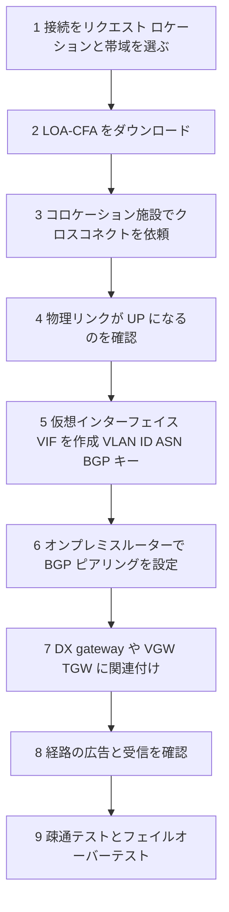

| ステップ | 実装のポイント |
|---|---|
| ポート | 光トランシーバーの種類 (例 1000BASE-LX, 10GBASE-LR) とポート速度をオンプレミス機器と合わせる |
| VIF の設定 | **VLAN ID**, **BGP ASN** (お客様側), **BGP MD5 キー**, ピア IP (AWS 側とお客様側) |
| プライベート VIF | VGW か DX gateway を接続先に指定 |
| トランジット VIF | DX gateway に接続し、DX gateway を **TGW に関連付け**て許可プレフィックスを設定 |
| 広告できるプレフィックス | DX gateway の「許可されたプレフィックス」で、オンプレミスへ広告する VPC の CIDR を制御 |
| 受信側の上限 | オンプレミスから AWS へ広告できる経路数には上限がある。**要約して広告**する |

### Site-to-Site VPN の実装

| 設定項目 | 内容 |
|---|---|
| カスタマーゲートウェイ (CGW) | AWS に「オンプレミス側の装置はこれ」と登録するリソース (パブリック IP と BGP ASN) |
| 仮想プライベートゲートウェイ (VGW) / TGW | AWS 側の終端 |
| ルーティング | 動的 (BGP) 推奨。VGW 使用時は**ルート伝播**を有効にして、サブネットのルートテーブルへ自動追加 |
| トンネルオプション | IKE バージョン, 暗号化 / 整合性アルゴリズム, DH グループ, 事前共有鍵, ライフタイム, DPD を指定可能 |
| 冗長化 | 2 本のトンネルを両方使えるように、オンプレミス側も対応させる。さらに CGW 装置を別に用意して**複数の VPN 接続**を張る |

```bash
# VPN 接続の作成例 (動的ルーティング, Transit Gateway 終端)
aws ec2 create-vpn-connection \
  --type ipsec.1 \
  --customer-gateway-id cgw-0123456789abcdef0 \
  --transit-gateway-id tgw-0123456789abcdef0 \
  --options '{"StaticRoutesOnly": false}'
```

### ハイブリッド DNS の実装

Task 1.2 の仕組みを、実際に作ります。

```bash
# アウトバウンドエンドポイントを作成 (AWS から オンプレミスへ転送するため)
aws route53resolver create-resolver-endpoint \
  --creator-request-id outbound-001 \
  --name onprem-outbound \
  --direction OUTBOUND \
  --security-group-ids sg-0123456789abcdef0 \
  --ip-addresses SubnetId=subnet-aaaa1111 SubnetId=subnet-bbbb2222

# 転送ルールを作成 (corp.example.com をオンプレミス DNS へ)
aws route53resolver create-resolver-rule \
  --creator-request-id rule-001 \
  --name forward-corp \
  --rule-type FORWARD \
  --domain-name corp.example.com \
  --resolver-endpoint-id rslvr-out-0123456789abcdef0 \
  --target-ips Ip=10.100.0.10,Port=53 Ip=10.100.0.11,Port=53
```

- 作ったルールは **VPC に関連付ける** (関連付けないと適用されない)。
- 他アカウントでも使いたい場合は **AWS RAM で共有**する。

### 接続性の検証

| ツール | 使い方 |
|---|---|
| Reachability Analyzer | 送信元 / 送信先 / プロトコル / ポートを指定して、**到達可能か、どこで止まるか**を設定から分析 |
| Transit Gateway Route Analyzer | TGW ルートテーブルのルーティングを分析 (経路の有無の確認) |
| VPC フローログ | 実トラフィックが許可 / 拒否されているか |
| CloudWatch メトリクス | VPN の `TunnelState`, DX の `ConnectionState` など |

```bash
# Reachability Analyzer でパスを作って分析する例
aws ec2 create-network-insights-path \
  --source i-0123456789abcdef0 \
  --destination i-0fedcba9876543210 \
  --protocol tcp \
  --destination-port 443

aws ec2 start-network-insights-analysis \
  --network-insights-path-id nip-0123456789abcdef0
```

### ベストプラクティス

1. **変更前に疎通の期待値を決めておく** (どこからどこへ、どのポートが通るべきか)。
2. **本番切り替え前にフェイルオーバーを試験する**: 主経路を落として、副経路に切り替わるか確認。
3. **ルート広告は意図した範囲のみ**: DX gateway の許可プレフィックスや、オンプレミス側のフィルターで制御する。
4. **BGP の認証 (MD5) を設定**する。
5. **監視を同時に実装**: 接続状態のアラームを先に設定してから本番化する。
6. **RAM / Organizations で共有**して、ネットワークアカウントに集約する。

### 試験の着眼点

| 問題文のキーワード | 想定される答え |
|---|---|
| 「DX の VIF が UP しない」 | VLAN ID, BGP ASN, MD5 キー, ピア IP の不一致を確認 |
| 「DX を介してオンプレミスに VPC の経路が広告されない」 | DX gateway の許可プレフィックス、VGW / TGW の関連付け |
| 「VPN で経路が自動で入らない」 | BGP を使う、またはルート伝播を有効にする |
| 「オンプレミスから AWS の DNS 名を解決」 | インバウンドエンドポイントの IP を、オンプレ DNS の転送先に設定 |
| 「到達できない原因の特定」 | Reachability Analyzer |

> **出典**
> - Direct Connect の仮想インターフェイス: https://docs.aws.amazon.com/directconnect/latest/UserGuide/WorkingWithVirtualInterfaces.html
> - Site-to-Site VPN: https://docs.aws.amazon.com/vpn/latest/s2svpn/VPC_VPN.html
> - Route 53 Resolver 転送ルール: https://docs.aws.amazon.com/Route53/latest/DeveloperGuide/resolver-overview-forward-vpc-to-network.html
> - Reachability Analyzer: https://docs.aws.amazon.com/vpc/latest/reachability/what-is-reachability-analyzer.html
> - AWS RAM: https://docs.aws.amazon.com/ram/latest/userguide/what-is.html

---

## Task 2.2 マルチアカウント・Region・VPC 接続の実装

**公式タスク**: 複数の AWS アカウント、Region、VPC にまたがる、さまざまな接続パターンのルーティングと接続を実装する。

### 何が問われるか

- VPC ピアリング, Transit Gateway, VPN, サードパーティー, SD-WAN, MPLS による接続
- PrivateLink によるプライベートなアプリケーション接続
- Organizations / RAM による接続の拡張
- 認証・認可 (SAML, Active Directory)
- セキュリティ (セキュリティグループ, ネットワーク ACL, Network Firewall)
- ハブ & スポーク構成、DNS による名前解決

### 実装の手順: VPC ピアリング

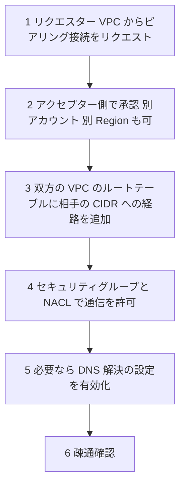

| 注意点 | 内容 |
|---|---|
| ルートの追加を忘れない | ピアリング接続を作るだけでは通信できない。**両方の VPC のルートテーブル**に経路が必要 |
| 推移的ルーティング不可 | A↔B と B↔C があっても A↔C は通信できない。IGW / NAT / VPN / DX を B 経由で使うこともできない |
| CIDR の重複不可 | 重複する CIDR の VPC とは接続できない |
| DNS 解決 | ピアリングの DNS 解決オプションを有効にすると、相手 VPC のパブリック DNS 名がプライベート IP に解決される |
| セキュリティグループ参照 | 同一 Region のピアリングでは、相手 VPC のセキュリティグループを参照できる |

### 実装の手順: Transit Gateway によるハブ & スポーク

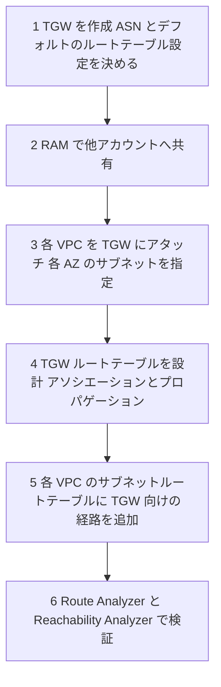

```yaml
# CloudFormation の例: Transit Gateway と VPC アタッチメント
Resources:
  Tgw:
    Type: AWS::EC2::TransitGateway
    Properties:
      AmazonSideAsn: 64512
      DefaultRouteTableAssociation: disable   # 自動関連付けを無効にして明示的に管理する
      DefaultRouteTablePropagation: disable
      Tags:
        - Key: Name
          Value: core-tgw

  SpokeAttachment:
    Type: AWS::EC2::TransitGatewayVpcAttachment
    Properties:
      TransitGatewayId: !Ref Tgw
      VpcId: !Ref SpokeVpc
      SubnetIds:
        - !Ref SpokeSubnetAz1
        - !Ref SpokeSubnetAz2
```

- **各 AZ に 1 つずつサブネットを指定**する (AZ を指定しないと、その AZ のリソースから TGW へ到達できない)。
- アタッチメント用には**専用の小さなサブネット (例 /28)** を用意すると、アプリ用サブネットの IP を消費せず、NACL の管理も分けやすい。

### 実装の手順: PrivateLink

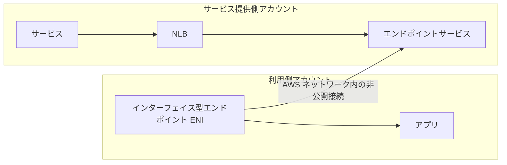

1. 提供側: サービスを **NLB (または GWLB)** の背後に置き、エンドポイントサービスを作成。
2. 提供側: 接続を許可するアカウント / ロールを**許可プリンシパル**に追加。接続の承認を必須にもできる。
3. 利用側: 提供側のサービス名を指定して、インターフェイス型エンドポイントを作成。
4. 利用側: エンドポイントのセキュリティグループで、利用元の通信を許可。必要ならプライベート DNS を設定。

### セキュリティの実装

| 手段 | 特徴 |
|---|---|
| セキュリティグループ | **ステートフル**。許可ルールのみ。ENI 単位。他の SG を参照できる |
| ネットワーク ACL | **ステートレス**。許可 / 拒否ルール。サブネット単位。番号の小さい順に評価。戻りの通信 (エフェメラルポート) も明示的に許可が必要 |
| Network Firewall | VPC のステートフル / ステートレスなファイアウォール。Suricata 互換のルール |
| VPC エンドポイントポリシー | エンドポイント経由のアクセスを制限 |

### 認証・認可

| 用語 | 説明 |
|---|---|
| SAML 2.0 | ID プロバイダー (IdP) と AWS を連携するフェデレーション。**Client VPN** でも SAML ベースの認証が使える |
| Active Directory | AWS Managed Microsoft AD などを Client VPN の認証元にできる |
| 相互認証 (証明書) | Client VPN でクライアント証明書による認証 |

### ベストプラクティス

1. **ネットワーク専用アカウント**を作り、TGW・DX・VPN・Network Firewall を集約して RAM で共有する。
2. **TGW のデフォルトの関連付け / 伝播を無効にして、意図したルーティングだけを許可**する (誤接続を防ぐ)。
3. **TGW アタッチメント用サブネットを専用化**する。
4. **ルート数を管理**: 要約し、不要なルートを広げない。
5. **SG は最小権限**、NACL はサブネット全体への粗い制御 (多層防御) に使う。
6. **IaC で再現可能に実装**し、変更は Reachability Analyzer で検証する。

### 試験の着眼点

| 問題文のキーワード | 想定される答え |
|---|---|
| 「ピアリングを作ったのに通信できない」 | 両側のルートテーブルの経路、SG / NACL の許可 |
| 「A↔B↔C で A から C に通信したい (ピアリング)」 | 推移的ルーティング不可なので、A↔C のピアリングを追加するか TGW を使う |
| 「TGW 経由で通信できない特定 AZ のみ」 | その AZ にアタッチメントのサブネットを追加していない |
| 「ネットワーク ACL でエフェメラルポートが必要」 | ステートレスなので戻りの通信も許可 |
| 「リモートユーザーが SAML で接続」 | Client VPN (SAML 認証) |

> **出典**
> - VPC ピアリング: https://docs.aws.amazon.com/vpc/latest/peering/what-is-vpc-peering.html
> - Transit Gateway: https://docs.aws.amazon.com/vpc/latest/tgw/what-is-transit-gateway.html
> - PrivateLink: https://docs.aws.amazon.com/vpc/latest/privatelink/what-is-privatelink.html
> - セキュリティグループ: https://docs.aws.amazon.com/vpc/latest/userguide/vpc-security-groups.html
> - ネットワーク ACL: https://docs.aws.amazon.com/vpc/latest/userguide/vpc-network-acls.html
> - AWS Client VPN: https://docs.aws.amazon.com/vpn/latest/clientvpn-admin/what-is.html
> - AWS Network Firewall: https://docs.aws.amazon.com/network-firewall/latest/developerguide/what-is-aws-network-firewall.html

---

## Task 2.3 複雑な DNS アーキテクチャの実装

**公式タスク**: 複雑なハイブリッド / マルチアカウント DNS アーキテクチャを実装する。

### 何が問われるか

- プライベートホストゾーンとパブリックホストゾーンの使い分け
- レイテンシー・地理・加重による**トラフィック管理**
- DNS の委任と転送 (条件付き転送)
- レコードタイプ (A, AAAA, TXT, PTR, エイリアス)
- **DNSSEC**、アカウント間での DNS 共有 (RAM)
- インバウンド / アウトバウンドエンドポイントの要件と実装
- DNS の監視とログ

### 集中型と分散型の DNS アーキテクチャ

```mermaid
flowchart TD
    subgraph CENT["集中型 共有サービスアカウントで一元管理"]
        direction TB
        CI["インバウンド と アウトバウンド エンドポイントを 1 か所に集約"]
        CR["転送ルールを RAM で全アカウントへ共有"]
    end
    subgraph DIST["分散型 各アカウントが自分で管理"]
        direction TB
        DI["各アカウントがエンドポイントとルールを保有"]
    end
    A["要件"] --> B{"管理方針"}
    B -->|"統制 コスト重視 ルールの一貫性"| CENT
    B -->|"アカウントの自律性 分離"| DIST
```

| 項目 | 集中型 | 分散型 |
|---|---|---|
| エンドポイント数 | 少ない (コスト低) | アカウント / VPC ごと (コスト高) |
| 管理 | 一元的で一貫性あり | 各チームが自由に管理 |
| 主な手段 | Resolver ルールを RAM で共有, PHZ を各 VPC に関連付け | アカウントごとに実装 |

### 複数アカウントでのプライベートホストゾーン

- 別アカウントの VPC を PHZ に関連付けるには、**ゾーンの所有アカウントで関連付けの承認 (認可) を作成**し、VPC 側アカウントが関連付けを実行する (CLI / API)。
- Route 53 **Profiles** を使うと、PHZ・Resolver ルール・DNS Firewall ルールグループなどの DNS 設定を束ね、RAM で他アカウントの VPC と共有できる。

```bash
# 1) PHZ を持つアカウントで、別アカウントの VPC との関連付けを許可
aws route53 create-vpc-association-authorization \
  --hosted-zone-id Z0123456789ABCDEFGHIJ \
  --vpc VPCRegion=ap-northeast-1,VPCId=vpc-0123456789abcdef0

# 2) VPC を持つアカウントで関連付けを実行
aws route53 associate-vpc-with-hosted-zone \
  --hosted-zone-id Z0123456789ABCDEFGHIJ \
  --vpc VPCRegion=ap-northeast-1,VPCId=vpc-0123456789abcdef0
```

### DNS の委任とサブドメイン

```mermaid
flowchart TD
    P["親ゾーン example.com"] -->|"NS レコードで委任"| S["サブドメインのゾーン dev.example.com 別アカウントや別の DNS で管理"]
    S --> R["A や CNAME などのレコード"]
```

- 親ゾーンに、サブドメインの NS レコードを作成して**委任**する。
- 親子で DNSSEC を使う場合は、委任に **DS レコード**が必要 (信頼の連鎖)。

### レコードの実践

| レコード | 実装のポイント |
|---|---|
| A / AAAA | IPv4 / IPv6。ALB などへは**エイリアス**を使う |
| CNAME | apex には作れない。別名として他のドメインを指す |
| TXT | ドメイン所有の確認, SPF などメールの認証 |
| PTR | 逆引き用。逆引きゾーン (`in-addr.arpa`) で管理 |
| エイリアス (A / AAAA) | AWS リソースを指す。ヘルスチェックの結果 (ターゲットの正常性の評価) も反映できる |

### DNSSEC の実装 (Route 53)

```mermaid
flowchart TD
    A["1 KMS で非対称キーを作成 us-east-1 ECC NIST P-256 署名と検証用"] --> B["2 Route 53 で KSK を作成 キーを関連付け"]
    B --> C["3 ホストゾーンの DNSSEC 署名を有効化"]
    C --> D["4 DS レコードを親ゾーンに登録 レジストラ側"]
    D --> E["5 検証 と 監視 CloudWatch の DNSSEC メトリクスとアラーム"]
```

| ポイント | 内容 |
|---|---|
| 署名できるゾーン | **パブリックホストゾーン**の DNSSEC 署名 (プライベートホストゾーンは対象外) |
| KMS キー | **us-east-1** に作成する非対称キー |
| 親への登録 | **DS レコード**を親ゾーンに登録して、信頼の連鎖を完成させる |
| 検証 | VPC のリゾルバーは、DNSSEC の**検証**を有効にできる |
| 運用 | キーのローテーションや、KMS キーの権限が失われないよう注意 (キーが使えなくなると署名が失敗する) |

### DNS の監視・ログ

| 対象 | 方法 |
|---|---|
| パブリックホストゾーンのクエリログ | CloudWatch Logs に出力 (ロググループは **us-east-1**) |
| Resolver クエリログ | VPC 内からのクエリを、CloudWatch Logs / S3 / Data Firehose に出力 |
| ヘルスチェック | メトリクス (`HealthCheckStatus` など) と CloudWatch アラーム |
| DNSSEC | 署名失敗などを CloudWatch メトリクスで監視 |

### ベストプラクティス

1. **共有サービスアカウントで Resolver を集約**し、ルールは RAM / Profiles で共有する。
2. **エンドポイントは 2 つ以上の AZ**、セキュリティグループは DNS のみ許可。
3. **転送ルールは具体的なドメインを指定**し、ループ (相互に転送し合う) を避ける。
4. **DNSSEC は KMS キーの管理を厳密に**する。
5. **クエリログで監査**する (データの持ち出し、マルウェア通信の検知)。
6. **TTL とヘルスチェックの整合性**を意識する。

### 試験の着眼点

| 問題文のキーワード | 想定される答え |
|---|---|
| 「別アカウントの VPC からも PHZ を解決」 | 関連付けの認可 (CLI / API) + 関連付け、または Route 53 Profiles |
| 「全アカウントで同じ転送ルールを使いたい」 | RAM で Resolver ルールを共有 |
| 「DNSSEC を有効にした後、ドメインが解決できなくなった」 | 親ゾーンの DS レコードの不一致、KMS キーの問題 |
| 「サブドメインを別チームが管理」 | NS レコードによる委任 |
| 「DNS クエリを監査」 | Resolver クエリログ |

> **出典**
> - Route 53 DNSSEC: https://docs.aws.amazon.com/Route53/latest/DeveloperGuide/dns-configuring-dnssec.html
> - Resolver クエリログ: https://docs.aws.amazon.com/Route53/latest/DeveloperGuide/resolver-query-logs.html
> - プライベートホストゾーンの操作: https://docs.aws.amazon.com/Route53/latest/DeveloperGuide/hosted-zones-private.html
> - Resolver のルールの共有: https://docs.aws.amazon.com/Route53/latest/DeveloperGuide/resolver-rules-managing.html
> - Route 53 Resolver: https://docs.aws.amazon.com/Route53/latest/DeveloperGuide/resolver.html

---

## Task 2.4 ネットワークの自動化

**公式タスク**: ネットワークインフラの自動化と構成を行う。

### 何が問われるか

- IaC (AWS CDK, CloudFormation, AWS CLI, SDK, API)
- イベント駆動のネットワーク自動化
- IaC テンプレート内の**ハードコードされた値**が引き起こす問題
- 再現可能な構成管理、ハイブリッドの自動化と IaC の統合

### IaC のツールの使い分け

| ツール | 特徴 | 向いている用途 |
|---|---|---|
| CloudFormation | JSON / YAML の宣言的テンプレート。スタック単位で管理 | 標準的な IaC、StackSets で複数アカウント・Region へ展開 |
| AWS CDK | プログラミング言語 (TypeScript, Python など) で書き、CloudFormation に変換 | 繰り返しや条件の多い構成、再利用可能な部品 (コンストラクト) |
| AWS CLI / SDK | コマンド / プログラムから API を呼ぶ | 運用スクリプト、一回限りの操作、Lambda 内の処理 |

### ハードコードの問題と対策

| ハードコードされがちな値 | 問題 | 対策 |
|---|---|---|
| AZ 名 (`ap-northeast-1a`) | アカウントによって AZ の割り当てが異なる。Region 間で再利用できない | `Fn::GetAZs` / `Fn::Select` や CDK の AZ 指定を使う |
| CIDR | 他の VPC と重複する | パラメーター化、IPAM との統合 |
| AMI ID | Region ごとに異なる | SSM パラメーター (パブリックパラメーター) を参照 |
| リソース ID (vpc-xxxx) | 環境ごとに異なる | 参照 (`!Ref`)、スタックのエクスポート / インポート、SSM パラメーターストア |
| アカウント ID, Region | 別環境で使い回せない | `AWS::AccountId`, `AWS::Region` の擬似パラメーター |
| IP アドレス | 変更時に全箇所を修正 | パラメーター、DNS 名の利用 |

```yaml
# ハードコードを避けた書き方の例
Parameters:
  VpcCidr:
    Type: String
    Default: 10.20.0.0/16
Resources:
  Vpc:
    Type: AWS::EC2::VPC
    Properties:
      CidrBlock: !Ref VpcCidr
      EnableDnsSupport: true
      EnableDnsHostnames: true
  PrivateSubnetA:
    Type: AWS::EC2::Subnet
    Properties:
      VpcId: !Ref Vpc
      AvailabilityZone: !Select [0, !GetAZs ""]     # AZ 名を直接書かない
      CidrBlock: !Select [0, !Cidr [!GetAtt Vpc.CidrBlock, 4, 8]]
```

### イベント駆動のネットワーク自動化

```mermaid
flowchart LR
    E1["VPN トンネルの状態変化 CloudWatch アラーム"] --> EB["EventBridge ルール"]
    E2["AWS Config のルール非準拠"] --> EB
    E3["CloudTrail の API イベント 例 セキュリティグループの変更"] --> EB
    EB --> L["Lambda"]
    EB --> SNS["SNS 通知"]
    L --> A["自動対応 ルート更新 SG の修正 チケット起票"]
```

| 例 | 実装 |
|---|---|
| SG に `0.0.0.0/0` からの全開放などの危険なルールが追加された | CloudTrail / Config → EventBridge → Lambda でルールを削除し、SNS で通知 |
| VPN トンネルが DOWN | CloudWatch アラーム → EventBridge → 通知 / 自動復旧のスクリプト |
| 新しい VPC を作成 | EventBridge → Lambda → TGW へ自動アタッチ、ルートテーブルへ関連付け |
| 非準拠のリソース | AWS Config ルール + 自動修復 (Systems Manager Automation) |

### ハイブリッドの自動化

- オンプレミス機器の設定を、**Ansible や Terraform などの既存ツール**と、AWS 側の CloudFormation / CDK を**パイプライン (CI/CD) で連携**して一貫して管理する。
- 変更は**プルリクエスト → レビュー → 自動デプロイ**の流れに乗せ、手作業を避ける。
- **ドリフト検出**で、手動変更との差分を検知する。

### コストと効率

- 不要な NAT ゲートウェイや未使用の Elastic IP、遊休の VPN / TGW アタッチメントを、タグと自動チェックで検出する。
- 開発環境は夜間・休日に停止するなど、IaC で**作成 / 削除を自動化**してコストを下げる。

### ベストプラクティス

1. **ネットワークはすべて IaC で管理**し、手動変更を禁止または検出する (ドリフト検出)。
2. **パラメーター化と参照**でハードコードを排除する。
3. **StackSets / Control Tower** で、組織全体に標準のネットワーク構成を展開する。
4. **変更セット (Change Set)** で、更新前に影響を確認する。
5. **ネットワークの基盤とアプリを別スタックにする**: 変更頻度と責任範囲が違うため。スタック間はエクスポートや SSM パラメーターで連携。
6. **テストを自動化**: デプロイ後に Reachability Analyzer で「疎通すべき / すべきでない」を検証する。

### 試験の着眼点

| 問題文のキーワード | 想定される答え |
|---|---|
| 「テンプレートが別 Region / アカウントで失敗」 | AZ 名、AMI ID、リソース ID のハードコードが原因 |
| 「複数アカウント・Region に同じネットワーク基盤を展開」 | CloudFormation StackSets |
| 「ネットワークの変更を検知して自動対応」 | CloudTrail / Config → EventBridge → Lambda |
| 「プログラミング言語で IaC」 | AWS CDK |
| 「手動変更を検知」 | CloudFormation のドリフト検出, AWS Config |

> **出典**
> - AWS CloudFormation ユーザーガイド: https://docs.aws.amazon.com/AWSCloudFormation/latest/UserGuide/Welcome.html
> - AWS CDK デベロッパーガイド: https://docs.aws.amazon.com/cdk/v2/guide/home.html
> - Amazon EventBridge: https://docs.aws.amazon.com/eventbridge/latest/userguide/eb-what-is.html
> - AWS Config: https://docs.aws.amazon.com/config/latest/developerguide/WhatIsConfig.html
> - AWS Control Tower: https://docs.aws.amazon.com/controltower/latest/userguide/what-is-control-tower.html

---

# Domain 3: Network Management and Operation (20%)

構築したネットワークを「維持・調査・改善」する視点です。**障害の切り分け**と**性能・コストの最適化**がよく出ます。

---

## Task 3.1 ルーティングと接続性の維持

**公式タスク**: AWS とハイブリッドネットワークのルーティングと接続性を維持する。

### 何が問われるか

- ハイブリッドで使う業界標準のルーティングプロトコル (Direct Connect 上の BGP)
- 接続方式 (Direct Connect gateway, Transit Gateway, VIF)
- **クォータ (上限) がネットワークサービスに与える影響** (帯域, ルート数など)
- カスタムサービスへのプライベート / パブリックなアクセス手段 (PrivateLink, VPC ピアリング)
- ルートテーブルの伝播と BGP、**ルートの要約**と CIDR 重複

### 用語とやさしい仕組み

#### ルートテーブルの経路が入る 3 つの方法

| 方法 | 説明 |
|---|---|
| ローカルルート | VPC の CIDR 内の通信。自動で入り、削除できない |
| 静的ルート | 人が手で追加 (例 `0.0.0.0/0` → NAT ゲートウェイ) |
| 伝播 (プロパゲーション) | VGW や TGW が BGP で学習した経路を、ルートテーブルに**自動で追加** |

> 同じ宛先に複数の経路があるとき、基本は**最長一致**。同じ長さの場合は、VPC ルートテーブルでは「ローカル > 静的ルート > 伝播されたルート」の順といった優先順位があります (詳細は公式ドキュメントで確認)。

#### クォータが効いてくる場面

上限は変更されるため数値は覚えず、「**どの種類の上限があるか**」を理解しましょう。

| 上限の種類 | 影響する場面 | 対処 |
|---|---|---|
| ルート数の上限 (VPN / DX / TGW / ルートテーブル) | オンプレミスから大量の経路を広告すると、BGP セッションが落ちる場合がある | **ルートを要約** (サマリー) して広告する |
| 帯域の上限 (VPN トンネル, TGW アタッチメント, NAT ゲートウェイなど) | 想定以上のトラフィックでパケットロス | ECMP で束ねる, DX を追加, アタッチメントを分割 |
| 接続数・フロー数 | NAT ゲートウェイや NLB のポート枯渇 | NAT ゲートウェイを AZ ごとに増やす, セカンダリ IP を割り当てる |
| 1 つの DX gateway に関連付けられる数 | 大規模な構成 | 構成を分割 |

#### ルートの要約

- 複数の細かい経路を、**1 つの大きな CIDR にまとめて**広告すること。
- 例: `10.1.0.0/24`, `10.1.1.0/24`, `10.1.2.0/24`, `10.1.3.0/24` → `10.1.0.0/22` にまとめる。
- ルート数の上限を節約でき、ルーターの負荷も減る。ただし、**まとめた範囲に存在しないアドレスも含まれる**ので、ブラックホールにならないよう設計に注意する。

```mermaid
flowchart LR
    A["10.1.0.0/24"] --> S["要約"]
    B["10.1.1.0/24"] --> S
    C["10.1.2.0/24"] --> S
    D["10.1.3.0/24"] --> S
    S --> R["10.1.0.0/22 を 1 経路として広告"]
```

#### リージョン間・リージョン内の通信パターン

| パターン | 方法 | メモ |
|---|---|---|
| 同一 Region の VPC 間 | ピアリング / TGW / PrivateLink | 同一 AZ 内のピアリング通信はデータ転送料が安い傾向 |
| Region 間 VPC | Inter-Region ピアリング / TGW ピアリング | AWS のバックボーンを通り、暗号化される。TGW ピアリングは静的ルート |
| 複数 Region のオンプレミス接続 | Direct Connect gateway | 1 本の DX で複数 Region の VPC に接続 |

#### カスタムサービスへのアクセス手段

| 手段 | 特徴 |
|---|---|
| PrivateLink | 特定のサービスのみ。CIDR 重複 OK。一方向 |
| VPC ピアリング | VPC 全体を接続。CIDR 重複不可 |
| パブリックアクセス | インターネット経由 (WAF / CloudFront で保護) |
| Direct Connect パブリック VIF | オンプレミスから AWS のパブリックエンドポイントへ、専用線で |

### ベストプラクティス

1. **ルートを要約**し、広告する経路の数を抑える。
2. **BGP を使い、ルート伝播を有効に**する。静的ルートは最小限に。
3. **クォータを事前に把握**し、Service Quotas / CloudWatch でしきい値の手前にアラームを置く。
4. **経路に変更を加える前に、現在の経路をバックアップ** (記録) する。
5. **PrivateLink を最小権限の公開手段**として使い、許可プリンシパルを管理する。
6. **DX gateway / TGW で集約**し、接続の形を単純に保つ。

### 試験の着眼点

| 問題文のキーワード | 想定される答え |
|---|---|
| 「BGP セッションが、ある時点で切れる / ルート数が多い」 | ルート数の上限超過 → 経路の要約 |
| 「サブネットのルートテーブルに VPN の経路を自動で追加」 | ルート伝播 |
| 「オンプレミスから複数 Region の VPC に 1 本の DX で」 | Direct Connect gateway |
| 「重複 CIDR の VPC 間でサービスのみ共有」 | PrivateLink |
| 「Region 間の TGW に経路が入らない」 | TGW ピアリングは静的ルートのみ |

> **出典**
> - VPC ルートテーブル (ルート優先順位): https://docs.aws.amazon.com/vpc/latest/userguide/VPC_Route_Tables.html
> - Direct Connect ルーティングポリシーと BGP コミュニティ: https://docs.aws.amazon.com/directconnect/latest/UserGuide/routing-and-bgp.html
> - Transit Gateway クォータ: https://docs.aws.amazon.com/vpc/latest/tgw/transit-gateway-quotas.html
> - Site-to-Site VPN クォータ: https://docs.aws.amazon.com/vpn/latest/s2svpn/vpn-limits.html
> - AWS Service Quotas: https://docs.aws.amazon.com/servicequotas/latest/userguide/intro.html

---

## Task 3.2 トラフィックの監視・分析・トラブルシューティング

**公式タスク**: ネットワークトラフィックを監視・分析して、接続パターンのトラブルシューティングと最適化を行う。

### 何が問われるか

- ネットワーク性能メトリクスと到達性の制約 (ルーティング, **パケットサイズ**)
- パケットロスなどの性能問題を評価するログとメトリクス
- CloudWatch, VPC フローログ, トラフィックミラーリング、Reachability Analyzer, Network Manager
- **MTU の不一致によるパケットサイズ問題**の解決

### トラブルシューティングの基本の流れ

```mermaid
flowchart TD
    A["通信できない または 遅い"] --> B{"名前解決はできるか"}
    B -->|"いいえ"| B1["DNS の確認 Resolver ルール PHZ の関連付け DNS Firewall"]
    B -->|"はい"| C{"経路はあるか ルートテーブル"}
    C -->|"いいえ"| C1["ルート 伝播 TGW ルートテーブル BGP の確認"]
    C -->|"はい"| D{"SG と NACL で許可されているか"}
    D -->|"いいえ"| D1["SG NACL エンドポイントポリシーの確認 フローログの REJECT"]
    D -->|"はい"| E{"小さい通信は通るが大きい通信だけ失敗するか"}
    E -->|"はい"| E1["MTU と PMTUD の確認 ICMP の許可"]
    E -->|"いいえ"| F["ターゲットのヘルス アプリ OS ファイアウォール 帯域上限の確認"]
```

> 実際の問題では、**Reachability Analyzer** で設定上の到達性を先に確認すると、効率よく原因を絞れます。

### レイヤー別の確認ポイント

| レイヤー | 確認すること | 使うツール |
|---|---|---|
| DNS | 名前が正しく引けるか、どの IP が返るか | `dig` / `nslookup`、Resolver クエリログ |
| ルーティング | 送信元・宛先双方のルートテーブル、TGW のルート、BGP で学習した経路 | ルートテーブル, TGW Route Analyzer, DX / VPN のルート表示 |
| セキュリティ | SG (インバウンド / アウトバウンド), NACL (**戻りの通信も**), エンドポイントポリシー | フローログ, Reachability Analyzer |
| トランスポート | 接続は張れるか、再送やリセットが多くないか | フローログの `tcp-flags`, トラフィックミラーリング |
| 経路 MTU | 大きなパケットが途中で落ちていないか | `ping` (DF ビットとサイズ指定), `tracepath` |
| 帯域・上限 | 帯域や PPS の上限に達していないか | CloudWatch メトリクス, ENA のメトリクス |

### パケットサイズ (MTU) の問題

#### 症状の典型

- `ping` (小さいパケット) は通るが、ファイル転送や HTTPS の大きなレスポンスの途中で止まる。
- SSH のログインはできるが、大きな出力を表示するとフリーズする。

#### 仕組み: パス MTU ディスカバリー (PMTUD)

```mermaid
flowchart TD
    A["送信元が DF ビット付きで大きなパケットを送る"] --> B{"途中の MTU より大きいか"}
    B -->|"いいえ"| C["そのまま届く"]
    B -->|"はい"| D["途中のルーターが破棄して ICMP Fragmentation Needed type 3 code 4 を返す"]
    D --> E{"ICMP が送信元まで届くか"}
    E -->|"はい"| F["送信元がパケットサイズを小さくして再送 成功"]
    E -->|"いいえ SG や NACL や FW が ICMP を遮断"| G["送信元は原因がわからず再送を繰り返し 通信が止まる ブラックホール"]
```

#### 対処

| 対処 | 内容 |
|---|---|
| ICMP を許可する | SG / NACL / ファイアウォールで、**ICMP type 3 (Destination Unreachable) code 4 (Fragmentation Needed)** を許可 |
| MSS クランプ | TCP の MSS (最大セグメントサイズ) を小さく調整 (例えば VPN の終端装置で) |
| MTU を揃える | ジャンボフレームを使うなら、経路上のすべてが対応しているか確認。そうでなければ 1,500 に統一 |
| 経路の MTU を把握 | VPN 経由は 1,500 未満、Inter-Region ピアリングや IGW 経由は 1,500 など |

```bash
# DF ビットを立てて、サイズを変えながら疎通確認 (Linux)
# -M do : 分割禁止 / -s : ペイロードサイズ (ヘッダー 28 バイト分を加えたものが IP パケットサイズ)
ping -M do -s 1472 10.20.0.10      # 1500 バイトの MTU を確認
ping -M do -s 8973 10.20.0.10      # 9001 バイトの MTU を確認

# 経路上の MTU を調べる
tracepath 10.20.0.10

# インスタンスの MTU を確認・変更
ip link show eth0
sudo ip link set dev eth0 mtu 1500
```

### 主要なメトリクス

| 対象 | メトリクスの例 | 意味 |
|---|---|---|
| Site-to-Site VPN | `TunnelState`, `TunnelDataIn`, `TunnelDataOut` | トンネルの UP / DOWN と通信量 |
| Direct Connect | `ConnectionState`, `ConnectionBpsEgress`, `ConnectionBpsIngress`, `ConnectionLightLevelTx` / `Rx` | リンク状態、帯域、光レベル (劣化の早期発見) |
| Transit Gateway | `BytesIn`, `BytesOut`, `PacketDropCountBlackhole`, `PacketDropCountNoRoute` | ブラックホールルート / ルートなしでの破棄 |
| NAT ゲートウェイ | `ErrorPortAllocation`, `PacketsDropCount`, `ConnectionAttemptCount` | ポート枯渇、破棄 |
| ALB | `HTTPCode_Target_5XX_Count`, `TargetResponseTime`, `UnHealthyHostCount` | エラー率、応答時間、異常ターゲット |
| NLB | `ActiveFlowCount`, `TCP_Target_Reset_Count`, `UnHealthyHostCount` | 接続数、リセット |
| EC2 (ENA) | `bw_in_allowance_exceeded`, `bw_out_allowance_exceeded`, `pps_allowance_exceeded`, `conntrack_allowance_exceeded` | インスタンスの帯域 / PPS / 接続追跡の**上限超過で破棄**された数 (`ethtool -S` で確認) |

> **ポイント**: ENA の「allowance exceeded」系の値が増えている場合は、**インスタンスタイプの上限に達している**ので、より大きなインスタンスタイプへの変更や、負荷の分散が必要です。

### フローログの分析 (Athena / CloudWatch Logs Insights)

```sql
-- Athena: 過去のフローログから、拒否された通信の上位を確認する例
SELECT srcaddr, dstaddr, dstport, protocol, COUNT(*) AS rejects
FROM vpc_flow_logs
WHERE action = 'REJECT'
GROUP BY srcaddr, dstaddr, dstport, protocol
ORDER BY rejects DESC
LIMIT 20;
```

```sql
# CloudWatch Logs Insights の例 (フローログ)
fields @timestamp, srcAddr, dstAddr, dstPort, action
| filter action = "REJECT"
| stats count(*) as rejects by srcAddr, dstAddr, dstPort
| sort rejects desc
| limit 20
```

### トポロジーの把握と自動検証

| 目的 | ツール |
|---|---|
| ネットワーク全体の地図 | Transit Gateway Network Manager (拠点, TGW, VPN, DX, Region をグローバルネットワークとして可視化) |
| 設定変更後の意図の検証 | Reachability Analyzer を **CI/CD や EventBridge と連携**して、変更のたびに自動実行 (到達すべき / すべきでない) |
| パケットの分析 | トラフィックミラーリング + 分析ツール (Wireshark, Suricata など) |

### ベストプラクティス

1. **切り分けは下から上、または外から内へ**: DNS → ルート → セキュリティ → MTU → アプリの順に確認。
2. **ICMP は遮断しない**: とくに PMTUD に必要な type 3 code 4。
3. **MTU を設計書に明記**し、ジャンボフレームを使う範囲を決めておく。
4. **ENA のメトリクスも収集**して、インスタンスの上限による破棄を検出する。
5. **フローログは S3 + Athena** で長期の分析、**CloudWatch Logs Insights** で素早い調査。
6. **Reachability Analyzer を変更管理に組み込む**。

### 試験の着眼点

| 問題文のキーワード | 想定される答え |
|---|---|
| 「ping は通るが、大きなデータ転送で止まる」 | MTU / PMTUD。ICMP (type 3 code 4) の許可、MSS クランプ |
| 「VPN 経由でのみ接続が途中で止まる」 | VPN の MTU (1,500 未満) → MSS 調整 |
| 「特定の通信が拒否されていることを確認」 | フローログの REJECT |
| 「パケットの中身を保存して分析」 | トラフィックミラーリング |
| 「設計どおりの経路か自動確認」 | Reachability Analyzer の自動化 |
| 「インスタンスで帯域が頭打ち / パケットが破棄」 | ENA の allowance exceeded メトリクス → インスタンスタイプの見直し |

> **出典**
> - EC2 ネットワーク MTU: https://docs.aws.amazon.com/AWSEC2/latest/UserGuide/network_mtu.html
> - ENA のパフォーマンス メトリクス: https://docs.aws.amazon.com/AWSEC2/latest/UserGuide/monitoring-network-performance-ena.html
> - VPC フローログ: https://docs.aws.amazon.com/vpc/latest/userguide/flow-logs.html
> - トラフィックミラーリング: https://docs.aws.amazon.com/vpc/latest/mirroring/what-is-traffic-mirroring.html
> - Reachability Analyzer: https://docs.aws.amazon.com/vpc/latest/reachability/what-is-reachability-analyzer.html
> - Network Manager: https://docs.aws.amazon.com/network-manager/latest/tgwnm/what-is-network-manager.html
> - Direct Connect の監視: https://docs.aws.amazon.com/directconnect/latest/UserGuide/monitoring-overview.html

---

## Task 3.3 性能・信頼性・コストの最適化

**公式タスク**: AWS ネットワークの性能、信頼性、コスト効率を最適化する。

### 何が問われるか

- VPC ピアリングと Transit Gateway の使い分け
- 帯域の削減手段 (ユニキャスト vs マルチキャスト, CloudFront)
- VPC とオンプレミス間のコスト効率の良い接続
- ネットワークインターフェイスの種類
- Route 53 の高可用性機能、ロードバランシング
- VPC サブネットの最適化、フレームサイズの最適化
- Global Accelerator による最適化

### 性能の最適化

#### ネットワークインターフェイスの選び方

| 種類 | 特徴 | 向いている用途 |
|---|---|---|
| ENI (Elastic Network Interface) | 仮想ネットワークカードの基本。複数 IP / セキュリティグループ / 付け替えが可能 | 一般的な用途、管理用ネットワーク、固定 IP の付け替えによるフェイルオーバー |
| ENA (Elastic Network Adapter) | 拡張ネットワーキング。高帯域・低遅延・高 PPS。現行世代のインスタンスで標準 | ほとんどの高性能なワークロード |
| EFA (Elastic Fabric Adapter) | ENA の機能に加え、**OS バイパス**で、MPI / NCCL などの通信を低遅延で実行 | HPC, 機械学習の分散トレーニング |

```mermaid
flowchart TD
    A["インスタンスのネットワーク性能要件"] --> B{"HPC や分散 ML で ノード間の超低遅延通信が必要か"}
    B -->|"はい"| C["EFA + クラスタープレイスメントグループ"]
    B -->|"いいえ"| D{"高帯域 高 PPS が必要か"}
    D -->|"はい"| E["ENA 対応の大きなインスタンスタイプ"]
    D -->|"いいえ"| F["標準の ENI"]
```

- **クラスタープレイスメントグループ**: 同一 AZ 内でインスタンスを物理的に近くに配置し、低遅延・高スループットを得る。
- **ジャンボフレーム (MTU 9001)**: 同一 VPC 内の通信では、オーバーヘッドを減らして効率を上げられる。**経路全体が対応**していることが条件 (インターネットや VPN 経由では使えない)。
- **ECMP**: TGW 終端の VPN で複数トンネルを束ねて帯域を増やす。

#### Global Accelerator での最適化

- ユーザーから最寄りのエッジに入り、AWS のバックボーンで運ぶことで、**パケットロスやジッターの少ない安定した経路**を提供する。
- ヘルスチェックで正常なエンドポイントへ自動で切り替え、可用性も向上。

### 信頼性の最適化 (Route 53)

| 手法 | 説明 |
|---|---|
| ヘルスチェック + フェイルオーバー | プライマリ異常時にセカンダリへ |
| レイテンシー / 加重 + ヘルスチェック | 正常なエンドポイントだけに、性能・比率で振り分け |
| 複数値回答 | 正常な複数の値を返す簡易分散 |
| AZ ごとのプライベート DNS | 例えば AZ ごとの名前 (`a.app.internal`, `b.app.internal`) を作り、AZ 間の転送を減らしつつ冗長化 |

### サブネットの最適化

| 課題 | 対処 |
|---|---|
| Auto Scaling の増加で、**サブネットの IP アドレスが枯渇** | 十分なサイズのサブネットに設計。足りなければ新しいサブネットを追加し、ASG のサブネット指定に加える |
| VPC 全体の IP が足りない | **セカンダリ CIDR** を追加し、新しいサブネットを作る |
| IP の無駄遣い (コンテナ / Pod が大量の IP を消費) | EKS で、Pod 用の別の CIDR (カスタムネットワーキング) / プレフィックス委任を使う |
| IPv4 の枯渇 | IPv6 (デュアルスタック) の導入 |

```mermaid
flowchart TD
    A["サブネットの空き IP が不足"] --> B{"VPC の CIDR にまだ余裕があるか"}
    B -->|"はい"| C["新しいサブネットを追加 ASG や ELB の対象に加える"]
    B -->|"いいえ"| D["セカンダリ CIDR を VPC に追加 そこに新しいサブネットを作る"]
    D --> E["ルートテーブル SG NACL を新サブネットにも適用"]
```

### フレームサイズの最適化 (ジャンボフレーム)

| 接続の種類 | 設定のポイント |
|---|---|
| VPC 内 | MTU 9001 (既定でジャンボフレーム対応のインスタンス) |
| Direct Connect プライベート VIF | 9001 まで設定可能 (VIF の MTU 設定) |
| Direct Connect トランジット VIF | 8500 まで |
| TGW の VPC アタッチメント | 8500 |
| インターネット / VPN / Inter-Region ピアリング | 1,500 (ジャンボは使えない) |

> **注意**: 経路上のどこか 1 つでも MTU が小さいと、PMTUD や分割が発生して性能が悪化 (または通信不可) になります。ジャンボフレームを導入するときは、**端から端まで**の MTU を確認してください。

### マルチキャスト

- 通常のネットワークは **ユニキャスト** (1 対 1)。複数の宛先へ同じデータを送るとき、送信元は宛先の数だけ送らなければならない。
- **マルチキャスト** (1 対多) は、送信元が 1 回送ると、参加者全員に複製されて届く。**帯域を削減**できる (市場データの配信、メディア配信など)。
- AWS では **Transit Gateway のマルチキャスト**を有効にし、**マルチキャストドメイン**を作る。グループ管理には **IGMPv2** を使える。
- オンプレミスとのマルチキャストは、GRE / オーバーレイなどで工夫する必要がある (試験では設計の考え方が問われる)。

### コストの最適化

#### 接続方式のコストの考え方

| 比較 | ポイント |
|---|---|
| VPC ピアリング vs TGW | 少数 VPC・大量転送ならピアリングが安い (TGW は**アタッチメント時間料金 + 処理データ量の料金**がかかる)。多数の VPC や集中管理が必要なら TGW |
| VPN vs Direct Connect | 低〜中程度のデータ量・短期なら VPN。大量転送が継続するなら DX の方が**データ転送料が安い**傾向 |
| NAT ゲートウェイ | 処理データ量にも課金。**S3 / DynamoDB はゲートウェイエンドポイント** (無料) を使い、NAT を経由させない |
| AZ 間通信 | AZ 間のデータ転送は有料。クロスゾーン負荷分散や、AZ をまたぐ通信を設計で減らす |
| CloudFront | インターネットへの直接配信より、**オリジンからのデータ転送量と費用を減らせる**場合が多い |
| 集中型エグレス | NAT ゲートウェイや検査を集約するとコストが減る一方、TGW のデータ処理料金が増える。**トレードオフを計算する** |

```mermaid
flowchart TD
    A["VPC 間の接続方式を選ぶ"] --> B{"VPC の数と構成"}
    B -->|"2 から 3 個 大量の通信 低コスト"| C["VPC ピアリング"]
    B -->|"多数 推移的通信 集中管理 ハイブリッド統合"| D["Transit Gateway"]
    B -->|"特定のサービスだけ"| E["PrivateLink"]
    C --> F["データ転送料が主なコスト"]
    D --> G["アタッチメント料金 と データ処理料金 を試算"]
```

> コスト分析には **AWS Cost Explorer** を使い、データ転送のコスト要因 (NAT, AZ 間, Region 間, インターネット向け) をタグ別に見える化します。

### ベストプラクティス

1. **要件 (帯域, 遅延, 可用性, コスト) を数値化**してから接続方式を選ぶ。
2. **性能が必要な通信はクラスタープレイスメントグループ + ENA / EFA**。
3. **ジャンボフレームは端から端まで**確認してから使う。
4. **NAT ゲートウェイは AZ ごとに配置**し、S3 / DynamoDB にはゲートウェイエンドポイントを使う。
5. **IP 空間に余裕を持たせる**。足りなくなったらセカンダリ CIDR。
6. **ヘルスチェック付きの DNS ルーティング**で、可用性を高める。
7. **Cost Explorer とタグで、ネットワークのコストを継続的にレビュー**する。

### 試験の着眼点

| 問題文のキーワード | 想定される答え |
|---|---|
| 「HPC」「ノード間の低遅延」「OS バイパス」 | EFA + クラスタープレイスメントグループ |
| 「Auto Scaling でサブネットの IP が足りない」 | 新しいサブネットを追加 / セカンダリ CIDR |
| 「同じデータを多数の受信者へ配信して帯域を削減」 | マルチキャスト (TGW マルチキャスト) |
| 「S3 へのアクセスで NAT ゲートウェイのコストを削減」 | ゲートウェイ型 VPC エンドポイント |
| 「少数 VPC の通信量が多く、コストを最小化」 | VPC ピアリング |
| 「ジャンボフレームで VPN 経由の性能を上げたい」 | VPN は 1,500 のため不可。DX (プライベート VIF) を検討 |
| 「Region 間のユーザー体験とフェイルオーバー」 | Global Accelerator / Route 53 レイテンシー + ヘルスチェック |

> **出典**
> - 拡張ネットワーキング (ENA): https://docs.aws.amazon.com/AWSEC2/latest/UserGuide/enhanced-networking-ena.html
> - Elastic Fabric Adapter: https://docs.aws.amazon.com/AWSEC2/latest/UserGuide/efa.html
> - プレイスメントグループ: https://docs.aws.amazon.com/AWSEC2/latest/UserGuide/placement-groups.html
> - Transit Gateway マルチキャスト: https://docs.aws.amazon.com/vpc/latest/tgw/tgw-multicast-overview.html
> - VPC の CIDR ブロック (セカンダリ CIDR): https://docs.aws.amazon.com/vpc/latest/userguide/vpc-cidr-blocks.html
> - ゲートウェイエンドポイント: https://docs.aws.amazon.com/vpc/latest/privatelink/gateway-endpoints.html
> - AWS Cost Explorer: https://docs.aws.amazon.com/cost-management/latest/userguide/ce-what-is.html
> - AWS Global Accelerator: https://docs.aws.amazon.com/global-accelerator/latest/dg/what-is-global-accelerator.html

---

# Domain 4: Network Security, Compliance, and Governance (24%)

ネットワークを「守る・監査する・暗号化する」視点です。**どの層をどのサービスで守るか**の対応づけが重要です。

---

## Task 4.1 セキュリティ・コンプライアンス要件を満たす機能

**公式タスク**: セキュリティとコンプライアンスの要件を満たすネットワーク機能を実装・維持する。

### 何が問われるか

- アプリケーション構成に応じた脅威モデル、一般的な脅威、通信フローごとの保護
- **インバウンド** (WAF, Shield, Network Firewall)、**アウトバウンド** (Network Firewall, プロキシ, Gateway Load Balancer)、**VPC 間** (SG, NACL, エンドポイントポリシー) の保護
- ネットワーク構成 (信頼できないネットワーク, 境界 VPC, 3 層アーキテクチャ)
- 脅威モデルの作成と緩和策、コンプライアンスのテスト (フェイルオーバー, 耐障害性)
- セキュリティインシデントの報告・通知の自動化

### 多層防御の全体像

```mermaid
flowchart TD
    U["インターネット"] --> SH["AWS Shield と Route 53 と CloudFront エッジ"]
    SH --> WAF["AWS WAF L7 のフィルタリング"]
    WAF --> ALB["ALB"]
    ALB --> NF["Network Firewall 境界 VPC や検査 VPC"]
    NF --> APP["アプリ層 SG"]
    APP --> DB["データ層 SG と NACL"]
    APP --> EG["アウトバウンド NAT Network Firewall ドメインフィルタ"]
```

### 防御サービスの役割分担

| サービス | 層 | 守る対象 | 主な機能 |
|---|---|---|---|
| AWS Shield Standard | L3 / L4 | すべての AWS 顧客 | 一般的な DDoS 攻撃からの自動保護 (追加料金なし) |
| AWS Shield Advanced | L3 / L4 / L7 (WAF 連携) | CloudFront, Route 53, Global Accelerator, ALB / CLB, Elastic IP 付きのリソース | 高度な DDoS 検知と緩和、攻撃の可視化、AWS の対応チーム (SRT) の支援、DDoS によるコスト急増の保護 |
| AWS WAF | L7 | CloudFront, ALB, API Gateway, AppSync, Cognito など | SQL インジェクションや XSS 対策、マネージドルール、**レートベースルール**、IP / 地理的制限、Bot Control |
| AWS Network Firewall | L3〜L7 | VPC のトラフィック | ステートレス / ステートフルのルール、**ドメインのフィルタリング**、Suricata 互換の IPS ルール、TLS 検査 |
| Gateway Load Balancer | L3 | サードパーティの仮想アプライアンス | アプライアンスを透過的に挿入し、スケール |
| Route 53 Resolver DNS Firewall | DNS | VPC の DNS クエリ | 悪性ドメインの遮断、許可リスト方式 |
| セキュリティグループ | L4 | ENI | ステートフルな許可リスト |
| ネットワーク ACL | L4 | サブネット | ステートレスな許可 / 拒否 |
| VPC エンドポイントポリシー | API | エンドポイント経由のアクセス | 許可するプリンシパル / 操作 / リソースを制限 |
| AWS Firewall Manager | 管理 | 組織全体 | WAF, Shield Advanced, SG, Network Firewall, DNS Firewall のポリシーを**一元管理** |

### インバウンド、アウトバウンド、VPC 間の保護

#### インバウンド

| 要件 | 構成 |
|---|---|
| Web アプリを攻撃から守る | CloudFront + WAF + Shield Advanced (必要に応じて) → ALB |
| オリジンを CloudFront 経由に限定 | OAC / VPC オリジン / マネージドプレフィックスリスト / カスタムヘッダー |
| ネットワーク層の検査 | Network Firewall (インターネットゲートウェイの**エッジ関連付けのルートテーブル**で、検査を経由させる) |
| サードパーティ製の IPS | GWLB + 仮想アプライアンス |

#### アウトバウンド

| 要件 | 構成 |
|---|---|
| 許可したドメインにだけ出られる | Network Firewall のドメインリスト (許可リスト)、またはプロキシ |
| 全社で出口を一本化 | **集中型エグレス**: TGW → 検査 VPC (Network Firewall / GWLB) → NAT → IGW |
| 特定の AWS サービスへの通信 | ゲートウェイ / インターフェイス型エンドポイント + エンドポイントポリシー (インターネットを経由しない) |
| DNS を使ったデータ持ち出しの抑止 | DNS Firewall |

#### VPC 間・アカウント間

| 手段 | 使い方 |
|---|---|
| セキュリティグループ | **SG の参照**で「このアプリ層の SG からだけ許可」のように、IP ではなくロールで制御 |
| ネットワーク ACL | サブネットの境界で、拒否したい IP / ポートを明示的にブロック (補助的な防御) |
| エンドポイントポリシー | 組織内のリソースにのみアクセスを許可 (`aws:PrincipalOrgID` 条件) |
| TGW ルートテーブル | 環境間のルートを分離 |
| Network Firewall (TGW 経由) | 環境間の通信を検査 |

### 参考アーキテクチャ

#### 3 層アーキテクチャ

```mermaid
flowchart TD
    I["インターネット"] --> ALB["パブリックサブネット ALB と NAT"]
    ALB --> APP["プライベートサブネット アプリ層"]
    APP --> DB["プライベートサブネット データ層 インターネットへの経路なし"]
    ALB -.->|"SG アプリ層は ALB の SG のみ許可"| APP
    APP -.->|"SG データ層は アプリ層の SG のみ許可"| DB
```

#### 境界 VPC (信頼できないネットワークとの接続)

- 取引先や信頼できないネットワークとの接続は、**専用の境界 VPC** で終端し、ファイアウォールやプロキシなどの検査を挟んでから内部へ通す。
- 内部の VPC とは、必要な通信だけを許可 (TGW のルートテーブル分離 + SG / NACL)。

#### 集中型の検査 (インスペクション) VPC

```mermaid
flowchart LR
    SP1["スポーク VPC A"] --> TGW["Transit Gateway アプライアンスモード"]
    SP2["スポーク VPC B"] --> TGW
    ONP["オンプレミス"] --> TGW
    TGW --> INS["検査 VPC"]
    INS --> NFW["Network Firewall エンドポイント"]
    NFW --> TGW
    INS --> NAT["NAT ゲートウェイ"]
    NAT --> IGW["インターネットゲートウェイ"]
```

### 脅威モデルの作り方 (初学者向け)

| ステップ | 内容 | 例 |
|---|---|---|
| 1 資産と通信フローを洗い出す | 何を守るか、どこからどこへ通信するか | Web → アプリ → DB、オンプレミス → 共有サービス |
| 2 信頼境界を引く | 信頼レベルが変わる場所 | インターネット / 境界 VPC / 内部 / オンプレミス |
| 3 脅威を挙げる | 各境界で起こりうる攻撃 | DDoS, SQL インジェクション, 横展開 (ラテラルムーブメント), データ持ち出し |
| 4 緩和策を割り当てる | 防御サービスを対応づける | DDoS → Shield, SQLi → WAF, 横展開 → SG / TGW 分離, 持ち出し → Network Firewall / DNS Firewall |
| 5 検証する | 想定どおり動くか試す | フェイルオーバーテスト、ペネトレーションテスト (AWS の方針の範囲内で) |

### インシデントの自動通知・対応

```mermaid
flowchart LR
    A["GuardDuty の検出 Config の非準拠 Network Firewall のアラート WAF のブロック急増"] --> B["EventBridge ルール"]
    B --> C["SNS でメール や チャット に通知"]
    B --> D["Lambda で自動対応 例 SG の隔離"]
    B --> E["チケット システムに連携"]
```

### ベストプラクティス

1. **多層防御**: エッジ (Shield / WAF) → ネットワーク (Network Firewall / NACL) → ホスト (SG) と重ねる。
2. **最小権限**: SG は「必要なポートを、必要な送信元からのみ」。`0.0.0.0/0` からの管理ポート (SSH / RDP) の開放は避け、Systems Manager Session Manager などを使う。
3. **SG の参照を活用**して、IP の変化に強く、意図が明確なルールにする。
4. **アウトバウンドも制限**する。侵害されたときの被害拡大 (データ持ち出し) を抑えられる。
5. **Firewall Manager** で、組織全体にポリシーを強制する。新しいアカウントにも自動適用。
6. **PrivateLink / エンドポイントポリシー**で、AWS サービスへのアクセスを閉域化・制限する。
7. **フェイルオーバーと耐障害性を定期的にテスト**する (コンプライアンスの証跡にもなる)。
8. **インシデントの検知 → 通知 → 対応を自動化**する。

### 試験の着眼点

| 問題文のキーワード | 想定される答え |
|---|---|
| 「SQL インジェクション」「XSS」「特定の国のみ許可」 | AWS WAF |
| 「HTTP フラッド」「リクエスト数の制限」 | WAF のレートベースルール |
| 「大規模な DDoS」「専門チームの支援」「コスト保護」 | AWS Shield Advanced |
| 「アウトバウンドで許可ドメインのみ」 | Network Firewall (ドメインリスト) |
| 「サードパーティのファイアウォールを全 VPC で使う」 | GWLB |
| 「全アカウントに同じセキュリティルールを強制」 | Firewall Manager |
| 「DNS を使った情報の持ち出しを防ぐ」 | Route 53 Resolver DNS Firewall |
| 「戻りの通信がブロックされる」 | NACL (ステートレス) のエフェメラルポートの許可漏れ |
| 「特定の S3 バケットにだけアクセスさせたい」 | VPC エンドポイントポリシー (+ バケットポリシー) |

> **出典**
> - AWS WAF: https://docs.aws.amazon.com/waf/latest/developerguide/waf-chapter.html
> - AWS Shield: https://docs.aws.amazon.com/waf/latest/developerguide/shield-chapter.html
> - AWS Network Firewall: https://docs.aws.amazon.com/network-firewall/latest/developerguide/what-is-aws-network-firewall.html
> - AWS Firewall Manager: https://docs.aws.amazon.com/waf/latest/developerguide/fms-chapter.html
> - セキュリティグループ: https://docs.aws.amazon.com/vpc/latest/userguide/vpc-security-groups.html
> - ネットワーク ACL: https://docs.aws.amazon.com/vpc/latest/userguide/vpc-network-acls.html
> - VPC エンドポイントポリシー: https://docs.aws.amazon.com/vpc/latest/privatelink/vpc-endpoints-access.html
> - Route 53 Resolver DNS Firewall: https://docs.aws.amazon.com/Route53/latest/DeveloperGuide/resolver-dns-firewall.html
> - AWS Well-Architected Framework セキュリティの柱: https://docs.aws.amazon.com/wellarchitected/latest/security-pillar/welcome.html

---

## Task 4.2 監視・ログによる検証と監査

**公式タスク**: ネットワークの監視・ログサービスで、セキュリティを検証・監査する。

### 何が問われるか

- 監視・ログのサービス (CloudWatch, CloudTrail, VPC トラフィックミラーリング, VPC フローログ, Network Manager)
- アラート (CloudWatch アラーム)、各サービスのログ (フローログ, ロードバランサー, CloudFront)
- ログの配信 (Kinesis, Route 53, CloudWatch)
- セキュリティ構成の**監査** (SG, Firewall Manager, Trusted Advisor)
- フローログの基本 / 拡張フィールド、カスタムメトリクス、**複数ソースの相関分析**、監査戦略

### ログの種類と目的

| ログ / サービス | 内容 | 主な目的 |
|---|---|---|
| CloudTrail | **API 呼び出しの記録** (誰が、いつ、何を変更したか) | 変更の監査、不正操作の調査 |
| AWS Config | リソースの**構成の変更履歴**と、ルール準拠の評価 | 構成のコンプライアンス |
| VPC フローログ | ネットワークの通信メタデータ | 通信の可視化、拒否の調査 |
| ELB アクセスログ | リクエスト単位 (クライアント IP, URL, ステータス, 応答時間) | アプリ層の調査 |
| CloudFront アクセスログ / 標準ログ | エッジでのリクエスト | 配信の分析、攻撃の調査 |
| WAF ログ | 検査結果 (許可 / ブロック, どのルールか) | 誤検知の調整、攻撃の分析 |
| Network Firewall ログ | アラートログ / フローログ | 検知の調査 |
| Route 53 Resolver クエリログ | VPC 内からの DNS クエリ | 異常なドメインへの通信の検知 |
| トラフィックミラーリング | パケットのコピー | 詳細な解析 |

```mermaid
flowchart TD
    subgraph SRC["ログの発生源"]
        A1["VPC フローログ"]
        A2["ELB と CloudFront のアクセスログ"]
        A3["WAF と Network Firewall のログ"]
        A4["Resolver クエリログ"]
        A5["CloudTrail と Config"]
    end
    SRC --> D1["S3 長期保管と Athena 分析"]
    SRC --> D2["CloudWatch Logs 検索と Logs Insights とメトリクスフィルター"]
    SRC --> D3["Data Firehose から OpenSearch や SIEM"]
    D2 --> AL["CloudWatch アラーム"]
    AL --> N["SNS と EventBridge による通知と自動対応"]
```

### ログの配信先の選び方

| 配信先 | 向いている用途 |
|---|---|
| S3 | 低コストの長期保管、Athena での分析、監査の証跡 |
| CloudWatch Logs | 検索 (Logs Insights)、**メトリクスフィルター → アラーム** |
| Data Firehose (Kinesis) | ほぼリアルタイムに、OpenSearch / サードパーティの SIEM / S3 へ配信 |

### フローログの基本と拡張フィールド

| 種類 | 例 |
|---|---|
| 基本フィールド | `srcaddr`, `dstaddr`, `srcport`, `dstport`, `protocol`, `packets`, `bytes`, `action`, `log-status` |
| 拡張フィールド (例) | `vpc-id`, `subnet-id`, `instance-id`, `interface-id`, `pkt-srcaddr`, `pkt-dstaddr`, `tcp-flags`, `flow-direction`, `traffic-path`, `az-id` |

```bash
# カスタムフォーマットのフローログを S3 に出力 (拡張フィールドを含む)
aws ec2 create-flow-logs \
  --resource-type VPC \
  --resource-ids vpc-0123456789abcdef0 \
  --traffic-type ALL \
  --log-destination-type s3 \
  --log-destination arn:aws:s3:::example-flowlogs-bucket/vpc/ \
  --max-aggregation-interval 60 \
  --log-format '${version} ${account-id} ${interface-id} ${srcaddr} ${dstaddr} ${srcport} ${dstport} ${protocol} ${packets} ${bytes} ${start} ${end} ${action} ${log-status} ${vpc-id} ${subnet-id} ${instance-id} ${tcp-flags} ${pkt-srcaddr} ${pkt-dstaddr} ${flow-direction} ${traffic-path}'
```

> `max-aggregation-interval` は 60 秒または 600 秒を選べます。短いほど細かい分析ができますが、ログ量が増えます。

### CloudWatch アラームとカスタムメトリクス

#### メトリクスフィルターで、ログから独自のメトリクスを作る

```bash
# フローログの REJECT をカウントするメトリクスフィルターを作成 (CloudWatch Logs に出力している場合)
aws logs put-metric-filter \
  --log-group-name /vpc/flowlogs \
  --filter-name RejectCount \
  --filter-pattern '[version, account, eni, source, destination, srcport, destport, protocol, packets, bytes, windowstart, windowend, action="REJECT", flowlogstatus]' \
  --metric-transformations metricName=RejectedPackets,metricNamespace=Network,metricValue=$packets,defaultValue=0
```

```bash
# そのメトリクスにアラームを設定
aws cloudwatch put-metric-alarm \
  --alarm-name HighRejectCount \
  --namespace Network \
  --metric-name RejectedPackets \
  --statistic Sum \
  --period 300 \
  --evaluation-periods 1 \
  --threshold 1000 \
  --comparison-operator GreaterThanThreshold \
  --alarm-actions arn:aws:sns:ap-northeast-1:111122223333:network-alerts
```

### 複数のログソースの相関分析

| 調べたいこと | 組み合わせ |
|---|---|
| 「誰が SG を変更して、その後に何が起きたか」 | CloudTrail (変更の記録) + フローログ (通信の変化) |
| 「不審な IP からの攻撃の全体像」 | WAF ログ + ALB アクセスログ + フローログ + CloudFront ログ |
| 「DNS 経由の持ち出し」 | Resolver クエリログ + フローログ |
| 「構成の非準拠が通信に与えた影響」 | Config (構成の履歴) + フローログ |

- S3 に集めたログを **Athena** で SQL 分析するのが定番。パーティション (日付 / アカウント / Region) で、スキャン量とコストを抑える。
- 複数アカウントのログは、**ログ集約アカウント**の S3 に集める (Organizations の組織の証跡など)。

### ネットワーク監査の戦略

| 目的 | 手段 |
|---|---|
| SG / NACL の違反の検出 | AWS Config ルール (例 `restricted-ssh` など)、Firewall Manager の監査ポリシー |
| 組織全体のポリシー適用 | Firewall Manager (WAF, SG, Network Firewall, DNS Firewall, NACL) |
| ベストプラクティスの逸脱 | Trusted Advisor (例 セキュリティグループの無制限アクセス)、Well-Architected Tool |
| 変更の追跡 | CloudTrail (組織の証跡), Config のタイムライン |
| 自動修復 | Config ルール + Systems Manager Automation / Lambda |

### ベストプラクティス

1. **ログは目的別に配信先を選ぶ**: 長期保管 = S3、検索とアラーム = CloudWatch Logs、準リアルタイム連携 = Firehose。
2. **ログ集約アカウントに集め**、書き込み専用・改ざん防止 (S3 オブジェクトロック、バケットポリシー、KMS 暗号化) を設定。
3. **保存期間とライフサイクル**を、コンプライアンス要件に合わせて設計する。
4. **フローログはカスタムフォーマット**で、調査に必要なフィールド (`pkt-srcaddr` など) を含める。
5. **アラームは「ログからメトリクス → アラーム」の形で自動化**する。
6. **CloudTrail は全 Region・組織単位**で有効にする。
7. **定期的に監査** (Config, Firewall Manager, Trusted Advisor) して、逸脱を早期に検知する。

### 試験の着眼点

| 問題文のキーワード | 想定される答え |
|---|---|
| 「誰が SG を変更したか」 | CloudTrail |
| 「拒否された通信が急増したら通知」 | フローログ → CloudWatch Logs → メトリクスフィルター → アラーム |
| 「ログを低コストで長期保管し、SQL で分析」 | S3 + Athena |
| 「ログをほぼリアルタイムで SIEM へ」 | Data Firehose (Kinesis) |
| 「全アカウントの SG の設定を監査・強制」 | Firewall Manager (+ Config) |
| 「NAT 越しの本来の送信元 IP を知りたい」 | フローログの `pkt-srcaddr` (拡張フィールド) |
| 「SG が `0.0.0.0/0` に開いていないか検出」 | Config ルール / Trusted Advisor |

> **出典**
> - AWS CloudTrail: https://docs.aws.amazon.com/awscloudtrail/latest/userguide/cloudtrail-user-guide.html
> - VPC フローログのレコード (フィールド): https://docs.aws.amazon.com/vpc/latest/userguide/flow-log-records.html
> - CloudWatch Logs メトリクスフィルター: https://docs.aws.amazon.com/AmazonCloudWatch/latest/logs/MonitoringLogData.html
> - ALB アクセスログ: https://docs.aws.amazon.com/elasticloadbalancing/latest/application/load-balancer-access-logs.html
> - CloudFront ログ: https://docs.aws.amazon.com/AmazonCloudFront/latest/DeveloperGuide/logging.html
> - AWS Config: https://docs.aws.amazon.com/config/latest/developerguide/WhatIsConfig.html
> - AWS Trusted Advisor: https://docs.aws.amazon.com/awssupport/latest/user/trusted-advisor.html
> - Firewall Manager: https://docs.aws.amazon.com/waf/latest/developerguide/fms-chapter.html

---

## Task 4.3 通信データの機密性

**公式タスク**: ネットワーク上のデータと通信の機密性を実装・維持する。

### 何が問われるか

- AWS で利用できるネットワーク暗号化のオプション
- **Direct Connect 上の VPN**
- 転送中のデータの暗号化 (IPsec など)
- **責任共有モデル**におけるネットワーク暗号化
- DNS 通信のセキュリティ (DNSSEC)
- 証明書管理 (ACM, AWS Private CA)

### 暗号化のレイヤーと手段

| レイヤー | 手段 | 守る範囲 | 例 |
|---|---|---|---|
| L2 | MACsec | 2 点間のイーサネットリンク | Direct Connect の専用接続 (オンプレミスのルーター ↔ AWS) |
| L3 | IPsec | ネットワーク間のトンネル | Site-to-Site VPN, Direct Connect 上のプライベート IP VPN |
| L4〜L7 | TLS (HTTPS) | クライアント ↔ サーバー間 (エンドツーエンド) | CloudFront, ALB / NLB, RDS, S3, API Gateway |
| アプリ | アプリ固有の暗号化 | アプリのデータ | EC2 上の独自実装 |

```mermaid
flowchart TD
    A["転送中のデータを暗号化したい"] --> B{"どの区間か"}
    B -->|"オンプレミスから AWS 専用線 DX"| C{"どの層で守るか"}
    C -->|"L2 リンク単位 高速"| C1["MACsec 対応の専用接続"]
    C -->|"L3 ネットワーク間"| C2["DX 上の IPsec VPN プライベート IP VPN など"]
    C -->|"L4 から L7 アプリ全体"| C3["TLS アプリ側で実施"]
    B -->|"インターネット経由のオンプレミス"| D["Site-to-Site VPN IPsec"]
    B -->|"クライアントとアプリ"| E["TLS CloudFront ALB NLB"]
    B -->|"AWS サービスの API"| F["TLS エンドポイントで HTTPS"]
```

### Direct Connect の暗号化

> **重要**: Direct Connect の接続は、**標準では暗号化されません** (専用線ですが、暗号化は別途必要)。

| 方法 | 特徴 | 注意 |
|---|---|---|
| MACsec | L2 で暗号化。高速で、スループットへの影響が小さい | 対応する専用接続 (高帯域のポート) と、対応する機器が必要。**2 点間 (ルーターと AWS のデバイス間) のみ**を保護 |
| DX 上の Site-to-Site VPN (プライベート IP VPN) | IPsec で暗号化。**パブリック IP を使わず**に、DX 経由で閉域のまま VPN を構成 | VPN のスループット上限 (トンネルあたり) の制約。Transit Gateway と組み合わせ |
| パブリック VIF 上の VPN | パブリック VIF 経由で IPsec VPN を張る (AWS のパブリック IP を使う) | 構成が複雑になるため、プライベート IP VPN の方が一般的に推奨 |
| TLS (アプリ) | アプリ層でエンドツーエンドに暗号化 | アプリ側の対応が必要 |

### 責任共有モデル

| 項目 | AWS の責任 | お客様の責任 |
|---|---|---|
| 物理ネットワーク | 物理的なセキュリティ、グローバルインフラの保護。AWS のデータセンター間の通信は、物理層で暗号化されている | - |
| VPC 内 | 隔離されたネットワークを提供 | **データの暗号化の方針を決めて、TLS 等を実装**。SG / NACL の設定 |
| 接続サービス | VPN / DX のサービス基盤 | **暗号化のオプション (IPsec / MACsec / TLS) の選択と設定**、鍵や証明書の管理 |
| マネージドサービス | サービスのエンドポイントの TLS 対応 | クライアントが TLS を使うよう強制 (例 S3 バケットポリシーで `aws:SecureTransport`) |

> 一部の最新の EC2 インスタンス (Nitro) 間では、VPC 内の通信が透過的に暗号化される機能があります (対象のインスタンスタイプなどの条件は公式ドキュメントで確認)。

### 各サービスでの暗号化の実装

| サービス | 方法 |
|---|---|
| CloudFront | ビューアープロトコルポリシーで **HTTPS を強制** (リダイレクト or HTTPS のみ)。オリジンプロトコルも HTTPS。カスタム証明書は ACM (**us-east-1**)。さらに**フィールドレベル暗号化**も可能 |
| ALB | HTTPS リスナー + ACM 証明書、HTTP → HTTPS のリダイレクト、TLS ポリシー (セキュリティポリシー) の選択、必要なら mTLS、ターゲットへ再暗号化 |
| NLB | TLS リスナー (ACM 証明書) で終端、または TCP リスナーでパススルー |
| Transit Gateway | TGW 自体は暗号化の機能を持たず、VPN アタッチメントなら IPsec で暗号化される。VPC 間の通信は、TLS などアプリ側で守る |
| マネージド DB | RDS 等の SSL / TLS 接続の強制 (パラメーターグループなど) |
| S3 | バケットポリシーで、TLS 以外のアクセスを拒否 |
| EC2 上の独自実装 | アプリ / Web サーバー (nginx など) で TLS を設定し、証明書を管理 |

```json
{
  "Version": "2012-10-17",
  "Statement": [
    {
      "Sid": "DenyInsecureTransport",
      "Effect": "Deny",
      "Principal": "*",
      "Action": "s3:*",
      "Resource": [
        "arn:aws:s3:::example-bucket",
        "arn:aws:s3:::example-bucket/*"
      ],
      "Condition": {
        "Bool": { "aws:SecureTransport": "false" }
      }
    }
  ]
}
```

### 証明書管理

| サービス | 内容 | 使いどころ |
|---|---|---|
| AWS Certificate Manager (ACM) | 公開証明書の発行・**自動更新**。ACM 統合サービス (CloudFront, ALB, NLB, API Gateway など) へ関連付け | インターネット向けの HTTPS |
| ACM のインポート | 外部で発行した証明書を取り込む (**自動更新はされない**ので期限管理が必要) | 既存の証明書の利用 |
| AWS Private CA (ACM PCA) | **プライベート認証局**。社内向けの証明書を発行 (内部サービス, mTLS, Client VPN のクライアント証明書など) | 社内 / 閉域のサービス |

> **注意**: CloudFront に使う証明書は **us-east-1 の ACM** で管理します。ALB / NLB は、そのロードバランサーと**同じ Region の ACM** の証明書を使います。

```mermaid
flowchart LR
    CA["AWS Private CA"] -->|"証明書を発行"| SVC["内部サービス ALB mTLS"]
    CA -->|"証明書を発行"| CL["Client VPN の クライアント証明書"]
    ACM["ACM 公開証明書"] -->|"自動更新"| PUB["CloudFront ALB NLB API Gateway"]
```

### DNS 通信のセキュリティ

| 手段 | 目的 |
|---|---|
| DNSSEC | 応答が改ざんされていないことを検証 (**真正性・完全性**。暗号化ではない) |
| Resolver DNS Firewall | 悪性ドメインへの問い合わせの遮断 |
| Resolver クエリログ | 異常な問い合わせの検知 |
| 暗号化された DNS (DoH / DoT) | 問い合わせ自体の盗聴防止 (クライアントとリゾルバー間) |

> **混同しないこと**: DNSSEC は、**DNS の応答の改ざんを防ぐ**ものであり、**通信の内容を暗号化するものではありません**。

### ベストプラクティス

1. **転送中のデータは、原則すべて暗号化**する (TLS 1.2 以上、可能なら 1.3)。
2. **DX では暗号化を明示的に設計**する (要件に応じて MACsec / IPsec / TLS)。
3. **TLS の強制**: CloudFront / ALB の HTTP → HTTPS リダイレクト、S3 の `aws:SecureTransport`。
4. **ACM で証明書を一元管理**し、自動更新を活用。**期限切れの監視**を行う。
5. **社内向けは Private CA**、不要な証明書は失効 (Revoke) する。
6. **TLS ポリシーを最新に保つ**: 古いプロトコル / 弱い暗号スイートを無効にする。
7. **DNSSEC** を、改ざんのリスクが高いドメインで検討する。
8. **責任共有モデルを理解して、お客様側の責任範囲を明確**にする。

### 試験の着眼点

| 問題文のキーワード | 想定される答え |
|---|---|
| 「Direct Connect の通信を暗号化 (L2, 高速)」 | MACsec |
| 「Direct Connect でパブリック IP を使わずに IPsec」 | プライベート IP VPN (DX 上の VPN) |
| 「DX は専用線だから暗号化されている?」 | されていない。追加で暗号化が必要 |
| 「エンドツーエンドで、LB で復号せずにターゲットまで暗号化」 | NLB の TCP リスナー (TLS パススルー) |
| 「TLS 証明書の自動更新」 | ACM (統合サービスで使う場合) |
| 「社内サービスのクライアント証明書を発行」 | AWS Private CA |
| 「CloudFront のカスタムドメインの証明書」 | us-east-1 の ACM |
| 「DNS 応答の改ざん防止」 | DNSSEC |
| 「S3 への HTTP アクセスを拒否」 | バケットポリシーの `aws:SecureTransport` |

> **出典**
> - Direct Connect の MACsec: https://docs.aws.amazon.com/directconnect/latest/UserGuide/MACsec.html
> - プライベート IP VPN (Direct Connect 上の Site-to-Site VPN): https://docs.aws.amazon.com/vpn/latest/s2svpn/private-ip-vpn.html
> - AWS Certificate Manager: https://docs.aws.amazon.com/acm/latest/userguide/acm-overview.html
> - AWS Private CA: https://docs.aws.amazon.com/privateca/latest/userguide/PcaWelcome.html
> - AWS 責任共有モデル: https://aws.amazon.com/compliance/shared-responsibility-model/
> - Route 53 DNSSEC: https://docs.aws.amazon.com/Route53/latest/DeveloperGuide/dns-configuring-dnssec.html
> - CloudFront で HTTPS を必須にする: https://docs.aws.amazon.com/AmazonCloudFront/latest/DeveloperGuide/using-https.html
> - EC2 の転送中の暗号化: https://docs.aws.amazon.com/AWSEC2/latest/UserGuide/data-protection.html

---

## 5. 横断チートシート

### 5.1 「何をつなぐか」のサービス選定フロー

```mermaid
flowchart TD
    A["接続したい"] --> B{"相手は"}
    B -->|"オンプレミス"| C{"要件は"}
    B -->|"他の VPC"| D{"範囲と規模は"}
    B -->|"AWS のサービス S3 DynamoDB など"| E["ゲートウェイ型エンドポイント または インターフェイス型エンドポイント"]
    B -->|"インターネットのユーザー"| F{"HTTP でキャッシュ可能か"}
    C -->|"すぐに 暗号化 低コスト"| C1["Site-to-Site VPN"]
    C -->|"安定 大容量 低遅延"| C2["Direct Connect + VPN バックアップ"]
    C -->|"SD-WAN"| C3["Transit Gateway Connect"]
    C -->|"リモートユーザー個人"| C4["Client VPN"]
    D -->|"特定サービスのみ または CIDR 重複"| D1["PrivateLink"]
    D -->|"少数 低コスト"| D2["VPC ピアリング"]
    D -->|"多数 集中管理 ハイブリッド"| D3["Transit Gateway"]
    F -->|"はい"| F1["CloudFront"]
    F -->|"いいえ 固定 IP TCP UDP"| F2["Global Accelerator"]
```

### 5.2 接続サービスの比較

| サービス | 推移的ルーティング | CIDR 重複 | 暗号化 | 主な用途 |
|---|---|---|---|---|
| VPC ピアリング | ✕ | ✕ | AWS バックボーン内 (Inter-Region は暗号化) | 少数 VPC の接続 |
| Transit Gateway | ○ | ✕ (同一ルートテーブル内) | VPN アタッチメントは IPsec | 大規模・ハイブリッド |
| PrivateLink | 該当なし (一方向) | ○ | TLS はアプリで | サービス公開 |
| Site-to-Site VPN | - | - | IPsec | 迅速・暗号化 |
| Direct Connect | - | - | **標準では暗号化されない** | 安定・大容量 |
| Client VPN | - | - | TLS (OpenVPN) | リモートユーザー |

### 5.3 ロードバランサー比較

| 項目 | ALB | NLB | GWLB |
|---|---|---|---|
| 層 | L7 | L4 | L3 |
| プロトコル | HTTP / HTTPS / gRPC | TCP / UDP / TLS | IP (GENEVE) |
| 静的 IP | ✕ (Global Accelerator と組み合わせる) | ○ (AZ ごとに Elastic IP) | - |
| クライアント IP | `X-Forwarded-For` | 保持 (ターゲットタイプによる) | 透過 |
| WAF | ○ | ✕ | ✕ |
| PrivateLink のバックエンド | ✕ | ○ | ○ (GWLB エンドポイント) |
| クロスゾーン既定 | 有効 (無効化不可) | 無効 | 無効 |
| 典型用途 | Web アプリ, マイクロサービス | 高性能, UDP, 固定 IP | セキュリティアプライアンス |

### 5.4 セキュリティ機能の比較

| 機能 | ステート | 適用単位 | ルールの種類 | 備考 |
|---|---|---|---|---|
| セキュリティグループ | ステートフル | ENI | 許可のみ | 他の SG を参照可能 |
| ネットワーク ACL | ステートレス | サブネット | 許可 / 拒否 (番号順) | 戻りの通信も許可が必要 |
| Network Firewall | ステートフル / ステートレス | VPC (ファイアウォールエンドポイント) | ドメイン, Suricata ルールなど | 集中検査に向く |
| WAF | L7 | CloudFront / ALB / API Gateway 等 | マネージド / カスタム / レートベース | Web 攻撃 |
| Shield Advanced | L3 / L4 (+L7 は WAF) | 対象リソース | 自動緩和 + 専門チーム | 高度な DDoS |

### 5.5 BGP / ルーティングの優先順位の覚え方

1. **最長一致 (より具体的なプレフィックス)** が最優先。
2. 同じプレフィックス長なら、**Direct Connect > VPN** の傾向。
3. DX では、**BGP コミュニティ (Local Preference)** で、AWS が受け取る経路の優先度を制御。
4. お客様ルーターの側では、**Local Preference / AS_PATH プリペンド / MED** で、送出する経路を制御。
5. Active/Active で負荷分散したいなら、**同条件で広告して ECMP** (TGW 終端の VPN など)。

### 5.6 MTU の早見表

| 経路 | MTU |
|---|---|
| VPC 内 | 9,001 |
| TGW VPC アタッチメント / TGW ピアリング | 8,500 |
| DX プライベート VIF | 9,001 (設定) |
| DX トランジット VIF | 8,500 (設定) |
| VPN | 1,500 未満 (IPsec のオーバーヘッド) |
| IGW / インターネット | 1,500 |
| Inter-Region VPC ピアリング | 1,500 |

### 5.7 「ありがちなひっかけ」リスト

| ひっかけ | 正しい理解 |
|---|---|
| 「DX は専用線だから暗号化済み」 | 標準では**暗号化されない**。MACsec / IPsec / TLS を追加 |
| 「ピアリングで A↔B↔C が通信できる」 | **推移的ルーティング不可** |
| 「ピアリングを作れば通信できる」 | **両側のルートテーブル**への経路追加が必要 |
| 「CIDR が重複している VPC を TGW で接続」 | できない。PrivateLink か NAT での回避 |
| 「NACL は戻りの通信を自動で許可」 | ステートレスなので**明示的に許可**が必要 |
| 「ALB でクロスゾーン負荷分散を無効にしたい」 | ロードバランサー単位では**無効にできない** (常に有効) |
| 「CloudFront の ACM 証明書を東京で作成」 | **us-east-1** で作成 |
| 「ping が通るから MTU は問題なし」 | 小さいパケットだけ通っている可能性。**DF ビットとサイズを変えて確認** |
| 「DNSSEC で通信が暗号化される」 | 暗号化ではなく、**応答の真正性の検証** |
| 「TGW ピアリングで動的ルーティング」 | **静的ルートのみ** |
| 「VPC 共有の参加者がルートテーブルを変更」 | 参加者は**変更できない** (オーナーが管理) |
| 「Reachability Analyzer が実際にパケットを送る」 | 設定を分析するもので、**実パケットは送らない** |
| 「フローログで DNS (Amazon の DNS) 通信も見える」 | Amazon の DNS サーバーへの通信などは**記録されない** |
| 「S3 へ NAT ゲートウェイ経由で十分」 | **ゲートウェイエンドポイント**ならコスト削減 + 閉域化 |

---

## 6. 学習プランと試験当日の戦略

### 6.1 学習プランの例 (8 週間)

| 週 | テーマ | やること |
|---|---|---|
| 1 | 基礎と VPC | 2 章の基礎の復習。VPC / サブネット / ルートテーブル / SG / NACL / NAT / IGW を実際に構築 |
| 2 | DNS と ELB | Route 53 の各ルーティング、Resolver、ALB / NLB / GWLB を構築 (Task 1.2, 1.3, 2.3) |
| 3 | エッジ | CloudFront (OAC, WAF 連携) と Global Accelerator (Task 1.1) |
| 4 | ハイブリッド | VPN (BGP), Direct Connect の概念、BGP 属性、冗長設計 (Task 1.5, 2.1, 3.1) |
| 5 | マルチ VPC | VPC ピアリング / TGW / PrivateLink / VPC 共有 / 重複 CIDR (Task 1.6, 2.2) |
| 6 | 運用とトラブルシューティング | フローログ, ミラーリング, Reachability Analyzer, MTU, ENA メトリクス (Task 1.4, 3.2, 3.3) |
| 7 | セキュリティと自動化 | WAF, Shield, Network Firewall, Firewall Manager, 暗号化, 証明書, IaC (Task 2.4, 4.1〜4.3) |
| 8 | 総合演習 | 公式の模擬問題・サンプル問題、弱点の復習、シナリオ問題の読み解き |

> 手を動かせる環境があるなら、**VPC 2 つ + TGW + VPN (別 VPC で擬似オンプレミス) + Route 53 Resolver**の構成を作ると、試験範囲の多くが体感できます。作業後は**リソースを削除**して課金を止めましょう (TGW, NAT, VPN, エンドポイントは時間課金です)。

### 6.2 問題の読み解き方 (複数選択・マッチング)

```mermaid
flowchart TD
    A["問題文を読む"] --> B["要件を抜き出す 性能 コスト 可用性 セキュリティ 運用負荷"]
    B --> C["制約を抜き出す 既存環境 CIDR 重複 帯域 期限 変更不可の条件"]
    C --> D["選択肢を 要件を満たすか で 1 つずつ判定"]
    D --> E{"正解の数は"}
    E -->|"2 つ以上 複数選択"| F["全部選ばないと得点にならない 確信度の高いものから確定"]
    E -->|"マッチング"| G["全ペア正解が必要 確実な組から埋めて 消去法"]
    F --> H["最小の変更 / 最小のコスト / マネージド優先 で絞る"]
    G --> H
```

| コツ | 内容 |
|---|---|
| キーワードを拾う | 「最小の運用負荷」「最もコスト効率」「高可用性」「既存の変更不可」など、評価基準になる語に印をつける |
| マネージドを優先 | 同じ効果なら、運用負荷の小さい AWS マネージドサービスが正解になりやすい |
| 「できないこと」を覚える | ピアリングの推移、CIDR 重複、NACL の戻り通信など、仕様上の制約で選択肢を消す |
| 数字より仕組み | 上限値を暗記するより、「上限がある → 要約する / 増やす / 分ける」と対処を覚える |
| 時間配分 | 難問に固執せず、一度飛ばして後で戻る |
| 無回答は不正解 | 誤答による減点はないため、必ず何か選ぶ |

---

## 7. 参考 URL 一覧

> 公式 Exam Guide の記載を最優先の根拠としています。各サービスの URL は AWS 公式ドキュメントです。AWS はドキュメントの構成を更新することがあるため、リンク切れの場合は公式ドキュメントのサイト内検索でサービス名を検索してください。

### 7.1 試験の公式情報

| 内容 | URL |
|---|---|
| Exam Guide (ANS-C01) | https://docs.aws.amazon.com/aws-certification/latest/advanced-networking-specialty-01/advanced-networking-specialty-01.html |
| Domain 1: Network Design | https://docs.aws.amazon.com/aws-certification/latest/advanced-networking-specialty-01/advanced-networking-specialty-01-domain1.html |
| Domain 2: Network Implementation | https://docs.aws.amazon.com/aws-certification/latest/advanced-networking-specialty-01/advanced-networking-specialty-01-domain2.html |
| Domain 3: Network Management and Operation | https://docs.aws.amazon.com/aws-certification/latest/advanced-networking-specialty-01/advanced-networking-specialty-01-domain3.html |
| Domain 4: Network Security, Compliance, and Governance | https://docs.aws.amazon.com/aws-certification/latest/advanced-networking-specialty-01/advanced-networking-specialty-01-domain4.html |
| In-Scope AWS Services | https://docs.aws.amazon.com/aws-certification/latest/advanced-networking-specialty-01/ans-01-in-scope-services.html |
| 認定の公式ページ | https://aws.amazon.com/certification/certified-advanced-networking-specialty/ |

### 7.2 エッジ・DNS・ロードバランシング

| サービス | URL |
|---|---|
| Amazon CloudFront | https://docs.aws.amazon.com/AmazonCloudFront/latest/DeveloperGuide/Introduction.html |
| AWS Global Accelerator | https://docs.aws.amazon.com/global-accelerator/latest/dg/what-is-global-accelerator.html |
| Amazon API Gateway | https://docs.aws.amazon.com/apigateway/latest/developerguide/welcome.html |
| Amazon Route 53 | https://docs.aws.amazon.com/Route53/latest/DeveloperGuide/Welcome.html |
| Route 53 ルーティングポリシー | https://docs.aws.amazon.com/Route53/latest/DeveloperGuide/routing-policy.html |
| Route 53 ヘルスチェックとフェイルオーバー | https://docs.aws.amazon.com/Route53/latest/DeveloperGuide/dns-failover.html |
| Route 53 Resolver | https://docs.aws.amazon.com/Route53/latest/DeveloperGuide/resolver.html |
| Route 53 Resolver クエリログ | https://docs.aws.amazon.com/Route53/latest/DeveloperGuide/resolver-query-logs.html |
| Route 53 Resolver DNS Firewall | https://docs.aws.amazon.com/Route53/latest/DeveloperGuide/resolver-dns-firewall.html |
| Route 53 DNSSEC | https://docs.aws.amazon.com/Route53/latest/DeveloperGuide/dns-configuring-dnssec.html |
| Elastic Load Balancing | https://docs.aws.amazon.com/elasticloadbalancing/latest/userguide/what-is-load-balancing.html |
| Application Load Balancer | https://docs.aws.amazon.com/elasticloadbalancing/latest/application/introduction.html |
| Network Load Balancer | https://docs.aws.amazon.com/elasticloadbalancing/latest/network/introduction.html |
| Gateway Load Balancer | https://docs.aws.amazon.com/elasticloadbalancing/latest/gateway/introduction.html |
| AWS Load Balancer Controller | https://docs.aws.amazon.com/eks/latest/userguide/aws-load-balancer-controller.html |

### 7.3 VPC・接続

| サービス | URL |
|---|---|
| Amazon VPC | https://docs.aws.amazon.com/vpc/latest/userguide/what-is-amazon-vpc.html |
| VPC の CIDR ブロック | https://docs.aws.amazon.com/vpc/latest/userguide/vpc-cidr-blocks.html |
| VPC ルートテーブル | https://docs.aws.amazon.com/vpc/latest/userguide/VPC_Route_Tables.html |
| NAT ゲートウェイ | https://docs.aws.amazon.com/vpc/latest/userguide/vpc-nat-gateway.html |
| VPC 共有 | https://docs.aws.amazon.com/vpc/latest/userguide/vpc-sharing.html |
| VPC ピアリング | https://docs.aws.amazon.com/vpc/latest/peering/what-is-vpc-peering.html |
| Transit Gateway | https://docs.aws.amazon.com/vpc/latest/tgw/what-is-transit-gateway.html |
| Transit Gateway Connect | https://docs.aws.amazon.com/vpc/latest/tgw/tgw-connect.html |
| Transit Gateway マルチキャスト | https://docs.aws.amazon.com/vpc/latest/tgw/tgw-multicast-overview.html |
| AWS PrivateLink | https://docs.aws.amazon.com/vpc/latest/privatelink/what-is-privatelink.html |
| ゲートウェイエンドポイント | https://docs.aws.amazon.com/vpc/latest/privatelink/gateway-endpoints.html |
| VPC エンドポイントポリシー | https://docs.aws.amazon.com/vpc/latest/privatelink/vpc-endpoints-access.html |
| AWS RAM | https://docs.aws.amazon.com/ram/latest/userguide/what-is.html |
| Direct Connect | https://docs.aws.amazon.com/directconnect/latest/UserGuide/Welcome.html |
| Direct Connect のレジリエンシー | https://docs.aws.amazon.com/directconnect/latest/UserGuide/resiliency_toolkit.html |
| Direct Connect gateway | https://docs.aws.amazon.com/directconnect/latest/UserGuide/direct-connect-gateways.html |
| Direct Connect ルーティングと BGP | https://docs.aws.amazon.com/directconnect/latest/UserGuide/routing-and-bgp.html |
| Direct Connect LAG | https://docs.aws.amazon.com/directconnect/latest/UserGuide/lags.html |
| Direct Connect MACsec | https://docs.aws.amazon.com/directconnect/latest/UserGuide/MACsec.html |
| Site-to-Site VPN | https://docs.aws.amazon.com/vpn/latest/s2svpn/VPC_VPN.html |
| アクセラレーテッド VPN | https://docs.aws.amazon.com/vpn/latest/s2svpn/accelerated-vpn.html |
| プライベート IP VPN | https://docs.aws.amazon.com/vpn/latest/s2svpn/private-ip-vpn.html |
| AWS Client VPN | https://docs.aws.amazon.com/vpn/latest/clientvpn-admin/what-is.html |
| VPC 接続オプション (ホワイトペーパー) | https://docs.aws.amazon.com/whitepapers/latest/aws-vpc-connectivity-options/introduction.html |
| Multi-VPC ネットワーク (ホワイトペーパー) | https://docs.aws.amazon.com/whitepapers/latest/building-scalable-secure-multi-vpc-network-infrastructure/welcome.html |

### 7.4 性能・監視・運用

| サービス | URL |
|---|---|
| EC2 のネットワーク MTU | https://docs.aws.amazon.com/AWSEC2/latest/UserGuide/network_mtu.html |
| 拡張ネットワーキング (ENA) | https://docs.aws.amazon.com/AWSEC2/latest/UserGuide/enhanced-networking-ena.html |
| ENA のパフォーマンスメトリクス | https://docs.aws.amazon.com/AWSEC2/latest/UserGuide/monitoring-network-performance-ena.html |
| Elastic Fabric Adapter | https://docs.aws.amazon.com/AWSEC2/latest/UserGuide/efa.html |
| プレイスメントグループ | https://docs.aws.amazon.com/AWSEC2/latest/UserGuide/placement-groups.html |
| Amazon CloudWatch | https://docs.aws.amazon.com/AmazonCloudWatch/latest/monitoring/WhatIsCloudWatch.html |
| VPC フローログ | https://docs.aws.amazon.com/vpc/latest/userguide/flow-logs.html |
| トラフィックミラーリング | https://docs.aws.amazon.com/vpc/latest/mirroring/what-is-traffic-mirroring.html |
| Reachability Analyzer | https://docs.aws.amazon.com/vpc/latest/reachability/what-is-reachability-analyzer.html |
| Transit Gateway Network Manager | https://docs.aws.amazon.com/network-manager/latest/tgwnm/what-is-network-manager.html |
| AWS CloudTrail | https://docs.aws.amazon.com/awscloudtrail/latest/userguide/cloudtrail-user-guide.html |
| AWS Config | https://docs.aws.amazon.com/config/latest/developerguide/WhatIsConfig.html |
| AWS Trusted Advisor | https://docs.aws.amazon.com/awssupport/latest/user/trusted-advisor.html |
| AWS Cost Explorer | https://docs.aws.amazon.com/cost-management/latest/userguide/ce-what-is.html |
| AWS Service Quotas | https://docs.aws.amazon.com/servicequotas/latest/userguide/intro.html |

### 7.5 自動化・セキュリティ

| サービス | URL |
|---|---|
| AWS CloudFormation | https://docs.aws.amazon.com/AWSCloudFormation/latest/UserGuide/Welcome.html |
| AWS CDK | https://docs.aws.amazon.com/cdk/v2/guide/home.html |
| Amazon EventBridge | https://docs.aws.amazon.com/eventbridge/latest/userguide/eb-what-is.html |
| AWS Control Tower | https://docs.aws.amazon.com/controltower/latest/userguide/what-is-control-tower.html |
| セキュリティグループ | https://docs.aws.amazon.com/vpc/latest/userguide/vpc-security-groups.html |
| ネットワーク ACL | https://docs.aws.amazon.com/vpc/latest/userguide/vpc-network-acls.html |
| AWS WAF | https://docs.aws.amazon.com/waf/latest/developerguide/waf-chapter.html |
| AWS Shield | https://docs.aws.amazon.com/waf/latest/developerguide/shield-chapter.html |
| AWS Firewall Manager | https://docs.aws.amazon.com/waf/latest/developerguide/fms-chapter.html |
| AWS Network Firewall | https://docs.aws.amazon.com/network-firewall/latest/developerguide/what-is-aws-network-firewall.html |
| AWS Certificate Manager | https://docs.aws.amazon.com/acm/latest/userguide/acm-overview.html |
| AWS Private CA | https://docs.aws.amazon.com/privateca/latest/userguide/PcaWelcome.html |
| 責任共有モデル | https://aws.amazon.com/compliance/shared-responsibility-model/ |
| AWS Well-Architected Framework | https://docs.aws.amazon.com/wellarchitected/latest/framework/welcome.html |
| Well-Architected セキュリティの柱 | https://docs.aws.amazon.com/wellarchitected/latest/security-pillar/welcome.html |

---

## 付録: ご利用上の注意

- 本資料は AWS 公式の Exam Guide (ANS-C01) の構成に沿った学習用の解説です。試験の実際の出題を保証するものではありません。
- AWS のサービス仕様・上限値・料金は変更されます。**最終的な確認は必ず AWS 公式ドキュメントで行ってください**。
- 一部の URL は、公式ドキュメントの構成変更によりリンク先が移動する場合があります。
