# AWS Certified Solutions Architect - Professional (SAP-C02)

# Content Domain 2: Design for New Solutions 初学者向けステップバイステップ解説

> 対象試験: AWS Certified Solutions Architect - Professional (SAP-C02)
> 対象範囲: Content Domain 2「新しいソリューションの設計(Design for New Solutions)」の全6タスク
> 公式の出題範囲(アンカー): <https://docs.aws.amazon.com/aws-certification/latest/solutions-architect-professional-02/solutions-architect-professional-02-domain2.html>

---

## 目次

1. [このガイドの使い方](#1-このガイドの使い方)
2. [Domain 2 の全体像](#2-domain-2-の全体像)
3. [Task 2.1 デプロイ戦略の設計](#3-task-21-デプロイ戦略の設計)
4. [Task 2.2 ビジネス継続性の確保](#4-task-22-ビジネス継続性の確保)
5. [Task 2.3 要件に基づくセキュリティ統制の決定](#5-task-23-要件に基づくセキュリティ統制の決定)
6. [Task 2.4 信頼性要件を満たす戦略の設計](#6-task-24-信頼性要件を満たす戦略の設計)
7. [Task 2.5 パフォーマンス目標を満たすソリューション設計](#7-task-25-パフォーマンス目標を満たすソリューション設計)
8. [Task 2.6 コスト最適化戦略の決定](#8-task-26-コスト最適化戦略の決定)
9. [横断: シナリオ別「この要件ならこの答え」早見表](#9-横断-シナリオ別この要件ならこの答え早見表)
10. [学習の進め方と最終チェックリスト](#10-学習の進め方と最終チェックリスト)
11. [参考URL一覧(根拠ソース)](#11-参考url一覧根拠ソース)

---

## 1. このガイドの使い方

SAP-C02 は「サービスの名前を知っているか」ではなく、**複数の要件(コスト・可用性・セキュリティ・運用負荷)が衝突する場面で、最も適切な組み合わせを選べるか**を問う試験です。そのため本ガイドは、各タスクを次の4ステップで解説します。

| ステップ | 内容 |
|---|---|
| Step 1 | 公式試験ガイドの「Knowledge of(知識)」「Skills in(スキル)」を、初学者向けにやさしく言い換える |
| Step 2 | 関連サービス・機能の仕組みを、図(Mermaid)と表(Markdown)で理解する |
| Step 3 | ベストプラクティス(設計の定石)を押さえる |
| Step 4 | 試験での「選び方のコツ」と「ひっかけポイント」を確認する |

### 初学者がつまずきやすい用語(先に確認)

| 用語 | やさしい意味 |
|---|---|
| リージョン (Region) | 世界各地にある、AWSのデータセンター群の「地域」(例: 東京、バージニア北部) |
| アベイラビリティゾーン (AZ) | 1つのリージョン内にある、電源・ネットワークが独立した複数の拠点 |
| IaC (Infrastructure as Code) | インフラ構成をコード(テキスト)で書き、再現可能にする考え方 |
| RTO | 障害から「どれくらいの時間で」復旧するか(目標復旧時間) |
| RPO | 障害時に「どれくらい前の時点まで」データが戻ってよいか(目標復旧時点) |
| 最小権限 | 必要な操作だけを許可し、それ以外は許可しない原則 |
| マネージドサービス | パッチ適用や冗長化などの運用をAWSに任せられるサービス |

> **試験の基本姿勢**: 問題文に「運用負荷を最小限に」「最もコスト効率が高い」「最小のダウンタイム」といった**最適化キーワード**があれば、それが正解を決める決め手です。技術的に可能な選択肢が複数あっても、キーワードに最も合うものを選びます。

---

## 2. Domain 2 の全体像

Domain 2 は「ゼロから新しく設計する」場面が中心です。6つのタスクは、Well-Architected Framework の各柱に対応させると覚えやすくなります。

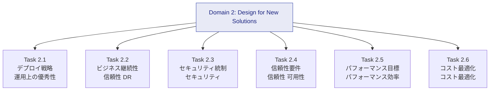

| タスク | 一言でいうと | 中心となるサービス・概念 |
|---|---|---|
| 2.1 | 安全に素早くリリースし、失敗したら戻せる設計 | CloudFormation, CDK, CodePipeline, CodeDeploy, Systems Manager |
| 2.2 | 災害時にも事業を止めない設計 | RTO/RPO, DR 4戦略, Route 53, AWS Backup, Elastic Disaster Recovery |
| 2.3 | 守るべきものを、必要最小限の許可で守る設計 | IAM, セキュリティグループ, NACL, KMS, WAF, Shield, GuardDuty |
| 2.4 | 壊れても動き続ける・すぐ戻る設計 | Multi-AZ/Region, Auto Scaling, SQS/SNS/Step Functions, Route 53 |
| 2.5 | 負荷が増えても速く動く設計 | キャッシュ, レプリカ, ストレージ選定, 専用データベース |
| 2.6 | 必要な性能を最も安く得る設計 | Savings Plans, RI, ストレージ階層化, データ転送コスト |

---

## 3. Task 2.1 デプロイ戦略の設計

> 公式: 「Design a deployment strategy to meet business requirements」

### Step 1: 何を問われるか

| 区分 | 公式の項目 | やさしい言い換え |
|---|---|---|
| 知識 | Infrastructure as code (CloudFormation など) | インフラをコードで管理する方法 |
| 知識 | CI/CD | コードの変更を自動でテスト・配布する仕組み |
| 知識 | Change management processes | 変更を安全に管理するルール・手順 |
| 知識 | Configuration management tools (Systems Manager など) | 多数のサーバー設定を一括で管理する道具 |
| スキル | 新サービス・機能への移行/アップグレード経路を決める | 古い構成から新しい構成へ、どう段階的に移るか |
| スキル | デプロイ戦略とロールバック機構を選ぶ | リリース方式と「元に戻す」手段の選択 |
| スキル | マネージドサービスで構築・パッチ負荷を減らす | 自前運用をやめてAWSに任せる判断 |
| スキル | 高度な技術の開発・デプロイをAWSに委任する | 難しい部分(ML、コンテナ基盤など)をマネージドで代替 |

### Step 2-A: Infrastructure as Code(IaC)

**IaC を使う理由**: 手作業の構築は「人によって違う」「再現できない」「レビューできない」問題を生みます。コード化すると、Git で管理でき、同じ環境を何度でも作れ、DR 時の復旧も速くなります。

| ツール | 特徴 | 使いどころ |
|---|---|---|
| AWS CloudFormation | JSON/YAML のテンプレートでリソースを宣言。スタック単位で作成・更新・削除 | AWS の標準IaC。試験の中心 |
| AWS CDK | TypeScript、Python などのプログラミング言語で記述し、CloudFormation テンプレートへ変換 | 開発者がループや条件分岐を使いたい場合 |
| AWS SAM | サーバーレス向けの CloudFormation 拡張構文 | Lambda、API Gateway、DynamoDB 中心の構成 |
| CloudFormation StackSets | 複数アカウント・複数リージョンへ同一スタックを展開 | 組織全体への統制、マルチリージョン展開 |

**CloudFormation の重要機能**

| 機能 | 何ができるか | 試験でのポイント |
|---|---|---|
| 変更セット (Change Sets) | 更新を実行する前に「何が変わるか」をプレビュー | 本番更新の事前確認、置換(Replacement)の検知 |
| ロールバック | スタック作成/更新失敗時、自動で直前の状態へ戻す | 既定でオン。ロールバックトリガーで CloudWatch アラームを監視し、異常時に自動ロールバック可能 |
| ドリフト検出 | 手作業で変更された設定とテンプレートの差分を検出 | 構成の逸脱検知 |
| スタックポリシー | 重要リソースの意図しない更新を防ぐ | DB など置換されると困るリソースの保護 |
| DeletionPolicy | スタック削除時に Retain(残す)/Snapshot(スナップショットを取る)/Delete を指定 | RDS や EBS のデータ保護 |
| UpdatePolicy / CreationPolicy | Auto Scaling グループのローリング更新や、cfn-signal による起動完了待ち | EC2 の安全な更新 |
| ネストスタック / クロススタック参照 | 大きな構成を分割して再利用 | テンプレートの肥大化対策 |
| StackSets | 複数アカウント/リージョンに展開 | Organizations と連携した統制 |

```yaml
# CloudFormation の例: DB を誤削除から守る
Resources:
  AppDatabase:
    Type: AWS::RDS::DBInstance
    DeletionPolicy: Snapshot          # スタック削除時にスナップショットを残す
    UpdateReplacePolicy: Snapshot     # 置換(再作成)時にもスナップショットを残す
    Properties:
      Engine: mysql
      DBInstanceClass: db.m6g.large
      AllocatedStorage: "100"
      MultiAZ: true
      StorageEncrypted: true
      MasterUsername: "{{resolve:secretsmanager:prod/db:SecretString:username}}"
      MasterUserPassword: "{{resolve:secretsmanager:prod/db:SecretString:password}}"
```

**IaC のベストプラクティス**

- テンプレートを Git で管理し、**変更セットと自動テスト(cfn-lint、cfn-guard など)を CI に組み込む**
- 1つの巨大スタックにせず、**ライフサイクルが同じリソースごと**(ネットワーク層、データ層、アプリ層)に分割する
- パスワード等の秘密情報は**テンプレートに直書きせず**、Secrets Manager や Parameter Store の動的参照を使う
- 本番リソースには DeletionPolicy とスタックポリシーを設定する
- 手作業の変更を避け、**ドリフト検出**を定期実行する

### Step 2-B: CI/CD(継続的インテグレーション/継続的デリバリー)

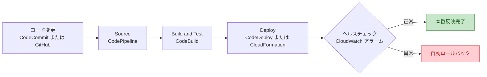

| サービス | 役割 |
|---|---|
| AWS CodePipeline | ソース取得からデプロイまでのパイプライン全体を自動化(オーケストレーション) |
| AWS CodeBuild | ビルド・テストを実行するフルマネージドなビルドサービス |
| AWS CodeDeploy | EC2、オンプレミス、Lambda、ECS へのデプロイを自動化し、ロールバックも可能 |
| AWS Elastic Beanstalk | コードを置くだけで環境(EC2、ELB、Auto Scaling)を管理してくれるPaaS的サービス |
| Amazon ECR | コンテナイメージのレジストリ |

> **補足**: CodeCommit は一時期新規受付を停止していましたが、AWS は 2025 年 11 月 25 日に新規サインアップを再開しており、新規顧客も利用できます。

#### デプロイ方式の比較(最重要)

| 方式 | 仕組み | ダウンタイム | ロールバックの速さ | 追加コスト | 向いている場面 |
|---|---|---|---|---|---|
| All at once(一斉) | 全台を一度に更新 | あり | 遅い(再デプロイ) | なし | 開発環境、停止を許容できる場合 |
| Rolling(ローリング) | 数台ずつ順に更新 | なし/小(一時的に容量低下) | 遅い | なし | 容量低下を許容できる通常のサービス |
| Rolling with additional batch | 追加の台数を用意してから順次更新 | なし(容量維持) | 遅い | 少し発生 | 容量を落とせないサービス |
| Immutable(不変) | 新しい Auto Scaling グループに全て新規作成し、成功後に切替 | なし | 速い(旧環境を破棄するだけ) | 一時的に2倍 | 安全性重視 |
| Blue/Green | 旧(Blue)と新(Green)の2環境を用意し、トラフィックを切替 | なし | 非常に速い(切り戻すだけ) | 一時的に2倍 | ダウンタイムとリスクを最小化したい場合 |
| Canary | 少量(例 10%)に先に新版を流し、問題なければ全体へ | なし | 速い | 小 | 影響範囲を限定して検証したい場合 |
| Linear | 一定間隔で一定割合ずつトラフィックを移行 | なし | 速い | 小 | 段階的に慎重に移行したい場合 |

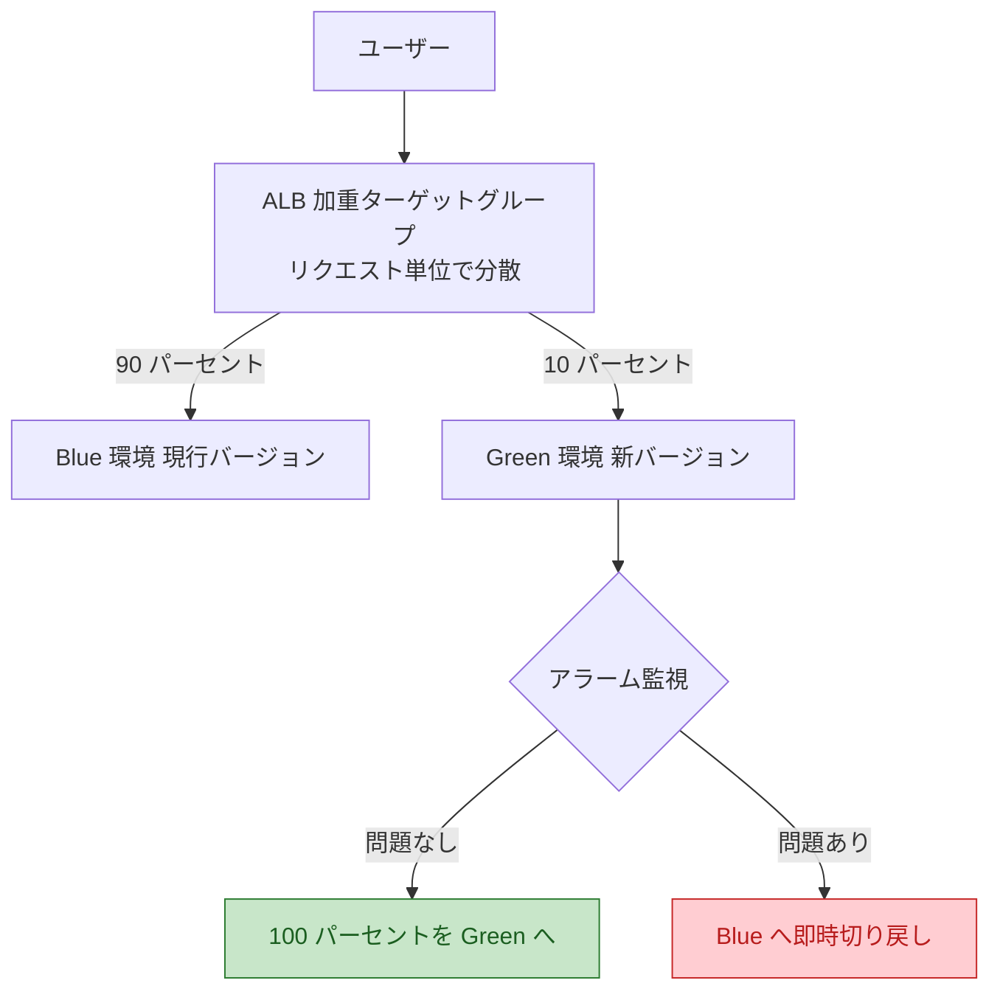

**サービス別の代表的なデプロイ手段**

| 対象 | 使える方式 | 補足 |
|---|---|---|
| EC2 / オンプレミス | CodeDeploy の In-place(ローリング相当)、Blue/Green | 設定例: OneAtATime、HalfAtATime、AllAtOnce |
| Lambda | CodeDeploy + エイリアスの重み付け(Canary、Linear、AllAtOnce) | SAM の `DeploymentPreference` で簡単に設定可能 |
| ECS | CodeDeploy の Blue/Green(Canary、Linear、AllAtOnce)、ECS のローリング更新 | ECS サービス自体の組み込みデプロイ機能も利用可能 |
| Elastic Beanstalk | All at once、Rolling、Rolling with additional batch、Immutable、Traffic splitting | 環境の置換(Blue/Green 風)は CNAME スワップで実現 |
| API Gateway | カナリアリリース | ステージ単位で一部トラフィックを新版へ |
| DNS 切替 | Route 53 の加重ルーティング | 全体の Blue/Green を DNS で実現 |

```yaml
# SAM の例: Lambda を 10% → 全体へ段階移行し、アラームで自動ロールバック
Resources:
  OrderFunction:
    Type: AWS::Serverless::Function
    Properties:
      Runtime: python3.13
      Handler: app.handler
      AutoPublishAlias: live
      DeploymentPreference:
        Type: Canary10Percent5Minutes     # 10% を5分間試してから残りを移行
        Alarms:
          - !Ref ErrorRateAlarm           # このアラームが鳴ったら自動ロールバック
```

**CI/CD のベストプラクティス**

- **すべての変更をパイプライン経由**にし、本番への手作業を禁止する
- パイプラインに**自動テスト(単体、統合、セキュリティスキャン)**を組み込み、承認ステージは本番前に置く
- デプロイ後は **CloudWatch アラームと連携した自動ロールバック**を設定する
- ビルド成果物(アーティファクト)は**バージョン管理し、同じ成果物を各環境で再利用**する(環境ごとに作り直さない)
- パイプライン用 IAM ロールは**最小権限**にする

### Step 2-C: 変更管理(Change Management)

| サービス | 役割 |
|---|---|
| AWS Systems Manager Change Manager | 変更リクエストの承認フローと実行履歴を管理(2025 年 11 月 7 日に新規顧客の受付を終了。既存顧客は引き続き利用可能) |
| AWS CloudTrail | 「誰が、いつ、何をしたか」の API 操作ログ |
| AWS Config | リソース構成の履歴記録と、ルールによる準拠性評価 |
| AWS Service Catalog | 承認済みテンプレート(製品)のみを利用者に提供し、構成を統制 |
| AWS Control Tower / Organizations(SCP) | 組織全体のガードレール(Domain 1 で詳述) |

**ベストプラクティス**: 変更は「申請 → レビュー → 承認 → 自動デプロイ → 記録」の流れにし、CloudTrail と Config で**変更の証跡と逸脱の検知**を残します。

### Step 2-D: 構成管理(AWS Systems Manager)

Systems Manager は、多数のサーバー(EC2 やオンプレミス)を**まとめて管理する運用ハブ**です。

| 機能 | できること | 例 |
|---|---|---|
| Parameter Store | 設定値や秘密情報を階層的に保存。SecureString で KMS 暗号化 | `/prod/app/db_host` |
| State Manager | 望ましい状態(エージェント導入、設定)を維持 | 全サーバーにエージェントを常に入れる |
| Patch Manager | パッチのスキャンと適用を自動化 | 毎週日曜夜にパッチ適用 |
| Run Command | 多数のサーバーでコマンドを一斉実行(SSH 不要) | 緊急の設定変更 |
| Automation | 運用手順(Runbook)を自動化 | AMI 作成、障害復旧手順の自動化 |
| Session Manager | SSH キーや踏み台なしで、IAM 認可でシェル接続。操作ログも記録可能 | セキュアな運用接続 |
| AppConfig | アプリ設定や機能フラグを段階的に配信し、アラーム連携でロールバック | 設定変更の安全な展開 |
| Inventory | ソフトウェア一覧などのメタデータ収集 | 構成の可視化 |

**ベストプラクティス**: SSH/RDP の直接公開をやめて **Session Manager** を使う、設定は **Parameter Store** に外出しする、パッチは **Patch Manager とメンテナンスウィンドウ**で計画的に適用する。

### Step 2-E: 移行/アップグレード経路とマネージドサービス活用

**「自前で運用」から「AWS に任せる」へ**: 運用負荷(プロビジョニング、パッチ適用、冗長化)を減らす判断が頻出です。

| 自前で運用している構成 | マネージドへの置き換え | 得られる効果 |
|---|---|---|
| EC2 に入れた MySQL/PostgreSQL | Amazon RDS / Aurora | バックアップ、パッチ、Multi-AZ を自動化 |
| EC2 上の Docker 管理 | ECS / EKS + Fargate | サーバー管理が不要になる |
| 自前のメッセージブローカー | Amazon SQS / SNS / Amazon MQ | 運用不要・高可用 |
| EC2 上のバッチ/イベント処理 | Lambda / Step Functions | サーバーレスで従量課金 |
| 自前の Redis/Memcached | ElastiCache | 管理・フェイルオーバー自動化 |
| 自前の機械学習基盤 | Amazon SageMaker AI / Amazon Bedrock | 複雑な基盤構築をAWSに委任 |
| 自前の Elasticsearch | Amazon OpenSearch Service | クラスター運用の削減 |

**段階的な移行経路の考え方**

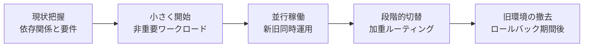

### Step 3: Task 2.1 試験のコツ

| 問題文のキーワード | 選ぶべき方向性 |
|---|---|
| 「ダウンタイムなし」「即時ロールバック」 | Blue/Green、Immutable、Canary |
| 「追加コストを抑えて」 | Rolling(Blue/Green や Immutable は一時的に2倍) |
| 「複数アカウント/リージョンに同一構成」 | CloudFormation StackSets |
| 「更新前に影響を確認」 | CloudFormation 変更セット |
| 「手作業の変更を検出」 | CloudFormation ドリフト検出、AWS Config |
| 「SSH を開けずにサーバー管理」 | Systems Manager Session Manager |
| 「運用負荷を最小に」 | マネージドサービス(RDS、Fargate、Lambda など) |
| 「アラームが鳴ったら自動で戻す」 | CodeDeploy + CloudWatch アラーム、CloudFormation ロールバックトリガー |

---

## 4. Task 2.2 ビジネス継続性の確保

> 公式: 「Design a solution to ensure business continuity」

### Step 1: 何を問われるか

| 区分 | 公式の項目 | やさしい言い換え |
|---|---|---|
| 知識 | AWS グローバルインフラストラクチャ | リージョン、AZ、エッジ拠点の構造 |
| 知識 | Route 53 などのネットワーク概念、ルーティング方式 | 障害時にトラフィックを別の場所へ向ける方法 |
| 知識 | RTO と RPO | 復旧時間とデータ損失許容量 |
| 知識 | DR シナリオ(バックアップとリストア、パイロットライト、ウォームスタンバイ、マルチサイト) | 災害対策の4つの型 |
| スキル | DR の構成、データ/DB レプリケーション、DR テスト | 実際に作る・複製する・訓練する |
| スキル | 自動化されコスト効率の高いバックアップ(複数 AZ/リージョン) | 勝手に取れて、安くて、遠くにも保管できる |
| スキル | 障害時も使える可用性の高い設計、集中監視による事前復旧 | 壊れても動く、壊れる前に気づく |

### Step 2-A: AWS グローバルインフラの基礎

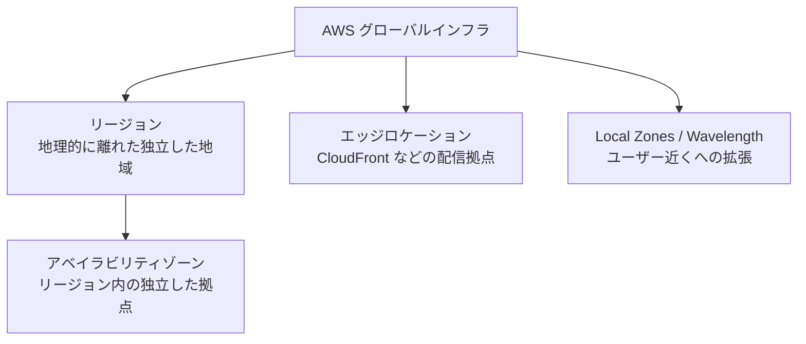

| 単位 | 障害の想定範囲 | 守れる障害の例 |
|---|---|---|
| 同一 AZ 内の冗長化 | 機器単体 | サーバー故障 |
| Multi-AZ | データセンター(AZ)単位 | AZ 停電、AZ 障害 |
| Multi-Region | リージョン全体 | リージョン規模の障害、大規模災害、規制要件 |

> **ポイント**: 「リージョン障害まで想定」「規制で遠隔地にデータを置く必要がある」といった要件があるときだけ Multi-Region を検討します。Multi-AZ で足りるのに Multi-Region にすると、コストと複雑さが無駄に増えます。

### Step 2-B: RTO と RPO

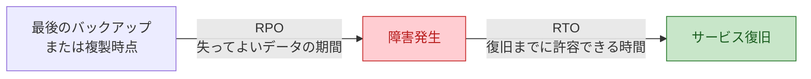

| 指標 | 意味 | 小さくするほど |
|---|---|---|
| RPO | 障害時にどの時点のデータまで戻れればよいか | データ損失が減る。レプリケーション頻度/同期性が必要になり高コスト |
| RTO | 障害発生からサービス再開までの許容時間 | 停止時間が減る。待機環境を常時稼働させる必要があり高コスト |

### Step 2-C: DR 4戦略(最重要)

| 戦略 | 仕組み | RTO / RPO の目安 | コスト | 向いている場面 |
|---|---|---|---|---|
| バックアップとリストア | バックアップを別リージョンへ保存し、災害時に復元 | 時間単位(長い) | 最も低い | 停止を数時間〜1日許容できる |
| パイロットライト | データだけ常時複製し、アプリ基盤は最小(停止状態)で用意。災害時に起動・拡張 | 数十分程度 | 低〜中 | 中程度の RTO |
| ウォームスタンバイ | 縮小版のフル環境を常時稼働。災害時にスケールアップ | 分単位 | 中〜高 | 短い RTO、常時テスト可能にしたい |
| マルチサイト Active/Active | 複数リージョンで同時に本番稼働 | ほぼゼロに近づけられる | 最も高い | ほぼ無停止・データ損失ほぼゼロ |

> 上表の時間は設計の目安です。実際の RTO/RPO は構成・データ量・運用手順で変わります。出典の AWS ホワイトペーパー(参考URL一覧)で最新の整理を確認してください。

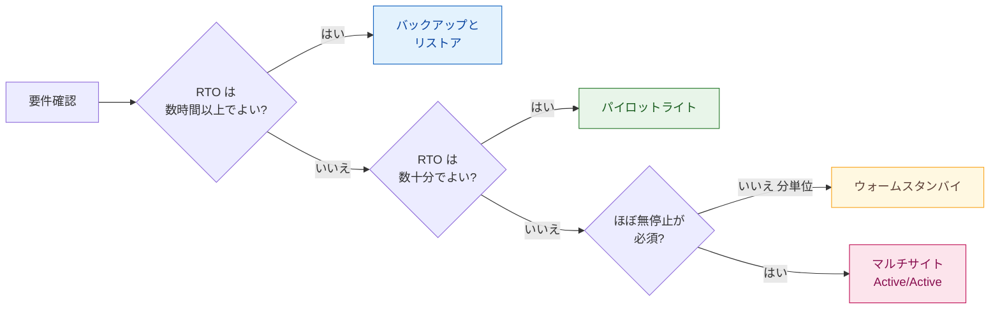

### Step 2-D: データとデータベースのレプリケーション

| サービス | 機能 | 特徴・注意点 |
|---|---|---|
| Amazon S3 | クロスリージョンレプリケーション(CRR)、同一リージョンレプリケーション(SRR) | **バージョニングが必須**。S3 Replication Time Control で複製時間の目標を設定可能。S3 Multi-Region Access Points で複数リージョンへ単一エンドポイント提供 |
| Amazon RDS | Multi-AZ(同期レプリケーション、自動フェイルオーバー)、クロスリージョンリードレプリカ | **Multi-AZ は可用性(同一リージョン)**、**リードレプリカは読み取り拡張とDR(昇格が必要)** |
| Amazon Aurora | Aurora レプリカ(最大15)、Aurora Global Database(リージョン間を専用インフラで低遅延複製) | グローバルデータベースは通常1秒未満の遅延が目標。災害時はセカンダリリージョンを昇格 |
| Amazon DynamoDB | PITR(ポイントインタイムリカバリ)、グローバルテーブル(マルチリージョン・マルチアクティブ) | グローバルテーブルは各リージョンで書き込み可能。MREC(マルチリージョン結果整合性)では競合は最後の書き込み優先、MRSC(マルチリージョン強整合性)では同一項目への同時書き込みが ReplicatedWriteConflictException で失敗し得る |
| Amazon EBS | スナップショットのリージョン間コピー、Data Lifecycle Manager による自動化 | 増分バックアップ |
| AWS Elastic Disaster Recovery (DRS) | サーバーのブロックレベル継続レプリケーションで、低コストなステージング領域から復旧 | オンプレミス/他クラウド/AWS から AWS への DR に利用。秒単位の RPO、分単位の RTO を目指せる |
| Amazon ElastiCache | Global Datastore などクロスリージョン複製 | 対応エンジンと機能を確認 |

> **重要な落とし穴**: 継続的レプリケーションは、**データ破損や誤削除も複製してしまいます**。そのため、バージョニングやポイントインタイムリカバリ、バックアップを併用します。

### Step 2-E: Route 53 とフェイルオーバー

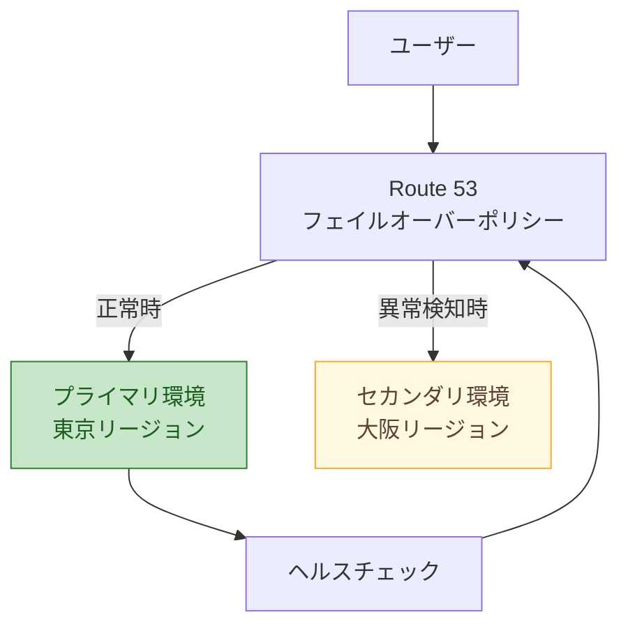

| 機能 | 内容 |
|---|---|
| ヘルスチェック | エンドポイント監視、他のヘルスチェックの組み合わせ(計算ヘルスチェック)、CloudWatch アラーム連動 |
| フェイルオーバールーティング | プライマリが異常ならセカンダリへ応答を切替(Active-Passive) |
| Route 53 Application Recovery Controller (ARC) | ルーティングコントロール(安全にトラフィックを切替)、準備状況チェック、ゾーンシフト(AZ 単位でトラフィックを退避) |

**ベストプラクティス**: フェイルオーバー時は**データプレーン(稼働中の仕組み)に依存する設計**にします。災害時にコントロールプレーン(リソース作成・変更の API)が使えない場合を想定し、切替操作は事前に用意した仕組み(ARC のルーティングコントロールなど)に任せる方が確実です。

### Step 2-F: バックアップの自動化(AWS Backup)

| 機能 | 内容 |
|---|---|
| バックアッププラン | スケジュール、保持期間、コピー先を一元定義 |
| 対応サービス | EC2/EBS、RDS、Aurora、DynamoDB、EFS、FSx、S3 など多数 |
| クロスリージョン/クロスアカウントコピー | 遠隔地・別アカウントへ自動コピー(ランサムウェア対策にも有効) |
| Backup Vault Lock | WORM で改ざん・削除から保護。ガバナンスモードは十分な権限を持つユーザーが解除可能、コンプライアンスモードは猶予期間終了後、保持期間中の削除・変更を防止 |
| リストアテスト | バックアップから復元できるか自動検証 |
| Organizations 連携 | 組織全体のバックアップポリシーを一括適用 |

**コスト効率の工夫**: コールドストレージへの移行に対応したリソースタイプでは、ライフサイクルで古いバックアップを低コストのコールドストレージへ移行、タグベースで対象リソースを自動選択、不要になった保持期間を見直す。

### Step 2-G: DR テストと集中監視

| 取り組み | 内容 |
|---|---|
| DR テスト | **テストされていない DR は DR ではない**。定期的にフェイルオーバー演習(ゲームデイ)を実施 |
| AWS Fault Injection Service (FIS) | 意図的に障害を起こして耐障害性を検証 |
| 集中監視 | CloudWatch、EventBridge、Systems Manager OpsCenter、Health Dashboard で検知し、自動復旧(Auto Scaling、Systems Manager Automation、Lambda)につなげる |
| IaC による復旧 | DR リージョンの環境を CloudFormation/CDK で再現可能にしておく |
| クォータの事前確認 | DR リージョンでも Service Quotas を十分に確保(災害時に上限不足にならないように) |

### Step 3: Task 2.2 試験のコツ

| 問題文のキーワード | 選ぶべき方向性 |
|---|---|
| 「RTO 数時間、最小コスト」 | バックアップとリストア(AWS Backup のクロスリージョンコピー) |
| 「データは常時複製、基盤は最小限」 | パイロットライト |
| 「分単位で復旧、縮小版を常時稼働」 | ウォームスタンバイ(Aurora Global Database のセカンダリリージョンを昇格する Active/Passive 構成など) |
| 「ほぼ無停止、リージョン障害でも継続」 | マルチサイト Active/Active(DynamoDB グローバルテーブル、Aurora DSQL のマルチリージョンクラスターなど複数リージョンで書き込めるデータストア、Route 53) |
| 「オンプレミスサーバーを AWS へ DR」 | AWS Elastic Disaster Recovery |
| 「リージョン間 DB の低遅延複製」 | Aurora Global Database |
| 「どのリージョンからも書き込み」 | DynamoDB グローバルテーブル |
| 「バックアップの削除・改ざんを防ぐ」 | AWS Backup Vault Lock、クロスアカウントコピー |

---

## 5. Task 2.3 要件に基づくセキュリティ統制の決定

> 公式: 「Determine security controls based on requirements」

### Step 1: 何を問われるか

| 区分 | 公式の項目 | やさしい言い換え |
|---|---|---|
| 知識 | IAM | 誰が何をできるかの制御 |
| 知識 | ルートテーブル、セキュリティグループ、ネットワーク ACL | ネットワークの通り道と門番 |
| 知識 | 保存時/転送時の暗号化 | 保存データと通信データの暗号化 |
| 知識 | AWS サービスエンドポイント | AWS サービスへの接続口 |
| 知識 | 認証情報管理サービス | パスワードやキーの安全な保管 |
| 知識 | マネージドセキュリティサービス(Shield、WAF、GuardDuty、Security Hub) | 攻撃防御と脅威検出の道具 |
| スキル | 最小権限、通信制御、大規模 Web 攻撃対策、暗号化戦略、エンドポイント指定、パッチ管理 | 上記を要件に合わせて組み合わせる |

### Step 2-A: IAM と最小権限

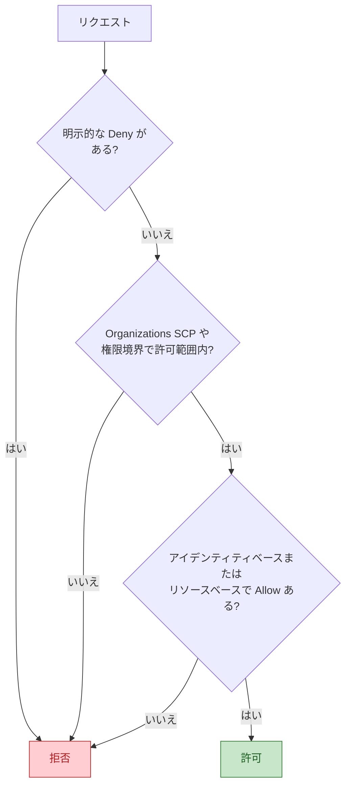

**注意**: この図は権限境界の暗黙的 Deny が効く一般的なケースに限定しています。同一アカウント内で、リソースベースポリシーが IAM ユーザー ARN を直接プリンシパルに指定して Allow する場合、権限境界の暗黙的 Deny はその Allow を制限しません(明示的 Deny と SCP は引き続き適用)。

> **覚え方**: 「明示的 Deny が最優先 → 暗黙的 Deny(何も許可がなければ拒否) → Allow があって初めて許可」。

| 仕組み | 役割 |
|---|---|
| IAM ロール | 一時的な認証情報を発行。EC2、Lambda、ECS タスクにはアクセスキーではなくロールを付与 |
| IAM Identity Center | 人間のユーザー向けのシングルサインオンとフェデレーション(長期アクセスキーを避ける) |
| 権限境界 (Permissions Boundary) | ロール/ユーザーが持てる**最大権限**を制限(委任管理で有効) |
| SCP | 組織/OU/アカウントの**上限**を制限(Domain 1 で詳述) |
| IAM Access Analyzer | 外部公開や未使用の権限を検出、最小権限ポリシーの生成を支援 |
| 条件キー | `aws:SourceVpce`、`aws:PrincipalOrgID`、`aws:MultiFactorAuthPresent` などで条件付き許可 |

```json
{
  "Version": "2012-10-17",
  "Statement": [
    {
      "Sid": "ReadOnlyFromSpecificBucketViaVpcEndpoint",
      "Effect": "Allow",
      "Action": ["s3:GetObject"],
      "Resource": "arn:aws:s3:::example-app-data/reports/*",
      "Condition": {
        "StringEquals": { "aws:SourceVpce": "vpce-0123456789abcdef0" }
      }
    }
  ]
}
```

**IAM のベストプラクティス**

- ルートユーザーは日常利用せず、MFA を有効にして保護する
- 人にはフェデレーション(IAM Identity Center)、ワークロードには**ロール**を使い、**長期アクセスキーを避ける**
- 最初は広めの権限で始めず、**必要な権限だけ**付与し、Access Analyzer のアクセスアドバイザーや生成機能で絞り込む
- 条件(MFA、送信元、タグ)で許可範囲を狭める

### Step 2-B: ネットワーク統制(ルートテーブル、セキュリティグループ、NACL)

| 観点 | セキュリティグループ | ネットワーク ACL |
|---|---|---|
| 適用単位 | ENI(インスタンス等) | サブネット |
| 状態 | **ステートフル**(戻り通信は自動許可) | **ステートレス**(往復とも明示が必要) |
| ルール | **許可のみ** | 許可と**拒否**の両方 |
| 評価 | 全ルールを評価 | **番号の小さい順**に評価、最初に一致したもので決定 |
| 用途 | 通常の通信制御の主役 | サブネット境界での粗い制御、特定 IP の明示的拒否 |

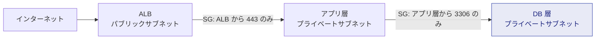

**ベストプラクティス**

- **セキュリティグループ同士を参照**して許可する(IP アドレス直書きより変更に強い)
- DB やアプリは**プライベートサブネット**に置き、インターネットへのアクセスが必要な場合のみ NAT ゲートウェイ経由にする
- 特定 IP を確実にブロックしたい場合は NACL の拒否ルールを使う
- ルートテーブルで**意図しない経路(0.0.0.0/0 の IGW 向け)を持たせない**

### Step 2-C: 暗号化(保存時・転送時)

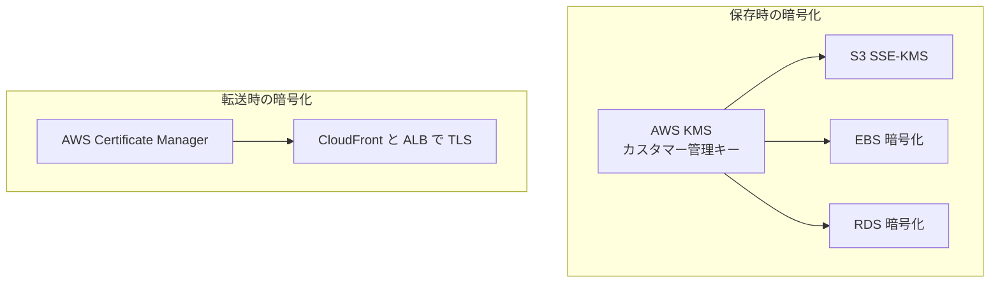

| 対象 | 方法 |
|---|---|
| 鍵管理 | **AWS KMS**: AWS 所有キー、AWS マネージドキー、カスタマー管理キー(ローテーション、キーポリシー、監査が可能)。マルチリージョンキーで DR 用に同じキーマテリアルを複数リージョンで利用 |
| 専用ハードウェア要件 | **AWS CloudHSM**: 専有の HSM が必要な場合(厳格なコンプライアンス) |
| S3 | SSE-S3、SSE-KMS、DSSE-KMS、クライアント側暗号化。バケットポリシーで暗号化なしのアップロードや HTTP を拒否できる |
| EBS / RDS / DynamoDB / EFS | 作成時に暗号化を有効化(既存の非暗号化リソースはスナップショット経由などで暗号化版を作成) |
| 転送時 | TLS。証明書は **ACM** で発行・自動更新。ALB、CloudFront、API Gateway に適用 |
| 内部通信 | VPN、Direct Connect + MACsec/IPsec 等で保護 |

```json
{
  "Sid": "DenyInsecureTransport",
  "Effect": "Deny",
  "Principal": "*",
  "Action": "s3:*",
  "Resource": ["arn:aws:s3:::example-bucket", "arn:aws:s3:::example-bucket/*"],
  "Condition": { "Bool": { "aws:SecureTransport": "false" } }
}
```

### Step 2-D: AWS サービスエンドポイント(VPC エンドポイント)

目的は、**インターネットを経由せず**に VPC から AWS サービスへ接続することです。

| 種類 | 対象 | 仕組み | 費用の考え方 |
|---|---|---|---|
| ゲートウェイエンドポイント | **S3 と DynamoDB** | ルートテーブルにエントリを追加 | **追加料金なし** |
| インターフェースエンドポイント (PrivateLink) | 多数の AWS サービス、他社/自社の公開サービス | サブネットに ENI を作成しプライベート IP で接続 | 時間課金+データ処理料金 |
| ゲートウェイロードバランサーエンドポイント | 仮想アプライアンス(ファイアウォール等)の挿入 | トラフィックを検査装置へ | 構成による |

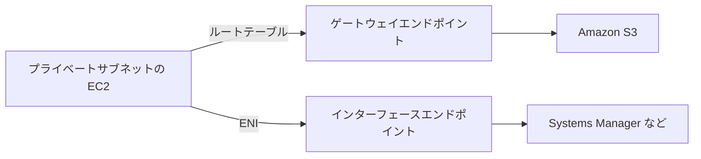

**ベストプラクティス**: S3 へのアクセスは**ゲートウェイエンドポイント**(無料)を第一候補にし、**エンドポイントポリシー**と**バケットポリシー(`aws:SourceVpce`)**で通信経路と権限を二重に制限する。NAT ゲートウェイ経由の S3 通信は余計なデータ処理料金が発生するため避ける。

### Step 2-E: 認証情報の管理

| サービス | 向いている用途 | 特徴 |
|---|---|---|
| AWS Secrets Manager | DB パスワード、API キー | **自動ローテーション**(RDS 等はネイティブ対応)、リージョン間レプリケーション、KMS 暗号化。有料 |
| SSM Parameter Store | 設定値、シンプルな秘密情報 | 階層管理、SecureString。標準パラメータは無料枠あり。自動ローテーションは標準では持たない |
| IAM ロール(一時認証情報) | AWS サービス間のアクセス | キーそのものを持たない(最も安全) |
| ACM | TLS 証明書 | 自動更新 |

> **ひっかけ**: 「パスワードを**自動でローテーション**したい」→ Secrets Manager。「設定値を**安価に**管理」→ Parameter Store。

### Step 2-F: マネージドセキュリティサービス

| サービス | 役割 | 覚え方 |
|---|---|---|
| AWS Shield | DDoS 対策。**Standard は全顧客に自動・無料**。**Advanced** は高度な検知、SRT(Shield Response Team)支援、コスト保護など | 「DDoS = Shield」 |
| AWS WAF | Web アプリケーション層(L7)のルール(SQL インジェクション、XSS、レートベース、Bot 制御)。CloudFront、ALB、API Gateway などに適用 | 「Web の攻撃 = WAF」 |
| AWS Firewall Manager | 複数アカウントの WAF、Shield Advanced、セキュリティグループ、Network Firewall のルールを一元管理 | 「組織全体で統制」 |
| AWS Network Firewall | VPC のネットワーク境界での状態検査 / 侵入防止 | 「VPC 境界のファイアウォール」 |
| Amazon GuardDuty | CloudTrail、VPC フローログ、DNS ログなどを分析する**脅威検出**(機械学習) | 「怪しい挙動を検知」 |
| AWS Security Hub | 各サービスの検出結果を集約し、セキュリティ標準への準拠を評価 | 「検出結果の集約」 |
| Amazon Inspector | EC2、コンテナ、Lambda の**脆弱性スキャン** | 「脆弱性 = Inspector」 |
| Amazon Macie | S3 内の機密データ(PII など)を検出 | 「機密データ = Macie」 |
| AWS Config | 構成の準拠性評価と変更履歴 | 「構成のルール評価」 |

### Step 2-G: 大規模 Web アプリへの攻撃緩和

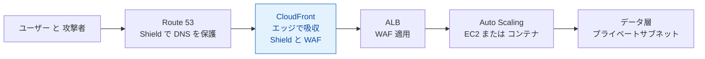

**DDoS 耐性の基本方針**

1. **攻撃面を減らす**: オリジンを直接公開せず、CloudFront 経由のみ許可する。S3 オリジンはオリジンアクセスコントロール(OAC)で保護する。ALB オリジンは CloudFront のマネージドプレフィックスリストだけでは他のディストリビューションからの経由を防げないため、CloudFront が付与する秘密のカスタムヘッダーを ALB リスナールールで検証する
2. **エッジで吸収する**: CloudFront と Route 53(エニーキャスト)を前面に置く
3. **Layer 7 を守る**: WAF のレートベースルール、マネージドルール、Bot Control
4. **スケールして耐える**: Auto Scaling と ELB で吸収し、Shield Advanced でコスト保護も受ける
5. **検知と対応**: CloudWatch アラーム、GuardDuty、Shield Advanced の SRT へのエスカレーション

### Step 2-H: パッチ管理

| 手段 | 内容 |
|---|---|
| Systems Manager Patch Manager | パッチベースラインで承認ルールを定義し、メンテナンスウィンドウで適用。コンプライアンスレポートも出力 |
| Amazon Inspector | 脆弱性を継続的にスキャンし、優先度付け |
| EC2 Image Builder | パッチ適用済みの AMI を**自動でビルド・配布**(Immutable な運用) |
| マネージドサービス | RDS のメンテナンスウィンドウ、Fargate、Lambda などは基盤パッチを AWS が担う |

**ベストプラクティス**: 「稼働中のサーバーにパッチを当てる」より、**パッチ済み AMI から新しいインスタンスに入れ替える(Immutable)** 方が再現性が高く、ロールバックも容易です。

### Step 3: Task 2.3 試験のコツ

| 問題文のキーワード | 選ぶべき方向性 |
|---|---|
| 「インターネット経由なしで S3 へ」 | ゲートウェイ VPC エンドポイント |
| 「特定 IP を確実にブロック」 | NACL の拒否ルール(セキュリティグループは拒否不可) |
| 「SQL インジェクション/XSS を防ぐ」 | AWS WAF |
| 「大規模 DDoS、コスト保護、専門チーム支援」 | Shield Advanced |
| 「パスワードの自動ローテーション」 | Secrets Manager |
| 「複数アカウントのルールを一括適用」 | Firewall Manager |
| 「異常な API 呼び出しや不正通信を検出」 | GuardDuty |
| 「検出結果を一元表示」 | Security Hub |
| 「暗号鍵の使用を細かく監査・制御」 | KMS カスタマー管理キー(キーポリシー、CloudTrail) |
| 「長期アクセスキーを使わない」 | IAM ロール、IAM Identity Center |

---

## 6. Task 2.4 信頼性要件を満たす戦略の設計

> 公式: 「Design a strategy to meet reliability requirements」

### Step 1: 何を問われるか

| 区分 | 公式の項目 | やさしい言い換え |
|---|---|---|
| 知識 | グローバルインフラ、ストレージ/レプリケーション(S3、RDS、ElastiCache) | データを複数の場所に安全に持つ方法 |
| 知識 | Multi-AZ / Multi-Region アーキテクチャ | 拠点をまたいで冗長化する設計 |
| 知識 | Auto Scaling のポリシーとイベント | 負荷や障害に応じて自動で台数を増減する仕組み |
| 知識 | アプリケーション統合(SNS、SQS、Step Functions) | システム同士を「疎結合」でつなぐ部品 |
| 知識 | サービスクォータと制限 | AWS の利用上限 |
| スキル | 高可用性環境、障害を前提とした設計、疎結合、フェイルオーバーの運用、マネージドサービス、DNS ルーティングポリシー | 壊れても続く・すぐ切り替わる・連鎖して壊れない設計 |

> **Task 2.2 との違い**: 2.2 は「災害(リージョン規模)後に事業を継続する」視点、2.4 は「日常的な障害(インスタンス故障、AZ 障害、負荷急増)でも落とさない」視点です。重なる部分は多いので、セットで理解しましょう。

### Step 2-A: 高可用性の基本形(Multi-AZ)

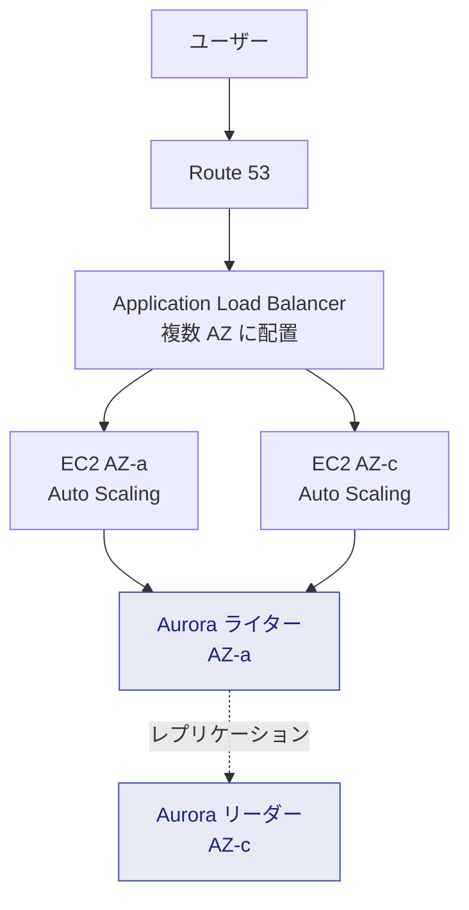

| 層 | 高可用性の手段 |
|---|---|
| DNS | Route 53(ヘルスチェックと組み合わせ) |
| ロードバランサー | ELB は複数 AZ に自動分散。異常なターゲットを切り離す(ヘルスチェック) |
| コンピュート | Auto Scaling グループを**複数 AZ に配置**。異常インスタンスを自動で置換 |
| データベース | RDS Multi-AZ、Aurora(ストレージは3つの AZ に6コピー)、DynamoDB(リージョン内で複数 AZ に自動複製) |
| ストレージ | S3(複数 AZ に自動冗長化。One Zone クラスは除く)、EFS(複数 AZ) |
| ネットワーク | AZ ごとに NAT ゲートウェイを配置(AZ 障害時の連鎖を防ぐ) |

### Step 2-B: ストレージとデータベースのレプリケーション戦略

| サービス | 同一リージョン内の可用性 | リージョン間 | 補足 |
|---|---|---|---|
| Amazon S3 | 複数 AZ に自動冗長化 | CRR、Multi-Region Access Points | バージョニングで誤削除対策 |
| Amazon RDS | **Multi-AZ**(同期レプリケーション、自動フェイルオーバー、通常1〜2分程度) | クロスリージョンリードレプリカ | リードレプリカは非同期。スタンバイは**読み取りに使えない**(Multi-AZ インスタンス構成の場合) |
| Amazon Aurora | 最大15のレプリカ、自動フェイルオーバー | Global Database | レプリカがあれば短時間でフェイルオーバー可能 |
| Amazon DynamoDB | 自動で複数 AZ | グローバルテーブル | オンデマンド/プロビジョンドの容量モードを選択 |
| Amazon ElastiCache | レプリカとMulti-AZ自動フェイルオーバー(Valkey / Redis OSS) | Global Datastore | Memcached はレプリケーションなし(別途設計が必要) |
| Amazon EFS | 複数 AZ に自動冗長化(Standard クラス) | EFS レプリケーション | One Zone クラスは単一 AZ |

> **ひっかけ**: RDS の **Multi-AZ は「可用性」**、**リードレプリカは「読み取りのスケールアウト(+DR)」**。目的が違うので混同しないこと。

### Step 2-C: Auto Scaling(ポリシーとイベント)

| スケーリング方式 | 内容 | 使いどころ |
|---|---|---|
| ターゲット追跡 | 指標(例: CPU 50%)を目標値に保つよう自動調整 | **最初の選択肢**。設定が簡単 |
| ステップスケーリング | アラームの超過幅に応じて段階的に増減 | 負荷に応じたきめ細かい調整 |
| スケジュールスケーリング | 時刻や日付で増減 | 予測できる負荷(営業時間、イベント) |
| 予測スケーリング | 過去のパターンを機械学習で予測し事前に拡張 | 周期的な負荷、起動に時間がかかるアプリ |
| カスタムメトリクス | 例: SQS の「1インスタンスあたりの待ちメッセージ数」 | キュー処理ワーカーの最適な増減 |

| 関連機能 | 内容 |
|---|---|
| ライフサイクルフック | 起動/終了の途中で処理を挟む(設定完了待ち、ログ退避など) |
| ウォームプール | 事前に初期化済みのインスタンスを待機させ、スケールアウトを高速化 |
| インスタンスリフレッシュ | AMI 更新などで段階的にインスタンスを入れ替え |
| ヘルスチェック | EC2 と ELB のヘルスチェックを併用し、アプリ異常も検知して置換 |
| 通知(イベント) | 起動、終了、失敗を SNS / EventBridge に通知 |

### Step 2-D: 疎結合(アプリケーション統合)

**密結合の問題**: 呼び出し先が落ちたり遅くなると、呼び出し元も連鎖して落ちます。間にキューやイベントバスを挟むと、**片方が止まっても他方は影響を受けにくく**なります。

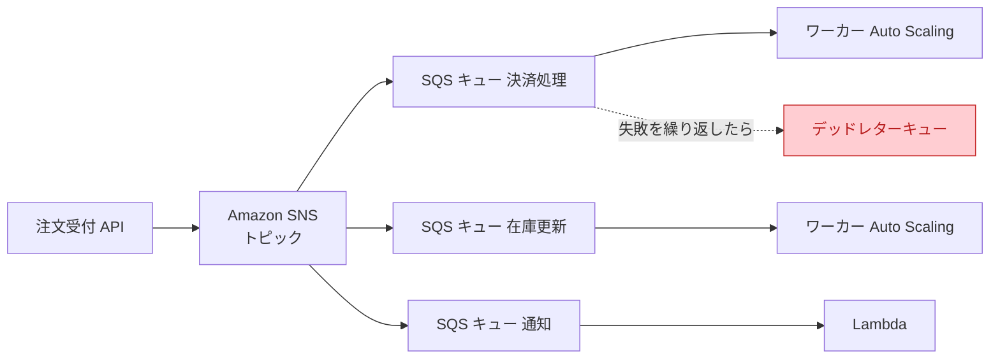

| サービス | 役割 | 試験の要点 |
|---|---|---|
| Amazon SQS | メッセージキュー(バッファ)。標準(ほぼ無制限スループット、順序保証なし、少なくとも1回)、FIFO(順序保証、重複排除) | 可視性タイムアウト、ロングポーリング、**デッドレターキュー**(失敗メッセージの隔離) |
| Amazon SNS | Pub/Sub(1つのメッセージを多数へ配信) | **SNS + SQS のファンアウト**、フィルターポリシー |
| Amazon EventBridge | イベントバス。ルールでイベントをターゲットへ振り分け、SaaS/AWS サービスのイベントを連携 | スケジュール実行、イベント駆動 |
| AWS Step Functions | ワークフローのオーケストレーション。リトライ、エラー処理、並列処理、人の承認待ちを定義 | Standard(長時間。ワークフロー実行は exactly-once だが、`Retry` を定義したタスクは再実行されうる)と Express(高頻度、短時間。非同期は at-least-once、同期は at-most-once) |
| Amazon Kinesis / MSK | ストリーミングデータの取り込み | 順序付きのリアルタイム処理 |
| API Gateway | API の公開、スロットリング、キャッシュ | バックエンドの保護 |

**ベストプラクティス**

- **同期呼び出しを減らし、非同期(キュー/イベント)にする**
- 処理は**冪等**(同じメッセージを2回処理しても結果が同じ)に設計する
- リトライには**指数バックオフとジッター**を使い、再試行の集中を避ける
- **デッドレターキュー**と監視アラームを必ず設定する
- Step Functions で**リトライとエラー分岐**を明示し、障害時の補償処理(Saga パターン)を設計する

### Step 2-E: サービスクォータ(上限)

| 項目 | 内容 |
|---|---|
| Service Quotas | クォータの確認、引き上げ申請、使用率アラーム設定を一元管理 |
| Trusted Advisor | クォータ使用率が高いサービスを警告 |
| 設計上の注意 | 急なスケールアウトや**DR 先リージョンで上限に達して起動できない**事態を防ぐ。リージョンごと・アカウントごとにクォータが異なるため、事前に引き上げる |
| ソフトリミットとハードリミット | 引き上げ可能なものと不可能なものがある。設計上の制約として把握する |

### Step 2-F: DNS ルーティングポリシー(Route 53)

| ポリシー | 動作 | 典型的な用途 |
|---|---|---|
| シンプル | 1つのレコードに1つ(または複数)の値を返す。ヘルスチェック連動なし | 単純な構成 |
| 加重 (Weighted) | 比率で振り分け(例: 90:10) | **カナリア/Blue/Green**、段階的移行 |
| レイテンシー | ユーザーに**最も遅延が小さい**リージョンへ | グローバル展開でのパフォーマンス最適化 |
| フェイルオーバー | プライマリが異常ならセカンダリへ | Active-Passive の DR |
| 位置情報 (Geolocation) | **ユーザーの所在地(国・大陸)**で振り分け | 言語、コンテンツ規制、データ主権 |
| 地理的近接 (Geoproximity) | リソースの場所と**バイアス**でトラフィック量を調整 | リージョン間の比率を地理的に調整 |
| IP ベース | クライアントの IP 範囲(CIDR)で振り分け | 特定 ISP/ネットワークを特定のエンドポイントへ |
| 複数値回答 | 最大8件の正常な値を返す(ヘルスチェック付き) | 簡易的な負荷分散 |

> **ひっかけ**: 「**最も速い**リージョン」= レイテンシー、「**国ごとに**コンテンツを出し分け」= 位置情報、「**災害時に切り替え**」= フェイルオーバー、「**徐々に移行**」= 加重。

### Step 2-G: 障害を前提とした設計(Design for Failure)

| 原則 | 具体策 |
|---|---|
| 単一障害点を排除 | すべての層を複数 AZ に。NAT ゲートウェイや DB も冗長化 |
| 障害を自動で検知・復旧 | ヘルスチェック、Auto Scaling の置換、自動フェイルオーバー |
| 連鎖障害を防ぐ | タイムアウト、リトライ(バックオフ)、サーキットブレーカー、バルクヘッド(隔離) |
| グレースフルデグラデーション | 一部機能が落ちても主要機能は継続(キャッシュの古い値を返す等) |
| ステートレス化 | セッション情報を ElastiCache や DynamoDB に外出し |
| 回復力のテスト | FIS による障害注入、ゲームデイ |

### Step 3: Task 2.4 試験のコツ

| 問題文のキーワード | 選ぶべき方向性 |
|---|---|
| 「AZ 障害でも継続」 | 複数 AZ の ELB + Auto Scaling + Multi-AZ DB |
| 「バックエンドの急増に耐える」「処理の取りこぼしを防ぐ」 | SQS でバッファリング |
| 「1つのイベントを複数システムへ」 | SNS + SQS ファンアウト、EventBridge |
| 「複雑な処理フロー、リトライ、分岐」 | Step Functions |
| 「失敗を繰り返すメッセージを退避」 | SQS デッドレターキュー |
| 「予測できる負荷」 | スケジュール/予測スケーリング |
| 「DR 先で起動できない」 | Service Quotas の事前引き上げ |

---

## 7. Task 2.5 パフォーマンス目標を満たすソリューション設計

> 公式: 「Design a solution to meet performance objectives」

### Step 1: 何を問われるか

| 区分 | 公式の項目 | やさしい言い換え |
|---|---|---|
| 知識 | パフォーマンス監視技術 | 遅さの原因を見つける道具 |
| 知識 | AWS のストレージ選択肢 | 用途に合ったストレージの選び方 |
| 知識 | インスタンスファミリーと用途 | EC2 の種類の使い分け |
| 知識 | 目的特化型データベース | 用途ごとに最適なデータベースを選ぶ考え方 |
| スキル | 多様なアクセスパターンへの大規模設計、弾力性のある設計、キャッシュ・バッファリング・レプリカの設計パターン、サービス選定プロセス、ライトサイジング | 速く、柔軟に、無駄なく |

### Step 2-A: パフォーマンス監視

| サービス | 役割 |
|---|---|
| Amazon CloudWatch | メトリクス、ログ、アラーム、ダッシュボード。Application Signals、Logs Insights など |
| AWS X-Ray | 分散トレーシング。マイクロサービス間のどこが遅いかを可視化 |
| CloudWatch Database Insights | データベース負荷と遅いクエリの分析 |
| AWS Compute Optimizer | 実使用データから EC2、EBS、Lambda などの**最適サイズを推奨** |
| CloudWatch RUM | 実ユーザー体験の計測 |

**ベストプラクティス**: 推測でなく**計測**する。まずボトルネック(CPU、メモリ、I/O、ネットワーク、DB のどこか)を特定し、そこへ手を打つ。メモリ使用率やディスク使用率は標準メトリクスに含まれないため、CloudWatch エージェントで収集する。

### Step 2-B: ストレージの選択

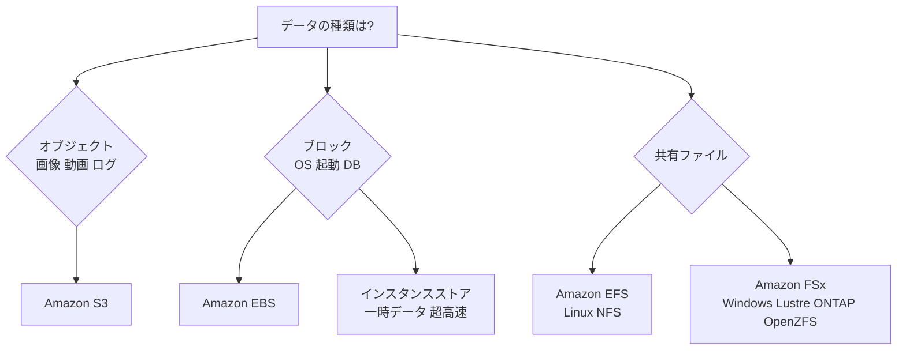

| サービス | 特徴 | 使いどころ |
|---|---|---|
| Amazon S3 | 無制限の容量、高い耐久性。**プレフィックスあたり 毎秒 3,500 の書き込み系・5,500 の読み取り系リクエスト**まで対応(並列化で拡張) | 静的コンテンツ、データレイク、バックアップ |
| EBS gp3 | 汎用 SSD。ベースライン 3,000 IOPS / 125 MiB/s で、**容量と独立して IOPS とスループットを調整可能** | 一般的なワークロード(通常の第一候補) |
| EBS io2 / io2 Block Express | プロビジョンド IOPS SSD。高耐久・最大 256,000 IOPS(Block Express)。マルチアタッチ対応 | ミッションクリティカルな DB、低レイテンシー |
| EBS st1 / sc1 | HDD。スループット重視 / 低頻度アクセス | ビッグデータ、ログ処理 / コールドデータ |
| インスタンスストア | ホストに直結した**一時的**な高速ディスク(停止/終了で消える) | キャッシュ、一時作業領域、高 IOPS が必要で永続性不要な用途 |
| Amazon EFS | 共有 NFS(Linux)。パフォーマンスモード/スループットモードを選択(Elastic が一般的) | 複数 EC2/コンテナで共有、CMS、開発環境 |
| Amazon FSx for Windows File Server | SMB、Active Directory 連携 | Windows ファイル共有 |
| Amazon FSx for Lustre | 高性能並列ファイルシステム。S3 とも連携 | HPC、機械学習、メディア処理 |
| Amazon FSx for NetApp ONTAP / OpenZFS | 既存のエンタープライズ NAS 機能 | NetApp/ZFS 資産の移行 |

**S3 の性能向上テクニック**: マルチパートアップロード、バイト範囲フェッチ、Transfer Acceleration(遠隔地からのアップロード)、並列リクエスト、CloudFront によるキャッシュ。

### Step 2-C: インスタンスファミリーの選び方

| ファミリー | 例 | 特徴 | 用途 |
|---|---|---|---|
| 汎用 | M、T(バースト可能) | CPU とメモリのバランス | Web/アプリサーバー、小規模 DB |
| コンピューティング最適化 | C | 高 CPU 性能 | バッチ処理、メディアエンコード、HPC、ゲームサーバー |
| メモリ最適化 | R、X、z1d | 大容量メモリ | インメモリ DB、SAP HANA、ビッグデータ分析 |
| ストレージ最適化 | I、D、H | 高速ローカルストレージ(高 IOPS / 高スループット) | NoSQL、データウェアハウス、分散ファイルシステム |
| 高速コンピューティング | P、G、Inf、Trn | GPU や専用チップ | 機械学習の学習/推論、グラフィックス |
| HPC 最適化 | Hpc | 高性能計算向け | 流体解析、気象シミュレーション |

> **補足**: 名前の末尾に **g** が付く(例: M7g)と **AWS Graviton(Arm)** 搭載で、一般に**価格あたりの性能が高い**傾向があります(アプリが Arm に対応している必要あり)。**T** ファミリーは CPU クレジットによるバースト型で、常時高負荷だと不向きです。

### Step 2-D: 目的特化型データベース(Purpose-built databases)

> **考え方**: 「何でもリレーショナル DB」ではなく、**データの形とアクセスパターン**に合わせて選びます。

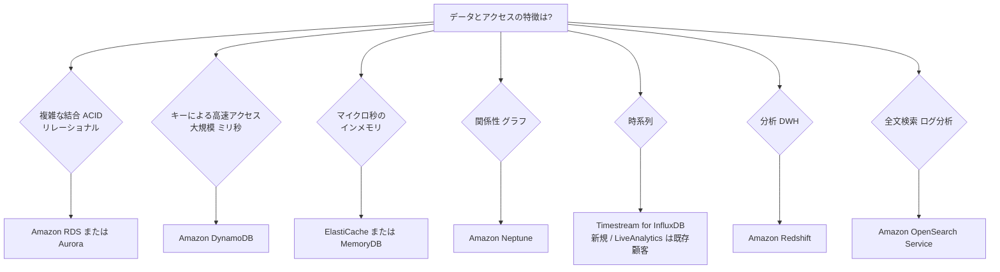

| データベース | 種類 | 向いているワークロード |
|---|---|---|
| Amazon RDS / Aurora | リレーショナル | 業務システム、トランザクション(ACID)、複雑な SQL。Aurora は高性能・高可用性。Aurora Serverless は負荷変動が大きい用途 |
| Amazon DynamoDB | キーバリュー / ドキュメント(NoSQL) | 大規模で予測可能な低レイテンシー(ミリ秒)、サーバーレス、ゲーム、IoT。DAX でマイクロ秒に |
| Amazon ElastiCache | インメモリキャッシュ | セッション、ランキング、DB 負荷軽減(Valkey / Redis OSS、Memcached) |
| Amazon MemoryDB | 耐久性のあるインメモリ DB | プライマリ DB として使えるインメモリ(Valkey / Redis OSS 互換) |
| Amazon DocumentDB | ドキュメント(MongoDB 互換) | JSON ドキュメント中心のアプリ |
| Amazon Neptune | グラフ | SNS、不正検知、ナレッジグラフ |
| Amazon Keyspaces | ワイドカラム(Cassandra 互換) | Cassandra ワークロードのマネージド化 |
| Amazon Timestream for InfluxDB | 時系列 | IoT センサー、運用メトリクス。新規顧客向けの現行の選択肢 |
| Amazon Timestream for LiveAnalytics | 時系列(サーバーレス) | 既存顧客・試験の出題範囲。新規顧客は利用不可 |
| Amazon Redshift | データウェアハウス(列指向) | 大規模分析(OLAP)、BI |
| Amazon OpenSearch Service | 検索/分析 | 全文検索、ログ分析 |

### Step 2-E: キャッシュ、バッファリング、レプリカ

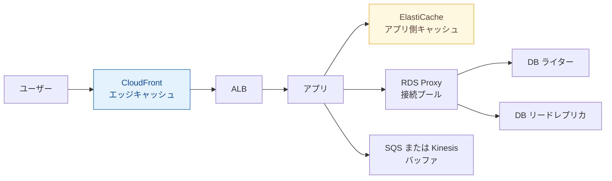

| パターン | 目的 | AWS サービス |
|---|---|---|
| **キャッシュ** | 同じ読み取りを速く、DB 負荷を減らす | CloudFront(エッジ)、ElastiCache(アプリ層)、DAX(DynamoDB 専用)、API Gateway キャッシュ |
| **バッファリング** | 急なスパイクを吸収し、バックエンドを一定の速度で処理 | SQS、Kinesis Data Streams / Firehose、Amazon MQ |
| **レプリカ** | 読み取りを分散 | RDS リードレプリカ、Aurora レプリカ(リーダーエンドポイント)、DynamoDB グローバルテーブル |
| **接続プール** | 接続数の急増から DB を守る(特に Lambda) | RDS Proxy |
| **グローバル高速化** | 世界中のユーザーへの経路改善 | CloudFront、Global Accelerator(エニーキャスト IP で AWS のバックボーンへ誘導)、S3 Transfer Acceleration |

> **ひっかけ**: **CloudFront** は主に HTTP/HTTPS コンテンツの**キャッシュ配信**、**Global Accelerator** は TCP/UDP も含めた**経路の最適化と高速フェイルオーバー**(キャッシュはしない)。

**キャッシュ戦略**: 「Lazy Loading(キャッシュミス時に DB から取得して格納)」と「Write-Through(書き込み時にキャッシュも更新)」。TTL を設定して古いデータを防ぐ。

### Step 2-F: 弾力性とライトサイジング

| 観点 | 内容 |
|---|---|
| 弾力性 | Auto Scaling、Lambda、Fargate、DynamoDB オンデマンド、Aurora Serverless など**需要に応じて自動で伸縮**する構成 |
| ライトサイジング | Compute Optimizer の推奨、CloudWatch の実測値を基に**過剰/不足なサイズ**へ調整。**変更は小さく、計測して繰り返す** |
| 選定プロセス | ①要件(レイテンシー、スループット、整合性、データ量)→ ②アクセスパターン → ③候補サービス → ④負荷テストで検証 → ⑤継続的に見直し |
| 新しい世代・Graviton | 世代が新しいインスタンスや Graviton は性能/価格が良いことが多い |

### Step 3: Task 2.5 試験のコツ

| 問題文のキーワード | 選ぶべき方向性 |
|---|---|
| 「読み取りが多い DB の負荷を軽減」 | ElastiCache、リードレプリカ、DAX(DynamoDB) |
| 「DynamoDB をマイクロ秒で」 | DAX |
| 「Lambda から DB 接続が枯渇」 | RDS Proxy |
| 「世界中のユーザーへ静的コンテンツを高速配信」 | CloudFront |
| 「固定 IP、TCP/UDP、高速フェイルオーバー」 | Global Accelerator |
| 「一時的で超高速な I/O」 | インスタンスストア |
| 「高い IOPS を DB で安定して」 | EBS io2 Block Express |
| 「複数インスタンスで共有する POSIX ファイル」 | EFS |
| 「HPC/機械学習の高スループットファイル」 | FSx for Lustre |
| 「関係性をたどるクエリ」 | Neptune |
| 「スパイクをならして処理」 | SQS、Kinesis |

---

## 8. Task 2.6 コスト最適化戦略の決定

> 公式: 「Determine a cost optimization strategy to meet solution goals and objectives」

### Step 1: 何を問われるか

| 区分 | 公式の項目 | やさしい言い換え |
|---|---|---|
| 知識 | コスト/使用状況の監視ツール(Cost Explorer、Trusted Advisor、Pricing Calculator) | 「いくら使っているか」「いくらかかるか」を知る道具 |
| 知識 | 料金モデル(リザーブドインスタンス、Savings Plans) | 長期利用と引き換えに割引を得る契約 |
| 知識 | ストレージ階層化 | アクセス頻度に応じて安い置き場所へ移す |
| 知識 | データ転送コスト | 通信にかかるお金の仕組み |
| 知識 | マネージドサービスの提供形態 | 運用コストも含めた総コストの考え方 |
| スキル | 適切なサイズ/リソースの選定、料金モデルの選定、データ転送のモデリング、支出と使用状況の統制 | 小さく、安く、使い過ぎを防ぐ |

### Step 2-A: コストの可視化と分析ツール

| ツール | 役割 |
|---|---|
| AWS Cost Explorer | 過去のコスト/使用量の分析と将来予測、Savings Plans/RI の推奨 |
| AWS Budgets | 予算を設定し、超過(予測含む)時に通知。**アクション**でポリシー適用やインスタンス停止も可能 |
| AWS Cost Anomaly Detection | 機械学習で通常と異なる支出を検知して通知 |
| AWS Cost and Usage Report / Data Exports | 最も詳細なコストデータ。Athena や QuickSight で分析 |
| コスト配分タグ | タグ(部署、プロジェクト、環境)ごとにコストを集計。**有効化が必要** |
| AWS Trusted Advisor | コスト最適化の観点で、未使用/低利用リソースを指摘(利用可能なチェックはサポートプランによる) |
| AWS Compute Optimizer | 過剰プロビジョニングの検出とサイズ推奨 |
| AWS Pricing Calculator | **構築前に**構成の費用を見積もる |
| AWS Organizations 一括請求 | 複数アカウントの料金を合算し、ボリューム割引や RI/Savings Plans の共有を実現 |

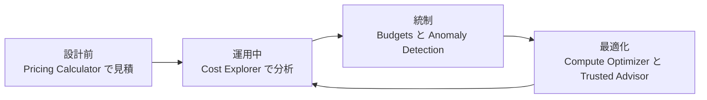

### Step 2-B: 料金モデルの選択

| モデル | 内容 | 柔軟性 | 向いている用途 |
|---|---|---|---|
| オンデマンド | 使った分だけ。前払い・契約なし | 最高 | 短期・予測不能・初期検証 |
| Compute Savings Plans | 1年/3年の使用量コミット(時間あたり金額)。**EC2(ファミリー/サイズ/リージョン/OS を問わず)、Fargate、Lambda** に適用 | 高い | 構成が変わる可能性がある安定した利用 |
| EC2 Instance Savings Plans | 特定のリージョン・インスタンスファミリーに限定。割引率は高め | 中 | ファミリーが固定されたワークロード |
| EC2 リザーブドインスタンス (RI) | 1年/3年。EC2 ではスタンダード(割引率が高い)と**コンバーチブル**(ファミリー変更可)の2クラス。リージョン RI/ゾーン RI(容量予約付き) | スタンダード: 低 | 安定した EC2 |
| RDS リザーブド DB インスタンス / ElastiCache リザーブドノード | 1年/3年。サービスごとの予約オファリング(EC2 のスタンダード/コンバーチブルの区分はない) | 低 | 安定した DB/キャッシュ。RDS などは RI が主な選択肢 |
| スポット | 余剰容量を大幅割引で利用。**2分前通知で中断される可能性** | 低(中断あり) | バッチ、CI、ビッグデータ、ステートレスで中断耐性がある処理 |
| 専有ホスト/インスタンス | 物理サーバー専有 | 低 | BYOL ライセンス、コンプライアンス要件 |

> 具体的な割引率はリージョン・期間・支払い方法で変わるため、**AWS の公式料金ページで確認**してください(試験では「最も大きい割引」「最も柔軟」といった相対的な選択が中心です)。

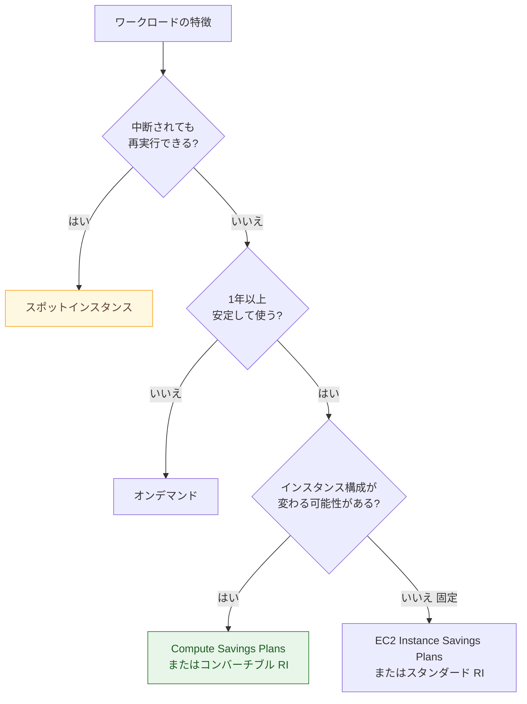

**組み合わせの定石**: 「**ベース負荷は Savings Plans/RI**、**変動分はオンデマンド**、**中断許容の処理はスポット**」を Auto Scaling の混合インスタンスポリシーで実現します。

### Step 2-C: ストレージ階層化(S3)

| ストレージクラス | アクセス頻度 | 特徴 |
|---|---|---|
| S3 Standard | 頻繁 | 低レイテンシー、取得料金なし |
| S3 Intelligent-Tiering | **不明/変動** | アクセスパターンに応じて**自動で階層移動**。取得料金なし(小さな監視・自動化料金あり) |
| S3 Standard-IA | 低頻度(ミリ秒取得) | 保存は安いが**取得料金・最低保存期間(30日)**あり |
| S3 One Zone-IA | 低頻度・再作成可能 | **単一 AZ**のため安いが可用性は低い |
| S3 Glacier Instant Retrieval | 四半期に1回程度 | アーカイブだがミリ秒で取得 |
| S3 Glacier Flexible Retrieval | 年に数回 | 数分〜数時間で取得 |
| S3 Glacier Deep Archive | ほぼ参照しない(長期保管) | **最安**。取得に12時間以上かかる |

```mermaid
flowchart LR
    A["S3 Standard<br/>作成直後"] -->|"30日後"| B["Standard-IA"]
    B -->|"90日後"| C["Glacier Flexible Retrieval"]
    C -->|"365日後"| D["Glacier Deep Archive"]
    D -->|"7年後"| E["削除"]
```

```json
{
  "Rules": [
    {
      "ID": "tier-and-expire-logs",
      "Status": "Enabled",
      "Filter": { "Prefix": "logs/" },
      "Transitions": [
        { "Days": 30,  "StorageClass": "STANDARD_IA" },
        { "Days": 90,  "StorageClass": "GLACIER" },
        { "Days": 365, "StorageClass": "DEEP_ARCHIVE" }
      ],
      "Expiration": { "Days": 2555 },
      "AbortIncompleteMultipartUpload": { "DaysAfterInitiation": 7 }
    }
  ]
}
```

**その他のストレージコスト最適化**: EBS は未使用ボリュームとスナップショットの整理、gp2 から gp3 への移行、EFS は EFS-IA/アーカイブへの**ライフサイクル管理**、S3 は**不完全なマルチパートアップロードの自動削除**。

### Step 2-D: データ転送コスト

| 通信 | 一般的な課金の考え方 |
|---|---|
| インターネットからの**受信(イン)** | 原則**無料** |
| インターネットへの**送信(アウト)** | **課金**(量に応じた段階料金) |
| 同一 AZ 内のプライベート IP 通信 | 原則無料 |
| **AZ 間**の通信 | 課金(Multi-AZ 設計では見落としがち) |
| **リージョン間**の通信 | 課金 |
| NAT ゲートウェイ経由 | 時間課金に加えて**データ処理料金**が発生 |
| CloudFront 経由の配信 | オリジン(AWS)から CloudFront への転送は無料で、直接配信より安くなることが多い |
| Direct Connect | 専用線のデータ転送(アウト)は通常のインターネット経由より低単価になりやすい |

```mermaid
flowchart TB
    A["データ転送コストを下げる"] --> B["S3 と DynamoDB は<br/>ゲートウェイエンドポイント"]
    A --> C["CloudFront でキャッシュし<br/>オリジン転送を削減"]
    A --> D["同一 AZ 内で完結する設計<br/>AZ 間通信を減らす"]
    A --> E["データを圧縮し<br/>不要な転送を避ける"]
    A --> F["大量転送は Direct Connect や<br/>Snow ファミリーを検討"]
```

> **ひっかけ**: 「プライベートサブネットの EC2 から S3 へ大量にアクセスして NAT ゲートウェイ料金が高い」→ **S3 ゲートウェイエンドポイント**(無料)で解決。

### Step 2-E: マネージドサービスと総保有コスト(TCO)

| 観点 | 内容 |
|---|---|
| 単価だけで比べない | マネージドサービスは単価が高く見えても、**運用人件費、パッチ、障害対応、冗長化**の削減を含めた TCO で判断する |
| サーバーレス | Lambda、Fargate、DynamoDB オンデマンド、Aurora Serverless は**使った分だけ**課金。アイドル時間が多い/変動が大きい用途で有利。常時高負荷なら固定リソース+割引モデルが安い場合もある |
| 適切なサービス選択 | 例: 小規模な定期バッチは EC2 常時起動より Lambda/EventBridge スケジュール |

### Step 2-F: 支出と使用状況の統制

| 統制手段 | 内容 |
|---|---|
| Organizations の SCP | 高額なインスタンスタイプや不要なリージョンの利用を禁止 |
| AWS Budgets アクション | しきい値超過時に自動で IAM ポリシー適用や停止 |
| タグポリシー + コスト配分タグ | 責任の所在を明確化(タグなしリソースを検出) |
| Service Catalog / IaC | 承認済み・サイズ制限付きの構成のみ提供 |
| スケジュール停止 | 開発/検証環境を夜間・休日に停止(Systems Manager Automation、Instance Scheduler) |
| 未使用リソースの定期棚卸し | 未接続 EBS、未使用 Elastic IP、アイドル ELB、古いスナップショット |

### Step 3: Task 2.6 試験のコツ

| 問題文のキーワード | 選ぶべき方向性 |
|---|---|
| 「アクセスパターンが不明/変動する S3 データ」 | S3 Intelligent-Tiering |
| 「中断可能なバッチ処理で最安」 | スポットインスタンス |
| 「インスタンスタイプを変える可能性があるが割引を得たい」 | Compute Savings Plans / コンバーチブル RI |
| 「構築前に費用を見積もる」 | Pricing Calculator |
| 「予算超過を通知/自動対応」 | AWS Budgets(アクション) |
| 「異常な支出を検知」 | Cost Anomaly Detection |
| 「NAT ゲートウェイのデータ処理料金を削減」 | VPC エンドポイント(S3/DynamoDB はゲートウェイ型) |
| 「長期保管で最安」 | S3 Glacier Deep Archive |
| 「過剰スペックを見つけてサイズ変更」 | Compute Optimizer |

---

## 9. 横断: シナリオ別「この要件ならこの答え」早見表

| 要件(問題文のシグナル) | 第一候補の設計 | 関連タスク |
|---|---|---|
| 複数アカウント/リージョンに同じインフラを展開 | CloudFormation StackSets | 2.1 |
| ダウンタイムなしで安全に切替、即時ロールバック | Blue/Green(CodeDeploy、ALB の加重ターゲットグループでリクエスト単位に分散。Route 53 加重は DNS 応答の選択でありリゾルバーの TTL キャッシュにより実際の比率がずれ、切り戻しも遅れうる) | 2.1 |
| オンプレミスの DR を低コストで | AWS Elastic Disaster Recovery | 2.2 |
| RTO 分単位、RPO 秒単位、リージョン障害対応 | Aurora Global Database + ウォームスタンバイ + Route 53 | 2.2 / 2.4 |
| S3 データのリージョン間複製 | S3 CRR(バージョニング必須) | 2.2 |
| バックアップの削除・改ざん防止 | AWS Backup Vault Lock + クロスアカウントコピー | 2.2 |
| インターネットを通さず AWS サービスへ接続 | VPC エンドポイント(S3/DynamoDB はゲートウェイ型) | 2.3 / 2.6 |
| L7 攻撃と DDoS の多層防御 | CloudFront + WAF + Shield(Advanced) + Route 53 | 2.3 |
| DB パスワードの自動ローテーション | Secrets Manager | 2.3 |
| 急な負荷増・処理の取りこぼし防止 | SQS でバッファ + Auto Scaling | 2.4 / 2.5 |
| 読み取り負荷の高い DB の高速化 | ElastiCache / DAX / リードレプリカ | 2.5 |
| 世界中のユーザーへ低レイテンシー | CloudFront、レイテンシールーティング、Global Accelerator | 2.4 / 2.5 |
| 変動する負荷で最安 | ベース: Savings Plans/RI、変動: オンデマンド、中断可: スポット | 2.6 |
| 古いデータの保管コスト削減 | S3 ライフサイクル / Intelligent-Tiering / Glacier | 2.6 |

---

## 10. 学習の進め方と最終チェックリスト

### 推奨ステップ

```mermaid
flowchart LR
    A["1 公式試験ガイドで<br/>範囲を確認"] --> B["2 本ガイドで<br/>概念と比較表を理解"]
    B --> C["3 Well-Architected<br/>各柱を読む"]
    C --> D["4 ハンズオンで<br/>実際に構築"]
    D --> E["5 模擬問題で<br/>最適化キーワード練習"]
    E --> F["6 弱点を<br/>公式ドキュメントで補強"]
```

### 最終チェックリスト

**Task 2.1 デプロイ戦略**
- [ ] CloudFormation の変更セット、ロールバック、ドリフト検出、StackSets を説明できる
- [ ] Rolling、Immutable、Blue/Green、Canary、Linear の違いと使い分けを説明できる
- [ ] CodePipeline、CodeBuild、CodeDeploy の役割を区別できる
- [ ] Systems Manager の主要機能(Parameter Store、Patch Manager、Session Manager、Automation)を説明できる

**Task 2.2 ビジネス継続性**
- [ ] RTO/RPO を説明し、DR 4戦略を要件から選べる
- [ ] 主要サービスのレプリケーション手段(S3 CRR、Aurora Global Database、DynamoDB グローバルテーブル、Elastic Disaster Recovery)を選べる
- [ ] AWS Backup(クロスリージョン/アカウント、Vault Lock)と DR テストの重要性を説明できる

**Task 2.3 セキュリティ**
- [ ] IAM の評価ロジック(明示的 Deny 優先)と権限境界/SCP の違いを説明できる
- [ ] セキュリティグループと NACL の違い(ステートフル/ステートレス、拒否ルール)を説明できる
- [ ] KMS、ACM による保存時/転送時の暗号化と、ゲートウェイ/インターフェースエンドポイントの違いを説明できる
- [ ] Shield、WAF、GuardDuty、Security Hub、Inspector、Macie の役割を区別できる

**Task 2.4 信頼性**
- [ ] Multi-AZ 設計の各層を説明でき、RDS の Multi-AZ とリードレプリカの違いを説明できる
- [ ] Auto Scaling ポリシー(ターゲット追跡、ステップ、スケジュール、予測)を使い分けられる
- [ ] SQS/SNS/EventBridge/Step Functions で疎結合設計を説明できる
- [ ] Route 53 のルーティングポリシーを要件から選べる

**Task 2.5 パフォーマンス**
- [ ] S3、EBS(gp3/io2)、インスタンスストア、EFS、FSx を用途で選べる
- [ ] EC2 のファミリーを用途で選べる
- [ ] 目的特化型データベースを要件から選べる
- [ ] キャッシュ、バッファリング、レプリカの設計パターンを説明できる

**Task 2.6 コスト最適化**
- [ ] Savings Plans、RI、スポット、オンデマンドを組み合わせて選べる
- [ ] S3 ストレージクラスとライフサイクルで階層化を設計できる
- [ ] データ転送コストの発生ポイントと削減策を説明できる
- [ ] Budgets、Cost Explorer、Cost Anomaly Detection、Compute Optimizer の違いを説明できる

---

## 11. 参考URL一覧(根拠ソース)

> 掲載URLはAWS公式ドキュメントを中心にしています。AWS はドキュメントの構成を更新することがあるため、リンク切れの場合はタイトルでサイト内検索してください。料金や上限値などは変更されるため、試験直前に最新情報を確認してください。

### 試験ガイド

| 内容 | URL |
|---|---|
| SAP-C02 試験ガイド(トップ) | https://docs.aws.amazon.com/aws-certification/latest/solutions-architect-professional-02/solutions-architect-professional-02.html |
| Content Domain 2: Design for New Solutions(本ガイドのアンカー) | https://docs.aws.amazon.com/aws-certification/latest/solutions-architect-professional-02/solutions-architect-professional-02-domain2.html |

### 全般(Well-Architected)

| 内容 | URL |
|---|---|
| AWS Well-Architected Framework | https://docs.aws.amazon.com/wellarchitected/latest/framework/welcome.html |
| 信頼性の柱 | https://docs.aws.amazon.com/wellarchitected/latest/reliability-pillar/welcome.html |
| セキュリティの柱 | https://docs.aws.amazon.com/wellarchitected/latest/security-pillar/welcome.html |
| パフォーマンス効率の柱 | https://docs.aws.amazon.com/wellarchitected/latest/performance-efficiency-pillar/welcome.html |
| コスト最適化の柱 | https://docs.aws.amazon.com/wellarchitected/latest/cost-optimization-pillar/welcome.html |
| AWS グローバルインフラストラクチャ | https://aws.amazon.com/about-aws/global-infrastructure/ |

### Task 2.1 デプロイ戦略

| 内容 | URL |
|---|---|
| AWS CloudFormation ユーザーガイド | https://docs.aws.amazon.com/AWSCloudFormation/latest/UserGuide/Welcome.html |
| CloudFormation ベストプラクティス | https://docs.aws.amazon.com/AWSCloudFormation/latest/UserGuide/best-practices.html |
| 変更セット | https://docs.aws.amazon.com/AWSCloudFormation/latest/UserGuide/using-cfn-updating-stacks-changesets.html |
| ドリフト検出 | https://docs.aws.amazon.com/AWSCloudFormation/latest/UserGuide/using-cfn-stack-drift.html |
| ロールバックトリガー | https://docs.aws.amazon.com/AWSCloudFormation/latest/UserGuide/using-cfn-rollback-triggers.html |
| StackSets | https://docs.aws.amazon.com/AWSCloudFormation/latest/UserGuide/what-is-cfnstacksets.html |
| AWS CDK デベロッパーガイド | https://docs.aws.amazon.com/cdk/v2/guide/home.html |
| AWS CodePipeline | https://docs.aws.amazon.com/codepipeline/latest/userguide/welcome.html |
| AWS CodeDeploy | https://docs.aws.amazon.com/codedeploy/latest/userguide/welcome.html |
| Elastic Beanstalk のデプロイポリシー | https://docs.aws.amazon.com/elasticbeanstalk/latest/dg/using-features.rolling-version-deploy.html |
| ホワイトペーパー: Practicing CI/CD on AWS | https://docs.aws.amazon.com/whitepapers/latest/practicing-continuous-integration-continuous-delivery/welcome.html |
| ホワイトペーパー: Overview of Deployment Options on AWS | https://docs.aws.amazon.com/whitepapers/latest/overview-deployment-options/welcome.html |
| AWS Systems Manager | https://docs.aws.amazon.com/systems-manager/latest/userguide/what-is-systems-manager.html |
| Systems Manager Patch Manager | https://docs.aws.amazon.com/systems-manager/latest/userguide/patch-manager.html |
| Systems Manager Parameter Store | https://docs.aws.amazon.com/systems-manager/latest/userguide/systems-manager-parameter-store.html |

### Task 2.2 ビジネス継続性

| 内容 | URL |
|---|---|
| ホワイトペーパー: Disaster Recovery of Workloads on AWS | https://docs.aws.amazon.com/whitepapers/latest/disaster-recovery-workloads-on-aws/disaster-recovery-workloads-on-aws.html |
| DR オプション(バックアップとリストア、パイロットライト、ウォームスタンバイ、マルチサイト) | https://docs.aws.amazon.com/whitepapers/latest/disaster-recovery-workloads-on-aws/disaster-recovery-options-in-the-cloud.html |
| AWS Elastic Disaster Recovery | https://docs.aws.amazon.com/drs/latest/userguide/what-is-drs.html |
| AWS Backup | https://docs.aws.amazon.com/aws-backup/latest/devguide/whatisbackup.html |
| Route 53 ルーティングポリシー | https://docs.aws.amazon.com/Route53/latest/DeveloperGuide/routing-policy.html |
| Route 53 Application Recovery Controller | https://docs.aws.amazon.com/r53recovery/latest/dg/what-is-route53-recovery.html |
| S3 レプリケーション | https://docs.aws.amazon.com/AmazonS3/latest/userguide/replication.html |
| Aurora Global Database | https://docs.aws.amazon.com/AmazonRDS/latest/AuroraUserGuide/aurora-global-database.html |
| DynamoDB グローバルテーブル | https://docs.aws.amazon.com/amazondynamodb/latest/developerguide/GlobalTables.html |
| RDS Multi-AZ | https://docs.aws.amazon.com/AmazonRDS/latest/UserGuide/Concepts.MultiAZ.html |

### Task 2.3 セキュリティ

| 内容 | URL |
|---|---|
| IAM のセキュリティベストプラクティス | https://docs.aws.amazon.com/IAM/latest/UserGuide/best-practices.html |
| ポリシーの評価論理 | https://docs.aws.amazon.com/IAM/latest/UserGuide/reference_policies_evaluation-logic.html |
| 権限境界 | https://docs.aws.amazon.com/IAM/latest/UserGuide/access_policies_boundaries.html |
| VPC セキュリティグループ | https://docs.aws.amazon.com/vpc/latest/userguide/vpc-security-groups.html |
| ネットワーク ACL | https://docs.aws.amazon.com/vpc/latest/userguide/vpc-network-acls.html |
| ルートテーブル | https://docs.aws.amazon.com/vpc/latest/userguide/VPC_Route_Tables.html |
| VPC エンドポイント(PrivateLink) | https://docs.aws.amazon.com/vpc/latest/privatelink/what-are-vpc-endpoints.html |
| ゲートウェイエンドポイント | https://docs.aws.amazon.com/vpc/latest/privatelink/gateway-endpoints.html |
| AWS KMS | https://docs.aws.amazon.com/kms/latest/developerguide/overview.html |
| AWS Secrets Manager | https://docs.aws.amazon.com/secretsmanager/latest/userguide/intro.html |
| AWS Certificate Manager | https://docs.aws.amazon.com/acm/latest/userguide/acm-overview.html |
| AWS Shield | https://docs.aws.amazon.com/waf/latest/developerguide/shield-chapter.html |
| AWS WAF | https://docs.aws.amazon.com/waf/latest/developerguide/waf-chapter.html |
| AWS Firewall Manager | https://docs.aws.amazon.com/waf/latest/developerguide/fms-chapter.html |
| Amazon GuardDuty | https://docs.aws.amazon.com/guardduty/latest/ug/what-is-guardduty.html |
| AWS Security Hub | https://docs.aws.amazon.com/securityhub/latest/userguide/what-is-securityhub.html |
| ホワイトペーパー: AWS Best Practices for DDoS Resiliency | https://docs.aws.amazon.com/whitepapers/latest/aws-best-practices-ddos-resiliency/welcome.html |

### Task 2.4 信頼性

| 内容 | URL |
|---|---|
| Amazon EC2 Auto Scaling | https://docs.aws.amazon.com/autoscaling/ec2/userguide/what-is-amazon-ec2-auto-scaling.html |
| Auto Scaling のスケーリングポリシー | https://docs.aws.amazon.com/autoscaling/ec2/userguide/as-scale-based-on-demand.html |
| Amazon SQS | https://docs.aws.amazon.com/AWSSimpleQueueService/latest/SQSDeveloperGuide/welcome.html |
| Amazon SNS | https://docs.aws.amazon.com/sns/latest/dg/welcome.html |
| AWS Step Functions | https://docs.aws.amazon.com/step-functions/latest/dg/welcome.html |
| Amazon EventBridge | https://docs.aws.amazon.com/eventbridge/latest/userguide/eb-what-is.html |
| Service Quotas | https://docs.aws.amazon.com/servicequotas/latest/userguide/intro.html |

### Task 2.5 パフォーマンス

| 内容 | URL |
|---|---|
| Amazon CloudWatch | https://docs.aws.amazon.com/AmazonCloudWatch/latest/monitoring/WhatIsCloudWatch.html |
| AWS X-Ray | https://docs.aws.amazon.com/xray/latest/devguide/aws-xray.html |
| AWS Compute Optimizer | https://docs.aws.amazon.com/compute-optimizer/latest/ug/what-is-compute-optimizer.html |
| EC2 インスタンスタイプ | https://docs.aws.amazon.com/ec2/latest/instancetypes/instance-types.html |
| EBS ボリュームタイプ | https://docs.aws.amazon.com/ebs/latest/userguide/ebs-volume-types.html |
| Amazon EFS | https://docs.aws.amazon.com/efs/latest/ug/whatisefs.html |
| S3 のパフォーマンス最適化 | https://docs.aws.amazon.com/AmazonS3/latest/userguide/optimizing-performance.html |
| DynamoDB Accelerator (DAX) | https://docs.aws.amazon.com/amazondynamodb/latest/developerguide/DAX.html |
| RDS Proxy | https://docs.aws.amazon.com/AmazonRDS/latest/UserGuide/rds-proxy.html |
| Amazon CloudFront | https://docs.aws.amazon.com/AmazonCloudFront/latest/DeveloperGuide/Introduction.html |
| AWS Global Accelerator | https://docs.aws.amazon.com/global-accelerator/latest/dg/what-is-global-accelerator.html |
| AWS のデータベース(目的特化型) | https://aws.amazon.com/products/databases/ |

### Task 2.6 コスト最適化

| 内容 | URL |
|---|---|
| AWS Cost Explorer | https://docs.aws.amazon.com/cost-management/latest/userguide/ce-what-is.html |
| AWS Budgets | https://docs.aws.amazon.com/cost-management/latest/userguide/budgets-managing-costs.html |
| AWS Cost Anomaly Detection | https://docs.aws.amazon.com/cost-management/latest/userguide/manage-ad.html |
| コスト配分タグ | https://docs.aws.amazon.com/awsaccountbilling/latest/aboutv2/cost-alloc-tags.html |
| AWS Trusted Advisor | https://docs.aws.amazon.com/awssupport/latest/user/trusted-advisor.html |
| AWS Pricing Calculator | https://docs.aws.amazon.com/pricing-calculator/latest/userguide/what-is-pricing-calculator.html |
| Savings Plans | https://docs.aws.amazon.com/savingsplans/latest/userguide/what-is-savings-plans.html |
| EC2 リザーブドインスタンス | https://docs.aws.amazon.com/AWSEC2/latest/UserGuide/ec2-reserved-instances.html |
| EC2 スポットインスタンス | https://docs.aws.amazon.com/AWSEC2/latest/UserGuide/using-spot-instances.html |
| S3 ストレージクラス | https://docs.aws.amazon.com/AmazonS3/latest/userguide/storage-class-intro.html |
| ブログ: Overview of Data Transfer Costs for Common Architectures | https://aws.amazon.com/blogs/architecture/overview-of-data-transfer-costs-for-common-architectures/ |

---

*本ガイドは公式試験ガイド(Content Domain 2)の出題項目に沿って作成した学習用資料です。AWS のサービス仕様・料金・クォータは随時変更されるため、最終的には上記の公式ドキュメントで最新情報を確認してください。*
