# AWS Certified Solutions Architect - Professional (SAP-C02) 初学者向けステップバイステップ完全ガイド

> **このガイドの使い方**
> SAP-C02 公式試験ガイド(Version 1.2)の 4 つのコンテンツドメイン・21 のタスクを、順番に「なぜ必要か → 基本用語 → サービスの選び方 → ベストプラクティス → ひっかけ注意」の流れで解説します。
> 図解はすべて Mermaid(フローチャート)または Markdown の表で表現し、ASCII アートは使っていません。

---

## 目次

| Step | 内容 | 対応タスク | ドメイン |
|---|---|---|---|
| 0 | 試験の全体像と解き方 | - | - |
| 1 | ネットワーク接続戦略 | 1.1 | D1 組織の複雑さ (26%) |
| 2 | セキュリティ統制の処方 | 1.2 | D1 |
| 3 | 信頼性と回復力のある設計 | 1.3 | D1 |
| 4 | マルチアカウント環境 | 1.4 | D1 |
| 5 | コスト最適化と可視化 | 1.5 | D1 |
| 6 | デプロイ戦略 | 2.1 | D2 新規ソリューション (29%) |
| 7 | 事業継続 | 2.2 | D2 |
| 8 | 要件に基づくセキュリティ統制 | 2.3 | D2 |
| 9 | 信頼性要件への対応 | 2.4 | D2 |
| 10 | パフォーマンス目標への対応 | 2.5 | D2 |
| 11 | コスト最適化戦略 | 2.6 | D2 |
| 12 | 運用上の優秀性の改善 | 3.1 | D3 既存の継続的改善 (25%) |
| 13 | セキュリティの改善 | 3.2 | D3 |
| 14 | パフォーマンスの改善 | 3.3 | D3 |
| 15 | 信頼性の改善 | 3.4 | D3 |
| 16 | コスト最適化の機会の特定 | 3.5 | D3 |
| 17 | 移行対象の選定 | 4.1 | D4 移行とモダナイゼーション (20%) |
| 18 | 最適な移行アプローチ | 4.2 | D4 |
| 19 | 既存ワークロードの新アーキテクチャ | 4.3 | D4 |
| 20 | モダナイゼーションと機能強化 | 4.4 | D4 |
| 21 | 練習問題 | - | 全体 |
| 22 | ひっかけパターン一覧 | - | 全体 |
| 23 | 最終チートシート | - | 全体 |
| 付録 | 参考 URL 一覧 | - | 全体 |

---

# Step 0:試験の全体像と解き方

## 0-1. SAP-C02 とは何を試す試験か

SAP-C02 は「**複雑な条件の中で、いちばん条件に合う AWS 設計を選べるか**」を試す試験です。サービスの名前を暗記しているかではなく、「コスト」「運用の手間」「移行リスク」「可用性」といった競合する条件から、最も合う答えを選ぶ力が問われます。

公式試験ガイドによると、次の 4 つの力を確認します。

| 確認される力 | 意味 |
|---|---|
| 組織の複雑さへの対応 | 複数アカウント、ハイブリッド接続、全社ガバナンスを設計する |
| 新規ソリューション設計 | ゼロから要件に合う構成を作る |
| 既存ソリューションの継続的改善 | 運用中のシステムの弱点を見つけ改善する |
| 移行とモダナイゼーションの加速 | オンプレミスから移す、さらに作り替える |

## 0-2. 試験フォーマット(公式試験ガイドより)

| 項目 | 内容 |
|---|---|
| 想定受験者 | AWS で 2 年以上のクラウドソリューション設計・実装経験 |
| 問題形式 | 択一式(正解 1 つ、不正解 3 つ)と複数選択式(5 つ以上の選択肢から 2 つ以上を選ぶ) |
| 採点対象の問題数 | 65 問 |
| 採点対象外の問題数 | 10 問(将来の問題評価用。どれか見分けはつかない) |
| スコア | 100〜1,000 のスケールスコア。**合格ライン 750** |
| 採点方式 | 補償型。ドメインごとの足切りはなく、全体で合格点を超えればよい |
| 未回答 | 不正解扱い。ただし誤答による減点はないので、必ず何か選ぶ |
| 複数選択式 | 正解をすべて選ばないと得点にならない |

> **ポイント**:補償型なので「苦手ドメインがあっても、他で補えば合格できる」。ただしドメイン 2(29%)と 1(26%)で全体の半分以上を占めるので、ここを厚めに学びます。

## 0-3. ドメインと重み

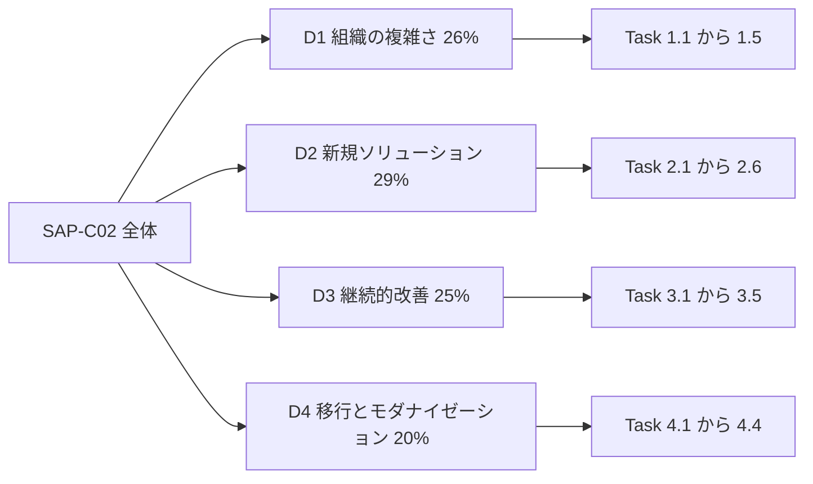

## 0-4. 学習ロードマップ

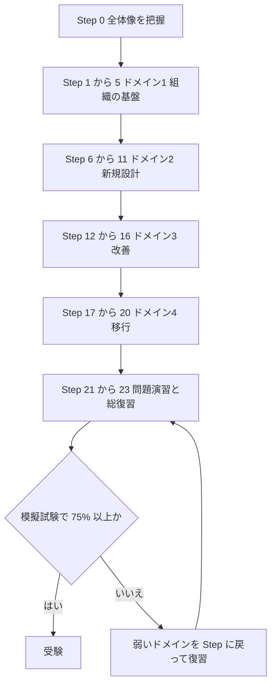

## 0-5. 問題の解き方(最重要)

SAP-C02 の問題文は長く、**「正解に見える選択肢が 2 つ」ある**のが普通です。次の手順で絞り込みます。

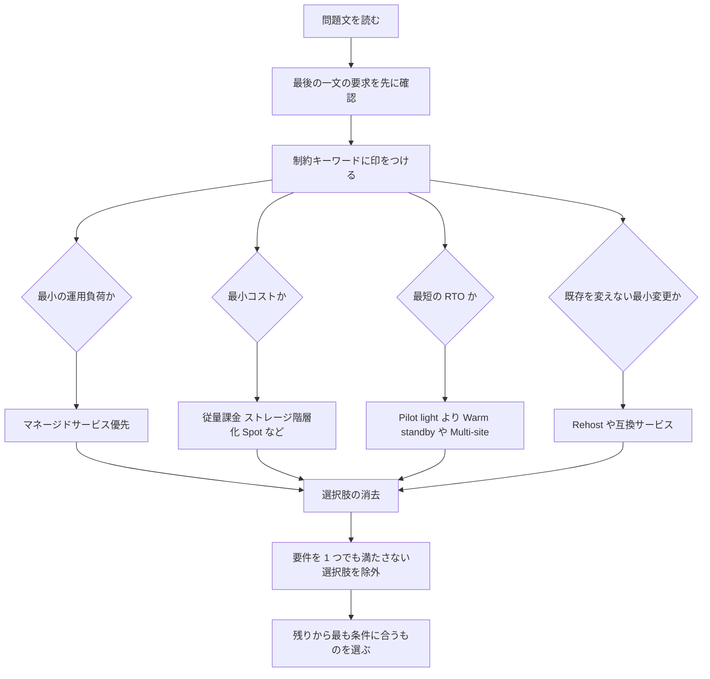

### 重要キーワード早見表

| 問題文のキーワード | 示唆される方向 |
|---|---|
| 運用上のオーバーヘッドを最小化 | マネージドサービス、サーバーレス |
| 最もコスト効率が高い | Savings Plans、Spot、S3 ライフサイクル、VPC エンドポイント |
| 最小限のコード変更 | Rehost、Replatform、互換エンジン |
| RPO がほぼゼロ | 同期または継続的レプリケーション(Aurora Global Database、Multi-AZ など) |
| ダウンタイムを最小化 | 継続的レプリケーションとカットオーバー(MGN、DMS CDC) |
| 疎結合 | SQS、SNS、EventBridge |
| 最小権限 | IAM ロール、SCP、Permission Boundary |
| 中央管理、一元化 | Organizations、Control Tower、委任管理者 |
| オンプレミスと接続 | Direct Connect、Site-to-Site VPN |
| 数千の VPC | Transit Gateway |

## 0-6. 土台:AWS Well-Architected フレームワーク

公式試験ガイドは「Well-Architected フレームワークに基づく設計」を前提にしています。6 つの柱を最初に押さえます。

| 柱 | 一言でいうと | 試験での現れ方 |
|---|---|---|
| 運用上の優秀性 | 運用を自動化し継続改善する | IaC、CI/CD、監視 |
| セキュリティ | データとシステムを守る | IAM、暗号化、検知 |
| 信頼性 | 障害から回復し続ける | Multi-AZ、DR、自動復旧 |
| パフォーマンス効率 | 適切なリソースを適切な量で使う | キャッシュ、適正サイズ |
| コスト最適化 | 無駄な支出を避ける | 購入オプション、階層化 |
| 持続可能性 | 環境負荷を減らす | 適正サイズ、Graviton |

### 出典(Step 0)

| 内容 | URL | 確認状況 |
|---|---|---|
| SAP-C02 公式試験ガイド PDF | https://d1.awsstatic.com/training-and-certification/docs-sa-pro/AWS-Certified-Solutions-Architect-Professional_Exam-Guide.pdf | 取得して内容確認済み |
| SAP-C02 公式試験ページ | https://aws.amazon.com/certification/certified-solutions-architect-professional/ | 既知のパス |
| Well-Architected フレームワーク | https://docs.aws.amazon.com/wellarchitected/latest/framework/welcome.html | 既知のパス |

---

# ドメイン 1:組織の複雑さに対応するソリューション設計(26%)

# Step 1:ネットワーク接続戦略(Task 1.1)

## 1-1. なぜ重要か

大企業では VPC が数十から数千になり、オンプレミスのデータセンターとも繋ぎます。「どの接続方式を選ぶか」は SAP-C02 の頻出テーマで、**接続数、帯域、コスト、セキュリティ、導入スピード**で答えが変わります。

## 1-2. 基本用語

| 用語 | やさしい説明 |
|---|---|
| VPC | AWS 上の自分専用の仮想ネットワーク |
| CIDR | IP アドレスの範囲の書き方(例 10.0.0.0/16) |
| 推移的ルーティング | A と B が繋がり B と C が繋がるとき、A から C へ B 経由で通信できること |
| Direct Connect | 専用線で AWS とオンプレミスを繋ぐ |
| Site-to-Site VPN | インターネット越しに暗号化トンネルで繋ぐ |
| Transit Gateway(TGW) | 多数の VPC とオンプレミスをつなぐ中継ハブ |
| PrivateLink | サービスを一方向に非公開で公開する仕組み |

## 1-3. VPC 同士をつなぐ方式の選び方

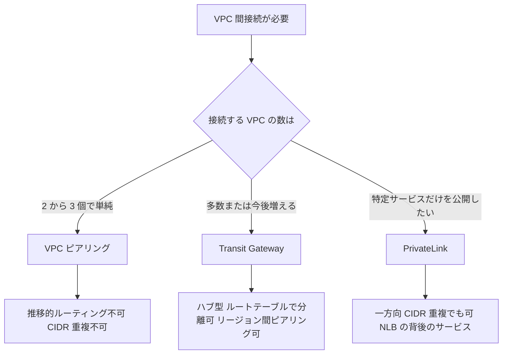

| 方式 | 推移的ルーティング | CIDR 重複 | 向いている場面 | 注意点 |
|---|---|---|---|---|
| VPC ピアリング | 不可 | 不可 | VPC が少数、低コスト、低レイテンシ | 数が増えると網目状に増えて管理困難 |
| Transit Gateway | 可 | 不可 | 多数の VPC、オンプレミス統合、中央集約 | 接続とデータ処理に課金 |
| PrivateLink(インターフェイスエンドポイント) | 該当なし | 可 | 特定サービスの一方向公開、SaaS 提供 | 双方向の全面通信には不向き |

### Transit Gateway のポイント

- **ルートテーブルを複数持てる**ので、「本番と開発を分離する」「検査用 VPC を経由させる」といったセグメンテーションが可能です。
- 別リージョンの TGW とは**ピアリング**で接続できます。
- ファイアウォールなどの検査アプライアンスを通すときは、**アプライアンスモード**を有効にして行きと帰りの経路を同じ AZ に揃えます。
- Site-to-Site VPN を複数本束ねて帯域を増やすには、TGW の **ECMP**(等コストマルチパス)を使います。

## 1-4. オンプレミスと接続する方式の選び方

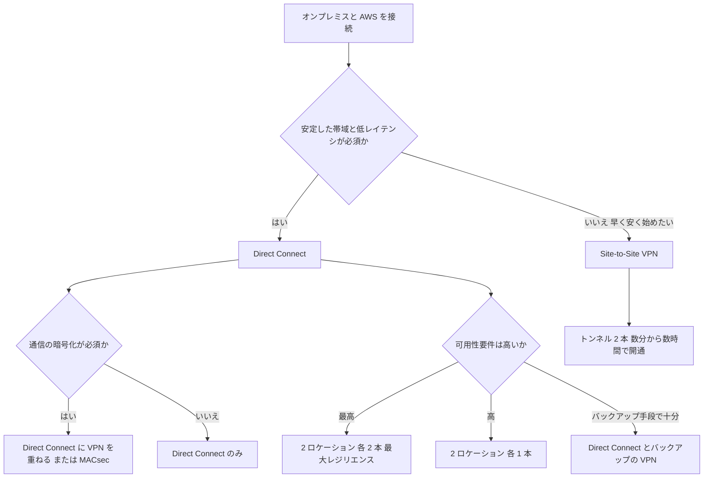

| 比較項目 | Direct Connect | Site-to-Site VPN |
|---|---|---|
| 経路 | 専用線(パブリックインターネットを通らない) | インターネット経由 |
| 帯域の安定性 | 高い | インターネット品質に依存 |
| 導入までの時間 | 数週間から数か月かかることがある | 短い(数分から数時間) |
| 暗号化 | **既定では暗号化されない** | IPsec で暗号化される |
| コスト | ポート料金とデータ転送料 | 接続時間とデータ転送料 |
| 典型的な使い方 | 本番の恒常的な大量通信 | 立ち上げ期、バックアップ回線 |

### Direct Connect の重要概念

| 概念 | 説明 |
|---|---|
| 仮想インターフェイス(VIF) | プライベート VIF は VPC、パブリック VIF は AWS のパブリックサービス、トランジット VIF は Transit Gateway に接続 |
| Direct Connect ゲートウェイ | 複数リージョンの複数 VPC に 1 本の接続から到達できるようにする |
| レジリエンス | 重要な本番は「別ロケーションに複数接続」で単一障害点を避ける |
| バックアップ | Direct Connect 障害時に VPN へ自動フェイルオーバーさせる構成が定番 |

> **ひっかけ**:「Direct Connect は暗号化されている」は誤りです。暗号化が要件なら、VPN を重ねるか MACsec(対応する専用接続)を使います。

## 1-5. ハイブリッド DNS

オンプレミスの DNS と Route 53 の名前解決を相互に通す仕組みが **Route 53 Resolver** です。

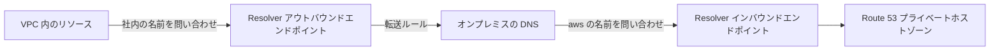

| 方向 | 使うもの | 用途 |
|---|---|---|
| オンプレミスから AWS の名前を引く | インバウンドエンドポイント | オンプレミスから EC2 や RDS の内部名を解決 |
| AWS からオンプレミスの名前を引く | アウトバウンドエンドポイント + 転送ルール | VPC 内から社内サーバー名を解決 |

> 複数アカウントで転送ルールを共有するときは、**AWS RAM** でルールを共有すると管理が楽になります。

## 1-6. サービスエンドポイント(AWS サービスへの私的アクセス)

| 種類 | 対象 | 料金 | 特徴 |
|---|---|---|---|
| ゲートウェイエンドポイント | **S3 と DynamoDB のみ** | **無料** | ルートテーブルにエントリを追加して使う |
| インターフェイスエンドポイント | 多くの AWS サービスと PrivateLink サービス | 時間課金とデータ処理課金 | VPC 内に ENI(プライベート IP)を作る |

> **コストのコツ**:プライベートサブネットから S3 に大量アクセスするなら、**ゲートウェイエンドポイント**で NAT ゲートウェイのデータ処理料金を避けられます。

## 1-7. ネットワークの調査と監視

| ツール | できること | 使いどころ |
|---|---|---|
| VPC フローログ | IP トラフィックのメタデータを記録 | 通信が許可または拒否されたか確認 |
| Reachability Analyzer | 2 点間の経路を設定から静的に分析 | 「なぜ繋がらないか」を調べる |
| トラフィックミラーリング | パケットのコピーを検査ツールへ送る | 詳細なパケット分析 |
| CloudWatch | 帯域やパケットのメトリクス | 容量の監視 |

## 1-8. リージョンと AZ の選び方

- **レイテンシ要件**:利用者や接続元に近いリージョンを選ぶ。
- **データ所在地(コンプライアンス)**:法令でデータの国外持ち出しが制限される場合はリージョンを固定する。
- **サービスの提供状況**:使いたいサービスがそのリージョンにあるか確認する。
- **AZ**:高可用性のため最低 2 つ、通常は 3 つの AZ に分散する。

## 1-9. ベストプラクティス

| ベストプラクティス | 理由 |
|---|---|
| VPC が 3 つ以上になりそうなら最初から Transit Gateway を検討 | ピアリングは数が増えると組み合わせが爆発し管理できなくなる |
| 将来の接続に備えて CIDR を重複させない設計にする | 重複すると ピアリングも TGW も使えない |
| 重要な接続は Direct Connect を別ロケーションで 2 本以上 | 単一のロケーション障害や回線障害で全断するのを防ぐ |
| Direct Connect のバックアップに VPN を用意 | 専用線の開通待ちや障害時の保険になる |
| S3、DynamoDB へはゲートウェイエンドポイントを使う | 無料で NAT ゲートウェイ料金を避けられる |
| 転送ルールは RAM で共有 | アカウントごとの設定の重複を防げる |
| 検査アプライアンスを通すなら TGW のアプライアンスモード | 行きと帰りの経路が揃わないと状態管理型の検査が壊れる |

### 出典(Step 1)

| 内容 | URL |
|---|---|
| VPC 接続オプション ホワイトペーパー | https://docs.aws.amazon.com/whitepapers/latest/aws-vpc-connectivity-options/introduction.html |
| 拡張性のあるマルチ VPC ネットワーク | https://docs.aws.amazon.com/whitepapers/latest/building-scalable-secure-multi-vpc-network-infrastructure/welcome.html |
| Transit Gateway | https://docs.aws.amazon.com/vpc/latest/tgw/what-is-transit-gateway.html |
| VPC ピアリング | https://docs.aws.amazon.com/vpc/latest/peering/what-is-vpc-peering.html |
| PrivateLink | https://docs.aws.amazon.com/vpc/latest/privatelink/what-is-privatelink.html |
| ゲートウェイエンドポイント | https://docs.aws.amazon.com/vpc/latest/privatelink/gateway-endpoints.html |
| Direct Connect | https://docs.aws.amazon.com/directconnect/latest/UserGuide/Welcome.html |
| Direct Connect レジリエンス | https://docs.aws.amazon.com/directconnect/latest/UserGuide/resiliency_toolkit.html |
| Site-to-Site VPN | https://docs.aws.amazon.com/vpn/latest/s2svpn/VPC_VPN.html |
| Route 53 Resolver | https://docs.aws.amazon.com/Route53/latest/DeveloperGuide/resolver.html |
| VPC フローログ | https://docs.aws.amazon.com/vpc/latest/userguide/flow-logs.html |
| Reachability Analyzer | https://docs.aws.amazon.com/vpc/latest/reachability/what-is-reachability-analyzer.html |

---

# Step 2:セキュリティ統制の処方(Task 1.2)

## 2-1. なぜ重要か

複数のアカウントと外部 ID(社内の Active Directory など)が絡む環境で、「誰が、どのアカウントの、何にアクセスできるか」を安全に設計する力が問われます。

## 2-2. IAM の基本

| 用語 | やさしい説明 |
|---|---|
| IAM ユーザー | 長期的な認証情報を持つ個人(現在は極力使わない) |
| IAM ロール | 一時的に引き受けて使う権限の入れ物 |
| アイデンティティベースポリシー | ユーザー、ロールにアタッチする許可 |
| リソースベースポリシー | S3 バケットや KMS キーなど、リソース側にアタッチする許可 |
| 信頼ポリシー | 「誰がこのロールを引き受けてよいか」を定義 |
| STS | 一時認証情報を発行するサービス |

### ポリシー評価の考え方

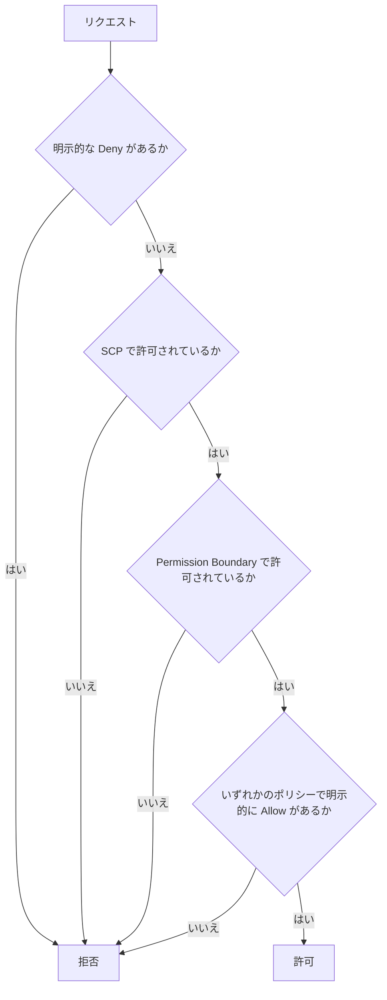

覚え方:**「明示的な Deny が常に最強」「SCP と Permission Boundary は許可を与えず、上限を決めるだけ」**。

## 2-3. クロスアカウントアクセス

別アカウントのリソースにアクセスする代表的な方法は 2 つです。

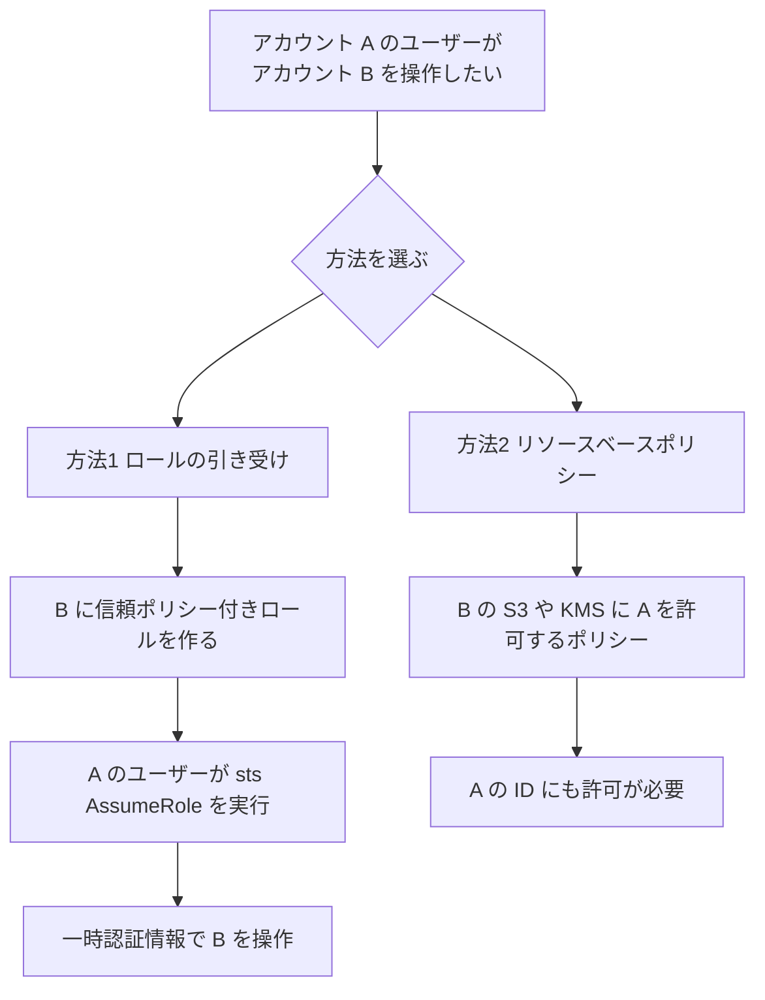

| 方法 | 長所 | 注意点 |
|---|---|---|
| ロールの引き受け | 一時認証情報で安全。権限を切り替えて使う | 元の ID の権限は一時的に使えなくなる |
| リソースベースポリシー | ロールを切り替えずに直接アクセスできる | 呼び出し側の ID ポリシーでも許可が必要 |

> サードパーティに自アカウントへのアクセスを許すときは、信頼ポリシーに **ExternalId** 条件を付けて「混乱した代理人」問題を防ぎます。

## 2-4. 外部 ID プロバイダー(IdP)との連携

| 利用者 | 推奨サービス | 補足 |
|---|---|---|
| 従業員(社内ユーザー) | **IAM Identity Center** | 社内 IdP(SAML 2.0)と連携し、複数アカウントへのシングルサインオンと権限セットを一元管理 |
| 一般ユーザー(アプリの利用者) | **Amazon Cognito** | ユーザープール、外部 IdP や SNS ログインとの連携 |
| 社内 Active Directory 連携 | **AWS Directory Service** | AWS Managed Microsoft AD、AD Connector、Simple AD |

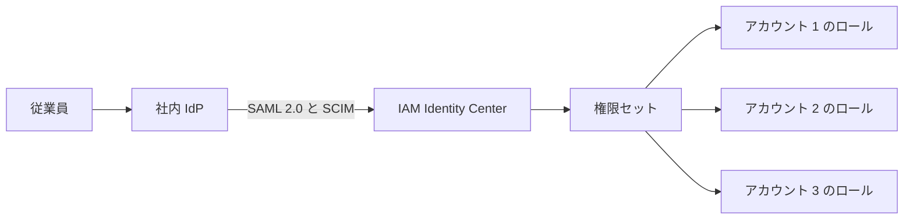

## 2-5. 暗号化戦略

### 保管中のデータの暗号化(at rest)

| サービス | 内容 |
|---|---|
| AWS KMS | 暗号化キーの作成と管理。キーポリシーでアクセス制御 |
| AWS CloudHSM | 専有の HSM。規制で「自分専用のハードウェア」が必須の場合 |
| S3 | 新しいオブジェクトは既定で SSE-S3 により暗号化。SSE-KMS で細かい制御と監査 |

### KMS のキー種類

| 種類 | 管理者 | 用途 |
|---|---|---|
| AWS 所有キー | AWS | 追加費用なし、利用者から見えない |
| AWS マネージドキー | AWS | サービスが自動で作る。ローテーションは自動 |
| カスタマーマネージドキー | 利用者 | キーポリシー、ローテーション、無効化を自分で制御 |

- **マルチリージョンキー**:複数リージョンで同じキー素材を使い、リージョン間でデータを復号したいときに使う。
- **エンベロープ暗号化**:データはデータキーで暗号化し、データキーを KMS のキーで暗号化する(大容量データを効率よく暗号化できる)。

### 転送中のデータの暗号化(in transit)

| 場面 | 手段 |
|---|---|
| クライアントからロードバランサーや CloudFront | **ACM** の証明書で TLS(CloudFront 用の証明書は **us-east-1** で管理) |
| S3 への TLS 強制 | バケットポリシーで `aws:SecureTransport` が false の通信を Deny |
| オンプレミスとの通信 | Site-to-Site VPN(IPsec)、Direct Connect + VPN、MACsec |

## 2-6. 一元的なセキュリティ通知と監査

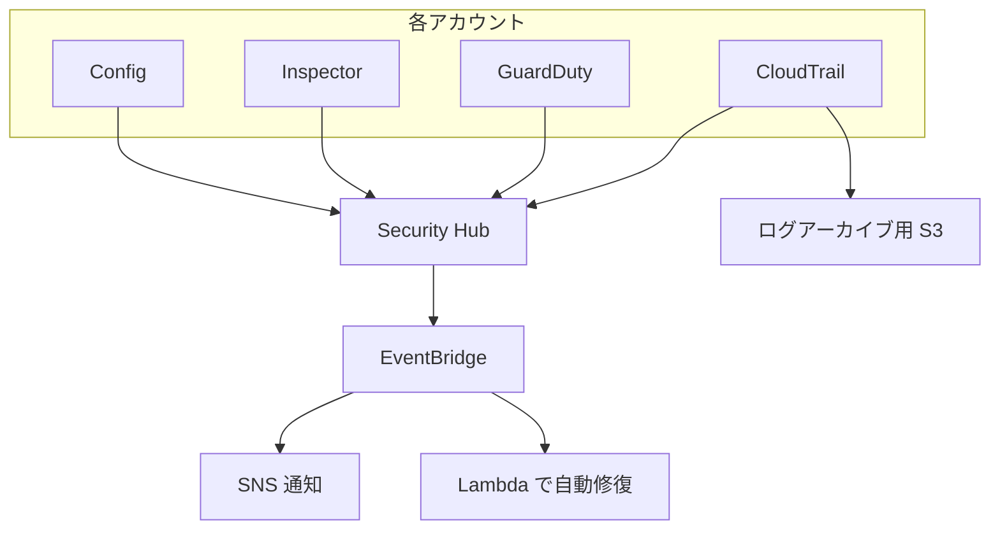

| サービス | 役割 |
|---|---|
| CloudTrail | API 呼び出しの記録(誰が、いつ、何をしたか)。**組織の証跡**で全アカウントを一括記録 |
| IAM Access Analyzer | 外部に共有されているリソースや未使用の権限を検出 |
| Security Hub | セキュリティ検出結果の集約とコンプライアンススコア(近年の刷新により従来機能の一部は Security Hub CSPM として提供) |
| Amazon Inspector | EC2、コンテナ、Lambda の脆弱性スキャン |
| GuardDuty | 脅威検知(不審な API 呼び出し、通信など) |

> 一元化の定石:**セキュリティ専用アカウントを委任管理者にして、組織全体の検出結果を集約**する。

## 2-7. ベストプラクティス

| ベストプラクティス | 理由 |
|---|---|
| 人にはユーザーでなく IAM Identity Center かロールを使う | 長期認証情報の漏えいリスクを減らす |
| ルートユーザーは使わず MFA を設定 | 最強権限が悪用されると取り返しがつかない |
| クロスアカウントはロールの引き受けを基本に | 一時認証情報なので漏れても被害が限定される |
| 組織の証跡を有効にしログ検証を ON | 全アカウントの監査証跡を改ざん検知付きで残せる |
| SCP で組織全体のガードレールを設定 | 個別アカウントの管理者でも越えられない上限を作れる |
| KMS のキーポリシーは最小権限 | キーが使えれば暗号化データも読めてしまう |
| セキュリティサービスは委任管理者で一括有効化 | 新規アカウントでも自動で保護が効く |

### 出典(Step 2)

| 内容 | URL |
|---|---|
| IAM ポリシー評価ロジック | https://docs.aws.amazon.com/IAM/latest/UserGuide/reference_policies_evaluation-logic.html |
| クロスアカウントのロール | https://docs.aws.amazon.com/IAM/latest/UserGuide/tutorial_cross-account-with-roles.html |
| IAM のベストプラクティス | https://docs.aws.amazon.com/IAM/latest/UserGuide/best-practices.html |
| IAM Access Analyzer | https://docs.aws.amazon.com/IAM/latest/UserGuide/what-is-access-analyzer.html |
| IAM Identity Center | https://docs.aws.amazon.com/singlesignon/latest/userguide/what-is.html |
| AWS KMS | https://docs.aws.amazon.com/kms/latest/developerguide/overview.html |
| AWS Certificate Manager | https://docs.aws.amazon.com/acm/latest/userguide/acm-overview.html |
| AWS CloudTrail | https://docs.aws.amazon.com/awscloudtrail/latest/userguide/cloudtrail-user-guide.html |
| AWS Security Hub | https://docs.aws.amazon.com/securityhub/latest/userguide/what-is-securityhub.html |
| Amazon GuardDuty | https://docs.aws.amazon.com/guardduty/latest/ug/what-is-guardduty.html |
| Amazon Inspector | https://docs.aws.amazon.com/inspector/latest/user/what-is-inspector.html |
| AWS Directory Service | https://docs.aws.amazon.com/directoryservice/latest/admin-guide/what_is.html |

---
# Step 3:信頼性と回復力のある設計(Task 1.3)

## 3-1. なぜ重要か

「障害は必ず起きる」前提で、**どれだけ早く(RTO)、どこまでのデータを失わずに(RPO)戻せるか**を、コストと釣り合わせて設計する力が問われます。

## 3-2. 基本用語

| 用語 | 意味 | たとえ |
|---|---|---|
| RTO(目標復旧時間) | 障害発生からサービス再開までに許される時間 | 「店が閉まっていてよいのは何時間か」 |
| RPO(目標復旧時点) | 失ってよいデータの時間幅 | 「どの時点の帳簿まで戻れればよいか」 |
| スケールアップ | 1 台を大きくする | 小型トラックを大型トラックに替える |
| スケールアウト | 台数を増やす | トラックの台数を増やす |

## 3-3. 災害対策(DR)の 4 戦略

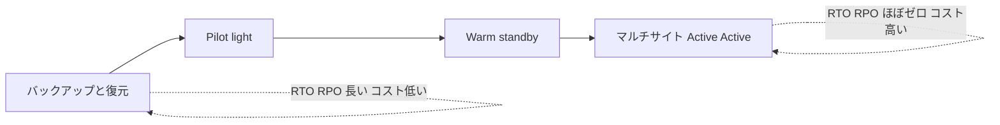

| 戦略 | 復旧先の状態 | RTO の目安 | RPO の目安 | コスト |
|---|---|---|---|---|
| バックアップと復元 | 何も動かさずバックアップだけ保持 | 数時間以上 | 数時間以上 | 最も低い |
| Pilot light | データ層だけ常時稼働。アプリは停止か最小 | 数十分から数時間 | 分単位 | 低い |
| Warm standby | 縮小した完全構成が常時稼働 | 数分から数十分 | 秒から分 | 中 |
| マルチサイト Active Active | 両サイトが同時に本番稼働 | ほぼゼロ | ほぼゼロ | 高い |

### 戦略の選び方

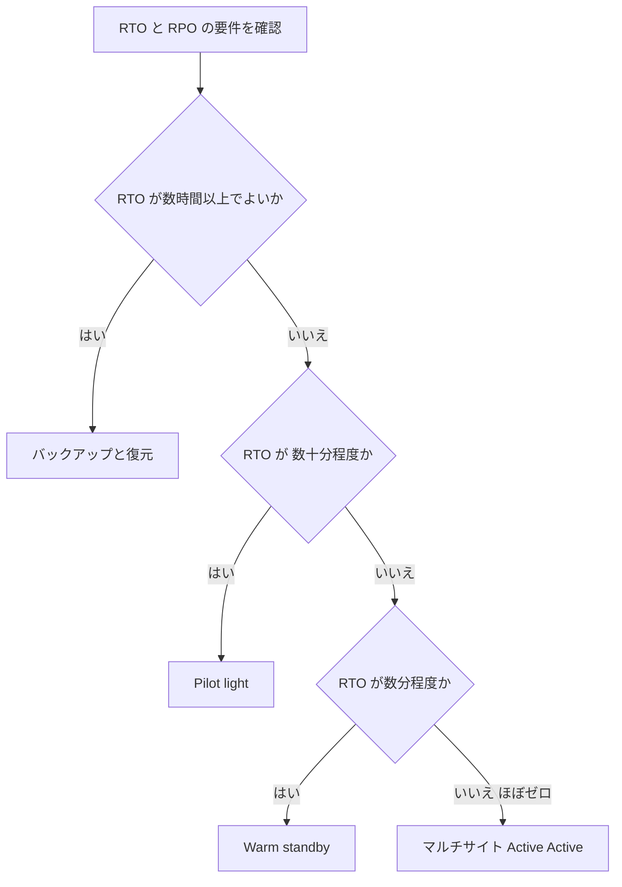

## 3-4. 関連サービス

| サービス | 役割 |
|---|---|
| AWS Elastic Disaster Recovery | オンプレミスや他クラウド、EC2 のサーバーを**継続的にブロックレベルでレプリケーション**し、障害時に AWS で素早く起動 |
| AWS Backup | 複数サービス(EBS、RDS、DynamoDB、EFS など)のバックアップを一元管理。クロスリージョンとクロスアカウントのコピー、Vault Lock による改ざん防止にも対応 |
| Aurora Global Database | 複数リージョンへ低遅延でレプリケーション。リージョン障害時に別リージョンへ昇格 |
| DynamoDB グローバルテーブル | 複数リージョンでマルチアクティブのレプリケーション |
| S3 クロスリージョンレプリケーション | オブジェクトを別リージョンへ複製 |

## 3-5. 自動復旧とスケール設計

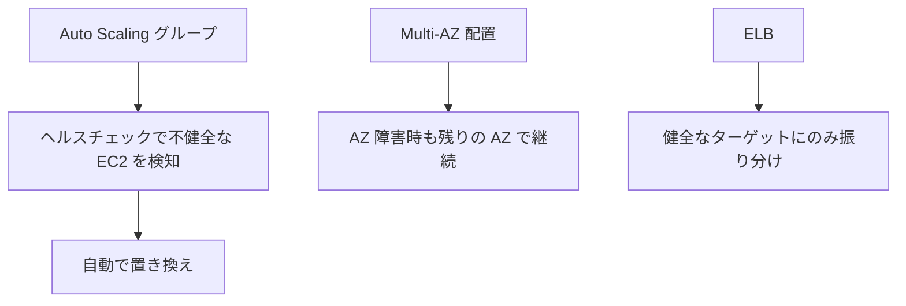

- **自動復旧**:Auto Scaling のヘルスチェック、ELB のヘルスチェック、RDS の Multi-AZ 自動フェイルオーバー。
- **スケールアウト優先**:スケールアップには上限があり、再起動が必要な場合も多い。スケールアウト(水平)のほうが可用性と拡張性で有利。
- **ステートレス設計**:セッションを外部(ElastiCache、DynamoDB)に置くとスケールアウトしやすい。

## 3-6. バックアップと復元戦略

| 設計ポイント | 内容 |
|---|---|
| 3-2-1 の考え方 | コピーを 3 つ、2 種類以上の媒体、1 つは別の場所(別リージョンや別アカウント) |
| 別アカウントへのコピー | ランサムウェアやアカウント侵害でもバックアップが守られる |
| 復元テスト | 取っていても戻せなければ意味がない。定期的に復元を試す |
| 保持ポリシー | AWS Backup のライフサイクルで古いバックアップを低コスト階層へ、期限で削除 |

## 3-7. ベストプラクティス

| ベストプラクティス | 理由 |
|---|---|
| RTO と RPO を業務側と合意してから戦略を選ぶ | 過剰設計でコストが膨らむのを防ぎ、不足による事業損失も防ぐ |
| DR は定期的に実際に切り替えて訓練 | 手順の抜けや権限不足は本番障害のときに気付いても遅い |
| バックアップは別リージョンかつ別アカウントにも保管 | 同一環境の障害や侵害で一緒に失われるのを避ける |
| 単一障害点を作らない | 1 つの AZ、1 台のインスタンスの障害でサービスが止まるため |
| IaC でインフラを再現可能にする | DR 先で同じ構成を短時間で正確に再構築できる |

### 出典(Step 3)

| 内容 | URL |
|---|---|
| AWS でのワークロードの災害対策 | https://docs.aws.amazon.com/whitepapers/latest/disaster-recovery-workloads-on-aws/disaster-recovery-workloads-on-aws.html |
| Well-Architected 信頼性の柱 | https://docs.aws.amazon.com/wellarchitected/latest/reliability-pillar/welcome.html |
| AWS Elastic Disaster Recovery | https://docs.aws.amazon.com/drs/latest/userguide/what-is-drs.html |
| AWS Backup | https://docs.aws.amazon.com/aws-backup/latest/devguide/whatisbackup.html |
| Aurora Global Database | https://docs.aws.amazon.com/AmazonRDS/latest/AuroraUserGuide/aurora-global-database.html |
| DynamoDB グローバルテーブル | https://docs.aws.amazon.com/amazondynamodb/latest/developerguide/GlobalTables.html |
| S3 レプリケーション | https://docs.aws.amazon.com/AmazonS3/latest/userguide/replication.html |

---

# Step 4:マルチアカウント環境の設計(Task 1.4)

## 4-1. なぜ重要か

大規模な組織では、1 つのアカウントにすべてを入れるのではなく、**目的ごとにアカウントを分ける**のが基本です。アカウントは「爆発半径(障害や侵害の影響範囲)の境界」であり、課金と権限の境界でもあります。

## 4-2. AWS Organizations の基本

| 用語 | 意味 |
|---|---|
| 管理アカウント | 組織を作り請求を集約するアカウント。ワークロードは置かない |
| メンバーアカウント | 組織に所属するアカウント |
| OU(組織単位) | アカウントのグループ。階層化できる |
| SCP | OU やアカウントに適用する権限の上限(ガードレール) |
| 一括請求 | 全アカウントの請求を集約し、ボリュームディスカウントや購入オプションを共有 |
| 委任管理者 | 管理アカウントの代わりに特定サービスを組織全体で管理するメンバーアカウント |

### 典型的な OU 構成

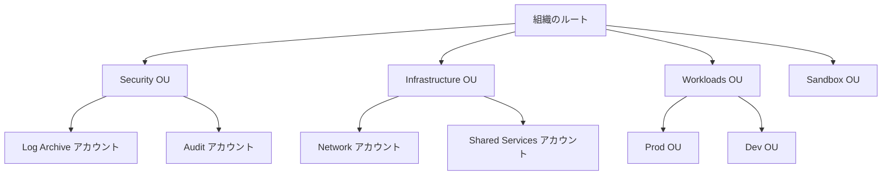

### SCP の重要ポイント

| ポイント | 内容 |
|---|---|
| 権限を付与しない | SCP は「許可の上限」を決めるだけ。実際の許可は IAM ポリシーで与える |
| 管理アカウントには効かない | 管理アカウントは SCP の対象外 |
| 継承される | 上位 OU の SCP は下位に引き継がれる |
| 典型的な用途 | 特定リージョン以外の利用禁止、CloudTrail の停止禁止、ルートユーザーの利用禁止 |

## 4-3. AWS Control Tower

Control Tower は、Organizations などを使った**ベストプラクティスのマルチアカウント環境(ランディングゾーン)を自動構築**するサービスです。

| 機能 | 説明 |
|---|---|
| ランディングゾーン | Log Archive アカウントと Audit アカウントを含む基本構成を自動作成 |
| ガードレール(コントロール) | 予防的(SCP)、検知的(AWS Config ルール)、プロアクティブ(CloudFormation フック)の 3 種類 |
| Account Factory | 標準化されたアカウントを自動で払い出す |
| ダッシュボード | 準拠状況を一覧で確認 |

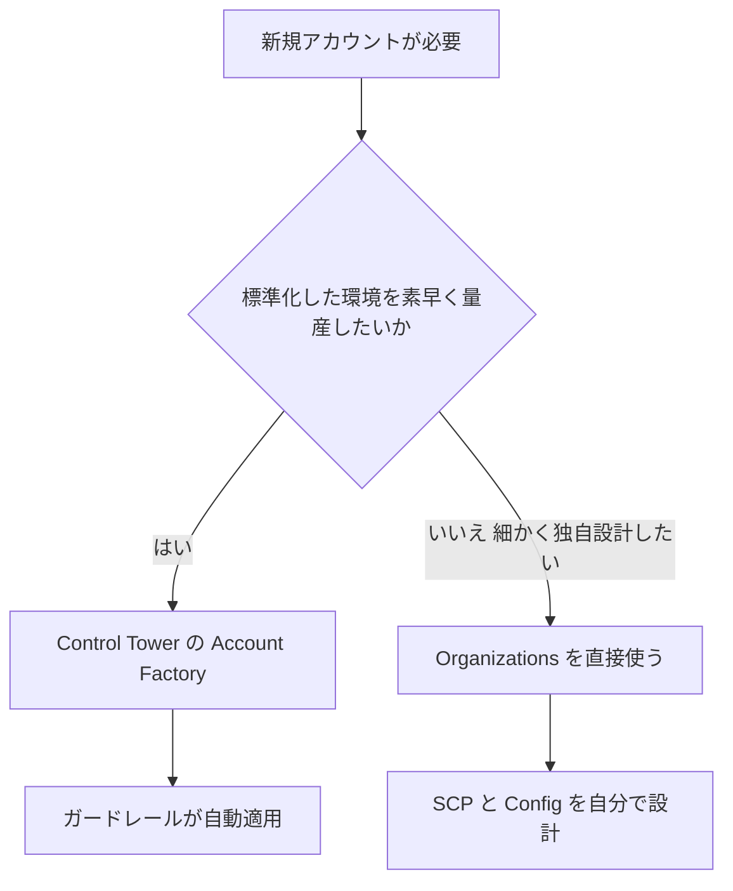

## 4-4. 中央ログと一元通知

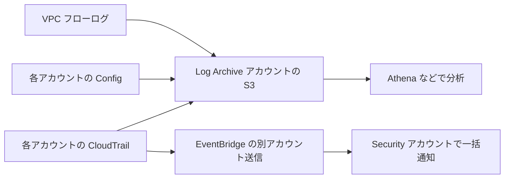

- ログ専用のアカウントに集約し、**書き込みは許可するが削除は許可しない**バケットポリシーと S3 オブジェクトロックで保護します。
- EventBridge は別アカウントのイベントバスへイベントを転送できます。

## 4-5. リソース共有:AWS RAM

AWS Resource Access Manager は、リソースを複製せず**他のアカウントと共有**する仕組みです。

| 共有できる代表例 | 用途 |
|---|---|
| サブネット(VPC 共有) | ネットワークアカウントが VPC を作り、他アカウントのワークロードが同じサブネットを利用 |
| Transit Gateway | 組織内で 1 つの TGW を共有 |
| Route 53 Resolver 転送ルール | 複数アカウントで DNS 設定を共有 |
| License Manager の構成 | ライセンスの一元管理 |

> Organizations と連携すると、共有を組織単位で有効にでき、アカウントごとの招待の承認が不要になります。

## 4-6. ガバナンスモデルの設計

| 統制の層 | 手段 |
|---|---|
| 予防 | SCP、Permission Boundary、Control Tower の予防的ガードレール |
| 検知 | AWS Config ルール、Security Hub、GuardDuty |
| 是正 | Config の自動修復、EventBridge と Lambda、Systems Manager Automation |
| 標準化 | CloudFormation StackSets、Service Catalog |
| 可視化 | タグポリシー、Cost Explorer、Audit Manager |

## 4-7. ベストプラクティス

| ベストプラクティス | 理由 |
|---|---|
| 管理アカウントにワークロードを置かない | SCP が効かず、侵害時の影響が組織全体に及ぶため |
| ログ専用と監査専用のアカウントを分ける | ログの改ざんや削除を防ぎ、職務分掌を保てる |
| 環境(本番と開発)ごとにアカウントを分ける | 爆発半径を限定し、権限や課金を明確に分けられる |
| 新規アカウントは Account Factory などで自動払い出し | 手作業の設定漏れやばらつきをなくす |
| サービスは委任管理者に任せる | 管理アカウントの利用を最小限にできる |
| タグポリシーでタグの標準化を強制 | コスト配賦の抜けを防ぐ |

### 出典(Step 4)

| 内容 | URL |
|---|---|
| AWS Organizations | https://docs.aws.amazon.com/organizations/latest/userguide/orgs_introduction.html |
| サービスコントロールポリシー | https://docs.aws.amazon.com/organizations/latest/userguide/orgs_manage_policies_scps.html |
| AWS Control Tower | https://docs.aws.amazon.com/controltower/latest/userguide/what-is-control-tower.html |
| AWS 環境の整理(ホワイトペーパー) | https://docs.aws.amazon.com/whitepapers/latest/organizing-your-aws-environment/organizing-your-aws-environment.html |
| AWS RAM | https://docs.aws.amazon.com/ram/latest/userguide/what-is.html |
| Amazon EventBridge | https://docs.aws.amazon.com/eventbridge/latest/userguide/eb-what-is.html |

---

# Step 5:コスト最適化と可視化の戦略(Task 1.5)

## 5-1. なぜ重要か

「使った分だけ払う」クラウドでは、**見える化と購入方法の選択**でコストが大きく変わります。組織レベルでは、部門ごとにコストを正しく配賦する仕組みも必要です。

## 5-2. コストを見るツール

| ツール | 役割 |
|---|---|
| AWS Cost Explorer | 過去のコストと使用量をグラフで分析、将来の予測 |
| AWS Budgets | 予算を設定し、超過しそう、または超過したら通知やアクションを実行 |
| AWS Cost and Usage Report(CUR) | 最も詳細な請求データを S3 に出力。Athena などで分析 |
| AWS Cost Anomaly Detection | 通常と異なる支出を機械学習で検知 |
| AWS Pricing Calculator | 構成を作る前の概算見積もり |
| AWS Trusted Advisor | コスト、セキュリティ、耐障害性などの推奨チェック(多くのチェックには Business 以上のサポートプランが必要) |

## 5-3. 購入オプション

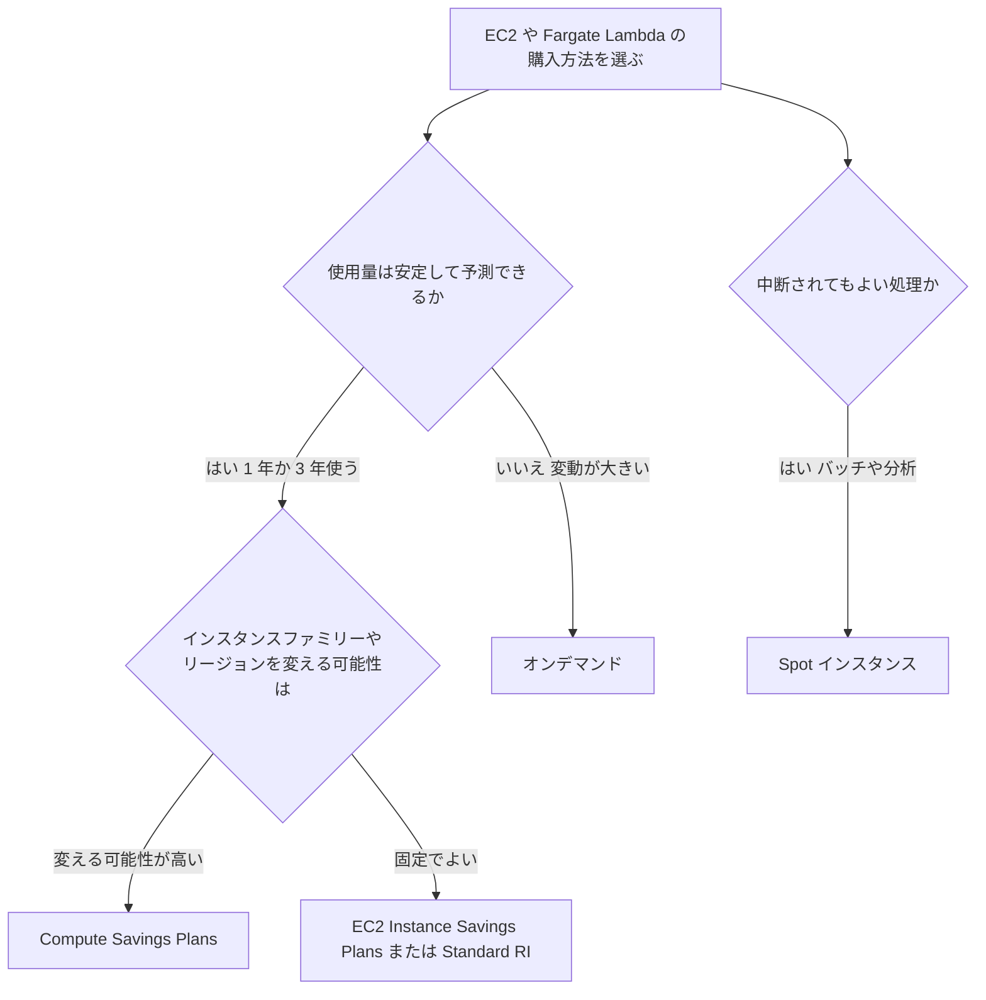

| 購入オプション | 割引の目安 | 柔軟性 | 向いている用途 |
|---|---|---|---|
| オンデマンド | なし | 最高 | 短期、予測不能、開発 |
| Compute Savings Plans | 大きい(最大で約 66%) | 高い(インスタンスファミリー、リージョン、OS を変更可。Fargate と Lambda にも適用) | 変化の多い安定ワークロード |
| EC2 Instance Savings Plans | さらに大きい(最大で約 72%) | 中(ファミリーとリージョンを固定) | 構成が固定のワークロード |
| リザーブドインスタンス | Savings Plans と同程度 | Standard は低い、Convertible は中 | 既存の RI 運用、RDS などの一部サービス |
| Spot インスタンス | 最大約 90% | 低い(2 分前通知で中断される) | ステートレスやフォールトトレラントなバッチ処理 |

> 割引率は期間、支払い方法、リージョンなどで変わるため、**「何と何を比較するとどちらが有利か」の関係**を覚えるのが試験対策として有効です。

## 5-4. ライトサイジングの可視化

| ツール | 内容 |
|---|---|
| AWS Compute Optimizer | EC2、EBS、Lambda などの使用状況を分析し、最適なサイズや種類を推奨 |
| Amazon S3 Storage Lens | 組織全体の S3 使用状況とコスト効率の指標を可視化 |
| Cost Explorer の rightsizing 推奨 | 未使用または低使用のインスタンスを特定 |

## 5-5. タグ戦略

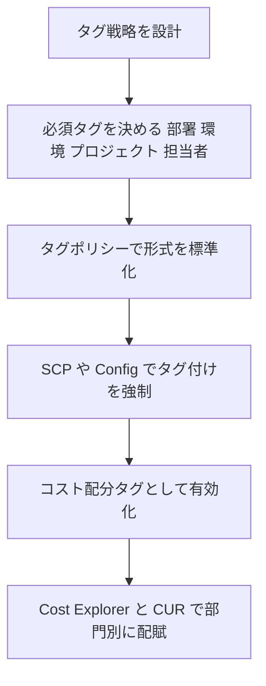

> **落とし穴**:タグを付けただけではコスト配分に反映されません。**コスト配分タグとして有効化**する必要があります(有効化した以降のデータに反映)。

## 5-6. ベストプラクティス

| ベストプラクティス | 理由 |
|---|---|
| 予算を組織、部門、プロジェクトごとに設定しアラートを出す | 超過に早く気付き、手遅れになる前に対処できる |
| 安定した基礎負荷は Savings Plans、変動分はオンデマンドと Spot | 割引を最大化しつつ過剰な長期コミットを避ける |
| 一括請求を使い購入オプションの割引を組織で共有 | 組織全体の使用量で最大限の割引を受けられる |
| 必須タグを定義し自動で強制 | 配賦できないコストをなくす |
| 定期的に Compute Optimizer の推奨を確認 | 使っていない余剰リソースを継続的に削減できる |
| Cost Anomaly Detection を有効化 | 設定ミスや不正利用による急な請求増を早期に発見できる |

### 出典(Step 5)

| 内容 | URL |
|---|---|
| Cost Explorer | https://docs.aws.amazon.com/cost-management/latest/userguide/ce-what-is.html |
| AWS Budgets | https://docs.aws.amazon.com/cost-management/latest/userguide/budgets-managing-costs.html |
| Cost and Usage Report | https://docs.aws.amazon.com/cur/latest/userguide/what-is-cur.html |
| Savings Plans | https://docs.aws.amazon.com/savingsplans/latest/userguide/what-is-savings-plans.html |
| EC2 Spot | https://docs.aws.amazon.com/AWSEC2/latest/UserGuide/using-spot-instances.html |
| Compute Optimizer | https://docs.aws.amazon.com/compute-optimizer/latest/ug/what-is-compute-optimizer.html |
| S3 Storage Lens | https://docs.aws.amazon.com/AmazonS3/latest/userguide/storage_lens.html |
| コスト配分タグ | https://docs.aws.amazon.com/awsaccountbilling/latest/aboutv2/cost-alloc-tags.html |
| Trusted Advisor | https://docs.aws.amazon.com/awssupport/latest/user/trusted-advisor.html |
| Pricing Calculator | https://docs.aws.amazon.com/pricing-calculator/latest/userguide/what-is-pricing-calculator.html |
| コスト最適化の柱 | https://docs.aws.amazon.com/wellarchitected/latest/cost-optimization-pillar/welcome.html |

---
# ドメイン 2:新規ソリューションの設計(29%)

# Step 6:ビジネス要件に合うデプロイ戦略(Task 2.1)

## 6-1. なぜ重要か

手作業の構築は、ミス、ばらつき、再現不能を生みます。**コードでインフラを定義し(IaC)、パイプラインで自動的に届け、失敗したら戻せる**仕組みを選ぶ力が問われます。

## 6-2. Infrastructure as Code(IaC)

| ツール | 内容 | ポイント |
|---|---|---|
| AWS CloudFormation | テンプレート(YAML、JSON)でリソースをスタックとして管理 | 変更セット、ドリフト検出、ロールバック |
| AWS CDK | プログラミング言語でインフラを書き、CloudFormation に変換 | 繰り返しや条件を言語で書ける |
| CloudFormation StackSets | 複数アカウントと複数リージョンへ同じスタックを展開 | Organizations 連携で新規アカウントへ自動展開 |
| AWS Service Catalog | 承認済みのテンプレートを製品として提供 | 利用者が自由に作れる範囲を統制 |

### CloudFormation の重要機能

| 機能 | 説明 |
|---|---|
| 変更セット | 適用前に「何が変わるか」をプレビュー |
| ドリフト検出 | 手作業で変更された設定とテンプレートの差を検出 |
| ロールバック | 作成や更新に失敗したら自動で元に戻す |
| DeletionPolicy | スタック削除時に Retain(残す)や Snapshot(スナップショットを取る)を指定 |
| ネストスタック | 共通部品を分割して再利用 |
| CreationPolicy と cfn-signal | EC2 内の初期設定が終わるまで成功扱いにしない |
| カスタムリソース | CloudFormation が未対応の処理を Lambda で実行 |

## 6-3. CI/CD とデプロイ方式

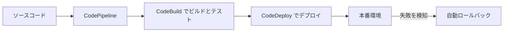

### デプロイ方式の比較

| 方式 | 仕組み | ダウンタイム | ロールバック | コスト |
|---|---|---|---|---|
| オールアットワンス | 全台を一度に置換 | あり得る | 再デプロイが必要 | 最小 |
| ローリング | 少しずつ置換 | 基本なし(容量は一時的に減る) | 遅い | 小 |
| ローリング(追加バッチ) | 追加のインスタンスを足して容量を維持 | なし | 遅い | 小から中 |
| イミュータブル | 新しいインスタンス群を別に作り入れ替える | なし | **速い**(古い群を戻すだけ) | 中 |
| ブルー/グリーン | 新旧 2 環境を並べ、切り替える | なし | **速い**(旧環境へ戻す) | 高い(一時的に 2 倍) |
| カナリア | 少量のトラフィックだけ新版へ流し様子を見る | なし | 速い | 中 |

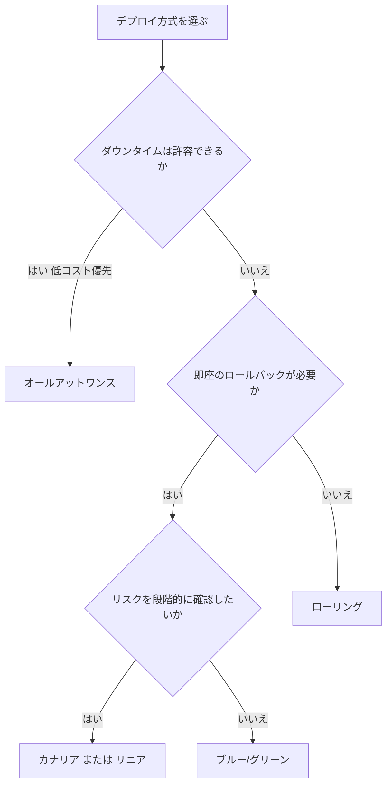

### サービス別の対応

| サービス | 使える方式 |
|---|---|
| Elastic Beanstalk | オールアットワンス、ローリング、追加バッチ付きローリング、イミュータブル、トラフィック分割 |
| CodeDeploy(EC2) | インプレース(1 台ずつ、半数ずつ、全台)、ブルー/グリーン |
| CodeDeploy(Lambda) | カナリア、リニア、オールアットワンス(エイリアスでトラフィック移行) |
| Route 53 加重ルーティング | DNS レベルでの段階的な切り替え |

## 6-4. 構成管理:AWS Systems Manager

| 機能 | 内容 |
|---|---|
| Session Manager | SSH の鍵や踏み台なしでインスタンスへ安全に接続。操作ログも残せる |
| Patch Manager | パッチベースラインとメンテナンスウィンドウでパッチ適用を自動化 |
| Parameter Store | 設定値と秘密情報(暗号化可)の保管 |
| Automation | 運用手順(ランブック)を自動実行 |
| State Manager | 望ましい状態を保つ(定期的に設定を適用) |
| Run Command | 多数のインスタンスへ一斉にコマンド実行 |

## 6-5. マネージドサービスで運用を減らす

| 自前運用 | 置き換え候補 | 減らせる負担 |
|---|---|---|
| EC2 上の MySQL | Amazon RDS または Aurora | パッチ、バックアップ、フェイルオーバー |
| EC2 上のコンテナ基盤 | ECS/EKS + Fargate | サーバー管理、パッチ |
| EC2 上のキュー | Amazon SQS | スケーリング、可用性 |
| 自前のバッチ基盤 | AWS Batch または Lambda | 基盤管理 |

> 「デプロイと基盤の複雑な作業を AWS に任せる」が試験ガイドの Skill に明記されています。**問題文に「運用負荷の削減」があれば、マネージドやサーバーレスが第一候補**です。

## 6-6. ベストプラクティス

| ベストプラクティス | 理由 |
|---|---|
| すべてのインフラを IaC 化しバージョン管理 | 再現性、レビュー、履歴管理ができる |
| CloudFormation は変更セットで確認してから適用 | 意図しない置換(データ消失)を事前に防ぐ |
| ステートフルなリソースには DeletionPolicy を設定 | スタック削除でデータが消えるのを防ぐ |
| StackSets で複数アカウントへ標準構成を展開 | 手作業の展開漏れとばらつきを防ぐ |
| 本番デプロイは自動ロールバックを組み込む | 障害を検知して自動で被害を最小化できる |
| 直接 SSH ではなく Session Manager | 鍵管理が不要になり、監査ログも残る |

### 出典(Step 6)

| 内容 | URL |
|---|---|
| AWS CloudFormation | https://docs.aws.amazon.com/AWSCloudFormation/latest/UserGuide/Welcome.html |
| CloudFormation StackSets | https://docs.aws.amazon.com/AWSCloudFormation/latest/UserGuide/what-is-cfnstacksets.html |
| AWS CodeDeploy | https://docs.aws.amazon.com/codedeploy/latest/userguide/welcome.html |
| デプロイオプションの概要 | https://docs.aws.amazon.com/whitepapers/latest/overview-deployment-options/welcome.html |
| Elastic Beanstalk のデプロイポリシー | https://docs.aws.amazon.com/elasticbeanstalk/latest/dg/using-features.rolling-version-deploy.html |
| AWS Systems Manager | https://docs.aws.amazon.com/systems-manager/latest/userguide/what-is-systems-manager.html |
| AWS Service Catalog | https://docs.aws.amazon.com/servicecatalog/latest/adminguide/introduction.html |

---

# Step 7:事業継続を確保する設計(Task 2.2)

## 7-1. Step 3 との違い

Step 3 は「既存の組織全体の観点から DR を評価」、Step 7 は「**新しく作るソリューションにどう DR を実装するか**」に焦点があります。実際にレプリケーションを設定し、切り替えを訓練するところまでを扱います。

## 7-2. DNS を使った切り替え(Route 53)

| ルーティングポリシー | 動作 | 典型的な使いどころ |
|---|---|---|
| シンプル | 1 つの値を返す | 単一のリソース |
| 加重 | 比率で振り分け | ブルー/グリーン、段階的な移行 |
| レイテンシー | 最も遅延が小さいリージョンへ | 世界中のユーザー |
| フェイルオーバー | プライマリが不健全ならセカンダリへ | アクティブ/パッシブの DR |
| 位置情報 | ユーザーの所在地(国、大陸)で振り分け | 法規制、言語、コンテンツ制限 |
| 地理的近接性 | リソースとユーザーの距離とバイアスで制御 | 近いリージョンに寄せたい、トラフィックを調整したい |
| IP ベース | 送信元 IP の CIDR で振り分け | 特定のネットワークを特定のエンドポイントへ |
| 複数値回答 | 健全な複数の値を返す(簡易な負荷分散) | 複数のエンドポイントを返したい |

```mermaid
flowchart TD
    U["ユーザー"] --> R["Route 53 フェイルオーバー"]
    R -->|通常時| P["東京リージョン プライマリ"]
    R -->|ヘルスチェックが失敗| S["大阪リージョン セカンダリ"]
    HC["ヘルスチェック"] -.->|監視| P
```

## 7-3. データとデータベースのレプリケーション

| サービス | 方式 | RPO の目安 | 備考 |
|---|---|---|---|
| RDS Multi-AZ | 同期レプリケーション(同一リージョン内の別 AZ) | ほぼゼロ | 自動フェイルオーバー。**読み取りの負荷分散には使えない**(従来型の Multi-AZ インスタンス構成) |
| RDS リードレプリカ | 非同期 | 秒から分 | 読み取りのスケールと、クロスリージョン DR に使える |
| Aurora | 6 つのコピーを 3 つの AZ に自動保存 | ほぼゼロ(同一リージョン) | リーダーを昇格してフェイルオーバー |
| Aurora Global Database | 専用基盤でクロスリージョンに低遅延レプリケーション | 通常 1 秒前後 | リージョン障害時に別リージョンを昇格 |
| DynamoDB グローバルテーブル | マルチリージョンのマルチアクティブ | 通常 1 秒前後 | 各リージョンで読み書き可能 |
| S3 CRR/SRR | 非同期のオブジェクト複製 | 通常数分以内(S3 Replication Time Control で 15 分以内を目標に設定可) | バージョニングが必須 |
| EBS スナップショット | 時点コピー | スナップショットの間隔 | クロスリージョンコピー可能 |

> **ひっかけ**:Multi-AZ は「可用性」のため、リードレプリカは「読み取りスケール」のため、が基本の役割です。DR(リージョン障害)には、クロスリージョンのリードレプリカや Aurora Global Database を使います。

## 7-4. DR の実装パターン(Pilot light の例)

```mermaid
flowchart LR
    subgraph 東京 本番
        A1["Web 層 稼働"]
        A2["アプリ層 稼働"]
        A3["DB プライマリ"]
    end
    subgraph 大阪 DR
        B1["Web 層 停止"]
        B2["アプリ層 停止 AMI 準備済み"]
        B3["DB レプリカ 稼働"]
    end
    A3 -->|継続レプリケーション| B3
```

障害時の手順:

1. DB のレプリカをプライマリへ昇格する。
2. 準備済みの AMI や CloudFormation でアプリ層と Web 層を起動する。
3. Route 53 を DR 側へ向ける。

> 手順は**自動化**(CloudFormation、SSM Automation、Lambda)しておくのが定石です。

## 7-5. DR テストと監視

| 項目 | 内容 |
|---|---|
| DR 訓練 | 定期的に実際にフェイルオーバーとフェイルバックを実施 |
| カオスエンジニアリング | AWS Fault Injection Service で意図的に障害を起こして耐性を確認 |
| 集中監視 | CloudWatch アラームと EventBridge で障害を検知し自動復旧を開始 |
| 運用の見える化 | AWS Health Dashboard で AWS 側の障害影響を確認 |

## 7-6. ベストプラクティス

| ベストプラクティス | 理由 |
|---|---|
| DR 手順は自動化し、IaC で再現できるようにする | 障害時の人為的ミスと復旧時間を減らす |
| DR リージョンのバックアップとレプリカを定期的に検証 | 壊れたバックアップは復旧時に初めて分かるため |
| フェイルオーバーとフェイルバックの両方を訓練 | 戻す手順が未検証だと二次障害を招く |
| DR 用のサービスクォータを事前に確認 | DR 先で起動台数の上限に達して復旧できない事態を防ぐ |
| Route 53 のヘルスチェックを実際の依存先まで含めて設計 | 画面は返るが DB が死んでいる状態を検知できる |

### 出典(Step 7)

| 内容 | URL |
|---|---|
| Route 53 ルーティングポリシー | https://docs.aws.amazon.com/Route53/latest/DeveloperGuide/routing-policy.html |
| Route 53 DNS フェイルオーバー | https://docs.aws.amazon.com/Route53/latest/DeveloperGuide/dns-failover.html |
| RDS Multi-AZ | https://docs.aws.amazon.com/AmazonRDS/latest/UserGuide/Concepts.MultiAZ.html |
| Aurora Global Database | https://docs.aws.amazon.com/AmazonRDS/latest/AuroraUserGuide/aurora-global-database.html |
| DynamoDB グローバルテーブル | https://docs.aws.amazon.com/amazondynamodb/latest/developerguide/GlobalTables.html |
| S3 レプリケーション | https://docs.aws.amazon.com/AmazonS3/latest/userguide/replication.html |
| AWS Fault Injection Service | https://docs.aws.amazon.com/fis/latest/userguide/what-is.html |
| DR ホワイトペーパー | https://docs.aws.amazon.com/whitepapers/latest/disaster-recovery-workloads-on-aws/disaster-recovery-workloads-on-aws.html |

---

# Step 8:要件に基づくセキュリティ統制の決定(Task 2.3)

## 8-1. 多層防御の考え方

```mermaid
flowchart TD
    A["インターネット"] --> B["Route 53 と CloudFront と Shield"]
    B --> C["AWS WAF"]
    C --> D["ロードバランサー"]
    D --> E["セキュリティグループ"]
    E --> F["アプリケーション"]
    F --> G["IAM ロールで最小権限"]
    G --> H["暗号化されたデータ"]
```

## 8-2. セキュリティグループとネットワーク ACL

| 項目 | セキュリティグループ | ネットワーク ACL |
|---|---|---|
| 適用単位 | ENI(インスタンス) | サブネット |
| 状態 | **ステートフル**(戻りの通信は自動許可) | **ステートレス**(戻りの通信も明示的に許可が必要) |
| ルール | **許可のみ** | 許可と拒否の両方 |
| 評価 | すべてのルールを評価 | 番号の小さいルールから順に評価し最初に一致したもので決定 |
| 典型的用途 | 通常のアクセス制御 | 特定 IP の明示的なブロックなど |

> **ひっかけ**:特定の IP アドレスを**拒否**したいときはネットワーク ACL を使います(セキュリティグループには拒否ルールがない)。

## 8-3. 大規模 Web アプリへの攻撃対策

| 脅威 | 対策サービス |
|---|---|
| ネットワーク層とトランスポート層の DDoS | AWS Shield Standard(自動、無料)。強化するなら Shield Advanced |
| アプリケーション層の攻撃(SQL インジェクション、XSS、ボット) | AWS WAF(CloudFront、ALB、API Gateway などに適用) |
| 大量リクエスト | WAF のレートベースルール、CloudFront によるエッジ吸収 |
| 複数アカウントへの一括ルール適用 | AWS Firewall Manager |
| VPC のネットワーク検査 | AWS Network Firewall |
| 不審な挙動の検知 | Amazon GuardDuty |

| Shield Advanced の特徴 | 内容 |
|---|---|
| 高度な DDoS 検知と緩和 | ELB、CloudFront、Route 53、Global Accelerator、Elastic IP などを保護 |
| 専門チームの支援 | DDoS 対応チームによる支援 |
| コスト保護 | DDoS 攻撃で急増したスケーリングコストの払い戻しを申請可能 |

```mermaid
flowchart TD
    A["大規模 Web アプリを攻撃から守る"] --> B["CloudFront を前面に配置"]
    B --> C["AWS WAF でアプリ層攻撃を遮断"]
    C --> D["Shield Advanced で DDoS 対策を強化"]
    D --> E["オリジンは CloudFront からのみ許可"]
    E --> F["Auto Scaling で正当な負荷に対応"]
```

## 8-4. 暗号化と認証情報の管理

| 目的 | サービス | 補足 |
|---|---|---|
| データの暗号化キー | KMS | カスタマーマネージドキーで制御と監査 |
| 認証情報(DB パスワードなど)の保管 | **Secrets Manager** | **自動ローテーション**に対応(RDS など) |
| 設定値や簡易な秘密情報 | Systems Manager Parameter Store | SecureString で暗号化。自動ローテーションは標準では持たない |
| TLS 証明書 | ACM | ロードバランサー、CloudFront などに無料で証明書を適用(統合サービス向け) |
| EC2 に権限を付ける | IAM ロール(インスタンスプロファイル) | アクセスキーをコードに埋め込まない |

> **使い分け**:「パスワードの自動ローテーション」が出たら Secrets Manager、「安価な設定値の保管」なら Parameter Store が基本です。

## 8-5. 最小権限の IAM

| 手法 | 説明 |
|---|---|
| 必要な操作とリソースだけを許可 | ワイルドカードを避ける |
| 条件キーを活用 | 送信元 IP、MFA、タグ、リージョンなどで絞る |
| Permission Boundary | 委任された管理者が作れる権限の上限を設定 |
| IAM Access Analyzer のポリシー生成 | CloudTrail の実際の使用履歴からポリシーを生成 |
| ABAC(タグベース) | タグが一致するリソースだけ許可し、ポリシーの数を減らす |

## 8-6. パッチ管理

```mermaid
flowchart LR
    A["Inspector が脆弱性を検出"] --> B["Systems Manager Patch Manager"]
    B --> C["パッチベースラインで対象を定義"]
    C --> D["メンテナンスウィンドウで適用"]
    D --> E["コンプライアンスをレポート"]
```

| 方式 | 内容 |
|---|---|
| Patch Manager | OS とアプリのパッチ適用を自動化し、準拠状況を可視化 |
| イミュータブル更新 | パッチ済みの新しい AMI でインスタンスを入れ替える |
| コンテナ | 新しいイメージを再ビルドして入れ替える(Inspector が ECR をスキャン) |

## 8-7. ベストプラクティス

| ベストプラクティス | 理由 |
|---|---|
| ALB、DB は「セキュリティグループ参照」でアクセスを許可 | IP の変化に影響されず、層ごとの経路を厳密にできる |
| DB は プライベートサブネットに置く | インターネットから直接到達できないようにする |
| WAF のルールを段階導入(Count モードで確認 → Block) | 正当な通信の誤遮断を避ける |
| Secrets Manager で認証情報を自動ローテーション | 漏えいしても被害期間を短くできる |
| 保管中と転送中の両方を暗号化 | どちらか一方では経路や保存先の侵害で漏れる |
| パッチの適用状況を継続的に可視化 | 既知の脆弱性の放置を防ぐ |

### 出典(Step 8)

| 内容 | URL |
|---|---|
| AWS Shield と DDoS | https://docs.aws.amazon.com/waf/latest/developerguide/ddos-overview.html |
| AWS WAF | https://docs.aws.amazon.com/waf/latest/developerguide/waf-chapter.html |
| AWS Firewall Manager | https://docs.aws.amazon.com/waf/latest/developerguide/fms-chapter.html |
| AWS Network Firewall | https://docs.aws.amazon.com/network-firewall/latest/developerguide/what-is-aws-network-firewall.html |
| AWS Secrets Manager | https://docs.aws.amazon.com/secretsmanager/latest/userguide/intro.html |
| Patch Manager | https://docs.aws.amazon.com/systems-manager/latest/userguide/patch-manager.html |
| IAM のベストプラクティス | https://docs.aws.amazon.com/IAM/latest/UserGuide/best-practices.html |

---

# Step 9:信頼性要件を満たす設計(Task 2.4)

## 9-1. 高可用性の基本

```mermaid
flowchart TD
    U["ユーザー"] --> ELB["ロードバランサー 複数 AZ"]
    ELB --> A1["AZ-a の EC2"]
    ELB --> A2["AZ-c の EC2"]
    ELB --> A3["AZ-d の EC2"]
    A1 --> DB["Aurora 複数 AZ"]
    A2 --> DB
    A3 --> DB
    ASG["Auto Scaling グループ"] -.->|台数を維持と調整| A1
```

| 原則 | 内容 |
|---|---|
| 複数 AZ に分散 | 1 つの AZ 障害で全断しない |
| 疎結合 | 一部が止まっても全体が連鎖して止まらない |
| 障害を前提にした設計 | 自動検知と自動復旧 |
| マネージドサービスの活用 | 可用性を AWS 側で担保 |

## 9-2. ストレージとデータベースの高可用性

| サービス | 可用性の仕組み |
|---|---|
| Amazon S3 | 複数の AZ に自動で冗長保存(One Zone クラスを除く) |
| Amazon EFS | 標準クラスは複数 AZ に冗長保存 |
| Amazon EBS | 単一 AZ 内で冗長化。**AZ をまたぐにはスナップショットかレプリケーションが必要** |
| RDS Multi-AZ | スタンバイへ自動フェイルオーバー |
| Aurora | 複数 AZ にストレージ複製。リーダーへ高速フェイルオーバー |
| ElastiCache | Multi-AZ の自動フェイルオーバーとレプリカ |
| DynamoDB | 複数 AZ に自動で冗長保存 |

## 9-3. 疎結合のためのアプリケーション統合

```mermaid
flowchart LR
    P["プロデューサー"] --> Q["SQS キュー"]
    Q --> C["コンシューマー 台数が自動で増減"]
    Q -->|処理失敗を繰り返す| DLQ["デッドレターキュー"]
```

| サービス | モデル | 使いどころ |
|---|---|---|
| Amazon SQS | キュー(プル型) | 処理の平準化、非同期処理、バッファリング |
| Amazon SNS | Pub/Sub(プッシュ型) | 1 つのイベントを複数の宛先へ(ファンアウト) |
| Amazon EventBridge | イベントバス | イベント駆動、SaaS 連携、ルールによる振り分け |
| AWS Step Functions | ワークフロー | 複数ステップの状態管理、リトライ、補償処理 |
| Amazon MQ | マネージドブローカー | 既存の ActiveMQ や RabbitMQ をそのまま移行 |

| SQS の種類 | 特徴 |
|---|---|
| 標準キュー | ほぼ無制限のスループット、**少なくとも 1 回**の配信、順序は保証されない |
| FIFO キュー | **順序保証**と重複排除(メッセージグループごとの順序) |

> **SNS と SQS を組み合わせるファンアウト**:SNS トピックに複数の SQS キューを登録すると、1 つのメッセージが複数の処理系へ確実に届きます。

## 9-4. Auto Scaling ポリシー

| ポリシー | 動作 | 使いどころ |
|---|---|---|
| ターゲット追跡 | 指標を目標値に保つように自動調整(例:CPU 50%) | 最も簡単で第一候補 |
| ステップスケーリング | 閾値の超過幅に応じて段階的に増減 | 細かく制御したい場合 |
| スケジュール | 時間で台数を指定 | 予測できる周期的な負荷 |
| 予測スケーリング | 過去の傾向から先回りして増減 | 周期的で、起動に時間がかかる構成 |

## 9-5. サービスクォータ

- AWS には**アカウントとリージョンごとの上限**があります。
- 急なスケールや DR で上限に達して起動できない事態を防ぐため、**Service Quotas** で使用状況を監視し、事前に引き上げを申請します。
- **リージョンごとに別々の上限**なので、DR リージョンの上限も確認が必要です。

## 9-6. ベストプラクティス

| ベストプラクティス | 理由 |
|---|---|
| 3 つの AZ にまたがって配置 | 1 つの AZ が失われても残りで容量を維持しやすい |
| キューで非同期化し、コンシューマーを独立してスケール | 負荷のピークを吸収し、下流の障害が上流に伝わらない |
| デッドレターキューを設定 | 処理できないメッセージで全体が詰まるのを防ぎ、原因調査に使える |
| ヘルスチェックを深い層まで設計 | 表面は正常でも中身が壊れている状態を検知できる |
| Service Quotas のアラームを設定 | 上限到達による障害を未然に防げる |
| Route 53 のレイテンシーや位置情報ポリシーを用途で使い分ける | 要件(速度、法規制)に合わせた振り分けができる |

### 出典(Step 9)

| 内容 | URL |
|---|---|
| Amazon SQS | https://docs.aws.amazon.com/AWSSimpleQueueService/latest/SQSDeveloperGuide/welcome.html |
| Amazon SNS | https://docs.aws.amazon.com/sns/latest/dg/welcome.html |
| AWS Step Functions | https://docs.aws.amazon.com/step-functions/latest/dg/welcome.html |
| Amazon EventBridge | https://docs.aws.amazon.com/eventbridge/latest/userguide/eb-what-is.html |
| EC2 Auto Scaling | https://docs.aws.amazon.com/autoscaling/ec2/userguide/what-is-amazon-ec2-auto-scaling.html |
| Service Quotas | https://docs.aws.amazon.com/servicequotas/latest/userguide/intro.html |
| Well-Architected 信頼性の柱 | https://docs.aws.amazon.com/wellarchitected/latest/reliability-pillar/welcome.html |

---

# Step 10:パフォーマンス目標を満たす設計(Task 2.5)

## 10-1. 考え方

「どこが遅くなりうるか」を **アクセスパターン** から逆算し、**目的に特化したサービス(purpose-built)**を選びます。1 つの万能サービスで全部をまかなうのではなく、用途ごとに最適なものを使い分けます。

## 10-2. EC2 インスタンスファミリー

| ファミリー | 特徴 | 典型的用途 |
|---|---|---|
| M | 汎用(バランス) | Web サーバー、アプリサーバー |
| C | コンピューティング最適化 | バッチ処理、HPC、ゲームサーバー、動画エンコード |
| R、X | メモリ最適化 | インメモリ DB、ビッグデータ分析 |
| I、D | ストレージ最適化(高速ローカル NVMe、高スループット) | NoSQL、データウェアハウス、ログ処理 |
| P、G | GPU | 機械学習、グラフィックス |
| T | バースト可能 | 負荷が低くときどき急増する開発や小規模サービス |
| Graviton(末尾に g) | Arm ベースで価格性能比が高い | 互換性が取れる Linux ワークロード全般 |

## 10-3. ストレージの選び方

```mermaid
flowchart TD
    A["ストレージを選ぶ"] --> B{"アクセス方法は"}
    B -->|ブロック 1 台のサーバーのディスク| C["EBS"]
    B -->|共有ファイル 複数サーバーで同時| D{"プロトコル"}
    B -->|オブジェクト HTTP API| E["S3"]
    D -->|Linux NFS| F["EFS"]
    D -->|Windows SMB| G["FSx for Windows File Server"]
    D -->|HPC 高速並列| H["FSx for Lustre"]
    D -->|NetApp ONTAP や OpenZFS 互換| I["FSx for NetApp ONTAP または OpenZFS"]
    C --> J{"要件は"}
    J -->|汎用 コスパ| K["gp3"]
    J -->|高 IOPS 低レイテンシ DB| L["io2 Block Express"]
    J -->|大容量スループット| M["st1 sc1"]
    J -->|最高速 一時的| N["インスタンスストア"]
```

| ボリューム | 特徴 |
|---|---|
| gp3 | 汎用 SSD。容量と独立して IOPS とスループットを指定でき、**gp2 より安価な第一候補** |
| io2 / io2 Block Express | 高耐久で最高の IOPS。ミッションクリティカルな DB 向け |
| st1 | スループット最適化 HDD。大きな順次読み書き(ログ、ビッグデータ) |
| sc1 | コールド HDD。低コストで頻繁には使わないデータ |
| インスタンスストア | ホスト内蔵の超高速な一時ストレージ。**インスタンス停止や障害でデータが消える** |

### S3 の性能のポイント

- プレフィックスごとに高いリクエスト性能が得られるため、**プレフィックスを分散**すると全体の性能が伸びる。
- 大きなオブジェクトは**マルチパートアップロード**で並列化する。
- 遠隔地からのアップロードは **S3 Transfer Acceleration**。
- 超低レイテンシが必要なら S3 Express One Zone を検討。

## 10-4. 目的別データベース(purpose-built)

```mermaid
flowchart TD
    A["データの性質を見る"] --> B{"どの型か"}
    B -->|リレーショナル OLTP| C["Aurora または RDS"]
    B -->|キー バリュー 超低遅延 無限スケール| D["DynamoDB"]
    B -->|インメモリ キャッシュ| E["ElastiCache"]
    B -->|分析 DWH| F["Redshift"]
    B -->|グラフ 関係の探索| G["Neptune"]
    B -->|時系列| H["Timestream"]
    B -->|ドキュメント MongoDB 互換| I["DocumentDB"]
    B -->|Cassandra 互換| J["Keyspaces"]
    B -->|全文検索 ログ分析| K["OpenSearch Service"]
```

## 10-5. キャッシュ、バッファリング、レプリカ

| 手法 | サービス | 効果 |
|---|---|---|
| エッジキャッシュ | CloudFront | 利用者に近い場所からコンテンツ配信 |
| DB のキャッシュ | ElastiCache、DynamoDB の DAX | 読み取りの高速化と DB 負荷軽減 |
| API キャッシュ | API Gateway のキャッシュ | バックエンドへの呼び出しを削減 |
| バッファリング | SQS、Kinesis Data Streams、Data Firehose | 急なトラフィックの平準化 |
| 読み取りレプリカ | RDS と Aurora のリードレプリカ | 読み取りの水平スケール |

## 10-6. プレイスメントグループ

| 種類 | 配置 | 用途 |
|---|---|---|
| クラスター | 1 つの AZ 内で物理的に近接 | **低遅延で高ネットワーク性能**(HPC) |
| パーティション | ラックごとに分割 | 大規模な分散システム(Hadoop、Kafka など)で障害の影響を分離 |
| スプレッド | 少数のインスタンスを別々のハードウェアに分散 | 重要な少数インスタンスの同時障害を避ける |

## 10-7. ベストプラクティス

| ベストプラクティス | 理由 |
|---|---|
| 汎用ではなく用途に合うデータストアを選ぶ | 必要な性能を安く得られ、後でスケールの限界に当たりにくい |
| EBS は gp3 を既定にし、必要なときだけ io2 | 無駄なコストを避けつつ性能を調整できる |
| 読み取りの多い負荷はキャッシュで DB を守る | DB のスケールアップより安く高速 |
| 急増トラフィックはキューで受けて平準化 | バックエンドの過負荷を防げる |
| 実際のメトリクスを見てライトサイジング | 推測では過大または過小になりがち |
| Graviton を検討 | 同等性能で低コスト、省電力になりやすい |

### 出典(Step 10)

| 内容 | URL |
|---|---|
| EC2 インスタンスタイプ | https://docs.aws.amazon.com/ec2/latest/instancetypes/instance-types.html |
| EBS ボリュームタイプ | https://docs.aws.amazon.com/ebs/latest/userguide/ebs-volume-types.html |
| プレイスメントグループ | https://docs.aws.amazon.com/AWSEC2/latest/UserGuide/placement-groups.html |
| S3 のパフォーマンス最適化 | https://docs.aws.amazon.com/AmazonS3/latest/userguide/optimizing-performance.html |
| Amazon EFS のパフォーマンス | https://docs.aws.amazon.com/efs/latest/ug/performance.html |
| DynamoDB DAX | https://docs.aws.amazon.com/amazondynamodb/latest/developerguide/DAX.html |
| Amazon ElastiCache | https://docs.aws.amazon.com/AmazonElastiCache/latest/dg/WhatIs.html |
| Amazon CloudFront | https://docs.aws.amazon.com/AmazonCloudFront/latest/DeveloperGuide/Introduction.html |

---

# Step 11:コスト最適化戦略(Task 2.6)

## 11-1. 設計段階でコストを決める 4 つのレバー

```mermaid
flowchart TD
    A["コストを下げる設計"] --> B["適正サイズのリソース選択"]
    A --> C["適切な購入モデル"]
    A --> D["ストレージの階層化"]
    A --> E["データ転送の削減"]
    A --> F["マネージドサービスで人件費を削減"]
```

## 11-2. S3 ストレージクラスと階層化

| クラス | 向いているデータ | 取り出し | 最小保存期間 |
|---|---|---|---|
| S3 Standard | 頻繁にアクセス | 即時 | なし |
| S3 Intelligent-Tiering | **アクセスパターンが不明、変動する** | 即時(自動で階層移動) | なし |
| S3 Standard-IA | 低頻度だが即時取り出しが必要 | 即時(取り出し料金あり) | 30 日 |
| S3 One Zone-IA | 再作成可能な低頻度データ(1 つの AZ のみ) | 即時 | 30 日 |
| S3 Glacier Instant Retrieval | 四半期に 1 回程度のアーカイブで即時取り出し | ミリ秒 | 90 日 |
| S3 Glacier Flexible Retrieval | 年に数回程度のアーカイブ | 数分から数時間 | 90 日 |
| S3 Glacier Deep Archive | 長期保管(規制対応) | 数時間(最長 12 時間以上) | 180 日 |

```mermaid
flowchart LR
    A["作成直後 Standard"] -->|30 日後| B["Standard-IA"]
    B -->|90 日後| C["Glacier Flexible Retrieval"]
    C -->|365 日後| D["Deep Archive"]
    D -->|7 年後| E["削除"]
```

> 上の遷移は **S3 ライフサイクルポリシー**で自動化します。アクセスパターンが読めないなら Intelligent-Tiering が安全です。

## 11-3. データ転送コスト

| 通信 | 課金 |
|---|---|
| インターネットから AWS(インバウンド) | 無料 |
| AWS からインターネット(アウトバウンド) | 課金 |
| 同一 AZ 内のプライベート IP 通信 | 無料 |
| AZ 間の通信 | 課金(双方向) |
| リージョン間の通信 | 課金 |
| NAT ゲートウェイ経由 | 時間料金とデータ処理料金 |
| CloudFront からのアウトバウンド | オリジンから直接配信するより安くなることが多い |

### データ転送を減らす定石

| 手法 | 効果 |
|---|---|
| S3 や DynamoDB にはゲートウェイエンドポイント | NAT のデータ処理料金を回避(無料) |
| CloudFront の利用 | オリジンからの転送を削減しキャッシュで配信 |
| AZ 間通信を意識した配置 | 密に通信する構成要素を同じ AZ に置く(可用性とのバランスに注意) |
| データを圧縮、重複排除 | 転送量そのものを減らす |
| VPC エンドポイントでインターネット経由を避ける | NAT 料金とセキュリティの両面で有利 |

## 11-4. 支出の統制

| 手法 | 内容 |
|---|---|
| AWS Budgets のアクション | 予算超過時に IAM ポリシーや SCP を自動で適用し作成を止める |
| サービスクォータ | 想定外の大量作成を制限 |
| タグの強制 | 誰のコストか分からない状態をなくす |
| コスト配分レポート | 部門ごとの実績を継続的に共有 |

## 11-5. ベストプラクティス

| ベストプラクティス | 理由 |
|---|---|
| アクセスパターンが不明なら S3 Intelligent-Tiering | 手間なく自動で最適化でき、取り出し料金の心配がない |
| ライフサイクルルールで古いデータを自動移行と削除 | 放置による保管料金の増加を防ぐ |
| S3、DynamoDB にはゲートウェイエンドポイント | 無料でデータ処理料金を節約できる |
| 可用性と転送コストのバランスを検討 | AZ 間通信の課金と耐障害性はトレードオフになる |
| 設計段階で見積もりを作成 | 構築後の想定外の請求を避ける |

### 出典(Step 11)

| 内容 | URL |
|---|---|
| S3 ストレージクラス | https://docs.aws.amazon.com/AmazonS3/latest/userguide/storage-class-intro.html |
| データ転送コストの概要(AWS ブログ) | https://aws.amazon.com/blogs/architecture/overview-of-data-transfer-costs-for-common-architectures/ |
| ゲートウェイエンドポイント | https://docs.aws.amazon.com/vpc/latest/privatelink/gateway-endpoints.html |
| AWS Budgets | https://docs.aws.amazon.com/cost-management/latest/userguide/budgets-managing-costs.html |
| コスト最適化の柱 | https://docs.aws.amazon.com/wellarchitected/latest/cost-optimization-pillar/welcome.html |

---
# ドメイン 3:既存ソリューションの継続的改善(25%)

> ドメイン 3 は「すでに動いているシステムを診断し、どこをどう直すか」を問います。**現状の弱点を見つけ → 優先順位を付け → 最小の変更で効果が出る改善策を選ぶ**、という流れで考えます。

```mermaid
flowchart LR
    A["現状を計測"] --> B["弱点と課題を特定"]
    B --> C["改善案を比較"]
    C --> D["優先順位を付けて実施"]
    D --> E["効果を測定"]
    E --> A
```

# Step 12:運用上の優秀性の改善(Task 3.1)

## 12-1. 監視とログの戦略

| サービス | 役割 |
|---|---|
| CloudWatch メトリクスとアラーム | 数値の監視としきい値の通知、Auto Scaling の起点 |
| CloudWatch Logs と Logs Insights | ログの集約とクエリ分析 |
| CloudWatch 複合アラーム | 複数のアラームを組み合わせ、通知のノイズを減らす |
| CloudWatch Synthetics | 外部の利用者視点で画面や API を定期的に監視 |
| AWS X-Ray | 分散アプリのトレース(どのサービスで遅いかを特定) |
| CloudTrail | 「誰が何をしたか」の API 履歴 |
| AWS Health Dashboard | AWS 側の障害情報とアカウントへの影響 |

```mermaid
flowchart TD
    A["監視戦略を決める"] --> B{"知りたいことは"}
    B -->|リソースの数値 CPU やキュー長| C["CloudWatch メトリクスとアラーム"]
    B -->|アプリのエラー内容| D["CloudWatch Logs と Logs Insights"]
    B -->|どこで遅いか リクエストの経路| E["X-Ray"]
    B -->|誰が設定を変えたか| F["CloudTrail"]
    B -->|利用者視点で動いているか| G["Synthetics"]
    B -->|設定の準拠状況| H["AWS Config"]
```

## 12-2. アラートと自動修復

```mermaid
flowchart LR
    A["CloudWatch アラーム"] --> B["EventBridge"]
    B --> C["Systems Manager Automation"]
    B --> D["Lambda"]
    B --> E["SNS で人へ通知"]
    C --> F["自動で再起動や設定修正"]
```

| 自動修復の例 | 実現手段 |
|---|---|
| 不健全な EC2 の置き換え | Auto Scaling のヘルスチェック |
| 非準拠の設定を自動で直す | AWS Config ルールと修復アクション(SSM Automation) |
| 公開されてしまった S3 を閉じる | EventBridge と Lambda |
| 手順化された運用作業 | Systems Manager Automation のランブック |

## 12-3. デプロイプロセスの改善

| 現状の問題 | 改善策 |
|---|---|
| 手作業のデプロイでミスが起きる | CI/CD パイプライン化(CodePipeline) |
| 本番反映で障害が出て戻すのに時間がかかる | ブルー/グリーンやカナリアで即時ロールバック |
| 環境ごとに設定がばらつく | CloudFormation でコード化し、StackSets で展開 |
| OS 設定が属人的 | Systems Manager の State Manager で構成管理 |

> 自動化の優先順位は **「頻度が高く、手順が決まっていて、ミスの影響が大きい作業」から**着手するのが定石です。

## 12-4. 障害シナリオの演習

- **Game Day**:障害を想定した訓練を計画して実施する。
- **AWS Fault Injection Service**:EC2 の停止、ネットワーク遅延、AZ 障害の模擬などを**安全に管理された形で**実験できる。
- 目的は「復旧手順が実際に機能するか」「監視が検知できるか」を事前に確認すること。

## 12-5. ベストプラクティス

| ベストプラクティス | 理由 |
|---|---|
| 監視は「利用者の体験」を起点にする | リソースが正常でも利用者が困っていれば障害のため |
| アラートは行動につながるものだけに絞る | 通知が多すぎると本当の障害が見逃される |
| 手順書は自動化(ランブック)して人手を減らす | 夜間や緊急時の人為的ミスを防ぐ |
| 障害訓練を定期的に実施 | 実際の障害での初動を速め、手順の欠陥を事前に見つけられる |
| 変更はすべて IaC とパイプライン経由にする | 追跡と再現ができ、手作業のドリフトをなくせる |

### 出典(Step 12)

| 内容 | URL |
|---|---|
| Amazon CloudWatch | https://docs.aws.amazon.com/AmazonCloudWatch/latest/monitoring/WhatIsCloudWatch.html |
| AWS X-Ray | https://docs.aws.amazon.com/xray/latest/devguide/aws-xray.html |
| AWS Config | https://docs.aws.amazon.com/config/latest/developerguide/WhatIsConfig.html |
| AWS Systems Manager | https://docs.aws.amazon.com/systems-manager/latest/userguide/what-is-systems-manager.html |
| AWS Fault Injection Service | https://docs.aws.amazon.com/fis/latest/userguide/what-is.html |
| Well-Architected 運用上の優秀性の柱 | https://docs.aws.amazon.com/wellarchitected/latest/operational-excellence-pillar/welcome.html |

---

# Step 13:セキュリティの改善(Task 3.2)

## 13-1. 改善のための観点

```mermaid
flowchart TD
    A["セキュリティを改善する"] --> B["認証情報の管理"]
    A --> C["最小権限の監査"]
    A --> D["全レイヤーでの防御"]
    A --> E["追跡可能性"]
    A --> F["脆弱性への自動対応"]
    A --> G["パッチとバックアップ"]
```

## 13-2. 認証情報(シークレット)の管理を評価する

| 悪い状態 | 改善策 |
|---|---|
| コードやリポジトリにパスワードが書かれている | Secrets Manager または Parameter Store に移し、実行時に取得 |
| 長期のアクセスキーを EC2 に置いている | IAM ロール(インスタンスプロファイル)に変更 |
| パスワードを何年も変えていない | Secrets Manager の自動ローテーション |
| ユーザーごとに IAM ユーザーが乱立 | IAM Identity Center へ集約 |

## 13-3. 最小権限の監査

| ツール | 見つけられるもの |
|---|---|
| IAM Access Analyzer(外部アクセス) | 外部に公開、共有されているリソース |
| IAM Access Analyzer(未使用アクセス) | 使われていないロール、ユーザー、権限 |
| IAM の最終アクセス情報 | 権限が最後に使われた日時 |
| ポリシー生成 | CloudTrail の実績から必要最小限のポリシーを作成 |
| Config ルール | 管理者権限を持つポリシーのアタッチなどを検出 |

## 13-4. 全レイヤーのセキュリティ

| レイヤー | 点検する対策 |
|---|---|
| エッジ | CloudFront、WAF、Shield |
| ネットワーク | セキュリティグループ、NACL、プライベートサブネット、VPC エンドポイント |
| コンピュート | パッチ、Inspector、IMDSv2 の強制 |
| アプリケーション | 入力検証、認証、認可 |
| データ | 暗号化、バックアップ、Macie による機密データ検出 |
| ID | 最小権限、MFA、一時認証情報 |

## 13-5. 追跡可能性と自動対応

| 目的 | 手段 |
|---|---|
| 誰が何をしたか | CloudTrail(組織の証跡、ログファイル検証、S3 オブジェクトロック) |
| 設定の履歴 | AWS Config |
| 通信の記録 | VPC フローログ |
| 脅威の検知 | GuardDuty と Detective(調査) |
| 自動対応 | EventBridge と Lambda、Systems Manager Automation、Config の修復アクション |
| 機密データの発見 | Amazon Macie |

```mermaid
flowchart LR
    A["GuardDuty が不審な挙動を検知"] --> B["EventBridge"]
    B --> C["Lambda"]
    C --> D["セキュリティグループで隔離 または スナップショット取得"]
    B --> E["SNS で通知"]
```

## 13-6. データ要件への対応

| 要件 | 対策 |
|---|---|
| データの保持期間 | S3 ライフサイクル、AWS Backup の保持設定 |
| 改ざん防止(WORM) | S3 オブジェクトロック、Backup Vault Lock、Glacier Vault Lock |
| データの機密度 | Macie で分類し、KMS で暗号化 |
| 規制の準拠証跡 | AWS Artifact(コンプライアンスレポート)、AWS Audit Manager |

## 13-7. ベストプラクティス

| ベストプラクティス | 理由 |
|---|---|
| 認証情報をコードに書かず、ロールか Secrets Manager を使う | 漏えいの最大の原因を排除できる |
| 未使用の権限を定期的に棚卸し | 攻撃者に悪用される可能性のある権限を減らせる |
| 検出から対応までを自動化 | 人の対応を待つ間に被害が広がるのを防げる |
| バックアップを別アカウントにも保管し、ロックをかける | ランサムウェアで削除、暗号化されても復元できる |
| インスタンスメタデータは IMDSv2 を必須に | SSRF による認証情報の窃取を防ぐ |

### 出典(Step 13)

| 内容 | URL |
|---|---|
| IAM Access Analyzer | https://docs.aws.amazon.com/IAM/latest/UserGuide/what-is-access-analyzer.html |
| AWS Secrets Manager | https://docs.aws.amazon.com/secretsmanager/latest/userguide/intro.html |
| AWS Config | https://docs.aws.amazon.com/config/latest/developerguide/WhatIsConfig.html |
| Amazon Macie | https://docs.aws.amazon.com/macie/latest/user/what-is-macie.html |
| Amazon GuardDuty | https://docs.aws.amazon.com/guardduty/latest/ug/what-is-guardduty.html |
| AWS Backup | https://docs.aws.amazon.com/aws-backup/latest/devguide/whatisbackup.html |
| Well-Architected セキュリティの柱 | https://docs.aws.amazon.com/wellarchitected/latest/security-pillar/welcome.html |

---

# Step 14:パフォーマンスの改善(Task 3.3)

## 14-1. 手順:ビジネス要件をメトリクスに翻訳する

「サイトが遅い」を、測れる指標(**SLI**)と目標(**SLO**)に直します。

| 曖昧な要求 | 測定可能な形 |
|---|---|
| ページが速く表示されてほしい | 95 パーセンタイルの応答時間が 500 ミリ秒以下 |
| いつでも使えてほしい | 月間可用性 99.9% 以上 |
| 注文が詰まらない | キューの滞留メッセージの最古の経過時間が 1 分以内 |

> 平均値より **パーセンタイル(p95、p99)**を見ます。平均は一部の遅いリクエストを隠してしまうためです。

## 14-2. ボトルネックの特定

```mermaid
flowchart TD
    A["遅いという報告"] --> B["X-Ray でどの層が遅いか特定"]
    B --> C{"どの層か"}
    C -->|ネットワーク 遠い利用者| D["CloudFront や Global Accelerator"]
    C -->|アプリ CPU 不足| E["スケールアウトか適正サイズ"]
    C -->|DB の読み取り| F["キャッシュかリードレプリカ"]
    C -->|DB の書き込み| G["シャーディングか DynamoDB 検討"]
    C -->|ストレージ I O| H["gp3 の調整か io2"]
    C -->|同期処理の連鎖| I["SQS で非同期化"]
```

## 14-3. グローバル配信サービスの使い分け

| 項目 | CloudFront | Global Accelerator |
|---|---|---|
| 仕組み | コンテンツを**エッジにキャッシュ** | AWS のグローバルネットワークへ**最寄りのエッジから入って転送** |
| プロトコル | HTTP、HTTPS(WebSocket 含む) | TCP、UDP(任意のアプリ) |
| IP アドレス | 変動する(DNS 名で利用) | **2 つの固定の Anycast IP** |
| 得意なこと | 静的、動的コンテンツの配信、キャッシュ | 非 HTTP、固定 IP が必要、リージョン間の高速なフェイルオーバー |

> **目安**:キャッシュできる HTTP コンテンツなら CloudFront、ゲームや IoT などの TCP、UDP や固定 IP が要件なら Global Accelerator。

## 14-4. 高性能なアーキテクチャの要素

| 要素 | 内容 |
|---|---|
| Auto Scaling | 負荷に応じた自動増減(ターゲット追跡、予測スケーリング) |
| インスタンスフリート(混合) | オンデマンドと Spot、複数のインスタンスタイプを組み合わせる |
| プレイスメントグループ | 低遅延が必要な密結合な計算(クラスター) |
| エッジコンピューティング | CloudFront Functions や Lambda@Edge、Wavelength、Outposts |

## 14-5. 改善案の検証とライトサイジング

| 手順 | 内容 |
|---|---|
| 検証 | 本番に近い環境で負荷試験をして改善案を比較 |
| 適正化 | Compute Optimizer の推奨と実測のメトリクス(CPU、メモリ、ネットワーク)から調整 |
| 新技術の採用 | Graviton、Aurora Serverless、Lambda などマネージドへの置き換えを提案 |

## 14-6. ベストプラクティス

| ベストプラクティス | 理由 |
|---|---|
| 改善の前に計測し、改善の後にも計測する | 効果を証明でき、逆効果の変更に気付ける |
| ボトルネックの層だけを変える | 無関係な部分の変更は効果がなくコストだけ増える |
| 平均でなくパーセンタイルで評価 | 少数のユーザーの悪い体験を見逃さない |
| 負荷試験で変更の効果を確認してから本番へ | 本番での性能劣化を避けられる |

### 出典(Step 14)

| 内容 | URL |
|---|---|
| Amazon CloudFront | https://docs.aws.amazon.com/AmazonCloudFront/latest/DeveloperGuide/Introduction.html |
| AWS Global Accelerator | https://docs.aws.amazon.com/global-accelerator/latest/dg/what-is-global-accelerator.html |
| AWS X-Ray | https://docs.aws.amazon.com/xray/latest/devguide/aws-xray.html |
| AWS Compute Optimizer | https://docs.aws.amazon.com/compute-optimizer/latest/ug/what-is-compute-optimizer.html |
| EC2 Auto Scaling | https://docs.aws.amazon.com/autoscaling/ec2/userguide/what-is-amazon-ec2-auto-scaling.html |
| Well-Architected パフォーマンス効率の柱 | https://docs.aws.amazon.com/wellarchitected/latest/performance-efficiency-pillar/welcome.html |

---

# Step 15:信頼性の改善(Task 3.4)

## 15-1. 現状の評価の進め方

```mermaid
flowchart TD
    A["現行アーキテクチャを図示"] --> B["各コンポーネントの単一障害点を洗い出す"]
    B --> C["障害の影響範囲と発生確率を評価"]
    C --> D["RTO RPO の要件と比較"]
    D --> E["改善策を選ぶ"]
    E --> F["冗長化 レプリケーション 自動復旧"]
```

## 15-2. 単一障害点(SPOF)の典型と解消策

| SPOF の例 | 解消策 |
|---|---|
| 1 台の EC2 | Auto Scaling グループで複数 AZ に分散(最小 2 台以上) |
| 単一 AZ の RDS | Multi-AZ 配置 |
| 1 つの NAT ゲートウェイ | AZ ごとに NAT ゲートウェイを配置 |
| 単一の Direct Connect 回線 | 別ロケーションの回線を追加、VPN をバックアップに |
| 単一リージョン構成 | リージョン障害への耐性が要件なら DR または Active Active |
| ローカルディスクのセッション | ElastiCache や DynamoDB に外出し |
| 1 台のメールやバッチサーバー | キューと複数のワーカーに置き換え |

## 15-3. 自己修復と弾力性

| 機能 | 内容 |
|---|---|
| Auto Scaling のヘルスチェック | 不健全なインスタンスを自動で置換 |
| ELB のヘルスチェック | 不健全なターゲットへは振り分けない |
| EC2 の自動復旧 | システム障害時に同じインスタンスを別ハードウェアで復旧 |
| RDS と Aurora の自動フェイルオーバー | 障害時にスタンバイやレプリカへ切り替え |
| サーキットブレーカーとリトライ(指数バックオフ) | 障害の連鎖を防ぐ |

## 15-4. データレプリケーションの有効化

| 目的 | 手段 |
|---|---|
| AZ 障害対策 | RDS Multi-AZ、Aurora、EFS、S3 |
| リージョン障害対策 | Aurora Global Database、DynamoDB グローバルテーブル、S3 CRR、AWS Backup のクロスリージョンコピー |
| 読み取り性能と可用性 | リードレプリカ |

## 15-5. 利用の増加傾向の把握

- CloudWatch のメトリクスと Service Quotas で、**増加の傾向とクォータの余裕**を継続的に確認する。
- 成長に先回りして、Auto Scaling の上限、DB のサイズ、クォータ引き上げを計画する。
- Trusted Advisor のサービスクォータのチェックも活用できる。

## 15-6. ベストプラクティス

| ベストプラクティス | 理由 |
|---|---|
| 障害を想定して「何が壊れたら何が止まるか」を図で確認 | 見落としていた依存関係に気付ける |
| AZ ごとに独立したリソース(NAT など)を持つ | 1 つの AZ の障害が他の AZ に波及しない |
| 状態をインスタンスの外に出す | インスタンスの置換や増減を自由にできる |
| リトライは指数バックオフとジッター付き | 一斉リトライによる過負荷(リトライストーム)を防ぐ |
| クォータの使用率を監視 | 成長時の突然の頭打ちを防げる |

### 出典(Step 15)

| 内容 | URL |
|---|---|
| Well-Architected 信頼性の柱 | https://docs.aws.amazon.com/wellarchitected/latest/reliability-pillar/welcome.html |
| EC2 Auto Scaling | https://docs.aws.amazon.com/autoscaling/ec2/userguide/what-is-amazon-ec2-auto-scaling.html |
| RDS Multi-AZ | https://docs.aws.amazon.com/AmazonRDS/latest/UserGuide/Concepts.MultiAZ.html |
| Service Quotas | https://docs.aws.amazon.com/servicequotas/latest/userguide/intro.html |
| AWS Backup | https://docs.aws.amazon.com/aws-backup/latest/devguide/whatisbackup.html |

---

# Step 16:コスト最適化の機会の特定(Task 3.5)

## 16-1. 使用状況の分析

```mermaid
flowchart TD
    A["コストを分析"] --> B["Cost Explorer で大きい費目を特定"]
    B --> C["CUR を Athena で詳細に分析"]
    C --> D["Compute Optimizer で過剰なリソースを特定"]
    D --> E["Trusted Advisor で未使用リソースを確認"]
    E --> F["改善策を実施"]
    F --> G["Budgets で監視"]
```

| 確認対象 | ツールと見るポイント |
|---|---|
| 低使用のリソース | Compute Optimizer、Trusted Advisor(低使用の EC2、アイドルの RDS、ELB など) |
| 過剰使用のリソース | CloudWatch で上限近くのリソースは性能問題の予兆 |
| 未使用のリソース | 接続されていない EBS、使われていない Elastic IP、古いスナップショット |
| S3 のコスト効率 | Storage Lens(不完全なマルチパートアップロード、古いバージョン) |

## 16-2. コスト意識のアーキテクチャ選択

| 手法 | 効果 |
|---|---|
| Spot インスタンス | 中断に耐える処理で大幅に割引 |
| スケーリングポリシー | 夜間や休日の台数を減らす(スケジュールスケーリング) |
| ライトサイジング | 実使用に合わせて小さくする |
| Graviton | 同等性能を低価格で |
| サーバーレス | 使った分だけの課金(低頻度の処理) |

## 16-3. 購入モデルの再評価

- 安定して使っているワークロードに **Savings Plans** や **RI** を適用。
- 既存の購入を見直すために Cost Explorer の「Savings Plans の推奨」を確認。
- コミットが多すぎないか(使い切れていない)を「使用率」「カバレッジ」で確認。

## 16-4. 請求アラームとレポート

| 項目 | 内容 |
|---|---|
| 請求アラーム | 予想される使用量パターンに基づいて AWS Budgets のしきい値を設定(実績と予測の両方) |
| CUR の分析 | リソース ID 単位の詳細なコストを Athena で SQL 分析 |
| タグによる配賦 | プロジェクトや部門別にコストを可視化し、責任を明確にする |

## 16-5. ベストプラクティス

| ベストプラクティス | 理由 |
|---|---|
| 未使用リソースを定期的に洗い出して削除 | 使っていない資源への支払いは完全な無駄 |
| 夜間、休日の非本番環境を自動停止 | 本番ほどの稼働時間が不要なため |
| Savings Plans のカバレッジと使用率を監視 | 過剰コミットで逆に無駄になるのを防ぐ |
| NAT ゲートウェイやデータ転送を定期的に点検 | 見落とされがちな高額な費目のため |
| 費用の異常を早期に検出 | 設定ミスや侵害による急な課金増に素早く対処できる |

### 出典(Step 16)

| 内容 | URL |
|---|---|
| Cost Explorer | https://docs.aws.amazon.com/cost-management/latest/userguide/ce-what-is.html |
| Cost and Usage Report | https://docs.aws.amazon.com/cur/latest/userguide/what-is-cur.html |
| AWS Trusted Advisor | https://docs.aws.amazon.com/awssupport/latest/user/trusted-advisor.html |
| AWS Compute Optimizer | https://docs.aws.amazon.com/compute-optimizer/latest/ug/what-is-compute-optimizer.html |
| S3 Storage Lens | https://docs.aws.amazon.com/AmazonS3/latest/userguide/storage_lens.html |
| コスト配分タグ | https://docs.aws.amazon.com/awsaccountbilling/latest/aboutv2/cost-alloc-tags.html |

---
# ドメイン 4:ワークロードの移行とモダナイゼーションの加速(20%)

> ドメイン 4 は「**何を、どの順で、どの方法で移し、移した後どう作り替えるか**」を扱います。移行の全体像を先に頭に入れましょう。

```mermaid
flowchart LR
    A["評価 Assess"] --> B["動員 Mobilize"]
    B --> C["移行と近代化 Migrate and Modernize"]
    C --> D["運用 Operate"]
    A -.-> A1["Step 17"]
    C -.-> C1["Step 18 から 20"]
```

# Step 17:移行する既存のワークロードとプロセスの選定(Task 4.1)

## 17-1. 移行評価の流れ

```mermaid
flowchart TD
    A["ポートフォリオ評価"] --> B["アプリの棚卸しと依存関係の把握"]
    B --> C["7R で移行戦略を判断"]
    C --> D["TCO を算出し効果を試算"]
    D --> E["優先順位付けとウェーブ計画"]
    E --> F["ウェーブごとに移行を実行"]
```

| ツール | 役割 |
|---|---|
| AWS Application Discovery Service | オンプレミスのサーバーの構成、性能、依存関係を自動で収集(エージェントレスとエージェントベースの 2 方式) |
| AWS Migration Hub | 移行の進捗を一元的に追跡(AWS は新しい移行支援サービスも提供しており、提供状況は最新情報を確認) |
| AWS Pricing Calculator と TCO 試算 | オンプレミスと AWS のコストを比較 |

> **ポイント**:依存関係を把握せずに一部だけ先に移すと、レイテンシ増大や接続不能を招きます。**一緒に動くサーバー群を同じウェーブで移す**のが定石です。

## 17-2. 7R の移行戦略

| 戦略 | 一言で | 例 | コード変更 | 移行の手間 |
|---|---|---|---|---|
| Retire(廃止) | 使われていないものを捨てる | 利用者のいない古い社内システム | なし | 最小 |
| Retain(保持) | 今は移さず残す | 規制、近い将来の入れ替え予定、メインフレーム | なし | なし |
| Rehost(リホスト、リフト&シフト) | そのまま移す | VM を EC2 へ(MGN) | なし | 小 |
| Relocate(リロケート) | ハイパーバイザー単位で移す | VMware Cloud on AWS へ移動 | なし | 小 |
| Repurchase(再購入) | SaaS などへ置き換える | 自社 CRM を SaaS の CRM へ | なし(データ移行のみ) | 中 |
| Replatform(リプラットフォーム) | 少し手直しして移す | 自前の MySQL を RDS へ | 小 | 中 |
| Refactor(リファクタリング、再設計) | クラウドネイティブに作り直す | モノリスをサーバーレスやマイクロサービスへ | 大 | 大 |

```mermaid
flowchart TD
    A["アプリを評価"] --> B{"まだ必要か"}
    B -->|不要| C["Retire"]
    B -->|必要| D{"今は移せない理由があるか"}
    D -->|はい| E["Retain"]
    D -->|いいえ| F{"SaaS に置き換えられるか"}
    F -->|はい| G["Repurchase"]
    F -->|いいえ| H{"VMware 環境をそのまま移したいか"}
    H -->|はい| I["Relocate"]
    H -->|いいえ| J{"最短で移したいか"}
    J -->|はい| K["Rehost"]
    J -->|いいえ| L{"クラウドの利点を最大限に活かしたいか"}
    L -->|はい 再設計の予算と時間がある| M["Refactor"]
    L -->|少しの手直しでよい| N["Replatform"]
```

## 17-3. TCO の考え方

| 比較する費用 | 内容 |
|---|---|
| オンプレミスのコスト | ハードウェア、ライセンス、電力、設置場所、運用人件費、更新費用 |
| AWS のコスト | 使用料、移行費用、運用費用、ライセンス |
| 見落としやすい要素 | 運用の削減効果、障害による機会損失、ライセンスの持ち込み可否 |

## 17-4. ベストプラクティス

| ベストプラクティス | 理由 |
|---|---|
| 最初に簡単でリスクの低いアプリで試行(パイロット) | 手順と課題を小さな範囲で学び、全体の失敗を避けられる |
| 依存関係に基づきウェーブを分ける | 通信が切れたり遅延が増えたりするのを防ぐ |
| すべてに Refactor を適用しない | 時間と費用がかかり、成果が出るまで遅れる |
| TCO には人件費を含めて比較 | ハードウェア費だけの比較では効果を過小評価する |

### 出典(Step 17)

| 内容 | URL |
|---|---|
| 大規模移行ガイド:移行戦略 7R | https://docs.aws.amazon.com/prescriptive-guidance/latest/large-migration-guide/migration-strategies.html |
| AWS Application Discovery Service | https://docs.aws.amazon.com/application-discovery/latest/userguide/what-is-appdiscovery.html |
| AWS Migration Hub | https://docs.aws.amazon.com/migrationhub/latest/ug/whatishub.html |
| AWS Pricing Calculator | https://docs.aws.amazon.com/pricing-calculator/latest/userguide/what-is-pricing-calculator.html |

---

# Step 18:既存ワークロードの最適な移行アプローチ(Task 4.2)

## 18-1. 移行対象ごとに道具を選ぶ

```mermaid
flowchart TD
    A["何を移すか"] --> B["サーバーとアプリ"]
    A --> C["データベース"]
    A --> D["ファイルとオブジェクトデータ"]
    A --> E["ID とガバナンス"]
    B --> B1["Application Migration Service"]
    C --> C1["DMS と SCT"]
    D --> D1["DataSync Snow Transfer Family Storage Gateway"]
    E --> E1["Directory Service IAM Identity Center Control Tower"]
```

## 18-2. サーバー移行:AWS Application Migration Service(MGN)

| 項目 | 内容 |
|---|---|
| 目的 | Rehost(リフト&シフト)の標準ツール |
| 仕組み | ソースサーバーにエージェントを入れ、**ブロックレベルで継続的にレプリケーション**し、カットオーバー時に EC2 を起動 |
| 利点 | ダウンタイムを最小化、本番切替前にテスト起動できる |
| 対象 | 物理、仮想、他クラウドのサーバー |

```mermaid
flowchart LR
    A["ソースサーバー"] -->|エージェントが継続レプリケーション| B["ステージング領域"]
    B --> C["テスト起動"]
    C --> D["カットオーバー"]
    D --> E["本番 EC2"]
```

## 18-3. データベース移行:AWS DMS と SCT

| ツール | 役割 |
|---|---|
| AWS DMS | データを移行。**CDC(変更データキャプチャ)**で移行中の変更も継続的に反映でき、ダウンタイムを最小化 |
| AWS SCT | **スキーマとコードを変換**(異種間の移行で必要) |

| 移行の種類 | 例 | 使うもの |
|---|---|---|
| 同種(Homogeneous) | MySQL から Aurora MySQL | DMS(ネイティブのツールも併用可) |
| 異種(Heterogeneous) | Oracle から Aurora PostgreSQL | **SCT でスキーマ変換 + DMS でデータ移行** |

```mermaid
flowchart TD
    A["DB 移行"] --> B{"エンジンは同じか"}
    B -->|はい| C["DMS のみ 場合により ネイティブのバックアップ復元"]
    B -->|いいえ| D["SCT でスキーマ変換"]
    D --> E["DMS でフルロード"]
    C --> E
    E --> F["CDC で変更を継続反映"]
    F --> G["切り替え"]
```

## 18-4. データ転送:どのサービスを選ぶか

```mermaid
flowchart TD
    A["大量データを AWS へ"] --> B{"ネットワーク帯域で現実的な期間に終わるか"}
    B -->|いいえ 回線が細い 容量が非常に大きい| C["物理デバイス Snow ファミリー"]
    B -->|はい| D{"継続的な同期や定期転送か"}
    D -->|はい オンプレミスのファイル共有| E["AWS DataSync"]
    D -->|パートナーが SFTP や FTP で送ってくる| F["AWS Transfer Family"]
    D -->|オンプレミスのアプリがキャッシュ付きで AWS を使い続ける| G["Storage Gateway"]
    D -->|遠隔地から S3 へのアップロード高速化| H["S3 Transfer Acceleration"]
```

| サービス | 特徴 |
|---|---|
| AWS DataSync | NFS、SMB、HDFS、S3 などの間でデータを**高速に自動転送**。スケジュール、整合性検証、帯域制御が可能 |
| AWS Transfer Family | **SFTP、FTPS、FTP、AS2** で S3 や EFS に直接ファイル転送(マネージド) |
| AWS Snow ファミリー | 物理デバイスを郵送して大容量データやエッジ処理(**提供状況は変更が案内されているため、最新情報を確認**) |
| S3 Transfer Acceleration | CloudFront のエッジを経由して遠隔地からの S3 アップロードを高速化 |
| AWS Storage Gateway | オンプレミスから AWS ストレージへのハイブリッド接続(ファイル、ボリューム、テープ) |

### 転送時間の目安

| 回線 | 理論上 1 日に送れる量の目安 |
|---|---|
| 100 Mbps | 約 1 TB |
| 1 Gbps | 約 10 TB |
| 10 Gbps | 約 100 TB |

> **判断の目安**:数十 TB から PB 級で、回線が 1 Gbps 以下なら**物理デバイス**、それ以外はオンラインの DataSync などが第一候補です。実際の回線は理論値の一部しか出ないことが多い点に注意しましょう。

## 18-5. ネットワークと ID の移行

| 項目 | 内容 |
|---|---|
| 移行時の接続 | Direct Connect や Site-to-Site VPN(Step 1 参照)。**Direct Connect は開通に時間がかかる**ため、早めに手配するか、当面は VPN で開始 |
| DNS の移行 | Route 53 の加重ルーティングで少しずつ切り替え |
| Active Directory | AWS Managed Microsoft AD(信頼関係の構築)、AD Connector(オンプレミス AD へのプロキシ) |
| 従業員 SSO | IAM Identity Center |
| 移行時のガバナンス | Control Tower と Organizations で新アカウントに標準のガードレールを適用 |

| ディレクトリの種類 | 使いどころ |
|---|---|
| AWS Managed Microsoft AD | AWS 上でフル機能の AD が必要。オンプレミス AD と信頼関係を結べる |
| AD Connector | **AWS 側に AD を新設せず**、オンプレミスの AD を使って認証を中継したい |
| Simple AD | 小規模で基本的な AD 機能のみ(ただし新規では他の選択肢が推奨される場合が多い) |

## 18-6. 移行時のセキュリティ

| 対策 | 内容 |
|---|---|
| 転送中の暗号化 | DMS、DataSync、MGN は TLS を使用。VPN や Direct Connect + VPN で経路も保護 |
| 保管中の暗号化 | 移行先の S3、EBS、RDS を KMS で暗号化 |
| 最小権限 | 移行ツール用の IAM ロールを必要な範囲に限定 |
| 監査 | CloudTrail で移行操作を記録 |

## 18-7. ベストプラクティス

| ベストプラクティス | 理由 |
|---|---|
| サーバーは MGN で継続レプリケーション後にカットオーバー | ダウンタイムを短くし、事前にテストできる |
| 異種 DB 移行は SCT で事前評価してから進める | 変換できない部分を早めに洗い出せる |
| DMS は CDC を使って切替時間を最小化 | フルロード中の変更を取りこぼさずに済む |
| データ量と帯域から先に転送時間を計算 | 回線で何か月もかかるなら最初から Snow などを検討できる |
| 移行後に本番切替前のテストと検証を行う | 切り替え後に問題が見つかる手戻りを避けられる |

### 出典(Step 18)

| 内容 | URL |
|---|---|
| AWS Application Migration Service | https://docs.aws.amazon.com/mgn/latest/ug/what-is-application-migration-service.html |
| AWS DMS | https://docs.aws.amazon.com/dms/latest/userguide/Welcome.html |
| AWS SCT | https://docs.aws.amazon.com/SchemaConversionTool/latest/userguide/CHAP_Welcome.html |
| AWS DataSync | https://docs.aws.amazon.com/datasync/latest/userguide/what-is-datasync.html |
| AWS Transfer Family | https://docs.aws.amazon.com/transfer/latest/userguide/what-is-aws-transfer-family.html |
| AWS Snow ファミリー | https://docs.aws.amazon.com/snowball/latest/developer-guide/whatisedge.html |
| AWS Storage Gateway | https://docs.aws.amazon.com/storagegateway/latest/userguide/StorageGatewayConcepts.html |
| AWS Directory Service | https://docs.aws.amazon.com/directoryservice/latest/admin-guide/what_is.html |
| IAM Identity Center | https://docs.aws.amazon.com/singlesignon/latest/userguide/what-is.html |

---

# Step 19:既存ワークロードの新しいアーキテクチャの決定(Task 4.3)

## 19-1. コンピュートの選び方

```mermaid
flowchart TD
    A["アプリの実行基盤を選ぶ"] --> B{"OS やミドルウェアの細かい制御が必要か"}
    B -->|はい| C["EC2"]
    B -->|いいえ| D{"コンテナ化されているか"}
    D -->|はい| E{"Kubernetes が必須か"}
    D -->|いいえ Web アプリ| F["Elastic Beanstalk"]
    E -->|はい| G["EKS"]
    E -->|いいえ| H{"サーバー管理を避けたいか"}
    H -->|はい| I["ECS on Fargate"]
    H -->|いいえ 細かい制御が必要| J["ECS on EC2"]
    D -->|単純な Web API をすぐ公開したい| K["App Runner"]
```

| サービス | 特徴 | 向いている場面 |
|---|---|---|
| EC2 | 最も自由度が高い | OS 制御、特殊なソフト、ライセンス制約 |
| Elastic Beanstalk | コードを置くだけで環境を自動構築 | Web アプリを最小の学習で PaaS 的に |
| ECS | AWS ネイティブなコンテナオーケストレーション | AWS に最適化、シンプルな運用 |
| EKS | マネージド Kubernetes | 既存の Kubernetes 資産、ポータビリティ |
| Fargate | **サーバーレスなコンテナ実行**(ECS、EKS で使用) | ノード管理をしたくない |
| ECR | コンテナイメージのレジストリ | イメージの保管とスキャン |
| App Runner | ソースやイメージからすぐに Web サービスを公開 | 最小の設定で公開したい |

## 19-2. ストレージの選び方(移行の観点)

| 既存の環境 | 移行先の候補 |
|---|---|
| Windows のファイルサーバー(SMB) | **FSx for Windows File Server** |
| Linux の共有 NFS | **EFS** |
| NetApp 環境 | **FSx for NetApp ONTAP** |
| HPC の並列ファイルシステム | **FSx for Lustre** |
| サーバーのブロックストレージ | **EBS** |
| 画像や動画、ログなどのオブジェクト | **S3** |
| iSCSI のボリュームをオンプレミスのまま AWS にバックアップ | **Volume Gateway(Storage Gateway)** |

## 19-3. データベースの選び方(移行の観点)

| 既存の環境 | 候補 | 補足 |
|---|---|---|
| MySQL、PostgreSQL | **Aurora** または RDS | 管理を減らし、高い可用性と性能 |
| Oracle、SQL Server | **RDS**(ライセンスは含む、または持ち込み) | 異種へ変えるなら SCT と Aurora PostgreSQL |
| 管理の自由度が必要、サポート対象外の構成 | EC2 上の自己管理 DB | 運用の手間が最大になる |
| NoSQL(キー バリュー) | **DynamoDB** | スケールと運用の簡素化 |
| 検索、ログ分析 | **OpenSearch Service** | マネージドな検索基盤 |

## 19-4. ベストプラクティス

| ベストプラクティス | 理由 |
|---|---|
| 運用負荷の削減が要件ならマネージドを優先 | パッチ、バックアップ、フェイルオーバーを AWS に任せられる |
| ノード管理が不要なら Fargate | サーバーのパッチやスケールの手間をなくせる |
| 既存資産(Kubernetes、SMB など)が足かせなら互換サービスを選ぶ | アプリの変更を最小にして素早く移せる |
| 自己管理 DB は「マネージドが使えない」と明記された場合に限る | 運用負荷が大きく、可用性の設計も自前になるため |

### 出典(Step 19)

| 内容 | URL |
|---|---|
| Amazon ECS | https://docs.aws.amazon.com/AmazonECS/latest/developerguide/Welcome.html |
| Amazon EKS | https://docs.aws.amazon.com/eks/latest/userguide/what-is-eks.html |
| Elastic Beanstalk のデプロイ | https://docs.aws.amazon.com/elasticbeanstalk/latest/dg/using-features.rolling-version-deploy.html |
| EBS ボリュームタイプ | https://docs.aws.amazon.com/ebs/latest/userguide/ebs-volume-types.html |
| Amazon EFS のパフォーマンス | https://docs.aws.amazon.com/efs/latest/ug/performance.html |
| Amazon RDS Multi-AZ | https://docs.aws.amazon.com/AmazonRDS/latest/UserGuide/Concepts.MultiAZ.html |

---

# Step 20:モダナイゼーションと機能強化の機会の特定(Task 4.4)

## 20-1. モダナイゼーションの考え方

移行後(または移行と同時)に、**運用負荷を下げ、拡張性と耐障害性を高める**ためにアーキテクチャを作り替えます。

```mermaid
flowchart TD
    A["モノリスのアプリ"] --> B["密結合を分離 疎結合に"]
    B --> C["SQS SNS EventBridge で非同期化"]
    C --> D["処理を Lambda や Fargate へ"]
    D --> E["目的別 DB へ分離"]
    E --> F["運用負荷の低いクラウドネイティブな構成"]
```

## 20-2. コンポーネントの分離(疎結合)

| 現状の症状 | 改善 |
|---|---|
| 呼び出し元が応答を待って遅い、詰まる | **SQS** でキュー化し非同期処理 |
| 1 つの処理結果を複数のシステムに通知 | **SNS** のファンアウト |
| システム間のイベント連携が複雑 | **EventBridge** のルールとイベントバス |
| 複数ステップの業務フロー | **Step Functions** でオーケストレーション |

## 20-3. サーバーレス化の機会

| 現状 | サーバーレスの候補 |
|---|---|
| 定期的に動くバッチ(cron のサーバー) | EventBridge スケジューラ + Lambda |
| アクセスが少ない API サーバー | API Gateway + Lambda |
| ファイルアップロード後の加工 | S3 イベント + Lambda |
| 変動の大きい DB | **Aurora Serverless** |
| 常時稼働のコンテナ管理の負担 | **Fargate** |

> **Lambda の向き不向き**:短時間で完結する処理に向き、長時間(上限あり)、高い常時の負荷、特殊な実行環境が必要な処理は Fargate や EC2 が適する場合があります。

## 20-4. 目的別データベースへの分離

| 現状の課題 | 改善 |
|---|---|
| 1 つの RDB に全てのデータを入れて性能が頭打ち | セッションは DynamoDB や ElastiCache、検索は OpenSearch、分析は Redshift に分離 |
| 読み取りが多く DB が高負荷 | ElastiCache でキャッシュ、Aurora のリードレプリカ |
| 世界規模でのスケールと低遅延 | DynamoDB グローバルテーブル |

## 20-5. アプリケーション統合サービスの選び方

```mermaid
flowchart TD
    A["統合サービスを選ぶ"] --> B{"1 対 1 の非同期処理か"}
    B -->|はい| C["SQS"]
    B -->|いいえ| D{"1 対 多の通知か"}
    D -->|はい| E["SNS"]
    D -->|いいえ| F{"イベントの内容で振り分けたいか"}
    F -->|はい| G["EventBridge"]
    F -->|いいえ| H{"複数ステップの手順の管理か"}
    H -->|はい| I["Step Functions"]
    H -->|既存の JMS や AMQP を使っている| J["Amazon MQ"]
```

| サービス | キーワード |
|---|---|
| SQS | キュー、バッファ、ワーカー、非同期、デッドレターキュー |
| SNS | 通知、ファンアウト、Pub/Sub |
| EventBridge | イベントバス、ルール、SaaS 連携、スケジュール |
| Step Functions | ワークフロー、状態管理、リトライ、人の承認 |
| Amazon MQ | 既存の ActiveMQ や RabbitMQ をコード変更なしで移行 |
| AppSync | GraphQL API |
| AppFlow | SaaS とのノーコードなデータ連携 |

## 20-6. ベストプラクティス

| ベストプラクティス | 理由 |
|---|---|
| 密結合な同期呼び出しはキューで切り離す | 一部の障害や遅延が全体に波及しなくなる |
| 変動の大きい負荷はサーバーレスを検討 | 使った分だけの課金で、スケールも自動 |
| データの性質に合う DB に分離 | 1 つの DB への集中による性能とスケールの限界を避けられる |
| 段階的に移行する(ストラングラーパターン) | 一度に全てを作り直すリスクを避け、価値を早く出せる |
| 既存の JMS 資産は MQ で一旦そのまま移す | コード変更なしで移行でき、後で段階的に改善できる |

### 出典(Step 20)

| 内容 | URL |
|---|---|
| AWS Lambda | https://docs.aws.amazon.com/lambda/latest/dg/welcome.html |
| Amazon SQS | https://docs.aws.amazon.com/AWSSimpleQueueService/latest/SQSDeveloperGuide/welcome.html |
| Amazon SNS | https://docs.aws.amazon.com/sns/latest/dg/welcome.html |
| Amazon EventBridge | https://docs.aws.amazon.com/eventbridge/latest/userguide/eb-what-is.html |
| AWS Step Functions | https://docs.aws.amazon.com/step-functions/latest/dg/welcome.html |
| Aurora Serverless v2 | https://docs.aws.amazon.com/AmazonRDS/latest/AuroraUserGuide/aurora-serverless-v2.html |
| Amazon ECS | https://docs.aws.amazon.com/AmazonECS/latest/developerguide/Welcome.html |

---
# Step 21:練習問題

> 本番の SAP-C02 に近づけるため、**条件の中から最も合うものを選ぶ**形式にしています。答えは各問題の下の「解答と解説」を開いて確認してください。

### 問題 1(Step 1)

多数の VPC(今後さらに増える見込み)とオンプレミスのデータセンターを接続し、本番 VPC と開発 VPC の間は通信できないようにしたい。運用の手間を最小にするには?

- A. すべての VPC を VPC ピアリングで相互に接続する
- B. Transit Gateway を使い、本番用と開発用に別々のルートテーブルを関連付ける
- C. 各 VPC に Site-to-Site VPN を個別に構築する
- D. 各 VPC に PrivateLink のエンドポイントを作る

<details><summary>解答と解説</summary>

**B**。Transit Gateway はハブ型で拡張しやすく、ルートテーブルを分けることで本番と開発を分離できます。A は数が増えると組み合わせが爆発し、推移的ルーティングもできません。C は管理が煩雑、D は特定サービスの一方向公開向けです。
</details>

### 問題 2(Step 1)

オンプレミスから AWS への接続で、**通信の暗号化が必須**で、**安定した帯域**も必要。適切な構成は?

- A. Direct Connect のみ
- B. Site-to-Site VPN のみ
- C. Direct Connect に Site-to-Site VPN を重ねる
- D. インターネット経由の HTTPS のみ

<details><summary>解答と解説</summary>

**C**。Direct Connect は既定では暗号化されません。安定した帯域は Direct Connect、暗号化は VPN(または MACsec)で補います。
</details>

### 問題 3(Step 4)

新規アカウントがどの OU に作られても、**CloudTrail の停止とルートユーザーの利用を禁止**したい。最も適切な方法は?

- A. 各アカウントの IAM ポリシーで Deny を設定する
- B. 組織のルートまたは OU に SCP を適用する
- C. Config ルールで定期的に確認して手動で修正する
- D. 管理アカウントの管理者が毎日確認する

<details><summary>解答と解説</summary>

**B**。SCP は組織全体のガードレールとして、アカウント側の管理者でも越えられない上限を設定できます。なお SCP は管理アカウントには効かない点に注意します。
</details>

### 問題 4(Step 3、7)

RTO は 15 分、RPO は 1 分未満、リージョン障害にも耐える必要がある。コストはなるべく抑えたい。最も適切な戦略は?

- A. バックアップと復元
- B. Pilot light
- C. Warm standby(Aurora Global Database 等と併用)
- D. 1 つのリージョンで Multi-AZ のみ

<details><summary>解答と解説</summary>

**C**。RTO が数分から十数分、RPO が数秒から分の要件には Warm standby が適しています。A は復旧が遅く、B は起動に時間がかかる場合があります。D はリージョン障害に耐えられません。
</details>

### 問題 5(Step 8)

大規模 Web アプリが SQL インジェクションと大規模な DDoS 攻撃の両方を受ける懸念がある。最も適切な対策は?

- A. セキュリティグループのみ
- B. CloudFront と AWS WAF、AWS Shield Advanced を組み合わせる
- C. ネットワーク ACL のみ
- D. GuardDuty のみ

<details><summary>解答と解説</summary>

**B**。アプリ層の攻撃は WAF、DDoS は Shield Advanced、エッジでの吸収は CloudFront で守れます。GuardDuty は検知であり遮断ではありません。
</details>

### 問題 6(Step 8)

DB の認証情報を**自動でローテーション**しつつ、アプリから安全に取得したい。適切なサービスは?

- A. Systems Manager Parameter Store の標準パラメータ
- B. AWS Secrets Manager
- C. S3 バケットに暗号化して保存
- D. アプリのソースコード内に埋め込む

<details><summary>解答と解説</summary>

**B**。Secrets Manager は RDS などの認証情報の自動ローテーションに対応しています。
</details>

### 問題 7(Step 9、20)

注文処理で、バックエンドが一時的に遅くなるとフロントエンドがタイムアウトする。**疎結合**にして耐障害性を高めるには?

- A. フロントエンドの EC2 を増やす
- B. SQS キューを間に挟み、非同期で処理する
- C. バックエンドのインスタンスを大きくする
- D. タイムアウト値を延ばす

<details><summary>解答と解説</summary>

**B**。キューで非同期化すると、バックエンドが遅くなってもフロントは受け付けを続けられ、ピーク負荷も平準化できます。
</details>

### 問題 8(Step 11、5)

アクセスパターンが予測できない大量のデータを S3 に保存している。**運用の手間なく**コストを最適化するには?

- A. すべて S3 Standard-IA に移す
- B. S3 Intelligent-Tiering を使う
- C. すべて Glacier Deep Archive に移す
- D. 手動で毎月アクセス状況を確認して移動する

<details><summary>解答と解説</summary>

**B**。アクセスパターンが不明な場合、自動で階層を移動する Intelligent-Tiering が適しています。A と C は頻繁にアクセスされると取り出し料金や遅延で不利になります。
</details>

### 問題 9(Step 11、1)

プライベートサブネットの EC2 が S3 に大量のデータを送っており、NAT ゲートウェイの費用が高い。最小の変更で費用を下げるには?

- A. NAT ゲートウェイを大きいものに変える
- B. S3 のゲートウェイ VPC エンドポイントを作成しルートテーブルに追加する
- C. インターネットゲートウェイを使い EC2 をパブリックに置く
- D. S3 のインターフェイスエンドポイントを作成する

<details><summary>解答と解説</summary>

**B**。ゲートウェイエンドポイントは無料で、NAT ゲートウェイのデータ処理料金を避けられます。D は時間料金とデータ処理料金が発生します(オンプレミスや他リージョンからの利用など特別な要件がある場合のみ有力)。
</details>

### 問題 10(Step 18)

オンプレミスの Oracle DB を Aurora PostgreSQL へ、**ダウンタイムを最小化**して移行したい。適切な組み合わせは?

- A. DMS のみ
- B. SCT でスキーマを変換し、DMS で CDC を使ってデータを移行
- C. DataSync でデータファイルをコピー
- D. Snow ファミリーでバックアップを送る

<details><summary>解答と解説</summary>

**B**。異種 DB の移行には、スキーマ変換の SCT と、継続的に変更を反映できる DMS(CDC)の組み合わせが定石です。
</details>

### 問題 11(Step 18)

オンプレミスの 200 TB のファイルデータを、回線が 1 Gbps しかない環境で、できるだけ早く S3 へ移したい。最も適切なのは?

- A. インターネット経由でアップロード
- B. DataSync のみで 1 Gbps の回線を使う
- C. Snow ファミリーの物理デバイスを利用する
- D. Transfer Family を使う

<details><summary>解答と解説</summary>

**C**。1 Gbps の理論値でも約 20 日かかり、実際はさらに長くなります。このような大容量には物理デバイスが有利です(ただし提供状況は最新情報を確認)。
</details>

### 問題 12(Step 17)

利用者がほとんどいない古い社内システムが多数ある。移行計画で最初に行うべきことは?

- A. すべて Rehost する
- B. 使われていないものは Retire(廃止)として移行対象から外す
- C. すべて Refactor する
- D. すべて Retain して何もしない

<details><summary>解答と解説</summary>

**B**。移行の前に棚卸しで不要なものを廃止すれば、移行の対象と費用を減らせます。
</details>

---

# Step 22:ひっかけパターン一覧

| # | ひっかけ | 正しい理解 |
|---|---|---|
| 1 | VPC ピアリングで A-B、B-C をつなげば A から C へ通信できる | **推移的ルーティング不可**。必要なら Transit Gateway |
| 2 | Direct Connect は暗号化されている | 既定では暗号化されない。VPN や MACsec を併用 |
| 3 | SCP で権限を付与できる | SCP は上限を決めるだけ。許可は IAM で与える |
| 4 | SCP は管理アカウントにも効く | 管理アカウントには効かない |
| 5 | セキュリティグループで特定 IP を拒否 | セキュリティグループに拒否はない。**NACL** を使う |
| 6 | NACL はステートフル | **ステートレス**(戻りの通信も許可が必要) |
| 7 | RDS Multi-AZ で読み取りを分散できる | Multi-AZ は可用性のため。分散にはリードレプリカ |
| 8 | リージョン障害は Multi-AZ で防げる | Multi-AZ は同一リージョン内。**別リージョンへのレプリケーション**が必要 |
| 9 | インスタンスストアにデータを置けば安全 | 停止や障害で**消える** |
| 10 | S3 ゲートウェイエンドポイントは有料 | **無料**(S3 と DynamoDB のみ対応) |
| 11 | パラメータストアでも自動ローテーションが標準 | 自動ローテーションは **Secrets Manager** |
| 12 | CloudFront の ACM 証明書は任意のリージョン | **us-east-1** の証明書が必要 |
| 13 | Savings Plans は EC2 にしか使えない | Compute Savings Plans は Fargate、Lambda にも適用 |
| 14 | Spot は重要な DB に最適 | 中断されるため、**中断に耐える処理**向け |
| 15 | タグを付ければ自動でコスト配分される | **コスト配分タグの有効化**が必要 |
| 16 | 異種 DB 移行は DMS だけでよい | スキーマ変換の **SCT** も必要 |
| 17 | Elastic Disaster Recovery は定期バックアップ | **継続的なブロックレベルのレプリケーション** |
| 18 | CloudFront と Global Accelerator は同じ | キャッシュの CloudFront、固定 IP と TCP、UDP の Global Accelerator |
| 19 | Pilot light は常にフル構成が動いている | データ層のみ稼働。フル構成の常時稼働は Warm standby |
| 20 | 全アプリに Refactor を適用するのが最善 | 目的、費用、期間で **7R を使い分ける** |
| 21 | 長期保管の WORM は IAM で十分 | **オブジェクトロックや Vault Lock** を使う |
| 22 | EBS は自動で AZ をまたいで冗長化される | 単一 AZ 内。AZ をまたぐにはスナップショットなどが必要 |

---

# Step 23:最終チートシート

## 23-1. 要件から選ぶ早見表

| 要件 | 第一候補 |
|---|---|
| 多数の VPC とオンプレミスを接続 | Transit Gateway |
| 特定サービスだけを一方向に公開 | PrivateLink |
| 安定した専用線 | Direct Connect(+ VPN で暗号化とバックアップ) |
| 社内ユーザーの SSO | IAM Identity Center |
| 組織全体の統制 | Organizations + SCP + Control Tower |
| 複数アカウントへの標準構成の展開 | CloudFormation StackSets |
| 即時ロールバックできるデプロイ | ブルー/グリーン |
| クロスリージョンの DR(RDBMS) | Aurora Global Database |
| マルチリージョンのマルチアクティブ NoSQL | DynamoDB グローバルテーブル |
| サーバーの Rehost | Application Migration Service(MGN) |
| DB の異種移行 | SCT + DMS |
| ファイルのオンライン転送 | DataSync |
| 大容量データの物理転送 | Snow ファミリー |
| SFTP でファイル受け取り | Transfer Family |
| 疎結合の非同期処理 | SQS |
| 1 対多の通知 | SNS |
| ワークフロー | Step Functions |
| DB のパスワード自動ローテーション | Secrets Manager |
| アプリ層の攻撃 | AWS WAF |
| DDoS の強化 | Shield Advanced |
| 読み取りの高速化(DB の前) | ElastiCache、DAX |
| 運用負荷を最小に | マネージド、サーバーレス |

## 23-2. DR 戦略の早見表

| 戦略 | RTO | コスト |
|---|---|---|
| バックアップと復元 | 時間 | 最低 |
| Pilot light | 数十分 | 低 |
| Warm standby | 数分 | 中 |
| マルチサイト | ほぼゼロ | 高 |

## 23-3. 購入オプションの選び方

```mermaid
flowchart LR
    A["安定した負荷 柔軟性が必要"] --> B["Compute Savings Plans"]
    C["安定した負荷 構成が固定"] --> D["EC2 Instance Savings Plans または Standard RI"]
    E["変動する負荷"] --> F["オンデマンド"]
    G["中断可能なバッチ"] --> H["Spot"]
```

## 23-4. 受験当日の心構え

1. **最後の一文**(何を求められているか)を最初に読む。
2. **制約(コスト最小、運用最小、ダウンタイム最小など)にマーカー**を付ける。
3. 条件を 1 つでも満たさない選択肢を消去する。
4. 残った候補で**最も運用負荷が低く、AWS マネージドなもの**を選ぶ。
5. 迷う問題は印を付けて先に進み、最後に戻る(未回答は不正解扱い、誤答の減点はなし)。

---

# 付録:参考 URL 一覧

> **URL の確認状況について**
> 公式試験ガイド PDF は取得して内容を確認済みです。そのほかの URL は AWS ドキュメントの既知のパスです。AWS は URL 構成やサービスの提供状況を更新することがあるため、学習時にリンク切れや内容の変更があれば、AWS ドキュメントの検索で最新版を確認してください。

## A. 試験情報

| 内容 | URL |
|---|---|
| SAP-C02 公式試験ガイド(Version 1.2) | https://d1.awsstatic.com/training-and-certification/docs-sa-pro/AWS-Certified-Solutions-Architect-Professional_Exam-Guide.pdf |
| SAP-C02 公式試験ページ | https://aws.amazon.com/certification/certified-solutions-architect-professional/ |
| Well-Architected フレームワーク | https://docs.aws.amazon.com/wellarchitected/latest/framework/welcome.html |

## B. ネットワークとセキュリティ

| 内容 | URL |
|---|---|
| Transit Gateway | https://docs.aws.amazon.com/vpc/latest/tgw/what-is-transit-gateway.html |
| PrivateLink | https://docs.aws.amazon.com/vpc/latest/privatelink/what-is-privatelink.html |
| Direct Connect | https://docs.aws.amazon.com/directconnect/latest/UserGuide/Welcome.html |
| Site-to-Site VPN | https://docs.aws.amazon.com/vpn/latest/s2svpn/VPC_VPN.html |
| Route 53 Resolver | https://docs.aws.amazon.com/Route53/latest/DeveloperGuide/resolver.html |
| IAM のベストプラクティス | https://docs.aws.amazon.com/IAM/latest/UserGuide/best-practices.html |
| AWS KMS | https://docs.aws.amazon.com/kms/latest/developerguide/overview.html |
| AWS WAF | https://docs.aws.amazon.com/waf/latest/developerguide/waf-chapter.html |
| AWS Shield | https://docs.aws.amazon.com/waf/latest/developerguide/ddos-overview.html |

## C. 組織、コスト、運用

| 内容 | URL |
|---|---|
| AWS Organizations | https://docs.aws.amazon.com/organizations/latest/userguide/orgs_introduction.html |
| AWS Control Tower | https://docs.aws.amazon.com/controltower/latest/userguide/what-is-control-tower.html |
| Savings Plans | https://docs.aws.amazon.com/savingsplans/latest/userguide/what-is-savings-plans.html |
| Cost Explorer | https://docs.aws.amazon.com/cost-management/latest/userguide/ce-what-is.html |
| CloudFormation | https://docs.aws.amazon.com/AWSCloudFormation/latest/UserGuide/Welcome.html |
| Systems Manager | https://docs.aws.amazon.com/systems-manager/latest/userguide/what-is-systems-manager.html |
| Amazon CloudWatch | https://docs.aws.amazon.com/AmazonCloudWatch/latest/monitoring/WhatIsCloudWatch.html |

## D. 信頼性、DR、移行

| 内容 | URL |
|---|---|
| DR ホワイトペーパー | https://docs.aws.amazon.com/whitepapers/latest/disaster-recovery-workloads-on-aws/disaster-recovery-workloads-on-aws.html |
| AWS Backup | https://docs.aws.amazon.com/aws-backup/latest/devguide/whatisbackup.html |
| Elastic Disaster Recovery | https://docs.aws.amazon.com/drs/latest/userguide/what-is-drs.html |
| 移行戦略 7R | https://docs.aws.amazon.com/prescriptive-guidance/latest/large-migration-guide/migration-strategies.html |
| Application Migration Service | https://docs.aws.amazon.com/mgn/latest/ug/what-is-application-migration-service.html |
| AWS DMS | https://docs.aws.amazon.com/dms/latest/userguide/Welcome.html |
| AWS DataSync | https://docs.aws.amazon.com/datasync/latest/userguide/what-is-datasync.html |

---

*このガイドは公式試験ガイド Version 1.2 の範囲をもとに作成しています。試験範囲やサービスの仕様は更新されることがあるため、受験前に公式試験ページで最新の内容を確認してください。*
