# AWS Certified Security - Specialty (SCS-C03) Content Domain 2: Incident Response 初学者向けステップバイステップガイド

> 対象試験: AWS Certified Security - Specialty (SCS-C03)
> 対象範囲: Content Domain 2: Incident Response (インシデントレスポンス / スコア対象コンテンツの 14%)
> 根拠アンカー: [公式試験ガイド SCS-C03](https://docs.aws.amazon.com/aws-certification/latest/security-specialty-03/security-specialty-03.html) と [Domain 2 ページ](https://docs.aws.amazon.com/aws-certification/latest/security-specialty-03/security-specialty-03-domain2.html)
> 情報確認日: 2026-10-17 (AWS のサービス仕様は変わるため、受験前に必ず最新の公式ドキュメントを確認してください)
> 表記ルール: 図解は Mermaid と Markdown の表のみ。ASCII アートは使いません。

---

## 目次

- [0. この資料の使い方と試験情報](#0-この資料の使い方と試験情報)
- [1. Domain 2 の全体像](#1-domain-2-の全体像)
- [2. 初学者向け基礎知識](#2-初学者向け基礎知識)
- [3. Task 2.1: インシデントレスポンス計画の設計とテスト](#3-task-21-インシデントレスポンス計画の設計とテスト)
  - [3.1 Skill 2.1.1: 対応計画とランブックの設計・実装](#31-skill-211-対応計画とランブックの設計実装)
  - [3.2 Skill 2.1.2: インシデントに備えたサービス構成](#32-skill-212-インシデントに備えたサービス構成)
  - [3.3 Skill 2.1.3: 対応計画の有効性テスト](#33-skill-213-対応計画の有効性テスト)
  - [3.4 Skill 2.1.4: 自動修復](#34-skill-214-自動修復)
- [4. Task 2.2: セキュリティイベントへの対応](#4-task-22-セキュリティイベントへの対応)
  - [4.1 Skill 2.2.1: フォレンジック用ログの取得と保管](#41-skill-221-フォレンジック用ログの取得と保管)
  - [4.2 Skill 2.2.2: ログの検索と相関分析](#42-skill-222-ログの検索と相関分析)
  - [4.3 Skill 2.2.3: 検出結果の検証と影響範囲の評価](#43-skill-223-検出結果の検証と影響範囲の評価)
  - [4.4 Skill 2.2.4: 封じ込め・根絶・復旧](#44-skill-224-封じ込め根絶復旧)
  - [4.5 Skill 2.2.5: 根本原因分析](#45-skill-225-根本原因分析)
- [5. 実践シナリオ 3 本](#5-実践シナリオ-3-本)
- [6. 試験対策](#6-試験対策)
- [7. 学習チェックリストと用語集](#7-学習チェックリストと用語集)
- [8. 参考 URL 一覧](#8-参考-url-一覧)
- [9. 検証できなかった点と注意事項](#9-検証できなかった点と注意事項)

---

## 0. この資料の使い方と試験情報

### 0.1 この資料の読み方 (ステップバイステップ)

| ステップ | やること | 目安 |
|---|---|---|
| 1 | 第 1 章で Domain 2 の「地図」を頭に入れる | 15 分 |
| 2 | 第 2 章で IR (インシデントレスポンス) の基本用語とライフサイクルを理解する | 30 分 |
| 3 | 第 3 章 (Task 2.1: 備える) を Skill ごとに読む | 90 分 |
| 4 | 第 4 章 (Task 2.2: 対応する) を Skill ごとに読む | 120 分 |
| 5 | 第 5 章のシナリオで「通しの流れ」を確認する | 30 分 |
| 6 | 第 6 章の早見表と練習問題で定着させる | 45 分 |

各 Skill の節は、次の順で書かれています。

1. これは何? (初学者向けの説明)
2. 関連サービス・機能の詳細
3. ベストプラクティス
4. 試験で狙われるポイント
5. 出典 URL

### 0.2 試験の基本情報 (公式試験ガイドより)

| 項目 | 内容 |
|---|---|
| 対象者 | クラウドソリューションのセキュリティ確保に責任を持つ人。3~5 年相当の経験が想定されている |
| 出題数 | スコア対象 50 問 + スコア対象外 15 問 (どれが対象外かは分からない) |
| 問題形式 | 択一 / 複数選択 / 並べ替え (Ordering) / マッチング (Matching) |
| 合否 | 合格 / 不合格。スコアは 100~1,000 の換算スコアで、合格最低点は 750 |
| 採点方式 | 補償型 (Compensatory)。ドメインごとの合格点はなく、試験全体で合格すればよい |
| 無回答 | 不正解扱い。誤答の減点はないので、必ず全問回答する |

並べ替え問題とマッチング問題が出る点に注目してください。Domain 2 は「手順の順序」を問う問題と相性が良く、たとえば「EBS スナップショット → メモリ取得 → 隔離」のような順序の理解が点数に直結します。

### 0.3 ドメイン配点 (公式)

| ドメイン | 配点 |
|---|---|
| 1. Detection | 16% |
| **2. Incident Response** | **14%** |
| 3. Infrastructure Security | 18% |
| 4. Identity and Access Management | 20% |
| 5. Data Protection | 18% |
| 6. Security Foundations and Governance | 14% |

Domain 2 は全体の 14% です。50 問のスコア対象のうち、おおよそ 7 問前後が目安になります (実際の問題数は試験フォームで前後します)。

出典: https://docs.aws.amazon.com/aws-certification/latest/security-specialty-03/security-specialty-03.html

---

## 1. Domain 2 の全体像

### 1.1 公式の出題範囲 (Task と Skill)

Domain 2 は 2 つの Task、合計 9 個の Skill でできています。

| Task | Skill | 公式の記述 (要約) | 公式が挙げている例 |
|---|---|---|---|
| **2.1 インシデントレスポンス計画の設計とテスト** | 2.1.1 | 対応計画とランブックを設計・実装する | Systems Manager OpsCenter, Amazon SageMaker AI notebooks |
| | 2.1.2 | AWS サービスの機能で、インシデントに備えた構成にする | アクセスの事前付与, セキュリティツールの展開, 被害範囲 (blast radius) の最小化, AWS Shield Advanced の保護設定 |
| | 2.1.3 | 対応計画の有効性をテスト・検証する手順を提案する | AWS Fault Injection Service, AWS Resilience Hub |
| | 2.1.4 | AWS サービスでインシデントを自動修復する | Systems Manager, Automated Forensics Orchestrator for Amazon EC2, AWS Step Functions, Amazon Application Recovery Controller, Lambda 関数 |
| **2.2 セキュリティイベントへの対応** | 2.2.1 | 関連するシステム・アプリケーションログをフォレンジック証拠として取得・保管する | (例の記載なし) |
| | 2.2.2 | アプリケーションと AWS サービスをまたいでログを検索・相関分析する | (例の記載なし) |
| | 2.2.3 | AWS セキュリティサービスの検出結果を検証し、イベントの範囲と影響を評価する | (例の記載なし) |
| | 2.2.4 | 影響を受けたリソースを封じ込め・根絶し、復旧する | ネットワーク封じ込め制御, バックアップからの復元 |
| | 2.2.5 | 根本原因分析 (RCA) の方法を説明する | Amazon Detective |

出典: https://docs.aws.amazon.com/aws-certification/latest/security-specialty-03/security-specialty-03-domain2.html

### 1.2 一言でいうと

- **Task 2.1 = 事件が起きる前の仕事**: 手順書を作り、道具を配り、訓練し、自動化しておく
- **Task 2.2 = 事件が起きた後の仕事**: 証拠を残し、調べ、広がりを止め、直し、原因を突き止める

### 1.3 Domain 2 のサービス地図

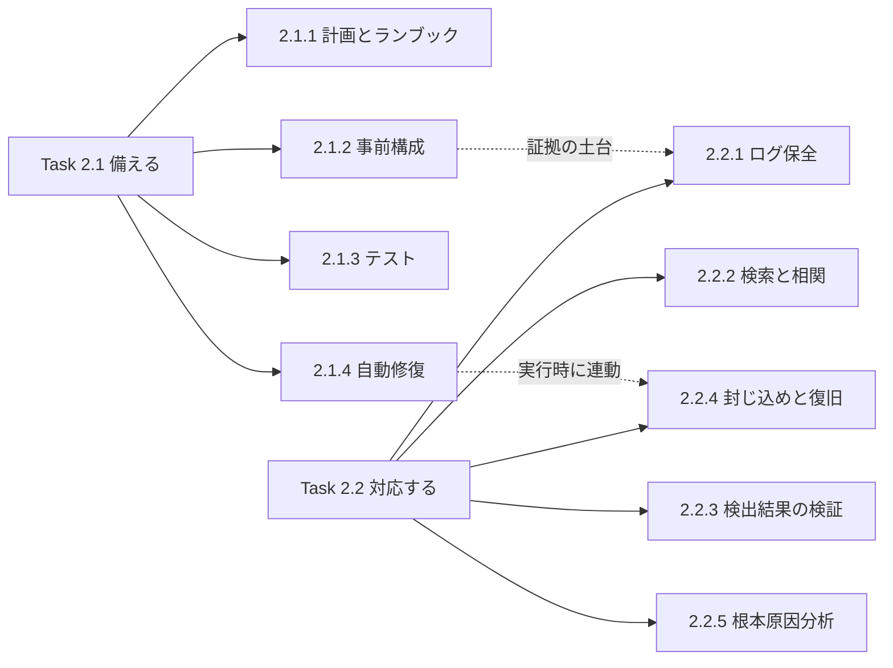

### 1.4 主なサービスと Skill の対応表

| サービス・機能 | 主に関係する Skill | ひとことで言うと |
|---|---|---|
| Systems Manager OpsCenter | 2.1.1 | 運用上の問題 (OpsItem) を一元管理し、Automation ランブックにつなぐ |
| Systems Manager Automation | 2.1.1, 2.1.4 | 手順をコード化して自動実行する (ランブック) |
| Amazon SageMaker AI notebooks | 2.1.1 | 調査手順をノートブック形式の「実行できる手順書」にする |
| AWS Security Incident Response | 2.1.1, 2.2.3 | トリアージ自動化と AWS 専門チームへのアクセスを提供する管理サービス |
| Amazon GuardDuty / Security Hub / Detective | 2.1.2, 2.2.3, 2.2.5 | 検出・集約・調査の中核 |
| AWS Shield Advanced | 2.1.2 | 高度な DDoS 保護と専門チーム (SRT) による対応 |
| AWS Fault Injection Service (FIS) | 2.1.3 | 意図的に障害を起こして対応力を試す |
| AWS Resilience Hub | 2.1.3 | 復旧目標 (RTO / RPO) に対する耐障害性を評価する |
| Amazon EventBridge / Lambda / Step Functions | 2.1.4 | 検出から修復までをつなぐ自動化の部品 |
| Automated Forensics Orchestrator for Amazon EC2 | 2.1.4, 2.2.1 | EC2 のフォレンジックを自動化する AWS ソリューション |
| Amazon Application Recovery Controller (ARC) | 2.1.4, 2.2.4 | AZ / リージョン障害からの切り替え・復旧を支援する |
| CloudTrail / VPC Flow Logs / CloudWatch Logs など | 2.2.1, 2.2.2 | 証拠となるログ |
| AWS Backup / EBS スナップショット | 2.2.1, 2.2.4 | 証拠保全と復元の材料 |

---

## 2. 初学者向け基礎知識

### 2.1 「セキュリティイベント」と「インシデント」の違い

| 用語 | 意味 | 例 |
|---|---|---|
| セキュリティイベント (Security Event) | セキュリティ上、気になる「出来事」。まだ被害が確定していない | GuardDuty が怪しい API 呼び出しを検出した |
| セキュリティインシデント (Security Incident) | イベントのうち、実際に機密性・完全性・可用性を損なう (または損なう恐れが高い) と判断されたもの | 漏えいしたアクセスキーで S3 データが持ち出された |

AWS のガイドも、検出 (Detection) で「潜在的なイベントを見つけ」、分析 (Analysis) で「それがインシデントか判断し範囲を評価する」と整理しています。

### 2.2 IR のライフサイクル (AWS ガイドの整理)

AWS Security Incident Response User Guide は、IR の基盤を「準備 (Preparation)」「運用 (Operations)」「インシデント後の活動 (Post-Incident Activity)」の 3 つで説明しています。運用はさらに 5 つのフェーズに分かれます。このガイドは NIST SP 800-61 Rev.3 に沿っています。

| フェーズ | 目的 (AWS ガイドの定義) |
|---|---|
| 検出 (Detection) | 潜在的なセキュリティイベントを特定する |
| 分析 (Analysis) | イベントがインシデントかを判断し、範囲を評価する |
| 封じ込め (Containment) | イベントの範囲を最小化・限定する |
| 根絶 (Eradication) | 不正なリソースや痕跡を取り除き、原因となった問題を緩和する |
| 復旧 (Recovery) | システムを既知の安全な状態に戻し、脅威が再発しないよう監視する |

重要なのは、これらのフェーズは**一直線ではない**ことです。封じ込めや根絶の後に、効果を確かめるため分析へ戻ることがあります。

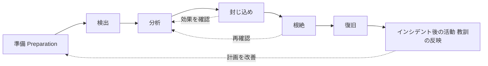

Domain 2 との対応は次のとおりです。

| ライフサイクル | 対応する Domain 2 の Skill |
|---|---|
| 準備 | 2.1.1, 2.1.2, 2.1.3, 2.1.4 |
| 検出 (Domain 1 の領域) | (Domain 1: Detection) |
| 分析 | 2.2.2, 2.2.3, 2.2.5 |
| 封じ込め・根絶・復旧 | 2.2.4 (と自動化の 2.1.4) |
| 証拠保全 | 2.2.1 |
| インシデント後の活動 | 2.2.5 (根本原因分析と教訓) |

出典:
- https://docs.aws.amazon.com/security-ir/latest/userguide/introduction.html
- https://docs.aws.amazon.com/security-ir/latest/userguide/operations.html

### 2.3 責任共有モデルと IR

- AWS は「クラウド自体のセキュリティ」(物理施設、ハイパーバイザなど) に責任を持ちます。
- お客様は「クラウド上のセキュリティ」(IAM 設定、OS、アプリケーション、データ、ログ設定) に責任を持ちます。
- したがって、お客様のアカウントの認証情報漏えいや EC2 内部の侵害は、**お客様が主体となって対応する**インシデントです。AWS のマネージドサービス (AWS Security Incident Response など) は支援であり、責任の移転ではありません。

### 2.4 IR に向いたマルチアカウント構成 (全体イメージ)

IR のベストプラクティスの多くは「アカウントを分ける」ことが前提です。理由は、侵害されたアカウントの管理者権限でログや調査ツールを消されないようにするためです。

| アカウントの役割 | 置くもの | なぜ分けるか |
|---|---|---|
| ワークロードアカウント | アプリケーション、EC2、データ | 侵害されうる場所。被害範囲をアカウント単位で限定できる |
| ログアーカイブアカウント | CloudTrail などの集約ログ (S3) | ワークロード側の権限では消せないようにする |
| セキュリティツールアカウント | GuardDuty / Security Hub / Detective の委任管理者 | 全アカウントを横断して検出・調査する |
| フォレンジックアカウント | 証拠 (スナップショット、メモリイメージ) と分析用インスタンス | 証拠を汚染せず、アクセスできる人を絞る |

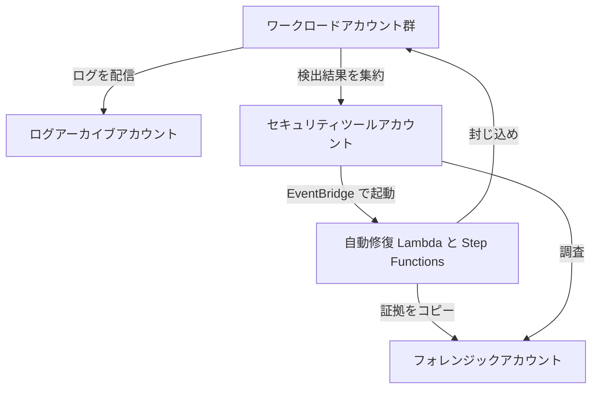

この構成は、Automated Forensics Orchestrator for Amazon EC2 の設計 (アプリケーションアカウント、セキュリティアカウント、フォレンジックアカウントの分離) とも一致します。

出典:
- https://docs.aws.amazon.com/solutions/latest/automated-forensics-orchestrator-for-amazon-ec2/architecture-overview.html
- https://aws.amazon.com/blogs/security/how-to-automate-forensic-disk-collection-in-aws

### 2.5 初学者がつまずきやすい用語

| 用語 | 簡単な説明 |
|---|---|
| ブラストラディウス (Blast radius) | 事故が起きたときに被害が及ぶ範囲。小さいほど良い |
| プレイブック (Playbook) | 「この種類のインシデントが起きたら、誰が何を判断し、どう動くか」を書いた手順書 |
| ランブック (Runbook) | プレイブック内の個々の作業手順。AWS では Systems Manager Automation で自動実行できる形にすることが多い |
| トリアージ (Triage) | 大量の検出結果から、優先度の高いものを選り分けること |
| フォレンジック (Forensics) | 証拠を壊さずに集め、何が起きたかを科学的に調べること |
| IoC (Indicator of Compromise) | 侵害の痕跡 (不審な IP、ファイルのハッシュなど) |
| RTO / RPO | 復旧目標時間 / 復旧目標時点。システムをいつまでに、どの時点のデータまで戻すか |
| チェーンオブカストディ (Chain of custody) | 証拠を「誰がいつ触ったか」を途切れなく記録すること |
| 封じ込め (Containment) | 被害の拡大を止めること。「消す」ことではない |
| 根絶 (Eradication) | 侵入者の足場や原因そのものを取り除くこと |

---
## 3. Task 2.1: インシデントレスポンス計画の設計とテスト

Task 2.1 のテーマは「事件が起きる前に、何をどこまで用意しておくか」です。AWS のガイドでも、準備では「検出コントロールを有効にし、必要なツールやクラウドサービスへ適切にアクセスできることを確認する」ことが基盤とされています。

---

### 3.1 Skill 2.1.1: 対応計画とランブックの設計・実装

#### 3.1.1 これは何?

インシデントが起きた瞬間に「誰が」「何を」「どの順で」やるかを悩んでいては遅れます。そこで、事前に次の 2 種類の文書 (または自動化) を用意します。

| 種類 | 役割 | 例 |
|---|---|---|
| 対応計画 / プレイブック | シナリオ別の判断と役割分担 | 「認証情報が漏えいした疑いがある場合の対応」 |
| ランブック | 具体的な実行手順。手動、自動、またはその組み合わせ | 「EC2 を隔離セキュリティグループに付け替える Automation」 |

AWS のガイドは、プレイブックとランブックを手動・自動・その併用で整備することで「迅速で一貫した対応」が可能になると説明しています。

#### 3.1.2 プレイブックに入れる項目 (テンプレート)

| 項目 | 書く内容 |
|---|---|
| 目的とスコープ | どのインシデント種別を扱うか (例: IAM アクセスキー漏えい) |
| 起動条件 | どの検出結果・アラートで開始するか (例: GuardDuty の特定の Finding Type) |
| 役割と連絡先 | インシデントコマンダー、調査担当、AWS 操作担当、法務、広報、経営層への連絡経路 |
| 初動判断 | 本物か誤検知かを見分ける質問リスト |
| 封じ込め手順 | リソース種別ごとの具体的操作 (第 4.4 節) |
| 証拠保全手順 | 何をどの順で取得するか (第 4.1 節) |
| 根絶・復旧手順 | 何を消し、どの時点のバックアップから戻すか |
| 事後レビュー | 教訓の記録とプレイブックの更新 |

AWS のガイドは、ランサムウェアと「公開された S3 バケット」では対応手順が異なると明記しています。つまり「万能の 1 本」ではなく、**シナリオ別に作る**のが基本です。サンプルは [aws-samples/aws-incident-response-playbooks](https://github.com/aws-samples/aws-incident-response-playbooks) に公開されていますが、これらは「テンプレートとして使うもの」であり、公式ドキュメントではない点に注意してください。また、リポジトリ自身が「配備前に Game Day などでテストすること」を強く推奨しています。

#### 3.1.3 AWS Systems Manager OpsCenter

OpsCenter は、運用上の問題を **OpsItem** という単位で集約・標準化し、関連リソースや過去の類似 OpsItem などの調査用コンテキストを一か所に表示する Systems Manager の機能です。Systems Manager **Automation** と連携し、ランブックで調査・解決まで進められます。

| 機能 | 内容 |
|---|---|
| OpsItem の集約 | CloudWatch アラームや EventBridge ルールから OpsItem を作成できる |
| 関連情報の表示 | 関連リソース、類似の過去 OpsItem、推奨ランブックなどを表示 |
| Automation 連携 | OpsItem から Automation ランブックを実行できる |
| クロスアカウント | 複数アカウントの OpsItem を一元管理できる |
| 料金 | OpsCenter の利用には料金が発生する (Systems Manager の料金ページ参照) |

##### 重要な最新情報: Incident Manager の提供状況

Systems Manager **Incident Manager は 2025 年 11 月 7 日以降、新規顧客の受け付けを終了**しています。AWS は既存顧客には引き続きサービスを提供しますが、運用上の問題の管理には **OpsCenter** を推奨し、移行ガイドも公開しています。SCS-C03 の公式試験ガイドが Skill 2.1.1 の例として挙げているのが OpsCenter であることは、この変更と整合します。古い教材では Incident Manager が前面に出ていることがあるため、注意してください。

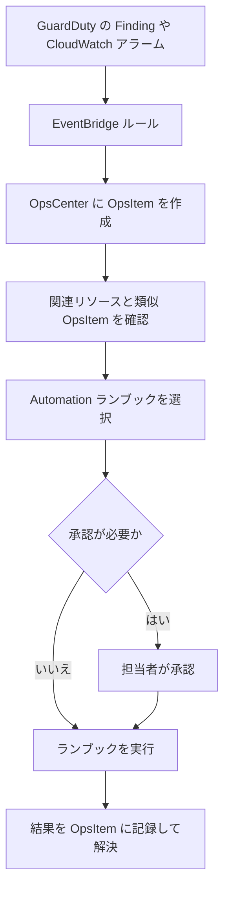

#### 3.1.4 Systems Manager Automation ランブック

AWS が用意した定義済みランブックを使うことも、独自に作ることもできます。次は「EC2 を隔離する」ごく単純な自作ランブックの例です (学習用。本番前に必ずテストしてください)。

```yaml
description: Isolate an EC2 instance by replacing its security groups
schemaVersion: '0.3'
assumeRole: '{{ AutomationAssumeRole }}'
parameters:
  InstanceId:
    type: String
    description: Target EC2 instance ID
  IsolationSecurityGroupId:
    type: String
    description: Security group with no inbound and no outbound rules
  AutomationAssumeRole:
    type: String
    description: Role used by Automation
mainSteps:
  - name: enableTerminationProtection
    action: aws:executeAwsApi
    inputs:
      Service: ec2
      Api: ModifyInstanceAttribute
      InstanceId: '{{ InstanceId }}'
      DisableApiTermination:
        Value: true
  - name: tagQuarantine
    action: aws:createTags
    inputs:
      ResourceType: EC2
      ResourceIds:
        - '{{ InstanceId }}'
      Tags:
        - Key: Status
          Value: Quarantine
  - name: swapSecurityGroup
    action: aws:executeAwsApi
    inputs:
      Service: ec2
      Api: ModifyInstanceAttribute
      InstanceId: '{{ InstanceId }}'
      Groups:
        - '{{ IsolationSecurityGroupId }}'
```

読み解きのポイントは次のとおりです。

- 最初に**終了保護**を有効にします。誤って (または攻撃者に) インスタンスを終了されると証拠が失われるためです。
- 次に `Status=Quarantine` というタグを付けます。AWS のガイドは、このようなタグを自動化のトリガーに使う例を示しています。
- 最後にセキュリティグループを隔離用へ付け替えます。
- 実運用では、**メモリ取得を先に行うべきか**を判断します (第 4.1 節)。メモリは隔離やシャットダウンで失われるためです。

#### 3.1.5 Amazon SageMaker AI notebooks を「実行できる手順書」として使う

公式試験ガイドは、Skill 2.1.1 の例として Amazon SageMaker AI notebooks を挙げています。AWS の公式ドキュメントでこの用途を詳しく説明したページは今回確認できなかったため (第 9 章参照)、ここでは**考え方**として整理します。

| 観点 | 内容 |
|---|---|
| なぜノートブックか | 説明文 (Markdown) とコード (Python / SQL) と実行結果を 1 つのファイルにまとめられる。調査の再現性と記録性が高い |
| 向いている用途 | CloudTrail ログの Athena クエリ、IoC の突き合わせ、タイムライン作成など、判断を伴う調査手順 |
| 向かない用途 | 数秒以内に実行すべき封じ込め。こちらは Automation や Lambda が向く |
| 注意点 | 実行ロールは最小権限にする。認証情報をノートブックに書かない。VPC 内で動かす。ノートブック自体をバージョン管理する |

考え方の使い分け: **「人が判断しながら進める調査」はノートブック、「決まりきった即時対応」は Automation**。

#### 3.1.6 AWS Security Incident Response (マネージドサービス)

2024 年 12 月に提供開始された、IR を支援するマネージドサービスです。公式ドキュメントでは、次のように説明されています。

| 項目 | 内容 |
|---|---|
| 役割 | 検出結果のトリアージ、重大なイベントのエスカレーション、ケース管理 |
| 専門家アクセス | AWS Customer Incident Response Team (CIRT) に 24 時間 365 日アクセスできる |
| 有効化 | AWS Organizations の管理アカウントまたは委任管理者で有効化できる |
| 前提となる連携 | GuardDuty と Security Hub を有効にすると、サービスを十分に活用できる (推奨) |
| 重要な性質 | このサービス自体は検出結果を生成しない。脅威検出の Finding をトリアージする |
| 注意 | 影響を受けたリソースが復旧できる保証はないため、バックアップを整備しておくこと |

プレイブックの「エスカレーション先」にこのサービスを組み込む、という設計がありえます。

#### 3.1.7 ベストプラクティス (Skill 2.1.1)

| # | ベストプラクティス | 理由 |
|---|---|---|
| 1 | シナリオ別にプレイブックを作る (認証情報漏えい、ランサムウェア、S3 公開、DDoS など) | 対応手順がシナリオで大きく異なるため |
| 2 | 手動・自動の両方を想定し、まず手動で確立してから自動化する | 理解していない手順を自動化すると、誤作動時に止められない |
| 3 | 役割と連絡先を明記し、定期的に更新する | 緊急時に連絡が取れないことが最大の遅延要因 |
| 4 | 判断ポイント (誤検知かどうか) を明文化する | 経験の浅い担当者でも同じ水準で対応できる |
| 5 | プレイブックを Game Day で検証し、結果を反映する | 計画は試して初めて有効になる (第 3.3 節) |
| 6 | 運用上の問題の集約は OpsCenter を使う (Incident Manager は新規受付終了) | 現在の推奨に沿うため |
| 7 | 破壊的な操作 (終了、削除) は承認ステップを挟む | 証拠喪失・誤検知による業務停止を防ぐ |
| 8 | 手順書そのものをアクセス制御し、バージョン管理する | 手順が改ざんされると IR が機能しない |

#### 3.1.8 試験で狙われるポイント

- 「運用上の問題を一元管理し、Automation ランブックにつなぐ」→ **Systems Manager OpsCenter**
- 「手順をコード化して自動実行する」→ **Systems Manager Automation (ランブック)**
- 「Incident Manager が新規で使えない場合の代替」→ **OpsCenter**
- 「AWS の専門家にトリアージや調査を依頼したい」→ **AWS Security Incident Response**
- 「調査手順を再現可能な形で記録・実行したい」→ ノートブック (SageMaker AI notebooks)

出典:
- https://docs.aws.amazon.com/security-ir/latest/userguide/sample-playbooks.html
- https://docs.aws.amazon.com/security-ir/latest/userguide/what-is.html
- https://docs.aws.amazon.com/incident-manager/latest/userguide/incident-manager-availability-change.html
- https://docs.aws.amazon.com/incident-manager/latest/userguide/migration-opscenter.html
- https://github.com/aws-samples/aws-incident-response-playbooks
- https://www.aws.amazon.com/security-incident-response/faqs/

---

### 3.2 Skill 2.1.2: インシデントに備えたサービス構成

#### 3.2.1 これは何?

公式の例は 4 つです。**(1) アクセスの事前付与、(2) セキュリティツールの展開、(3) 被害範囲の最小化、(4) AWS Shield Advanced の保護設定**。共通する考え方は「事件が起きてから設定しては間に合わない」です。

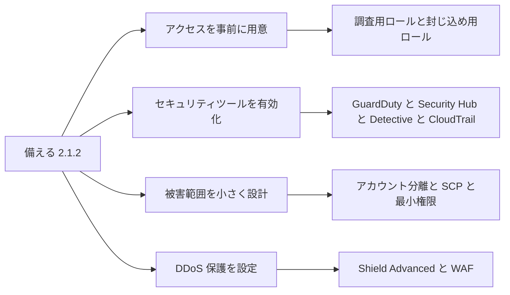

#### 3.2.2 アクセスの事前付与 (Provisioning access)

AWS のガイドは、準備の中で「必要なツールやサービスへ適切にアクセスできること」を検証するよう求めています。

| ロール / 仕組み | 役割 | 設計のコツ |
|---|---|---|
| 調査用ロール (読み取り中心) | ログや設定を読んで調べる | 全アカウントに事前に配置し、セキュリティツールアカウントから AssumeRole できるようにする |
| 封じ込め用ロール | SG 付け替え、キー無効化、スナップショット作成など限定された変更を行う | 許可するアクションを必要最小限に絞る。使用時にアラートを出す |
| 緊急用 (ブレークグラス) アクセス | 通常の SSO やフェデレーションが使えないときの最後の手段 | MFA を必須にし、普段は使わず、使われたら必ず通知する |
| フォレンジックアカウントのアクセス | 証拠を取得する担当 (Responder) と分析する担当 (Investigator) を分ける | 権限を分離すると証拠の改ざんリスクが下がる |

> 初学者向けの注意: **インシデント中に新しい IAM ユーザーやロールを作る運用は避けます。** 攻撃者が IAM を操作している可能性があるうえ、設定ミスや遅延が起きやすいためです。

#### 3.2.3 セキュリティツールの展開 (Deploying security tools)

事前に有効化しておくべき主なサービスです。

| サービス | 役割 | IR での使いどころ |
|---|---|---|
| AWS CloudTrail (組織の証跡) | API 呼び出しの記録 | 「誰が何をしたか」の根拠。全リージョン、全アカウントで有効にする |
| Amazon GuardDuty | 脅威検出 | 初動の検出。Organizations で全アカウントに展開し、委任管理者を設定する |
| AWS Security Hub | 検出結果の集約と自動化の起点 | EventBridge と組み合わせて自動対応する |
| Amazon Detective | 調査・根本原因分析 | 事件後に挙動を時系列で調べる |
| AWS Config | リソース設定の履歴 | 「いつ設定が変わったか」の確認 |
| VPC Flow Logs / Route 53 Resolver クエリログ | ネットワークと DNS の記録 | 通信先や C2 (指令サーバー) の特定 |
| Amazon Inspector / Macie | 脆弱性、機密データの検出 | 影響範囲 (どのデータが関係したか) の評価 |
| AWS Systems Manager (SSM Agent) | リモート実行、Automation | ログイン不要での調査・封じ込め。フォレンジックソリューションの前提でもある |
| AWS WAF / Shield | Web 攻撃・DDoS 対策 | 送信元 IP のブロックなど (source containment) |

ベストプラクティスは、これらを**ひとつずつ手作業で有効にしない**ことです。Organizations と委任管理者、または Infrastructure as Code (CloudFormation など) で、新しいアカウントにも自動適用します。

#### 3.2.4 被害範囲の最小化 (Minimizing the blast radius)

| 手段 | 効果 |
|---|---|
| アカウントの分離 (OU 単位、環境単位) | 1 つのアカウントが侵害されても他に広がりにくい |
| SCP (サービスコントロールポリシー) | CloudTrail や GuardDuty の無効化など、危険な操作を組織全体で禁止できる |
| 最小権限の IAM + 権限境界 | 認証情報が漏れても、できることが限られる |
| 短期認証情報 (IAM ロール) の利用 | 長期アクセスキーが漏えいするリスクを減らす |
| IMDSv2 の利用 | EC2 インスタンスの認証情報が SSRF などで盗まれにくくなる |
| ネットワーク分離 (VPC、サブネット、SG) | 横展開 (ラテラルムーブメント) を難しくする |
| リソースへのタグ付け | 自動化の対象選定、被害範囲の特定、隔離判断に使える |
| バックアップを別アカウントに保管 | ランサムウェアや破壊的な攻撃からの復旧を可能にする |

#### 3.2.5 AWS Shield Advanced の保護設定

AWS Shield は DDoS 対策サービスです。Standard は全顧客に無料で自動適用され、**Advanced** は有料でより強力な保護と専門的な支援を提供します。

| Shield Advanced の機能 | 内容 |
|---|---|
| 保護対象 | CloudFront ディストリビューション、Route 53 ホストゾーン、Global Accelerator、Elastic Load Balancing、EC2 の Elastic IP |
| AWS WAF との統合 | アプリケーション層の保護に WAF の Web ACL、ルール、ルールグループを使う。Shield Advanced の購読で、保護対象リソースに対する標準的な WAF 料金がカバーされる |
| アプリケーション層の自動緩和 | レイヤー 7 の攻撃時に WAF ルールを自動的に展開する (有効化は保護対象リソースごと) |
| ヘルスベース検出 | Route 53 ヘルスチェックと連携し、アプリケーションの健全性を検出に使う |
| Shield Response Team (SRT) | DDoS の緩和を支援する AWS の専門チーム。利用には Business または Enterprise サポートプランが必要 |
| プロアクティブエンゲージメント | 攻撃の兆候に応じて SRT が連絡する。連絡先 (メールアドレス、電話番号) の事前登録が必要 |
| SRT のアクセス許可 | SRT がアカウントにアクセスして支援できるよう、IAM ロールを事前に関連付ける |
| コスト保護 | DDoS によるスケーリング費用の急増に対し、Shield Advanced のサービスクレジットで一定の保護がある |
| 保護グループ | 複数リソースを束ねて検出の仕方を変える |
| Firewall Manager | 組織全体に Shield Advanced と WAF の保護を適用できる |

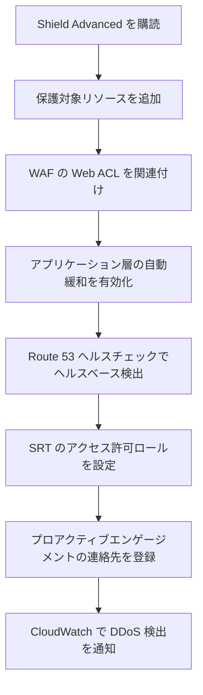

> 初学者向けの注意: SRT を使うには **Business / Enterprise サポートの加入が前提**です。試験では「Shield Advanced を購読しただけで SRT が使えるか」というひっかけが想定されます。サポートプランと SRT のアクセス許可 (ロール付与) の両方が必要、と覚えてください。

#### 3.2.6 ベストプラクティス (Skill 2.1.2)

| # | ベストプラクティス |
|---|---|
| 1 | GuardDuty、Security Hub、CloudTrail を**全アカウント・全リージョン**で有効化し、委任管理者で集中管理する |
| 2 | 調査用・封じ込め用ロールを**事前に**配置し、利用をログと通知で監視する |
| 3 | ブレークグラスアクセスは MFA 必須、利用時に即時通知 |
| 4 | SCP でセキュリティサービスの無効化・ログ削除を禁止する |
| 5 | ログとバックアップは、侵害されうるアカウントとは**別のアカウント**に置く |
| 6 | 長期アクセスキーを減らし、IAM ロール (短期認証情報) と IMDSv2 を使う |
| 7 | インターネット公開の重要リソースには Shield Advanced + WAF を組み合わせる |
| 8 | Shield Advanced の SRT ロール付与とプロアクティブエンゲージメントの連絡先を**事前に**設定する |
| 9 | 自動化対象を識別するためのタグ設計をあらかじめ決める (例: `Status=Quarantine`) |

#### 3.2.7 試験で狙われるポイント

- 「被害範囲を小さくしたい」→ アカウント分離、SCP、最小権限、ネットワーク分離
- 「DDoS 時に AWS の専門チームの支援を受けたい」→ Shield Advanced + SRT (サポートプラン要件に注意)
- 「DDoS による課金急増を軽減したい」→ Shield Advanced のコスト保護
- 「レイヤー 7 の DDoS を自動で緩和したい」→ Shield Advanced のアプリケーション層自動緩和 (WAF と連携)
- 「複数アカウントに一括で Shield Advanced / WAF を適用」→ AWS Firewall Manager

出典:
- https://docs.aws.amazon.com/security-ir/latest/userguide/introduction.html
- https://docs.aws.amazon.com/waf/latest/developerguide/ddos-advanced-summary-capabilities.html
- https://aws.amazon.com/documentation-overview/shield/
- https://docs.aws.amazon.com/solutions/latest/automated-forensics-orchestrator-for-amazon-ec2/architecture-overview.html

---

### 3.3 Skill 2.1.3: 対応計画の有効性テスト

#### 3.3.1 これは何?

「書いてあるだけの計画」は役に立ちません。**実際に動くか**を事前に確かめる手順を提案できることが、このスキルの中身です。公式の例は **AWS Fault Injection Service (FIS)** と **AWS Resilience Hub** です。

テストの手段は大きく 3 層に分けて考えると整理しやすくなります。

| 層 | 手段 | 何を確かめるか |
|---|---|---|
| 机上 | テーブルトップ演習 (シナリオを読み合わせる) | 役割分担、連絡経路、判断基準 |
| 擬似検出 | GuardDuty のサンプル検出結果の生成 | 検出から EventBridge、自動修復、通知までの配線 |
| 実環境での擬似障害 | AWS FIS、Game Day | 実際の障害・攻撃時に、復旧の仕組みが期待どおり動くか |

#### 3.3.2 AWS Fault Injection Service (FIS)

FIS は、AWS ワークロードに**意図的に障害を注入**する実験を、安全装置付きで実行するサービスです。実験テンプレートは次の要素で構成されます。

| 構成要素 | 内容 |
|---|---|
| アクション (Actions) | 実行する障害の種類。順番に、または同時に実行できる |
| ターゲット (Targets) | アクションを実行する対象 AWS リソース |
| 停止条件 (Stop conditions) | CloudWatch アラームで定義する安全装置。条件を満たすと FIS が実験を自動停止する。停止した実験は再開できない |
| 実験ロール (Experiment role) | FIS が実験を実行するために引き受ける IAM ロール |
| 実験レポート設定 | 実験レポートの出力設定 |
| 実験オプション | テンプレートごとのオプション |

停止条件を作る前に、まず**定常状態 (steady state)** を定義します。定常状態から外れたことを検知する CloudWatch アラームを停止条件にする、という順序です。

```json
{
  "description": "Stop one tagged instance to test the recovery runbook",
  "targets": {
    "TargetInstances": {
      "resourceType": "aws:ec2:instance",
      "resourceTags": { "Env": "ir-gameday" },
      "selectionMode": "COUNT(1)"
    }
  },
  "actions": {
    "StopInstances": {
      "actionId": "aws:ec2:stop-instances",
      "parameters": { "startInstancesAfterDuration": "PT10M" },
      "targets": { "Instances": "TargetInstances" }
    }
  },
  "stopConditions": [
    {
      "source": "aws:cloudwatch:alarm",
      "value": "arn:aws:cloudwatch:ap-northeast-1:111122223333:alarm:ir-gameday-stop"
    }
  ],
  "roleArn": "arn:aws:iam::111122223333:role/FisExperimentRole",
  "tags": { "Purpose": "ir-test" }
}
```

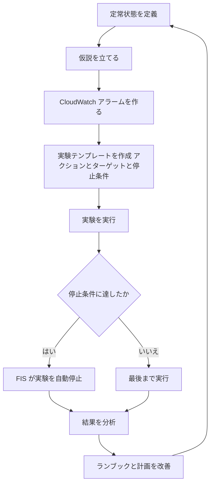

FIS の位置づけで大切なのは、FIS は主に**可用性・耐障害性**の検証に強いという点です。攻撃そのものの再現ではなく、「障害が起きたときに復旧手順、アラーム、自動化が動くか」を確かめる道具として理解してください。

#### 3.3.3 GuardDuty のサンプル検出結果で自動化の配線を試す

GuardDuty はサンプルの検出結果を生成できます。これで EventBridge ルール、Lambda、通知までの動作を、本物の攻撃なしに確認できます。

```bash
aws guardduty create-sample-findings \
  --detector-id 12abc34d567e8fa901bc2d34e56789f0 \
  --finding-types UnauthorizedAccess:EC2/SSHBruteForce
```

> サンプルの検出結果には実際のリソース ID が入らないため、自動修復 Lambda が「リソースが見つからない」と失敗することがあります。サンプル用の分岐処理を入れるか、テスト用の実リソースを用意してください。

#### 3.3.4 AWS Resilience Hub

Resilience Hub は、アプリケーションの**耐障害性を定義・検証・追跡**するサービスです。

| 概念 | 内容 |
|---|---|
| 耐障害性ポリシー (Resiliency policy) | RTO と RPO の目標を、「アプリケーション」「インフラストラクチャ」「AZ」「リージョン」の障害タイプごとに定義する |
| アプリケーション | CloudFormation スタックなどのリソースをまとめて記述したもの。評価の前に公開する |
| 評価 (Assessment) | AWS Well-Architected Framework のベストプラクティスに基づき構成を分析し、推定 RTO / RPO を算出する |
| コンプライアンスステータス | Assessed / Not assessed / Policy breached / Changes detected |
| ドリフト | 前回の評価からの推定 RTO / RPO の変化 |
| 推奨事項 | 目標未達の場合の改善案。目標を満たすまで改善と再評価を繰り返す |
| FIS との連携 | 障害を模擬するテストで耐障害性を測る |

「Policy breached」は、**設定したポリシーの RTO / RPO の目標を満たしていない**という意味です。見つけたらレポートの推奨事項を確認してから再評価します。

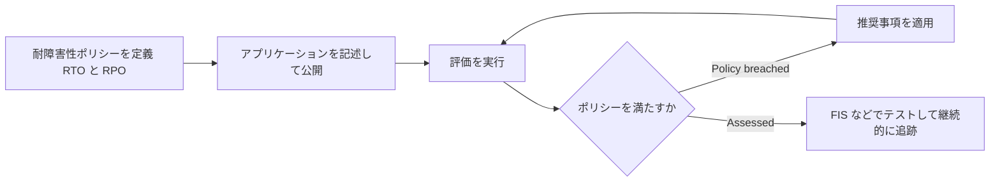

#### 3.3.5 ベストプラクティス (Skill 2.1.3)

| # | ベストプラクティス |
|---|---|
| 1 | テーブルトップ → 擬似検出 → 実環境テスト、と**段階的に**進める |
| 2 | FIS では**必ず停止条件 (CloudWatch アラーム)** を設定する |
| 3 | 最初は本番ではなく**非本番環境**で、影響範囲の小さいターゲットから始める |
| 4 | 実験ロールは最小権限にする |
| 5 | テストごとに「期待した動作」と「実際の動作」を記録し、プレイブックとランブックに反映する |
| 6 | Resilience Hub で RTO / RPO の目標と実力の差 (ドリフト) を継続的に見る |
| 7 | 定期的に (たとえば四半期ごと) 繰り返す。構成は変わり続けるため |
| 8 | 参加者全員が、自分の役割で一度は手を動かす |

#### 3.3.6 試験で狙われるポイント

- 「障害を意図的に起こして、復旧や対応の仕組みを試したい」→ **AWS FIS**
- 「FIS の実験を安全に止めたい」→ **停止条件 (CloudWatch アラーム)**
- 「RTO / RPO に対してアプリケーションが十分か評価したい」→ **Resilience Hub (耐障害性ポリシーと評価)**
- 「自動修復の配線だけを、攻撃なしに確認したい」→ **GuardDuty のサンプル検出結果**

出典:
- https://docs.aws.amazon.com/fis/latest/userguide/experiment-templates.html
- https://docs.aws.amazon.com/fis/latest/userguide/stop-conditions.html
- https://docs.aws.amazon.com/resilience-hub/latest/userguide/arh-mgmt.html
- https://docs.aws.amazon.com/resilience-hub/latest/userguide/resiliency-policies.html
- https://docs.aws.amazon.com/resilience-hub/latest/userguide/applications.html
- https://docs.aws.amazon.com/resilience-hub/latest/userguide/review-assessment.html
- https://github.com/aws-samples/aws-incident-response-playbooks

---

### 3.4 Skill 2.1.4: 自動修復

#### 3.4.1 これは何?

検出から封じ込めまでを、人手を待たずに実行する仕組みです。基本の型は次のとおりです。

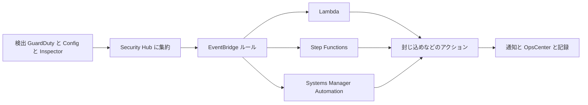

#### 3.4.2 Security Hub の自動化 (2 種類)

| 種類 | 内容 | 使いどころ |
|---|---|---|
| 自動化ルール (Automation rules) | 条件に合う検出結果を、ほぼリアルタイムで自動更新・抑制する (ASFF のフィールド更新など) | 重大度の引き上げ、既知の安全な検出結果の抑制 |
| 自動応答と修復 (EventBridge ルール) | 検出結果をイベントとして受け、Lambda 呼び出し、Step Functions 起動、SNS 通知などを行う | 実際の封じ込め・修復アクション |

自動化ルールが先に適用され、その更新後の検出結果に EventBridge ルールが適用されます。また、カスタムアクションを使うと、**人がコンソールのボタンで**対応を起動する半自動の運用もできます。

EventBridge ルールのイベントパターンの例 (高重大度の EC2 関連 GuardDuty 検出結果):

```json
{
  "source": ["aws.guardduty"],
  "detail-type": ["GuardDuty Finding"],
  "detail": {
    "severity": [{ "numeric": [">=", 7] }],
    "resource": { "resourceType": ["Instance"] }
  }
}
```

#### 3.4.3 Lambda による隔離 (簡単な例)

```python
import os
import boto3

ec2 = boto3.client("ec2")
ISOLATION_SG = os.environ["ISOLATION_SG_ID"]  # must be in the same VPC as the instance


def lambda_handler(event, context):
    detail = event["detail"]
    severity = detail.get("severity", 0)
    instance_id = detail["resource"]["instanceDetails"]["instanceId"]

    # Low severity: do not act automatically, leave it to a human
    if severity < 7:
        return {"action": "none", "instance": instance_id}

    # 1) Protect the instance from accidental termination
    ec2.modify_instance_attribute(
        InstanceId=instance_id,
        DisableApiTermination={"Value": True},
    )
    # 2) Tag it so other automation (forensics) can pick it up
    ec2.create_tags(
        Resources=[instance_id],
        Tags=[{"Key": "Status", "Value": "Quarantine"}],
    )
    # 3) Replace all security groups with the isolation group
    ec2.modify_instance_attribute(InstanceId=instance_id, Groups=[ISOLATION_SG])

    return {"action": "isolated", "instance": instance_id}
```

> このコードは**学習用の最小例**です。実運用では、冪等性 (何度実行しても同じ結果)、エラー処理、監査ログ、メモリ取得を先に行うかの判断、クロスアカウントのロール引き受けなどが必要です。

#### 3.4.4 AWS が提供する自動化ソリューション

| ソリューション | 内容 |
|---|---|
| Automated Security Response on AWS (ASR) | Security Hub の検出結果に対する定義済みの修復アクションを組織全体に展開する。EventBridge ルールが検出結果の作成・更新イベントとカスタムアクションを受け、Step Functions が管理アカウントで処理し、対象リソースのあるメンバーアカウントで修復を実行する。実施内容を検出結果のメモに監査証跡として残す |
| Automated Forensics Orchestrator for Amazon EC2 (EC2 と EKS に対応する Guidance に更新されている) | 脅威検出を起点に、影響を受けた EC2 を隔離し、メモリとディスクのイメージを安全な場所に保存し、調査・分析のアクションを起動する |

##### Automated Forensics Orchestrator の流れ

AWS のアーキテクチャ解説によると、流れは次のとおりです。

1. アプリケーションアカウントで、AWS Config のマネージドルール、GuardDuty、サードパーティツールが不審な挙動を検出する。
2. 検出結果は Security Hub に集約され、既定では EventBridge に送られて下流のワークフローを起動する。
3. トリアージ情報は DynamoDB に保存される。Security Hub のアクションに基づいて隔離の要否を、インスタンスのタグに基づいて取得 (acquisition) の要否を判断する。
4. **2 つの取得フローが並行して**起動する。メモリフォレンジックフロー (Step Functions) はメモリを取得して S3 に保存し、その後インスタンスをセキュリティグループで隔離する。ディスクフォレンジックフローは EBS ボリュームのスナップショットを取り、フォレンジックアカウントと共有する。
5. 調査フローで、フォレンジック用 AMI から分析用インスタンスを起動し、スナップショットから作ったボリュームをアタッチして、SSM ドキュメントでディスク・メモリを分析する。
6. 結果の概要は SNS で通知され、フォレンジックのタイムラインは AWS AppSync で照会できる。

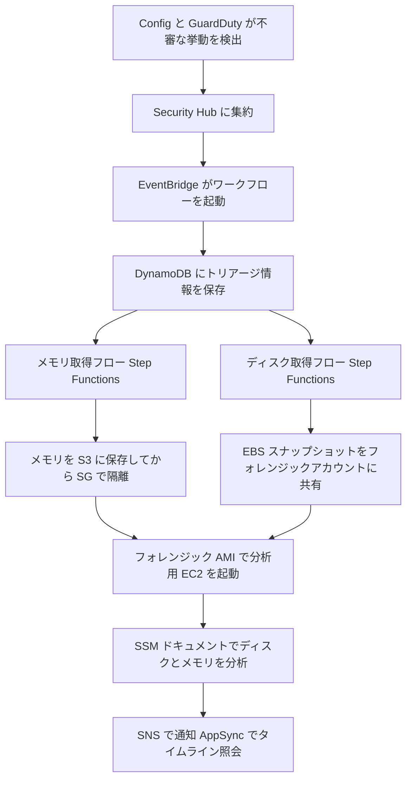

> 前提と注意: 対象 EC2 に **SSM Agent** が必要です。対応する OS が限られます。また AWS Solutions Library のコンテンツは AWS Content として提供されており、本番アカウントで使う前に自組織で十分に検証する必要があります。

#### 3.4.5 Amazon Application Recovery Controller (ARC)

ARC は、**AZ やリージョンの障害から、より速く復旧する**ためのサービスです。セキュリティの文脈では、DDoS や大規模障害、封じ込めのために特定の AZ やリージョンから切り離す場面で関わります。

| 機能 | 種類 | 内容 |
|---|---|---|
| ゾーンシフト (Zonal shift) | 複数 AZ の復旧 | 障害のある AZ から正常な AZ へ、一時的にトラフィックを移す。対応リソースごとに有効化 |
| ゾーンオートシフト (Zonal autoshift) | 複数 AZ の復旧 | AWS が、障害のある AZ から同一リージョン内の正常な AZ へ、お客様に代わってトラフィックを移すことを許可する |
| ルーティングコントロール (Routing control) | 複数リージョンの復旧 | 障害のあるリージョンから正常なリージョンへフェイルオーバーする (オン/オフのスイッチ) |
| リージョンスイッチ (Region switch) | 複数リージョンの復旧 | リージョン単位のアプリケーション復旧計画の実行 |
| 準備チェック (Readiness check) | 複数リージョンの復旧 | クォータ、キャパシティ、ネットワークルーティングポリシーを継続的に監視し、フェイルオーバー先の準備状況を通知する。**フェイルオーバー中の重要な経路で使うものではない** |

覚え方: **AZ の話はゾーンシフト、リージョンの話はルーティングコントロール**。

#### 3.4.6 自動修復のリスクと設計上の注意

| リスク | 対策 |
|---|---|
| 誤検知で業務を止める | 重大度の閾値、承認ステップ、対象リソースの絞り込み、まず通知のみで運用 |
| 証拠を壊す (終了、削除) | 破壊的操作は自動化しない。先に証拠を取得し、隔離を優先する |
| 自動化自身が悪用される | Lambda ロールを最小権限にし、変更を CloudTrail で監視する |
| 再実行で状態が壊れる | 冪等な設計にする |
| 何が行われたか不明になる | 検出結果のメモや OpsItem に実行内容を記録する |
| 複数アカウントで動かない | クロスアカウントロールと、組織全体への展開を事前に設計する |

#### 3.4.7 ベストプラクティス (Skill 2.1.4)

| # | ベストプラクティス |
|---|---|
| 1 | 自動化の第一歩は「検出 → 通知 → 人の判断」。信頼できる分から段階的に完全自動へ |
| 2 | 封じ込め (隔離、キーの無効化) は自動化しやすく、削除・終了は慎重にする |
| 3 | EventBridge ルールのパターンで、**重大度やリソース種別を絞る** |
| 4 | 複数ステップの処理 (取得 → 隔離 → 分析 → 通知) は Step Functions で管理する |
| 5 | 自動化の実行内容を、検出結果のメモ、OpsItem、ログに必ず記録する |
| 6 | Security Hub の自動化ルールでノイズを抑えてから、自動対応を接続する |
| 7 | AWS のソリューション (ASR、Forensics Orchestrator) を土台にして、自社の要件に合わせて調整する |
| 8 | 自動化もプレイブックと同じく Game Day でテストする |

#### 3.4.8 試験で狙われるポイント

- 「Security Hub の検出結果に対して自動で Lambda を実行」→ **EventBridge ルール**
- 「ほぼリアルタイムで検出結果のフィールドを更新・抑制」→ **Security Hub の自動化ルール**
- 「人が選んだ検出結果に手動で修復を起動」→ **Security Hub のカスタムアクション**
- 「EC2 のメモリとディスクを自動で取得・分析」→ **Automated Forensics Orchestrator for Amazon EC2**
- 「複数ステップのワークフローをオーケストレーション」→ **Step Functions**
- 「障害のある AZ からトラフィックを逃がす」→ **ARC のゾーンシフト / ゾーンオートシフト**
- 「リージョン間のフェイルオーバー」→ **ARC のルーティングコントロール (または Region switch)**

出典:
- https://docs.aws.amazon.com/securityhub/latest/userguide/securityhub-cloudwatch-events
- https://docs.aws.amazon.com/securityhub/latest/userguide/automations.html
- https://docs.aws.amazon.com/solutions/automated-security-response-on-aws/
- https://docs.aws.amazon.com/solutions/latest/automated-security-response-on-aws/architecture-overview.html
- https://aws.amazon.com/solutions/implementations/automated-forensics-orchestrator-for-amazon-ec2
- https://docs.aws.amazon.com/solutions/latest/automated-forensics-orchestrator-for-amazon-ec2/architecture-overview.html
- https://docs.aws.amazon.com/solutions/latest/automated-forensics-orchestrator-for-amazon-ec2/forensic-investigation-and-reporting-service.html
- https://docs.aws.amazon.com/r53recovery/latest/dg/what-is-route53-recovery.html

---
## 4. Task 2.2: セキュリティイベントへの対応

Task 2.2 は、実際にイベントが起きた後の「証拠を残す → 調べる → 見極める → 止めて直す → 原因を探る」の流れです。

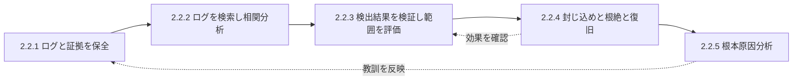

---

### 4.1 Skill 2.2.1: フォレンジック用ログの取得と保管

#### 4.1.1 これは何?

事件後に「何が起きたか」を証明できるかどうかは、**事件前から集めていたログ**と、**事件中に壊さずに取った証拠**で決まります。証拠として扱うには、次の条件が必要です。

| 条件 | 意味 |
|---|---|
| 完全性 | 改ざんされていないことを証明できる |
| 可用性 | 必要なときに取り出せる (保持期間が足りている) |
| 機密性 | 許可された人だけが見られる |
| 追跡可能性 | いつ、誰が、どのように取得・取り扱ったかの記録 (チェーンオブカストディ) |

#### 4.1.2 集めるべきログの一覧

| ログ | 何がわかるか | 補足 |
|---|---|---|
| AWS CloudTrail (管理イベント) | 誰が、いつ、どこから、どの API を呼んだか | 全リージョン・組織の証跡で有効化 |
| CloudTrail データイベント | S3 オブジェクト操作、Lambda 実行など | 量が多いので重要リソースに絞る |
| CloudTrail Lake | CloudTrail イベントを SQL で保存・照会 | 調査クエリを素早く実行 |
| VPC Flow Logs | ネットワークの通信記録 (送信元、宛先、ポート、許可/拒否) | 通信先や持ち出し量の確認 |
| Route 53 Resolver クエリログ | VPC 内からの DNS 問い合わせ | C2 ドメインやマイニングプールへの名前解決の特定 |
| ELB / CloudFront / AWS WAF ログ | Web アクセスと攻撃の痕跡 | 攻撃元 IP、攻撃パターン |
| S3 サーバーアクセスログ / データイベント | バケットへのアクセス | 情報の持ち出し調査 |
| AWS Config | リソース設定の履歴 | いつ誰が設定を変えたか |
| GuardDuty / Security Hub の検出結果 | 検出の根拠 | 長期保管したい場合は S3 へエクスポート |
| CloudWatch Logs (OS、アプリ、コンテナ) | アプリ・OS レベルの挙動 | CloudWatch エージェントで収集。インスタンスが消えても残る |
| SSM Session Manager のログ | セッションの記録 | 誰がどのインスタンスに入って何をしたか |
| EKS 監査ログ | Kubernetes API の操作 | コンテナ環境の調査 |
| Amazon Security Lake | OCSF 形式での集約 | 複数ソースを横断した分析 |

#### 4.1.3 ログの保管: 改ざん・消去から守る

| 対策 | 内容 |
|---|---|
| ログの集約先を別アカウントにする | ワークロード側の管理者権限でも消せない |
| S3 バージョニングと Object Lock | WORM (一度書いたら変更・削除不可) で保持。重要なログに使う |
| CloudTrail ログファイル整合性検証 | 配信された各ログファイルのハッシュと、署名付きのダイジェストファイルが同じ S3 バケットに保存される。ログの変更・削除、ダイジェストの変更・削除を検出できる |
| KMS による暗号化 | ログとスナップショットを暗号化。鍵のアクセス権を絞る |
| バケットポリシーとアクセス制御 | 削除権限を最小限にする (MFA Delete、拒否ポリシー) |
| 保持期間とライフサイクル | 規制や調査に必要な期間を決め、Glacier などへ移行する |
| ハッシュ値の記録 | 取得した証拠のハッシュを記録し、後で一致を確認する |

CloudTrail の整合性検証は、AWS CLI の `validate-logs` コマンドで実行できます。ただし、**検証できるのはダイジェストファイルが参照しているログファイルのみ**で、ダイジェストとログは配信元の S3 の場所から移動していない必要があります。

```bash
aws cloudtrail validate-logs \
  --trail-arn arn:aws:cloudtrail:ap-northeast-1:111122223333:trail/org-trail \
  --start-time 2026-10-01T00:00:00Z \
  --end-time 2026-10-17T00:00:00Z
```

> 整合性検証を**有効化する**ことと、**検証を実行する**ことは別です。有効化するとダイジェストファイルが配信されるだけで、検証は自分で行う必要があります。

#### 4.1.4 EC2 の証拠を取る順序

AWS Security Incident Response User Guide は、EC2 から**最大限のデータを取得・保全するための順序**を示しています。

| 順序 | 作業 | 理由 |
|---|---|---|
| 1 | インスタンス保護とタグの設定 | 終了保護を有効にし、シャットダウン動作を「停止」にし、EBS の「終了時に削除」を無効化、`Status=Quarantine` のようなタグを付ける。自動化の起点にもなる |
| 2 | ディスクの取得 (EBS スナップショット) | 各ボリュームのスナップショットを取得する。インスタンスストアボリュームの場合はライブレスポンスで収集する |
| 3 | メモリの取得 | EBS スナップショットは EBS に書き込まれたデータしか取れない。メモリ上のデータは別途ツールで取得する |
| 4 | 隔離環境で稼働を継続 (必要に応じて) | 監視を仕込んだ隔離環境で動かし続け、挙動を観察する |

AWS は、**ライブレスポンスやシステムの隔離・シャットダウンの前にメモリを取得すること**が、揮発性の高い貴重なデータを残すために不可欠だとしています。

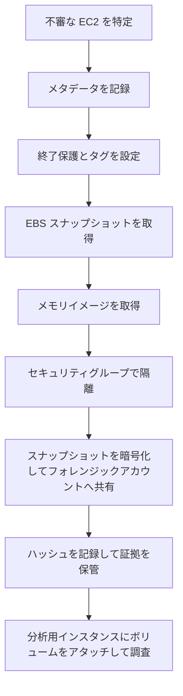

#### 4.1.5 スナップショットをフォレンジックアカウントへ安全に渡す

AWS Security Blog のディスク収集ソリューションは、次の流れを採用しています。

| ステップ | 内容 |
|---|---|
| 1 | 監視対象アカウントでインスタンスのボリュームのスナップショットを、インシデントにできるだけ近い時点で取得する |
| 2 | フォレンジック専用の KMS キーでスナップショットをコピーする |
| 3 | コピーしたスナップショットをセキュリティアカウントに共有する |
| 4 | セキュリティアカウントへ最終コピーする (共有されたスナップショットの所有者は元のアカウントのままのため) |
| 5 | 1 ボリュームごとに EC2 を起動し、スナップショットのビット単位のコピー (raw イメージ .dd) を S3 の証拠バケットへ保存する。メタデータとハッシュ値も併せて保存する |

> 暗号化されたスナップショットを別アカウントと共有するには、**カスタマーマネージドキー**で暗号化し、そのキーの使用を相手アカウントに許可する必要があります。AWS マネージドキーで暗号化されたスナップショットは共有できません。

#### 4.1.6 ベストプラクティス (Skill 2.2.1)

| # | ベストプラクティス |
|---|---|
| 1 | CloudTrail、VPC Flow Logs、DNS ログなどを**事件前に**有効化する。後から遡れない |
| 2 | ログは別アカウントの S3 に集約し、Object Lock、バージョニング、KMS で保護する |
| 3 | CloudTrail のログファイル整合性検証を有効にし、定期的または調査時に検証する |
| 4 | EC2 は「保護とタグ → ディスク → メモリ → 隔離」の順で証拠を取る。**メモリは隔離やシャットダウンの前** |
| 5 | 終了や再作成を急がない。証拠を取る前に壊さない |
| 6 | 証拠のコピーはフォレンジックアカウントに置き、取得担当と分析担当の権限を分ける |
| 7 | 取得日時、取得者、ハッシュ値を記録して、チェーンオブカストディを残す |
| 8 | OS・アプリのログは CloudWatch Logs などに常時転送し、インスタンスが消えても残るようにする |
| 9 | 保持期間を、規制と調査に必要な期間から逆算して決める |

#### 4.1.7 試験で狙われるポイント

- 「ログが改ざん・削除されていないことを証明」→ **CloudTrail ログファイル整合性検証** (ダイジェストファイル)
- 「ログを削除・上書きできないよう保護」→ **S3 Object Lock** + 別アカウント
- 「EC2 のメモリの内容を保全したい」→ **EBS スナップショットでは取れない。メモリ取得ツールを使い、隔離・停止の前に実行**
- 「暗号化スナップショットを調査用アカウントと共有」→ **カスタマーマネージドキー (CMK) の使用を許可**
- 「証拠を汚染せず調査」→ **専用のフォレンジックアカウント**

出典:
- https://docs.aws.amazon.com/security-ir/latest/userguide/collect-relevant-artifacts.html
- https://aws.amazon.com/blogs/security/how-to-automate-forensic-disk-collection-in-aws
- https://docs.aws.amazon.com/awscloudtrail/latest/userguide/cloudtrail-log-file-validation-cli.html
- https://docs.aws.amazon.com/awscloudtrail/latest/userguide/cloudtrail-log-file-validation-intro.html
- https://docs.aws.amazon.com/AmazonS3/latest/userguide/object-lock.html
- https://docs.aws.amazon.com/vpc/latest/userguide/flow-logs.html
- https://docs.aws.amazon.com/Route53/latest/DeveloperGuide/resolver-query-logs.html

---

### 4.2 Skill 2.2.2: ログの検索と相関分析

#### 4.2.1 これは何?

1 つのログだけでは全体像は見えません。複数のログを**共通のキー**でつなぎ、**時系列**に並べて、「何が、いつ、どこから、どう広がったか」を再構成します。

| 共通キー | 結びつけられる情報 |
|---|---|
| アクセスキー ID / IAM プリンシパルの ARN / セッション名 | CloudTrail の操作 ↔ GuardDuty の検出 ↔ Detective のプロファイル |
| 送信元 IP アドレス | CloudTrail ↔ VPC Flow Logs ↔ WAF / ELB ログ ↔ 脅威インテリジェンス |
| インスタンス ID / ENI ID | VPC Flow Logs ↔ OS ログ ↔ SSM ログ ↔ GuardDuty |
| リソース ARN | Config 履歴 ↔ CloudTrail ↔ 検出結果 |
| 時刻 | すべて。**タイムゾーン (UTC) を揃える** |

#### 4.2.2 検索・分析ツールの使い分け

| ツール | 向いているケース | 特徴 |
|---|---|---|
| CloudWatch Logs Insights | CloudWatch Logs に入っているログを素早く検索 | 専用のクエリ言語。小〜中規模の素早い調査 |
| Amazon Athena (S3 上のログ) | S3 に溜めた CloudTrail、VPC Flow Logs、ALB ログなどを SQL で分析 | 大量ログ、長期間の調査。サーバーレス |
| CloudTrail Lake | CloudTrail イベントを専用のイベントデータストアに保存して SQL で照会 | CloudTrail 中心の調査を簡単にする |
| Amazon Security Lake | 複数のソース (AWS、サードパーティ) を OCSF で一元化 | 組織全体の横断分析 |
| Amazon Detective | GuardDuty の検出結果などを起点に、挙動を可視化・相関 | 「関連する検出結果と主体」をグラフで探索 (第 4.5 節) |
| Amazon OpenSearch Service | ログの全文検索・ダッシュボード | SIEM 的な運用 |

#### 4.2.3 クエリの例

##### CloudWatch Logs Insights: 特定のアクセスキーの操作を新しい順に確認

```text
fields @timestamp, eventName, eventSource, userIdentity.arn, sourceIPAddress, awsRegion
| filter userIdentity.accessKeyId = "AKIAEXAMPLEEXAMPLE"
| sort @timestamp desc
| limit 100
```

##### Athena: 不審な IAM ユーザーの操作を時系列に確認 (CloudTrail テーブル)

```sql
SELECT eventtime,
       eventname,
       eventsource,
       useridentity.arn AS principal,
       sourceipaddress,
       errorcode
FROM cloudtrail_logs
WHERE useridentity.accesskeyid = 'AKIAEXAMPLEEXAMPLE'
  AND eventtime BETWEEN '2026-10-10T00:00:00Z' AND '2026-10-17T00:00:00Z'
ORDER BY eventtime;
```

##### Athena: 特定の ENI からの外向き通信量を宛先別に集計 (VPC Flow Logs テーブル)

```sql
SELECT dstaddr,
       dstport,
       SUM(bytes) AS total_bytes
FROM vpc_flow_logs
WHERE interface_id = 'eni-0123456789abcdef0'
  AND action = 'ACCEPT'
GROUP BY dstaddr, dstport
ORDER BY total_bytes DESC
LIMIT 20;
```

> テーブル名と列名は、ログの形式や作成したテーブル定義に依存します。上記は考え方を示す例です。

#### 4.2.4 相関分析の進め方

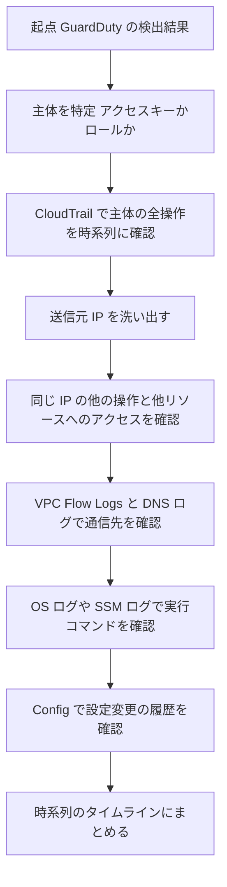

#### 4.2.5 ベストプラクティス (Skill 2.2.2)

| # | ベストプラクティス |
|---|---|
| 1 | 調査の起点 (主体、IP、リソース) を決めて、そこから外へ広げる |
| 2 | すべてのログの時刻を UTC に統一する |
| 3 | よく使うクエリをあらかじめ保存し、プレイブックに載せる |
| 4 | Athena のテーブルは、パーティション (日付など) で絞って検索コストと時間を減らす |
| 5 | 認証失敗 (errorcode) も重要。攻撃者の試行錯誤の痕跡になる |
| 6 | 自分の調査行為も CloudTrail に残る。調査用ロールの利用を区別できるようにしておく |
| 7 | 複数リージョンを調べる。攻撃者は普段使わないリージョンにリソースを作ることがある |

#### 4.2.6 試験で狙われるポイント

- 「S3 に保存された大量の CloudTrail ログを SQL で調査」→ **Athena**
- 「CloudWatch Logs のログを対話的に検索」→ **CloudWatch Logs Insights**
- 「CloudTrail イベントを SQL で照会する専用ストア」→ **CloudTrail Lake**
- 「複数ソースのセキュリティデータを OCSF で一元化」→ **Amazon Security Lake**
- 「検出結果を起点に、関連する主体・リソースの挙動をグラフで確認」→ **Amazon Detective**

出典:
- https://docs.aws.amazon.com/AmazonCloudWatch/latest/logs/AnalyzingLogData.html
- https://docs.aws.amazon.com/security-lake/latest/userguide/what-is-security-lake.html
- https://aws.amazon.com/detective/faqs
- https://docs.aws.amazon.com/security-ir/latest/userguide/operations.html

---

### 4.3 Skill 2.2.3: 検出結果の検証と影響範囲の評価

#### 4.3.1 これは何?

検出結果 (Finding) は「疑わしい」という**仮説**です。そのまま全部を封じ込めると業務が止まり、無視すれば被害が広がります。そこで、**本当に問題か (真陽性か誤検知か)** と、**どこまで及んでいるか (範囲と影響)** を確かめます。

#### 4.3.2 検出結果の読み方 (GuardDuty の例)

| 見る場所 | 意味 |
|---|---|
| Finding type | 脅威の種類。`脅威の目的:リソース種別/脅威名` の形式 |
| Severity | 重大度。高いほど緊急 |
| Resource | 影響を受けるリソースの種類と ID (Instance、AccessKey、S3Bucket など) |
| Actor / Action | 誰が (どの IP が) 何をしたか |
| 時間 | 初回検出日時、最終検出日時、発生回数 |

Finding type の例です (イメージをつかむ用)。

| Finding type の例 | 意味 |
|---|---|
| `UnauthorizedAccess:IAMUser/InstanceCredentialExfiltration.OutsideAWS` | EC2 上で発行された一時認証情報が、AWS の外部のホストから使われた |
| `UnauthorizedAccess:EC2/SSHBruteForce` | SSH へのブルートフォース攻撃 |
| `CryptoCurrency:EC2/BitcoinTool.B!DNS` | 暗号資産マイニング関連のドメインへの DNS 問い合わせ |
| `Stealth:IAMUser/CloudTrailLoggingDisabled` | CloudTrail のログ記録が無効化された (証跡隠し) |
| `Policy:S3/BucketPublicAccessGranted` | S3 バケットが公開された |

#### 4.3.3 検証の手順

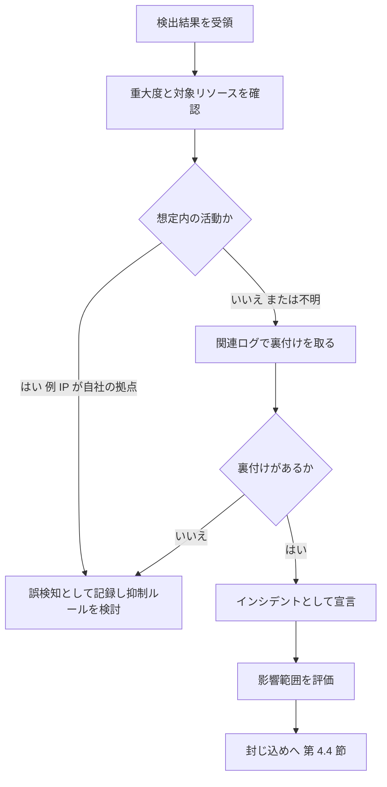

#### 4.3.4 影響範囲 (スコープ) と影響 (インパクト) を評価する質問

| 評価の軸 | 確認すること | 使うサービス・ログ |
|---|---|---|
| 主体 | どの IAM ユーザー / ロール / アクセスキーが関与したか。権限は何か | CloudTrail, IAM, IAM Access Analyzer |
| 期間 | いつから、いつまで (まだ続いているか) | CloudTrail, Detective |
| リソース | どのリソースに触れたか。新しいリソースを作られていないか | CloudTrail, Config |
| データ | 機密データにアクセスされたか。持ち出されたか | S3 データイベント, Macie, VPC Flow Logs |
| 横展開 | 他のアカウント・リージョン・インスタンスへ広がったか | Detective, Security Hub, CloudTrail |
| 永続化 | 攻撃者が足場を残していないか (新しい IAM ユーザー、ロール、アクセスキー、Lambda、EC2) | CloudTrail, Config |
| 脆弱性 | 侵入経路になった脆弱性や設定ミスは何か | Inspector, Security Hub |

#### 4.3.5 AWS セキュリティサービスの連携

| サービス | 役割 |
|---|---|
| GuardDuty | 脅威検出。ログ (CloudTrail、VPC Flow Logs、DNS ログなど) を分析 |
| Security Hub | 複数サービスの検出結果を集約し、横断的に見る |
| Detective | 検出結果の相関と、関連する主体・リソースの挙動の可視化 |
| Inspector | 脆弱性の検出。侵入経路の特定に役立つ |
| Macie | S3 内の機密データの検出。「何が漏えいしうるか」の評価に役立つ |
| IAM Access Analyzer | 意図しない外部アクセスの検出 |
| AWS Security Incident Response | GuardDuty と Security Hub の検出結果を自動でトリアージし、必要時にケースを作成して通知する。顧客固有の情報 (既知の IP や IAM エンティティなど) でフィルタリングする |

> 初学者向けの注意: 複数の検出結果が**同じ主体やリソース**を共有しているなら、同じインシデントの一部である可能性が高いと考えます。Detective の「検出結果グループ」がまさにその発想です (第 4.5 節)。

#### 4.3.6 ベストプラクティス (Skill 2.2.3)

| # | ベストプラクティス |
|---|---|
| 1 | 検出結果を単体で判断せず、関連ログと突き合わせて裏付けを取る |
| 2 | 「想定内」を判断するために、自社の既知の IP、ロール、定期ジョブの一覧を整備しておく |
| 3 | 誤検知は**抑制ルール**で管理し、変更を通知・記録する (AWS Security Incident Response も抑制よりトリアージを優先する設計) |
| 4 | 影響評価は、主体・期間・リソース・データ・横展開・永続化の 6 軸で行う |
| 5 | 攻撃者が作った**永続化の痕跡**を必ず探す |
| 6 | 範囲が確定するまで、「封じ込めの範囲」を保守的に広めに取る判断も検討する |
| 7 | 判断の根拠をケースやチケットに記録する |

#### 4.3.7 試験で狙われるポイント

- 「複数の検出結果を、同じインシデントとしてまとめて調べたい」→ **Detective の検出結果グループ**
- 「検出結果の集約と自動化の起点」→ **Security Hub (+ EventBridge)**
- 「大量の検出結果を自動でトリアージし、AWS の専門家にエスカレーション」→ **AWS Security Incident Response**
- 「S3 のどのデータが機密か」→ **Macie**
- 「侵入経路になった脆弱性の確認」→ **Inspector**

出典:
- https://docs.aws.amazon.com/guardduty/latest/ug/guardduty_finding-types-iam.html
- https://docs.aws.amazon.com/security-ir/latest/userguide/what-is.html
- https://www.aws.amazon.com/security-incident-response/faqs/
- https://docs.aws.amazon.com/detective/latest/userguide/groups-about.html

---

### 4.4 Skill 2.2.4: 封じ込め・根絶・復旧

#### 4.4.1 3 つのフェーズの違い

| フェーズ | 目的 | 初学者向けのたとえ |
|---|---|---|
| 封じ込め | 被害の拡大を止める | 火事で、延焼しないよう燃えている部屋の扉を閉める |
| 根絶 | 原因と侵入者の足場を取り除く | 火元を消火し、くすぶっている場所をすべて確認する |
| 復旧 | 安全な状態に戻して通常運用へ | 安全が確認できたら、建物を使える状態に戻す |

#### 4.4.2 封じ込め戦略の決め方 (NIST の判断基準)

AWS のガイドは、NIST SP 800-61 が示す封じ込め戦略の判断基準を紹介しています。

| 判断基準 | 考えること |
|---|---|
| リソースの損害・窃取の可能性 | 放置するとどこまで悪化するか |
| 証拠保全の必要性 | 証拠を残すために何を先にするか |
| サービスの可用性 | 隔離で業務をどこまで止めてよいか |
| 実装に必要な時間とリソース | すぐにできるか |
| 戦略の有効性 | 部分的な封じ込めか、完全か |
| 解決策の期間 | 緊急の暫定措置か、一時的な回避策か、恒久策か |

#### 4.4.3 AWS における封じ込めの 3 分類

AWS のガイドは、AWS サービスにおける基本的な封じ込めを 3 つに整理しています。

| 分類 | 内容 | 具体例 |
|---|---|---|
| ソース封じ込め (Source containment) | フィルタリングやルーティングで、**特定の送信元**からのアクセスを防ぐ | AWS WAF の IP セットでブロック、S3 バケットポリシーで IP / VPC エンドポイントを拒否、SG のルール削除 |
| 手法・アクセス封じ込め (Technique and access containment) | リソースへのアクセス権や**攻撃手法**を取り除く | IAM アクセスキーの無効化・削除、IAM ポリシーの削除・デタッチ、一時認証情報の失効 |
| 宛先封じ込め (Destination containment) | フィルタリングやルーティングで、**対象リソース**へのアクセスを防ぐ | 隔離用セキュリティグループの付与、NACL、ルートの変更 |

##### ソース封じ込めの注意点

- **セキュリティグループを変更しても、すでに追跡されている既存の接続は切断されません。** 将来のトラフィックだけが新しい SG でブロックされます。
- セキュリティグループとネットワーク ACL は、**Amazon Route 53 (DNS) へのトラフィックをフィルタリングしません。** EC2 を封じ込める場合、外部ホストとの通信を防ぐには DNS 通信も明示的にブロックします (たとえば Route 53 Resolver DNS Firewall)。

> 既存接続を切りたい場合は、ステートレスな**ネットワーク ACL** で拒否する、またはインスタンスの停止などを検討します (ただし停止は揮発データを失う点に注意)。

##### 手法・アクセス封じ込めの要点 (IAM)

| 状況 | 対応 |
|---|---|
| IAM アクセスキーが漏えいした | アクセスキーを**無効化 (Inactive)** または削除する。IAM プリンシパルは同時に最大 2 つのアクセスキーを持てる |
| 攻撃者が一時認証情報 (STS) を発行した (IAM ユーザーの場合) | IAM ユーザーの一時認証情報はコンソールから直接失効できない。次のいずれかを行う: (1) セキュリティトークンの**発行時刻**に基づいてアクセスを拒否するインラインポリシーを IAM ユーザーに付与する、(2) 漏えいしたキーを持つ IAM ユーザーを削除する |
| 侵害された IAM ロール | コンソールの「Revoke active sessions」で、発行時刻より前のセッションを拒否するポリシーが付与される |
| 権限が過大 | 封じ込め対象のプリンシパルから許可を削除し、リソースへのアクセスを制限する |

アクセスキーを無効化するコマンドと、トークン発行時刻で拒否するポリシーの例です。

```bash
aws iam update-access-key \
  --user-name compromised-user \
  --access-key-id AKIAEXAMPLEEXAMPLE \
  --status Inactive
```

```json
{
  "Version": "2012-10-17",
  "Statement": [
    {
      "Effect": "Deny",
      "Action": "*",
      "Resource": "*",
      "Condition": {
        "DateLessThan": { "aws:TokenIssueTime": "2026-10-17T00:00:00Z" }
      }
    }
  ]
}
```

> ポリシーの日時は「失効させたい時点」(通常は現在時刻) を指定します。これより前に発行された一時認証情報はすべて拒否されます。その後、正当な利用者は新しいセッションを取得すれば再び使えます。

#### 4.4.4 リソース別 封じ込めの早見表

| 対象 | 封じ込めの手段 | 補足 |
|---|---|---|
| EC2 インスタンス | 隔離用セキュリティグループへ付け替え (他の SG の関連付けはすべて外す) | GuardDuty の推奨手順。必要なら悪意のある活動を止められない場合は終了・再作成を検討 |
| EC2 の IAM ロール (インスタンスプロファイル) | ロールのセッション失効、拒否ポリシーの付与 | インスタンス認証情報の窃取 (Exfiltration) への対応 |
| IAM ユーザー / アクセスキー | キー無効化、ポリシー削除、(必要なら) ユーザー削除 | 一時認証情報はトークン発行時刻で拒否 |
| S3 バケット | パブリックアクセスのブロック、バケットポリシーで拒否、IAM の制限 | 公開設定の戻しとアクセスの調査を併行 |
| Web アプリ (ALB、CloudFront) | AWS WAF の IP セットやレートベースルールで悪意ある送信元をブロック | ソース封じ込め |
| DDoS | Shield Advanced、WAF、SRT の支援 | 第 3.2.5 節 |
| AMI / EBS スナップショット / バックアップ復旧ポイント | 共有 (起動許可) の削除、バックアップボールトのアクセスポリシー制限、自動リストアのジョブ停止 | 感染したバックアップから復元しない |
| コンテナ / EKS | Pod の隔離 (拒否ネットワークポリシーなど)、ノードの隔離 | 監査ログを先に確認 |

GuardDuty の「侵害された可能性のある EC2 インスタンス」への対応手順では、**まずマルウェアの有無を調べ (GuardDuty のオンデマンドマルウェアスキャンを利用可能)、隔離用セキュリティグループを付与し、他の SG の関連付けをすべて外し**、それでも不正な活動を止められないなら、インスタンスを終了して新しいインスタンスに置き換えることを推奨しています。

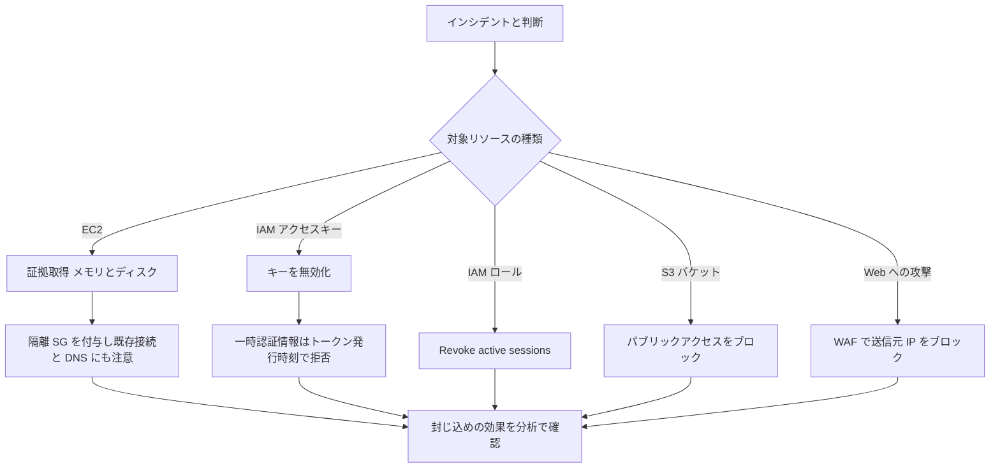

#### 4.4.5 隔離用セキュリティグループの作り方 (CLI の例)

```bash
# 1) Create an isolation security group in the same VPC as the instance
aws ec2 create-security-group \
  --group-name ir-isolation \
  --description "IR isolation - no traffic" \
  --vpc-id vpc-0123456789abcdef0

# 2) New security groups allow all outbound by default, so remove it
aws ec2 revoke-security-group-egress \
  --group-id sg-0123456789abcdef0 \
  --ip-permissions '[{"IpProtocol":"-1","IpRanges":[{"CidrIp":"0.0.0.0/0"}]}]'

# 3) Protect the instance from termination
aws ec2 modify-instance-attribute \
  --instance-id i-0123456789abcdef0 \
  --disable-api-termination

# 4) Replace the instance's security groups with the isolation group
aws ec2 modify-instance-attribute \
  --instance-id i-0123456789abcdef0 \
  --groups sg-0123456789abcdef0

# 5) Take EBS snapshots of attached volumes for investigation
aws ec2 create-snapshot \
  --volume-id vol-0123456789abcdef0 \
  --description "IR evidence i-0123456789abcdef0" \
  --tag-specifications 'ResourceType=snapshot,Tags=[{Key=Purpose,Value=ir-evidence}]'
```

> 注意: 新しく作成したセキュリティグループは、既定で**すべてのアウトバウンドを許可**しています。そのまま付与しても外部へ通信できてしまうため、アウトバウンドルールを削除します。順序は「メモリ取得が必要なら、手順 4 (隔離) より前に行う」点に注意してください。

#### 4.4.6 根絶 (Eradication)

| やること | 具体例 |
|---|---|
| 攻撃者の足場を探して削除 | 不正な IAM ユーザー、ロール、アクセスキー、信頼ポリシーの変更、Lambda、EC2、EventBridge ルール、セキュリティグループの変更 |
| マルウェアの駆除 | GuardDuty のマルウェアスキャン等で確認し、可能ならインスタンスを作り直す |
| 認証情報の更新 | 漏えいした可能性のあるキー、パスワード、シークレットをローテーション (Secrets Manager など) |
| 侵入経路の是正 | 公開設定の修正、脆弱性パッチ、過大な権限の見直し、IMDSv2 の強制 |
| 検出ルールの追加 | 同じ手口を検出できるよう GuardDuty や Config ルールを調整 |

> 初学者向けの重要な考え方: **「掃除して使い続ける」より「既知の安全な状態から作り直す」ほうが確実です。** 侵害されたインスタンスは、信頼できる AMI と Infrastructure as Code から再作成するのが原則です。

#### 4.4.7 復旧 (Recovery)

| ステップ | 内容 |
|---|---|
| 1 | 復旧の対象と優先順位を決める (ビジネス影響度、RTO / RPO) |
| 2 | **侵害前**の「きれいな」バックアップ (復旧ポイント) を選ぶ。感染した復旧ポイントから戻さない |
| 3 | 復元先は、隔離したネットワークで検証してから本番へ |
| 4 | IaC と信頼できる AMI でリソースを再作成する |
| 5 | 復旧後も強化した監視を続け、脅威が戻らないことを確認する |
| 6 | 必要に応じて AZ やリージョンの切り替えに ARC を使う (第 3.4.5 節) |

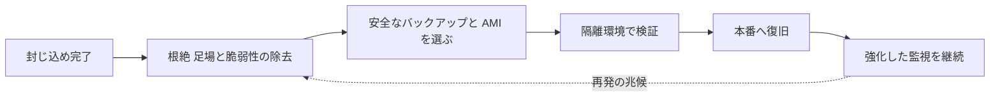

AWS Security Incident Response のドキュメントも、影響を受けたリソースの復旧は保証されないため、**バックアップの整備を推奨**しています。

#### 4.4.8 ベストプラクティス (Skill 2.2.4)

| # | ベストプラクティス |
|---|---|
| 1 | **証拠保全と封じ込めのバランス**を取る。メモリ取得は隔離前、ただし被害が急拡大するなら封じ込めを優先する判断もある |
| 2 | 封じ込めは「削除」ではなく「隔離・無効化」から始める (可逆な操作を優先) |
| 3 | SG だけに頼らず、既存接続と DNS の抜け道を考慮する |
| 4 | 一時認証情報の失効は、トークン発行時刻ベースの拒否ポリシー (またはロールのセッション失効) を使う |
| 5 | 封じ込めの効果を分析に戻って確認する (フェーズは直線ではない) |
| 6 | 根絶は「足場」まで。新しい IAM、Lambda、EC2、ルールなど、作られた痕跡を探す |
| 7 | 復旧は侵害前のバックアップから、検証してから戻す |
| 8 | 鍵やシークレットは、漏えいした可能性があればすべてローテーションする |
| 9 | 実施した操作と時刻を、すべて記録する |

#### 4.4.9 試験で狙われるポイント

- 「EC2 を隔離したが、既存の接続が切れない」→ SG は**追跡済みの既存接続を切らない**。NACL などで対処
- 「隔離したはずの EC2 が外部と DNS 通信できる」→ SG と NACL は **Route 53 へのトラフィックをフィルタしない**
- 「IAM ユーザーの一時認証情報を失効させたい」→ **トークン発行時刻に基づく拒否ポリシー**を付与 (またはユーザー削除)
- 「漏えいしたアクセスキーへの即時対応」→ **キーを無効化 / 削除**
- 「侵害された EC2 の対応順序」→ **保護・タグ → EBS スナップショット → メモリ → 隔離**
- 「Web 攻撃元の IP をブロック」→ **AWS WAF の IP セット (ソース封じ込め)**
- 「感染した復旧ポイント」→ **バックアップボールトのアクセス制限、自動リストアの停止、侵害前の復旧ポイントから復元**

出典:
- https://docs.aws.amazon.com/security-ir/latest/userguide/containment.html
- https://docs.aws.amazon.com/security-ir/latest/userguide/source-containment.html
- https://docs.aws.amazon.com/security-ir/latest/userguide/technique-access-containment.html
- https://docs.aws.amazon.com/security-ir/latest/userguide/collect-relevant-artifacts.html
- https://docs.aws.amazon.com/guardduty/latest/ug/compromised-ec2
- https://docs.aws.amazon.com/guardduty/latest/ug/compromised-ami.html
- https://docs.aws.amazon.com/security-ir/latest/userguide/what-is.html

---

### 4.5 Skill 2.2.5: 根本原因分析

#### 4.5.1 これは何?

封じ込めと復旧で「火は消えた」としても、**なぜ起きたか**が分からなければ、同じ手口で再び侵入されます。根本原因分析 (RCA: Root Cause Analysis) は、直接の原因だけでなく、その背後にある**設定ミス、権限の過大、プロセスの欠陥**まで掘り下げます。

#### 4.5.2 Amazon Detective

Detective は、セキュリティの検出結果や不審な活動の**根本原因を分析・調査**しやすくするサービスです。複数の AWS サービスからデータを取り込み、機械学習、統計分析、グラフ理論を使って、リソースの挙動とその相互作用を時系列で示す**ビヘイビアグラフ (Behavior graph)** を作ります。

| 用語 | 内容 |
|---|---|
| ビヘイビアグラフ | 1 つ以上のアカウントのソースデータから作られる、関連づけられたデータの集合 |
| 委任管理者 | 組織のビヘイビアグラフを管理するアカウント |
| メンバーアカウント | ビヘイビアグラフにデータを提供するアカウント |
| エンティティプロファイル | IAM ユーザー、ロール、IP、EC2 などの活動を要約した画面。調査や不審な活動の探索 (ハンティング) の裏付けになる |
| 検出結果グループ (Finding groups) | グラフ分析により、同じ潜在的インシデントに関連すると推定される複数の検出結果とエンティティをまとめたもの |

##### 検出結果グループの要点

- 検出結果を**個別に**調べると、重要性を見誤ったり、根本原因を見つけにくくなります。Detective は、グラフ分析で検出結果とエンティティの関係を推定し、まとめます。
- AWS は**検出結果グループを調査の出発点にすること**を推奨しています。
- 高重大度の GuardDuty の検出結果の根本原因分析に使えます。
- 関連する GuardDuty の検出結果が発生した後、すべての関連検出結果と関与エンティティを含むグループが **48 時間以内**に作られます。
- 集約データは最大で **1 年**分保持されて分析に使われます (Detective の FAQ より)。
- Detective は GuardDuty を土台にした調査に強く、**「検出」より「調査・相関」**の役割です。

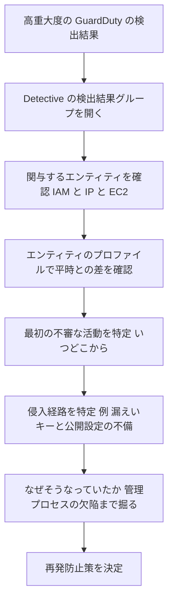

#### 4.5.3 RCA の進め方 (初学者向けステップ)

| ステップ | 質問 | 使う情報源 |
|---|---|---|
| 1. 事実の整理 | 何が起きた? (影響を受けたリソースとデータ) | 検出結果、CloudTrail |
| 2. タイムライン作成 | 最初の不審な活動はいつ? その前後に何があった? | CloudTrail、VPC Flow Logs、Config、Detective |
| 3. 侵入経路の特定 | どうやって入った? | Detective、CloudTrail、Inspector |
| 4. 直接原因 | その経路はなぜ使えた? (漏えいキー、脆弱性、公開設定) | Config、IAM、Inspector |
| 5. 根本原因 | なぜその状態が放置された? (レビュー不足、監視の穴、教育) | プロセスの振り返り |
| 6. 再発防止 | 何を変えれば防げる? | プレイブック、SCP、検出ルール |

「なぜ」を繰り返して掘り下げる手法 (いわゆる「なぜなぜ分析」) が有効です。次は例です。

| 「なぜ」 | 答えの例 |
|---|---|
| なぜ S3 のデータが持ち出された? | 漏えいしたアクセスキーが使われた |
| なぜキーが漏れた? | 開発者がキーをパブリックなリポジトリにコミットした |
| なぜコミットできた? | 長期アクセスキーを発行・利用していた。コミット時の秘密情報検出もなかった |
| なぜ長期キーがあった? | IAM ロールへの移行が進んでおらず、SCP などでの制限もなかった |
| 根本原因 | 認証情報の管理ポリシーと技術的なガードレールの欠如 |
| 再発防止 | IAM ロールへの移行、キー作成の制限、秘密情報スキャン、未使用キーの定期棚卸し |

#### 4.5.4 インシデント後の活動 (教訓の反映)

| 活動 | 内容 |
|---|---|
| 事後レビュー | 責任追及でなく**学び**を目的に、関係者で振り返る (非難しない姿勢) |
| 指標の確認 | 検出までの時間、封じ込めまでの時間、復旧までの時間 |
| 改善の実行 | プレイブック、ランブック、検出ルール、自動化、訓練内容の更新 |
| 記録の保管 | タイムライン、判断の根拠、実施した操作、証拠の所在 |

AWS のガイドも、インシデント後に「何がどのように起きたかを記録し、教訓と改善項目を得る」ことを、IR の 3 本柱の 1 つとして位置づけています。

#### 4.5.5 ベストプラクティス (Skill 2.2.5)

| # | ベストプラクティス |
|---|---|
| 1 | Detective を**事前に有効化**し、データを蓄積しておく |
| 2 | 調査は検出結果グループを出発点にする |
| 3 | 直接原因だけでなく、「なぜその状態が許されたか」まで掘る |
| 4 | RCA の結果は、必ずプレイブック・ガードレール (SCP、Config ルール) に反映する |
| 5 | 責任追及ではなく学びに焦点を当てた事後レビューを行う |
| 6 | タイムラインは、UTC で、根拠 (ログの場所) を添えて残す |

#### 4.5.6 試験で狙われるポイント

- 「根本原因を分析したい」→ **Amazon Detective**
- 「関連する複数の検出結果を同じインシデントとして調べる」→ **Detective の検出結果グループ**
- 「Detective が使うデータ」→ CloudTrail、VPC Flow Logs、GuardDuty の検出結果など (Detective 自体が検出するのではなく、調査する)
- 「インシデント後に実施すること」→ **事後レビュー、教訓の反映、プレイブックの更新**

出典:
- https://docs.aws.amazon.com/detective/latest/userguide/groups-about.html
- https://aws.amazon.com/detective/faqs
- https://aws.amazon.com/about-aws/whats-new/2023/08/amazon-detective-visualizations-security-investigations
- https://docs.aws.amazon.com/security-ir/latest/userguide/introduction.html

---
## 5. 実践シナリオ 3 本

ここまでの Skill を「通しで」使う練習です。それぞれ、ライフサイクルの各フェーズでどの Skill が出てくるかを意識してください。

### 5.1 シナリオ A: EC2 の認証情報が外部から使われた

**状況**: GuardDuty が `UnauthorizedAccess:IAMUser/InstanceCredentialExfiltration.OutsideAWS` を検出。EC2 インスタンスに付いたロールの一時認証情報が、AWS の外部のホストから使われた。

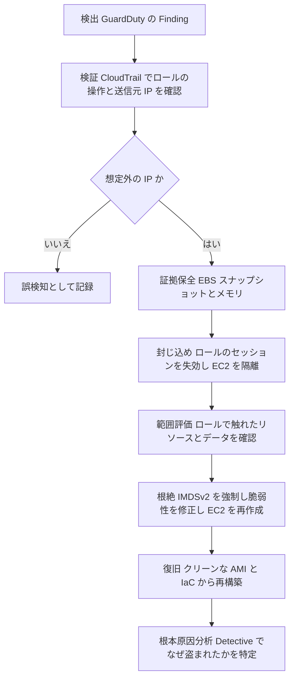

| フェーズ | 具体的な作業 | 関連 Skill |
|---|---|---|
| 検出・検証 | Finding の外部 IP とロール名を確認。CloudTrail でそのロールの全操作を時系列に確認 | 2.2.2, 2.2.3 |
| 証拠保全 | インスタンス保護とタグ → EBS スナップショット → メモリ取得 | 2.2.1 |
| 封じ込め | トークン発行時刻に基づく拒否ポリシー (ロールの Revoke active sessions)。インスタンスの隔離 | 2.2.4 |
| 範囲評価 | 盗まれた認証情報でアクセスされた S3、DynamoDB などを確認 | 2.2.3 |
| 根絶 | インスタンスのメタデータ経由の窃取経路 (SSRF など) を塞ぎ、IMDSv2 を強制。再作成 | 2.2.4 |
| 復旧 | 信頼できる AMI と IaC で再構築。強化した監視 | 2.2.4 |
| RCA | Detective で最初の不審な活動と侵入経路を特定。プレイブックを更新 | 2.2.5 |
| 自動化の余地 | 隔離とタグ付けは EventBridge + Lambda / Automation、証拠取得は Forensics Orchestrator | 2.1.4 |

### 5.2 シナリオ B: IAM アクセスキーが公開リポジトリに漏れた

**状況**: 開発者のアクセスキーが公開リポジトリに載り、見知らぬ IP からの API 呼び出しが GuardDuty に検出された。

| フェーズ | 具体的な作業 |
|---|---|
| 検証 | CloudTrail で該当アクセスキー ID の全操作を確認。普段と異なる IP、リージョン、操作 (例: `CreateUser`、`RunInstances`) を探す |
| 封じ込め | アクセスキーを**無効化**。攻撃者が発行した一時認証情報を考慮して、トークン発行時刻ベースの拒否ポリシーを IAM ユーザーに付与 (または IAM ユーザー削除) |
| 範囲評価 | そのキーで作成されたリソース、アクセスされたデータ。**他のリージョン**も確認 |
| 根絶 | 攻撃者が作った IAM ユーザー、ロール、キー、EC2 (マイニング用など) を削除。正規キーのローテーション |
| 復旧 | 必要なら新しい認証情報を発行 (できれば IAM ロールへ移行) |
| RCA | なぜ長期キーが存在し、コミットできたか。ガードレールと教育の見直し |

### 5.3 シナリオ C: S3 バケットが意図せず公開された

**状況**: `Policy:S3/BucketPublicAccessGranted` が検出された。

| フェーズ | 具体的な作業 |
|---|---|
| 検証 | 誰が (どのプリンシパルが)、いつ、どの API でバケットを公開したか (CloudTrail)。公開中に実際にアクセスがあったか (S3 データイベント / サーバーアクセスログ) |
| 封じ込め | S3 パブリックアクセスのブロックを有効化。バケットポリシーの不要な許可を削除 |
| 範囲評価 | 公開されていた期間に取得されたオブジェクトは? 機密データ (Macie) は含まれていたか |
| 根絶・予防 | 同じ設定を防ぐため、アカウントレベルのパブリックアクセスブロック、SCP、Config ルールを設定 |
| RCA | なぜ公開できる権限・手順があったか |

---

## 6. 試験対策

### 6.1 「こんなときはこのサービス」早見表

| 問われ方 | 答え |
|---|---|
| 運用上の問題 (OpsItem) を一元管理し Automation と連携 | Systems Manager OpsCenter |
| Incident Manager が新規で使えない場合の代替 | Systems Manager OpsCenter |
| 手順をコード化して自動実行 | Systems Manager Automation |
| AWS の専門チームのトリアージとケース管理 | AWS Security Incident Response |
| 検出結果を自動で処理 (Lambda、Step Functions) | EventBridge ルール (Security Hub の自動応答と修復) |
| 検出結果のフィールドを自動更新・抑制 | Security Hub の自動化ルール |
| 人がボタンで修復を起動 | Security Hub のカスタムアクション |
| 組織全体に定義済みの修復を展開 | Automated Security Response on AWS |
| EC2 のメモリ・ディスクの自動フォレンジック | Automated Forensics Orchestrator for Amazon EC2 |
| 障害を意図的に注入して試験 | AWS Fault Injection Service |
| 実験を安全に止める | FIS の停止条件 (CloudWatch アラーム) |
| RTO / RPO に対する耐障害性の評価 | AWS Resilience Hub |
| AZ 障害でトラフィックを逃がす | ARC ゾーンシフト / ゾーンオートシフト |
| リージョン間フェイルオーバー | ARC ルーティングコントロール / Region switch |
| DDoS の専門チーム対応 | Shield Advanced の SRT (Business / Enterprise サポートが必要) |
| DDoS による課金急増の保護 | Shield Advanced のコスト保護 |
| レイヤー 7 DDoS の自動緩和 | Shield Advanced のアプリケーション層自動緩和 (WAF) |
| ログが改ざんされていないことの証明 | CloudTrail ログファイル整合性検証 |
| ログの削除・上書き防止 | S3 Object Lock + 別アカウント |
| S3 上のログを SQL で調査 | Amazon Athena |
| CloudTrail イベントの SQL 照会ストア | CloudTrail Lake |
| 複数ソースの OCSF 一元化 | Amazon Security Lake |
| 関連する検出結果をグループ化して根本原因を調査 | Amazon Detective |
| 機密データ (PII) の検出 | Amazon Macie |
| 脆弱性の検出 | Amazon Inspector |
| 特定の送信元 IP を Web でブロック | AWS WAF の IP セット |

### 6.2 ひっかけポイント集

| # | ひっかけ | 正しい理解 |
|---|---|---|
| 1 | SG を変えれば既存の接続も切れる | **切れない。** 追跡済みの既存接続は継続する |
| 2 | SG と NACL で DNS も止まる | **止まらない。** Route 53 へのトラフィックはフィルタされない |
| 3 | EBS スナップショットでメモリも保全される | **されない。** EBS に書かれたデータのみ。メモリは別途取得 |
| 4 | 隔離してからメモリを取る | **逆。** メモリは隔離・停止の前に取る |
| 5 | IAM ユーザーの一時認証情報はコンソールで失効できる | できない。トークン発行時刻ベースの拒否ポリシーか、ユーザー削除 |
| 6 | Shield Advanced を購読すれば SRT がすぐ使える | **Business / Enterprise サポート**と SRT のアクセス許可が必要 |
| 7 | Incident Manager が IR 管理の第一候補 | **新規受付は終了。** OpsCenter を使う |
| 8 | FIS は停止条件なしで安全に使える | 停止条件 (CloudWatch アラーム) を設定する。停止した実験は再開できない |
| 9 | Detective が脅威を検出する | 検出は GuardDuty。Detective は**調査・相関** |
| 10 | CloudTrail の整合性検証を有効にすれば自動で検証される | 有効化はダイジェスト配信のみ。**検証は別途実行** |
| 11 | 侵害された EC2 は掃除して使い続けるのが安全 | 信頼できる AMI と IaC から**作り直す**のが原則 |
| 12 | AWS マネージドキー暗号化のスナップショットを別アカウントへ共有できる | できない。カスタマーマネージドキーを使う |
| 13 | ARC の準備チェックはフェイルオーバーの最中に実行する | フェイルオーバー中の重要な経路では使わない。事前の準備確認用 |
| 14 | 自動修復は何でも自動で削除する設計がよい | 破壊的操作は慎重に。隔離・無効化など可逆な操作から |

### 6.3 練習問題 (10 問)

答えは各問の直後に書いてあります。まず自分で考えてから確認してください。

**Q1 (並べ替え)** 侵害された疑いのある EC2 インスタンスから、証拠を最大限保全するための正しい順序を選べ。
(a) セキュリティグループで隔離する (b) メモリイメージを取得する (c) EBS スナップショットを取得する (d) 終了保護とタグを設定する

- **答え**: (d) → (c) → (b) → (a)
- 解説: 保護とタグ、ディスク、メモリの順に取得し、メモリを失わないよう隔離はその後に行う。

**Q2** 侵害された EC2 に隔離用セキュリティグループを付与した。しかし攻撃者の既存の SSH セッションが続いている。原因は?

- **答え**: セキュリティグループは**接続追跡**しており、変更しても既存の追跡済み接続は切断されない。
- 解説: 既存接続を切るには NACL による拒否などを併用する。

**Q3** 漏えいした IAM ユーザーのアクセスキーで、攻撃者が STS の一時認証情報を作成した。最も適切な封じ込めは?

- **答え**: キーを無効化し、IAM ユーザーにトークンの発行時刻より前の一時認証情報を拒否するインラインポリシーを付与する (またはユーザーを削除する)。
- 解説: IAM ユーザーの一時認証情報はコンソールから直接失効できない。

**Q4** Systems Manager Incident Manager を新規に使えない組織が、運用上の問題を集約し Automation ランブックで調査・解決したい。使うべきサービスは?

- **答え**: Systems Manager OpsCenter。
- 解説: Incident Manager は 2025 年 11 月 7 日以降、新規顧客に非提供。OpsCenter が推奨される。

**Q5** FIS で実験中にアプリケーションの性能が許容できないほど悪化したら、実験を自動で止めたい。どうする?

- **答え**: 定常状態を基に CloudWatch アラームを作成し、**停止条件**として実験テンプレートに設定する。
- 解説: 停止した実験は再開できない。

**Q6** GuardDuty の複数の検出結果が、同じ IAM ロールと IP を共有している。これらをまとめて調査し根本原因を探したい。使うべきは?

- **答え**: Amazon Detective の検出結果グループ。
- 解説: Detective は関連する検出結果とエンティティをグラフ分析でまとめる。

**Q7** ある企業が Shield Advanced を購読し、DDoS 発生時に AWS の専門チームに緩和を依頼したい。購読以外に必要な事前準備は?

- **答え**: Business または Enterprise サポートプランへの加入と、SRT にアクセスを許可する IAM ロールの関連付け。プロアクティブエンゲージメントを使うなら連絡先の登録も行う。

**Q8** Security Hub の重大度の高い検出結果に対して、自動で Lambda を実行し EC2 を隔離したい。最も適切な構成は?

- **答え**: Security Hub の検出結果を EventBridge ルールで受け、Lambda を起動する。
- 解説: 検出結果のフィールド更新・抑制だけなら Security Hub の自動化ルールだが、外部アクションは EventBridge。

**Q9** 調査担当が、CloudTrail のログが保存後に変更されていないことを証明したい。事前に何を有効にし、事後に何を実行する?

- **答え**: 事前にログファイル整合性検証を有効化 (ダイジェストファイルの配信)。事後に `aws cloudtrail validate-logs` などで検証を実行する。
- 解説: 有効化だけでは検証されない。

**Q10** ある AZ に障害が発生した。マルチ AZ 構成のアプリケーションのトラフィックを、一時的に正常な AZ に逃がしたい。使う機能は?

- **答え**: ARC のゾーンシフト (自動で AWS に任せるならゾーンオートシフト)。
- 解説: リージョン間のフェイルオーバーはルーティングコントロール (または Region switch)。

---

## 7. 学習チェックリストと用語集

### 7.1 学習チェックリスト

自分の言葉で説明できたら、その項目は習得できたと考えてください。

**Task 2.1**

- プレイブックとランブックの違いを説明できる
- OpsCenter、Automation の役割と、Incident Manager の提供状況の変更を説明できる
- 事前に用意すべきアクセス (調査用ロール、封じ込め用ロール、ブレークグラス) を挙げられる
- IR 前に有効化すべきセキュリティサービスを挙げられる
- 被害範囲を小さくする手段を 5 つ以上挙げられる
- Shield Advanced の主要機能 (SRT、コスト保護、自動緩和、プロアクティブエンゲージメント) と前提条件を説明できる
- FIS の実験テンプレートの構成要素と停止条件を説明できる
- Resilience Hub の耐障害性ポリシーと評価、「Policy breached」の意味を説明できる
- Security Hub の自動化ルールと EventBridge ルールの違いを説明できる
- Automated Forensics Orchestrator の流れ (取得 2 フロー、隔離、調査) を説明できる
- ARC のゾーンシフト、ゾーンオートシフト、ルーティングコントロール、準備チェックを区別できる

**Task 2.2**

- 収集すべきログの種類と、保護の方法 (別アカウント、Object Lock、整合性検証) を説明できる
- EC2 の証拠取得の順序 (保護とタグ → ディスク → メモリ → 隔離) とその理由を説明できる
- 暗号化スナップショットをフォレンジックアカウントへ共有する手順を説明できる
- CloudWatch Logs Insights、Athena、CloudTrail Lake、Security Lake の使い分けができる
- 検出結果を検証し、範囲と影響を評価する観点を挙げられる
- 封じ込めの 3 分類 (ソース、手法・アクセス、宛先) を説明できる
- SG の既存接続と DNS に関する注意点を説明できる
- IAM の一時認証情報を失効させる方法を説明できる
- 根絶と復旧の違い、復旧ポイント選びの注意点を説明できる
- Detective の検出結果グループと RCA の進め方を説明できる

### 7.2 用語集

| 用語 | 説明 |
|---|---|
| ASFF | AWS Security Finding Format。Security Hub の検出結果の標準形式 |
| ASR | Automated Security Response on AWS。Security Hub の検出結果に対する定義済み修復を展開するソリューション |
| Automation (SSM) | Systems Manager の機能。ランブックとして手順を自動実行する |
| Behavior graph | Detective が作る、リソースの挙動を時系列でつなげたデータ構造 |
| Blast radius | 被害の及ぶ範囲 |
| Break-glass | 緊急時にのみ使う特別なアクセス手段 |
| CIRT | AWS Customer Incident Response Team。AWS Security Incident Response から利用できる専門チーム |
| Containment | 封じ込め。被害の拡大を止める |
| Digest file | CloudTrail の整合性検証で使う、署名付きのダイジェストファイル |
| Eradication | 根絶。原因と足場を取り除く |
| Finding group | Detective が関連する検出結果をまとめたもの |
| FIS | AWS Fault Injection Service |
| Game Day | 実環境に近い条件で障害や攻撃を想定して訓練すること |
| IoC | Indicator of Compromise。侵害の痕跡 |
| IMDSv2 | EC2 インスタンスメタデータサービスのバージョン 2。SSRF などによる認証情報窃取に強い |
| Object Lock | S3 のオブジェクトを一定期間、変更・削除不可にする機能 (WORM) |
| OCSF | Open Cybersecurity Schema Framework。Security Lake が使うデータ形式 |
| OpsItem | OpsCenter で管理する運用上の問題の単位 |
| Playbook | シナリオ別の対応手順書 |
| RCA | Root Cause Analysis。根本原因分析 |
| Resiliency policy | Resilience Hub で RTO / RPO の目標を定義するもの |
| Runbook | 具体的な実行手順。自動化できる形のもの |
| RTO / RPO | 復旧目標時間 / 復旧目標時点 |
| SCP | Service Control Policy。Organizations で権限の上限を決める |
| SRT | Shield Response Team。Shield Advanced の専門対応チーム |
| Steady state | FIS で、システムが正常と見なす状態。停止条件の基準 |
| Triage | トリアージ。優先度の選別 |
| Zonal shift | ARC の機能。障害のある AZ から正常な AZ へトラフィックを移す |

---

## 8. 参考 URL 一覧

### 8.1 試験ガイド (一次情報)

| 内容 | URL |
|---|---|
| SCS-C03 試験ガイド (アンカー) | https://docs.aws.amazon.com/aws-certification/latest/security-specialty-03/security-specialty-03.html |
| Content Domain 2: Incident Response | https://docs.aws.amazon.com/aws-certification/latest/security-specialty-03/security-specialty-03-domain2.html |
| 対象サービス一覧 (In-Scope AWS Services) | https://docs.aws.amazon.com/aws-certification/latest/security-specialty-03/scs-02-in-scope-services.html |
| 技術と概念 (Technologies and Concepts) | https://docs.aws.amazon.com/aws-certification/latest/security-specialty-03/scs-technologies-concepts.html |

### 8.2 インシデントレスポンスの基本

| 内容 | URL |
|---|---|
| AWS Security Incident Response User Guide: 概要 | https://docs.aws.amazon.com/security-ir/latest/userguide/introduction.html |
| 運用 (検出、分析、封じ込め、根絶、復旧) | https://docs.aws.amazon.com/security-ir/latest/userguide/operations.html |
| 封じ込め | https://docs.aws.amazon.com/security-ir/latest/userguide/containment.html |
| ソース封じ込め | https://docs.aws.amazon.com/security-ir/latest/userguide/source-containment.html |
| 手法とアクセスの封じ込め | https://docs.aws.amazon.com/security-ir/latest/userguide/technique-access-containment.html |
| 関連アーティファクトの収集 (EC2 の証拠取得順序) | https://docs.aws.amazon.com/security-ir/latest/userguide/collect-relevant-artifacts.html |
| サンプルプレイブック | https://docs.aws.amazon.com/security-ir/latest/userguide/sample-playbooks.html |
| AWS Security Incident Response (サービス) とは | https://docs.aws.amazon.com/security-ir/latest/userguide/what-is.html |
| AWS Security Incident Response FAQ | https://www.aws.amazon.com/security-incident-response/faqs/ |
| IR プレイブックのサンプル (aws-samples) | https://github.com/aws-samples/aws-incident-response-playbooks |

### 8.3 準備・自動化・テスト

| 内容 | URL |
|---|---|
| Incident Manager の提供状況の変更 | https://docs.aws.amazon.com/incident-manager/latest/userguide/incident-manager-availability-change.html |
| OpsCenter への移行 | https://docs.aws.amazon.com/incident-manager/latest/userguide/migration-opscenter.html |
| Shield Advanced の機能とオプション | https://docs.aws.amazon.com/waf/latest/developerguide/ddos-advanced-summary-capabilities.html |
| AWS Shield ドキュメント概要 | https://aws.amazon.com/documentation-overview/shield/ |
| FIS 実験テンプレート | https://docs.aws.amazon.com/fis/latest/userguide/experiment-templates.html |
| FIS 停止条件 | https://docs.aws.amazon.com/fis/latest/userguide/stop-conditions.html |
| Resilience Hub の概要 | https://docs.aws.amazon.com/resilience-hub/latest/userguide/arh-mgmt.html |
| Resilience Hub 耐障害性ポリシー | https://docs.aws.amazon.com/resilience-hub/latest/userguide/resiliency-policies.html |
| Resilience Hub アプリケーション | https://docs.aws.amazon.com/resilience-hub/latest/userguide/applications.html |
| Resilience Hub 評価レポート | https://docs.aws.amazon.com/resilience-hub/latest/userguide/review-assessment.html |
| Security Hub の自動化 | https://docs.aws.amazon.com/securityhub/latest/userguide/automations.html |
| Security Hub と EventBridge による自動応答と修復 | https://docs.aws.amazon.com/securityhub/latest/userguide/securityhub-cloudwatch-events |
| Automated Security Response on AWS | https://docs.aws.amazon.com/solutions/automated-security-response-on-aws/ |
| ASR アーキテクチャ概要 | https://docs.aws.amazon.com/solutions/latest/automated-security-response-on-aws/architecture-overview.html |
| Automated Forensics Orchestrator for Amazon EC2 (Solutions Library) | https://aws.amazon.com/solutions/implementations/automated-forensics-orchestrator-for-amazon-ec2 |
| Forensics Orchestrator アーキテクチャ概要 | https://docs.aws.amazon.com/solutions/latest/automated-forensics-orchestrator-for-amazon-ec2/architecture-overview.html |
| Forensics Orchestrator 調査とレポート | https://docs.aws.amazon.com/solutions/latest/automated-forensics-orchestrator-for-amazon-ec2/forensic-investigation-and-reporting-service.html |
| Forensics Orchestrator (GitHub) | https://github.com/aws-solutions-library-samples/automated-forensic-orchestrator-for-amazon-ec2 |
| ARC とは | https://docs.aws.amazon.com/r53recovery/latest/dg/what-is-route53-recovery.html |

### 8.4 ログ・調査・根本原因分析

| 内容 | URL |
|---|---|
| ディスクフォレンジック収集の自動化 (AWS Security Blog) | https://aws.amazon.com/blogs/security/how-to-automate-forensic-disk-collection-in-aws |
| CloudTrail ログファイル整合性検証の概要 | https://docs.aws.amazon.com/awscloudtrail/latest/userguide/cloudtrail-log-file-validation-intro.html |
| CloudTrail ログファイル整合性検証 (CLI) | https://docs.aws.amazon.com/awscloudtrail/latest/userguide/cloudtrail-log-file-validation-cli.html |
| S3 Object Lock | https://docs.aws.amazon.com/AmazonS3/latest/userguide/object-lock.html |
| VPC Flow Logs | https://docs.aws.amazon.com/vpc/latest/userguide/flow-logs.html |
| Route 53 Resolver クエリログ | https://docs.aws.amazon.com/Route53/latest/DeveloperGuide/resolver-query-logs.html |
| CloudWatch Logs Insights | https://docs.aws.amazon.com/AmazonCloudWatch/latest/logs/AnalyzingLogData.html |
| Amazon Security Lake | https://docs.aws.amazon.com/security-lake/latest/userguide/what-is-security-lake.html |
| GuardDuty: 侵害された可能性のある EC2 インスタンスの修復 | https://docs.aws.amazon.com/guardduty/latest/ug/compromised-ec2 |
| GuardDuty: 侵害された可能性のある AMI の修復 | https://docs.aws.amazon.com/guardduty/latest/ug/compromised-ami.html |
| GuardDuty: IAM の Finding type | https://docs.aws.amazon.com/guardduty/latest/ug/guardduty_finding-types-iam.html |
| Detective: 検出結果グループの分析 | https://docs.aws.amazon.com/detective/latest/userguide/groups-about.html |
| Detective FAQ | https://aws.amazon.com/detective/faqs |
| Detective の検出結果グループの可視化の強化 (What's New) | https://aws.amazon.com/about-aws/whats-new/2023/08/amazon-detective-visualizations-security-investigations |

---

## 9. 検証できなかった点と注意事項

この資料を作る際に、確認できた事項と、確認できなかった事項を区別しておきます。

| 項目 | 状況 |
|---|---|
| 試験ガイドの Domain 2 の Task / Skill、配点、問題数、合格点 | 公式の試験ガイドを直接取得して確認済み (2026-10-17) |
| Amazon SageMaker AI notebooks を IR ランブックとして使う公式手順 | 公式の試験ガイドに例として挙がっていることは確認済み。ただし、この用途を詳述した AWS ドキュメントは見つけられなかったため、第 3.1.5 節は**一般的な設計の考え方**として記述した |
| Incident Manager の新規受付終了 (2025 年 11 月 7 日) | AWS の公式ドキュメントで確認済み |
| ARC、FIS、Resilience Hub、Shield Advanced、Detective、GuardDuty の個別機能 | 公式ドキュメントの内容を検索結果で確認済み |
| AWS Security Incident Response の「IR チームに最低 2 名が必要」 | AWS re:Post の記事で確認。公式ドキュメントでの再確認は未実施 |
| S3 Object Lock、VPC Flow Logs、Route 53 Resolver クエリログ、Security Lake、CloudWatch Logs Insights の URL | 広く知られた公式ドキュメントの URL を掲載したが、今回は個別に開いて確認していない |
| Athena のテーブル名・列名、各コマンドの引数 | 学習用の例。実際の環境のスキーマと AWS CLI の最新仕様に合わせて調整が必要 |
| 試験の「おおよそ 7 問前後」という目安 | 配点 14% からの単純な計算。実際の問題数は試験フォームによって変わる |
| Security Hub の名称 | 公式ドキュメントでは「Security Hub CSPM」という表記が使われている箇所がある。製品の構成は更新が続いているため、最新の名称と機能は公式ドキュメントで確認してほしい |

> 本資料は学習用の整理です。実際のインシデント対応では、自組織のポリシー、法的要件、最新の AWS ドキュメントに従ってください。コマンドやコードは**必ず非本番環境でテストしてから**使ってください。
