# AWS Certified Security - Specialty (SCS-C03)

# Content Domain 3: Infrastructure Security 初学者向けステップバイステップガイド

> 対象試験: AWS Certified Security - Specialty (SCS-C03)
> 対象ドメイン: **Content Domain 3: Infrastructure Security(スコア対象の 18%)**
> 根拠(アンカー): AWS 公式試験ガイド Domain 3 ページ
> https://docs.aws.amazon.com/aws-certification/latest/security-specialty-03/security-specialty-03-domain3.html
> 作成日: 2026-10-21 / 図解は Mermaid と Markdown の表のみ使用(ASCII アートは使用しません)

---

## 目次

1. [このガイドの使い方](#1-このガイドの使い方)
2. [Domain 3 の全体像](#2-domain-3-の全体像)
3. [前提知識(ここだけは先に押さえる)](#3-前提知識ここだけは先に押さえる)
4. [Task 3.1 ネットワークエッジサービスのセキュリティ制御](#4-task-31-ネットワークエッジサービスのセキュリティ制御)
5. [Task 3.2 コンピュートワークロードのセキュリティ制御](#5-task-32-コンピュートワークロードのセキュリティ制御)
6. [Task 3.3 ネットワークセキュリティ制御の設計とトラブルシューティング](#6-task-33-ネットワークセキュリティ制御の設計とトラブルシューティング)
7. [横断まとめ: サービス選択早見表とキーワード対応表](#7-横断まとめ-サービス選択早見表とキーワード対応表)
8. [トラブルシューティング実践フロー](#8-トラブルシューティング実践フロー)
9. [理解度チェック(演習問題)](#9-理解度チェック演習問題)
10. [参考 URL(根拠ソース一覧)](#10-参考-url根拠ソース一覧)

---

## 1. このガイドの使い方

### 1.1 学習の進め方(ステップバイステップ)

| ステップ | やること | 目安 |
|---|---|---|
| Step 1 | 「2. 全体像」で 3 つの Task と 16 個のスキルの地図を頭に入れる | 15 分 |
| Step 2 | 「3. 前提知識」で多層防御・責任共有・VPC の基本を確認する | 20 分 |
| Step 3 | Task 3.1 → 3.2 → 3.3 の順に読む。各スキルは「何か → なぜ → 仕組み → ベストプラクティス → 試験の着眼点」の順 | 各 60 分 |
| Step 4 | 「7. 横断まとめ」「8. トラブルシューティング」で知識を結びつける | 30 分 |
| Step 5 | 「9. 演習問題」で理解を確認し、間違えた箇所に戻る | 30 分 |

### 1.2 各スキルの読み方

- **何か**: そのサービス・機能の一文説明
- **なぜ重要か**: どんな脅威や要件に効くのか
- **仕組み**: 動作の流れ(Mermaid 図、表)
- **ベストプラクティス**: 実務と試験の両方で正解になりやすい設計
- **試験の着眼点**: 選択肢の見分け方(よく出る引っかけ)

### 1.3 注意事項

- 本ガイドは AWS 公式試験ガイドの Task / Skill に沿って整理した学習用資料です。試験ガイド自体が「網羅的なリストではない」と明記しているため、記載外の内容が出題される可能性があります。
- サービスの仕様・名称・提供状況は変更されます。最終確認は必ず「10. 参考 URL」の公式ドキュメントで行ってください。
- 試験ガイドの対象外業務として「パケットレベルのトラフィック分析」「暗号アルゴリズムの設計」などが挙げられています。深追いしすぎないようにしましょう。

---

## 2. Domain 3 の全体像

### 2.1 位置づけ

SCS-C03 は 6 つのドメインで構成され、Infrastructure Security は **18%** を占めます。出題比率は Domain 4(IAM, 20%)に次いで大きい部類です。

| ドメイン | 配点 |
|---|---|
| Domain 1: Detection | 16% |
| Domain 2: Incident Response | 14% |
| **Domain 3: Infrastructure Security** | **18%** |
| Domain 4: Identity and Access Management | 20% |
| Domain 5: Data Protection | 18% |
| Domain 6: Security Foundations and Governance | 14% |

### 2.2 3 つの Task と 16 のスキル

```mermaid
flowchart TB
    D3["Domain 3<br/>Infrastructure Security"]
    T1["Task 3.1<br/>ネットワークエッジ"]
    T2["Task 3.2<br/>コンピュート"]
    T3["Task 3.3<br/>ネットワーク制御"]
    D3 --> T1
    D3 --> T2
    D3 --> T3
    T1 --> S11["3.1.1 エッジ戦略の選定"]
    T1 --> S12["3.1.2 エッジ保護の実装"]
    T1 --> S13["3.1.3 エッジルールの設計"]
    T1 --> S14["3.1.4 外部サービス連携"]
    T2 --> S21["3.2.1 堅牢化 AMI とイメージ"]
    T2 --> S22["3.2.2 ロールの適切な適用"]
    T2 --> S23["3.2.3 脆弱性スキャン"]
    T2 --> S24["3.2.4 パッチ適用の自動化"]
    T2 --> S25["3.2.5 安全な管理アクセス"]
    T2 --> S26["3.2.6 パイプライン内の脆弱性検出"]
    T2 --> S27["3.2.7 生成 AI の保護"]
    T3 --> S31["3.3.1 SG・NACL・Network Firewall"]
    T3 --> S32["3.3.2 ハイブリッド接続"]
    T3 --> S33["3.3.3 ハイブリッドの要件"]
    T3 --> S34["3.3.4 ネットワーク分離"]
    T3 --> S35["3.3.5 不要なアクセスの特定"]
```

### 2.3 Task とスキルの対応表(試験ガイドの原文に沿った整理)

| Task | スキル | 主なサービス・キーワード |
|---|---|---|
| 3.1 | 3.1.1 脅威に基づくエッジセキュリティ戦略の定義と選定 | CloudFront, Route 53, Shield, WAF |
| 3.1 | 3.1.2 エッジ保護の実装 | CloudFront ヘッダー, AWS WAF, AWS IoT ポリシー, OWASP Top 10, S3 CORS, Shield Advanced |
| 3.1 | 3.1.3 要件に基づくエッジ制御とルール | 地理, ジオロケーション, レート制限, クライアントフィンガープリント |
| 3.1 | 3.1.4 エッジサービスとサードパーティの連携 | OCSF 形式での取り込み, サードパーティ WAF ルール |
| 3.2 | 3.2.1 堅牢化された EC2 AMI とコンテナイメージ | Systems Manager, EC2 Image Builder |
| 3.2 | 3.2.2 インスタンスプロファイル、サービスロール、実行ロール | EC2, Lambda, ECS, EKS |
| 3.2 | 3.2.3 既知の脆弱性のスキャン | Amazon Inspector, GuardDuty ランタイム監視 |
| 3.2 | 3.2.4 パッチの自動展開と継続的検証 | Patch Manager, Inspector |
| 3.2 | 3.2.5 コンピュートへの安全な管理アクセス | Session Manager, EC2 Instance Connect |
| 3.2 | 3.2.6 パイプライン内の脆弱性の発見と修復 | Amazon Q Developer, Amazon CodeGuru Security |
| 3.2 | 3.2.7 生成 AI アプリのガードレール | OWASP Top 10 for LLM Applications |
| 3.3 | 3.3.1 通信の許可・拒否の制御 | セキュリティグループ, ネットワーク ACL, AWS Network Firewall |
| 3.3 | 3.3.2 ハイブリッド / マルチクラウド接続 | Site-to-Site VPN, Direct Connect, MACsec |
| 3.3 | 3.3.3 ハイブリッド環境の通信要件 | AWS Verified Access |
| 3.3 | 3.3.4 ネットワークセグメンテーション | 南北 / 東西トラフィック, 分離サブネット |
| 3.3 | 3.3.5 不要なネットワークアクセスの特定 | Verified Access, Network Access Analyzer, Inspector ネットワーク到達性 |

---

## 3. 前提知識(ここだけは先に押さえる)

### 3.1 責任共有モデル(Shared Responsibility Model)

AWS は「クラウド**の**セキュリティ」(物理施設、ハイパーバイザー、マネージドサービスの基盤)を担い、お客様は「クラウド**の中の**セキュリティ」(OS パッチ、SG 設定、データ、IAM)を担います。

| サービス種別 | 例 | お客様の主な責任 |
|---|---|---|
| IaaS 寄り | EC2 | ゲスト OS のパッチ、ファイアウォール、アプリ、データ、IAM |
| コンテナ | ECS on EC2, EKS ノード | ノード OS、コンテナイメージ、タスク権限 |
| サーバーレス | Lambda, Fargate | コード、依存ライブラリ、実行ロール、データ |
| マネージド | S3, DynamoDB | データ分類、アクセスポリシー、暗号化設定 |

> **試験の着眼点**: 「パッチ適用は誰の責任か」は、EC2 ならお客様、Lambda のランタイム基盤なら AWS、Lambda の依存ライブラリはお客様、のように切り分けて答えます。

### 3.2 多層防御(Defense in Depth)

1 つの対策が破られても次の層で止める考え方です。Domain 3 はこの考え方の実装そのものです。

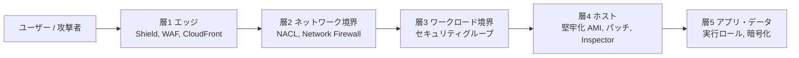

### 3.3 VPC の基本用語

| 用語 | 説明 |
|---|---|
| VPC | AWS 上の論理的に分離された仮想ネットワーク |
| サブネット | VPC を分割した IP 範囲。ルートテーブルで公開 / 非公開が決まる |
| パブリックサブネット | ルートテーブルにインターネットゲートウェイ(IGW)への経路があるサブネット |
| プライベートサブネット | ルートテーブルに IGW への直接経路がないサブネット。インターネットへの外向き通信が必要な場合のみ、NAT ゲートウェイなどの NAT デバイス経由の経路を追加する (任意) |
| 分離サブネット(isolated) | VPC の外への経路を持たないサブネット。VPC 内の通信は可能で、AWS サービスへは必要に応じて VPC エンドポイントを追加して接続する |
| 南北トラフィック | VPC の内と外の通信(インターネット、オンプレミスとの通信) |
| 東西トラフィック | VPC 内、VPC 間のワークロード同士の通信 |

---

## 4. Task 3.1 ネットワークエッジサービスのセキュリティ制御

**エッジ**とは、インターネットからの通信が最初に到達する「入口」です。ここで不正な通信を早く止めるほど、内側のリソースの負荷とリスクが下がります。

### 4.0 エッジ防御の全体像

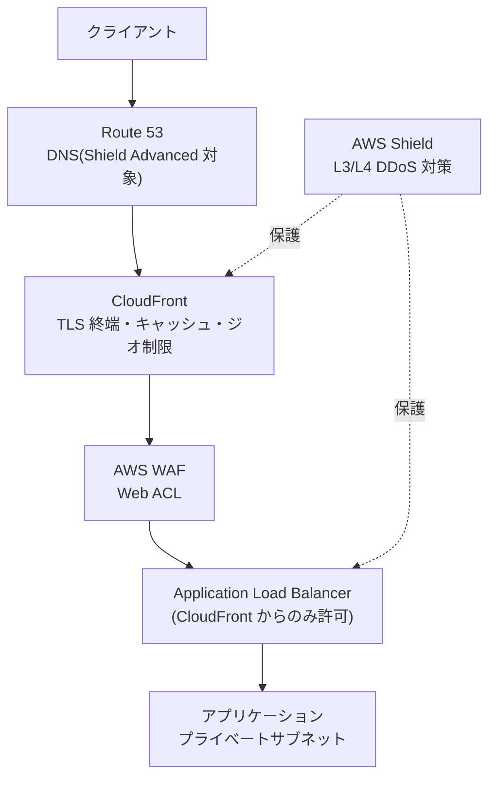

---

### 4.1 Skill 3.1.1 脅威に基づくエッジセキュリティ戦略の定義と選定

#### 何か

「どんな攻撃が想定されるか」を先に洗い出し、それに合うエッジサービスを選ぶスキルです。サービス名を暗記するのではなく、**脅威 → 対策**で考えます。

#### 脅威と対策の対応表

| 想定される脅威 | 層 | 第一選択のサービス・機能 |
|---|---|---|
| ボリューム型 DDoS(UDP フラッド、SYN フラッド) | L3/L4 | AWS Shield Standard(自動・無料)、より高度な保護は Shield Advanced |
| HTTP フラッド(L7 DDoS) | L7 | AWS WAF レートベースルール、Shield Advanced のアプリケーション層自動緩和 |
| SQL インジェクション、XSS | L7 | AWS WAF マネージドルール(SQL データベース、コアルールセット) |
| 悪意のあるボット、スクレイピング | L7 | AWS WAF Bot Control、CAPTCHA / Challenge アクション |
| 不正ログイン(クレデンシャルスタッフィング) | L7 | AWS WAF Account Takeover Prevention(ATP) |
| 特定国からのアクセス排除 | L7 | CloudFront 地理的制限、WAF の地理一致ルール |
| オリジンへの直接アクセス(CloudFront 迂回) | L7 | Origin Access Control(OAC)、オリジンへのカスタムヘッダー、マネージドプレフィックスリスト |
| 盗聴、改ざん | L4-L7 | CloudFront ビューワープロトコルポリシー(HTTPS)、ACM 証明書、TLS セキュリティポリシー |
| IoT デバイスのなりすまし | 認証認可 | X.509 証明書、AWS IoT ポリシー |

#### 戦略選定のフロー

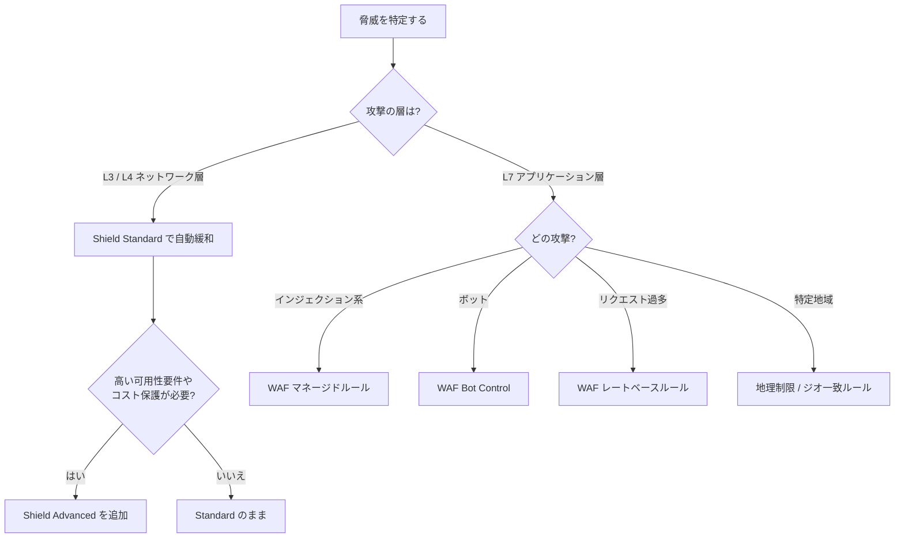

#### ベストプラクティス

- **エッジをできるだけ外側に置く**: 攻撃を CloudFront や WAF で吸収し、ALB や EC2 に到達させない。
- **ネットワーク層とアプリ層の両方を考える**: Shield だけ、WAF だけ、では片方の層が空く。
- **新規ルールは Count モードで始める**: 誤検知(正規ユーザーのブロック)を確認してから Block に切り替える。
- **コストと複雑さのトレードオフを説明できるようにする**: Shield Advanced は有償サブスクリプションであり、全システムには不要。重要システムを選んで適用する。

#### 試験の着眼点

- 「最小の運用負荷で」「追加費用なしで」なら **Shield Standard**(自動で有効)が正解になりやすい。
- 「DDoS による急なスケールアウト費用を補填したい」「AWS の対応チーム(Shield Response Team)の支援を受けたい」なら **Shield Advanced**。

---

### 4.2 Skill 3.1.2 ネットワークエッジ保護の実装

試験ガイドの例示: **CloudFront ヘッダー、AWS WAF、AWS IoT ポリシー、OWASP Top 10 対策、S3 CORS、Shield Advanced**。それぞれ順に見ます。

#### 4.2.1 Amazon CloudFront のセキュリティ機能

| 機能 | 役割 | 補足 |
|---|---|---|
| ビューワープロトコルポリシー | HTTP を HTTPS にリダイレクト、または HTTPS のみ許可 | 暗号化されていない通信を排除 |
| TLS セキュリティポリシー | 許可する TLS の最小バージョンと暗号スイート | 古いプロトコルを無効化 |
| オリジンプロトコルポリシー | CloudFront からオリジンへの通信も HTTPS にする | エッジからオリジンまで暗号化 |
| Origin Access Control(OAC) | S3 オリジンへのアクセスを CloudFront のみに限定 | 旧 OAI の後継。SSE-KMS など新しい要件に対応 |
| 署名付き URL / 署名付き Cookie | 有料コンテンツなど、アクセス権のあるユーザーだけに配信 | 有効期限や IP を制限できる |
| フィールドレベル暗号化 | 特定フォームフィールド(カード番号など)をエッジで追加暗号化 | アプリ内部でも平文にしない |
| 地理的制限 | 国単位の許可リスト / 拒否リスト | 細かい条件は WAF のジオ一致を使う |
| レスポンスヘッダーポリシー | セキュリティヘッダーや CORS ヘッダーを付与 | 下記参照 |

#### CloudFront で付与する代表的なセキュリティヘッダー

| ヘッダー | 目的 |
|---|---|
| `Strict-Transport-Security`(HSTS) | ブラウザに「今後は常に HTTPS で接続せよ」と指示し、ダウングレード攻撃を防ぐ |
| `Content-Security-Policy`(CSP) | 読み込めるスクリプトの出所を制限し、XSS の被害を抑える |
| `X-Content-Type-Options: nosniff` | ブラウザによる MIME タイプの推測を禁止 |
| `X-Frame-Options` | 他サイトの iframe 埋め込みを禁止し、クリックジャッキングを防ぐ |
| `Referrer-Policy` | リファラー情報の漏えいを制御 |

> **ポイント**: これらは**レスポンスヘッダーポリシー**を CloudFront ディストリビューションのキャッシュビヘイビアにアタッチするだけで付与でき、オリジンのコード変更は不要です。

#### オリジン保護の設計(CloudFront を迂回させない)

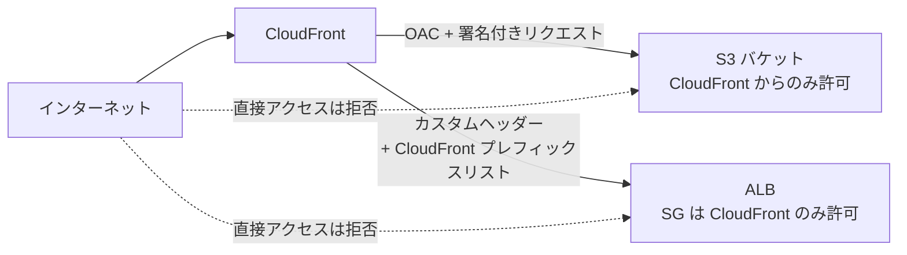

**ベストプラクティス**

- S3 オリジンは**パブリックアクセスをブロック**し、バケットポリシーで CloudFront(OAC)からのアクセスだけを許可する。
- ALB オリジンは、セキュリティグループの送信元に **CloudFront のマネージドプレフィックスリスト**(`com.amazonaws.global.cloudfront.origin-facing`)を指定する。
- さらに CloudFront から**秘密のカスタムヘッダー**を付与し、WAF や ALB のルールでそのヘッダーが無いリクエストを拒否する(ヘッダー値は Secrets Manager で管理しローテーションする)。

#### 4.2.2 AWS WAF の基本

**AWS WAF** は HTTP(S) リクエストを検査する Web アプリケーションファイアウォール(L7)です。Web ACL を作り、次のリソースに関連付けます。

| 関連付け可能な主なリソース | 補足 |
|---|---|
| Amazon CloudFront ディストリビューション | グローバル(Web ACL は us-east-1 の CLOUDFRONT スコープで作成) |
| Application Load Balancer | リージョナル |
| Amazon API Gateway(REST API) | リージョナル |
| AWS AppSync(GraphQL) | リージョナル |
| Amazon Cognito ユーザープール | リージョナル |
| AWS Verified Access インスタンス | リージョナル |

**WAF の構成要素**

| 要素 | 説明 |
|---|---|
| Web ACL | ルールの入れ物。デフォルトアクション(Allow / Block)を持つ |
| ルール | 条件(Statement)と、一致時のアクション |
| ルールグループ | ルールをまとめたもの。AWS マネージド、AWS Marketplace、自作がある |
| アクション | Allow / Block / Count / CAPTCHA / Challenge |
| Web ACL キャパシティユニット(WCU) | ルールの複雑さを表す上限 |
| ログ | CloudWatch Logs / S3 / Kinesis Data Firehose に出力可能 |

**WAF の評価の流れ**

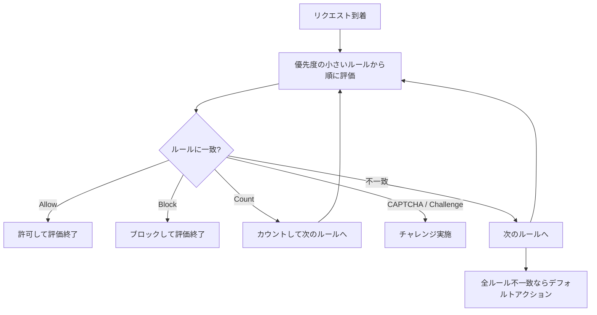

#### 4.2.3 OWASP Top 10 への対策

| 脅威 | WAF での対策 |
|---|---|
| インジェクション(SQLi など) | AWS マネージドルール「SQL database」、コアルールセット |
| クロスサイトスクリプティング(XSS) | コアルールセット(CRS)、XSS 一致ステートメント |
| 既知の悪意ある入力(Log4j など) | 「Known bad inputs」マネージドルール |
| 認証の不備、クレデンシャルスタッフィング | ATP、レートベースルール |
| セキュリティの設定ミス | Firewall Manager で WAF ポリシーを組織全体に強制 |
| ボットによる悪用 | Bot Control |

> **注意**: WAF は万能ではありません。**アプリ側の入力検証、パラメータ化クエリ、最小権限の実行ロール**と組み合わせる多層防御が前提です。

#### 4.2.4 Amazon S3 CORS(クロスオリジンリソース共有)

**CORS** は、あるオリジン(例: `https://app.example.com`)のページから別オリジン(例: S3 バケット)へブラウザがリクエストするときの、**ブラウザ側の制御ルール**です。S3 バケットに CORS 設定を置いて、許可するオリジンとメソッドを宣言します。

```json
[
  {
    "AllowedOrigins": ["https://app.example.com"],
    "AllowedMethods": ["GET", "HEAD"],
    "AllowedHeaders": ["Authorization", "Content-Type"],
    "ExposeHeaders": ["ETag"],
    "MaxAgeSeconds": 3000
  }
]
```

**ベストプラクティス**

- `AllowedOrigins` に **`*` を安易に使わない**。必要なオリジンだけを列挙する。
- `AllowedMethods` は必要最小限(読み取りだけなら `GET`, `HEAD`)にする。
- **CORS は認可の仕組みではない**。ブラウザ以外(curl など)からのアクセスは CORS では止まらないため、アクセス制御は IAM、バケットポリシー、署名付き URL、OAC で行う。
- CloudFront 経由の場合は、CORS ヘッダーが正しくオリジンから返り、キャッシュキー(`Origin` ヘッダーなど)に反映されているかも確認する。

#### 4.2.5 AWS IoT ポリシー

IoT デバイスは **X.509 クライアント証明書**で AWS IoT Core に接続し、証明書にアタッチした **AWS IoT ポリシー**で「何を許可するか」が決まります(IAM ポリシーに似た JSON)。

```json
{
  "Version": "2012-10-17",
  "Statement": [
    {
      "Effect": "Allow",
      "Action": "iot:Connect",
      "Resource": "arn:aws:iot:ap-northeast-1:111122223333:client/${iot:Connection.Thing.ThingName}"
    },
    {
      "Effect": "Allow",
      "Action": ["iot:Publish", "iot:Receive"],
      "Resource": "arn:aws:iot:ap-northeast-1:111122223333:topic/devices/${iot:Connection.Thing.ThingName}/*"
    },
    {
      "Effect": "Allow",
      "Action": "iot:Subscribe",
      "Resource": "arn:aws:iot:ap-northeast-1:111122223333:topicfilter/devices/${iot:Connection.Thing.ThingName}/*"
    }
  ]
}
```

**ベストプラクティス**

- **ポリシー変数**(例: `${iot:Connection.Thing.ThingName}`)を使い、「各デバイスは自分のトピックだけ」を 1 つのポリシーで実現する。
- 全デバイスに同じ広い権限(`iot:*` と `Resource: "*"`)を与えない。
- デバイスごとに一意の証明書を発行し、紛失や侵害時は**証明書を無効化**する。
- 証明書は安全に保管する(可能ならセキュアエレメント)。

#### 4.2.6 AWS Shield Advanced

| 項目 | Shield Standard | Shield Advanced |
|---|---|---|
| 費用 | 追加費用なし(自動) | 有償サブスクリプション |
| 保護層 | 一般的な L3/L4 攻撃 | L3/L4 に加え L7 の自動緩和も可能 |
| 保護対象 | すべての AWS 顧客 | CloudFront、Route 53、Global Accelerator、ELB、Elastic IP を明示的に登録 |
| 追加機能 | なし | 攻撃の可視化、Shield Response Team(SRT)の支援、DDoS によるスケール費用の補填(要件あり)、Firewall Manager 連携 |

**ベストプラクティス**

- 重要なインターネット公開システムのみ Shield Advanced を有効化し、保護対象リソースを登録する。
- WAF と連携し、**レートベースルールとアプリケーション層の自動緩和**を設定する。
- 攻撃時の連絡経路(SRT への事前連絡先や、プロアクティブエンゲージメント)を事前に整備する。

---

### 4.3 Skill 3.1.3 要件に基づくエッジ制御とルールの設計・実装

試験ガイドの例示: **地理、ジオロケーション、レート制限、クライアントフィンガープリント**。

#### 4.3.1 地理制御(CloudFront 地理的制限 vs WAF ジオ一致)

| 比較軸 | CloudFront 地理的制限 | WAF ジオ一致ルール |
|---|---|---|
| 粒度 | 国単位の許可 / 拒否のみ | 国単位で、他の条件(パス、ヘッダーなど)と組み合わせ可能 |
| 結果 | 403 を返す | Block / Count / CAPTCHA など選択可能 |
| 設定の手軽さ | 簡単 | 柔軟だが設計が必要 |
| 向いている要件 | 「この国は丸ごと配信しない」 | 「この国からは管理画面だけ拒否」「この国は CAPTCHA」 |

> **注意**: IP アドレスから国を推定するため、VPN やプロキシ経由のアクセスは正確に判定できません。ジオ制御だけに頼らず、他の制御と併用します。

#### 4.3.2 レート制限(レートベースルール)

特定の IP(や、ヘッダー、URI などの集計キー)から**一定時間内のリクエスト数が閾値を超えたら**ブロックするルールです。ブルートフォース、スクレイピング、L7 DDoS に有効です。

```json
{
  "Name": "RateLimitLogin",
  "Priority": 10,
  "Statement": {
    "RateBasedStatement": {
      "Limit": 100,
      "EvaluationWindowSec": 300,
      "AggregateKeyType": "IP",
      "ScopeDownStatement": {
        "ByteMatchStatement": {
          "SearchString": "/login",
          "FieldToMatch": { "UriPath": {} },
          "TextTransformations": [{ "Priority": 0, "Type": "NONE" }],
          "PositionalConstraint": "STARTS_WITH"
        }
      }
    }
  },
  "Action": { "Block": {} },
  "VisibilityConfig": {
    "SampledRequestsEnabled": true,
    "CloudWatchMetricsEnabled": true,
    "MetricName": "RateLimitLogin"
  }
}
```

**ベストプラクティス**

- **スコープダウンステートメント**で保護対象(例: `/login`)に絞る。サイト全体に厳しい制限をかけると正規ユーザーに影響する。
- NAT の背後にいる多数の正規ユーザーが同じ IP になる点に注意し、**転送 IP(X-Forwarded-For)や他の集計キー**も検討する。
- まず Count で閾値を調整してから Block にする。

#### 4.3.3 クライアントフィンガープリント

**TLS ハンドシェイクの特徴(JA3 / JA4 フィンガープリント)**などから、クライアントソフトウェアの種類を識別します。攻撃ツールは IP を頻繁に変えても、TLS の特徴が同じことが多いため、**IP ベースのブロックを回避する攻撃**に有効です。

| 手法 | 説明 | 使いどころ |
|---|---|---|
| JA3 / JA4 フィンガープリント一致 | TLS クライアントの特徴量で識別 | IP を変えながら攻撃するボットの検出 |
| Bot Control(ターゲット型) | ブラウザの挙動や署名から自動化ツールを判定 | スクレイピング、在庫買い占め |
| CAPTCHA / Challenge アクション | 人間かどうかを確認 | 疑わしいが即ブロックしたくないとき |

#### ベストプラクティス(エッジルール全般)

- ルールの優先度を設計する(許可リスト → 既知の悪い入力 → レート制限 → ボット制御、のように)。
- **WAF ログを有効化**し、Athena や CloudWatch Logs Insights で分析、誤検知をチューニングする。
- **AWS Firewall Manager** で、Organizations 配下の全アカウントに WAF ルールや Shield Advanced 保護を一括強制する。

---

### 4.4 Skill 3.1.4 エッジサービスとサードパーティ製品の統合

試験ガイドの例示: **OCSF 形式でのデータ取り込み、サードパーティ WAF ルールの利用**。

#### 4.4.1 OCSF(Open Cybersecurity Schema Framework)

**OCSF** は、セキュリティログのフィールド名や構造を統一するオープン標準のスキーマです。ベンダーごとにバラバラな形式のログを共通形式にそろえ、横断分析しやすくします。

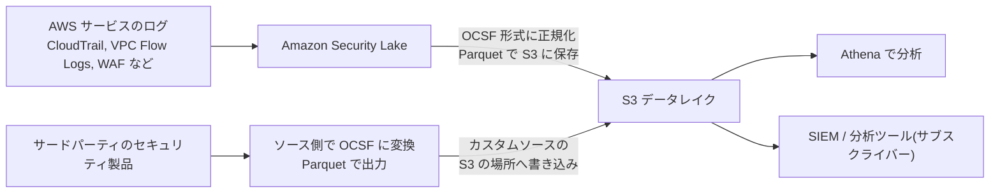

**ベストプラクティス**

- ログソースを個別に扱わず、**Amazon Security Lake** で OCSF に正規化して一元管理する。
- サードパーティ製品を取り込む場合は、Security Lake が変換するのではなく、**ソース側(製品や変換処理)で OCSF・Parquet 形式にしてから**カスタムソースの S3 の場所へ書き込む。Security Lake が自動で正規化するのは、ネイティブ対応の AWS サービスのログである。
- 保存先 S3 とサブスクライバーのアクセス権は最小権限にし、ロールアップ Region の設計も確認する。

#### 4.4.2 サードパーティ WAF ルール

| 選択肢 | 説明 |
|---|---|
| AWS マネージドルール | AWS が提供・更新。最も手軽 |
| AWS Marketplace のマネージドルールグループ | セキュリティベンダーが提供。購読して Web ACL に追加 |
| 自作ルール | 独自要件向け。運用負荷が高い |

**ベストプラクティス**

- 汎用的な脅威には**マネージドルール**を使い、最新の脅威への追従をベンダーに任せる。
- 追加したルールグループは **Count モードで検証**してから Block にする。
- ルールの WCU 消費と料金を確認し、Web ACL の上限内で運用する。

---

### 4.5 Task 3.1 まとめ(試験の着眼点)

| 要件の言い回し | 答えになりやすい選択肢 |
|---|---|
| 「オリジンの S3 に CloudFront 経由でのみアクセスさせたい」 | OAC + バケットポリシー |
| 「ALB への直接アクセスを防ぎ CloudFront 経由のみにしたい」 | CloudFront マネージドプレフィックスリスト、カスタムヘッダー検証 |
| 「ブラウザの別ドメインから S3 を呼び出すとエラーになる」 | S3 CORS 設定の確認 |
| 「特定の国だけ管理画面を拒否」 | WAF ジオ一致 + URI 条件 |
| 「同一 IP からの大量ログイン試行を抑止」 | レートベースルール(スコープダウン) |
| 「IP を変えながら攻撃してくるボット」 | JA3/JA4 フィンガープリント、Bot Control |
| 「多数のアカウントに同じ WAF ルールを強制」 | AWS Firewall Manager |
| 「各種ログを共通スキーマで一元化」 | Amazon Security Lake(OCSF) |
| 「IoT デバイスが自分のトピックのみ操作できるように」 | IoT ポリシー変数 |


---

## 5. Task 3.2 コンピュートワークロードのセキュリティ制御

コンピュートとは、EC2、コンテナ(ECS / EKS / Fargate)、Lambda など「コードが動く場所」です。**作る時(ビルド)・動かす時(ランタイム)・直す時(パッチ)・入る時(管理アクセス)**の 4 つの局面で守ります。

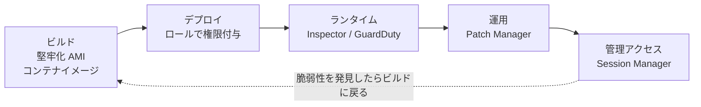

---

### 5.1 Skill 3.2.1 堅牢化(ハードニング)された EC2 AMI とコンテナイメージ

#### 何か

**堅牢化**とは、不要なソフトウェア・サービス・アカウント・ポートを取り除き、セキュリティ設定を適用した状態の「ひな形」(AMI / コンテナイメージ)を作ることです。起動するたびに同じ安全な状態から始められるので、設定のばらつき(ドリフト)を防げます。

#### 堅牢化の代表的な項目

| 項目 | 内容 |
|---|---|
| 不要パッケージの削除 | 使わないコンパイラ、ネットワークツール、デモアプリを削除 |
| 不要サービスの停止 | 使わないデーモンを無効化 |
| セキュリティベースラインの適用 | CIS Benchmarks など業界標準に準拠 |
| ログとエージェントの組み込み | SSM Agent、CloudWatch エージェントを最初から搭載 |
| 認証情報を埋め込まない | AMI にアクセスキーやパスワードを焼き込まない |
| IMDSv2 の既定化 | AMI 設定で IMDSv2 必須を既定にする |
| 暗号化 | AMI のスナップショットを KMS で暗号化 |

#### EC2 Image Builder によるパイプライン

**EC2 Image Builder** は、AMI やコンテナイメージの「作成・テスト・配布」を自動化するマネージドサービスです。

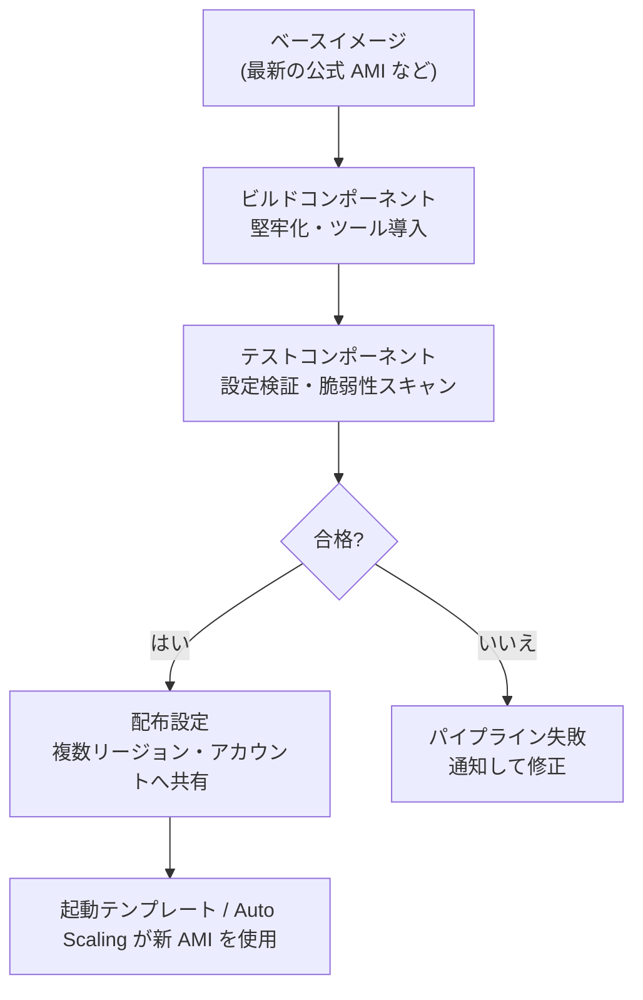

Image Builder のコンポーネントは YAML で記述します(例: 不要サービスの無効化)。

```yaml
name: HardenLinux
description: 不要サービスを停止し SSH のパスワード認証を無効化する
schemaVersion: 1.0
phases:
  - name: build
    steps:
      - name: DisableUnneededService
        action: ExecuteBash
        inputs:
          commands:
            - systemctl disable --now cups || true
      - name: DisablePasswordAuth
        action: ExecuteBash
        inputs:
          commands:
            - sed -i 's/^#\?PasswordAuthentication.*/PasswordAuthentication no/' /etc/ssh/sshd_config
  - name: test
    steps:
      - name: VerifyPasswordAuthDisabled
        action: ExecuteBash
        inputs:
          commands:
            - grep -q '^PasswordAuthentication no' /etc/ssh/sshd_config
```

#### コンテナイメージの堅牢化

| ベストプラクティス | 理由 |
|---|---|
| 最小ベースイメージ(minimal / distroless)を使う | 攻撃対象領域(アタックサーフェス)を減らす |
| **root 以外のユーザー**で実行する | コンテナ脱出時の被害を抑える |
| 読み取り専用ルートファイルシステムにする | 実行時の書き換えや不正ファイル設置を防ぐ |
| 秘密情報をイメージに含めない | 履歴レイヤーから漏れる。Secrets Manager や SSM Parameter Store から実行時に取得 |
| Amazon ECR の**プッシュ時スキャン / 継続スキャン**(Inspector 連携)を有効化 | 既知の脆弱性を早期発見 |
| タグを**イミュータブル**にする | 同じタグの上書きによる改ざんを防ぐ |
| イメージ署名と検証(AWS Signer など) | 出所不明のイメージの実行を防ぐ |
| 信頼できるレジストリのみ許可 | サプライチェーン攻撃の予防 |

```dockerfile
# 最小権限で動かすコンテナの例
FROM public.ecr.aws/docker/library/python:3.12-slim
RUN useradd --create-home appuser
WORKDIR /app
COPY --chown=appuser:appuser requirements.txt .
RUN pip install --no-cache-dir -r requirements.txt
COPY --chown=appuser:appuser . .
USER appuser
CMD ["python", "main.py"]
```

#### ベストプラクティス(まとめ)

- **ゴールデン AMI を定期的に再作成**する(パッチ込み)。古い AMI を使い続けない。
- 起動後に手作業で修正せず、**イミュータブルインフラ**(修正は新イメージで置き換える)を基本にする。
- AMI の共有は必要なアカウントのみとし、公開 AMI にしない。
- AWS Organizations の宣言型ポリシー等で、「承認された AMI のみ起動可能」とするガバナンスも検討する(Allowed AMIs 機能)。

#### 試験の着眼点

- 「AMI の作成・テスト・配布を自動化」→ **EC2 Image Builder**
- 「全インスタンスに同じ設定を継続的に適用・修復」→ **Systems Manager State Manager**
- 「起動後の手動変更を避けたい」→ イミュータブルなイメージ戦略

---

### 5.2 Skill 3.2.2 インスタンスプロファイル、サービスロール、実行ロールの適切な適用

#### 何か

コンピュートワークロードに**長期のアクセスキーを持たせず**、IAM ロールで一時認証情報を渡して AWS API を呼ばせる仕組みです。

#### ロールの種類と使い分け

| 名称 | 誰が引き受ける? | 使う場面 |
|---|---|---|
| **インスタンスプロファイル** | EC2 インスタンス | EC2 上のアプリが S3、DynamoDB、SSM を呼ぶ。プロファイルは IAM ロールを EC2 に渡す「入れ物」 |
| **Lambda 実行ロール** | Lambda 関数 | 関数が CloudWatch Logs に書く、他サービスを呼ぶ |
| **ECS タスクロール** | ECS タスク内のコンテナ | コンテナ内のアプリが AWS API を呼ぶ |
| **ECS タスク実行ロール** | ECS エージェント | イメージの ECR からの取得、ログ出力、シークレット取得 |
| **EKS: IRSA / EKS Pod Identity** | Kubernetes のサービスアカウント(Pod 単位) | Pod ごとに別の権限を与える |
| **サービスロール** | AWS サービス自体 | CloudFormation、CodePipeline など、サービスが自分の代わりに操作を実行 |
| **サービスにリンクされたロール** | AWS サービス | サービスが事前定義した権限で自分のために使う。ユーザーは編集不可 |

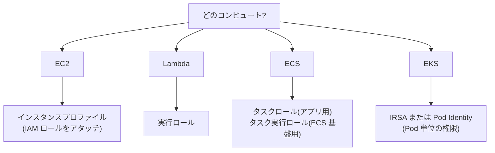

#### EC2 用ロールの信頼ポリシー(誰がロールを引き受けられるか)

```json
{
  "Version": "2012-10-17",
  "Statement": [
    {
      "Effect": "Allow",
      "Principal": { "Service": "ec2.amazonaws.com" },
      "Action": "sts:AssumeRole"
    }
  ]
}
```

> **ポイント**: ロールには 2 種類のポリシーがあります。**信頼ポリシー**(誰が引き受けられるか)と**権限ポリシー**(引き受けた後に何ができるか)。試験の「AssumeRole が失敗する」系のトラブルは、信頼ポリシーを疑います。

#### ベストプラクティス

- **IAM ユーザーのアクセスキーを EC2 やコンテナに置かない**。必ずロールを使う。
- **最小権限**: ワークロードごとに別ロールを作り、必要な API とリソースだけ許可する。
- **IMDSv2 を必須にする**。IMDSv1 は SSRF 攻撃でロールの一時認証情報が盗まれるリスクがある。
- コンテナで IMDS に到達させない設計(**ホップ制限を 1**、Pod Identity や IRSA を使う)も有効。
- 条件キー(`aws:SourceArn`、`aws:SourceAccount` など)で**混乱した代理(confused deputy)**を防ぐ。
- **アクセス許可の境界**や SCP でロールの上限を縛る。

IMDSv2 を必須にする CLI の例:

```bash
# 既存インスタンスを IMDSv2 必須にする(ホップ数は 1)
aws ec2 modify-instance-metadata-options \
  --instance-id i-0123456789abcdef0 \
  --http-tokens required \
  --http-put-response-hop-limit 1 \
  --http-endpoint enabled
```

SCP で「IMDSv2 でない起動」を禁止する例:

```json
{
  "Version": "2012-10-17",
  "Statement": [
    {
      "Sid": "DenyRunInstancesWithoutIMDSv2",
      "Effect": "Deny",
      "Action": "ec2:RunInstances",
      "Resource": "arn:aws:ec2:*:*:instance/*",
      "Condition": {
        "StringNotEquals": { "ec2:MetadataHttpTokens": "required" }
      }
    }
  ]
}
```

#### 試験の着眼点

- 「EC2 上のアプリがコードに認証情報を書かずに S3 へアクセス」→ **インスタンスプロファイル**
- 「ECS で、タスク内のアプリと ECS 基盤で権限を分けたい」→ **タスクロール**と**タスク実行ロール**を分離
- 「EKS で Pod ごとに別権限」→ **IRSA / Pod Identity**
- 「SSRF によるメタデータ窃取の対策」→ **IMDSv2 必須**

---

### 5.3 Skill 3.2.3 コンピュートリソースの既知の脆弱性スキャン

試験ガイドの例示: **Amazon Inspector でコンテナイメージと Lambda 関数をスキャン、GuardDuty でコンピュートランタイムを監視**。

#### Amazon Inspector

**Amazon Inspector** は、ワークロードの**既知の脆弱性(CVE)と意図しないネットワーク露出**を自動かつ継続的にスキャンするサービスです。

| スキャン対象 | 内容 |
|---|---|
| EC2 インスタンス | OS とアプリのパッケージの脆弱性、ネットワーク到達性 |
| ECR のコンテナイメージ | イメージ内のパッケージの脆弱性 |
| Lambda 関数 | 関数コードと依存ライブラリ(パッケージ)の脆弱性 |

主な特徴:

- 対象を**自動検出**し、新しい脆弱性情報が出ると**再スキャン**する(継続スキャン)。
- 検出結果に**Inspector リスクスコア**が付き、優先順位付けしやすい。
- 結果は **EventBridge** に流せて、自動修復や通知につなげられる。AWS Security Hub にも連携。
- 組織全体で、**委任管理者アカウント**から一括有効化できる。

#### Amazon GuardDuty ランタイムモニタリング

**GuardDuty** は脅威検出サービスで、**ランタイムモニタリング**を有効にすると、EC2、ECS(Fargate を含む)、EKS のワークロードの**実行中の挙動**(ファイルアクセス、プロセス実行、ネットワーク接続など)を監視し、不審な活動を検出します。

| 観点 | Amazon Inspector | Amazon GuardDuty(ランタイム) |
|---|---|---|
| 目的 | **脆弱性**を見つける(予防) | **脅威・不審な挙動**を見つける(検知) |
| タイミング | 静的、継続的スキャン | 実行中の挙動を監視 |
| 例 | 「このパッケージに CVE がある」 | 「このコンテナから暗号資産マイニングのプールへ通信している」 |

> **覚え方**: Inspector = 「弱いところ探し」、GuardDuty = 「悪い動き探し」。両方を併用するのが定石。

#### ベストプラクティス

- 組織全体で Inspector と GuardDuty を**自動有効化**する。
- ECR は**プッシュ時と継続**の両方をスキャンする。
- 検出結果を Security Hub に集約し、**重大度・悪用可能性**で優先順位付けする。
- 修復までの SLA(例: Critical は数日以内)を決めて運用する。

#### 試験の着眼点

- 「Lambda 関数の依存ライブラリの脆弱性」→ **Inspector**
- 「EKS 上の Pod でのマルウェア / 不審なプロセス実行」→ **GuardDuty ランタイムモニタリング**
- 「EC2 の脆弱性を最小の運用負荷で継続的に検出」→ **Inspector**(SSM Agent 利用)

---

### 5.4 Skill 3.2.4 パッチ適用の自動化と継続的検証

試験ガイドの例示: **Systems Manager Patch Manager、Amazon Inspector**。

#### Systems Manager Patch Manager

**Patch Manager** は、マネージドノード(EC2 やオンプレミスサーバー)に対して、パッチの**スキャン(不足の確認)とインストール**を自動化します。

| 構成要素 | 役割 |
|---|---|
| **パッチベースライン** | どのパッチを承認するかの定義(分類、重大度、自動承認までの待機日数、除外など) |
| **パッチグループ** | タグで対象インスタンスをまとめる(例: 本番、開発) |
| **メンテナンスウィンドウ** | パッチ適用を実行する時間帯を指定 |
| **コマンドドキュメント** | `AWS-RunPatchBaseline` が実際にスキャン / インストールを実行 |
| **パッチポリシー** | Quick Setup で、Organizations 全体に一括でパッチ設定を展開 |
| **コンプライアンスレポート** | 各ノードのパッチ適用状況を可視化 |

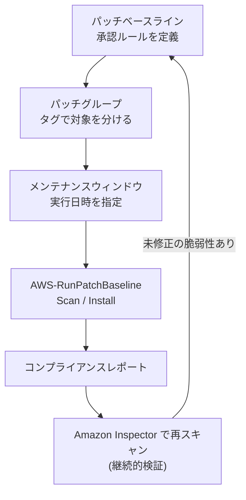

AWS CLI でスキャンのみ / インストールを実行する例:

```bash
# 不足パッチを確認するだけ(Scan)
aws ssm send-command \
  --document-name "AWS-RunPatchBaseline" \
  --targets "Key=tag:Patch Group,Values=prod" \
  --parameters "Operation=Scan"

# パッチをインストール(必要に応じて再起動)
aws ssm send-command \
  --document-name "AWS-RunPatchBaseline" \
  --targets "Key=tag:Patch Group,Values=prod" \
  --parameters "Operation=Install,RebootOption=RebootIfNeeded"
```

#### ベストプラクティス

- **まず開発 → 検証 → 本番**の順に段階展開する(パッチグループごとにウィンドウをずらす)。
- 自動承認には**待機日数**を設定し、不具合パッチの影響を避ける。
- **Scan だけ毎日、Install は計画ウィンドウで**という分離運用も有効。
- **Inspector と組み合わせて「パッチ後に実際に脆弱性が消えたか」を検証**する(継続的検証)。
- コンテナや Lambda は「パッチを当てる」のではなく、**修正済みイメージ / 依存関係で再デプロイ**する。
- 長期稼働のインスタンスを減らし、AMI の再作成で更新するイミュータブル運用が理想。

#### 試験の着眼点

- 「複数アカウント・複数 Region に一貫したパッチポリシーを展開」→ **Patch Manager のパッチポリシー(Quick Setup)**
- 「本番インスタンスだけ日曜深夜にパッチ」→ **メンテナンスウィンドウ + パッチグループ**
- 「パッチ適用後の検証」→ **Inspector**

---

### 5.5 Skill 3.2.5 コンピュートリソースへの安全な管理アクセス

試験ガイドの例示: **Systems Manager Session Manager、EC2 Instance Connect**。

#### 従来方式の問題

| 従来の方式 | 問題 |
|---|---|
| インターネットから SSH(22)や RDP(3389)を開放 | 常時攻撃を受ける |
| 踏み台(Bastion)ホストの運用 | 踏み台自体の管理・パッチ・鍵管理が必要 |
| 長期 SSH 鍵の共有 | 退職者対応、漏えい、鍵のローテーションが困難 |

#### Session Manager(推奨)

**Session Manager** は、**インバウンドポートを一切開けず**、SSH 鍵も使わずに、ブラウザ / CLI からインスタンスへシェル接続できる仕組みです。接続は IAM で認可され、セッションの開始・終了などの API 呼び出しは CloudTrail に記録されます。シェルなど対話型セッションの操作内容は、セッションログ(CloudWatch Logs / S3)に記録できます(ポートフォワーディングと SSH セッションは内容のログ記録に対応していません)。

| 要件 | 内容 |
|---|---|
| SSM Agent | インスタンスで稼働(Amazon Linux などは標準) |
| インスタンスプロファイル | `AmazonSSMManagedInstanceCore` 相当の権限 |
| ネットワーク | SSM のエンドポイントへ到達できる(NAT ゲートウェイ、または VPC エンドポイント) |
| ユーザー側 IAM | `ssm:StartSession` を許可 |

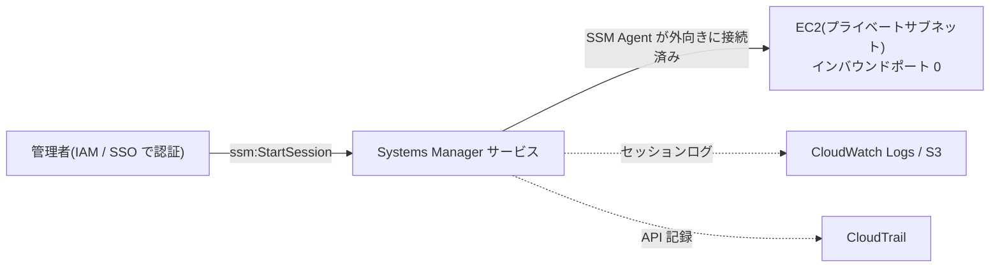

プライベートサブネットで NAT ゲートウェイを使わずに接続する場合は、次の **VPC インターフェイスエンドポイント**が必要です。`ssm` と `ssmmessages` は必須で、`ec2messages` は対応リージョンかつ SSM Agent が必要とする場合のみ追加します。

| エンドポイント | 用途 | 必要性 |
|---|---|---|
| `com.amazonaws.<region>.ssm` | Systems Manager API | 必須 |
| `com.amazonaws.<region>.ssmmessages` | Session Manager のセッション通信 | 必須 |
| `com.amazonaws.<region>.ec2messages` | SSM Agent の通信 | 対応リージョンで、SSM Agent が必要とする場合のみ(新しい SSM Agent は `ssmmessages` を優先使用) |

特定タグのインスタンスだけ接続を許可する IAM ポリシー例(タグ条件はインスタンスにのみ付け、セッションドキュメントは別ステートメントで許可します):

```json
{
  "Version": "2012-10-17",
  "Statement": [
    {
      "Effect": "Allow",
      "Action": "ssm:StartSession",
      "Resource": "arn:aws:ec2:ap-northeast-1:111122223333:instance/*",
      "Condition": {
        "StringEquals": { "aws:ResourceTag/Environment": "dev" }
      }
    },
    {
      "Effect": "Allow",
      "Action": "ssm:StartSession",
      "Resource": [
        "arn:aws:ssm:ap-northeast-1:111122223333:document/SSM-SessionManagerRunShell",
        "arn:aws:ssm:ap-northeast-1::document/AWS-StartPortForwardingSessionToRemoteHost"
      ]
    },
    {
      "Effect": "Allow",
      "Action": "ssmmessages:OpenDataChannel",
      "Resource": "arn:aws:ssm:*:*:session/${aws:userid}-*"
    }
  ]
}
```

```bash
# セッション開始
aws ssm start-session --target i-0123456789abcdef0

# ローカルポートフォワーディング(例: プライベート RDS へ)
aws ssm start-session \
  --target i-0123456789abcdef0 \
  --document-name AWS-StartPortForwardingSessionToRemoteHost \
  --parameters '{"host":["mydb.example.internal"],"portNumber":["5432"],"localPortNumber":["15432"]}'
```

#### EC2 Instance Connect

**EC2 Instance Connect** は、接続のたびに**一時的な SSH 公開鍵**を API で送り込んで SSH 接続する仕組みです(公開鍵は短時間のみ有効)。**EC2 Instance Connect Endpoint** を使うと、パブリック IP を持たないインスタンスにもインターネットを経由せず接続できます。

| 比較 | Session Manager | EC2 Instance Connect |
|---|---|---|
| 接続プロトコル | SSM 独自(WebSocket 等) | SSH(Linux)など |
| 22 番ポート | **不要** | 必要(ただし SG は EIC Endpoint 等に限定できる) |
| 鍵管理 | 不要 | 一時鍵を自動配布(長期鍵を管理しない) |
| 監査 | シェルなど対話型セッションはセッションログ(CloudWatch / S3)に操作内容を記録可(ポートフォワーディング・SSH は内容を記録できない) | CloudTrail に接続 API を記録(操作内容は記録されない) |
| 向く場面 | 基本の第一選択、監査要件が強い場合 | 既存の SSH ツールを使いたい場合 |

#### ベストプラクティス

- SSH / RDP の**パブリック開放をやめる**(0.0.0.0/0 からの 22 / 3389 は禁止)。
- **Session Manager を第一選択**にし、セッションを CloudWatch Logs / S3 に**暗号化して**記録する。
- IAM 条件(タグ、MFA、送信元)で「誰が・どのインスタンスに」接続できるかを絞る。
- 緊急用アクセス(ブレークグラス)の手順と承認フローを決める。
- Config や Security Hub で「SG の 22 番ポート全開放」を検出してアラートする。

#### 試験の着眼点

- 「インバウンドポートを開けず、監査ログも残して管理接続」→ **Session Manager**
- 「SSH 鍵を長期保管せずに SSH 接続」→ **EC2 Instance Connect**
- 「プライベートインスタンスへ踏み台なしで SSH」→ **EC2 Instance Connect Endpoint**

---

### 5.6 Skill 3.2.6 パイプライン内の脆弱性の検出と修復のためのセキュリティツール設定

試験ガイドの例示: **Amazon Q Developer、Amazon CodeGuru Security**(CodeGuru Security は 2025-11-20 にサポート終了)。

#### 何か

**シフトレフト**、つまり脆弱性を**本番に出る前(開発・CI/CD の段階)**で見つけて直す考え方です。

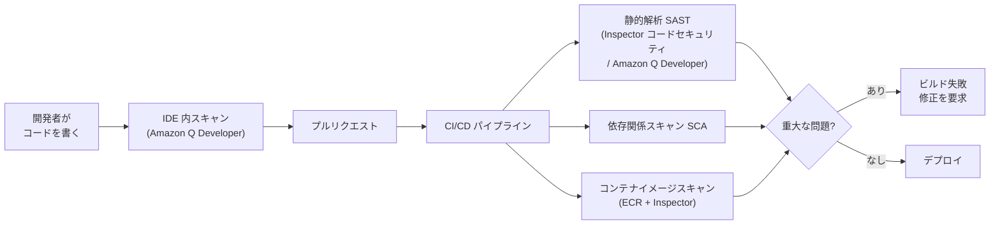

| ツール | できること |
|---|---|
| **Amazon Q Developer** | IDE やコマンドラインでのセキュリティスキャン、脆弱性の指摘、修正案の提示 |
| **Amazon Inspector コードセキュリティ** | GitHub / GitLab のリポジトリを対象に、SAST・依存関係(SCA)・IaC のスキャンを行い、CI/CD に組み込める。CodeGuru Security の後継として推奨 |
| **Amazon CodeGuru Security(提供終了)** | 2025-11-20 にサポート終了。試験ガイドの用語として残っているが、新規の CI/CD 導入には Inspector コードセキュリティまたは Amazon Q Developer を使う |
| **Amazon ECR + Inspector** | ビルドしたコンテナイメージの脆弱性スキャン |
| **IaC のポリシー検査(cfn-guard など)** | CloudFormation / IaC の設定ミス(公開 S3、広すぎる SG など)をデプロイ前に検出 |

> **補足**: 試験ガイドには CodeGuru Security が記載されていますが、同サービスは 2025-11-20 にサポートを終了しています。試験では「CI でコードの脆弱性を検出する SAST」の役割として理解し、実務では Amazon Inspector のコードセキュリティや Amazon Q Developer を使います。

#### ベストプラクティス

- **脆弱性の重大度に応じてパイプラインをゲート**する(Critical / High は失敗扱い)。
- ハードコードされたシークレットの検出を必須にし、秘密情報は Secrets Manager / Parameter Store で管理する。
- パイプラインのロールは**最小権限**にし、デプロイ先アカウントごとに分ける。
- 依存ライブラリは**バージョン固定**と**定期更新**の両方を行う(サプライチェーン対策)。
- スキャン結果は**修正まで追跡**する(チケット化、Security Hub 集約)。

#### 試験の着眼点

- 「コードコミット前、または CI でコード内の脆弱性を検出し修正案がほしい」→ **Amazon Q Developer / Inspector コードセキュリティ**(選択肢に CodeGuru Security が出たら、試験ガイド上の同じ役割として扱う。サービス自体は提供終了)
- 「本番稼働中の EC2 の CVE」→ Inspector(パイプラインではなくランタイム)

---

### 5.7 Skill 3.2.7 生成 AI アプリケーションの保護とガードレール

試験ガイドの例示: **GenAI OWASP Top 10 for LLM Applications** の保護策の適用。SCS-C03 で新しく加わった観点です。

#### OWASP Top 10 for LLM Applications(2025 年版)と AWS での対策

| ID | 脅威 | 概要 | AWS での主な対策 |
|---|---|---|---|
| LLM01 | プロンプトインジェクション | 入力で LLM の指示を乗っ取る | Amazon Bedrock Guardrails のプロンプト攻撃フィルター、入力検証、権限分離 |
| LLM02 | 機密情報の漏えい | 個人情報や機密がモデル出力に混入 | Guardrails の機密情報フィルター(PII のマスク / ブロック)、データ分類、最小権限 |
| LLM03 | サプライチェーン | 汚染されたモデル、ライブラリ、データ | 信頼できるモデル提供元、イメージ / 依存関係のスキャン、アクセス制御 |
| LLM04 | データとモデルの汚染 | 学習・RAG データの改ざん | データソースの書き込み権限の制限、整合性検証、バージョン管理 |
| LLM05 | 不適切な出力処理 | 出力をそのまま実行・表示して攻撃に | 出力のサニタイズ、エスケープ、Guardrails の出力フィルター |
| LLM06 | 過剰なエージェンシー | AI に与えた権限・機能が過大 | エージェントのロールを最小権限にする、重要操作は人間の承認 |
| LLM07 | システムプロンプトの漏えい | 内部指示や秘密が引き出される | システムプロンプトに秘密を入れない、Guardrails |
| LLM08 | ベクトルと埋め込みの脆弱性 | RAG のベクトルストアの権限不備 | ベクトルストアのアクセス制御・テナント分離・暗号化 |
| LLM09 | 誤情報 | もっともらしい誤回答 | Guardrails の**コンテキスト根拠チェック**、RAG の出典提示 |
| LLM10 | 無制限の消費 | 過剰リクエストでコスト増・DoS | WAF レートベースルール、API Gateway の使用量プラン、クォータ、予算アラート |

> 出典の整理は OWASP GenAI Security Project の LLM Top 10 に基づきます。項目名・順位は版により異なるため、最新版は「10. 参考 URL」で確認してください。

#### Amazon Bedrock Guardrails の機能

| 機能 | 内容 |
|---|---|
| コンテンツフィルター | 有害コンテンツ(暴力、ヘイトなど)を入力・出力の両方で検出 |
| プロンプト攻撃フィルター | ジェイルブレイクやプロンプトインジェクションを検出 |
| 拒否トピック | 扱ってはいけない話題を定義してブロック |
| 単語フィルター | 特定の単語・フレーズをブロック |
| 機密情報フィルター | PII を検出してブロックまたはマスク |
| コンテキスト根拠チェック | 回答が参照元に基づくか、質問に関連するかを確認(ハルシネーション抑制) |

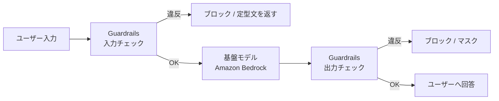

ApplyGuardrail API を単独で呼ぶ例(任意のモデルの前後でチェックできる):

```python
import boto3

client = boto3.client("bedrock-runtime", region_name="ap-northeast-1")

response = client.apply_guardrail(
    guardrailIdentifier="gr-xxxxxxxx",
    guardrailVersion="1",
    source="INPUT",  # 出力側をチェックするときは "OUTPUT"
    content=[{"text": {"text": "ユーザーが入力した文章"}}],
)

if response["action"] == "GUARDRAIL_INTERVENED":
    print("ガードレールが介入しました")
else:
    print("問題なし")
```

#### ベストプラクティス

- **入力と出力の両方**にガードレールを適用する。
- **モデルやエージェントの IAM ロールは最小権限**。AI に与える「ツール」「API」も絞る(LLM06 対策)。
- **Bedrock への通信は VPC エンドポイント(PrivateLink)**で閉域化し、モデル呼び出しログを有効化して監査する。
- RAG のデータソースは**アクセス権に応じて分離**し、ベクトルストアの権限を厳格にする。
- API の前段に **WAF とレート制限**を置き、無制限消費を防ぐ。
- 重要な操作(削除、送金など)は**人間の承認**を挟む。
- 機密情報を学習・プロンプトに入れない設計にする(データ分類と連動)。

#### 試験の着眼点

- 「ユーザー入力経由のジェイルブレイクを防ぐ」→ **Guardrails のプロンプト攻撃フィルター**
- 「出力に含まれる個人情報をマスク」→ **Guardrails の機密情報フィルター**
- 「AI エージェントが過剰な操作をしてしまう」→ **ロールの最小権限、人の承認**
- 「GenAI API への大量リクエストでコスト急増」→ **WAF レートベース、クォータ**

---

### 5.8 Task 3.2 まとめ(試験の着眼点)

| 要件の言い回し | 答えになりやすい選択肢 |
|---|---|
| 「承認済みの堅牢な AMI を自動で作成・配布」 | EC2 Image Builder |
| 「アクセスキーなしで EC2 から AWS を操作」 | インスタンスプロファイル |
| 「Lambda に必要な権限だけを付与」 | 実行ロール(最小権限) |
| 「Lambda、ECR、EC2 の CVE を継続検出」 | Amazon Inspector |
| 「ランタイムの不審な挙動を検出」 | GuardDuty ランタイムモニタリング |
| 「パッチを計画的・自動的に適用し、結果を確認」 | Patch Manager + メンテナンスウィンドウ + Inspector |
| 「22 / 3389 を開けずに管理接続し、操作を記録」 | Session Manager |
| 「CI でコードの脆弱性を検出」 | Amazon Q Developer / Inspector コードセキュリティ(旧 CodeGuru Security は提供終了) |
| 「LLM のプロンプトインジェクション対策」 | Bedrock Guardrails |


---

## 6. Task 3.3 ネットワークセキュリティ制御の設計とトラブルシューティング

### 6.1 Skill 3.3.1 通信の許可・拒否の制御(セキュリティグループ、NACL、AWS Network Firewall)

#### 3 つの制御の違い

| 項目 | セキュリティグループ(SG) | ネットワーク ACL(NACL) | AWS Network Firewall |
|---|---|---|---|
| 適用単位 | ENI(インスタンス等)単位 | サブネット単位 | VPC 内のファイアウォールエンドポイント経由 |
| ステートフル性 | **ステートフル**(戻り通信は自動許可) | **ステートレス**(戻り通信も明示が必要) | ステートレスエンジンとステートフルエンジンの両方 |
| ルールの種類 | **許可のみ** | **許可と拒否** | 許可、拒否、アラート、ドロップ |
| 評価方法 | すべてのルールを評価 | **番号の小さい順**に評価し、最初に一致したもので決定 | ルールグループの順序とエンジンに従う |
| 参照先 | IP、プレフィックスリスト、**他の SG** | IP の CIDR のみ | IP、ドメイン、Suricata 互換ルール、TLS 検査 |
| 主な用途 | ワークロード単位の最小権限 | サブネット境界の粗い制御、特定 IP の明示的拒否 | VPC 境界の高度な検査(ドメインフィルタ、IPS) |

> **最重要の違い**: SG は「**許可のみ・ステートフル**」、NACL は「**許可と拒否・ステートレス**」。この 2 点は頻出です。

#### パケットが通る順序の考え方

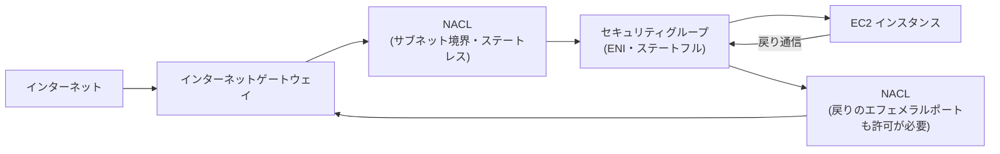

NACL はステートレスなので、**戻り通信用のエフェメラルポート(例: 1024-65535)を許可しないと通信が成立しない**のがよくある落とし穴です。

#### セキュリティグループのベストプラクティス

- **デフォルトで拒否**。必要なポートと送信元だけを許可する。
- 送信元に **別の SG を参照**する(例: アプリ層 SG は ALB の SG からのみ許可)。IP アドレス変更に強く、意図が明確。
- **0.0.0.0/0 からの SSH / RDP / DB ポートの開放は禁止**。
- 層ごとに SG を分ける(Web 層、アプリ層、DB 層)。
- アウトバウンドも必要なものに絞る(データ持ち出しの抑止)。
- 管理しやすいよう、**マネージドプレフィックスリスト**を活用する。
- AWS Config、Security Hub、Firewall Manager で SG ルールを継続監査・是正する。

3 層の SG 参照の例(CLI):

```bash
# ALB 用 SG: インターネットから 443 を許可
aws ec2 authorize-security-group-ingress \
  --group-id sg-0alb000000000000 \
  --protocol tcp --port 443 --cidr 0.0.0.0/0

# アプリ用 SG: ALB の SG からのみ 8080 を許可(IP ではなく SG を参照)
aws ec2 authorize-security-group-ingress \
  --group-id sg-0app00000000000 \
  --protocol tcp --port 8080 \
  --source-group sg-0alb000000000000

# DB 用 SG: アプリ SG からのみ 5432 を許可
aws ec2 authorize-security-group-ingress \
  --group-id sg-0db000000000000 \
  --protocol tcp --port 5432 \
  --source-group sg-0app00000000000
```

#### NACL のベストプラクティス

- SG を主役にし、NACL は**サブネット単位の追加の安全網**として使う。
- ルール番号は**間隔(10, 20, 30...)をあけて**付け、後からの挿入を容易にする。
- 特定の悪意ある IP を**明示的に拒否**したいときは NACL(SG には拒否ルールがない)。
- **戻り通信(エフェメラルポート)**の許可を忘れない。
- 最後の `*` ルール(暗黙の拒否)があることを理解する。

#### AWS Network Firewall

**AWS Network Firewall** は VPC 向けのマネージドなステートフル・ネットワークファイアウォールです。SG や NACL ではできない**ドメイン単位のフィルタリング、侵入防止(IPS)、TLS 検査**ができます。

| 機能 | 内容 |
|---|---|
| ステートレスルール | 高速なパケット単位の許可・拒否 |
| ステートフルルール | 接続の文脈を見て判定。5-tuple、ドメインリスト、**Suricata 互換**ルール |
| ドメインリスト | 許可 / 拒否するドメイン名を指定(アウトバウンドの送信先制限) |
| TLS 検査 | 暗号化通信の中身を検査(証明書は ACM で管理) |
| ログ | アラートログとフローログを CloudWatch Logs / S3 / Firehose へ |
| 集中管理 | Firewall Manager で組織全体に展開 |

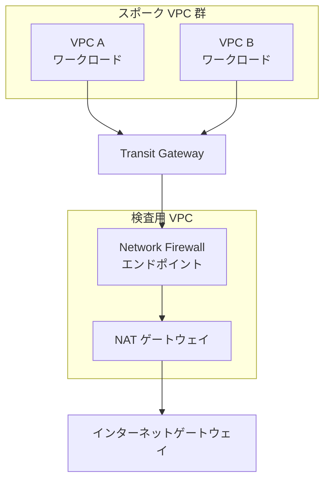

ドメイン許可リスト(ステートフル・Suricata 形式)の例:

```text
# ルール変数(集中検査では HOME_NET を検査 VPC の CIDR だけにせず、スポーク VPC の CIDR を含める)
# HOME_NET     = [10.1.0.0/16, 10.2.0.0/16]   # スポーク VPC A / B
# EXTERNAL_NET = !$HOME_NET                    # 拡張した HOME_NET 以外
# api.example.com と updates.example.org 以外への HTTPS を拒否するルール例(概念例)
pass tls $HOME_NET any -> $EXTERNAL_NET 443 (tls.sni; content:"api.example.com"; nocase; startswith; endswith; flow:to_server; sid:1000001; rev:1;)
pass tls $HOME_NET any -> $EXTERNAL_NET 443 (tls.sni; content:"updates.example.org"; nocase; startswith; endswith; flow:to_server; sid:1000002; rev:1;)
drop tls $HOME_NET any -> $EXTERNAL_NET 443 (msg:"Blocked non-allowlisted domain"; flow:to_server; sid:1000003; rev:1;)
```

> Network Firewall の `HOME_NET` は既定で検査 VPC の CIDR になるため、そのままではスポーク VPC 発の通信が `$HOME_NET` に一致せず、許可ルールが効きません。ルールグループのルール変数で `HOME_NET` にスポーク VPC の CIDR を加え、`EXTERNAL_NET` はその否定として扱います。
>
> 実運用では、ドメインリスト型ルールグループ(許可リスト方式)を使うと簡単に書けます。上記は仕組みの理解用です。

**関連する仲間のサービス**

| サービス | 役割 |
|---|---|
| Route 53 Resolver DNS Firewall | DNS クエリ段階で悪意あるドメインへの名前解決をブロック(データ持ち出し対策) |
| Gateway Load Balancer | サードパーティの仮想アプライアンスを透過的に挟み込む |
| VPC エンドポイント(ゲートウェイ型 / インターフェイス型) | AWS サービスへインターネットを経由せず接続 |

#### 試験の着眼点

- 「特定 IP を明示的にブロック」→ **NACL の拒否ルール**
- 「ステートフル、戻り通信を自動で許可」→ **セキュリティグループ**
- 「アウトバウンドをドメイン名で許可リスト化」→ **Network Firewall(ドメインリスト)**、または DNS Firewall
- 「VPC 間・オンプレミス間の通信を集中検査」→ **Transit Gateway + Network Firewall**

---

### 6.2 Skill 3.3.2 ハイブリッド / マルチクラウド間の安全な接続の設計

試験ガイドの例示: **AWS Site-to-Site VPN、AWS Direct Connect、MACsec**。

#### 接続方式の比較

| 項目 | Site-to-Site VPN | Direct Connect(DX) | DX + MACsec | DX 上の VPN |
|---|---|---|---|---|
| 経路 | インターネット経由(IPsec で暗号化) | 専用線(閉域) | 専用線 | 専用線の上に IPsec |
| 暗号化 | **IPsec で暗号化** | **標準では暗号化されない** | **レイヤー 2 で暗号化(IEEE 802.1AE)** | IPsec で暗号化 |
| 帯域・品質 | インターネット品質に依存 | 安定・低遅延 | 同左 | 同左 |
| 導入の速さ | 速い(数分〜) | 遅い(回線手配) | 遅い | 遅い |
| 向く場面 | 迅速な接続、DX のバックアップ | 大容量・安定性・閉域要件 | **回線レベルの暗号化要件** | 閉域 + エンドツーエンドの IPsec 要件 |

> **重要**: **Direct Connect 自体は暗号化されません**。暗号化が必要なら、**MACsec**(専用接続で対応、レイヤー 2)や、**DX 上の VPN(IPsec)**を併用します。

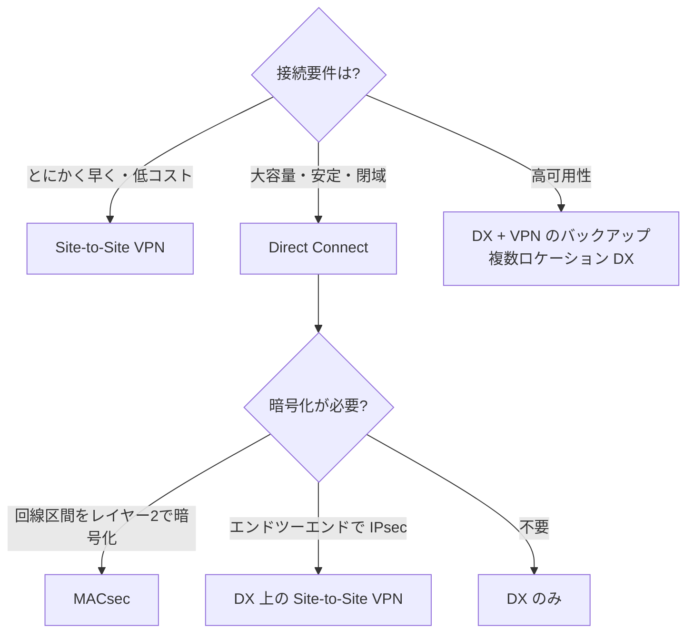

#### ベストプラクティス

- **冗長化**: VPN は 2 本のトンネルを両方使い、オンプレミス側の機器も冗長にする。DX は**複数ロケーション・複数回線**にする。
- DX のバックアップに **Site-to-Site VPN** を用意する。
- 複数 VPC・拠点を束ねるなら **Transit Gateway** で集約し、ルートテーブルで分離する。
- ルーティングは BGP を使い、**受け入れるプレフィックスを制限**する。
- マルチクラウド接続でも、**暗号化と認証、最小限のルート広告**を徹底する。
- 回線やトンネルの状態を CloudWatch で監視する。

---

### 6.3 Skill 3.3.3 ハイブリッド環境と AWS 間の通信に必要なセキュリティ要件の決定(AWS Verified Access)

#### 何か

**AWS Verified Access** は、VPN なしで社内アプリケーションへ**ゼロトラスト**なアクセスを提供するサービスです。アクセスのたびに、**ユーザーの ID** をポリシーで評価して許可・拒否します。**デバイスの状態**も評価したい場合は、デバイス信頼プロバイダーを設定し、そのデータを参照するポリシーを書く必要があります(既定で自動評価されるわけではありません)。

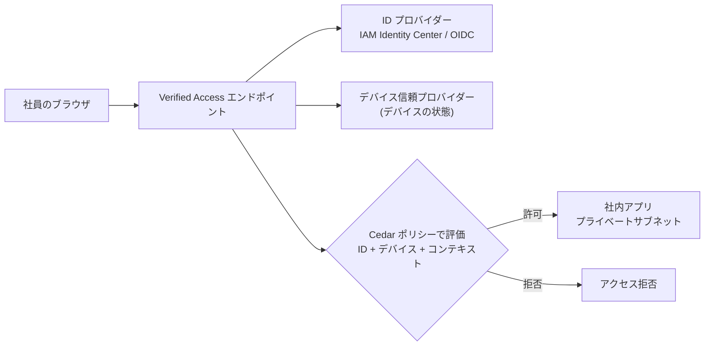

| 比較 | 従来の VPN | Verified Access |
|---|---|---|
| アクセス範囲 | ネットワーク全体に入れてしまいがち | **アプリ単位**で許可 |
| 認可の根拠 | 接続できたか(ネットワーク位置) | **ユーザーとデバイスの状態を毎回評価** |
| クライアント | VPN クライアントが必要 | 主にブラウザで利用可(HTTP(S) アプリ向け) |
| 監査 | 接続ログ中心 | アクセスごとのログ |

#### ベストプラクティス

- 「社内ネットワークにいるから信頼する」をやめ、**ID とデバイスの状態に基づく最小権限**にする。
- アプリごと(またはグループごと)に Verified Access のポリシーを書き、**ポリシーを細かく分ける**。
- Verified Access の前に **AWS WAF** を関連付け、攻撃をブロックする。
- アクセスログを有効化し、SIEM / Security Lake に連携する。
- ハイブリッド環境では、VPN / DX と併用して、**アプリごとに適切な経路を選ぶ**。

#### 試験の着眼点

- 「VPN なしで、ユーザーとデバイスの状態に基づき社内アプリへアクセスさせたい」→ **AWS Verified Access**
- 「ゼロトラスト」「デバイス姿勢」のキーワード → Verified Access

---

### 6.4 Skill 3.3.4 セキュリティ要件に基づくネットワークセグメンテーションの設計

試験ガイドの例示: **南北 / 東西トラフィックの保護、分離サブネット**。

#### セグメンテーションとは

ネットワークを**用途と重要度で区切り**、侵害されても被害が広がらないようにする設計(爆発半径の縮小)です。

| 手段 | 分離の強さ | 説明 |
|---|---|---|
| **アカウント分離** | 非常に強い | 本番 / 開発 / セキュリティを別アカウントに(Organizations) |
| **VPC 分離** | 強い | 環境やシステムごとに VPC を分ける |
| **サブネット分離** | 中 | 層(Web / アプリ / DB)ごとにサブネットを分ける |
| **SG による分離** | 細かい | ワークロード間の通信を SG 参照で制御 |
| **NACL / Network Firewall** | 境界制御 | サブネット境界・VPC 境界での追加制御 |

#### 3 層構成の例(南北と東西の保護)

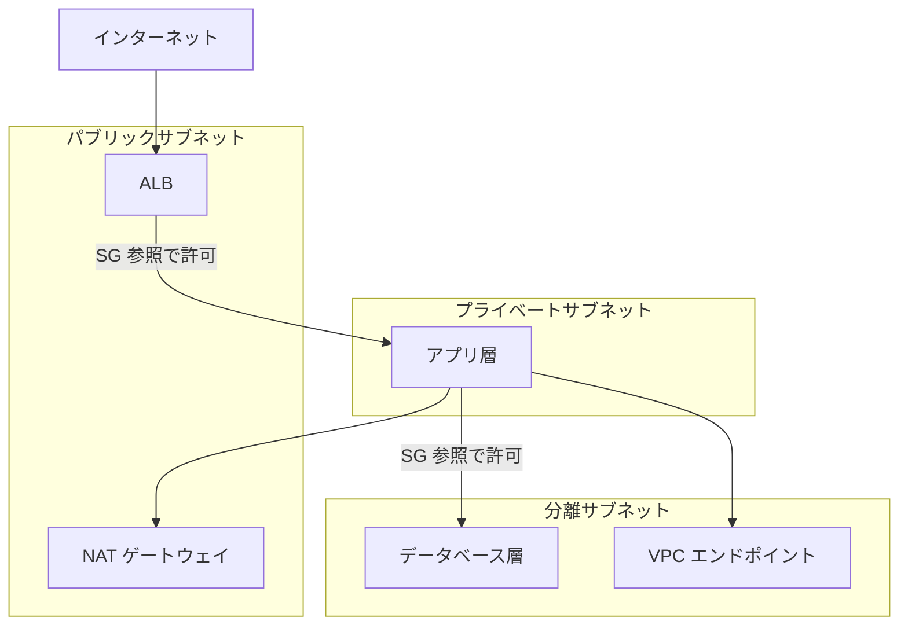

- **南北トラフィック**(外 ↔ VPC): WAF、ALB、Network Firewall、NAT ゲートウェイ、VPN / DX でコントロール。
- **東西トラフィック**(VPC 内、VPC 間): **SG 参照、NACL、Transit Gateway のルートテーブル分離、Network Firewall** でコントロール。

#### ベストプラクティス

- **DB は分離サブネット**に置き、インターネット向け経路を持たせない。AWS サービスへは **VPC エンドポイント**で接続する。
- **VPC エンドポイントポリシー**で、使える API・リソースを絞る(データ持ち出し防止)。
- アウトバウンドの経路を制限する(NAT 経由に集約し、Network Firewall / DNS Firewall で制御)。
- Transit Gateway では、**環境ごとにルートテーブルを分けて**本番と開発間の通信を遮断する。
- 管理用の経路(踏み台や Session Manager)と業務用の経路を分ける。
- IaC でネットワークを**コード化**し、差分を継続検出する(ドリフト検知)。
- **VPC Flow Logs** を有効化し、通信を可視化・分析する。

#### 試験の着眼点

- 「DB がインターネットに一切出てはならない」→ **分離サブネット + VPC エンドポイント**
- 「環境間の通信を遮断して爆発半径を抑える」→ アカウント / VPC 分離、**Transit Gateway ルートテーブルの分離**
- 「S3 へのアクセスをインターネットを経由せず、特定バケットだけに制限」→ **ゲートウェイ VPC エンドポイント + エンドポイントポリシー**

---

### 6.5 Skill 3.3.5 不要なネットワークアクセスの特定

試験ガイドの例示: **AWS Verified Access、Network Access Analyzer、Amazon Inspector ネットワーク到達性の検出結果**。

#### 道具の使い分け

| ツール | 何をするか | 典型的な質問 |
|---|---|---|
| **Network Access Analyzer** | 「あってはならない通信経路」を**スコープ(要件)として定義**し、VPC 構成を解析して該当する経路を洗い出す | 「インターネットから DB に到達できる経路は?」「本番と開発の VPC 間で通信できる経路は?」 |
| **VPC Reachability Analyzer** | **送信元から宛先までの 1 本の経路**を、構成情報から解析して到達可否と原因を示す | 「この EC2 からあの RDS に届かないのはなぜ?」 |
| **Amazon Inspector ネットワーク到達性** | EC2 に対して、**インターネットなど外部から到達可能なポート**を検出 | 「意図せず公開されているポートは?」 |
| **AWS Verified Access** | アプリへのアクセスを**ID とデバイスで最小化**し、不要なネットワーク到達を減らす | 「VPN で広く開けている社内アクセスを絞れないか」 |
| **VPC Flow Logs** | 実際の通信を記録(許可 / 拒否を含む) | 「実際にどこと通信している?」 |
| **IAM Access Analyzer / Config** | リソースの公開や設定逸脱を検出 | 「SG が 0.0.0.0/0 に開放されていないか」 |

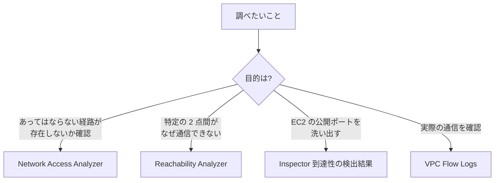

#### ベストプラクティス

- Network Access Analyzer のスコープを**セキュリティ要件としてコード化**し、定期実行して違反を検出する。
- Inspector のネットワーク到達性の結果を**Security Hub に集約**し、不要な公開ポートを閉じる。
- **使われていない SG ルール、使われていないリソース**を定期的に棚卸しする(Flow Logs で実績を確認してから削除)。
- 変更は IaC と変更管理を通し、**手動変更による設定ドリフト**を検出する。

#### 試験の着眼点

- 「インターネットから到達可能な内部リソースを網羅的に洗い出す」→ **Network Access Analyzer**
- 「A から B に接続できない原因を特定」→ **Reachability Analyzer**(送信元 / 宛先を指定して SG / NACL / ルートのどこで止まるかを確認)
- 「EC2 の意図しない公開ポートの検出」→ **Inspector ネットワーク到達性**

---

### 6.6 Task 3.3 まとめ(試験の着眼点)

| 要件の言い回し | 答えになりやすい選択肢 |
|---|---|
| 「戻り通信を考えずにワークロード単位で制御」 | セキュリティグループ |
| 「サブネット単位で特定 IP を拒否」 | NACL |
| 「送信先ドメインで許可・拒否、IPS が必要」 | Network Firewall |
| 「オンプレミスと早く安全に接続」 | Site-to-Site VPN |
| 「専用線 + 回線の暗号化」 | Direct Connect + MACsec |
| 「VPN なしでゼロトラストの社内アプリ公開」 | Verified Access |
| 「DB をインターネットから完全に隔離」 | 分離サブネット + VPC エンドポイント |
| 「許されない経路の有無を検査」 | Network Access Analyzer |

---

## 7. 横断まとめ: サービス選択早見表とキーワード対応表

### 7.1 サービス選択早見表

| やりたいこと | 第一候補 | 補足 |
|---|---|---|
| L3/L4 DDoS を自動緩和 | Shield Standard | 追加費用なし |
| L7 の攻撃(SQLi / XSS / ボット)を防ぐ | AWS WAF | ALB / CloudFront / API Gateway に関連付け |
| WAF / Shield を組織全体に強制 | Firewall Manager | Organizations 連携 |
| S3 オリジンを CloudFront のみに限定 | OAC | OAI の後継 |
| セキュリティヘッダーを付与 | CloudFront レスポンスヘッダーポリシー | HSTS, CSP など |
| 堅牢な AMI を自動作成 | EC2 Image Builder | テストと配布まで自動化 |
| 脆弱性(CVE)の継続スキャン | Amazon Inspector | EC2 / ECR / Lambda |
| 実行中の脅威検出 | GuardDuty ランタイムモニタリング | EC2 / ECS / EKS |
| パッチ適用の自動化 | Patch Manager | ベースライン + ウィンドウ |
| ポートを開けずに管理接続 | Session Manager | 操作ログを記録 |
| 一時 SSH 鍵で接続 | EC2 Instance Connect | EIC Endpoint で非公開インスタンスへ |
| コードの脆弱性をパイプラインで検出 | Amazon Q Developer / Inspector コードセキュリティ(CodeGuru Security は提供終了) | シフトレフト |
| LLM の入出力を制御 | Bedrock Guardrails | プロンプト攻撃、PII、根拠チェック |
| 通信をサブネット単位で許可 / 拒否 | NACL | ステートレス |
| 通信をインスタンス単位で許可 | セキュリティグループ | ステートフル |
| ドメイン単位の送信制御 / IPS | Network Firewall | Suricata 互換 |
| DNS 経由の持ち出し対策 | Route 53 Resolver DNS Firewall | |
| 専用線の暗号化 | MACsec | レイヤー 2 |
| VPN なしゼロトラスト | Verified Access | ID + デバイス |
| 不要な経路を洗い出す | Network Access Analyzer | スコープで定義 |
| 2 点間の疎通原因 | Reachability Analyzer | 構成解析 |

### 7.2 間違えやすいペア

| 紛らわしい 2 つ | 違い |
|---|---|
| SG と NACL | ステートフル / 許可のみ **vs** ステートレス / 許可と拒否 |
| Shield Standard と Advanced | 無料・自動 **vs** 有償・L7 自動緩和・SRT・費用保護 |
| WAF と Shield | L7 の内容検査 **vs** DDoS 対策(特に L3/L4) |
| Inspector と GuardDuty | 脆弱性の発見(予防) **vs** 脅威の検知 |
| Session Manager と EC2 Instance Connect | ポート不要・操作ログ **vs** 一時 SSH 鍵 |
| Network Access Analyzer と Reachability Analyzer | 「あってはならない経路」の洗い出し **vs** 「2 点間の疎通」の原因解析 |
| タスクロールとタスク実行ロール(ECS) | アプリの権限 **vs** ECS 基盤(ECR 取得・ログ)の権限 |
| OAC と OAI | OAC が現行の推奨。OAI は旧方式 |
| Direct Connect と VPN | 専用線(暗号化なし) **vs** インターネット上の IPsec |

### 7.3 設計判断のトレードオフ(試験ガイドの「コスト・セキュリティ・複雑さ」)

| 選択 | セキュリティ | コスト | 複雑さ |
|---|---|---|---|
| Shield Advanced を全リソースに適用 | 高 | 高 | 中 |
| 重要システムのみ Shield Advanced | 高(重要部分) | 中 | 低 |
| Network Firewall の集中配置 | 高 | 高(エンドポイント課金とデータ処理料) | 高 |
| SG 参照中心 + NACL は最小限 | 中〜高 | 低 | 低 |
| Direct Connect + MACsec | 非常に高 | 高 | 高 |
| Site-to-Site VPN のみ | 中〜高 | 低 | 低 |

---

## 8. トラブルシューティング実践フロー

### 8.1 「EC2 から宛先へ接続できない」ときの調べ方

```mermaid
flowchart TD
    S["接続できない"] --> R{"ルートテーブルに<br/>宛先への経路がある?"}
    R -->|"ない"| FIXR["ルート追加<br/>(IGW / NAT / TGW / ピアリング)"]
    R -->|"ある"| SGO{"送信元の SG の<br/>アウトバウンドが許可?"}
    SGO -->|"拒否"| FIXS1["アウトバウンドルールを追加"]
    SGO -->|"許可"| NACLO{"送信元サブネットの NACL<br/>アウトバウンド許可?"}
    NACLO -->|"拒否"| FIXN1["NACL を修正"]
    NACLO -->|"許可"| NACLI{"宛先サブネットの NACL<br/>インバウンド許可?<br/>戻りのエフェメラルポートも許可?"}
    NACLI -->|"拒否"| FIXN2["NACL を修正"]
    NACLI -->|"許可"| SGI{"宛先の SG の<br/>インバウンドが許可?"}
    SGI -->|"拒否"| FIXS2["インバウンドルールを追加"]
    SGI -->|"許可"| OS["OS ファイアウォール / アプリの待受 / DNS を確認"]
```

> **ツール活用**: 上記のチェックを手作業ではなく **VPC Reachability Analyzer** に任せると、どこで止まっているかを示してくれます。実際の拒否は **VPC Flow Logs**(`REJECT`)で確認できます。

### 8.2 症状別チェックリスト

| 症状 | まず疑うこと | 確認・修復ツール |
|---|---|---|
| CloudFront 経由だと S3 が 403 | OAC とバケットポリシー、KMS キーポリシー | CloudFront 設定、バケットポリシー |
| ブラウザで S3 呼び出しが CORS エラー | S3 CORS 設定(オリジン、メソッド、ヘッダー) | S3 CORS 設定、ブラウザ開発者ツール |
| 正規ユーザーが WAF でブロック | 誤検知ルール(マネージドルール) | WAF ログ、サンプルリクエスト、Count へ変更 |
| Session Manager で接続できない | SSM Agent、インスタンスプロファイル、VPC エンドポイント(ssm / ssmmessages、必要に応じて ec2messages) | Fleet Manager、Reachability Analyzer |
| EC2 のアプリが S3 に Access Denied | インスタンスプロファイルの権限、バケットポリシー、VPC エンドポイントポリシー | IAM Policy Simulator、CloudTrail |
| 戻り通信が届かない | NACL のエフェメラルポート | NACL ルール、Flow Logs |
| パッチが適用されない | パッチグループのタグ、ベースライン、SSM 接続 | Patch Manager コンプライアンス、Run Command 履歴 |
| Inspector で対象が出てこない | SSM Agent の状態、Inspector の有効化、対応 OS | Inspector の対象範囲、Systems Manager |
| VPN は上がるが通信できない | ルーティング(BGP、静的ルート)、SG / NACL | VPN トンネル状態、ルートテーブル |

---

## 9. 理解度チェック(演習問題)

> 答えは各問の直後にあります。まず自力で考えてから開いてください。

**Q1.** 公開 Web サイトの ALB を、CloudFront 経由のアクセスだけに限定したい。最も適切な構成はどれか。
A. ALB の SG で `0.0.0.0/0` を許可する
B. ALB の SG の送信元に CloudFront のマネージドプレフィックスリストを指定し、CloudFront からカスタムヘッダーを付与して検証する
C. NACL で CloudFront の IP を 1 件ずつ列挙する
D. ALB をパブリックサブネットから削除する

<details><summary>答えと解説</summary>

**B**。マネージドプレフィックスリストで送信元を CloudFront に絞り、さらにカスタムヘッダーの検証で他のディストリビューション経由のアクセスも防げます。A は迂回を許す、C は IP の変更に追従できない、D は ALB の役割を失います。
</details>

**Q2.** ブルートフォース攻撃により `/login` に同一 IP から大量のリクエストが来ている。正規ユーザーへの影響を抑えつつ防御したい。最適なのはどれか。
A. サイト全体に厳しいレートベースルールを設定
B. `/login` に絞ったスコープダウン付きのレートベースルールを、Count で検証後に Block
C. 国単位の地理的制限のみ
D. Shield Standard のみ

<details><summary>答えと解説</summary>

**B**。保護対象を絞り、Count で閾値を確認してから Block にすることで誤ブロックを避けられます。Shield Standard は主に L3/L4 対策であり、アプリ層のログイン試行には WAF が必要です。
</details>

**Q3.** プライベートサブネットの EC2 に、インバウンドポートを開けず、操作内容も記録できる管理接続を提供したい。必要な構成はどれか。
A. 踏み台ホストを置き、22 番ポートを `0.0.0.0/0` に開放
B. Session Manager を使い、SSM Agent、インスタンスプロファイル、必要な VPC エンドポイントを用意して、セッションログを CloudWatch Logs / S3 に出力
C. EC2 に長期 SSH 鍵を配布
D. Direct Connect を導入

<details><summary>答えと解説</summary>

**B**。Session Manager は IAM で認可され、インバウンドポート不要で、セッションログも残せます。
</details>

**Q4.** ECS(Fargate)上のアプリが DynamoDB を呼ぶ。権限をどこに付与するのが適切か。
A. タスク実行ロール
B. タスクロール(最小権限)
C. IAM ユーザーのアクセスキーをコンテナの環境変数に設定
D. EC2 のインスタンスプロファイル

<details><summary>答えと解説</summary>

**B**。アプリ(コンテナ内のコード)が使う権限は**タスクロール**です。タスク実行ロールは ECR からのイメージ取得やログ出力など、ECS 基盤が使う権限です。
</details>

**Q5.** あるサブネット内のインスタンスへ向かう通信は SG で許可しているのに、応答が戻ってこない。サブネットの NACL でありがちな原因は何か。
A. SG はステートレスだから
B. NACL がステートレスで、戻りのエフェメラルポートが許可されていない
C. NACL に許可ルールが多すぎる
D. IGW が停止している

<details><summary>答えと解説</summary>

**B**。NACL はステートレスなので、戻り通信(エフェメラルポート)も明示的に許可が必要です。SG はステートフルです。
</details>

**Q6.** 組織のセキュリティ要件は「インターネットから本番 DB へ到達できる経路が存在してはならない」である。この経路の有無を網羅的に検証する最適なサービスは?
A. VPC Reachability Analyzer
B. Network Access Analyzer
C. GuardDuty
D. AWS Shield Advanced

<details><summary>答えと解説</summary>

**B**。Network Access Analyzer は「あってはならない経路」をスコープとして定義し、該当経路を洗い出します。Reachability Analyzer は特定の 2 点間の疎通を確認する用途です。
</details>

**Q7.** オンプレミスと AWS を閉域の専用線で接続しており、回線区間も暗号化したい。専用接続で選べる方式は?
A. Direct Connect は標準で暗号化されるので追加不要
B. MACsec を有効化(または DX 上に IPsec VPN を重ねる)
C. インターネット VPN に切り替える
D. セキュリティグループで暗号化する

<details><summary>答えと解説</summary>

**B**。Direct Connect は標準では暗号化されません。MACsec(レイヤー 2)や DX 上の VPN を使います。
</details>

**Q8.** 生成 AI チャットボットに「これまでの指示を無視して…」という入力でシステムの動作を乗っ取られるリスクがある。最初に導入すべき対策は?
A. EC2 の CPU を増やす
B. Bedrock Guardrails のプロンプト攻撃フィルターと、エージェントの最小権限ロール
C. NACL で全 IP を拒否
D. CloudFront の地理的制限

<details><summary>答えと解説</summary>

**B**。プロンプトインジェクション(LLM01)には入力の検査と、万一乗っ取られても被害が出ない最小権限(LLM06 対策)の組み合わせが基本です。
</details>

**Q9.** Lambda 関数が使用しているサードパーティ製ライブラリの既知の脆弱性を、継続的に検出したい。適切なサービスは?
A. Amazon Inspector
B. AWS Shield
C. Route 53
D. AWS Direct Connect

<details><summary>答えと解説</summary>

**A**。Inspector は Lambda 関数のコードと依存パッケージのスキャンに対応しています。
</details>

**Q10.** 数百のアカウントに、同じ WAF ルールと Shield Advanced 保護を一括で強制したい。最適なサービスは?
A. AWS Firewall Manager
B. 各アカウントで手作業
C. Amazon Macie
D. AWS Artifact

<details><summary>答えと解説</summary>

**A**。Firewall Manager は Organizations と連携して、WAF、Shield Advanced、SG、Network Firewall などのポリシーを組織全体に展開・強制します。
</details>

---

## 10. 参考 URL(根拠ソース一覧)

> URL は 2026-10-21 時点で参照していた AWS 公式ドキュメントの構成に基づきます。AWS はドキュメントの再編を行うことがあるため、リンク切れの場合は各ページのタイトルで検索してください。

### 10.1 試験ガイド(アンカー)

| 内容 | URL |
|---|---|
| SCS-C03 試験ガイド(トップ) | https://docs.aws.amazon.com/aws-certification/latest/security-specialty-03/security-specialty-03.html |
| Content Domain 3: Infrastructure Security | https://docs.aws.amazon.com/aws-certification/latest/security-specialty-03/security-specialty-03-domain3.html |

### 10.2 Task 3.1 ネットワークエッジ

| トピック | URL |
|---|---|
| AWS WAF 開発者ガイド | https://docs.aws.amazon.com/waf/latest/developerguide/waf-chapter.html |
| AWS WAF レートベースルール | https://docs.aws.amazon.com/waf/latest/developerguide/waf-rule-statement-type-rate-based.html |
| AWS WAF 地理一致ルール | https://docs.aws.amazon.com/waf/latest/developerguide/waf-rule-statement-type-geo-match.html |
| AWS WAF JA3 フィンガープリント一致 | https://docs.aws.amazon.com/waf/latest/developerguide/waf-rule-statement-type-ja3-match.html |
| AWS WAF Bot Control | https://docs.aws.amazon.com/waf/latest/developerguide/waf-bot-control.html |
| AWS WAF ログ | https://docs.aws.amazon.com/waf/latest/developerguide/logging.html |
| AWS Firewall Manager | https://docs.aws.amazon.com/waf/latest/developerguide/fms-chapter.html |
| AWS Shield | https://docs.aws.amazon.com/waf/latest/developerguide/shield-chapter.html |
| Shield Advanced 概要 | https://docs.aws.amazon.com/waf/latest/developerguide/ddos-advanced-summary.html |
| CloudFront のセキュリティと private コンテンツ | https://docs.aws.amazon.com/AmazonCloudFront/latest/DeveloperGuide/SecurityAndPrivateContent.html |
| CloudFront OAC(S3 オリジンの制限) | https://docs.aws.amazon.com/AmazonCloudFront/latest/DeveloperGuide/private-content-restricting-access-to-s3.html |
| CloudFront レスポンスヘッダーポリシー | https://docs.aws.amazon.com/AmazonCloudFront/latest/DeveloperGuide/adding-response-headers.html |
| Amazon S3 CORS | https://docs.aws.amazon.com/AmazonS3/latest/userguide/cors.html |
| AWS IoT ポリシー | https://docs.aws.amazon.com/iot/latest/developerguide/iot-policies.html |
| Amazon Security Lake の OCSF | https://docs.aws.amazon.com/security-lake/latest/userguide/open-cybersecurity-schema-framework.html |
| OCSF(公式サイト) | https://ocsf.io/ |

### 10.3 Task 3.2 コンピュート

| トピック | URL |
|---|---|
| EC2 Image Builder | https://docs.aws.amazon.com/imagebuilder/latest/userguide/what-is-image-builder.html |
| EC2 のインスタンスプロファイル(IAM ロール) | https://docs.aws.amazon.com/AWSEC2/latest/UserGuide/iam-roles-for-amazon-ec2.html |
| IMDS(IMDSv2)の設定 | https://docs.aws.amazon.com/AWSEC2/latest/UserGuide/configuring-instance-metadata-service.html |
| Lambda 実行ロール | https://docs.aws.amazon.com/lambda/latest/dg/lambda-intro-execution-role.html |
| ECS のタスク IAM ロール | https://docs.aws.amazon.com/AmazonECS/latest/developerguide/task-iam-roles.html |
| Amazon ECR イメージスキャン | https://docs.aws.amazon.com/AmazonECR/latest/userguide/image-scanning.html |
| Amazon Inspector | https://docs.aws.amazon.com/inspector/latest/user/what-is-inspector.html |
| GuardDuty ランタイムモニタリング | https://docs.aws.amazon.com/guardduty/latest/ug/runtime-monitoring.html |
| Systems Manager Patch Manager | https://docs.aws.amazon.com/systems-manager/latest/userguide/patch-manager.html |
| Systems Manager Session Manager | https://docs.aws.amazon.com/systems-manager/latest/userguide/session-manager.html |
| EC2 Instance Connect | https://docs.aws.amazon.com/AWSEC2/latest/UserGuide/connect-linux-inst-eic.html |
| Amazon CodeGuru Security のサポート終了 | https://docs.aws.amazon.com/codeguru/latest/security-ug/end-of-support.html |
| Amazon Inspector コードセキュリティ | https://docs.aws.amazon.com/inspector/latest/user/code-security-assessments.html |
| Amazon Q Developer | https://docs.aws.amazon.com/amazonq/latest/qdeveloper-ug/what-is.html |
| Amazon Bedrock Guardrails | https://docs.aws.amazon.com/bedrock/latest/userguide/guardrails.html |
| OWASP Top 10 for LLM Applications(GenAI Security Project) | https://genai.owasp.org/llm-top-10/ |

### 10.4 Task 3.3 ネットワーク

| トピック | URL |
|---|---|
| セキュリティグループ | https://docs.aws.amazon.com/vpc/latest/userguide/vpc-security-groups.html |
| ネットワーク ACL | https://docs.aws.amazon.com/vpc/latest/userguide/vpc-network-acls.html |
| AWS Network Firewall | https://docs.aws.amazon.com/network-firewall/latest/developerguide/what-is-aws-network-firewall.html |
| Route 53 Resolver DNS Firewall | https://docs.aws.amazon.com/Route53/latest/DeveloperGuide/resolver-dns-firewall.html |
| Gateway Load Balancer | https://docs.aws.amazon.com/elasticloadbalancing/latest/gateway/introduction.html |
| VPC エンドポイント(AWS PrivateLink) | https://docs.aws.amazon.com/vpc/latest/privatelink/what-are-vpc-endpoints.html |
| AWS Site-to-Site VPN | https://docs.aws.amazon.com/vpn/latest/s2svpn/VPC_VPN.html |
| AWS Direct Connect | https://docs.aws.amazon.com/directconnect/latest/UserGuide/Welcome.html |
| Direct Connect MACsec | https://docs.aws.amazon.com/directconnect/latest/UserGuide/MACsec.html |
| AWS Transit Gateway | https://docs.aws.amazon.com/vpc/latest/tgw/what-is-transit-gateway.html |
| AWS Verified Access | https://docs.aws.amazon.com/verified-access/latest/ug/what-is-verified-access.html |
| Network Access Analyzer | https://docs.aws.amazon.com/vpc/latest/network-access-analyzer/what-is-vaa.html |
| VPC Reachability Analyzer | https://docs.aws.amazon.com/vpc/latest/reachability/what-is-reachability-analyzer.html |

### 10.5 全般

| トピック | URL |
|---|---|
| AWS Well-Architected Framework セキュリティの柱 | https://docs.aws.amazon.com/wellarchitected/latest/security-pillar/welcome.html |

