# AWS Certified Security - Specialty (SCS-C03) Content Domain 4: Identity and Access Management 初学者向けステップバイステップガイド

> Domain 4 は試験全体の **20%** を占め、6 ドメインの中で最も配点が高い領域です。
> 認証 (あなたは誰か) と認可 (何をしてよいか) を、設計・実装・トラブルシューティングの 3 つの視点で問われます。

---

## 0. このガイドの使い方

### 0.1 試験での位置づけ

| 項目 | 内容 |
|---|---|
| 試験名 | AWS Certified Security - Specialty (SCS-C03) |
| ドメイン | Content Domain 4: Identity and Access Management |
| 配点 | スコア対象問題の 20% |
| 想定受験者 | クラウドセキュリティ 3〜5 年相当の経験者 |
| 出題形式 | 択一 / 複数選択 / 並べ替え (Ordering) / マッチング |
| 合格スコア | 1,000 点満点中 750 点以上 (ドメインごとの足切りなし、総合で判定) |
| スコア対象問題数 | 50 問 (ほかに採点対象外 15 問) |

### 0.2 試験ガイドが定める出題範囲 (原文の整理)

| Task | Skill | 内容 | 本ガイドの章 |
|---|---|---|---|
| 4.1 認証戦略の設計・実装・トラブルシュート | 4.1.1 | 人・アプリ・システムの認証基盤 (IAM Identity Center, Amazon Cognito, MFA, IdP 連携) | 第 2 章 |
| | 4.1.2 | 一時的な認証情報の発行 (AWS STS, S3 署名付き URL) | 第 3 章 |
| | 4.1.3 | 認証問題のトラブルシュート (CloudTrail, Cognito, Identity Center 許可セット, Directory Service) | 第 4 章 |
| 4.2 認可戦略の設計・実装・トラブルシュート | 4.2.1 | 認可制御の設計と評価 (Verified Permissions, IAM パス, IAM Roles Anywhere, リソースポリシー, ロール信頼ポリシー) | 第 6 章 |
| | 4.2.2 | ABAC / RBAC の設計 (タグや属性によるアクセス制御) | 第 7 章 |
| | 4.2.3 | 最小権限の IAM ポリシー (アクセス許可の境界, セッションポリシー) | 第 8 章 |
| | 4.2.4 | 認可エラーの原因分析 (IAM ポリシーシミュレーター, IAM Access Analyzer) | 第 9 章 |
| | 4.2.5 | 意図しない権限の調査と是正 (IAM Access Analyzer) | 第 10 章 |

### 0.3 学習の進め方

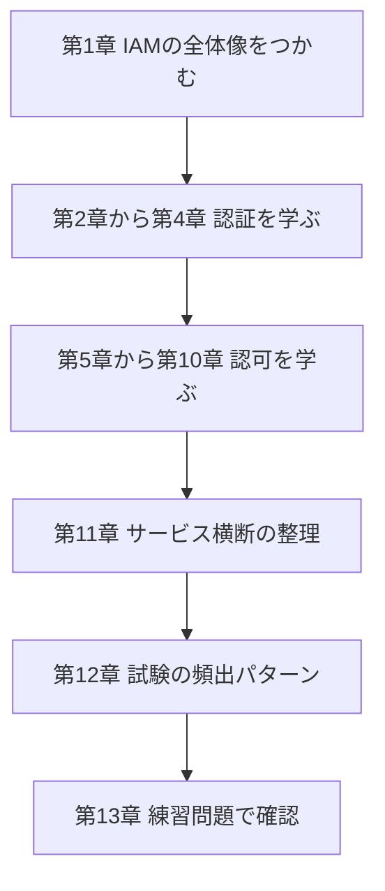

---

## 1. 全体像: 認証と認可、そして IAM の登場人物

### Step 1. 認証 (Authentication) と認可 (Authorization)

| 用語 | 意味 | たとえ | AWS での主な仕組み |
|---|---|---|---|
| 認証 | 「あなたは誰か」を確認する | 社員証で入館ゲートを通る | IAM Identity Center, Cognito, IAM ユーザー, MFA, STS |
| 認可 | 「あなたに何を許可するか」を決める | 入館後、入れる部屋が決まっている | IAM ポリシー, SCP, RCP, リソースポリシー, Verified Permissions |

### Step 2. 誰が AWS にアクセスするか (プリンシパルの種類)

| 種類 | 例 | 推奨される認証方式 |
|---|---|---|
| 人 (従業員) | 開発者, 運用担当 | IAM Identity Center で IdP と連携しシングルサインオン |
| 人 (アプリの利用者) | Web / モバイルアプリのエンドユーザー | Amazon Cognito |
| アプリケーション (AWS 内) | EC2, Lambda, ECS, EKS 上のコード | IAM ロール (一時認証情報) |
| システム (AWS 外) | オンプレミスサーバー, CI/CD | IAM Roles Anywhere, OIDC フェデレーション |

> **ベストプラクティスの大原則**: 人にもシステムにも **長期のアクセスキーを持たせず**、**一時的な認証情報** を使う。

### Step 3. IAM の基本部品

| 部品 | 説明 | 覚え方 |
|---|---|---|
| IAM ユーザー | 長期認証情報を持つ ID。新規には原則使わない | 恒久的な社員証 |
| IAM グループ | ユーザーをまとめて権限を付与する入れ物 | 部署 |
| IAM ロール | 一時的に引き受ける ID。ポリシーを持つが、パスワードやキーは持たない | 借りられる入館証 |
| IAM ポリシー | JSON で書かれた許可・拒否のルール | 入室ルールの規則書 |
| 信頼ポリシー | 「誰がこのロールを引き受けられるか」を定義するロール専用のリソースポリシー | 貸出名簿 |

### Step 4. ポリシーの種類と評価の順序

IAM では複数のポリシーが重なって評価されます。**デフォルトは暗黙の拒否**、明示的な Allow があれば許可、**明示的な Deny は常に最優先** です。

| ポリシータイプ | 付与先 | 権限を与えるか | 役割 |
|---|---|---|---|
| ID ベースポリシー | ユーザー, グループ, ロール | 与える | 「この ID は何ができるか」 |
| リソースベースポリシー | S3, KMS, SQS, Lambda などのリソース | 与える | 「このリソースを誰が使えるか」 |
| アクセス許可の境界 | ユーザー, ロール | 与えない (上限を決める) | 権限の天井 |
| SCP (サービスコントロールポリシー) | Organizations の OU, アカウント | 与えない (上限を決める) | アカウントに対するガードレール |
| RCP (リソースコントロールポリシー) | Organizations の OU, アカウント | 与えない (上限を決める) | リソースに対するガードレール |
| セッションポリシー | 一時セッション | 与えない (上限を絞る) | セッション単位の絞り込み |
| VPC エンドポイントポリシー | VPC エンドポイント | 与えない (上限を決める) | ネットワーク経路での制限 |

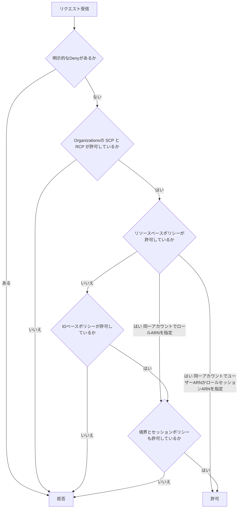

> 上図は初学者向けに簡略化したものです。厳密な評価ロジックは出典の公式ドキュメントで確認してください。
> 同一アカウントでも、リソースベースポリシーが **ロール ARN** を指定して許可した場合は、境界とセッションポリシーの範囲内でのみ有効です。IAM ユーザー ARN やロールセッション ARN を直接指定した場合は、それらの暗黙の拒否に制限されません。
> 特に **クロスアカウントでは、リソース側とアクセス元の ID 側の両方で許可が必要** な点が重要です (第 6 章で詳述)。

出典: https://docs.aws.amazon.com/IAM/latest/UserGuide/reference_policies_evaluation-logic.html
出典: https://docs.aws.amazon.com/IAM/latest/UserGuide/best-practices.html

---

# Task 4.1: 認証戦略の設計・実装・トラブルシュート

## 2. Skill 4.1.1: 人・アプリ・システムの認証基盤を設計する

### 2.1 IAM Identity Center (従業員のシングルサインオン)

#### Step 1. 何をするサービスか

IAM Identity Center は、**複数の AWS アカウントと業務アプリへのシングルサインオン (SSO)** を一元管理するサービスです。従業員のアクセスはここに集約するのが現在の標準的な設計です。

#### Step 2. ID の取得元 (ID ソース) を選ぶ

| ID ソース | 向いているケース | 補足 |
|---|---|---|
| Identity Center ディレクトリ | 既存の IdP がなく、小規模に始める | ユーザーとグループを直接作成 |
| Active Directory | 既存の AD を使っている | AWS Managed Microsoft AD、または AD Connector 経由 |
| 外部 IdP (SAML 2.0) | Okta, Microsoft Entra ID などを使っている | **SCIM** でユーザーとグループを自動同期できる |

> ID ソースは同時に 1 つだけ。変更すると既存の割り当てに影響するため、設計時に慎重に決めます。

#### Step 3. 許可セット (Permission Set) とアカウント割り当て

許可セットは「**どの権限を、誰に、どのアカウントで** 与えるか」を決めるテンプレートです。

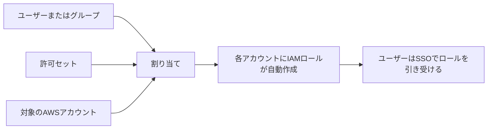

| 許可セットの構成要素 | 説明 |
|---|---|
| AWS 管理ポリシー | `ReadOnlyAccess` など既成のもの |
| カスタマー管理ポリシー | 各アカウント側に**同じ名前・同じパス**で用意するポリシーを参照 (パスが異なるとプロビジョニングに失敗) |
| インラインポリシー | 許可セット内に直接記述 |
| アクセス許可の境界 | 許可セットに付ける権限の上限 |
| セッション時間 | 既定 1 時間、最大 12 時間 |

> 許可セットを割り当てると、対象アカウントに `AWSReservedSSO_` で始まる名前の IAM ロールが作成されます。
> カスタマー管理ポリシーは名前だけでなくパスも一致させる必要があり、アカウントごとに異なるカスタムパスで作成しているとプロビジョニングできません。
> 許可セットを変更したら、**対象アカウントへ再プロビジョニング** されて初めて反映されます (トラブルシュートで重要)。

#### Step 4. その他の押さえどころ

| 機能 | 内容 |
|---|---|
| 委任管理者 | 管理アカウント以外のメンバーアカウントに Identity Center の運用を委任できる |
| アクセス制御用属性 (ABAC) | IdP の属性 (部署など) をセッションタグとして渡し、ABAC に利用する (第 7 章) |
| MFA | Identity Center ディレクトリ利用時は Identity Center 側で設定。外部 IdP 利用時は IdP 側の MFA を使う |
| 信頼された ID の伝播 (Trusted identity propagation) | ユーザーの ID を保ったまま、対応する AWS サービスのデータアクセスを制御する仕組み |
| 組織インスタンスとアカウントインスタンス | アカウントインスタンスは単一のAWSアカウント内で、複数の対応アプリケーションを含む限定的なアプリ利用向け。権限セットとマルチアカウント管理が必要な場合は組織インスタンスが必須 |

#### ベストプラクティス (IAM Identity Center)

| やること | 理由 |
|---|---|
| 従業員のアクセスは IAM ユーザーではなく Identity Center にフェデレーションする | 長期認証情報を排除し、入退社の管理を IdP に集約できる |
| 許可セットは職務ベースで作り、グループに割り当てる | ユーザー個別の割り当ては管理が破綻する |
| 管理アカウントでの作業を最小限にし、委任管理者を使う | 管理アカウントへの露出を減らす |
| セッション時間は必要最小限にする | 盗まれたセッションの影響時間を短くする |
| IdP 側で MFA を強制する (できればパスキーなどフィッシング耐性のある方式) | 認証の強度を上げる |

出典: https://docs.aws.amazon.com/singlesignon/latest/userguide/what-is.html
出典: https://docs.aws.amazon.com/singlesignon/latest/userguide/permissionsetsconcept.html
出典: https://docs.aws.amazon.com/singlesignon/latest/userguide/abac.html

---

### 2.2 Amazon Cognito (アプリのエンドユーザー認証)

#### Step 1. 2 つの部品を区別する (最頻出)

| 項目 | ユーザープール (User Pool) | ID プール (Identity Pool) |
|---|---|---|
| 役割 | **認証** (サインアップ, サインイン) を担うユーザーディレクトリ兼 IdP | **認可** のため、AWS の一時認証情報を渡す |
| 出力 | JWT トークン (ID トークン, アクセストークン, リフレッシュトークン) | AWS の一時認証情報 (STS 経由) |
| 主な用途 | アプリのログイン、API Gateway や ALB の認可 | モバイルアプリから S3 や DynamoDB に直接アクセス |
| 外部 IdP との連携 | SAML, OIDC, ソーシャル (Google など) | ユーザープール, ソーシャル, SAML, OIDC などを認証済み ID として受け入れる |

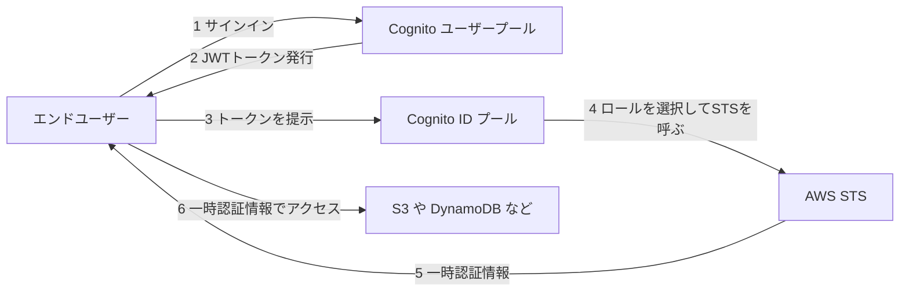

> トークンで **自社の API を守る** ならユーザープールだけで足ります。
> **AWS のリソースを直接使わせたい** ときに ID プールが必要です。

#### Step 2. ID プールのロールの考え方

| ロール | 付与される対象 |
|---|---|
| 認証済みロール | サインインしたユーザー |
| 未認証 (ゲスト) ロール | サインインしていないユーザー。**最小限の権限にする、または無効化する** |
| ロールの選択ルール | トークンのクレームやグループに応じて別のロールを割り当てる |

ロールの信頼ポリシーには、**対象の ID プールの ID を条件に含める** ことが重要です。含めないと、他の ID プールからもロールを引き受けられてしまいます。

```json
{
  "Version": "2012-10-17",
  "Statement": [
    {
      "Effect": "Allow",
      "Principal": { "Federated": "cognito-identity.amazonaws.com" },
      "Action": "sts:AssumeRoleWithWebIdentity",
      "Condition": {
        "StringEquals": {
          "cognito-identity.amazonaws.com:aud": "ap-northeast-1:11111111-2222-3333-4444-555555555555"
        },
        "ForAnyValue:StringLike": {
          "cognito-identity.amazonaws.com:amr": "authenticated"
        }
      }
    }
  ]
}
```

#### Step 3. ユーザープールのセキュリティ機能

| 機能 | 内容 |
|---|---|
| MFA | TOTP アプリと SMS は全プラン (Lite, Essentials, Plus) で利用可。メール MFA は Essentials または Plus が必要。パスキー (WebAuthn) によるパスワードレス認証にも対応 (Essentials または Plus が必要) |
| 適応型認証と侵害された認証情報の検出 | リスクに応じて MFA を要求したりブロックしたりする (脅威保護の機能。Plus プランが必要) |
| パスワードポリシー | 長さや文字種を設定 |
| Lambda トリガー | サインイン前後やトークン発行前に独自ロジックを挟む (例: トークンにクレームを追加) |
| AWS WAF 連携 | ユーザープールのエンドポイントを WAF で保護 |
| アプリクライアント | クライアントシークレットの有無、許可するフロー、コールバック URL を定義 |

#### ベストプラクティス (Amazon Cognito)

| やること | 理由 |
|---|---|
| 認可コードフロー (PKCE 付き) を使い、インプリシットフローは避ける | トークン漏えいのリスクを下げる |
| ID プールの未認証アクセスは原則無効にする | 匿名で AWS にアクセスされるのを防ぐ |
| ID プールのロールには最小権限を付け、ユーザー固有のデータはプレフィックスで分離する | 他ユーザーのデータを見られないようにする |
| ユーザープールで MFA を有効化し、脅威保護を使う | アカウント乗っ取りを防ぐ |
| トークンの有効期限を短めにし、リフレッシュトークンを必要に応じて失効させる | 盗難時の影響を限定する |

出典: https://docs.aws.amazon.com/cognito/latest/developerguide/what-is-amazon-cognito.html
出典: https://docs.aws.amazon.com/cognito/latest/developerguide/cognito-identity.html
出典: https://docs.aws.amazon.com/cognito/latest/developerguide/cognito-user-pool-settings-threat-protection.html

---

### 2.3 多要素認証 (MFA)

#### Step 1. 使える MFA の種類

| 種類 | 説明 | フィッシング耐性 |
|---|---|---|
| パスキー / セキュリティキー (FIDO2) | 生体認証や物理キーで認証 | 高い (推奨) |
| 仮想 MFA アプリ (TOTP) | スマホアプリのワンタイムコード | 中 |
| ハードウェア TOTP トークン | 専用デバイスのワンタイムコード | 中 |

> 1 人の IAM ユーザー (およびルートユーザー) に **最大 8 台の MFA デバイス** を登録できます。
> SMS による MFA は IAM ではサポートされません。ルートユーザーには MFA の設定が必須です。

#### Step 2. 「MFA を使っていること」を条件に権限を与える

MFA 未使用の操作を拒否する典型的なポリシーです。長期認証情報のリクエストには `aws:MultiFactorAuthPresent` が **含まれない** ため、`BoolIfExists` を使うのがポイントです。

```json
{
  "Version": "2012-10-17",
  "Statement": [
    {
      "Sid": "DenyAllExceptListedIfNoMFA",
      "Effect": "Deny",
      "NotAction": [
        "iam:CreateVirtualMFADevice",
        "iam:EnableMFADevice",
        "iam:ListMFADevices",
        "iam:ListVirtualMFADevices",
        "iam:ResyncMFADevice",
        "sts:GetSessionToken"
      ],
      "Resource": "*",
      "Condition": {
        "BoolIfExists": { "aws:MultiFactorAuthPresent": "false" }
      }
    }
  ]
}
```

| 条件キー | 用途 |
|---|---|
| `aws:MultiFactorAuthPresent` | MFA で認証されたセッションか |
| `aws:MultiFactorAuthAge` | MFA 認証からの経過秒数 (再認証を求めたいとき) |

#### ベストプラクティス (MFA)

| やること | 理由 |
|---|---|
| ルートユーザーに MFA を設定し、日常利用しない | 最強権限の保護 |
| 重要操作 (ロールの引き受け、削除など) は MFA 条件を付ける | 認証情報の盗難に備える |
| 可能な限りパスキーやセキュリティキーを使う | フィッシング耐性 |
| 予備の MFA デバイスを登録する | 紛失時の締め出し防止 |

出典: https://docs.aws.amazon.com/IAM/latest/UserGuide/id_credentials_mfa.html
出典: https://docs.aws.amazon.com/IAM/latest/UserGuide/id_credentials_mfa_configure-api-require.html

---

### 2.4 外部 IdP との連携 (フェデレーション)

#### Step 1. 3 つのパターン

| パターン | 仕組み | 主な使いどころ |
|---|---|---|
| SAML 2.0 フェデレーション | IAM に SAML プロバイダーを登録し、`AssumeRoleWithSAML` を使う | 従業員の SSO (通常は Identity Center 経由が推奨) |
| OIDC フェデレーション | IAM に OIDC プロバイダーを登録し、`AssumeRoleWithWebIdentity` を使う | GitHub Actions, EKS のサービスアカウント, モバイルアプリ |
| カスタム ID ブローカー | 独自に認証して STS を呼ぶ | SAML や OIDC が使えない特殊な場合 |

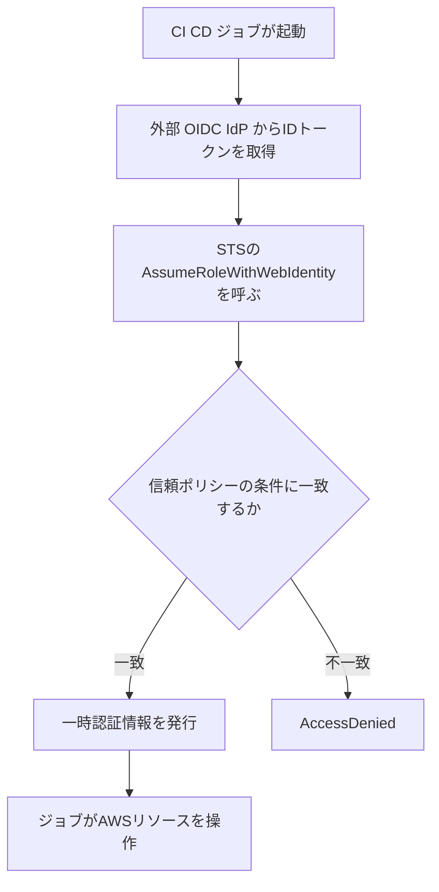

#### Step 2. OIDC の信頼ポリシーは条件を必ず絞る

GitHub Actions を例にした信頼ポリシーです。`sub` (リポジトリやブランチ) を絞らないと、**他人のリポジトリからもロールを引き受けられる** 危険があります。

```json
{
  "Version": "2012-10-17",
  "Statement": [
    {
      "Effect": "Allow",
      "Principal": {
        "Federated": "arn:aws:iam::111122223333:oidc-provider/token.actions.githubusercontent.com"
      },
      "Action": "sts:AssumeRoleWithWebIdentity",
      "Condition": {
        "StringEquals": {
          "token.actions.githubusercontent.com:aud": "sts.amazonaws.com"
        },
        "StringLike": {
          "token.actions.githubusercontent.com:sub": "repo:example-org/example-repo:ref:refs/heads/main"
        }
      }
    }
  ]
}
```

#### ベストプラクティス (フェデレーション)

| やること | 理由 |
|---|---|
| `aud` と `sub` の両方を条件に入れる | トークン発行元の取り違えや、他リポジトリからの悪用を防ぐ |
| IdP の署名証明書の更新を運用に組み込む | 期限切れで認証が止まるのを避ける |
| 従業員の SAML は IAM ではなく Identity Center に集約する | 複数アカウントの管理が楽になる |

出典: https://docs.aws.amazon.com/IAM/latest/UserGuide/id_roles_providers_saml.html
出典: https://docs.aws.amazon.com/IAM/latest/UserGuide/id_roles_providers_oidc.html

---

### 2.5 AWS Directory Service (Active Directory との連携)

| 種類 | 説明 | 向いているケース |
|---|---|---|
| AWS Managed Microsoft AD | AWS 上のマネージドな本物の Microsoft AD | AWS 上で AD を使う、オンプレ AD と信頼関係を結ぶ |
| AD Connector | オンプレ AD へ認証要求を転送するプロキシ (ディレクトリ自体は持たない) | 既存の AD をそのまま使いたい |
| Simple AD | Samba ベースの小規模互換ディレクトリ | 機能が限定的で新規構築には非推奨 (提供状況は公式で確認) |

| 項目 | ポイント |
|---|---|
| 信頼関係 | Managed Microsoft AD とオンプレ AD の間で一方向または双方向の信頼を設定できる |
| Identity Center との関係 | AD を ID ソースにできる |
| ログ | ディレクトリのログを CloudWatch Logs に転送して監査できる |

出典: https://docs.aws.amazon.com/directoryservice/latest/admin-guide/what_is.html

---

### 2.6 アプリケーションとシステムの認証 (人以外)

「**コードにアクセスキーを書かない**」が鉄則です。実行環境ごとに適した仕組みを選びます。

| 実行環境 | 使う仕組み | 補足 |
|---|---|---|
| EC2 | インスタンスプロファイルと IAM ロール | メタデータは **IMDSv2 を必須** にする |
| Lambda | 実行ロール | 関数ごとに最小権限のロールを分ける |
| ECS / Fargate | タスクロール | タスク実行ロールとは別物 (前者はアプリ、後者はコンテナの起動用) |
| EKS | EKS Pod Identity または IRSA (サービスアカウント用 IAM ロール) | Pod 単位で権限を分ける |
| オンプレミスや他クラウド | IAM Roles Anywhere または OIDC フェデレーション | 第 6 章で詳述 |
| 機密情報 (DB パスワードなど) | AWS Secrets Manager | 自動ローテーションを使う |

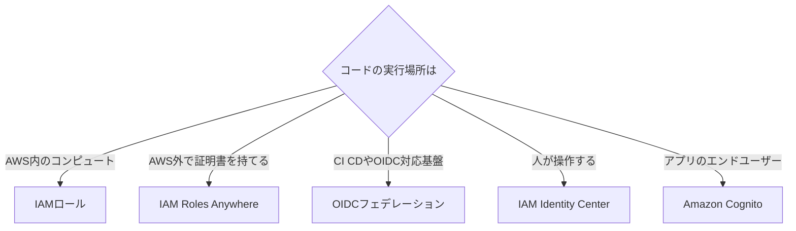

出典: https://docs.aws.amazon.com/IAM/latest/UserGuide/id_roles_use_switch-role-ec2.html
出典: https://docs.aws.amazon.com/AWSEC2/latest/UserGuide/configuring-instance-metadata-service.html
出典: https://docs.aws.amazon.com/eks/latest/userguide/pod-identities.html

---

## 3. Skill 4.1.2: 一時的な認証情報を発行する

### 3.1 AWS STS (Security Token Service)

#### Step 1. 一時認証情報とは

一時認証情報は **アクセスキー ID、シークレットアクセスキー、セッショントークン** の 3 点セットで、**有効期限が来ると自動で無効** になります。長期のアクセスキーと違い、漏えいしても被害が時間で限定されます。

#### Step 2. 主要な STS API の比較 (最頻出)

| API | 誰が呼ぶか | 用途 | 有効期間の目安 |
|---|---|---|---|
| `AssumeRole` | IAM ユーザーやロール | ロールを引き受ける (クロスアカウント含む) | 既定 1 時間。15 分〜ロールの最大セッション時間 (最大 12 時間) |
| `AssumeRoleWithSAML` | SAML IdP で認証済みのユーザー | SAML フェデレーション | 15 分〜ロールの最大セッション時間 |
| `AssumeRoleWithWebIdentity` | OIDC やソーシャルで認証済みのユーザー | Web ID フェデレーション (Cognito ID プールも内部で利用) | 15 分〜ロールの最大セッション時間 |
| `GetSessionToken` | IAM ユーザー (またはルート) | **MFA 付きの一時認証情報** を得る | IAM ユーザーは既定 12 時間 (15 分〜36 時間)。ルートは既定 1 時間 (15 分〜最大 1 時間) |
| `GetFederationToken` | IAM ユーザー (またはルート) | 独自ブローカーによるフェデレーション | IAM ユーザーは既定 12 時間 (15 分〜36 時間)。ルートは既定 1 時間 (15 分〜最大 1 時間) |
| `AssumeRoot` | 管理アカウントまたは委任管理者 | メンバーアカウントのルート権限が必要な特定タスクを実行 (中央集権的なルートアクセス管理) | 最大 15 分 |
| `GetCallerIdentity` | 誰でも | 「今の自分は誰か」を確認 (権限不要) | 該当なし |

> **ロールチェーン** (ロールを引き受けた状態でさらに別のロールを引き受ける) の場合、セッションは **最大 1 時間** に制限されます。
> `GetSessionToken` で得た認証情報で呼べる STS API は **`AssumeRole` と `GetCallerIdentity` のみ** です。IAM API は **MFA 情報を付けて取得した場合のみ** 呼べ、MFA なしで取得した場合は呼べません。試験では「MFA 付きの CLI 認証情報が欲しい」なら `GetSessionToken` と覚えます。

#### Step 3. AssumeRole の流れ (クロスアカウント)

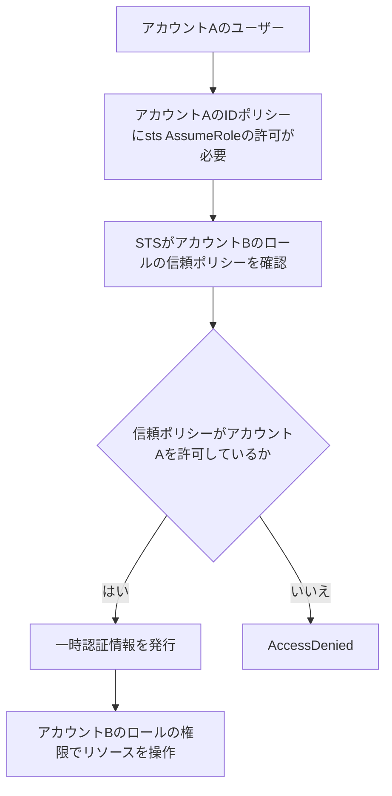

#### Step 4. セッションを制御する仕組み

| 仕組み | 内容 | 使いどころ |
|---|---|---|
| セッションポリシー | `AssumeRole` 時に渡す追加ポリシー。**権限を絞るだけで付与はしない** | ロールの権限の一部だけ使わせる |
| セッションタグ | セッションに付けるタグ (`aws:PrincipalTag`)。`sts:TagSession` の許可が必要 | ABAC (第 7 章) |
| 推移的タグ | ロールチェーンの先にもタグを引き継ぐ | チェーンしても属性を保つ |
| ソース ID (`sts:SourceIdentity`) | 「元の人」を固定して記録。変更不可 | 監査で最初のユーザーを追跡 |
| 外部 ID (`sts:ExternalId`) | 第三者に権限を渡す際の合言葉。**混乱した代理人問題** の対策 | SaaS 事業者へのクロスアカウント委任 |
| セッション名 (`RoleSessionName`) | CloudTrail に残る識別名 | 誰が引き受けたかの追跡 |

```json
{
  "Version": "2012-10-17",
  "Statement": [
    {
      "Effect": "Allow",
      "Principal": { "AWS": "arn:aws:iam::999988887777:root" },
      "Action": "sts:AssumeRole",
      "Condition": {
        "StringEquals": { "sts:ExternalId": "unique-id-from-saas-vendor" }
      }
    }
  ]
}
```

#### ベストプラクティス (STS)

| やること | 理由 |
|---|---|
| 長期アクセスキーより一時認証情報を使う | 漏えい時の被害期間を限定 |
| セッション時間は用途に合う最短にする | 盗難時の影響を最小化 |
| 第三者への委任には外部 ID を使う | 混乱した代理人問題を防ぐ |
| 信頼ポリシーで `aws:PrincipalOrgID` などで組織内に限定する | 組織外からの引き受けを遮断 |
| 緊急時に一時認証情報を即時無効化できるよう、ロールの「すべてのセッションを取り消す」(明示的拒否の発行) を理解しておく | 漏えい時の初動 |

出典: https://docs.aws.amazon.com/IAM/latest/UserGuide/id_credentials_temp.html
出典: https://docs.aws.amazon.com/IAM/latest/UserGuide/id_credentials_temp_request.html
出典: https://docs.aws.amazon.com/STS/latest/APIReference/welcome.html
出典: https://docs.aws.amazon.com/IAM/latest/UserGuide/confused-deputy.html

---

### 3.2 Amazon S3 署名付き URL (Presigned URL)

#### Step 1. 何ができるか

署名付き URL を使うと、**AWS の認証情報を持たない人に、期限付きで特定のオブジェクトのアップロードやダウンロードを許可** できます。

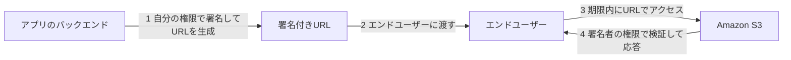

#### Step 2. 重要な性質

| 性質 | 内容 |
|---|---|
| 権限 | **URL を生成した主体 (署名者) の権限** で動く。署名者の権限が失われると URL も使えない |
| 有効期限 | IAM ユーザーの長期認証情報で署名すると最大 7 日 (SigV4)。**ロールなどの一時認証情報で署名すると、その認証情報の期限が上限**。マネジメントコンソールで生成する場合は最大 12 時間 |
| 対象操作 | GET (ダウンロード)、PUT (アップロード) など。署名時に決めた操作と対象のみ |
| 誰でも使える | URL を知っていれば誰でも使える (期限内)。**URL は秘密情報として扱う** |

#### Step 3. 署名付き URL を安全に使う条件

| 手段 | 内容 |
|---|---|
| 有効期限を短くする | 必要最小限 (数分から数時間) |
| バケットポリシーの条件 | `aws:SourceIp`, `aws:SourceVpce` (VPC エンドポイント経由のみ許可), `s3:signatureAge` (署名からの経過ミリ秒を制限), `s3:authType` (認証方式の制限) |
| 署名者の権限を最小化 | 署名専用ロールを作り、必要なキーだけに権限を付与 |
| HTTPS を強制 | `aws:SecureTransport` 条件 |
| アップロード用は署名付き POST も検討 | サイズや Content-Type などの条件を付けられる |

```json
{
  "Version": "2012-10-17",
  "Statement": [
    {
      "Sid": "DenyPresignedUrlOlderThan5Minutes",
      "Effect": "Deny",
      "Principal": "*",
      "Action": "s3:GetObject",
      "Resource": "arn:aws:s3:::example-bucket/*",
      "Condition": {
        "NumericGreaterThan": { "s3:signatureAge": 300000 }
      }
    }
  ]
}
```

> CloudFront 経由で配信する場合は、署名付き URL と署名付き Cookie が別の仕組みとして用意されています。S3 の署名付き URL とは混同しないよう注意します。

出典: https://docs.aws.amazon.com/AmazonS3/latest/userguide/using-presigned-url.html
出典: https://docs.aws.amazon.com/AmazonS3/latest/userguide/ShareObjectPreSignedURL.html

---

## 4. Skill 4.1.3: 認証の問題をトラブルシュートする

### 4.1 トラブルシュートの全体フロー

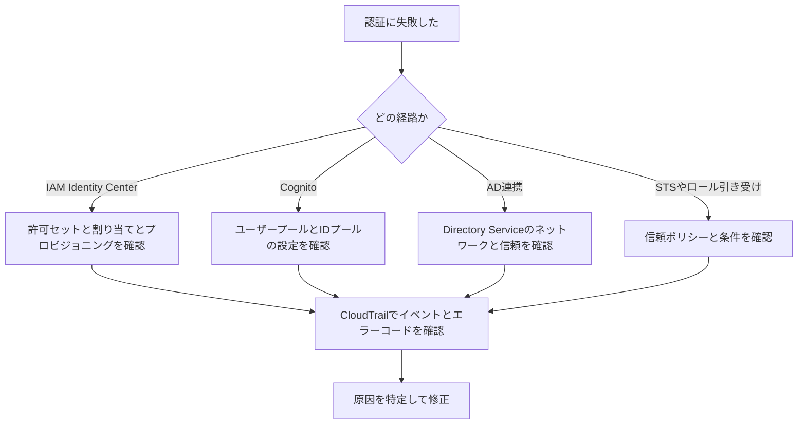

### 4.2 AWS CloudTrail で調べる

CloudTrail は **誰が、いつ、何をしたか** を記録する監査ログです。認証の調査では最初に見る場所です。

| 見る項目 | 意味 |
|---|---|
| `eventName` | `ConsoleLogin`, `AssumeRole`, `AssumeRoleWithSAML`, `AssumeRoleWithWebIdentity`, `GetSessionToken` など |
| `userIdentity.type` | `IAMUser`, `AssumedRole`, `SAMLUser`, `WebIdentityUser`, `Root` など |
| `errorCode` / `errorMessage` | 失敗の理由 (下表) |
| `sourceIPAddress` | どこからのアクセスか |
| `additionalEventData.MFAUsed` | ConsoleLogin で MFA が使われたか |
| `responseElements.ConsoleLogin` | `Success` か `Failure` か |

| よくあるエラー | 主な原因 |
|---|---|
| `AccessDenied` | 信頼ポリシーが許可していない、条件 (MFA, 外部 ID, IP など) を満たしていない |
| `ExpiredToken` / `ExpiredTokenException` | 一時認証情報や JWT の期限切れ |
| `InvalidClientTokenId` | アクセスキーが無効、削除済み、または環境のリージョンやパーティションの不一致 |
| `SignatureDoesNotMatch` | シークレットキーの誤り、時刻のずれ、署名の計算ミス |
| `InvalidIdentityToken` | OIDC や SAML のトークンが不正 (発行元、`aud`、署名) |

> 保存先の違いに注意: マルチリージョン証跡を有効にしておくと、どのリージョンのサインインも 1 か所で追えます。長期の分析は S3 + Athena、または CloudTrail Lake が便利です。

```sql
-- ConsoleLogin の失敗を抽出する Athena クエリの例
SELECT eventtime,
       useridentity.arn,
       sourceipaddress,
       responseelements
FROM cloudtrail_logs
WHERE eventname = 'ConsoleLogin'
  AND json_extract_scalar(responseelements, '$.ConsoleLogin') = 'Failure'
ORDER BY eventtime DESC
LIMIT 50;
```

### 4.3 サービス別のチェックポイント

| 対象 | まず確認すること |
|---|---|
| IAM Identity Center の許可セット | 許可セット変更後に **再プロビジョニング済みか**。対象アカウントに `AWSReservedSSO_` ロールがあるか。カスタマー管理ポリシーが対象アカウントに **同名で存在** するか。許可セットの境界やアカウントの SCP で拒否されていないか |
| IdP と Identity Center の同期 | SCIM の同期状況とアクセストークンの期限。ユーザーやグループが割り当て先に含まれているか。SAML 属性の不一致 |
| Amazon Cognito ユーザープール | ユーザーの確認状態 (`UserNotConfirmedException`)、パスワードや MFA の失敗 (`NotAuthorizedException`)、アプリクライアントの許可フローとコールバック URL の一致、トークンの有効期限 |
| Amazon Cognito ID プール | ロールの信頼ポリシーの `aud` や `amr` 条件、認証済みと未認証のロール設定、ユーザープールのプロバイダー設定 (ユーザープール ID とアプリクライアント ID) |
| AWS Directory Service | VPC のセキュリティグループとルーティング (DNS, Kerberos, LDAP の通信)、DNS 設定、信頼関係の状態、**時刻のずれ (Kerberos は時刻に敏感)** |
| ロールの引き受け | 信頼ポリシーの `Principal` と条件、呼び出し側の `sts:AssumeRole` 許可、セッション時間の上限、ロールチェーンの 1 時間制限 |

### 4.4 便利な調査ツール

| ツール | 用途 |
|---|---|
| IAM 認証情報レポート | 全ユーザーのパスワード、アクセスキー、MFA の状態を CSV で一覧 |
| IAM の最終アクセス情報 (Access Advisor) | ID がサービスを最後にいつ使ったか |
| `aws sts get-caller-identity` | 今どの ID で動いているかをすぐ確認 |

```bash
# 現在の呼び出し元を確認 (権限不要)
aws sts get-caller-identity

# 認証情報レポートの取得
aws iam generate-credential-report
aws iam get-credential-report --query Content --output text | base64 --decode
```

出典: https://docs.aws.amazon.com/awscloudtrail/latest/userguide/cloudtrail-user-guide.html
出典: https://docs.aws.amazon.com/singlesignon/latest/userguide/troubleshooting.html
出典: https://docs.aws.amazon.com/cognito/latest/developerguide/logging-using-cloudtrail.html
出典: https://docs.aws.amazon.com/IAM/latest/UserGuide/id_credentials_getting-report.html
出典: https://docs.aws.amazon.com/IAM/latest/UserGuide/access_policies_last-accessed.html

---

# Task 4.2: 認可戦略の設計・実装・トラブルシュート

## 5. 認可を設計する前の整理: 「誰が」「何を」「どの条件で」

認可の設計は次の 3 つの問いに答えることから始まります。

| 問い | IAM での表現 |
|---|---|
| 誰が (Principal) | ユーザー, ロール, アカウント, サービス |
| 何を (Action と Resource) | `s3:GetObject` と `arn:aws:s3:::bucket/*` |
| どの条件で (Condition) | MFA, 送信元 IP, タグ, 組織 ID, 時刻 など |

| 設計パターン | 概要 | 向いている規模 |
|---|---|---|
| RBAC (ロールベース) | 職務ごとのロールに権限を付与 | 小〜中規模、職務が明確 |
| ABAC (属性ベース) | タグなどの属性の一致で権限を判断 | 大規模、リソースが頻繁に増減 |
| 外部の認可エンジン | アプリ固有の細かな認可を Verified Permissions で外出し | アプリの業務ロジックに近い認可 |

---

## 6. Skill 4.2.1: 人・アプリ・システムの認可制御を設計・評価する

### 6.1 リソースポリシーとクロスアカウントアクセス

#### Step 1. 同一アカウントとクロスアカウントの違い (超重要)

| 状況 | 許可の条件 |
|---|---|
| 同一アカウント (リソースポリシーが IAM ユーザー ARN またはロールセッション ARN を直接指定) | ID ベースポリシーか、リソースベースポリシー **のどちらか一方** が許可していれば OK。リソースポリシーの許可はアクセス許可の境界やセッションポリシーの暗黙の拒否に制限されない (ただし明示的な Deny がない場合) |
| 同一アカウント (リソースポリシーがロール ARN を指定) | リソースポリシーの許可も **アクセス許可の境界とセッションポリシーの範囲内** でのみ有効 (境界に明示的な Allow が必要) |
| クロスアカウント | **リソース側のポリシーと、アクセス元の ID ベースポリシーの両方** が許可している必要がある |

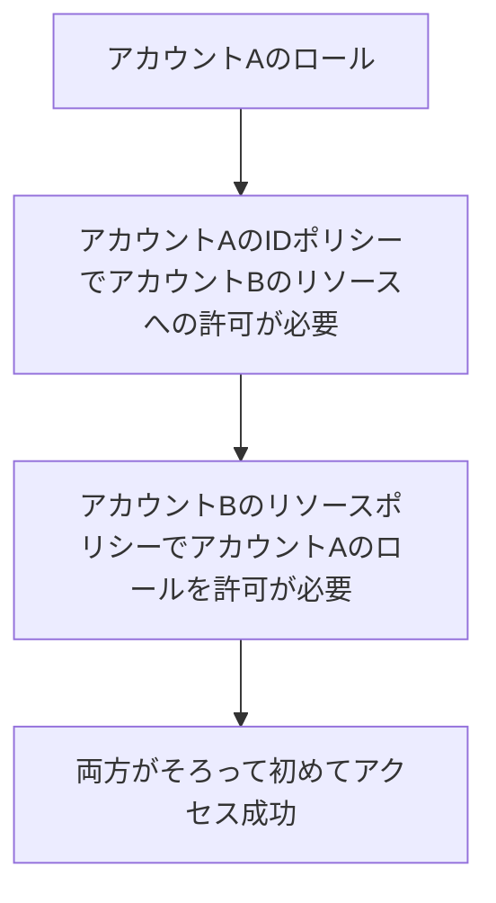

#### Step 2. クロスアカウントの方式を選ぶ

| 方式 | 仕組み | 特徴 |
|---|---|---|
| ロールの引き受け | 相手アカウントのロールを `AssumeRole` | **自分の元の権限を一時的に手放して** ロールの権限になる。ほとんどのサービスで使える |
| リソースベースポリシー | リソースに他アカウントを直接許可 | 元の権限のまま使える。S3, SQS, SNS, KMS, Lambda, Secrets Manager, ECR など対応サービスのみ |
| AWS RAM (Resource Access Manager) | リソースを共有 | サブネット, Transit Gateway などの共有に便利 |

#### Step 3. リソースポリシーを組織内に限定する例

特定の組織 (Organizations) に所属するアカウントだけに許可する、最も使われる条件の 1 つです。

```json
{
  "Version": "2012-10-17",
  "Statement": [
    {
      "Sid": "AllowOrgMembersReadOnly",
      "Effect": "Allow",
      "Principal": "*",
      "Action": ["s3:GetObject", "s3:ListBucket"],
      "Resource": [
        "arn:aws:s3:::shared-bucket",
        "arn:aws:s3:::shared-bucket/*"
      ],
      "Condition": {
        "StringEquals": { "aws:PrincipalOrgID": "o-exampleorgid" }
      }
    }
  ]
}
```

> `Principal` を `*` にしても、`aws:PrincipalOrgID` で絞れば組織内だけに限定できます。アカウントを 1 つずつ列挙する運用より保守が楽です。

### 6.2 IAM ロールの信頼ポリシー

信頼ポリシーは **「誰がそのロールを引き受けられるか」** を決める、ロールにアタッチされるリソースベースポリシーです。

| 要素 | 説明 |
|---|---|
| `Principal` | 引き受けを許可する主体 (AWS アカウント, ロール, サービス, フェデレーション ID) |
| `Action` | `sts:AssumeRole`, `sts:AssumeRoleWithSAML`, `sts:AssumeRoleWithWebIdentity` など (主体の種類で変わる) |
| `Condition` | 外部 ID、MFA、組織 ID、ソース ID、送信元などの追加条件 |

| 信頼ポリシーのよくある失敗 | 影響 |
|---|---|
| `Principal` にアカウントのルート (`:root`) を指定 | そのアカウントの **IAM 側の許可次第で誰でも** 引き受けられる。意図通りかを必ず確認 |
| 条件なしで `"Principal": "*"` | 他アカウントを含む誰でも引き受けられる恐れ |
| サービスロールでサービスプリンシパルに条件を付けない | 混乱した代理人問題。`aws:SourceArn` と `aws:SourceAccount` で絞る |

### 6.3 IAM パス (Path)

IAM ユーザー、グループ、ロール、ポリシーには **名前の前にパスを付けて階層化** できます。

| 項目 | 内容 |
|---|---|
| 例 | `arn:aws:iam::111122223333:role/engineering/app-deploy` (パスは `/engineering/`) |
| 使いどころ | チームや用途ごとに ID を整理し、IAM ポリシーの `Resource` にパスのワイルドカードを使って権限を委任する |
| 注意 | パスは **名前空間の整理** と ARN での範囲指定のための仕組み。権限を与えるものではなく、**タグの代替 (ABAC) でもない** |

```json
{
  "Effect": "Allow",
  "Action": ["iam:GetRole", "iam:UpdateAssumeRolePolicy"],
  "Resource": "arn:aws:iam::111122223333:role/engineering/*"
}
```

> 上の例では、`/engineering/` パス配下のロールだけを管理できます。パス設計は **後から変更できない (作り直しが必要)** ため、最初に決めておきます。

### 6.4 IAM Roles Anywhere (AWS 外のワークロードの認可)

オンプレミスのサーバーなど **AWS の外** で動くシステムが、**X.509 証明書** を使って一時認証情報を取得できる仕組みです。長期アクセスキーを配らずに済みます。

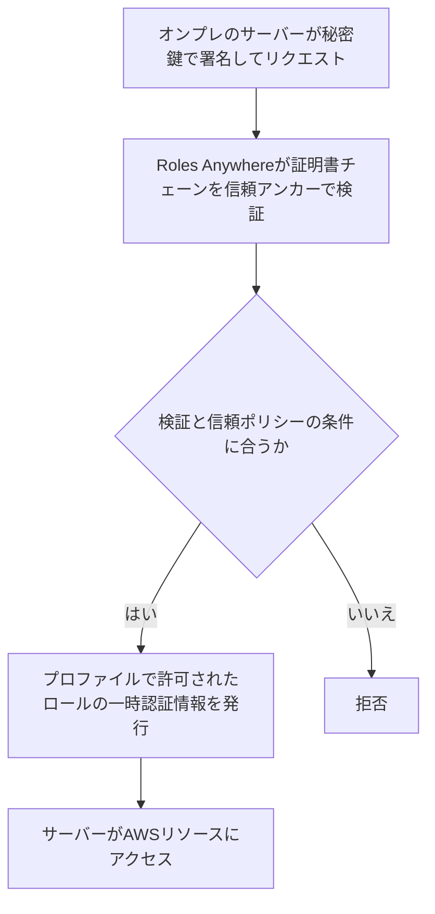

| 構成要素 | 説明 |
|---|---|
| 信頼アンカー (Trust anchor) | 証明書の発行元 (CA) を信頼する設定。**AWS Private CA** か、外部 CA の証明書を登録 |
| プロファイル (Profile) | 引き受け可能なロールと、セッションポリシーや管理ポリシーによる追加の絞り込みを定義 |
| ロールの信頼ポリシー | Roles Anywhere のサービスプリンシパルを信頼し、`aws:SourceArn` や証明書の属性で絞る |
| クレデンシャルヘルパー | `aws_signing_helper` ツール。AWS CLI や SDK の `credential_process` から利用 |
| 失効の確認 | 証明書失効リスト (CRL) を登録して、失効した証明書を拒否 |

```json
{
  "Version": "2012-10-17",
  "Statement": [
    {
      "Effect": "Allow",
      "Principal": { "Service": "rolesanywhere.amazonaws.com" },
      "Action": ["sts:AssumeRole", "sts:SetSourceIdentity", "sts:TagSession"],
      "Condition": {
        "ArnEquals": {
          "aws:SourceArn": "arn:aws:rolesanywhere:ap-northeast-1:111122223333:trust-anchor/EXAMPLE-ID"
        },
        "StringEquals": {
          "aws:PrincipalTag/x509Subject/CN": "batch-server-01"
        }
      }
    }
  ]
}
```

#### ベストプラクティス (IAM Roles Anywhere)

| やること | 理由 |
|---|---|
| 信頼ポリシーで信頼アンカーと証明書の属性 (CN など) を条件にする | 他の証明書からの悪用を防ぐ |
| 証明書の有効期間を短くし、更新を自動化する | 秘密鍵が漏れた場合の影響を限定 |
| 秘密鍵は HSM やハードウェアで保護する | 鍵の持ち出し対策 |
| CRL を登録し、不要になった証明書を失効させる | 退役サーバーの認証を止める |

### 6.5 Amazon Verified Permissions (アプリ固有の細かな認可)

アプリ内の「この利用者はこの文書を編集できるか」のような **きめ細かい認可** を、アプリのコードから切り出して一元管理できるマネージドサービスです。ポリシー言語には **Cedar** を使います。

| 概念 | 説明 |
|---|---|
| ポリシーストア | スキーマ、ポリシー、ID ソースを入れる入れ物 |
| スキーマ | プリンシパル、アクション、リソースの種類と属性を定義 |
| ID ソース | Amazon Cognito のユーザープールや外部 OIDC プロバイダーと連携 |
| ポリシーテンプレート | プレースホルダー付きの再利用可能なポリシーで、共有設定の作成に便利 |
| 判定 API | `IsAuthorized` と `IsAuthorizedWithToken` で許可か拒否かを返す |

> Cedar の評価原則は IAM と同じで、**デフォルト拒否、`forbid` は `permit` に常に優先** します。

```cedar
// RBAC: Admins グループは文書を更新できる
permit (
  principal in MyApp::UserGroup::"Admins",
  action == MyApp::Action::"UpdateDocument",
  resource
);

// ABAC: 文書の所有者だけが削除できる
permit (
  principal,
  action == MyApp::Action::"DeleteDocument",
  resource
) when { resource.owner == principal };

// 機密文書は部外者には絶対に見せない
forbid (
  principal,
  action,
  resource
) when { resource.confidential == true }
  unless { principal.department == resource.department };
```

| IAM と Verified Permissions の使い分け | 内容 |
|---|---|
| IAM | **AWS のリソースや API** へのアクセスを制御 |
| Verified Permissions | **自社アプリの機能やデータ** へのアクセスを制御 |

出典: https://docs.aws.amazon.com/rolesanywhere/latest/userguide/introduction.html
出典: https://docs.aws.amazon.com/verifiedpermissions/latest/userguide/what-is-avp.html
出典: https://docs.aws.amazon.com/IAM/latest/UserGuide/reference_policies_elements_principal.html
出典: https://docs.aws.amazon.com/IAM/latest/UserGuide/access_policies-cross-account-resource-access.html
出典: https://docs.aws.amazon.com/IAM/latest/UserGuide/id_roles_create_for-user_externalid.html

### 6.6 Organizations の SCP と RCP (組織レベルのガードレール)

| 項目 | SCP (サービスコントロールポリシー) | RCP (リソースコントロールポリシー) |
|---|---|---|
| 何を制限するか | 組織内の **プリンシパル** (ID) が実行できる操作の上限 | 組織内の **リソース** に対して許可される操作の上限 |
| 守る方向 | 「うちのアカウントの ID は何をしてよいか」 | 「うちのリソースは誰にアクセスされてよいか」 (外部からのアクセス対策にも有効) |
| 権限を付与するか | しない (上限のみ) | しない (上限のみ) |
| 例 | 特定リージョン以外の利用禁止、CloudTrail の停止禁止 | 組織外のプリンシパルからの S3 アクセスを拒否 |

> SCP と RCP はどちらも、管理アカウントとそのリソースには適用されません。ガードレールだけでは権限は付与されないため、IAM の許可も別途必要です。

出典: https://docs.aws.amazon.com/organizations/latest/userguide/orgs_manage_policies_scps.html
出典: https://docs.aws.amazon.com/organizations/latest/userguide/orgs_manage_policies_rcps.html

---

## 7. Skill 4.2.2: ABAC と RBAC を設計する

### 7.1 RBAC と ABAC の比較

| 観点 | RBAC (ロールベース) | ABAC (属性ベース) |
|---|---|---|
| 判断の基準 | 職務ロール (例: 開発者ロール) | タグなどの属性 (例: プロジェクトが同じ) |
| 新しいプロジェクトが増えたとき | 新しいロールやポリシーの追加・更新が必要 | **ポリシーを変えずにタグを付けるだけ** で対応 |
| ポリシー数 | 増えやすい | 少なく保てる |
| 弱点 | ロールが爆発的に増える | **タグの管理が甘いと権限が漏れる** |
| 向く場面 | 職務が固定的で小規模 | 大規模、動的な環境 |

### 7.2 ABAC を実現する条件キー

| 条件キー | 意味 |
|---|---|
| `aws:PrincipalTag/キー` | 操作する側 (ユーザー、ロール、セッション) のタグ |
| `aws:ResourceTag/キー` | 操作される側のリソースのタグ |
| `aws:RequestTag/キー` | リクエストで付けようとしているタグ |
| `aws:TagKeys` | リクエストに含まれるタグのキーの一覧 |

#### 基本形: 自分と同じプロジェクトのインスタンスだけ操作できる

```json
{
  "Version": "2012-10-17",
  "Statement": [
    {
      "Effect": "Allow",
      "Action": ["ec2:StartInstances", "ec2:StopInstances"],
      "Resource": "arn:aws:ec2:*:*:instance/*",
      "Condition": {
        "StringEquals": {
          "aws:ResourceTag/project": "${aws:PrincipalTag/project}"
        }
      }
    }
  ]
}
```

#### 作成時にも自分のプロジェクトのタグを強制する

```json
{
  "Version": "2012-10-17",
  "Statement": [
    {
      "Sid": "RunTaggedInstance",
      "Effect": "Allow",
      "Action": "ec2:RunInstances",
      "Resource": [
        "arn:aws:ec2:*:*:instance/*",
        "arn:aws:ec2:*:*:volume/*"
      ],
      "Condition": {
        "StringEquals": {
          "aws:RequestTag/project": "${aws:PrincipalTag/project}"
        },
        "ForAllValues:StringEquals": {
          "aws:TagKeys": ["project", "Name"]
        }
      }
    },
    {
      "Sid": "RunInstanceDependencies",
      "Effect": "Allow",
      "Action": "ec2:RunInstances",
      "Resource": [
        "arn:aws:ec2:*::image/*",
        "arn:aws:ec2:*:*:subnet/*",
        "arn:aws:ec2:*:*:network-interface/*",
        "arn:aws:ec2:*:*:key-pair/*",
        "arn:aws:ec2:*:*:security-group/*"
      ]
    },
    {
      "Sid": "TagOnLaunch",
      "Effect": "Allow",
      "Action": "ec2:CreateTags",
      "Resource": [
        "arn:aws:ec2:*:*:instance/*",
        "arn:aws:ec2:*:*:volume/*"
      ],
      "Condition": {
        "StringEquals": {
          "ec2:CreateAction": "RunInstances"
        }
      }
    }
  ]
}
```

> `RunInstances` は AMI、サブネット、ネットワークインターフェイス、ボリューム、キーペア、セキュリティグループ、インスタンスの各リソースに対して認可されます。リクエストタグは起動時に作成されるインスタンスと、`TagSpecifications` でタグを付けて作成するボリュームにだけ付き、既存リソースには付かないため、タグ条件はインスタンスとボリュームに適用し、それ以外のリソースは条件なしの別ステートメントで許可します。この例ではボリュームにも `project` タグの `TagSpecifications` 指定が必要です。タグ条件と `ec2:CreateTags` をインスタンスとボリュームに絞っているのはこの例の制限であり、起動時にタグ付けできるリソースの全一覧ではありません。`TagSpecifications` はネットワークインターフェイスやスポットインスタンスリクエストにも指定できますが、この例のポリシーはそれらを対象にしていません。作成時のタグ付けには `ec2:CreateAction` で `RunInstances` に限定した `ec2:CreateTags` を、インスタンスとボリュームの両方に許可します。

### 7.3 属性 (タグ) の渡し方

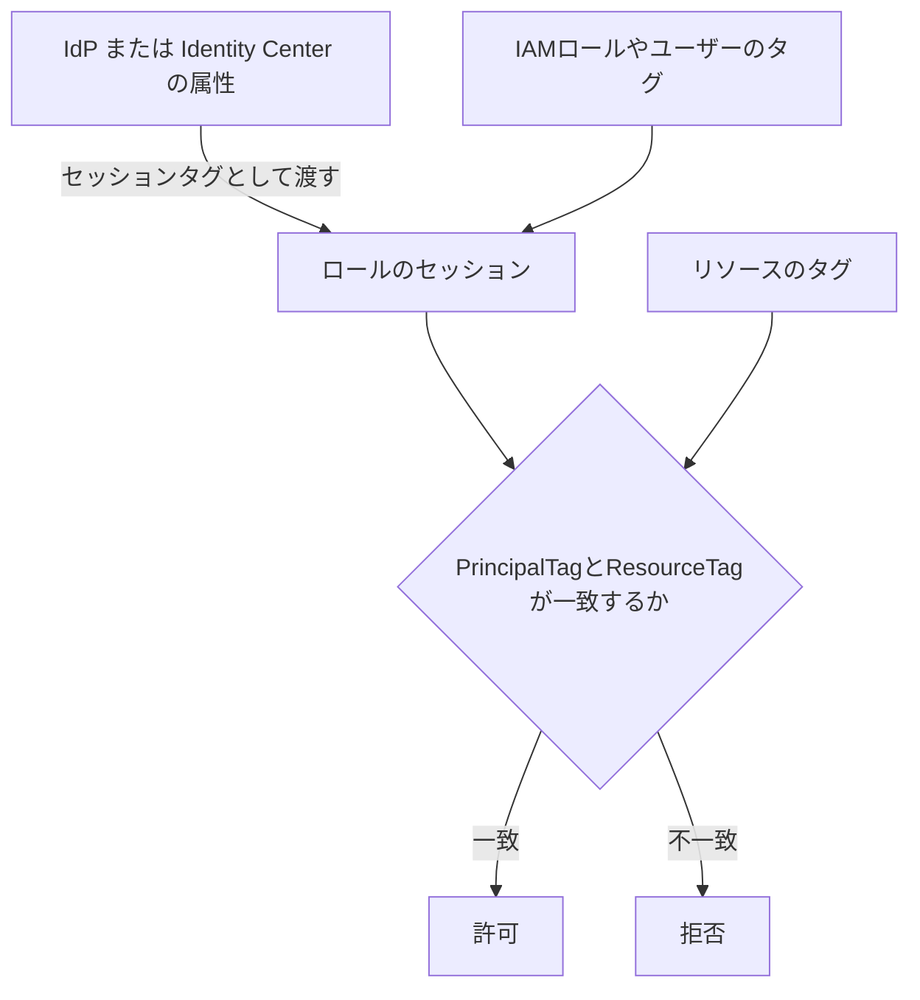

| 属性の出どころ | 設定方法 |
|---|---|
| IAM ユーザーやロールのタグ | IAM のタグ機能 |
| 外部 IdP (SAML) | SAML アサーションの `https://aws.amazon.com/SAML/Attributes/PrincipalTag:キー` 属性 |
| IAM Identity Center | 「アクセス制御用属性」を有効にして属性をマッピング |
| Cognito ID プール | 「アクセス制御用属性」のマッピング |
| `AssumeRole` | `--tags` オプションでセッションタグを渡す (`sts:TagSession` の許可が必要) |

### 7.4 ABAC で気をつけること

| リスク | 対策 |
|---|---|
| **誰でもタグを変更できると権限昇格できる** | `iam:TagRole`, `iam:TagUser`, `ec2:CreateTags` などタグ操作の権限を厳密に制限し、SCP で重要タグの変更を禁止する |
| タグ付けされていないリソースの扱い | 条件が一致しないため暗黙拒否になる。**タグ付けを必須化** (作成時にタグがなければ拒否) |
| すべてのサービスがタグベースの認可に対応しているわけではない | 利用するサービスが ABAC に対応しているか公式ドキュメントで確認 |
| タグキーは大文字小文字を区別しない場合がある | 命名規則を統一する |
| タグの値の標準化 | AWS Organizations の **タグポリシー** で許可する値を統制 |

#### ベストプラクティス (ABAC / RBAC)

| やること | 理由 |
|---|---|
| まず少数のロール (RBAC) で骨格を作り、増える部分に ABAC を使う | 両者の併用が現実的 |
| 属性は信頼できるソース (IdP や自動化) から付与する | 利用者が自分で書き換えられる属性は使わない |
| タグの付与と変更の権限を分離する | 権限昇格の防止 |

出典: https://docs.aws.amazon.com/IAM/latest/UserGuide/introduction_attribute-based-access-control.html
出典: https://docs.aws.amazon.com/IAM/latest/UserGuide/id_session-tags.html
出典: https://docs.aws.amazon.com/IAM/latest/UserGuide/reference_policies_condition-keys.html
出典: https://docs.aws.amazon.com/singlesignon/latest/userguide/abac.html

---

## 8. Skill 4.2.3: 最小権限の IAM ポリシーを設計・解釈・実装する

### 8.1 ポリシーの読み方

| 要素 | 意味 |
|---|---|
| `Effect` | `Allow` か `Deny` |
| `Action` / `NotAction` | 対象の操作 (`NotAction` は「それ以外すべて」で扱いに注意) |
| `Resource` / `NotResource` | 対象リソース |
| `Principal` | リソースベースポリシーと信頼ポリシーで使う、対象の主体 |
| `Condition` | 追加の条件 |

> 読み解くコツ: まず `Effect` を見て、次に `Action`、`Resource`、最後に `Condition` を確認します。
> `Deny` と `NotAction` の組み合わせは「**例外を除いてすべて拒否**」になるので、意図しない広範囲の拒否にならないか注意します。

### 8.2 最小権限を実現する手順

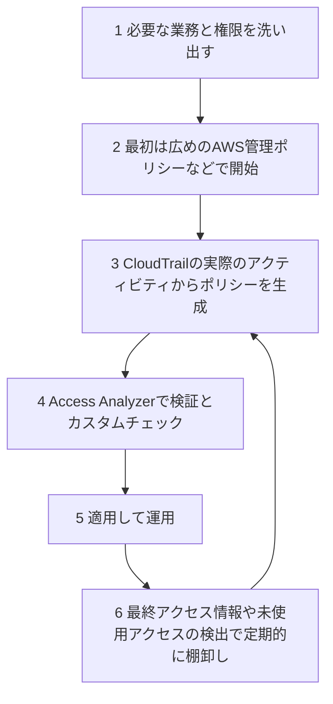

| 手段 | 内容 |
|---|---|
| IAM Access Analyzer のポリシー生成 | CloudTrail の過去のアクセス履歴 (最大 90 日) をもとに、実際に使われた権限のポリシーを生成。**S3 のデータイベントなどのアクションレベルの履歴や `iam:PassRole` は生成されたポリシーに含まれない**ため、必要な権限が欠けていないかを確認して追加してから既存ポリシーと置き換える |
| ポリシー検証 | 文法エラーやセキュリティ上の警告、改善提案を出す (`ERROR`, `SECURITY_WARNING`, `WARNING`, `SUGGESTION`) |
| カスタムポリシーチェック | 自社基準を満たすかを自動検証。`CheckNoNewAccess` (権限が増えていないか)、`CheckAccessNotGranted` (特定の操作が許可されていないか)、`CheckNoPublicAccess` (公開されないか)。CI/CD に組み込める |
| 未使用アクセスの検出 | 使われていないロール、アクセスキー、パスワード、権限を検出して削除 |

### 8.3 アクセス許可の境界 (Permissions Boundary)

境界は **権限そのものを与えず、ID ベースポリシーが与えられる権限の「上限」を決める** 機能です。

| 項目 | 内容 |
|---|---|
| 実効権限 | ID ベースポリシーと境界の **両方が許可** したものだけ (積集合) |
| 適用先 | IAM ユーザーとロール (グループには付けられない) |
| 主な用途 | 開発者に **IAM ロールの作成を委任** しつつ、権限の昇格を防ぐ |
| 注意 | IAM ユーザーやロールの ARN を直接指定したリソースベースポリシーの許可は、境界では制限されない |

#### 委任管理の定番パターン: 「境界を付けないとロールを作れない」

```json
{
  "Version": "2012-10-17",
  "Statement": [
    {
      "Sid": "CreateRoleOnlyWithBoundary",
      "Effect": "Allow",
      "Action": ["iam:CreateRole", "iam:PutRolePermissionsBoundary"],
      "Resource": "arn:aws:iam::111122223333:role/app-*",
      "Condition": {
        "StringEquals": {
          "iam:PermissionsBoundary": "arn:aws:iam::111122223333:policy/DeveloperBoundary"
        }
      }
    },
    {
      "Sid": "DenyBoundaryRemoval",
      "Effect": "Deny",
      "Action": [
        "iam:DeleteRolePermissionsBoundary",
        "iam:DeletePolicy",
        "iam:CreatePolicyVersion",
        "iam:SetDefaultPolicyVersion",
        "iam:DeletePolicyVersion"
      ],
      "Resource": [
        "arn:aws:iam::111122223333:role/app-*",
        "arn:aws:iam::111122223333:policy/DeveloperBoundary"
      ]
    }
  ]
}
```

### 8.4 セッションポリシー

| 項目 | 内容 |
|---|---|
| 何か | `AssumeRole`, `AssumeRoleWithSAML`, `AssumeRoleWithWebIdentity`, `GetFederationToken` などで **セッション作成時に渡す** ポリシー |
| 効果 | ロールの権限との **積集合** になり、権限を絞るだけで **付与はしない** |
| 使いどころ | 同じロールでも、呼び出しごとに権限を一時的に絞る (マルチテナントの SaaS など) |

### 8.5 ガードレールの層を整理する

| 層 | 仕組み | 誰が管理するか | 主な目的 |
|---|---|---|---|
| 組織 | SCP, RCP | セキュリティチーム | アカウントやリソースの絶対的な上限 |
| アカウントの委任 | アクセス許可の境界 | IAM 管理者 | 開発者が作る ID の上限 |
| セッション | セッションポリシー | アプリや運用 | 一時的な絞り込み |
| 付与 | ID ベース / リソースベースポリシー | 各チーム | 実際の許可 |

### 8.6 よく使う条件キー

| 条件キー | 用途 |
|---|---|
| `aws:PrincipalOrgID` | 組織内に限定 |
| `aws:SourceIp` / `aws:SourceVpce` / `aws:SourceVpc` | ネットワーク経路での制限 |
| `aws:RequestedRegion` | リージョン制限 |
| `aws:SecureTransport` | HTTPS 強制 |
| `aws:MultiFactorAuthPresent` | MFA 必須 |
| `aws:CalledVia` | 特定のサービス経由の呼び出しだけ許可 |
| `iam:PassedToService` | `iam:PassRole` で渡せる先のサービスを限定 |

#### ベストプラクティス (IAM ポリシー)

| やること | 理由 |
|---|---|
| `Action: "*"` と `Resource: "*"` を避ける | 権限過剰の最大の原因 |
| `iam:PassRole` は渡せるロールとサービスを限定する | ロールの持ち出しによる権限昇格を防ぐ |
| AWS 管理ポリシーで始め、実績ベースでカスタムポリシーに絞る | 初期の開発速度と最小権限の両立 |
| デプロイ前に Access Analyzer のポリシー検証とカスタムチェックを実行 | 過剰権限の混入を自動で防ぐ |
| 長期認証情報のアクセスキーは定期的にローテーションし、使っていないものは削除する | 漏えいリスクを減らす |
| ルートユーザーは日常利用せず、MFA を設定する | 最強権限の保護 |

出典: https://docs.aws.amazon.com/IAM/latest/UserGuide/access_policies_boundaries.html
出典: https://docs.aws.amazon.com/IAM/latest/UserGuide/access_policies.html#policies_session
出典: https://docs.aws.amazon.com/IAM/latest/UserGuide/access-analyzer-policy-generation.html
出典: https://docs.aws.amazon.com/IAM/latest/UserGuide/access-analyzer-policy-validation.html
出典: https://docs.aws.amazon.com/IAM/latest/UserGuide/access-analyzer-custom-policy-checks.html
出典: https://docs.aws.amazon.com/IAM/latest/UserGuide/best-practices.html

---

## 9. Skill 4.2.4: 認可の失敗を分析して原因を特定する

### 9.1 まずエラーメッセージを読む

最近の `AccessDenied` のメッセージには、**どの種類のポリシーが拒否したか** が書かれていることが多いです。

| メッセージの例 (要旨) | 意味 | 見る場所 |
|---|---|---|
| `no identity-based policy allows the action` | ID ベースポリシーに許可がない (暗黙の拒否) | ID に付いたポリシー |
| `with an explicit deny in an identity-based policy` | ID ベースポリシーに明示的な Deny | その Deny の条件 |
| `with an explicit deny in a service control policy` | SCP で拒否 | Organizations の SCP |
| `with an explicit deny in a resource control policy` | RCP で拒否 | Organizations の RCP |
| `with an explicit deny in a resource-based policy` | リソースポリシーで拒否 | バケットポリシーなど |
| `no permissions boundary allows the action` | 境界に許可がない | 境界ポリシー |
| `no session policy allows the action` | セッションポリシーに許可がない | AssumeRole 時に渡したポリシー |
| `no VPC endpoint policy allows the action` | VPC エンドポイントポリシーに許可がない | エンドポイントポリシー |

### 9.2 原因を切り分けるフロー

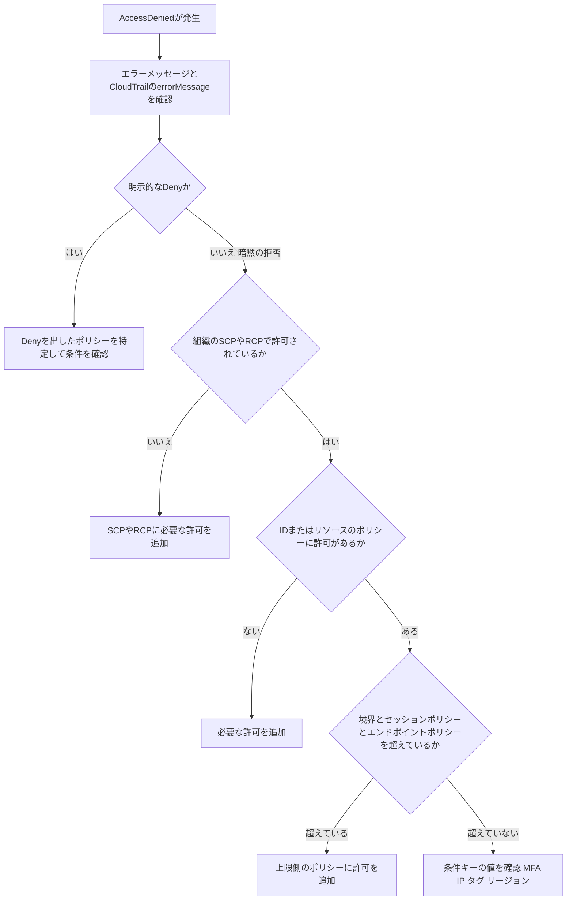

### 9.3 使うツール

| ツール | 何をするか | 注意点 |
|---|---|---|
| IAM ポリシーシミュレーター | 実際にリクエストを送らず、ポリシーが操作を許可するかをテスト。コンソールと API (`SimulatePrincipalPolicy`, `SimulateCustomPolicy`) に対応 | 実環境と結果が異なる場合がある (考慮される範囲に制約があるため、公式ドキュメントで確認)。**リソースのタグや条件の値を手動で与える** 必要がある |
| CloudTrail | 失敗したリクエストの `errorCode` と `errorMessage` を確認 | データイベントは有効化が必要 |
| `sts:DecodeAuthorizationMessage` | 一部のサービス (EC2 など) が返す **エンコードされた認可エラーメッセージ** を人間が読める形に復号。詳細に誰が何を拒否されたかが分かる | 復号には専用の権限が必要 |
| IAM Access Analyzer のポリシー検証 | 文法エラーや無効な条件を事前検知 | 実行時の評価そのものではない |
| IAM の最終アクセス情報 | 権限が実際に使われているかを確認 | 一定の遅延がある |

```bash
# ポリシーシミュレーターを CLI で実行する例
aws iam simulate-principal-policy \
  --policy-source-arn arn:aws:iam::111122223333:role/app-role \
  --action-names s3:GetObject \
  --resource-arns arn:aws:s3:::example-bucket/data.csv

# エンコードされた認可エラーメッセージの復号
aws sts decode-authorization-message \
  --encoded-message "ENCODED_MESSAGE_STRING" \
  --query DecodedMessage --output text
```

### 9.4 よくある原因と対処

| 症状 | よくある原因 | 対処 |
|---|---|---|
| クロスアカウントで S3 にアクセスできない | 片側 (リソース側または ID 側) にしか許可がない | 両方に許可を追加。オブジェクト所有者の違いにも注意 (所有者の強制設定で解消) |
| KMS で暗号化したオブジェクトにアクセスできない | **KMS キーポリシーの許可が不足** (S3 の許可だけでは足りない) | キーポリシーまたは許可に `kms:Decrypt` などを追加 |
| 許可したはずなのに拒否される | SCP や境界、セッションポリシーでの暗黙拒否 | 各層の上限を確認 |
| MFA を使っているのに拒否される | `aws:MultiFactorAuthPresent` が含まれないセッション (長期認証情報) | `GetSessionToken` で MFA 付きのセッションを取得 |
| ロールを引き受けられない | 信頼ポリシーの `Principal` や条件の不一致、呼び出し側の許可不足 | 両側を確認 |
| 条件キーが効かない | サービスやアクションが該当の条件キーに対応していない | サービス認可リファレンスで対応キーを確認 |

出典: https://docs.aws.amazon.com/IAM/latest/UserGuide/troubleshoot_access-denied.html
出典: https://docs.aws.amazon.com/IAM/latest/UserGuide/access_policies_testing-policies.html
出典: https://docs.aws.amazon.com/STS/latest/APIReference/API_DecodeAuthorizationMessage.html
出典: https://docs.aws.amazon.com/IAM/latest/UserGuide/reference_policies_evaluation-logic.html

---

## 10. Skill 4.2.5: 意図しない権限を調査して是正する

### 10.1 IAM Access Analyzer の 3 種類のアナライザー

| 種類 | 何を見つけるか | 見る範囲 (信頼ゾーン) | ポイント |
|---|---|---|---|
| 外部アクセス | **信頼ゾーン (アカウントまたは組織) の外部** と共有されているリソース | アカウントまたは組織 | リソースベースポリシーを分析。無料。**リージョンごと** に作成 |
| 内部アクセス | 組織やアカウント **内部** の IAM ロールやユーザーから、指定した重要リソースへ到達できる経路 | アカウントまたは組織 | 外部アクセスと組み合わせると、内外すべてのアクセス経路を把握できる。有料 |
| 未使用アクセス | **使われていない** ロール、アクセスキー、パスワード、権限 | アカウントまたは組織 | 最小権限へ絞り込む材料になる。有料 |

> 3 種類は **別々のアナライザーとして作成** します。未使用アクセスの検出結果はリージョンによって変わりません。

主な外部アクセス検出の対象 (例): S3 バケット、IAM ロールの信頼ポリシー、KMS キー、Lambda 関数とレイヤー、SQS キュー、Secrets Manager のシークレット、SNS トピック、ECR リポジトリ、EBS スナップショットなど。

### 10.2 調査と是正のフロー

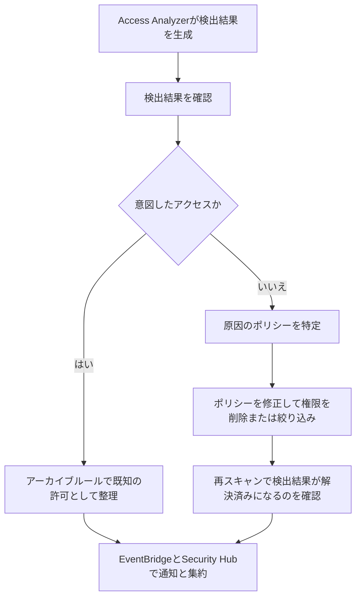

| 手順 | やること |
|---|---|
| 1. 検出 | 外部、内部、未使用の各アナライザーを組織単位で作成 (委任管理者が便利) |
| 2. 分類 | 「意図した共有」はアーカイブルールで抑制、「意図しない」は是正対象にする |
| 3. 是正 | リソースポリシーの `Principal` や条件を絞る。不要なロールや鍵を削除する。権限を実際の利用範囲まで絞る |
| 4. 自動化 | EventBridge で検出結果をトリガーに、通知や自動修復 (Lambda や Systems Manager Automation) を実行 |
| 5. 予防 | CI/CD でカスタムポリシーチェックを実行して再発を防ぐ。S3 ブロックパブリックアクセス、SCP、RCP でガードレール化 |

### 10.3 そのほかの調査手段

| ツール | 用途 |
|---|---|
| IAM 認証情報レポート | MFA 未設定のユーザー、古いアクセスキー、未使用のパスワードを洗い出す |
| IAM の最終アクセス情報 | サービスや操作ごとの最終利用日時から、不要な権限を特定 |
| AWS Config のルール | 管理者権限の付与 (`iam-policy-no-statements-with-admin-access`)、MFA 未設定、アクセスキーの経過日数などを継続的に評価 |
| AWS Security Hub | IAM に関する CSPM のコントロールを集約して違反を可視化 |
| Amazon GuardDuty | 異常な API 呼び出しや認証情報の不正利用の兆候を検出 |
| CloudTrail Lake / Athena | 不審な権限変更 (例: `AttachUserPolicy`, `PutRolePolicy`, `CreateAccessKey`) を調査 |

```sql
-- IAM の権限変更系イベントを調べる Athena クエリの例
SELECT eventtime, eventname, useridentity.arn, requestparameters
FROM cloudtrail_logs
WHERE eventsource = 'iam.amazonaws.com'
  AND eventname IN ('AttachUserPolicy', 'AttachRolePolicy', 'PutUserPolicy',
                    'PutRolePolicy', 'CreateAccessKey', 'UpdateAssumeRolePolicy')
ORDER BY eventtime DESC
LIMIT 100;
```

### 10.4 認証情報が漏えいした疑いがあるときの初動

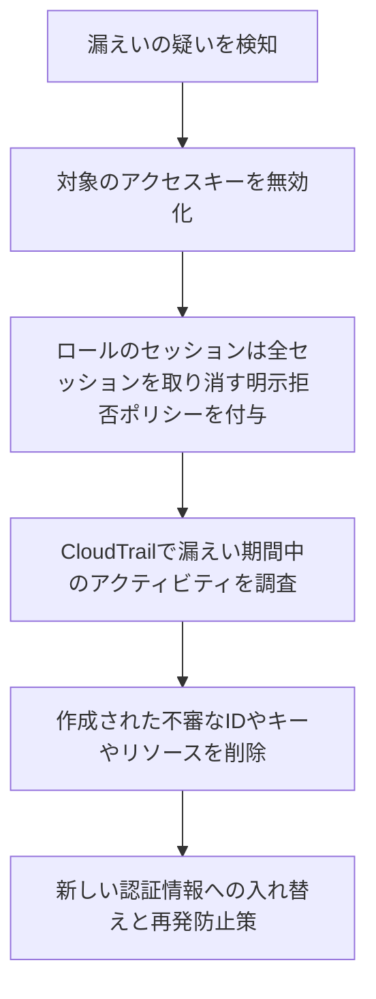

> アクセスキーは **削除する前に無効化** して影響を確認するのが安全です。
> ロールの一時セッションは、**ロールの「すべてのアクティブなセッションを取り消す」機能** で、指定時刻より前に発行されたセッションを拒否できます。

#### ベストプラクティス (是正と継続的な棚卸し)

| やること | 理由 |
|---|---|
| 組織全体に外部アクセスと未使用アクセスのアナライザーを有効化する | 見えない公開や過剰権限を継続的に検出 |
| 検出結果を EventBridge や Security Hub に集約する | 対応の自動化と一元管理 |
| 定期的に未使用のロール、キー、権限を削除する | 攻撃対象面の縮小 |
| 是正後は CI/CD のチェックで再発防止する | 同じミスの繰り返しを防ぐ |

出典: https://docs.aws.amazon.com/IAM/latest/UserGuide/what-is-access-analyzer.html
出典: https://docs.aws.amazon.com/IAM/latest/UserGuide/access-analyzer-findings.html
出典: https://docs.aws.amazon.com/IAM/latest/UserGuide/access-analyzer-concepts.html
出典: https://docs.aws.amazon.com/IAM/latest/UserGuide/id_roles_use_revoke-sessions.html
出典: https://docs.aws.amazon.com/IAM/latest/UserGuide/id-credentials-access-keys-update.html

---

## 11. サービス横断の整理

### 11.1 サービスと役割の対応表

| サービスや機能 | 認証 / 認可 | 一言でいうと | 主な Skill |
|---|---|---|---|
| IAM Identity Center | 認証 + 認可の入口 | 従業員の SSO と複数アカウントの権限配布 | 4.1.1 |
| Amazon Cognito ユーザープール | 認証 | アプリ利用者のサインインと JWT 発行 | 4.1.1 |
| Amazon Cognito ID プール | 認可 | JWT を AWS の一時認証情報に交換 | 4.1.1 / 4.1.2 |
| AWS STS | 認証情報の発行 | 一時認証情報の発行元 | 4.1.2 |
| S3 署名付き URL | 一時アクセス | 署名者の権限で期限付きの URL | 4.1.2 |
| AWS Directory Service | 認証 | AD 連携 | 4.1.1 / 4.1.3 |
| AWS CloudTrail | 監査 | 認証と認可の失敗の調査 | 4.1.3 / 4.2.4 |
| IAM Roles Anywhere | 認証 + 認可 | AWS 外のワークロードに証明書ベースで一時認証情報 | 4.2.1 |
| Amazon Verified Permissions | 認可 | アプリ固有のきめ細かな認可 (Cedar) | 4.2.1 |
| 信頼ポリシー / リソースポリシー | 認可 | クロスアカウントアクセスの制御 | 4.2.1 |
| アクセス許可の境界 | 認可 (上限) | 委任された管理の権限昇格防止 | 4.2.3 |
| セッションポリシー | 認可 (上限) | 一時セッションの絞り込み | 4.2.3 |
| ポリシーシミュレーター | 検証 | 許可か拒否かを事前確認 | 4.2.4 |
| IAM Access Analyzer | 検証 / 検出 | 外部、内部、未使用アクセスの検出とポリシー検証、生成 | 4.2.4 / 4.2.5 |

### 11.2 「どれを選ぶ?」の判断表

| 要件 | 選ぶもの |
|---|---|
| 従業員が複数アカウントにシングルサインオンしたい | IAM Identity Center |
| Web / モバイルアプリのエンドユーザーにログインさせたい | Cognito ユーザープール |
| モバイルアプリのユーザーに S3 へ直接アクセスさせたい | Cognito ID プール |
| オンプレミスのサーバーから AWS を使いたい (長期キーなし) | IAM Roles Anywhere |
| GitHub Actions から AWS にデプロイしたい (長期キーなし) | OIDC フェデレーション + IAM ロール |
| CLI で MFA 付きの一時認証情報が欲しい | STS `GetSessionToken` |
| 他アカウントのロールに切り替えたい | STS `AssumeRole` |
| 認証なしの外部ユーザーに期限付きでファイルを渡したい | S3 署名付き URL |
| 開発者に IAM ロール作成を許しつつ権限昇格を防ぎたい | アクセス許可の境界 |
| 組織内の全アカウントに共通の禁止事項を適用したい | SCP |
| 組織のリソースを組織外からアクセスさせたくない | RCP や `aws:PrincipalOrgID` 条件 |
| プロジェクトが増えてもポリシーを増やしたくない | ABAC |
| 実際に使われた権限だけに絞りたい | Access Analyzer のポリシー生成と未使用アクセスの検出 |
| 外部に公開されたリソースを見つけたい | Access Analyzer の外部アクセスアナライザー |
| 自社アプリ内の「文書の所有者だけ編集可」を実装したい | Amazon Verified Permissions |

---

## 12. 試験の頻出パターンとひっかけ

### 12.1 キーワードから答えを引く

| 問題文のキーワード | 想定される答え |
|---|---|
| 「長期の認証情報を使わず」「一時的」 | IAM ロール、STS、Roles Anywhere、OIDC フェデレーション |
| 「ユーザーの属性やタグでアクセスを制御」「ポリシーを増やさずに」 | ABAC (`aws:PrincipalTag` と `aws:ResourceTag`) |
| 「権限の上限」「委任された管理者が権限昇格しないよう」 | アクセス許可の境界 |
| 「ロール引き受け時に権限を一時的に絞る」 | セッションポリシー |
| 「サードパーティ」「混乱した代理人」 | 外部 ID、`aws:SourceArn`、`aws:SourceAccount` |
| 「外部と共有されているリソースを検出」 | IAM Access Analyzer の外部アクセスアナライザー |
| 「使われていない権限を削除」「最小権限へ」 | 未使用アクセスアナライザー、ポリシー生成 |
| 「CloudTrail のログから最小権限ポリシーを生成」 | IAM Access Analyzer のポリシー生成 |
| 「ポリシーがデプロイ前に自社基準に合うか」 | カスタムポリシーチェック |
| 「エンコードされた認可エラーメッセージ」 | `sts:DecodeAuthorizationMessage` |
| 「MFA 必須」「MFA 付きの一時認証情報」 | `aws:MultiFactorAuthPresent`、`GetSessionToken` |
| 「アプリ独自のきめ細かな認可」「Cedar」 | Amazon Verified Permissions |
| 「オンプレミスの証明書」 | IAM Roles Anywhere |

### 12.2 ひっかけポイント

| ひっかけ | 正しい理解 |
|---|---|
| 「境界を付ければ権限が付与される」 | 境界は **上限を決めるだけ**。付与には ID ベースポリシーが必要 |
| 「SCP で許可すれば使える」 | SCP も **上限だけ**。IAM の許可が別途必要 |
| 「クロスアカウントはリソースポリシーだけで OK」 | **両側の許可が必要** |
| 「Cognito ユーザープールが AWS の一時認証情報を出す」 | 出すのは JWT。AWS の一時認証情報は **ID プール** |
| 「署名付き URL は誰の権限で動くか」 | **署名者の権限** |
| 「ロールチェーンで 12 時間のセッション」 | ロールチェーンは **最大 1 時間** |
| 「IAM パスで ABAC ができる」 | パスは整理用。ABAC は **タグや属性** |
| 「Access Analyzer の外部アクセスは組織内の他アカウントも検出する」 | 信頼ゾーン (アカウントまたは組織) の **外側** が対象。組織内部の経路は内部アクセスアナライザーの領域 |
| 「アクセスキーはすぐ削除」 | まず **無効化** して影響を確認してから削除 |
| 「`BoolIfExists` と `Bool` は同じ」 | 条件キーが存在しない場合の扱いが違う (MFA 条件では `BoolIfExists` が定番) |

---

## 13. 練習問題 (確認テスト)

**Q1.** 従業員が複数の AWS アカウントに、会社の外部 IdP でサインインしたい。長期の IAM ユーザーは作りたくない。最も適切な設計は?

<details>
<summary>答えを見る</summary>

IAM Identity Center の ID ソースに外部 IdP (SAML 2.0) を設定し、SCIM でユーザーとグループを同期する。許可セットをグループに割り当てる。IAM ユーザーは作らず、各アカウントに自動作成されるロールを一時認証情報で引き受ける。
</details>

**Q2.** モバイルアプリのサインインしたユーザーに、自分のフォルダだけを S3 で読み書きさせたい。必要な構成は?

<details>
<summary>答えを見る</summary>

Cognito ユーザープールで認証し、ID プールで JWT を AWS の一時認証情報に交換する。認証済みロールの IAM ポリシーで、Cognito ID を含むプレフィックス (`${cognito-identity.amazonaws.com:sub}`) に限定する。未認証アクセスは無効にする。
</details>

**Q3.** 開発者に IAM ロールの作成を許可したいが、管理者権限を持つロールを作って昇格されたくない。どうする?

<details>
<summary>答えを見る</summary>

開発者の許可に `iam:PermissionsBoundary` 条件を付け、指定の境界ポリシーが付いたロールしか作成できないようにする。境界ポリシーの削除や変更を拒否するステートメントも加える。
</details>

**Q4.** 第三者の SaaS 事業者にクロスアカウントのロールを引き受けさせる。混乱した代理人問題への対策は?

<details>
<summary>答えを見る</summary>

ロールの信頼ポリシーに `sts:ExternalId` 条件を設定し、事業者が顧客ごとに一意の外部 ID を使うようにする。
</details>

**Q5.** 開発チームの権限を「実際に使った操作」だけに絞りたい。もっとも効率的な方法は?

<details>
<summary>答えを見る</summary>

IAM Access Analyzer のポリシー生成で、CloudTrail の実際のアクティビティ (最大 90 日) から最小権限のポリシーを生成する。ただし S3 のデータイベントなどのアクションレベルの履歴や `iam:PassRole` は生成されたポリシーに含まれないため、必要な権限が欠けていないかを確認して追加してから既存ポリシーと置き換える。さらに未使用アクセスアナライザーで未使用の権限を検出して削除する。
</details>

**Q6.** プロジェクトが頻繁に増えるが、そのたびにポリシーを書き換えたくない。「自分のプロジェクトのリソースだけ操作できる」ようにしたい。

<details>
<summary>答えを見る</summary>

ABAC を採用する。ポリシーで `aws:ResourceTag/project` と `${aws:PrincipalTag/project}` の一致を条件にする。タグの付与と変更権限は厳しく制限する。
</details>

**Q7.** ユーザーに S3 の許可を付けたのに、クロスアカウントのバケットにアクセスできない。確認すべきことは?

<details>
<summary>答えを見る</summary>

クロスアカウントでは、アクセス元の ID ベースポリシーとバケット側のバケットポリシーの両方が許可している必要がある。加えて、KMS で暗号化されている場合はキーポリシーの許可、SCP や RCP、VPC エンドポイントポリシーによる拒否も確認する。
</details>

**Q8.** EC2 のオペレーションで「Encoded authorization failure message」が返った。原因を調べるには?

<details>
<summary>答えを見る</summary>

`sts:DecodeAuthorizationMessage` で復号する (復号するための権限が必要)。復号結果から、拒否したポリシーの種類と対象のアクションを確認する。
</details>

---

## 14. 参考ソース一覧 (公式ドキュメント)

> 本ガイドは AWS の公式ドキュメントをもとに構成しています。サービスは頻繁に更新されるため、**試験前に最新の内容を公式ドキュメントで確認** してください。
> 特に、制限値 (セッション時間、MFA デバイス数など) と Cognito や Access Analyzer の機能構成は変更されることがあります。

### 14.1 試験ガイド

| タイトル | URL |
|---|---|
| AWS Certified Security - Specialty (SCS-C03) 試験ガイド | https://docs.aws.amazon.com/aws-certification/latest/security-specialty-03/security-specialty-03.html |
| Content Domain 4: Identity and Access Management | https://docs.aws.amazon.com/aws-certification/latest/security-specialty-03/security-specialty-03-domain4.html |
| 対象範囲のサービス一覧 | https://docs.aws.amazon.com/aws-certification/latest/security-specialty-03/scs-02-in-scope-services.html |
| 技術と概念 | https://docs.aws.amazon.com/aws-certification/latest/security-specialty-03/scs-technologies-concepts.html |

### 14.2 IAM の基礎、ポリシー評価、ベストプラクティス

| タイトル | URL |
|---|---|
| IAM とは | https://docs.aws.amazon.com/IAM/latest/UserGuide/introduction.html |
| IAM のセキュリティベストプラクティス | https://docs.aws.amazon.com/IAM/latest/UserGuide/best-practices.html |
| ポリシー評価ロジック | https://docs.aws.amazon.com/IAM/latest/UserGuide/reference_policies_evaluation-logic.html |
| グローバル条件キー | https://docs.aws.amazon.com/IAM/latest/UserGuide/reference_policies_condition-keys.html |
| Principal 要素 | https://docs.aws.amazon.com/IAM/latest/UserGuide/reference_policies_elements_principal.html |
| ルートユーザー | https://docs.aws.amazon.com/IAM/latest/UserGuide/id_root-user.html |

### 14.3 認証 (Skill 4.1.1 から 4.1.3)

| タイトル | URL |
|---|---|
| IAM Identity Center とは | https://docs.aws.amazon.com/singlesignon/latest/userguide/what-is.html |
| 許可セット | https://docs.aws.amazon.com/singlesignon/latest/userguide/permissionsetsconcept.html |
| Identity Center の ABAC | https://docs.aws.amazon.com/singlesignon/latest/userguide/abac.html |
| Identity Center のトラブルシューティング | https://docs.aws.amazon.com/singlesignon/latest/userguide/troubleshooting.html |
| Amazon Cognito とは | https://docs.aws.amazon.com/cognito/latest/developerguide/what-is-amazon-cognito.html |
| Cognito ID プール | https://docs.aws.amazon.com/cognito/latest/developerguide/cognito-identity.html |
| Cognito の脅威保護 | https://docs.aws.amazon.com/cognito/latest/developerguide/cognito-user-pool-settings-threat-protection.html |
| Cognito と CloudTrail | https://docs.aws.amazon.com/cognito/latest/developerguide/logging-using-cloudtrail.html |
| IAM の MFA | https://docs.aws.amazon.com/IAM/latest/UserGuide/id_credentials_mfa.html |
| MFA 付きのアクセスを要求する | https://docs.aws.amazon.com/IAM/latest/UserGuide/id_credentials_mfa_configure-api-require.html |
| SAML フェデレーション | https://docs.aws.amazon.com/IAM/latest/UserGuide/id_roles_providers_saml.html |
| OIDC フェデレーション | https://docs.aws.amazon.com/IAM/latest/UserGuide/id_roles_providers_oidc.html |
| AWS Directory Service | https://docs.aws.amazon.com/directoryservice/latest/admin-guide/what_is.html |
| EC2 のロール (インスタンスプロファイル) | https://docs.aws.amazon.com/IAM/latest/UserGuide/id_roles_use_switch-role-ec2.html |
| EC2 インスタンスメタデータ (IMDSv2) | https://docs.aws.amazon.com/AWSEC2/latest/UserGuide/configuring-instance-metadata-service.html |
| EKS Pod Identity | https://docs.aws.amazon.com/eks/latest/userguide/pod-identities.html |
| 一時的なセキュリティ認証情報 | https://docs.aws.amazon.com/IAM/latest/UserGuide/id_credentials_temp.html |
| 一時認証情報をリクエストする (API の比較) | https://docs.aws.amazon.com/IAM/latest/UserGuide/id_credentials_temp_request.html |
| AWS STS API リファレンス | https://docs.aws.amazon.com/STS/latest/APIReference/welcome.html |
| 混乱した代理人問題 | https://docs.aws.amazon.com/IAM/latest/UserGuide/confused-deputy.html |
| 外部 ID | https://docs.aws.amazon.com/IAM/latest/UserGuide/id_roles_create_for-user_externalid.html |
| S3 署名付き URL | https://docs.aws.amazon.com/AmazonS3/latest/userguide/using-presigned-url.html |
| AWS CloudTrail ユーザーガイド | https://docs.aws.amazon.com/awscloudtrail/latest/userguide/cloudtrail-user-guide.html |
| IAM 認証情報レポート | https://docs.aws.amazon.com/IAM/latest/UserGuide/id_credentials_getting-report.html |
| 最終アクセス情報 | https://docs.aws.amazon.com/IAM/latest/UserGuide/access_policies_last-accessed.html |

### 14.4 認可 (Skill 4.2.1 から 4.2.5)

| タイトル | URL |
|---|---|
| IAM Roles Anywhere | https://docs.aws.amazon.com/rolesanywhere/latest/userguide/introduction.html |
| Amazon Verified Permissions | https://docs.aws.amazon.com/verifiedpermissions/latest/userguide/what-is-avp.html |
| クロスアカウントのリソースアクセス | https://docs.aws.amazon.com/IAM/latest/UserGuide/access_policies-cross-account-resource-access.html |
| SCP | https://docs.aws.amazon.com/organizations/latest/userguide/orgs_manage_policies_scps.html |
| RCP | https://docs.aws.amazon.com/organizations/latest/userguide/orgs_manage_policies_rcps.html |
| ABAC (属性ベースのアクセス制御) | https://docs.aws.amazon.com/IAM/latest/UserGuide/introduction_attribute-based-access-control.html |
| セッションタグ | https://docs.aws.amazon.com/IAM/latest/UserGuide/id_session-tags.html |
| アクセス許可の境界 | https://docs.aws.amazon.com/IAM/latest/UserGuide/access_policies_boundaries.html |
| セッションポリシー | https://docs.aws.amazon.com/IAM/latest/UserGuide/access_policies.html#policies_session |
| ポリシーシミュレーター | https://docs.aws.amazon.com/IAM/latest/UserGuide/access_policies_testing-policies.html |
| AccessDenied のトラブルシューティング | https://docs.aws.amazon.com/IAM/latest/UserGuide/troubleshoot_access-denied.html |
| DecodeAuthorizationMessage | https://docs.aws.amazon.com/STS/latest/APIReference/API_DecodeAuthorizationMessage.html |
| IAM Access Analyzer とは | https://docs.aws.amazon.com/IAM/latest/UserGuide/what-is-access-analyzer.html |
| Access Analyzer の検出結果 | https://docs.aws.amazon.com/IAM/latest/UserGuide/access-analyzer-findings.html |
| Access Analyzer の概念 | https://docs.aws.amazon.com/IAM/latest/UserGuide/access-analyzer-concepts.html |
| Access Analyzer のポリシー生成 | https://docs.aws.amazon.com/IAM/latest/UserGuide/access-analyzer-policy-generation.html |
| Access Analyzer のポリシー検証 | https://docs.aws.amazon.com/IAM/latest/UserGuide/access-analyzer-policy-validation.html |
| Access Analyzer のカスタムポリシーチェック | https://docs.aws.amazon.com/IAM/latest/UserGuide/access-analyzer-custom-policy-checks.html |
| ロールセッションの取り消し | https://docs.aws.amazon.com/IAM/latest/UserGuide/id_roles_use_revoke-sessions.html |
| アクセスキーの管理 | https://docs.aws.amazon.com/IAM/latest/UserGuide/id-credentials-access-keys-update.html |

---

## 15. 最後に: 学習のチェックリスト

- [ ] 認証 (Identity Center, Cognito, MFA, フェデレーション) と認可 (ポリシー, 境界, SCP) を言葉で説明できる
- [ ] Cognito のユーザープールと ID プールの違いを説明できる
- [ ] STS の主要 API (`AssumeRole`, `AssumeRoleWithSAML`, `AssumeRoleWithWebIdentity`, `GetSessionToken`) の使い分けができる
- [ ] 署名付き URL が誰の権限で動き、どう制限できるかを説明できる
- [ ] ポリシー評価ロジックの優先順位 (明示的な Deny が最優先) を描ける
- [ ] クロスアカウントで必要な許可 (両側) を説明できる
- [ ] ABAC のポリシーを 1 つ書ける (タグの一致条件)
- [ ] 境界、セッションポリシー、SCP、RCP の違いを説明できる
- [ ] `AccessDenied` の原因を層ごとに切り分けられる
- [ ] Access Analyzer の 3 種類のアナライザーとポリシー生成、検証、カスタムチェックの違いを説明できる
- [ ] 認証情報漏えい時の初動 (無効化、セッション取り消し、CloudTrail 調査) を説明できる
