# AWS Certified Security - Specialty (SCS-C03)
# Content Domain 5: Data Protection 完全ガイド(初学者向け・ステップバイステップ)

> 対象試験: AWS Certified Security - Specialty (SCS-C03)
> 対象ドメイン: **Content Domain 5: Data Protection(出題比率 18%)**
> 作成日: 2026-10-22
> 想定読者: AWS のセキュリティを初めて体系的に学ぶ方(インフラ・開発の基礎知識があればOK)

---

## 目次

1. [この文書の使い方と試験の全体像](#1-この文書の使い方と試験の全体像)
2. [基礎知識: データ保護を理解する4つの土台](#2-基礎知識-データ保護を理解する4つの土台)
3. [Task 5.1: 転送中のデータ(Data in Transit)](#3-task-51-転送中のデータdata-in-transit)
   - [Skill 5.1.1 暗号化接続の強制](#skill-511-暗号化接続の強制)
   - [Skill 5.1.2 安全でプライベートなアクセス](#skill-512-安全でプライベートなアクセス)
   - [Skill 5.1.3 リソース間の転送中暗号化](#skill-513-リソース間の転送中暗号化)
4. [Task 5.2: 保存中のデータ(Data at Rest)](#4-task-52-保存中のデータdata-at-rest)
   - [Skill 5.2.1 保存時の暗号化(KMS と CloudHSM、SSE と CSE)](#skill-521-保存時の暗号化)
   - [Skill 5.2.2 データ整合性の保護](#skill-522-データ整合性の保護)
   - [Skill 5.2.3 ライフサイクル管理と保持](#skill-523-ライフサイクル管理と保持)
   - [Skill 5.2.4 レプリケーションとバックアップ](#skill-524-レプリケーションとバックアップ)
5. [Task 5.3: 機密データ・認証情報・シークレット・暗号鍵の保護](#5-task-53-機密データ認証情報シークレット暗号鍵の保護)
   - [Skill 5.3.1 シークレットの管理とローテーション](#skill-531-シークレットの管理とローテーション)
   - [Skill 5.3.2 インポートしたキーマテリアルと外部キーストア](#skill-532-インポートしたキーマテリアルと外部キーストア)
   - [Skill 5.3.3 インポート鍵と AWS 生成鍵の違い](#skill-533-インポート鍵と-aws-生成鍵の違い)
   - [Skill 5.3.4 機密データのマスキング](#skill-534-機密データのマスキング)
   - [Skill 5.3.5 鍵と証明書の作成・管理(単一/マルチリージョン)](#skill-535-鍵と証明書の作成管理)
6. [試験対策: 頻出パターンとひっかけポイント](#6-試験対策-頻出パターンとひっかけポイント)
7. [理解度チェック(演習問題)](#7-理解度チェック演習問題)
8. [最終チェックリスト](#8-最終チェックリスト)
9. [参考ソース(URL)](#9-参考ソースurl)

---

## 1. この文書の使い方と試験の全体像

### 1.1 試験情報(公式ガイドより)

| 項目 | 内容 |
|---|---|
| 試験名 | AWS Certified Security - Specialty (SCS-C03) |
| 想定受験者 | クラウドセキュリティ実務 3〜5年相当 |
| 問題数 | 採点対象 50問 + 採点対象外 15問(見分けはつかない) |
| 合格点 | スケールスコア 100〜1,000 のうち **750 以上** |
| 採点方式 | 補償型(各ドメインで合格点を取る必要はなく、全体で合格すればよい) |
| 出題形式 | 択一、複数選択、並べ替え(Ordering)、マッチング |
| Domain 5 の配点 | **18%**(Domain 4 の 20% に次いで大きい) |

> 根拠: [Exam Guide (SCS-C03)](https://docs.aws.amazon.com/aws-certification/latest/security-specialty-03/security-specialty-03.html)

### 1.2 Domain 5 の構造

Domain 5 は **3つの Task と 12個の Skill** で構成されています。この文書もこの順番で解説します。

| Task | 内容 | Skill 数 |
|---|---|---|
| **5.1** | 転送中のデータの制御を設計・実装する | 3 |
| **5.2** | 保存中のデータの制御を設計・実装する | 4 |
| **5.3** | 機密データ・認証情報・シークレット・暗号鍵を保護する | 5 |

> 根拠: [Content Domain 5: Data Protection](https://docs.aws.amazon.com/aws-certification/latest/security-specialty-03/security-specialty-03-domain5.html)

### 1.3 学習の進め方(おすすめ)

1. まず「2. 基礎知識」で用語を押さえる(ここを飛ばすと後半で必ず詰まります)
2. Task 5.1 → 5.2 → 5.3 の順に読む。各 Skill は次の型で書いてあります
   - **ひとことで言うと** → **なぜ必要か** → **仕組み** → **設定手順** → **ベストプラクティス** → **試験のポイント**
3. 各章末の「試験のポイント」を、自分の言葉で説明できるか確認する
4. 最後に「7. 理解度チェック」で腕試しする

### 1.4 試験範囲外(出題されない)ことの確認

公式ガイドでは次の業務は**対象外**とされています。深入りしなくて大丈夫です。

- 暗号アルゴリズムそのものの設計
- パケットレベルでのトラフィック分析
- クラウド全体のアーキテクチャ設計
- エンドユーザーコンピューティングの管理
- 機械学習モデルの学習

つまり「暗号の数学」ではなく、「**AWS のどのサービス・機能を、どの場面で、どう設定して守るか**」を問われます。

---

## 2. 基礎知識: データ保護を理解する4つの土台

### 2.1 データの3つの状態

データ保護は、データがどの状態にあるかで考えると整理できます。

| 状態 | 英語 | 例 | 主な守り方 | Domain 5 の Task |
|---|---|---|---|---|
| 転送中 | Data in Transit | ブラウザ→ALB、アプリ→DB | TLS、VPN、PrivateLink | **5.1** |
| 保存中 | Data at Rest | S3 のオブジェクト、EBS ボリューム | 暗号化、ロック、バックアップ | **5.2** |
| 秘密情報そのもの | Secrets / Keys | DB パスワード、API キー、暗号鍵 | Secrets Manager、KMS、CloudHSM | **5.3** |

### 2.2 暗号化の基本用語

| 用語 | やさしい説明 |
|---|---|
| 平文(Plaintext) | 暗号化前の読めるデータ |
| 暗号文(Ciphertext) | 暗号化後の読めないデータ |
| 対称鍵暗号 | 暗号化と復号に**同じ鍵**を使う(例: AES-256)。高速で大量データ向き |
| 非対称鍵暗号 | **公開鍵と秘密鍵のペア**を使う(例: RSA、ECC)。署名や鍵交換向き |
| TLS | 通信を暗号化・認証するプロトコル。HTTPS の「S」の正体 |
| 証明書 | 「この公開鍵はこのサーバーのものです」と認証局(CA)が保証する電子的な身分証 |
| 鍵ローテーション | 鍵を定期的に新しいものに切り替えること。万一の漏えい影響を限定する |

### 2.3 エンベロープ暗号化(最重要の概念)

AWS の暗号化サービスはほぼすべて **エンベロープ暗号化** で動いています。ここを理解すると KMS の問題の大半が解けます。

**なぜ必要か**: KMS の `Encrypt` API で直接暗号化できるのは最大 4 KB までです。大きなデータは、データ用の鍵(データキー)で暗号化し、そのデータキーを KMS の鍵(KMS キー)で暗号化します。

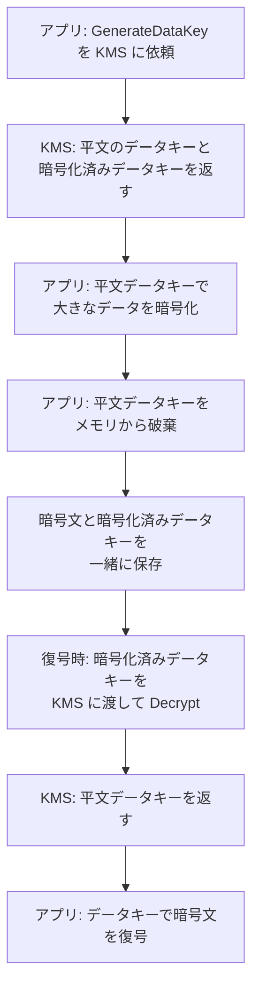

**ポイント**
- KMS キー(旧称 CMK)そのものは **KMS の外に出ません**(CloudHSM や外部キーストアでも原則同様)
- 保存するのは「暗号文 + 暗号化済みデータキー」。平文のデータキーは使い終わったらすぐ破棄
- 鍵へのアクセス権(誰が `Decrypt` できるか)を管理すれば、データへのアクセスを間接的に制御できる

### 2.4 責任共有モデルとデータ保護

| 区分 | AWS の責任 | お客様の責任 |
|---|---|---|
| 暗号化機能 | 暗号化機能・ハードウェア・KMS 基盤の提供と運用 | **暗号化を有効にする・強制する設定、鍵ポリシー、アクセス制御** |
| 転送中 | AWS 内部ネットワークの物理保護 | **TLS 設定、エンドポイント設計、証明書管理** |
| 保存中 | ストレージ基盤の保護 | **暗号化方式の選択、バックアップ・保持・削除ポリシー** |

---

## 3. Task 5.1: 転送中のデータ(Data in Transit)

> **Task 5.1: Design and implement controls for data in transit**
> 公式 Skill: 5.1.1(暗号化接続の強制)/ 5.1.2(安全でプライベートなアクセス)/ 5.1.3(リソース間の暗号化)

### Task 5.1 の全体像

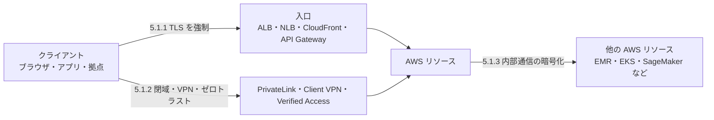

---

### Skill 5.1.1 暗号化接続の強制

#### ひとことで言うと
**「暗号化されていない接続は、そもそも受け付けない」**ようにする設計と設定です。

#### なぜ必要か
HTTP のような平文通信は、経路上で盗聴・改ざんされる危険があります。「暗号化を**使える**」だけでは不十分で、「暗号化**以外は拒否する**」状態にして初めて守れたと言えます。

#### 仕組み: TLS とセキュリティポリシー

TLS 接続では、クライアントとサーバーが **TLS バージョン**と**暗号スイート(使う暗号方式の組み合わせ)**を交渉して決めます。サーバー側がどのバージョン・暗号スイートを許可するかを定めたものが **セキュリティポリシー**です。古い TLS(1.0/1.1)や弱い暗号スイートを許可すると、ダウングレード攻撃の余地が生まれます。

#### サービス別の「強制」方法

| サービス | 強制方法 | 要点 |
|---|---|---|
| **ALB / NLB** | HTTPS/TLS リスナー + **セキュリティポリシー**を選択 | ALB はカスタムポリシー**不可**(定義済みポリシーから選ぶ) |
| **ALB** | HTTP(80)リスナーで HTTPS(443)へ**リダイレクト** | 平文入口を残さない |
| **CloudFront** | Viewer Protocol Policy を `Redirect HTTP to HTTPS` または `HTTPS Only`、Origin Protocol Policy を `HTTPS Only` | ビューアー側とオリジン側の**両方**を設定 |
| **API Gateway** | カスタムドメインで最小 TLS バージョンを指定、必要に応じて**相互 TLS(mTLS)** | REST API エンドポイントは HTTPS のみ |
| **S3** | バケットポリシーで `aws:SecureTransport` が `false` のリクエストを **Deny** | `s3:TlsVersion` 条件キーで TLS 1.2 未満を拒否することも可能 |
| **RDS / Aurora** | PostgreSQL は `rds.force_ssl`、MySQL/MariaDB は `require_secure_transport` パラメータ | 接続側は RDS の CA 証明書を検証 |
| **EFS** | マウント時に `tls` オプション(EFS マウントヘルパー)、ファイルシステムポリシーで `aws:SecureTransport` を要求 | |
| **SQS / SNS など** | リソースポリシーで `aws:SecureTransport` を要求 | |

#### ELB セキュリティポリシーを深掘り

ALB の定義済みポリシーの名前には規則があります。

| 名前の例 | 意味 |
|---|---|
| `ELBSecurityPolicy-TLS13-1-3-2021-06` | **TLS 1.3 のみ**許可する最も厳格なポリシー |
| `ELBSecurityPolicy-TLS13-1-2-2021-06` | TLS 1.3 と TLS 1.2 を許可 |
| `ELBSecurityPolicy-TLS13-1-2-Res-2021-06` | TLS 1.3/1.2 で、暗号スイートをより制限(Res = Restricted) |
| `ELBSecurityPolicy-TLS13-1-0-2021-06` | TLS 1.3 から 1.0 まで許可(互換性重視・非推奨寄り) |
| 名前に **PQ** を含むもの | 耐量子計算機を意識した**ハイブリッド・ポスト量子鍵交換**をサポート |
| 名前に **FIPS** を含むもの | FIPS 準拠が必要な環境向け |

2026年10月時点の公式ドキュメントでは、**コンソールでリスナーを作ると既定で `ELBSecurityPolicy-TLS13-1-2-Res-PQ-2025-09` が選ばれ**、AWS はポスト量子 TLS ポリシー(`...Res-PQ-2025-09` または FIPS 版)の採用を推奨しています。作成方法(コンソール/CLI/API)で既定が変わりうるため、**「ポリシーを明示的に指定する」**のがベストプラクティスです。

```bash
# 利用可能なセキュリティポリシーと内容を確認する
aws elbv2 describe-ssl-policies \
  --names "ELBSecurityPolicy-TLS13-1-2-Res-2021-06"

# HTTPS リスナーのセキュリティポリシーを変更する
aws elbv2 modify-listener \
  --listener-arn arn:aws:elasticloadbalancing:ap-northeast-1:111122223333:listener/app/my-alb/xxxx/yyyy \
  --ssl-policy ELBSecurityPolicy-TLS13-1-2-Res-2021-06
```

> 根拠: [Security policies for your Application Load Balancer](https://docs.aws.amazon.com/elasticloadbalancing/latest/application/describe-ssl-policies.html)

#### S3 で暗号化通信を強制するバケットポリシー(定番)

```json
{
  "Version": "2012-10-17",
  "Statement": [
    {
      "Sid": "DenyInsecureTransport",
      "Effect": "Deny",
      "Principal": "*",
      "Action": "s3:*",
      "Resource": [
        "arn:aws:s3:::my-secure-bucket",
        "arn:aws:s3:::my-secure-bucket/*"
      ],
      "Condition": {
        "Bool": { "aws:SecureTransport": "false" }
      }
    },
    {
      "Sid": "DenyOldTLS",
      "Effect": "Deny",
      "Principal": "*",
      "Action": "s3:*",
      "Resource": [
        "arn:aws:s3:::my-secure-bucket",
        "arn:aws:s3:::my-secure-bucket/*"
      ],
      "Condition": {
        "NumericLessThan": { "s3:TlsVersion": "1.2" }
      }
    }
  ]
}
```

#### 証明書の管理: AWS Certificate Manager (ACM)

| 項目 | 内容 |
|---|---|
| 役割 | TLS 証明書のプロビジョニング、デプロイ、**自動更新** |
| 連携先 | ALB、NLB、CloudFront、API Gateway など(統合サービスに直接関連付け) |
| 検証方式 | **DNS 検証を推奨**(Route 53 なら自動更新も安定) |
| リージョン注意 | ACM 証明書は**リージョン単位**。**CloudFront 用は米国東部(バージニア北部)us-east-1** で発行 |
| 社内用 | プライベート証明書は **AWS Private CA** で発行(Skill 5.3.5) |

#### ベストプラクティス

| # | ベストプラクティス | 理由 |
|---|---|---|
| 1 | TLS 1.2 以上(可能なら TLS 1.3)のポリシーを**明示指定** | 古いプロトコルを排除 |
| 2 | HTTP→HTTPS リダイレクトを設定し、平文の入口を残さない | 設定漏れによる平文通信を防ぐ |
| 3 | リソースポリシーで `aws:SecureTransport` を **Deny 条件**として強制 | クライアント側の設定ミスに依存しない |
| 4 | ACM + DNS 検証で証明書を**自動更新** | 期限切れ障害を防ぐ |
| 5 | AWS Config のマネージドルール(例: ALB の HTTP→HTTPS リダイレクト確認、S3 の SSL リクエスト限定)で**継続的に検査** | ドリフト検知 |
| 6 | ポリシー変更は**トラフィックの少ない時間帯**に実施 | 高負荷時の変更で接続断が起こりうる |

#### 試験のポイント
- 「**ALB でカスタム暗号スイートを使いたい**」→ ALB は**不可**。定義済みポリシーから選ぶ(NLB も定義済みポリシーから選択。Classic Load Balancer のみカスタム可だが新規利用は非推奨)
- 「**S3 へ HTTP でアクセスさせない**」→ バケットポリシーの `aws:SecureTransport = false` を Deny
- 「**CloudFront で証明書を使う**」→ ACM は **us-east-1**
- 「**クライアント証明書でも認証したい**」→ ALB / API Gateway の **mTLS**
- 「**TLS 1.2 未満を拒否**」→ セキュリティポリシーの選択、または S3 なら `s3:TlsVersion`

---

### Skill 5.1.2 安全でプライベートなアクセス

#### ひとことで言うと
**「インターネットを経由せずに」あるいは「信頼できる相手だけに」リソースへ到達させる**ための仕組みです。

#### 登場サービスの全体マップ

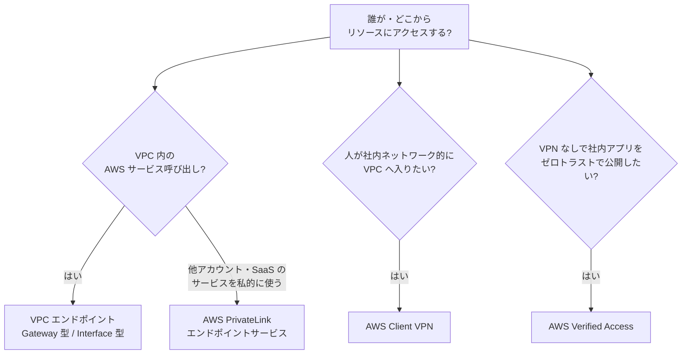

#### (1) VPC エンドポイントと AWS PrivateLink

| 種類 | 対応サービス | 仕組み | 料金の目安 |
|---|---|---|---|
| **Gateway エンドポイント** | **S3 と DynamoDB** | ルートテーブルにプレフィックスリストへのルートを追加 | **無料** |
| **Interface エンドポイント**(PrivateLink) | 多数の AWS サービス、他社/自社のエンドポイントサービス | サブネットに **ENI(プライベート IP)** を作成 | 時間 + データ処理料金 |
| **Gateway Load Balancer エンドポイント** | セキュリティアプライアンス挿入 | トラフィックを検査基盤へ誘導 | |

**エンドポイントポリシー**: エンドポイント自体に付ける IAM 形式のポリシーです。「このエンドポイント経由では**特定のバケットだけ**触れる」といった**データ境界**を作れます。

```json
{
  "Statement": [
    {
      "Effect": "Allow",
      "Principal": "*",
      "Action": ["s3:GetObject", "s3:PutObject"],
      "Resource": "arn:aws:s3:::my-secure-bucket/*"
    }
  ]
}
```

**バケット側から「この VPC エンドポイント経由のみ許可」にする**(反対方向の制御)

```json
{
  "Version": "2012-10-17",
  "Statement": [
    {
      "Sid": "AllowOnlyFromMyVpce",
      "Effect": "Deny",
      "Principal": "*",
      "Action": "s3:*",
      "Resource": [
        "arn:aws:s3:::my-secure-bucket",
        "arn:aws:s3:::my-secure-bucket/*"
      ],
      "Condition": {
        "StringNotEquals": { "aws:SourceVpce": "vpce-0123456789abcdef0" }
      }
    }
  ]
}
```

> **注意**: この Deny は、同じバケットを管理する管理者の操作も止めてしまう可能性があります。実運用では、管理ロールを例外にするなど**ロックアウト対策**を必ず入れてください。

#### (2) AWS Client VPN

| 項目 | 内容 |
|---|---|
| 何か | マネージドな **OpenVPN ベースのクライアント VPN**。TLS で通信を保護 |
| 認証 | **相互認証(証明書)**、Active Directory、**SAML ベースのフェデレーション**(IdP 連携)を組み合わせ可能 |
| 認可 | **認可ルール**(接続ユーザー/グループが到達できる CIDR を制御) |
| 経路 | 全トラフィックを VPN 経由にするか、**スプリットトンネル**で必要な宛先だけ経由するか選べる |
| 監査 | 接続ログを CloudWatch Logs に出力 |

#### (3) AWS Verified Access

| 項目 | 内容 |
|---|---|
| 何か | **VPN なし**で社内アプリへ安全にアクセスさせる**ゼロトラスト**型サービス |
| 判定材料 | **ID(IdP)** と **デバイスの状態**(トラストプロバイダー)をリクエストごとに評価 |
| ポリシー | **Cedar** 言語でアクセスポリシーを記述 |
| 使い所 | 社員・外部委託先が、ブラウザだけで社内 Web アプリに到達したい |

#### Client VPN と Verified Access の使い分け

| 観点 | Client VPN | Verified Access |
|---|---|---|
| 到達範囲 | ネットワーク(VPC)全体に近い | **アプリ単位** |
| 判定タイミング | 接続時(認可ルール) | **リクエストごと**に ID・デバイス評価 |
| クライアント | VPN クライアントが必要 | 主にブラウザ(VPN 不要) |
| 思想 | 境界型の延長 | **ゼロトラスト** |

#### (4) 拠点・オンプレミスとの接続の暗号化

| 接続方式 | 暗号化 | 補足 |
|---|---|---|
| **Site-to-Site VPN** | **IPsec** で暗号化 | インターネット越し |
| **Direct Connect** | **既定では暗号化されない**(専用線だが平文) | **MACsec**(対応する専用接続)や、**DX 上に VPN を重ねる**ことで暗号化 |

#### ベストプラクティス

| # | ベストプラクティス |
|---|---|
| 1 | AWS サービスへのアクセスは、可能な限り **VPC エンドポイント**(S3/DynamoDB は無料の Gateway 型)経由にする |
| 2 | **エンドポイントポリシー**と**リソースポリシー**の両方で「許可する経路・主体」を絞る(多層防御) |
| 3 | Interface エンドポイントは**複数 AZ** に配置し、**セキュリティグループ**で 443 を必要な送信元だけに許可 |
| 4 | 人のアクセスは**ゼロトラスト(Verified Access)**を優先検討し、ネットワーク到達性が必要な場合のみ Client VPN |
| 5 | Direct Connect を使う場合は**暗号化の追加**(MACsec または VPN)を忘れない |
| 6 | `aws:PrincipalOrgID` などを併用し、**自組織のアカウントだけ**が使えるデータ境界を作る |

#### 試験のポイント
- 「**S3 / DynamoDB にインターネットなしで接続、かつコスト最小**」→ **Gateway エンドポイント**
- 「**オンプレミスから S3 へ私的に接続**」→ Gateway エンドポイントはオンプレから使えないため **Interface エンドポイント**(S3 の Interface 型)
- 「**他アカウント/SaaS のサービスを VPC ピアリングなしで私的に公開・利用**」→ **PrivateLink**(重複 CIDR でも可)
- 「**VPN なしで、デバイス状態も見て社内アプリへ**」→ **Verified Access**
- 「**Direct Connect を暗号化したい**」→ **MACsec** または **VPN over DX**

---

### Skill 5.1.3 リソース間の転送中暗号化

#### ひとことで言うと
**VPC の中や AWS サービスの内部ノード同士の通信**も暗号化する設計です。「境界の中は安全」と考えない(ゼロトラスト)のが出発点です。

#### 代表的な設定一覧

| 対象 | 暗号化の方法 | 要点 |
|---|---|---|
| **Nitro ベースの EC2 インスタンス間** | **Nitro システムのハードウェアによる自動暗号化**(対応インスタンスタイプ間) | 設定不要・性能影響が小さい。対応インスタンスと経路の条件あり |
| **VPC 全体** | **VPC Encryption Controls**(Monitor / Enforce モード) | 暗号化状態を可視化し、非暗号化通信を**禁止**できる |
| **Amazon EMR** | **セキュリティ設定(Security Configuration)** で転送中暗号化(TLS)を有効化 | 証明書は S3 上の PEM ZIP またはカスタムプロバイダーで指定 |
| **Amazon EKS** | Pod 間は **サービスメッシュの mTLS**(Istio/Linkerd 等)や CNI の透過暗号化(WireGuard 等)、Ingress は TLS 終端 | 「Pod 間はデフォルト平文」という前提で設計 |
| **Amazon SageMaker AI** | 学習ジョブの **コンテナ間トラフィック暗号化**(Inter-Container Traffic Encryption) | 分散学習でノード間通信が発生する場合に有効化 |
| **VPC ピアリング / Transit Gateway / Cloud WAN** | AWS のネットワーク層暗号化に加え、アプリ層で TLS | リージョン間は AWS 側で暗号化されるが、要件に応じ TLS を併用 |

#### VPC Encryption Controls の導入ステップ

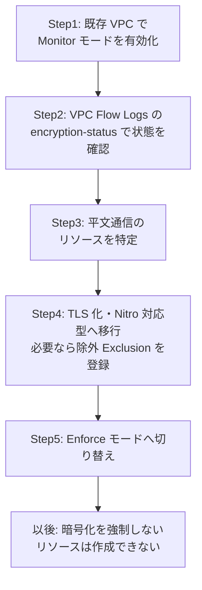

- **既存 VPC をいきなり Enforce にはできません**。必ず Monitor → 是正 → Enforce の順です
- **新規 VPC なら作成時から Enforce** を選べます
- Monitor モードでは VPC Flow Logs に `encryption-status` 情報が付与され、**Nitro ハードウェア暗号化**/**アプリ層暗号化(TLS)**/**両方**のどれかを判別できます

> 根拠: [Enforce VPC encryption in transit](https://docs.aws.amazon.com/vpc/latest/userguide/vpc-encryption-controls.html)

#### EMR の転送中暗号化(設定例)

```json
{
  "EncryptionConfiguration": {
    "EnableInTransitEncryption": true,
    "EnableAtRestEncryption": true,
    "InTransitEncryptionConfiguration": {
      "TLSCertificateConfiguration": {
        "CertificateProviderType": "PEM",
        "S3Object": "s3://my-certs-bucket/emr-certs.zip"
      }
    },
    "AtRestEncryptionConfiguration": {
      "S3EncryptionConfiguration": {
        "EncryptionMode": "SSE-KMS",
        "AwsKmsKey": "arn:aws:kms:ap-northeast-1:111122223333:key/1234abcd-12ab-34cd-56ef-1234567890ab"
      }
    }
  }
}
```

#### SageMaker のコンテナ間暗号化(CLI 例)

```bash
aws sagemaker create-training-job \
  --training-job-name my-secure-training \
  --enable-inter-container-traffic-encryption \
  --enable-network-isolation \
  --vpc-config "SecurityGroupIds=sg-0123456789abcdef0,Subnets=subnet-0123456789abcdef0" \
  --cli-input-json file://training-job.json
```

> 補足: `--cli-input-json` 側に `AlgorithmSpecification` や `RoleArn` などの必須項目が必要です。ここでは暗号化関連オプションの位置を示すための抜粋です。

#### ベストプラクティス

| # | ベストプラクティス |
|---|---|
| 1 | **新規 VPC は最初から Encryption Controls の Enforce** を検討し、既存 VPC は Monitor で現状把握から始める |
| 2 | **Nitro 対応インスタンスを選ぶ**ことで、アプリ改修なしに EC2 間通信を暗号化する |
| 3 | EMR / SageMaker など**分散処理のノード間通信**は、既定が平文のものがあるので**明示的に有効化** |
| 4 | EKS は**サービスメッシュ(mTLS)**で「通信相手の認証」と「暗号化」を同時に実現 |
| 5 | 暗号化の有無は **VPC Flow Logs** で**証跡として**確認する(「たぶん暗号化されている」を排除) |

#### 試験のポイント
- 「**EC2 間通信を、アプリ改修なしで暗号化**」→ **Nitro** 対応インスタンスの利用
- 「**VPC 内の平文通信を可視化し、最終的に禁止**」→ **VPC Encryption Controls**(Monitor → Enforce)
- 「**SageMaker 分散学習のノード間通信**」→ **Inter-Container Traffic Encryption**
- 「**EMR のノード間通信**」→ **Security Configuration**(転送中暗号化)

---

## 4. Task 5.2: 保存中のデータ(Data at Rest)

> **Task 5.2: Design and implement controls for data at rest**
> 公式 Skill: 5.2.1(保存時の暗号化)/ 5.2.2(整合性の保護)/ 5.2.3(ライフサイクルと保持)/ 5.2.4(レプリケーションとバックアップ)

### Task 5.2 の全体像

| Skill | 守るもの | 主な機能 |
|---|---|---|
| 5.2.1 | **機密性**(読まれない) | KMS、CloudHSM、SSE / CSE |
| 5.2.2 | **完全性**(書き換え・削除されない) | Object Lock、Vault Lock、バージョニング、署名、チェックサム |
| 5.2.3 | **保持と廃棄**(いつまで持ち、いつ消すか) | S3 Lifecycle、EFS Lifecycle、FSx バックアップ |
| 5.2.4 | **可用性と復旧**(失っても戻せる) | AWS Backup、DLM、レプリケーション、DataSync |

---

### Skill 5.2.1 保存時の暗号化

#### ひとことで言うと
**要件に合う「鍵の管理方法」と「暗号化する場所」を選ぶ**スキルです。試験では「どれを選ぶか」の判断が問われます。

#### Step 1: 鍵サービスを選ぶ(KMS か CloudHSM か)

| 比較軸 | AWS KMS | AWS CloudHSM |
|---|---|---|
| 形態 | マルチテナントのマネージドサービス | **専有(シングルテナント)HSM** クラスター |
| 鍵の管理者 | AWS が基盤を運用。お客様は**ポリシーで制御** | **お客様が鍵を完全に管理**(AWS は鍵にアクセスできない) |
| 統合 | **多くの AWS サービスとネイティブ統合**(S3、EBS、RDS 等) | 直接統合は限定的。**KMS のカスタムキーストア**経由や PKCS#11/JCE/CNG で利用 |
| 運用負荷 | 低い | 高い(クラスター・HA・バックアップ設計が必要) |
| 向く要件 | 一般的な暗号化要件、運用を簡単にしたい | 規制で**専有 HSM** が必須、独自アプリで HSM API を使う |
| 料金感 | リクエスト・鍵単位 | 時間単位の HSM 課金(高め) |

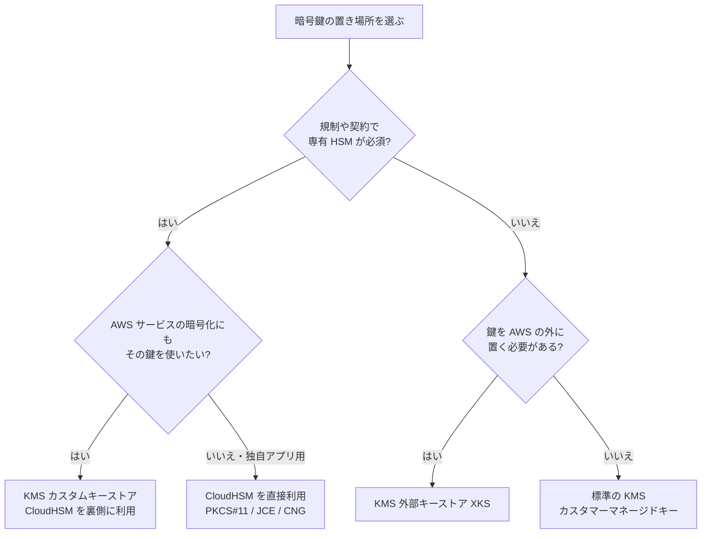

#### Step 2: KMS キーの種類を理解する

| 種類 | 作成・管理 | ローテーション | キーポリシー編集 | 料金 |
|---|---|---|---|---|
| **AWS 所有キー** | AWS が所有(アカウントから見えない) | AWS が管理 | 不可 | 無料 |
| **AWS マネージドキー**(`aws/s3` など) | サービスがアカウント内に作成 | **毎年自動**(変更不可) | 不可 | 無料(利用料は別) |
| **カスタマーマネージドキー(CMK)** | お客様が作成 | 自動/オンデマンド/手動を選択 | **可(キーポリシー)** | キー月額 + リクエスト |

**CMK を選ぶ理由**: 「キーポリシーで誰が使えるか細かく制御したい」「CloudTrail でキー使用を監査したい」「無効化・削除でデータへのアクセスを意図的に遮断したい」「クロスアカウントで共有したい」。**これらが要件に出たら CMK** です。

#### Step 3: KMS のアクセス制御(最頻出)

KMS は **キーポリシーが必須で、アクセス制御の主役**です。他の AWS サービスと違い、キーポリシーで許可がなければ IAM ポリシーだけでは使えません(ただし、キーポリシーが IAM ポリシーを有効にしている場合は IAM でも制御できます)。

| 仕組み | 説明 |
|---|---|
| **キーポリシー** | キーに付属するリソースポリシー。**必須** |
| **IAM ポリシー** | キーポリシーが「アカウントの IAM に委任」している場合に有効 |
| **グラント(Grant)** | 一時的・プログラム的に特定の主体へ権限を委任(AWS サービスが内部で利用) |
| **クロスアカウント** | **キーポリシー(相手アカウントを許可)+ 相手側の IAM ポリシー**の**両方**が必要 |

**キーポリシーの例: 特定サービス経由でのみ使用を許可する(`kms:ViaService`)**

```json
{
  "Sid": "AllowUseOnlyThroughS3",
  "Effect": "Allow",
  "Principal": { "AWS": "arn:aws:iam::111122223333:role/AppRole" },
  "Action": ["kms:Decrypt", "kms:GenerateDataKey"],
  "Resource": "*",
  "Condition": {
    "StringEquals": {
      "kms:ViaService": "s3.ap-northeast-1.amazonaws.com",
      "kms:CallerAccount": "111122223333"
    }
  }
}
```

**暗号化コンテキスト(Encryption Context)**: 暗号化・復号時に渡す**キーと値のペア**で、**AAD(追加認証データ)**として働きます。復号時に同じコンテキストが必要になり、**CloudTrail にも記録**されます。秘密情報ではないので、**機密そのものを入れてはいけません**。`kms:EncryptionContext:キー名` 条件でアクセス制御にも使えます。

**職務分掌のベストプラクティス**: 鍵の**管理者**(作成・ローテーション・削除予約)と**利用者**(Encrypt/Decrypt)を**別の主体**にします。

#### Step 4: 暗号化する場所を選ぶ(サーバー側か、クライアント側か)

| 方式 | 誰が暗号化 | 鍵の管理 | 向く場面 |
|---|---|---|---|
| **サーバー側暗号化(SSE)** | AWS サービス側 | サービスが鍵を使う(KMS 等) | 大半のケース。**運用が簡単** |
| **クライアント側暗号化(CSE)** | **データを送る前にアプリ側で暗号化** | アプリが鍵を扱う(KMS 利用可) | **AWS にも平文を渡したくない**、データ自体を保護したい |

**CSE を実装するツール**: AWS Encryption SDK、Amazon S3 Encryption Client、AWS Database Encryption SDK(DynamoDB など)

#### S3 のサーバー側暗号化(SSE)の選択肢

| 方式 | 鍵の管理 | 特徴 |
|---|---|---|
| **SSE-S3** | S3 が管理 | **すべてのバケットでデフォルト有効**(新規オブジェクトは自動で暗号化)。追加コスト無し |
| **SSE-KMS** | KMS キー(AWS マネージドまたは CMK) | **KMS の監査・アクセス制御**が使える。リクエストごとに KMS を呼ぶため料金・スロットリングに注意 |
| **DSSE-KMS** | KMS キー(**二重**の暗号化レイヤー) | 規制で**多層暗号化**が求められる場合 |
| **SSE-C** | お客様が**リクエストごとに鍵を渡す** | **S3 は鍵を保存しない**。HTTPS 必須。2026年4月から**新規バケットでは既定で無効**(必要なら `PutBucketEncryption` で明示的に有効化) |

> 最新動向(重要): 2026年4月以降、**SSE-C は新規の汎用バケット(およびSSE-C暗号化オブジェクトを持たないアカウントの既存バケット)で既定で無効**になりました。ほとんどの用途で SSE-S3 または SSE-KMS が推奨されています。
> 根拠: [Default SSE-C setting for new buckets FAQ](https://docs.aws.amazon.com/AmazonS3/latest/userguide/default-s3-c-encryption-setting-faq.html) / [Using server-side encryption with customer-provided keys (SSE-C)](https://docs.aws.amazon.com/AmazonS3/latest/userguide/ServerSideEncryptionCustomerKeys.html)

**S3 バケットキー(Bucket Keys)**: SSE-KMS で**バケット単位の鍵**を使い、KMS へのリクエスト数を大幅に減らすことで**コストとスロットリングを抑える**機能。大量オブジェクトを扱うなら有効化を検討します。

**「暗号化されていないアップロードを拒否」するポリシー(SSE-KMS を強制)**

```json
{
  "Sid": "DenyUnEncryptedObjectUploads",
  "Effect": "Deny",
  "Principal": "*",
  "Action": "s3:PutObject",
  "Resource": "arn:aws:s3:::my-secure-bucket/*",
  "Condition": {
    "StringNotEquals": { "s3:x-amz-server-side-encryption": "aws:kms" }
  }
}
```

#### その他サービスの暗号化(要点だけ)

| サービス | ポイント |
|---|---|
| **EBS** | **リージョン単位の「既定で暗号化」設定**を有効化。暗号化ボリュームから作ったスナップショットも暗号化。**他アカウントへ共有する暗号化スナップショットは CMK が必要**(AWS マネージドキーは共有不可) |
| **RDS / Aurora** | **作成時にのみ**暗号化を指定可能。既存の非暗号化 DB は、**スナップショット → 暗号化コピー → 復元**で暗号化。リードレプリカは元と暗号化状態を揃える |
| **DynamoDB** | **常に保存時暗号化**。鍵は AWS 所有/AWS マネージド/CMK から選択 |
| **EFS** | **作成時に暗号化を指定**(後から変更不可) |

```bash
# リージョンの EBS 既定暗号化を有効にし、既定 KMS キーを CMK に変更する
aws ec2 enable-ebs-encryption-by-default --region ap-northeast-1
aws ec2 modify-ebs-default-kms-key-id \
  --kms-key-id arn:aws:kms:ap-northeast-1:111122223333:key/1234abcd-12ab-34cd-56ef-1234567890ab \
  --region ap-northeast-1
```

#### KMS キーのライフサイクルと削除の注意

| 操作 | 内容 |
|---|---|
| 無効化(Disable) | 一時的に使用不可。**再有効化可能** |
| 削除予約(ScheduleKeyDeletion) | **待機期間 7〜30日**を経て削除。待機中は使用不可・**キャンセル可能** |
| 削除後 | **復元不可。その鍵で暗号化したデータは永久に復号できない** |

> 「削除予約中」や「無効化」を **CloudWatch アラーム + EventBridge** で検知し、誤削除・不正削除に気づける仕組みを入れましょう。

#### ベストプラクティス

| # | ベストプラクティス |
|---|---|
| 1 | **既定で暗号化**を有効化(EBS 既定暗号化、S3 バケット既定暗号化)し、**暗号化されないものを作れない**状態にする |
| 2 | **機密度の高いデータは CMK**(SSE-KMS)で、キーポリシーに最小権限と `kms:ViaService` / `kms:CallerAccount` 条件 |
| 3 | 鍵の**管理者と利用者を分離**。キーポリシーで IAM への全面委任を安易に使わない |
| 4 | 大量リクエストの S3 は **バケットキー**でコストとスロットリングを抑制 |
| 5 | 鍵の使用は **CloudTrail** で監査し、削除予約・無効化は**アラート**化 |
| 6 | **SCP / リソースポリシー / Config ルール**で非暗号化リソースの作成を**予防・検知** |
| 7 | 暗号化コンテキストに**機密情報を入れない** |

#### 試験のポイント
- 「**専有 HSM、鍵の完全な管理権限**」→ **CloudHSM**(統合したいなら KMS **カスタムキーストア**)
- 「**AWS が鍵にアクセスできないようにしたい**」→ CloudHSM / **外部キーストア(XKS)**
- 「**キー使用を細かく監査・制御、クロスアカウント共有**」→ **CMK**(AWS マネージドキーはポリシー編集・共有不可)
- 「**S3 のKMSコストを下げたい**」→ **バケットキー**
- 「**暗号化されていない RDS を暗号化したい**」→ スナップショット → 暗号化コピー → 復元
- 「**AWS にも平文を渡したくない**」→ **クライアント側暗号化**

---

### Skill 5.2.2 データ整合性の保護

#### ひとことで言うと
**「データが勝手に書き換えられたり、消されたりしない」ことを技術的に保証する**スキルです。ランサムウェア対策や規制対応(WORM)で重要です。

#### 機能マップ

| 機能 | 守るもの | 要点 |
|---|---|---|
| **S3 バージョニング** | 上書き・削除からの復旧 | 削除は**削除マーカー**になり、過去バージョンは残る |
| **S3 MFA Delete** | バージョンの完全削除 | ルートユーザー+MFA が必要 |
| **S3 Object Lock** | **WORM**(書込み一度・読取り複数) | **バージョニング前提**。保持期間と法的ホールド |
| **S3 Glacier Vault Lock** | S3 Glacier ボールトの規制保持 | ボールトロックポリシーで**変更不可**にできる |
| **AWS Backup Vault Lock** | バックアップの削除防止 | ガバナンス/コンプライアンスモード |
| **チェックサム / ETag** | 転送・保存中の**破損検知** | S3 の追加チェックサム(CRC32、CRC32C、SHA-1、SHA-256、CRC64NVME) |
| **AWS Signer(コード署名)** | ソフトウェアの**真正性と未改ざん** | Lambda コード署名、コンテナイメージ署名など |
| **CloudTrail ログファイル整合性検証** | 監査ログの**改ざん検知** | ダイジェストファイル(SHA-256 + RSA 署名) |

#### S3 Object Lock の2つのモード

| 項目 | **ガバナンスモード** | **コンプライアンスモード** |
|---|---|---|
| 削除・上書き | 特別な権限(`s3:BypassGovernanceRetention`)があれば**可能** | **誰も不可(ルートユーザーも)** |
| 保持期間の短縮 | 権限があれば可能 | **不可** |
| 用途 | 運用ルールとして守らせたい、**テスト導入** | **法規制(WORM 要件)**・ランサムウェア耐性 |

| 追加機能 | 説明 |
|---|---|
| **保持期間(Retention Period)** | 指定した期間、バージョンの削除・上書きを禁止 |
| **法的ホールド(Legal Hold)** | **期限なし**で削除を禁止。権限者が任意に解除(`s3:PutObjectLegalHold`) |

```bash
# バケットで Object Lock を有効にして作成(バージョニングは自動で有効)
aws s3api create-bucket \
  --bucket my-worm-bucket \
  --region ap-northeast-1 \
  --create-bucket-configuration LocationConstraint=ap-northeast-1 \
  --object-lock-enabled-for-bucket

# 既定の保持設定(コンプライアンスモード・365日)
aws s3api put-object-lock-configuration \
  --bucket my-worm-bucket \
  --object-lock-configuration '{
    "ObjectLockEnabled": "Enabled",
    "Rule": { "DefaultRetention": { "Mode": "COMPLIANCE", "Days": 365 } }
  }'
```

> **落とし穴**: コンプライアンスモードは**設定ミスを後から直せません**(長すぎる保持期間もそのまま)。**まずガバナンスモードで検証**してから切り替えるのが定石です。

#### S3 Glacier Vault Lock

- **ボールトロックポリシー**で「保持期間内は削除を拒否」などを定義
- 流れ: **ロックを開始(InProgress)** → **24時間以内**にポリシーを確認・必要なら中止 → **ロックを完了(Locked)**
- **完了後はポリシーを変更・削除できません**(不変)

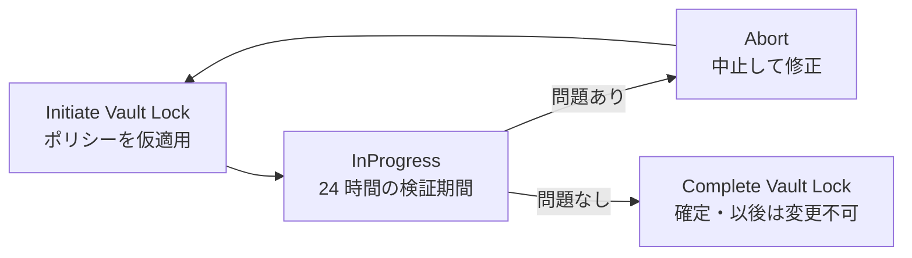

#### デジタルコード署名(AWS Signer)

| 対象 | 使い方 |
|---|---|
| **AWS Lambda** | **コード署名設定(Code Signing Configuration)**で、**署名済みコードのみデプロイを許可**(未署名/期限切れ署名なら拒否 or 警告) |
| **コンテナイメージ** | Signer + Notation 等でイメージに署名し、デプロイ時に検証 |

→ **サプライチェーン攻撃(改ざんされたコードの混入)への対策**になります。

#### CloudTrail ログファイル整合性検証

- ログと一緒に**1時間ごとのダイジェストファイル**を出力。**SHA-256 ハッシュ**と **RSA によるデジタル署名**を含む
- `aws cloudtrail validate-logs` で**改ざん・削除の有無**を検証できる
- 検証対象のログ保管先 S3 バケットには **Object Lock や MFA Delete** を併用すると一層強固

```bash
aws cloudtrail validate-logs \
  --trail-arn arn:aws:cloudtrail:ap-northeast-1:111122223333:trail/my-trail \
  --start-time 2026-10-01T00:00:00Z
```

#### ベストプラクティス

| # | ベストプラクティス |
|---|---|
| 1 | 重要バケットは **バージョニング有効化**(誤削除・上書きからの復旧の基本) |
| 2 | 規制対応(WORM)は **Object Lock のコンプライアンスモード**。**事前にガバナンスモードで検証** |
| 3 | 監査ログ用バケットは**別アカウント**に置き、Object Lock・MFA Delete・バケットポリシーで保護 |
| 4 | アップロード時に**チェックサムを指定**して破損を検知(SHA-256 等) |
| 5 | Lambda/コンテナは **AWS Signer** で署名し、**未署名はデプロイ拒否** |
| 6 | CloudTrail は **ログファイル整合性検証を有効化** |

#### 試験のポイント
- 「**ルートユーザーでも削除不可**」→ Object Lock **コンプライアンスモード** / Vault Lock コンプライアンス
- 「**一部の権限者は例外的に削除可能**」→ **ガバナンスモード**
- 「**期限を決めず、調査のため削除を止めたい**」→ **法的ホールド**
- 「**Object Lock の前提条件**」→ **バージョニング**
- 「**Glacier の規制対応、設定後は変更不可**」→ **Vault Lock**(24時間の検証期間あり)
- 「**デプロイするコードの改ざんを防ぎたい**」→ **AWS Signer + Lambda コード署名設定**
- 「**CloudTrail ログの改ざん検知**」→ **ログファイル整合性検証**

---

### Skill 5.2.3 ライフサイクル管理と保持

#### ひとことで言うと
**「データをいつまで・どこに置き、いつ安全に消すか」を自動化する**スキルです。コスト削減だけでなく、**不要データを持ち続けるリスク(情報漏えい・コンプライアンス違反)の削減**でもあります。

#### サービス別の機能

| サービス | 機能 | 内容 |
|---|---|---|
| **S3** | **S3 Lifecycle** | 経過日数・タグ・プレフィックスで**ストレージクラス移行(Transition)**や**有効期限(Expiration)**を自動実行。バージョニング有効時は**非現行バージョン**の移行・削除も設定可 |
| **S3** | **Object Lock** | 保持期間中の削除を禁止(Skill 5.2.2)。Lifecycle の期限切れ設定と**併用**し、**保持期間満了後**に削除 |
| **EFS** | **EFS ライフサイクル管理** | 一定期間アクセスのないファイルを **Infrequent Access / Archive** へ自動移行(アクセス時に**Standard へ戻す**設定も可能) |
| **FSx for Lustre** | **バックアップポリシー** | 永続ファイルシステムの**自動日次バックアップ**と保持期間。AWS Backup との連携も可能 |
| **EBS** | **Data Lifecycle Manager(DLM)** | スナップショット/AMI の作成・保持・削除を**ポリシーで自動化** |
| **CloudWatch Logs** | **保持期間(Retention)** | ロググループごとに保持日数を設定 |
| **DynamoDB** | **TTL** | 有効期限を過ぎた項目を自動削除 |

#### S3 Lifecycle の設定例

```json
{
  "Rules": [
    {
      "ID": "archive-and-expire-logs",
      "Status": "Enabled",
      "Filter": { "Prefix": "logs/" },
      "Transitions": [
        { "Days": 30, "StorageClass": "STANDARD_IA" },
        { "Days": 90, "StorageClass": "GLACIER" }
      ],
      "Expiration": { "Days": 2555 },
      "NoncurrentVersionExpiration": { "NoncurrentDays": 90 },
      "AbortIncompleteMultipartUpload": { "DaysAfterInitiation": 7 }
    }
  ]
}
```

```bash
aws s3api put-bucket-lifecycle-configuration \
  --bucket my-secure-bucket \
  --lifecycle-configuration file://lifecycle.json
```

#### Lifecycle と Object Lock を組み合わせるときの考え方

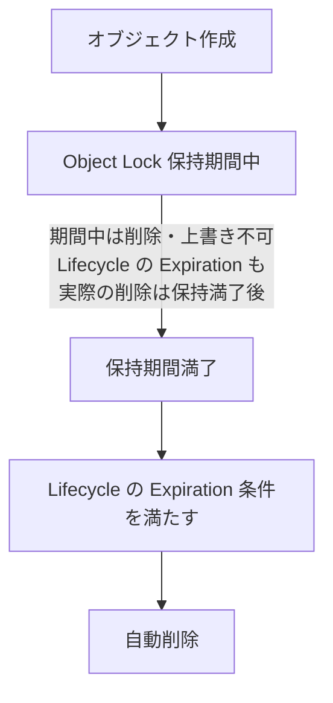

- Object Lock で保護されたバージョンは、保持期間中は Lifecycle の**期限切れ設定があっても削除されません**(保持満了後に処理)
- 「**保持 7 年 → 満了後に自動削除**」のような要件は **Object Lock + Lifecycle** の組み合わせで実現します

#### ベストプラクティス

| # | ベストプラクティス |
|---|---|
| 1 | **データ分類(機密度・保持要件)に基づいて**ライフサイクルを設計する(技術要件より先に、法規制・社内規程の保持期間を確認) |
| 2 | **バージョニング有効バケットでは非現行バージョンの期限切れ**も設定する(放置すると増え続ける) |
| 3 | **未完了のマルチパートアップロード**を自動中止する設定を入れる |
| 4 | 保持が必要なデータは **Object Lock と併用**。削除は保持満了後 |
| 5 | EBS スナップショットは **DLM** で**作成・保持・削除**まで自動化(手動運用のスナップショットは「消し忘れ」の温床) |
| 6 | **ログの保持期間を明示**(CloudWatch Logs は既定で無期限) |

#### 試験のポイント
- 「**一定日数後に低コストストレージへ移行/削除**」→ **S3 Lifecycle**
- 「**EFS で低頻度アクセスのファイルのコストを下げる**」→ **EFS ライフサイクル管理**
- 「**保持期間満了までは削除不可、満了後は自動削除**」→ **Object Lock + S3 Lifecycle**
- 「**EBS スナップショットの自動作成・自動削除**」→ **DLM**(または AWS Backup)

---

### Skill 5.2.4 レプリケーションとバックアップ

#### ひとことで言うと
**「失っても、壊されても、戻せる」**状態を作るスキルです。特に**ランサムウェアで本番も管理者権限も奪われた場合**でも復旧できるか、が近年の重要テーマです。

#### 機能マップ

| 機能 | 用途 |
|---|---|
| **AWS Backup** | **複数サービスを一元管理**するバックアップ(EC2/EBS、RDS、DynamoDB、EFS、FSx、S3 など)。**バックアッププラン**、**バックアップボールト**、**クロスアカウント/クロスリージョンコピー** |
| **Amazon Data Lifecycle Manager (DLM)** | EBS スナップショット・AMI の**自動化**。クロスリージョン/クロスアカウントコピーにも対応 |
| **S3 レプリケーション** | **CRR(別リージョン)/SRR(同一リージョン)** へ非同期レプリケーション。**バージョニング必須** |
| **AWS DataSync** | オンプレ ⇔ AWS、AWS 内ストレージ間の**データ移行・同期**(転送時暗号化、整合性検証) |

#### AWS Backup のセキュリティ機能

| 機能 | 内容 |
|---|---|
| **バックアップボールトの暗号化** | ボールトごとの KMS キーで暗号化(**ソースが非暗号化でもバックアップは暗号化可能**) |
| **Vault Lock** | WORM。**ガバナンスモード**(権限者は変更可)/ **コンプライアンスモード**(猶予期間後は**不変**) |
| **論理的エアギャップボールト**<br/>(Logically air-gapped vault) | **コンプライアンスモードの Vault Lock が常に適用**された特別なボールト。本番アカウントの IAM 経路から**直接アクセス・削除できない**分離境界を提供。**AWS RAM で他アカウントと共有して復元**可能 |
| **マルチパーティ承認** | 復旧操作などに**複数人の承認**を要求 |
| **クロスアカウント/クロスリージョンコピー** | 本番アカウントが侵害されても、**別アカウント・別リージョン**に復旧用コピーを保持 |
| **Backup Audit Manager** | バックアップ要件への**準拠状況を監査・レポート** |
| **復元テスト(Restore Testing)** | 復元可能性を**定期的に自動検証** |

> 根拠: [Logically air-gapped vault - AWS Backup](https://docs.aws.amazon.com/aws-backup/latest/devguide/logicallyairgappedvault.html) / [Securing backup data against modern threats with AWS Backup](https://aws.amazon.com/blogs/storage/securing-backup-data-against-modern-threats-with-aws-backup/)

#### ランサムウェア対策としてのバックアップ設計(多層防御)

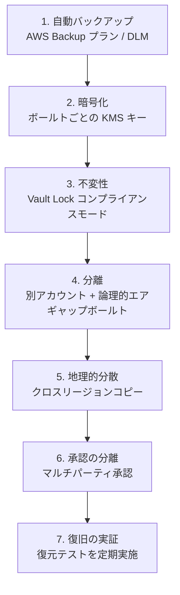

#### Vault Lock と論理的エアギャップボールトの違い

| 観点 | Vault Lock(通常ボールト) | 論理的エアギャップボールト |
|---|---|---|
| 不変性(WORM) | ガバナンス/コンプライアンスを**選択** | **常にコンプライアンスモード** |
| アクセス分離 | **同じアカウントの管理者権限が及ぶ**(削除はロックで防ぐが、アクセス自体は分離されない) | **本番アカウントの IAM 経路から分離**(別境界) |
| 暗号化キー | お客様の KMS キーを指定 | AWS 所有キー(既定)または CMK |
| 想定脅威 | 誤削除、内部不正、保持期間短縮 | **認証情報を奪った攻撃者**による破壊・暗号化 |

#### S3 レプリケーションの要点

| 項目 | 内容 |
|---|---|
| 前提 | 送信元・送信先**両方でバージョニング有効**、レプリケーション用 **IAM ロール** |
| 種類 | **CRR**(クロスリージョン:DR・遅延低減・規制対応)/ **SRR**(同一リージョン:ログ集約・アカウント分離) |
| 暗号化 | **SSE-KMS のオブジェクトをレプリケートするには明示的な設定**(レプリカ用 KMS キー指定、レプリケーションロールへの `kms:Decrypt`/`kms:Encrypt` 権限)が必要 |
| 既存オブジェクト | 既定では対象外。**S3 バッチレプリケーション**で対応 |
| 削除マーカー | 既定の設定では注意が必要(削除マーカーのレプリケーション設定を確認) |
| 速度保証 | **S3 Replication Time Control (RTC)** で 15 分 SLA の選択肢 |
| 注意 | レプリケーションは**バックアップの代替にならない**(削除や破損も複製される可能性)。**バージョニング + Object Lock + バックアップ**と併用 |

#### AWS DataSync のセキュリティ

| 項目 | 内容 |
|---|---|
| 転送中の暗号化 | **TLS** による暗号化 |
| 整合性 | 転送後の**データ検証(Verify)**オプション |
| 閉域接続 | **VPC エンドポイント(PrivateLink)**経由でサービスと通信可能 |
| アクセス制御 | 送信元・送信先ロケーションへの**最小権限 IAM ロール** |
| 保存時 | 送信先(S3・EFS・FSx)の**暗号化設定が適用** |

#### EBS スナップショットの保護

| 機能 | 内容 |
|---|---|
| **DLM** | スナップショットの**自動作成・保持・削除**、クロスリージョン/アカウントコピー |
| **EBS スナップショットのロック** | 指定期間の**削除を禁止**(ガバナンス/コンプライアンス) |
| **ごみ箱(Recycle Bin)** | 誤削除したスナップショット/AMI を**保持期間内なら復元可能** |

#### ベストプラクティス

| # | ベストプラクティス |
|---|---|
| 1 | **3-2-1 ルール**を意識:最低3コピー、2種類の媒体/方式、**1つは別の場所(別アカウント/別リージョン)** |
| 2 | バックアップは**別アカウント**へコピーし、**Vault Lock(コンプライアンス)/論理的エアギャップ**で不変化 |
| 3 | **AWS Organizations のバックアップポリシー**で、組織全体に**一貫したバックアップ**を強制 |
| 4 | **復元を定期的にテスト**する(バックアップは「戻せて」初めて価値がある) |
| 5 | バックアップ用 KMS キーの**キーポリシー**を、バックアップ関連の主体に**限定** |
| 6 | **S3 レプリケーションだけに頼らない**(削除・破損の伝播に注意) |
| 7 | **RPO/RTO(復旧時点・復旧時間目標)**から保持期間・頻度・リージョン戦略を決める |

#### 試験のポイント
- 「**ランサムウェアで管理者権限を奪われても削除されないバックアップ**」→ **論理的エアギャップボールト**(+ Vault Lock コンプライアンス)
- 「**組織全体で一貫したバックアップを強制**」→ **AWS Backup + Organizations のバックアップポリシー**
- 「**EBS スナップショットの自動化**」→ **DLM**
- 「**S3 を別リージョンへ複製(DR)**」→ **CRR**(バージョニング必須)
- 「**暗号化オブジェクトのレプリケーションで失敗**」→ **KMS 権限・レプリカ用キー設定**を確認
- 「**オンプレから S3/EFS へ安全に同期**」→ **DataSync**(TLS、検証)

---

## 5. Task 5.3: 機密データ・認証情報・シークレット・暗号鍵の保護

> **Task 5.3: Design and implement controls to protect confidential data, credentials, secrets, and cryptographic key materials**
> 公式 Skill: 5.3.1(シークレット管理とローテーション)/ 5.3.2(インポート鍵・外部キーストア)/ 5.3.3(インポート鍵と AWS 生成鍵の違い)/ 5.3.4(マスキング)/ 5.3.5(鍵と証明書の管理)

### Task 5.3 の全体像

| Skill | キーワード | 一言で |
|---|---|---|
| 5.3.1 | **Secrets Manager** | パスワードや API キーを**コードに書かず**、自動で**入れ替える** |
| 5.3.2 | **BYOK / 外部キーストア** | 鍵の**素材そのもの**を自分で持ち込む・AWS の外に置く |
| 5.3.3 | **インポート vs AWS 生成** | 2つの違いを**説明できる**こと |
| 5.3.4 | **マスキング** | ログやメッセージ内の**機密データを隠す** |
| 5.3.5 | **KMS CMK / Private CA** | 鍵・証明書を**単一/複数リージョン**で作り管理する |

---

### Skill 5.3.1 シークレットの管理とローテーション

#### ひとことで言うと
データベースのパスワードや API キーを**ソースコードや設定ファイルに埋め込まず**、**AWS Secrets Manager** に保管して**自動ローテーション**します。

#### なぜ必要か
- ハードコードされた認証情報は、Git へのコミットやログ出力から**漏えい**しやすい
- 長期間変わらないパスワードは、漏えいした際の**被害期間が長い**

> **大原則**: まず「そもそも長期シークレットを持たない設計」(IAM ロールによる一時認証、RDS の IAM データベース認証など)を検討し、**やむを得ない場合に** Secrets Manager を使います。

#### Secrets Manager の基本

| 項目 | 内容 |
|---|---|
| 保管できるもの | DB 認証情報、API キー、OAuth トークン、任意の文字列/JSON(最大 64 KB) |
| 暗号化 | 常に **KMS で暗号化**(既定は `aws/secretsmanager`、CMK も指定可) |
| アクセス制御 | **IAM ポリシー + リソースポリシー**(クロスアカウント共有も可) |
| バージョン管理 | ステージングラベル **AWSCURRENT / AWSPENDING / AWSPREVIOUS** |
| 監査 | **CloudTrail** で `GetSecretValue` などを記録 |
| 削除 | **回復期間(7〜30日)**を設けて削除。誤削除から復旧可能 |
| 複数リージョン | シークレットを**他リージョンへレプリケート**(DR・低遅延) |

> **クロスアカウント共有の落とし穴**: 他アカウントがシークレットを読むには、**AWS マネージドキー `aws/secretsmanager` では不可**。**CMK**(キーポリシーで相手を許可)を使い、リソースポリシーも設定します。

#### ローテーションの仕組み

| 方式 | 仕組み | 使い所 |
|---|---|---|
| **マネージドローテーション** | **Lambda 関数不要**。サービスが自動でローテーションを設定・管理(RDS/Aurora の管理されたマスターパスワード、Redshift 管理者パスワード、ECS Service Connect の Private CA 証明書、**マネージド外部シークレット**(パートナー保有のシークレット)など)。通常 1 分程度で完了 | 対応サービスなら**最優先**で選ぶ |
| **Lambda 関数によるローテーション** | Secrets Manager が Lambda を呼び、**createSecret → setSecret → testSecret → finishSecret** の4ステップで実行 | 上記以外の DB・API キー等。AWS 提供のテンプレートを利用可 |

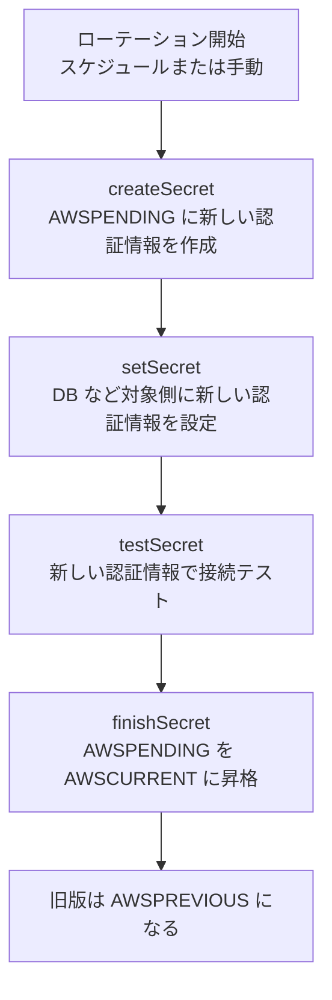

**ローテーションのスケジュール**
- **`rate()` または `cron()` 式**と**ウィンドウ(Window duration)**で指定。時刻は **UTC**
- ローテーションウィンドウは**毎時の 0 分開始**。`cron` の分フィールドは **0 必須**
- ウィンドウは**次の UTC 日や次のウィンドウにまたがれない**

```bash
aws secretsmanager rotate-secret \
  --secret-id prod/app/db \
  --rotation-lambda-arn arn:aws:lambda:ap-northeast-1:111122223333:function:SecretsManagerRotation \
  --rotation-rules '{"ScheduleExpression":"cron(0 16 1,15 * ? *)","Duration":"3h"}'
```

**ローテーション戦略(Lambda 利用時)**

| 戦略 | 内容 | メリット/デメリット |
|---|---|---|
| **単一ユーザー** | 同じユーザーのパスワードを更新 | 簡単。**更新の瞬間に旧パスワードの接続が切れうる** |
| **交互ユーザー(Alternating users)** | **2つのユーザー**を用意し、片方ずつ更新 | **ダウンタイムを抑えられる**。ユーザー作成の手間と権限設計が必要 |

**ローテーション Lambda のネットワーク**: VPC 内の DB に接続するため Lambda を VPC に置く場合、**Secrets Manager へのアクセス経路**(VPC エンドポイントまたは NAT)も必要です。

#### アプリからの安全な取得

```python
import json
import boto3

client = boto3.client("secretsmanager", region_name="ap-northeast-1")

def get_db_credentials():
    # 取得のたびに API を呼ぶと遅延・コストが増えるため、本番では
    # AWS 提供のキャッシュクライアントやコードキャッシュの利用を検討する
    res = client.get_secret_value(SecretId="prod/app/db")
    return json.loads(res["SecretString"])
```

#### Secrets Manager と Systems Manager Parameter Store の使い分け

| 観点 | Secrets Manager | Parameter Store(SecureString) |
|---|---|---|
| **自動ローテーション** | **あり**(標準機能) | なし(自前で実装) |
| **クロスリージョンレプリケーション** | あり | 標準では自前 |
| **クロスアカウント共有** | リソースポリシーで可 | 制限あり(高度なパラメータ等) |
| **料金** | シークレット数 + API 呼び出し | **標準パラメータは無料** |
| **向く用途** | **DB 認証情報、API キー**等の**ローテーションが必要**なもの | 設定値、ローテーション不要の機密設定 |

#### ベストプラクティス

| # | ベストプラクティス |
|---|---|
| 1 | **長期認証情報を避ける**(IAM ロール、IAM DB 認証、一時認証を優先) |
| 2 | **ハードコードしない**。コード/IaC/ログ/環境変数への平文埋め込みを検出・防止(シークレット検知ツール) |
| 3 | **自動ローテーションを有効化**。対応サービスは**マネージドローテーション**を使う |
| 4 | シークレットごとに**最小権限**の IAM / リソースポリシー(`secretsmanager:GetSecretValue` を必要なロールだけに) |
| 5 | **CMK** を使い、キーポリシーでもアクセスを絞る(クロスアカウント共有時は必須) |
| 6 | **AWS Config ルール**でローテーション未設定を検知、**EventBridge/CloudWatch** でローテーション失敗を通知 |
| 7 | **キャッシュ**を使って API 呼び出しを抑える(ただしローテーション直後に旧値を保持しすぎない) |
| 8 | DR 要件があれば**マルチリージョンレプリケーション** |
| 9 | 削除時は**回復期間**を確保 |

#### 試験のポイント
- 「**DB パスワードを自動で定期変更**」→ **Secrets Manager の自動ローテーション**(RDS/Aurora はマネージド)
- 「**ローテーション中のダウンタイムを避けたい**」→ **交互ユーザー戦略**
- 「**別アカウントにシークレットを共有**」→ **リソースポリシー + CMK**(`aws/secretsmanager` は不可)
- 「**ローテーションが不要で、無料で設定値を保管**」→ **Parameter Store**
- 「**ローテーション Lambda が DB に繋がらない**」→ **VPC 設定・セキュリティグループ・Secrets Manager への経路**

---

### Skill 5.3.2 インポートしたキーマテリアルと外部キーストア

#### ひとことで言うと
KMS の鍵の**素材(キーマテリアル)**を**自分で生成して持ち込む(BYOK)**、あるいは**鍵を AWS の外**(外部 HSM)に置いたまま KMS 経由で使う仕組みです。

#### 3つの「鍵の置き場所」パターン

| パターン | キーマテリアルの生成場所 | 保管場所 | KMS キーの Origin |
|---|---|---|---|
| **標準(AWS 生成)** | KMS が生成 | **KMS の HSM** | `AWS_KMS` |
| **インポート(BYOK)** | **お客様が生成して持ち込む** | **KMS の HSM**(お客様も原本を保持) | `EXTERNAL` |
| **カスタムキーストア** | CloudHSM クラスター内 | **お客様の CloudHSM** | `AWS_CLOUDHSM` |
| **外部キーストア(XKS)** | 外部 HSM | **AWS の外**(お客様管理の外部 HSM) | `EXTERNAL_KEY_STORE` |

#### キーマテリアルのインポート手順(ステップバイステップ)

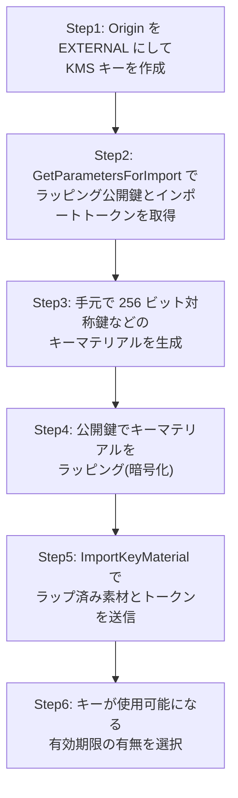

```bash
# Step1: Origin が EXTERNAL の KMS キーを作成
aws kms create-key --origin EXTERNAL --description "BYOK key"

# Step2: ラッピング公開鍵とインポートトークンを取得
aws kms get-parameters-for-import \
  --key-id 1234abcd-12ab-34cd-56ef-1234567890ab \
  --wrapping-algorithm RSAES_OAEP_SHA_256 \
  --wrapping-key-spec RSA_2048

# Step3: キーマテリアルを生成(256ビット)
openssl rand -out PlaintextKeyMaterial.bin 32

# Step4: 公開鍵でラッピング(PublicKey は取得結果を Base64 デコードして DER で保存)
openssl pkeyutl -encrypt \
  -in PlaintextKeyMaterial.bin -out EncryptedKeyMaterial.bin \
  -inkey WrappingPublicKey.bin -keyform DER -pubin \
  -pkeyopt rsa_padding_mode:oaep \
  -pkeyopt rsa_oaep_md:sha256 \
  -pkeyopt rsa_mgf1_md:sha256

# Step5: インポート
aws kms import-key-material \
  --key-id 1234abcd-12ab-34cd-56ef-1234567890ab \
  --encrypted-key-material fileb://EncryptedKeyMaterial.bin \
  --import-token fileb://ImportToken.bin \
  --expiration-model KEY_MATERIAL_DOES_NOT_EXPIRE
```

**要点**
- ラッピングアルゴリズムは **RSAES_OAEP_SHA_256 などの OAEP 系**を使う(古い PKCS#1 v1.5 系は避ける)
- **インポートトークンと公開鍵には有効期限**(24時間)があり、期限切れなら取得し直す
- **有効期限を設定**した場合、期限が来ると KMS は素材を削除し**キーが使えなくなる**。再開するには**まったく同じキーマテリアルを再インポート**する
- **`DeleteImportedKeyMaterial`** で素材だけを削除可能(**KMS キー自体は残り**、使用不能になる。**同じ素材を再インポートすれば復旧**)
- **キーマテリアルの原本(コピー)は必ずお客様側で安全に保管**する(消えると復旧できない)

#### インポートした鍵のローテーション

| 方式 | 可否 | 内容 |
|---|---|---|
| **自動ローテーション** | **不可** | 自動ローテーションは **`AWS_KMS` Origin の対称暗号化キーのみ** |
| **オンデマンドローテーション** | **可能**(2025年6月から) | **新しいキーマテリアルをインポート(状態: Pending rotation)→ ローテーション実行**。**キー ID/ARN/エイリアスは変わらず**、既存データも引き続き復号できる |
| **手動ローテーション(新しい KMS キーに切替)** | 可能 | **非対称キー、HMAC キー、カスタムキーストアのキー、インポートマテリアルのマルチリージョンキー**など、上記が使えない場合 |

- オンデマンドローテーションは **1つのキーにつき最大 10回**
- **マルチリージョンキー**の場合は、**プライマリと全レプリカに同じ新しいキーマテリアルをインポート**し、プライマリでローテーションを実行する

> 根拠: [Rotate AWS KMS keys](https://docs.aws.amazon.com/kms/latest/developerguide/rotate-keys.html) / [Perform on-demand key rotation](https://docs.aws.amazon.com/kms/latest/developerguide/rotating-keys-on-demand.html) / [AWS KMS launches on-demand key rotation for imported keys (2025-06-06)](https://aws.amazon.com/about-aws/whats-new/2025/06/aws-kms-on-demand-key-rotation-imported-keys)

#### 外部キーストア(XKS)とカスタムキーストアの違い

| 観点 | **カスタムキーストア(CloudHSM)** | **外部キーストア(XKS)** |
|---|---|---|
| 鍵の保管 | **お客様の AWS CloudHSM クラスター**(AWS 内の専有 HSM) | **AWS の外**にある外部 HSM・鍵管理システム |
| 暗号処理の場所 | CloudHSM 内 | **外部 HSM 内**(AWS は鍵素材に触れない) |
| 接続 | KMS ⇔ CloudHSM | KMS ⇔ **XKS プロキシ** ⇔ 外部 HSM |
| 主な動機 | **専有 HSM** の要件 | **主権・規制で、鍵を AWS の外で管理**する必要 |
| 可用性への影響 | CloudHSM クラスターの可用性に依存 | **外部システム・ネットワークの可用性に依存**(遅延や停止が AWS サービス利用に影響しうる) |
| 自動ローテーション | 不可(手動) | 不可(手動) |

#### ベストプラクティス

| # | ベストプラクティス |
|---|---|
| 1 | **規制上の明確な理由がない限り、AWS 生成の KMS キー**を使う(運用負荷・耐障害性で有利) |
| 2 | BYOK の素材は**十分なエントロピー**を持つ安全な環境で生成し、**原本を安全に保管**(紛失=データ喪失) |
| 3 | **有効期限を使う場合は、再インポート手順と期限監視**を運用に組み込む(CloudWatch/EventBridge で通知) |
| 4 | インポート鍵のローテーションは**オンデマンド**で計画的に実施 |
| 5 | XKS は**外部システムの高可用性設計**と**遅延監視**を必須にする |
| 6 | **マルチリージョンのインポート鍵**は各レプリカに**同一素材**をインポートする手順を文書化 |

#### 試験のポイント
- 「**鍵素材を自社で生成・管理、いつでも削除可能にしたい**」→ **インポート(BYOK)**(`DeleteImportedKeyMaterial`)
- 「**AWS の外で鍵を保持**」→ **外部キーストア(XKS)**
- 「**専有 HSM を KMS 経由で利用**」→ **カスタムキーストア(CloudHSM)**
- 「**インポート鍵を自動ローテーションしたい**」→ **自動は不可**。**オンデマンド(新素材インポート → Rotate now)**、または新キー + エイリアス切替
- 「**期限切れで復号できなくなった**」→ **同一素材を再インポート**

---

### Skill 5.3.3 インポート鍵と AWS 生成鍵の違い

> この Skill は「**Describe(説明できる)**」が求められています。比較表を丸ごと頭に入れておきましょう。

| 比較項目 | **AWS 生成(`AWS_KMS`)** | **インポート(`EXTERNAL`)** |
|---|---|---|
| キーマテリアルの生成 | **KMS の HSM** | **お客様** |
| 耐久性(Durability) | KMS が**高耐久性**を管理 | **お客様が原本を保持する責任**。KMS 側の素材が失われた場合は**再インポート**で復旧 |
| 有効期限 | なし | **設定可能**(期限切れで素材が削除される) |
| 素材だけの削除 | 不可(キー削除は待機期間 7〜30日) | **`DeleteImportedKeyMaterial` で即時に使用不能化**できる |
| 自動ローテーション | **可能**(既定 365日、期間は 90〜2560日で指定) | **不可** |
| オンデマンドローテーション | 可能 | **可能**(新素材のインポートが前提) |
| マルチリージョンキー | レプリカへ**自動で同一素材が複製**される | **各レプリカに同じ素材を手動でインポート**する必要 |
| 運用負荷 | 低い | **高い**(生成・保管・再インポート・期限監視) |
| 規制対応の強み | 一般的な要件 | **鍵生成の主体性、削除の確実性**を示したい要件 |
| 暗号文の互換性 | — | **同じ素材でのみ復号可**(異なる素材を再インポートしても既存暗号文は復号不可) |

**判断フロー**

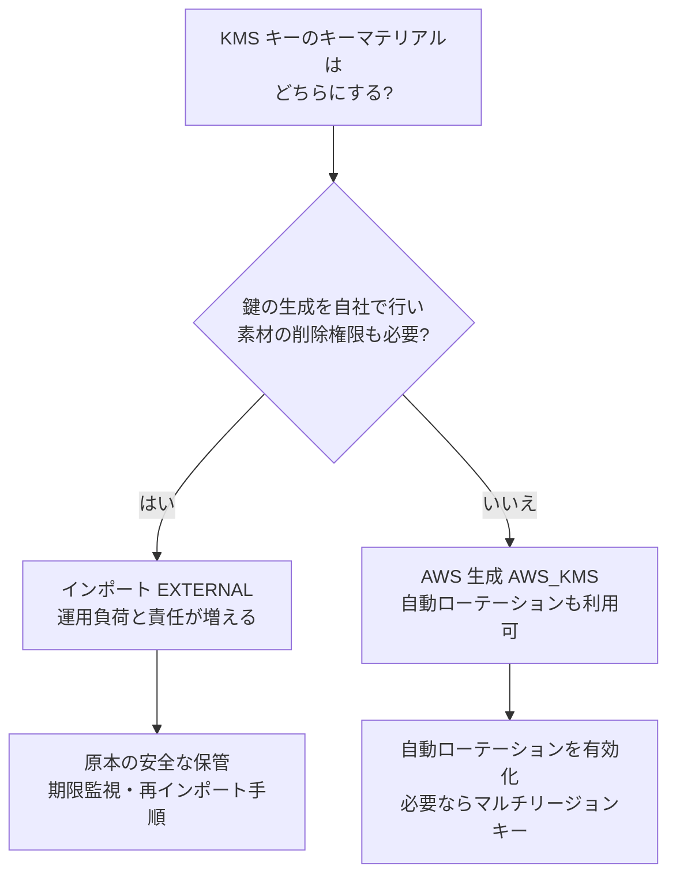

---

### Skill 5.3.4 機密データのマスキング

#### ひとことで言うと
ログやメッセージの中に紛れ込んだ**個人情報(PII)・認証情報などの機密データを自動で検出し、隠す(マスクする)**スキルです。「**そもそも出力しない**」のが最善ですが、漏れを**最後の砦で止める**仕組みを持ちます。

#### 主な機能

| サービス/機能 | 何をするか | 動作 |
|---|---|---|
| **CloudWatch Logs データ保護ポリシー** | ログに含まれる機密データを**検出・マスク** | **マネージドデータ識別子**(メールアドレス、クレジットカード番号、認証情報など)や**カスタムデータ識別子**(正規表現)で検出 |
| **Amazon SNS メッセージデータ保護** | トピックを流れるメッセージ内の機密データを**検出・ブロック・マスク** | **Audit / Deny / De-identify** の操作を、**Inbound(発行)/ Outbound(配信)**方向で指定 |
| **Amazon Macie** | **S3 内**の機密データを**発見・分類** | 機械学習とパターンマッチで PII 等を検出し、**Security Hub / EventBridge** に通知 |

#### CloudWatch Logs データ保護ポリシー

| 項目 | 内容 |
|---|---|
| 適用範囲 | **ロググループ単位**、または**アカウント全体**(アカウントレベルポリシー) |
| 操作 | **Audit**(検出して結果を出力)/ **Deidentify**(検出箇所を**マスク**) |
| 監査結果の出力先 | CloudWatch Logs、S3、Firehose |
| マスクされる範囲 | ポリシー適用**後に取り込まれたログ**(過去ログには遡らない) |
| 元の値の閲覧 | **`logs:Unmask`** 権限を持つ主体のみ(最小限に付与) |

```json
{
  "Name": "mask-pii-policy",
  "Description": "メールアドレスとカード番号を検出・マスクする",
  "Version": "2021-06-01",
  "Statement": [
    {
      "Sid": "audit-policy",
      "DataIdentifier": [
        "arn:aws:dataprotection::aws:data-identifier/EmailAddress",
        "arn:aws:dataprotection::aws:data-identifier/CreditCardNumber"
      ],
      "Operation": {
        "Audit": {
          "FindingsDestination": {
            "CloudWatchLogs": { "LogGroup": "dataprotection-findings" }
          }
        }
      }
    },
    {
      "Sid": "redact-policy",
      "DataIdentifier": [
        "arn:aws:dataprotection::aws:data-identifier/EmailAddress",
        "arn:aws:dataprotection::aws:data-identifier/CreditCardNumber"
      ],
      "Operation": { "Deidentify": { "MaskConfig": {} } }
    }
  ]
}
```

```bash
aws logs put-data-protection-policy \
  --log-group-identifier my-app-logs \
  --policy-document file://mask-pii-policy.json
```

#### SNS メッセージデータ保護ポリシー

```json
{
  "Name": "sns-data-protection",
  "Description": "カード番号を含むメッセージの発行を拒否する",
  "Version": "2021-06-01",
  "Statement": [
    {
      "DataDirection": "Inbound",
      "Principal": ["*"],
      "DataIdentifier": [
        "arn:aws:dataprotection::aws:data-identifier/CreditCardNumber"
      ],
      "Operation": { "Deny": {} }
    }
  ]
}
```

| 操作 | 動作 |
|---|---|
| **Audit** | 検出して**記録**(通過は許可) |
| **Deny** | 検出したら**メッセージの発行/配信を拒否** |
| **De-identify** | 検出箇所を**マスクまたは削除**して通過 |

#### 「マスキング」の考え方の整理

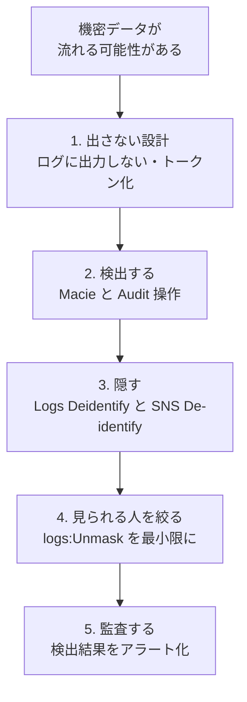

#### ベストプラクティス

| # | ベストプラクティス |
|---|---|
| 1 | **アカウントレベル**の CloudWatch Logs データ保護ポリシーで**全ロググループに既定適用**し、設定漏れを防ぐ |
| 2 | まず **Audit** で検出状況を把握してから **Deidentify** を適用(誤検知・影響を確認) |
| 3 | **`logs:Unmask`** は**少人数・限定ロール**にのみ付与し、使用を CloudTrail で監査 |
| 4 | 自社固有の ID 形式(社員番号など)は**カスタムデータ識別子**を定義 |
| 5 | **S3 の機密データ**は **Macie** で定期発見し、結果を **Security Hub** に集約 |
| 6 | **ログに機密データを出力しないコーディング規約**を設ける(マスキングは補完策) |
| 7 | SNS は**トピックごと/既定**のデータ保護ポリシーで、**機密を含むメッセージ発行を Deny** |

#### 試験のポイント
- 「**ログ内のメールアドレスやカード番号を自動マスク**」→ **CloudWatch Logs データ保護ポリシー(Deidentify)**
- 「**マスクされた値を一部の人だけが見られる**」→ **`logs:Unmask`** 権限
- 「**SNS で機密データを含むメッセージを防ぐ**」→ **SNS メッセージデータ保護ポリシー(Deny/De-identify)**
- 「**S3 のどこに機密データがあるか知りたい**」→ **Amazon Macie**(マスキングではなく**発見・分類**)
- 「**過去に取り込んだログにもマスクを遡及**」→ **遡及しない**(適用後の取り込み分が対象)

---

### Skill 5.3.5 鍵と証明書の作成・管理

#### ひとことで言うと
**KMS のカスタマーマネージドキー(CMK)**と **TLS 証明書(ACM / AWS Private CA)**を、**単一リージョンでも、複数リージョンでも**、安全に作り・配り・更新・廃棄するスキルです。

---

#### Part A: KMS カスタマーマネージドキーの管理

**ローテーションの整理(試験頻出)**

| キーの種類 | ローテーション |
|---|---|
| **AWS 所有キー** | AWS が管理(お客様は関与しない) |
| **AWS マネージドキー** | **毎年自動**(変更・停止不可) |
| **CMK(対称・AWS_KMS)** | **自動**(既定 365日、**90〜2560日**でカスタム可)/ **オンデマンド**(最大10回) |
| **CMK(インポート素材)** | 自動不可。**オンデマンド**または手動 |
| **CMK(非対称 / HMAC / カスタムキーストア / XKS)** | 自動・オンデマンド不可。**手動**(新キー作成 + **エイリアス切替**) |

```bash
# 自動ローテーションを有効化(180日ごと)
aws kms enable-key-rotation \
  --key-id 1234abcd-12ab-34cd-56ef-1234567890ab \
  --rotation-period-in-days 180

# 状態確認
aws kms get-key-rotation-status \
  --key-id 1234abcd-12ab-34cd-56ef-1234567890ab

# オンデマンドで今すぐローテーション
aws kms rotate-key-on-demand \
  --key-id 1234abcd-12ab-34cd-56ef-1234567890ab
```

**ローテーションの重要な性質**
- **キー ID / ARN / エイリアスは変わらない**ので、アプリの変更は不要
- **古いキーマテリアルは保持**され、**既存の暗号文は引き続き復号できる**(新規の暗号化は最新素材で実施)
- オンデマンドは**自動ローテーションのスケジュールを変更しない**

**エイリアスの活用(手動ローテーション時)**: アプリは**エイリアス**(例: `alias/app-data`)を指定しておき、新しい KMS キーを作成したらエイリアスの向き先を付け替えます。ただし、**古い鍵で暗号化された既存データは古い KMS キーでしか復号できない**ので、旧キーを**削除しない**(または再暗号化する)ことに注意します。

---

#### Part B: マルチリージョンキー(Multi-Region Keys)

**ひとことで言うと**: **異なるリージョンに、同じキー ID・同じキーマテリアルを持つ「関連キー」**を作る機能です。**あるリージョンで暗号化し、別リージョンで(KMS を跨がずに)復号**できます。

| 項目 | 内容 |
|---|---|
| 構成 | **プライマリキー** 1 つ + **レプリカキー**(複数リージョン) |
| キー ID | **共通**(先頭が `mrk-`)。ARN はリージョンごとに異なる |
| 共有されるもの | **キーマテリアル**、キー ID、Origin、ローテーション設定(プライマリが管理) |
| **共有されない**もの | **キーポリシー**(リージョンごとに**独立**)、グラント、エイリアス、タグ |
| ユースケース | **DR**、**DynamoDB グローバルテーブル / Aurora グローバルデータベース**の暗号化、**クライアント側暗号化**でリージョン間移動するデータ |
| 注意 | 「**グローバルな1つの鍵**」ではなく、**独立したリソースの組**。**データ主権要件**がある場合は、複製先リージョンの妥当性を確認 |

```bash
# プライマリキーを作成
aws kms create-key --multi-region --description "mrk primary" --region ap-northeast-1

# 別リージョンにレプリカを作成
aws kms replicate-key \
  --key-id mrk-1234abcd12ab34cd56ef1234567890ab \
  --replica-region us-west-2 \
  --region ap-northeast-1
```

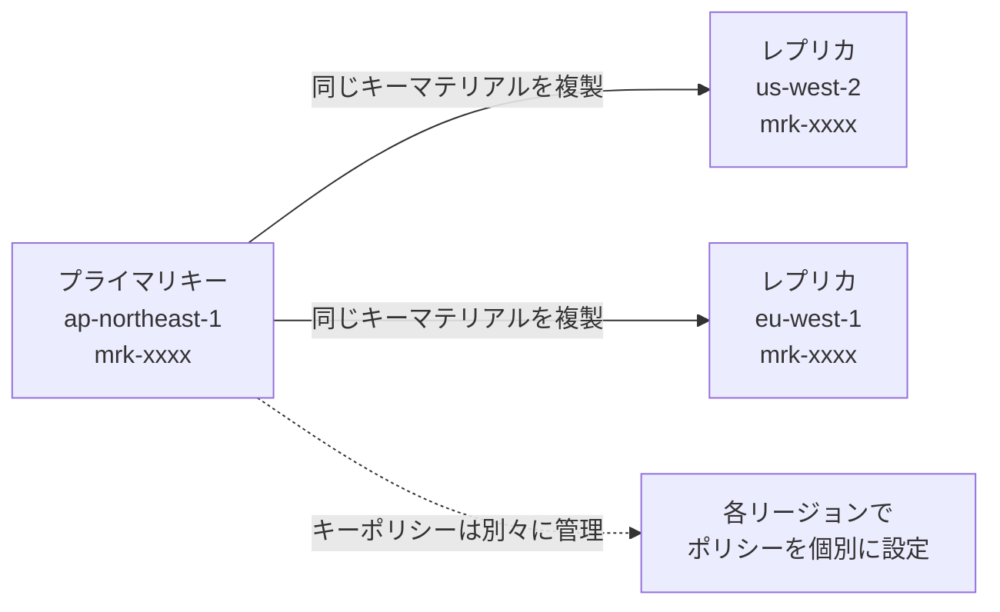

---

#### Part C: 証明書の管理(ACM と AWS Private CA)

| サービス | 役割 | 用途 |
|---|---|---|
| **AWS Certificate Manager (ACM)** | **パブリック/プライベート証明書**の発行・デプロイ・**自動更新** | ALB、CloudFront、API Gateway などの TLS 終端 |
| **AWS Private Certificate Authority (Private CA)** | **自社専用の認証局(CA)**をマネージドで運用 | 社内システム、サービス間 **mTLS**、IoT/デバイス証明書、VPN クライアント証明書 |

**AWS Private CA の要点**

| 項目 | 内容 |
|---|---|
| CA 階層 | **ルート CA + 下位(Subordinate)CA** の階層を構成。**ルートは使用を最小化**し、**下位 CA で発行**するのが定石 |
| 失効管理 | **CRL** と **OCSP** をサポート(失効した証明書を検証側に伝える) |
| CA のモード | **汎用(General-purpose)**:長めの有効期間 / **短期証明書(Short-lived)**:短い有効期間(**失効管理を不要にする運用向き**・コストも抑えやすい) |
| 共有 | **AWS RAM** で組織内の他アカウントに CA を共有し、**証明書の発行を委任** |
| 自動更新 | **ACM 経由で発行したプライベート証明書は自動更新**(対応サービスに関連付け時) |
| 範囲 | CA は**リージョン単位**。マルチリージョン運用では**リージョンごとの設計**が必要 |
| 秘密鍵 | CA の秘密鍵は **HSM で保護** |

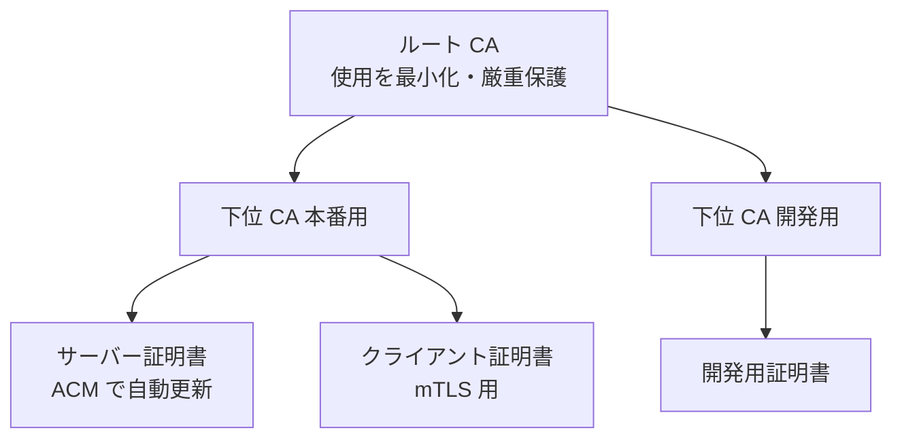

**証明書のリージョン関連の注意**

| 項目 | 内容 |
|---|---|
| ACM 証明書の範囲 | **リージョン固有**。複数リージョンで使うなら**各リージョンで発行** |
| CloudFront | 使用する証明書は **us-east-1** の ACM |
| 期限切れ対策 | **DNS 検証 + 自動更新**。**ACM の期限切れ接近イベント(EventBridge)**で監視 |

---

#### ベストプラクティス(鍵と証明書)

| # | ベストプラクティス |
|---|---|
| 1 | **CMK の自動ローテーションを有効化**(要件に応じ期間を調整) |
| 2 | **キーポリシーは最小権限**。管理者と利用者を分離。`kms:ViaService`、`kms:CallerAccount`、`aws:PrincipalOrgID` で**範囲を限定** |
| 3 | **用途ごとにキーを分ける**(データ分類・アプリ・環境ごと)ことで、**影響範囲(ブラストラディウス)**を限定 |
| 4 | アプリは**エイリアス**でキーを参照し、ローテーション/切替を容易にする |
| 5 | **マルチリージョンキー**は、DR・グローバルデータの要件がある場合に限定して採用。**各リージョンのキーポリシーを個別に管理** |
| 6 | **削除は慎重に**。**無効化 → 一定期間の観察 → 削除予約**の順で進め、**削除予約/無効化の検知アラート**を設定 |
| 7 | 証明書は **ACM で自動更新**。**Private CA は階層化**し、**ルートは最小利用** |
| 8 | **短期証明書**の活用で失効管理の負担を軽減 |
| 9 | KMS・ACM・Private CA の操作は **CloudTrail** で監査し、**Config ルール**で準拠を継続検査 |

#### 試験のポイント
- 「**ローテーションしてもアプリ変更なし**」→ **KMS の自動/オンデマンドローテーション**(キー ID は不変)
- 「**非対称キー・HMAC キーをローテーション**」→ **手動**(新キー + エイリアス切替)
- 「**複数リージョンで同じ鍵で暗号化・復号、KMS 通信を跨ぎたくない**」→ **マルチリージョンキー**
- 「**マルチリージョンキーでキーポリシーも自動同期?**」→ **同期されない**(個別管理)
- 「**社内システム用に自社の認証局を AWS で運用**」→ **AWS Private CA**
- 「**複数アカウントで Private CA を共有して証明書を発行**」→ **AWS RAM**
- 「**証明書の自動更新で期限切れを防ぐ**」→ **ACM(DNS 検証)**

---

## 6. 試験対策: 頻出パターンとひっかけポイント

### 6.1 「要件 → 答え」早見表

| 要件(問題文のキーワード) | 答えの候補 |
|---|---|
| 暗号化されていない通信を**拒否** | リソースポリシーの `aws:SecureTransport = false` を Deny / HTTPS リダイレクト |
| TLS 1.2 未満を許可しない | ELB セキュリティポリシーの選択 / `s3:TlsVersion` |
| **TLS 1.3 のみ** | `ELBSecurityPolicy-TLS13-1-3-2021-06` |
| インターネットを通さず S3/DynamoDB へ(低コスト) | **Gateway エンドポイント** |
| オンプレから S3 へ私的接続 | **Interface エンドポイント(PrivateLink)** |
| VPN なし・デバイス状態も評価してアプリ公開 | **Verified Access** |
| リモート作業者を VPC に接続(証明書/SAML) | **Client VPN** |
| Direct Connect の暗号化 | **MACsec** / **VPN over DX** |
| VPC 内の平文通信を可視化し禁止 | **VPC Encryption Controls**(Monitor → Enforce) |
| EMR / SageMaker のノード間通信を暗号化 | **Security Configuration** / **Inter-Container Traffic Encryption** |
| 専有 HSM・鍵の完全管理 | **CloudHSM**(KMS 統合は**カスタムキーストア**) |
| 鍵を AWS の外に保持 | **外部キーストア(XKS)** |
| キー使用の細かな制御・クロスアカウント | **CMK** |
| S3 の KMS 呼び出しコスト削減 | **S3 バケットキー** |
| 暗号化されていない RDS を暗号化 | スナップショット → **暗号化コピー** → 復元 |
| 新規 EBS を必ず暗号化 | **EBS 既定暗号化**(リージョン単位) |
| ルートでも削除不可の WORM | **Object Lock コンプライアンス** |
| Glacier の不変ポリシー | **Vault Lock** |
| 未署名コードのデプロイを拒否 | **AWS Signer + コード署名設定** |
| ランサムウェアに耐えるバックアップ | **論理的エアギャップボールト** + Vault Lock + 別アカウント |
| 組織全体のバックアップ強制 | **AWS Backup + Organizations バックアップポリシー** |
| DB パスワードを自動で定期変更 | **Secrets Manager 自動ローテーション** |
| ログ内の PII を自動マスク | **CloudWatch Logs データ保護ポリシー** |
| S3 内の機密データを発見 | **Macie** |
| 鍵素材を自社で生成・削除権を保持 | **インポート(BYOK)** |
| 自社の認証局を運用 | **AWS Private CA** |
| 複数リージョンで同じ鍵 | **マルチリージョンキー** |

### 6.2 ひっかけポイント集

| # | ひっかけ | 正しい理解 |
|---|---|---|
| 1 | 「ALB でカスタム暗号スイートを設定」 | ALB は**カスタムポリシー不可**。定義済みポリシーから選ぶ |
| 2 | 「CloudFront の証明書を東京リージョンの ACM で」 | **us-east-1** の ACM が必要 |
| 3 | 「Gateway エンドポイントでオンプレから S3 へ」 | Gateway 型はオンプレから**利用不可**。Interface 型を使う |
| 4 | 「Direct Connect は専用線だから暗号化済み」 | **既定では暗号化されない** |
| 5 | 「SSE-C は新規バケットでも普通に使える」 | **2026年4月以降は新規バケットで既定無効**(明示的に有効化が必要) |
| 6 | 「AWS マネージドキーをクロスアカウントで共有」 | **不可**。**CMK** が必要(Secrets Manager、EBS スナップショット共有も同様) |
| 7 | 「IAM ポリシーだけで KMS キーを使える」 | **キーポリシーが必須**。IAM へ委任する記述がなければ IAM だけでは不可 |
| 8 | 「既存の RDS の暗号化をコンソールで ON」 | **作成時のみ**。スナップショット経由で暗号化 |
| 9 | 「インポート鍵も自動ローテーションできる」 | **自動は不可**。**オンデマンド**(新素材インポート → Rotate now) |
| 10 | 「マルチリージョンキーはキーポリシーも同期」 | **同期されない**(リージョンごとに独立) |
| 11 | 「コンプライアンスモードは後で短縮できる」 | **誰も不可**。**事前にガバナンスモードで検証** |
| 12 | 「S3 レプリケーション = バックアップ」 | 削除・破損も複製される。**バックアップの代替ではない** |
| 13 | 「Object Lock はバージョニングなしで使える」 | **バージョニング前提** |
| 14 | 「データ保護ポリシーで過去のログもマスク」 | **適用後に取り込まれたログのみ** |
| 15 | 「暗号化コンテキストに機密を入れて守る」 | **秘密ではない**。CloudTrail にも記録される |
| 16 | 「KMS キー削除は即時」 | **待機 7〜30日**。ただし削除後は**復元不可** |
| 17 | 「Macie でマスキング」 | Macie は**発見・分類**。マスキングはログ/SNS のデータ保護ポリシー |
| 18 | 「ロックアウトを気にせず `aws:SourceVpce` で Deny」 | **管理者も締め出しうる**。例外設計が必要 |

### 6.3 サービス選択の判断フロー(総まとめ)

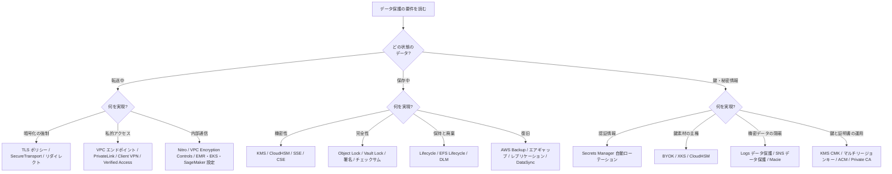

---

## 7. 理解度チェック(演習問題)

各問題の答えは `<details>` を開くと確認できます。

### 問題 1
ある企業では、S3 バケットへの**すべてのアクセスを TLS 1.2 以上に限定**し、HTTP でのアクセスを拒否したい。最も適切な方法は?

- A. CloudFront の Viewer Protocol Policy を設定する
- B. バケットポリシーで `aws:SecureTransport` が `false` のリクエストを Deny し、`s3:TlsVersion` が 1.2 未満のリクエストも Deny する
- C. S3 のバケット既定暗号化を SSE-KMS にする
- D. VPC エンドポイントを作成する

<details>
<summary>答えと解説</summary>

**B**。転送中の暗号化を**リソースポリシーで強制**する定石です。A は CloudFront 経由のみに効果、C は保存時の暗号化、D はアクセス経路の制御で、いずれも TLS バージョンの強制ではありません。
</details>

### 問題 2
オンプレミスのデータセンターから Direct Connect 経由で S3 に**インターネットを通さず**アクセスしたい。Gateway エンドポイントを作成したが、オンプレミスから利用できない。どうすべきか?

- A. NAT ゲートウェイを追加する
- B. S3 用の **Interface エンドポイント(PrivateLink)** を作成し、プライベート IP 経由でアクセスする
- C. VPC ピアリングを設定する
- D. インターネットゲートウェイを追加する

<details>
<summary>答えと解説</summary>

**B**。Gateway エンドポイントは VPC 内のルートテーブルで機能するため、**オンプレミスから直接は利用できません**。Interface エンドポイントは **VPC 内のプライベート IP(ENI)**を持つので、Direct Connect や VPN 経由で到達できます。
</details>

### 問題 3
規制により、**ルートユーザーを含む誰も**、7年間は S3 オブジェクトを削除・上書きできないようにする必要がある。設定として正しいものは?(2つ選択)

- A. バケットで **S3 Object Lock** を有効にする(バージョニングが前提)
- B. **ガバナンスモード**で 7年の保持期間を設定する
- C. **コンプライアンスモード**で 7年の保持期間を設定する
- D. MFA Delete のみを有効にする
- E. バケットポリシーで Delete を Deny する

<details>
<summary>答えと解説</summary>

**A と C**。ルートユーザーも削除不可にできるのは**コンプライアンスモード**だけです。ガバナンスモードは特別権限で解除可能、バケットポリシーは変更可能なため WORM 要件を満たしません。
</details>

### 問題 4
ランサムウェア対策として、**本番アカウントの管理者権限を攻撃者に奪われても**、バックアップが破壊されない構成にしたい。最も適切なのは?

- A. 同一アカウントの標準バックアップボールトにガバナンスモードの Vault Lock を設定する
- B. S3 クロスリージョンレプリケーションのみを使う
- C. **論理的エアギャップボールト**を使い、バックアップを本番とは分離された境界に保持する
- D. EBS スナップショットを手動で取得する

<details>
<summary>答えと解説</summary>

**C**。論理的エアギャップボールトは**常にコンプライアンスモードの Vault Lock**が適用され、本番アカウントの IAM 経路から分離されています。A はガバナンスモードで権限者が解除可能、B は削除の伝播リスク、D は運用が属人的で防御になりません。
</details>

### 問題 5
Amazon RDS for MySQL の本番 DB を暗号化していないことが判明した。**最小のダウンタイム**で暗号化するには?

- A. コンソールで「暗号化を有効化」を選択する
- B. KMS キーポリシーを変更する
- C. スナップショットを取得し、**暗号化を有効にしてコピー**し、そこから新しい DB を復元して切り替える
- D. EBS 既定暗号化を有効化する

<details>
<summary>答えと解説</summary>

**C**。RDS は**作成時にのみ**暗号化を指定できます。既存 DB は「スナップショット → 暗号化コピー → 復元」で暗号化します。ダウンタイムを減らすには、復元後に**レプリケーションや DMS**で差分を追従させる手法もあります。
</details>

### 問題 6
DB 認証情報を Secrets Manager で管理し、**ダウンタイムなし**で定期的にローテーションしたい。適切な戦略は?

- A. 単一ユーザー戦略
- B. 交互ユーザー(Alternating users)戦略
- C. 手動でパスワードを変更
- D. Parameter Store の SecureString を使用

<details>
<summary>答えと解説</summary>

**B**。2つのユーザーを交互に更新するため、**更新中でも有効な認証情報が常に存在**します。単一ユーザーは更新の瞬間に旧パスワードが無効になる影響があり、Parameter Store には**組み込みのローテーション機能がありません**。
</details>

### 問題 7
ある企業が、**自社で生成した鍵素材**を KMS に取り込んで使っている。コンプライアンス上、**素材を定期的に入れ替え**つつ、**既存データを再暗号化せず**、**キー ARN も変更しない**ことが求められる。最適な方法は?

- A. 自動ローテーションを有効化する
- B. 新しい鍵素材をインポートし(Pending rotation)、**オンデマンドローテーション**を実行する
- C. 新しい KMS キーを作り、全データを再暗号化する
- D. キーを削除して再作成する

<details>
<summary>答えと解説</summary>

**B**。インポート素材の KMS キーは**自動ローテーション不可**ですが、2025年6月から**オンデマンドローテーション**に対応しました。キー ARN・エイリアスを維持し、既存データも引き続き復号できます。
</details>

### 問題 8
アプリケーションログに顧客のメールアドレスとクレジットカード番号が混入する恐れがある。**ログ取り込み時に自動でマスク**し、**権限のある一部のセキュリティ担当だけ**が元の値を確認できるようにしたい。

- A. Amazon Macie をロググループに設定する
- B. **CloudWatch Logs のデータ保護ポリシー**(Deidentify)を設定し、`logs:Unmask` を限定したロールにのみ付与する
- C. ログ保持期間を短くする
- D. ロググループを KMS で暗号化する

<details>
<summary>答えと解説</summary>

**B**。マスクは CloudWatch Logs のデータ保護ポリシー、元の値の表示は `logs:Unmask` で制御します。Macie は**S3 内の機密データ発見**が主用途、KMS 暗号化は保存時の保護でログ閲覧者に対するマスキングではありません。
</details>

---

## 8. 最終チェックリスト

試験前に、各項目を**自分の言葉で説明できる**か確認しましょう。

### Task 5.1 転送中のデータ
- [ ] ELB セキュリティポリシーの名前の読み方と、ALB はカスタム不可であることを説明できる
- [ ] S3 で `aws:SecureTransport` と `s3:TlsVersion` を使った強制ポリシーを書ける
- [ ] Gateway / Interface エンドポイントの違いと、オンプレからの利用可否を説明できる
- [ ] Client VPN と Verified Access の違い(境界型 vs ゼロトラスト)を説明できる
- [ ] Direct Connect が既定で暗号化されない点と、MACsec / VPN の対策を説明できる
- [ ] VPC Encryption Controls の Monitor → Enforce の手順を説明できる
- [ ] EMR / EKS / SageMaker のノード間暗号化の設定箇所を説明できる

### Task 5.2 保存中のデータ
- [ ] KMS と CloudHSM の違い、カスタムキーストアと XKS の位置づけを説明できる
- [ ] AWS 所有 / AWS マネージド / カスタマーマネージドキーの違いを説明できる
- [ ] SSE-S3 / SSE-KMS / DSSE-KMS / SSE-C の違いと、SSE-C が 2026年4月から既定無効である点を説明できる
- [ ] エンベロープ暗号化の流れを図なしで説明できる
- [ ] Object Lock の 2 モードと法的ホールド、Vault Lock の 24 時間検証を説明できる
- [ ] S3 Lifecycle、EFS Lifecycle、DLM の役割の違いを説明できる
- [ ] 論理的エアギャップボールトと通常の Vault Lock の違いを説明できる
- [ ] S3 レプリケーションの前提と、バックアップの代替にならない理由を説明できる

### Task 5.3 機密データ・認証情報・鍵
- [ ] Secrets Manager のローテーション 4 ステップと、単一/交互ユーザーの違いを説明できる
- [ ] Secrets Manager と Parameter Store の使い分けを説明できる
- [ ] BYOK の手順(GetParametersForImport → ラップ → ImportKeyMaterial)を説明できる
- [ ] インポート鍵と AWS 生成鍵の違い(生成・耐久性・期限・削除・ローテーション・マルチリージョン)を表なしで言える
- [ ] CloudWatch Logs データ保護ポリシーと SNS データ保護ポリシーの動作を説明できる
- [ ] KMS のローテーション種別(自動・オンデマンド・手動)と対象キー種別を説明できる
- [ ] マルチリージョンキーの共有されるもの/されないものを説明できる
- [ ] ACM と AWS Private CA の違いと、CloudFront 用証明書のリージョンを説明できる

---

## 9. 参考ソース(URL)

> 本ガイドの内容は、2026年10月22日時点で確認した AWS 公式ドキュメント・公式ブログを根拠としています。**サービスの仕様や既定値は更新されるため、試験直前・実装前に必ず最新の公式情報を確認**してください。
>
> **URL の確認状況**: 次のページは本ガイド作成時に実際に取得・確認しました(試験ガイド トップ/Domain 5、ALB セキュリティポリシー、VPC Encryption Controls、S3 SSE-C と SSE-C 既定無効の FAQ・ブログ、KMS のローテーション/オンデマンドローテーション/インポート鍵の発表、Secrets Manager のローテーションスケジュール/マネージドローテーション、AWS Backup の論理的エアギャップボールトと Backup ブログ)。**それ以外の URL は AWS ドキュメントの標準的な構成に基づく参照先で、個別の到達確認はしていません**。ページが移動している場合は、ページ名でドキュメント内検索してください。

### 9.1 試験ガイド(公式)

| 内容 | URL |
|---|---|
| SCS-C03 試験ガイド(トップ) | https://docs.aws.amazon.com/aws-certification/latest/security-specialty-03/security-specialty-03.html |
| Content Domain 5: Data Protection | https://docs.aws.amazon.com/aws-certification/latest/security-specialty-03/security-specialty-03-domain5.html |
| 対象サービス(In-Scope) | https://docs.aws.amazon.com/aws-certification/latest/security-specialty-03/scs-02-in-scope-services.html |
| 技術と概念 | https://docs.aws.amazon.com/aws-certification/latest/security-specialty-03/scs-technologies-concepts.html |

### 9.2 Task 5.1: 転送中のデータ

| 内容 | URL |
|---|---|
| ALB のセキュリティポリシー | https://docs.aws.amazon.com/elasticloadbalancing/latest/application/describe-ssl-policies.html |
| ALB の HTTPS リスナー | https://docs.aws.amazon.com/elasticloadbalancing/latest/application/create-https-listener.html |
| VPC Encryption Controls | https://docs.aws.amazon.com/vpc/latest/userguide/vpc-encryption-controls.html |
| VPC Encryption Controls(ブログ) | https://aws.amazon.com/blogs/networking-and-content-delivery/implementing-encryption-in-transit-across-connectivity-patterns-with-vpc-encryption-controls/ |
| AWS PrivateLink / VPC エンドポイント | https://docs.aws.amazon.com/vpc/latest/privatelink/what-is-privatelink.html |
| VPC エンドポイントポリシー | https://docs.aws.amazon.com/vpc/latest/privatelink/vpc-endpoints-access.html |
| AWS Client VPN | https://docs.aws.amazon.com/vpn/latest/clientvpn-admin/what-is.html |
| AWS Verified Access | https://docs.aws.amazon.com/verified-access/latest/ug/what-is-verified-access.html |
| EC2 の転送中暗号化(Nitro) | https://docs.aws.amazon.com/AWSEC2/latest/UserGuide/data-protection.html |
| EMR の転送中暗号化 | https://docs.aws.amazon.com/emr/latest/ManagementGuide/emr-data-encryption-options.html |
| SageMaker のコンテナ間トラフィック暗号化 | https://docs.aws.amazon.com/sagemaker/latest/dg/train-encrypt.html |
| S3 のセキュリティベストプラクティス | https://docs.aws.amazon.com/AmazonS3/latest/userguide/security-best-practices.html |
| AWS Certificate Manager | https://docs.aws.amazon.com/acm/latest/userguide/acm-overview.html |

### 9.3 Task 5.2: 保存中のデータ

| 内容 | URL |
|---|---|
| AWS KMS 開発者ガイド | https://docs.aws.amazon.com/kms/latest/developerguide/overview.html |
| AWS KMS の概念(エンベロープ暗号化等) | https://docs.aws.amazon.com/kms/latest/developerguide/concepts.html |
| KMS キーポリシー | https://docs.aws.amazon.com/kms/latest/developerguide/key-policies.html |
| AWS CloudHSM | https://docs.aws.amazon.com/cloudhsm/latest/userguide/introduction.html |
| S3 のサーバー側暗号化 | https://docs.aws.amazon.com/AmazonS3/latest/userguide/serv-side-encryption.html |
| S3 SSE-C(2026年4月の既定変更を含む) | https://docs.aws.amazon.com/AmazonS3/latest/userguide/ServerSideEncryptionCustomerKeys.html |
| SSE-C 既定無効の FAQ | https://docs.aws.amazon.com/AmazonS3/latest/userguide/default-s3-c-encryption-setting-faq.html |
| SSE-C 既定無効の事前告知(ブログ) | https://aws.amazon.com/blogs/storage/advanced-notice-amazon-s3-to-disable-the-use-of-sse-c-encryption-by-default-for-all-new-buckets-and-select-existing-buckets-in-april-2026 |
| S3 Object Lock | https://docs.aws.amazon.com/AmazonS3/latest/userguide/object-lock.html |
| S3 Glacier Vault Lock | https://docs.aws.amazon.com/amazonglacier/latest/dev/vault-lock.html |
| S3 ライフサイクル | https://docs.aws.amazon.com/AmazonS3/latest/userguide/object-lifecycle-mgmt.html |
| S3 レプリケーション | https://docs.aws.amazon.com/AmazonS3/latest/userguide/replication.html |
| EFS ライフサイクル管理 | https://docs.aws.amazon.com/efs/latest/ug/lifecycle-management-efs.html |
| FSx for Lustre のバックアップ | https://docs.aws.amazon.com/fsx/latest/LustreGuide/using-backups-fsx.html |
| Amazon Data Lifecycle Manager | https://docs.aws.amazon.com/ebs/latest/userguide/snapshot-lifecycle.html |
| AWS Backup 開発者ガイド | https://docs.aws.amazon.com/aws-backup/latest/devguide/whatisbackup.html |
| 論理的エアギャップボールト | https://docs.aws.amazon.com/aws-backup/latest/devguide/logicallyairgappedvault.html |
| AWS Backup のセキュリティ強化(ブログ) | https://aws.amazon.com/blogs/storage/securing-backup-data-against-modern-threats-with-aws-backup/ |
| AWS DataSync | https://docs.aws.amazon.com/datasync/latest/userguide/what-is-datasync.html |
| AWS Signer | https://docs.aws.amazon.com/signer/latest/developerguide/Welcome.html |
| Lambda のコード署名 | https://docs.aws.amazon.com/lambda/latest/dg/configuration-codesigning.html |
| CloudTrail ログファイル整合性検証 | https://docs.aws.amazon.com/awscloudtrail/latest/userguide/cloudtrail-log-file-validation-intro.html |

### 9.4 Task 5.3: 機密データ・シークレット・鍵・証明書

| 内容 | URL |
|---|---|
| AWS Secrets Manager ユーザーガイド | https://docs.aws.amazon.com/secretsmanager/latest/userguide/intro.html |
| シークレットのローテーション | https://docs.aws.amazon.com/secretsmanager/latest/userguide/rotating-secrets.html |
| ローテーションスケジュール | https://docs.aws.amazon.com/secretsmanager/latest/userguide/rotate-secrets_schedule.html |
| マネージドローテーション | https://docs.aws.amazon.com/secretsmanager/latest/userguide/rotate-secrets_managed.html |
| KMS キーのローテーション | https://docs.aws.amazon.com/kms/latest/developerguide/rotate-keys.html |
| KMS オンデマンドローテーション | https://docs.aws.amazon.com/kms/latest/developerguide/rotating-keys-on-demand.html |
| インポート鍵のオンデマンドローテーション(発表) | https://aws.amazon.com/about-aws/whats-new/2025/06/aws-kms-on-demand-key-rotation-imported-keys |
| KMS キーマテリアルのインポート | https://docs.aws.amazon.com/kms/latest/developerguide/importing-keys.html |
| KMS 外部キーストア(XKS) | https://docs.aws.amazon.com/kms/latest/developerguide/keystore-external.html |
| KMS カスタムキーストア(CloudHSM) | https://docs.aws.amazon.com/kms/latest/developerguide/keystore-cloudhsm.html |
| KMS マルチリージョンキー | https://docs.aws.amazon.com/kms/latest/developerguide/multi-region-keys-overview.html |
| CloudWatch Logs データ保護(機密データのマスク) | https://docs.aws.amazon.com/AmazonCloudWatch/latest/logs/mask-sensitive-log-data.html |
| SNS メッセージデータ保護 | https://docs.aws.amazon.com/sns/latest/dg/sns-message-data-protection.html |
| Amazon Macie | https://docs.aws.amazon.com/macie/latest/user/what-is-macie.html |
| AWS Private Certificate Authority | https://docs.aws.amazon.com/privateca/latest/userguide/PcaWelcome.html |

### 9.5 全体の補足リソース

| 内容 | URL |
|---|---|
| AWS Well-Architected: セキュリティの柱(データ保護) | https://docs.aws.amazon.com/wellarchitected/latest/security-pillar/protecting-data-at-rest.html |
| AWS 暗号化に関する規範的ガイダンス | https://docs.aws.amazon.com/prescriptive-guidance/latest/encryption-best-practices/welcome.html |
| ポスト量子暗号(AWS) | https://aws.amazon.com/security/post-quantum-cryptography/ |

---

## 付録: 学習の進め方(おすすめ 5 ステップ)

1. **基礎(2章)**: エンベロープ暗号化を図なしで説明できるまで読み込む
2. **Task 5.1**: ELB ポリシー、エンドポイント、VPC Encryption Controls を**ハンズオン**(無料枠 + 最小構成)で触る
3. **Task 5.2**: S3 の Object Lock(ガバナンスモードで)、KMS の CMK、AWS Backup を**実際に設定**して理解を固める
4. **Task 5.3**: Secrets Manager のマネージドローテーション、BYOK の手順、CloudWatch Logs データ保護ポリシーを**手を動かして確認**
5. **仕上げ**: 6章の早見表とひっかけ集、7章の演習問題を**繰り返し**、わからない箇所は 9章の公式ドキュメントで確認

> **ハンズオンの注意**: コンプライアンスモードの Object Lock や、KMS キーの削除は**取り消せない操作**です。学習環境では**必ずガバナンスモード・短い期間・検証用アカウント**で試してください。

---

*本ガイドは試験範囲の理解を助ける学習資料です。実環境への適用時は、組織のセキュリティ要件・法令・最新の公式ドキュメントに従ってください。*
