# AWS Certified Security - Specialty (SCS-C03)
## Content Domain 6: Security Foundations and Governance 初学者向けステップバイステップ解説

> 対象試験: AWS Certified Security - Specialty (SCS-C03)
> 対象ドメイン: Content Domain 6: Security Foundations and Governance(スコア対象の **14%**)
> 作成日: 2026-10-22
> 位置づけ: 公式試験ガイドの Task 6.1 〜 6.3(全12 Skill)を、初学者が順番に読むだけで理解できるように解説したガイドです。各項目に「ベストプラクティス」と「試験での狙われ方」を付けています。

---

## 目次

- [0. このガイドの使い方](#0-このガイドの使い方)
- [1. ドメイン6の全体像](#1-ドメイン6の全体像)
- [Part A. Task 6.1 アカウントを一元的にデプロイ・管理する戦略](#part-a-task-61-アカウントを一元的にデプロイ管理する戦略)
  - [2. Skill 6.1.1 AWS Organizations の導入と設定](#2-skill-611-aws-organizations-の導入と設定)
  - [3. Skill 6.1.2 AWS Control Tower](#3-skill-612-aws-control-tower)
  - [4. Skill 6.1.3 組織ポリシー(SCP / RCP / AI オプトアウト / 宣言型)](#4-skill-613-組織ポリシーscp--rcp--ai-オプトアウト--宣言型)
  - [5. Skill 6.1.4 セキュリティサービスの一元管理(委任管理者)](#5-skill-614-セキュリティサービスの一元管理委任管理者)
  - [6. Skill 6.1.5 ルートユーザー認証情報の管理](#6-skill-615-ルートユーザー認証情報の管理)
- [Part B. Task 6.2 安全で一貫したリソースのデプロイ戦略](#part-b-task-62-安全で一貫したリソースのデプロイ戦略)
  - [7. Skill 6.2.1 IaC による一貫したデプロイ](#7-skill-621-iac-による一貫したデプロイ)
  - [8. Skill 6.2.2 タグによるリソースのグルーピング](#8-skill-622-タグによるリソースのグルーピング)
  - [9. Skill 6.2.3 AWS Firewall Manager による中央配信](#9-skill-623-aws-firewall-manager-による中央配信)
  - [10. Skill 6.2.4 リソースの安全な共有(RAM / Service Catalog)](#10-skill-624-リソースの安全な共有ram--service-catalog)
- [Part C. Task 6.3 リソースのコンプライアンス評価](#part-c-task-63-リソースのコンプライアンス評価)
  - [11. Skill 6.3.1 検出と自動修復(AWS Config / Security Hub)](#11-skill-631-検出と自動修復aws-config--security-hub)
  - [12. Skill 6.3.2 監査証拠の収集(Audit Manager / Artifact)](#12-skill-632-監査証拠の収集audit-manager--artifact)
  - [13. Skill 6.3.3 Well-Architected Tool](#13-skill-633-well-architected-tool)
- [Part D. 総まとめ](#part-d-総まとめ)
  - [14. 全体を一枚で理解する(リファレンス構成)](#14-全体を一枚で理解するリファレンス構成)
  - [15. 紛らわしいサービスの比較表](#15-紛らわしいサービスの比較表)
  - [16. シナリオ別 解答パターン集](#16-シナリオ別-解答パターン集)
  - [17. 確認問題(10問)](#17-確認問題10問)
  - [18. 用語集](#18-用語集)
  - [19. 参考ソース URL](#19-参考ソース-url)

---

## 0. このガイドの使い方

### 0.1 学習の進め方

初学者の方は、次の順番で読むと理解が積み上がります。

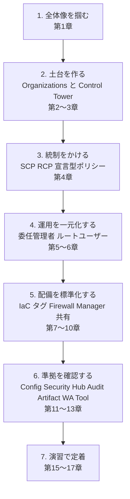

### 0.2 各章の構成

各 Skill の章は、次の 4 ステップで統一しています。

| ステップ | 内容 |
|---|---|
| Step 1 | **何のためのものか**(目的と解決する課題) |
| Step 2 | **仕組み**(用語、動作、制限事項) |
| Step 3 | **ベストプラクティス**(実務と試験の両方で重要な判断基準) |
| Step 4 | **試験での狙われ方**(紛らわしいポイント、ひっかけ) |

### 0.3 表記ルール

- 図解は Mermaid と Markdown の表のみを使用しています(ASCII 図は使っていません)。
- コード例はすべて言語指定付きのコードブロックです(シンタックスハイライト対象)。
- サービスの仕様は更新が速いため、各章末と第19章に **根拠となる公式ドキュメントの URL** を載せています。試験直前には必ず最新の公式情報も確認してください。

---

## 1. ドメイン6の全体像

### 1.1 このドメインで問われること

ドメイン6は **「たくさんのアカウントを、安全に、一貫したルールで運用する」** ための知識を問います。個別サービスの設定というより、**組織全体のガバナンス設計**が中心です。

公式試験ガイドでは、次の 3 つの Task に分かれています。

| Task | テーマ | Skill 数 | 一言で言うと |
|---|---|---|---|
| 6.1 | アカウントの一元的なデプロイと管理 | 5 | アカウントの「器」とルールを作る |
| 6.2 | リソースの安全で一貫したデプロイ | 4 | ルールに沿ったリソースを量産・配布する |
| 6.3 | リソースのコンプライアンス評価 | 3 | ルールを守れているか確認し、証拠を残す |

### 1.2 全 Skill 一覧と対応サービス

| Skill | 公式の記述(要約) | 主なサービス・機能 | 本ガイドの章 |
|---|---|---|---|
| 6.1.1 | Organizations のデプロイと設定 | AWS Organizations、OU、信頼されたアクセス | 第2章 |
| 6.1.2 | Control Tower の導入・管理、任意/カスタムコントロール | AWS Control Tower、ランディングゾーン、コントロール | 第3章 |
| 6.1.3 | 組織ポリシーによる権限管理 | SCP、RCP、AI サービスオプトアウトポリシー、宣言型ポリシー | 第4章 |
| 6.1.4 | セキュリティサービスの一元管理 | 委任管理者アカウント | 第5章 |
| 6.1.5 | ルートユーザー認証情報の管理 | ルートアクセスの一元管理、MFA、break-glass | 第6章 |
| 6.2.1 | IaC による一貫したデプロイ | CloudFormation StackSets、CloudFormation Guard、cfn-lint | 第7章 |
| 6.2.2 | タグによるグルーピング | タグポリシー、コスト配分タグ | 第8章 |
| 6.2.3 | 中央ソースからのポリシー・設定の強制 | AWS Firewall Manager | 第9章 |
| 6.2.4 | アカウント間の安全なリソース共有 | AWS Service Catalog、AWS RAM | 第10章 |
| 6.3.1 | 非準拠リソースの検出・修復・通知 | AWS Config、Security Hub | 第11章 |
| 6.3.2 | 監査証拠の収集と整理 | AWS Audit Manager、AWS Artifact | 第12章 |
| 6.3.3 | AWS ベストプラクティスへの準拠評価 | AWS Well-Architected Tool | 第13章 |

### 1.3 重要な前提: 「予防」「検出」「是正」の 3 層で考える

ガバナンスの仕組みはほとんどが次の 3 層のどれかに当てはまります。試験問題の選択肢を見たとき「これはどの層の対策か」を考えると、正解を絞り込みやすくなります。

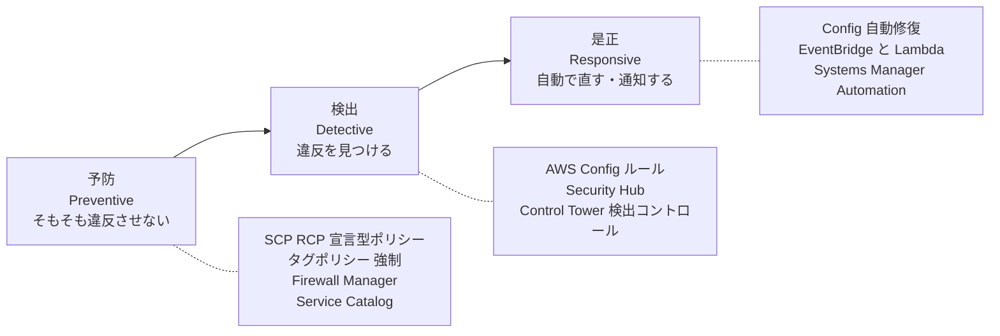

| 層 | 目的 | 代表的な手段 | 特徴 |
|---|---|---|---|
| 予防 | 違反操作そのものを不可能にする | SCP、RCP、宣言型ポリシー、CloudFormation Hooks(プロアクティブ)、Service Catalog | 強力だが、設定ミスで業務を止めるリスクがある |
| 検出 | 違反状態を見つけて可視化する | AWS Config、Security Hub、Control Tower の検出コントロール | 影響が小さい。違反は一度発生する |
| 是正 | 違反を自動で直す・担当者へ通知する | Config の修復アクション、EventBridge、Systems Manager Automation | 検出とセットで設計する |

### 1.4 共有責任モデルとの関係

- **AWS がクラウド「の」セキュリティ**(データセンター、ハードウェア、マネージドサービスの基盤)を担当します。
- **お客様がクラウド「における」セキュリティ**(アカウント設計、IAM、設定、データ)を担当します。
- 本ドメインは、お客様側の責任のうち **「複数アカウントをどう統治するか」** に当たります。AWS 側の証跡は AWS Artifact で取得できます(第12章)。

---

# Part A. Task 6.1 アカウントを一元的にデプロイ・管理する戦略

## 2. Skill 6.1.1 AWS Organizations の導入と設定

### Step 1. 何のためのものか

AWS では **「ワークロードごと・環境ごとにアカウントを分ける」** のが基本方針です。アカウントは AWS における最も強い分離境界(セキュリティ、請求、クォータ、障害の影響範囲)だからです。しかし、アカウントが増えると管理が大変になります。そこで **AWS Organizations** を使い、複数アカウントを 1 つの組織として束ねます。

Organizations でできることは次のとおりです。

| 機能 | 説明 |
|---|---|
| アカウントの一括作成・招待 | API やコンソールでメンバーアカウントを作成、または既存アカウントを招待 |
| OU(組織単位)による階層化 | アカウントをグループ化し、グループ単位でポリシーを適用 |
| 組織ポリシー | SCP、RCP、宣言型ポリシー、タグポリシー、バックアップポリシーなどを一括適用 |
| 一括請求(コンソリデーテッドビリング) | 利用料金を管理アカウントに集約、ボリュームディスカウントを共有 |
| 信頼されたアクセスと委任管理者 | 他の AWS サービスが組織全体で動作することを許可し、管理を専用アカウントへ委任 |

### Step 2. 仕組み

#### 2.1 基本用語

| 用語 | 意味 |
|---|---|
| 組織(Organization) | アカウントを束ねる全体の単位 |
| ルート(Root) | 組織階層の最上位のコンテナ(ルートユーザーとは別物) |
| OU | アカウントをまとめるフォルダのようなもの。入れ子にできる |
| 管理アカウント(Management account) | 組織を作成したアカウント。請求の支払者。**SCP・RCP の制限を受けない** |
| メンバーアカウント | 組織に所属するそれ以外のアカウント |
| 委任管理者 | 管理アカウントから特定サービスの管理権限を委任された、メンバーアカウント |

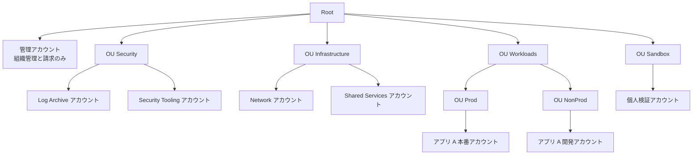

#### 2.2 「すべての機能」と「一括請求のみ」

組織には 2 つの機能セットがあります。

| 機能セット | できること | 注意 |
|---|---|---|
| 一括請求のみ(Consolidated billing) | 請求の一本化だけ | SCP、RCP、宣言型ポリシーなどの組織ポリシーは使えない |
| **すべての機能(All features)** | 一括請求 + 組織ポリシー + 信頼されたアクセス + 委任管理者 | **セキュリティ統制を行うなら必須**。RCP も All features の組織でのみ利用可能 |

> 試験ポイント: 「SCP が使えない」「RCP を有効化できない」という設問では、まず **All features が有効か** を疑います。

#### 2.3 アカウントの追加方法

| 方法 | 手順の概要 | 補足 |
|---|---|---|
| 新規作成 | Organizations の `CreateAccount`(またはコンソール、Control Tower の Account Factory) | 作成時に `OrganizationAccountAccessRole` が作られ、管理アカウントから引き受けて入れる |
| 既存アカウントの招待 | 招待を送り、相手が承諾 | 招待されたアカウントには `OrganizationAccountAccessRole` が自動作成されないため、手動で作成する |

#### 2.4 信頼されたアクセス(Trusted access)と委任管理者

多くのセキュリティサービス(GuardDuty、Security Hub、Config、Firewall Manager、CloudFormation StackSets など)は、**組織全体を対象に動くために信頼されたアクセスの有効化**が必要です。有効化すると、サービスが組織内のアカウントにサービスリンクロールを作成して動作できるようになります。

さらに、管理アカウントでそのサービスを運用し続けるのは避け、**メンバーアカウントを委任管理者として登録**します(詳細は第5章)。

```bash
# 例: 組織で GuardDuty の信頼されたアクセスを有効化し、委任管理者を登録する(管理アカウントで実行)
aws organizations enable-aws-service-access \
  --service-principal guardduty.amazonaws.com

aws organizations register-delegated-administrator \
  --account-id 111122223333 \
  --service-principal guardduty.amazonaws.com
```

> 上記は考え方を示す例です。サービスによっては、委任管理者の登録に専用 API(例: `guardduty enable-organization-admin-account`)を使います。

#### 2.5 OU 設計の考え方(推奨構成)

AWS Security Reference Architecture(SRA)や Organizing Your AWS Environment ホワイトペーパーの考え方では、次のように「機能ごと」に OU を分けます。

| OU の例 | 入れるアカウント | 目的 |
|---|---|---|
| Security | Log Archive、Security Tooling(監査用) | 監査ログの保管とセキュリティツールの運用 |
| Infrastructure | Network、Shared Services | ネットワーク(Transit Gateway など)と共通基盤 |
| Workloads(Prod / NonProd) | アプリケーションごとのアカウント | 環境ごとにポリシーの厳しさを変える |
| Sandbox | 検証用 | 予算上限と広めの権限、ただしガードレール付き |
| Policy Staging | ポリシーの試験用 | 新しい SCP や RCP を本番 OU へ適用する前に影響を確認 |
| Suspended | 閉鎖予定のアカウント | すべて拒否する SCP を適用して隔離 |

### Step 3. ベストプラクティス

| # | ベストプラクティス | 理由 |
|---|---|---|
| 1 | **管理アカウントにワークロードを置かない**(組織管理と請求だけに使う) | 管理アカウントは SCP・RCP の対象外であり、侵害時の影響が最大になる |
| 2 | OU は **組織図ではなく「セキュリティ要件・機能」** で分ける | 部署異動で構造が壊れず、ポリシーが分かりやすい |
| 3 | OU の階層を深くしすぎない(5 階層が上限) | SCP の評価経路が複雑になり、トラブルシュートが難しくなる |
| 4 | ポリシーは **個別アカウントではなく OU にアタッチ** する | アカウント移動時にポリシーが自動で追随する |
| 5 | 新しい SCP・RCP は **テスト用 OU → 下位 OU → 上位** の順に段階展開し、CloudTrail の AccessDenied を確認する | ルートに直接アタッチして業務を止める事故を防ぐ |
| 6 | 組織全体の証跡(組織の CloudTrail)を **Log Archive アカウント**に集約 | 改ざん耐性と監査性を確保 |
| 7 | 管理アカウントのルートユーザーは MFA 必須、メールは共有メールボックス、IAM ユーザーは作らず IAM Identity Center を使う | 最重要アカウントの保護 |
| 8 | メンバーアカウントの作成は **自動化**(Control Tower の Account Factory、または IaC) | ベースライン設定の漏れを防ぐ |

### Step 4. 試験での狙われ方

- 「管理アカウントに SCP を適用したが効かない」→ **管理アカウントは SCP/RCP の対象外**。そもそも管理アカウントを使わない設計にする。
- 「組織内の全アカウントへ同じ設定を一括適用したい」→ まず **OU 構造とポリシーのアタッチ位置**を考える。
- 「サービスを組織全体で有効化したい」→ **信頼されたアクセス + 委任管理者**。
- 「招待したアカウントに OrganizationAccountAccessRole が無い」→ 招待参加のアカウントには自動作成されない。

### 参考 URL(根拠)

- AWS Organizations ユーザーガイド: https://docs.aws.amazon.com/organizations/latest/userguide/orgs_introduction.html
- 管理アカウントのベストプラクティス: https://docs.aws.amazon.com/organizations/latest/userguide/orgs_best-practices_mgmt-acct.html
- AWS Security Reference Architecture(Org Management アカウント): https://docs.aws.amazon.com/prescriptive-guidance/latest/security-reference-architecture/org-management.html

---

## 3. Skill 6.1.2 AWS Control Tower

### Step 1. 何のためのものか

Organizations は「器」を作りますが、**どんなアカウント構成・ログ・ガードレールを入れるか**は自分で設計する必要があります。**AWS Control Tower** は、ベストプラクティスに沿ったマルチアカウント環境(ランディングゾーン)を自動構築し、継続的にガバナンスする仕組みです。

公式の説明では、ランディングゾーンは Organizations、IAM Identity Center、AWS Config、AWS CloudTrail、AWS Backup などの統合で成り立ち、**新規または既存の組織**にデプロイできます。

### Step 2. 仕組み

#### 2.1 ランディングゾーンの構成要素

| 要素 | 説明 |
|---|---|
| ランディングゾーン | ベストプラクティスに沿ったマルチアカウント環境。組織ごとに 1 つ |
| 共有アカウント | 管理アカウントに加え、**Log Archive** と **Audit**(監査)アカウントが作られる(既存アカウントを指定することも可能) |
| OU | Security OU などの基本 OU が作られ、追加の OU も登録できる |
| コントロール(旧ガードレール) | OU に適用する統制ルール |
| Account Factory | 標準化されたアカウントを払い出す仕組み(Service Catalog 連携。Account Factory for Terraform や Customizations も利用可能) |
| IAM Identity Center | 既定のシングルサインオン基盤 |

#### 2.2 コントロールの種類(最重要)

コントロールは **「どう動くか(behavior)」**と **「推奨度(guidance)」** の 2 つの軸で分類されます。

**軸1: behavior(動作)**

| 種類 | 実装手段 | 効果 | 例 |
|---|---|---|---|
| 予防(Preventive) | **SCP**(一部は RCP) | 違反操作を**拒否**する。違反は発生しない | CloudTrail の無効化を禁止 |
| 検出(Detective) | **AWS Config ルール** | 違反を**検出**して報告する(止めない) | 暗号化されていない EBS ボリュームを検出 |
| プロアクティブ(Proactive) | **CloudFormation Hooks** | **デプロイ前**に CloudFormation テンプレートを検査し、非準拠なら**デプロイをブロック** | 公開 S3 バケットを作るテンプレートを拒否 |

**軸2: guidance(推奨度)**

| 種類 | 意味 |
|---|---|
| 必須(Mandatory) | **常時有効**。Control Tower が自動で適用する。無効化できない |
| 強く推奨(Strongly recommended) | 任意。AWS のベストプラクティスに基づく |
| 選択的(Elective) | 任意。多くの企業が利用するが、必須ではない |

> 覚え方: 予防=SCP、検出=Config、プロアクティブ=CloudFormation Hooks。**「デプロイ前に止める」ならプロアクティブ、「既存リソースの違反を見つける」なら検出、「操作自体を拒否」なら予防**。

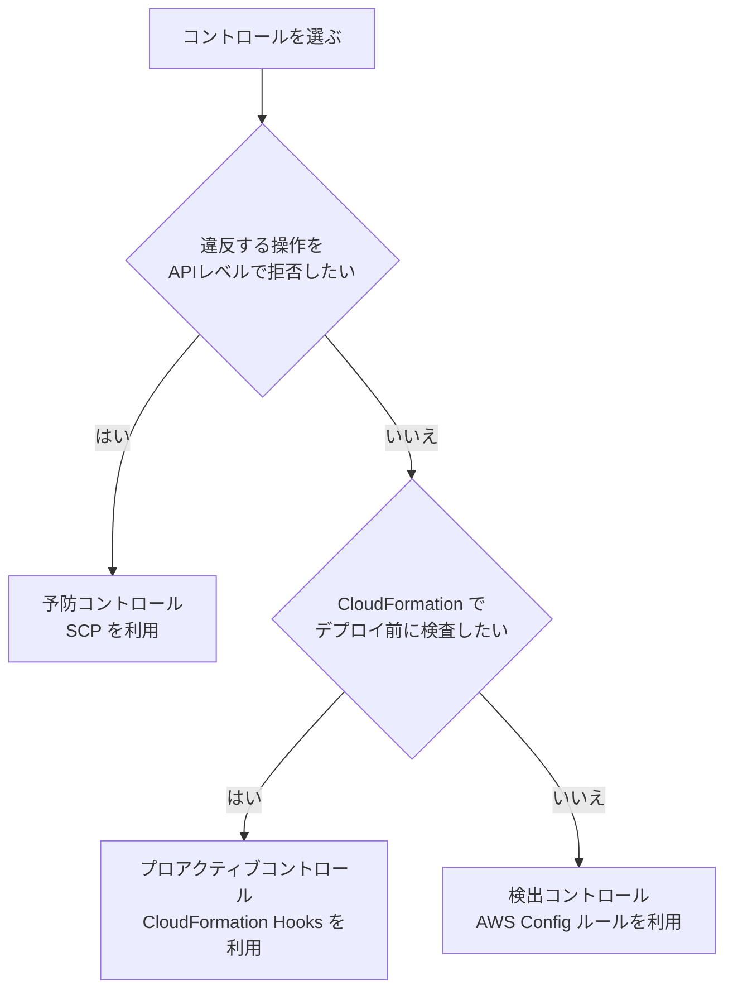

#### 2.3 ランディングゾーン設定時に自動で行われること

公式ドキュメントによると、ランディングゾーンを設定すると Control Tower は管理アカウント上で次を実行します。

- すべての**必須の予防コントロール**を適用する
- すべての**必須の検出コントロール**を適用する
- **予防コントロールは管理アカウントには適用されない**(SCP と同じ性質)

また、Control Tower は既定で **CloudFormation StackSets** を使って各アカウントにリソースを展開します。

#### 2.4 新規環境と既存環境での導入

| ケース | 方法 | ポイント |
|---|---|---|
| 新規組織 | Control Tower をセットアップしてランディングゾーンを作成 | 最も簡単。共有アカウントが新規作成される |
| **既存の組織** | 既存の Organizations 上に Control Tower を導入し、既存の OU とアカウントを**登録(Register OU / Enroll account)** する | 既存アカウントには事前に前提条件(AWS Config のレコーダー設定の競合解消、必要な IAM ロール等)が必要。登録後は Control Tower の管理対象になる |
| コントロールだけ使いたい | **ランディングゾーンなしで**組織にコントロールを有効化(公式の説明に「ランディングゾーンを設定せずにコントロールの有効化を開始できる」旨の記載あり) | 既存の統制基盤を活かしつつ、マネージドなコントロールだけ使う |

> 既存アカウントを登録する前に、既存の AWS Config レコーダーや配信チャネルとの競合を整理する必要があります。詳細な前提条件は最新の公式手順を確認してください。

#### 2.5 任意コントロールとカスタムコントロールのデプロイ

| 目的 | 手段 |
|---|---|
| 任意コントロールを有効化 | コンソールのコントロールライブラリで OU を選んで有効化(API / CLI / CloudFormation でも可能) |
| データ所在地(Data residency)の制御 | 任意の Data residency コントロールで、データを保管・アクセスできる Region を制限 |
| セキュリティ基準の自動チェック | 統合された **Security Hub CSPM 標準**に基づく任意コントロール |
| デプロイ前チェック | 任意の**プロアクティブ**コントロール(CloudFormation Hooks) |
| 組織固有ルール | **カスタムの SCP / RCP** や **カスタム Config ルール**、独自の CloudFormation Hooks を OU へ展開(Control Tower と併用して運用) |
| アカウントごとのカスタマイズ | **Account Factory Customization(AFC)**、**Account Factory for Terraform(AFT)**、**Customizations for AWS Control Tower(CfCT)** |

#### 2.6 ドリフトと更新

- 管理対象リソースを手動で変更すると **ドリフト** が発生します。Control Tower はドリフトを検出し、**ランディングゾーンの更新・OU の再登録**で修復します。
- ランディングゾーンには**バージョン**があり、新バージョンへ更新できます。Region の追加・削除や、組織レベルの CloudTrail 証跡の有効/無効の選択も更新時に変更できます。

### Step 3. ベストプラクティス

| # | ベストプラクティス | 理由 |
|---|---|---|
| 1 | Control Tower が作成・管理するリソース(StackSet、IAM ロール、Config 設定など)を**手動で変更しない** | ドリフトの原因。修復に時間がかかる |
| 2 | **ガバナンス対象の Region を明示的に選択**し、使わない Region は Region 拒否コントロールで制限 | 攻撃面の縮小とデータ所在地の遵守 |
| 3 | 強く推奨コントロールを**まず検出モードで運用**し、影響を確認してから予防に進める | 段階展開で業務停止を防ぐ |
| 4 | Account Factory で**アカウントのベースライン(IAM、ネットワーク、ログ)を自動化** | 手作業による設定漏れを防ぐ |
| 5 | カスタムの SCP・Config ルールは、Control Tower のコントロールと**重複しないよう整理** | SCP のサイズ・個数上限に注意 |
| 6 | 組織レベルの CloudTrail 証跡を使い、**ログは Log Archive アカウントに集約** | 一元的な監査証跡 |
| 7 | Control Tower と Organizations は**併用**する(Control Tower は Organizations の上に載る) | 役割が異なるため、片方で他方を置き換えない |

### Step 4. 試験での狙われ方

| 問われ方 | 答え |
|---|---|
| 「CloudFormation のデプロイ前にリソース設定を検査したい」 | **プロアクティブコントロール**(CloudFormation Hooks) |
| 「既存の組織に統制を追加し、新規アカウントも自動で標準化したい」 | Control Tower を既存組織へ導入、OU 登録、Account Factory |
| 「特定 Region の利用を禁止したい」 | Region 拒否(予防コントロール = SCP) |
| 「管理アカウントでコントロールが効かない」 | **予防コントロールは管理アカウントに適用されない** |
| 「必須コントロールを無効にしたい」 | **不可**(必須は常時有効) |
| 「Control Tower と Organizations の違い」 | Organizations=基盤(器・ポリシー)、Control Tower=その上に載るベストプラクティスの自動化と継続ガバナンス |

### 参考 URL(根拠)

- AWS Control Tower とは(動作の仕組み): https://docs.aws.amazon.com/controltower/latest/userguide/how-control-tower-works.html
- ランディングゾーンのカスタマイズ: https://docs.aws.amazon.com/controltower/latest/userguide/console-customize.html
- コントロールによるリソース統制(Prescriptive Guidance): https://docs.aws.amazon.com/prescriptive-guidance/latest/designing-control-tower-landing-zone/controls.html
- AWS Control Tower の機能: https://aws.amazon.com/controltower/features

---

## 4. Skill 6.1.3 組織ポリシー(SCP / RCP / AI オプトアウト / 宣言型)

### Step 1. 何のためのものか

アカウントが増えても、「このアカウントではこの操作を許さない」「組織外の人にデータを渡さない」といったルールを**一か所で定義して全アカウントに効かせたい**。これが組織ポリシーの役割です。Organizations の組織ポリシーは大きく 2 系統に分かれます。

| 系統 | ポリシー | 何を決めるか |
|---|---|---|
| **認可ポリシー**(Authorization policies) | **SCP**(サービスコントロールポリシー) | **プリンシパル**(IAM ユーザー/ロール)が使える最大権限 |
| | **RCP**(リソースコントロールポリシー) | **リソース**に対して許される最大権限 |
| **管理ポリシー**(Management policies) | **宣言型ポリシー** | AWS サービスの**あるべき設定状態**を強制 |
| | AI サービスオプトアウトポリシー | AI サービスによるコンテンツの保存・利用の可否 |
| | タグポリシー | タグのキー・値の標準化 |
| | バックアップポリシー | AWS Backup のバックアップ計画の一括適用 |
| | Chat applications ポリシー | Slack / Teams 等のチャット連携の制御 |

> 試験の Skill 6.1.3 は「SCP、RCP、AI サービスオプトアウトポリシー、宣言型ポリシーなど」と明記しています。まずこの 4 つを確実に区別できるようにしましょう。

### Step 2. 仕組み

#### 2.1 SCP(サービスコントロールポリシー)

**SCP は権限を「与える」のではなく、「使える範囲の上限(ガードレール)」を決める**ポリシーです。

| 項目 | 内容 |
|---|---|
| 制御対象 | メンバーアカウントの **IAM ユーザー・IAM ロール・メンバーアカウントのルートユーザー** |
| 対象外 | **管理アカウント**の全プリンシパル、**サービスリンクロール**、組織外のプリンシパル(組織外から自分のリソースへのアクセスは SCP では制御できない) |
| 権限の付与 | しない。SCP で許可されていても、IAM ポリシー等で許可されなければアクセスできない |
| 実効権限 | **SCP の許可 ∩ IAM(アイデンティティベース / リソースベース)の許可**。さらに親 OU からルートまですべての階層で許可されていることが必要 |
| 既定 | 組織作成時は `FullAWSAccess` がルート・OU・アカウントにアタッチされている |

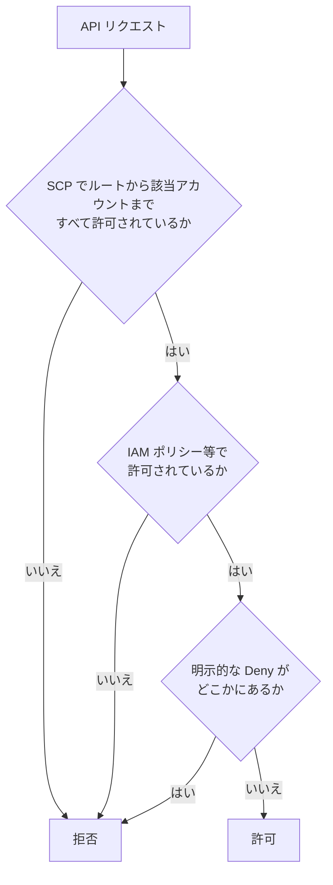

**戦略: 拒否リスト方式 vs 許可リスト方式**

| 方式 | 構成 | 長所 | 短所 |
|---|---|---|---|
| **拒否リスト(Deny list)** | `FullAWSAccess` を残したまま、禁止したい操作を `Deny` する SCP を追加 | 運用が楽。新サービスも自動的に使える | 禁止し忘れたものは使えてしまう |
| **許可リスト(Allow list)** | `FullAWSAccess` を外し、許可するサービスだけを `Allow` する SCP を明示 | 厳格 | 新サービスのたびに更新が必要。運用が重い |

**一般に推奨されるのは拒否リスト方式**です(`FullAWSAccess` を維持し、Deny で絞る)。

**SCP の例 1: Region を限定する(グローバルサービスを除外)**

```json
{
  "Version": "2012-10-17",
  "Statement": [
    {
      "Sid": "DenyOutsideApprovedRegions",
      "Effect": "Deny",
      "NotAction": [
        "iam:*",
        "organizations:*",
        "route53:*",
        "cloudfront:*",
        "support:*",
        "budgets:*"
      ],
      "Resource": "*",
      "Condition": {
        "StringNotEquals": {
          "aws:RequestedRegion": ["ap-northeast-1", "ap-northeast-3"]
        }
      }
    }
  ]
}
```

**SCP の例 2: 管理者ロール以外による CloudTrail の停止・削除を禁止**

```json
{
  "Version": "2012-10-17",
  "Statement": [
    {
      "Sid": "ProtectCloudTrail",
      "Effect": "Deny",
      "Action": [
        "cloudtrail:StopLogging",
        "cloudtrail:DeleteTrail",
        "cloudtrail:UpdateTrail"
      ],
      "Resource": "*",
      "Condition": {
        "ArnNotLike": {
          "aws:PrincipalArn": "arn:aws:iam::*:role/SecurityBreakGlassRole"
        }
      }
    }
  ]
}
```

**SCP の例 3: メンバーアカウントのルートユーザーによる操作を拒否**

```json
{
  "Version": "2012-10-17",
  "Statement": [
    {
      "Sid": "DenyRootUserActions",
      "Effect": "Deny",
      "Action": "*",
      "Resource": "*",
      "Condition": {
        "StringLike": {
          "aws:PrincipalArn": "arn:aws:iam::*:root"
        }
      }
    }
  ]
}
```

> 注意: 例 3 を適用すると、ルートユーザー専用の操作もできなくなります。**集中ルートアクセス管理(第6章)** を導入して `sts:AssumeRoot` の特権セッションで必要な作業を行う運用とセットで検討します。

#### 2.2 RCP(リソースコントロールポリシー)

RCP は **「リソース側」から最大権限を縛る**ポリシーです。SCP が「自分たちのプリンシパルが何をできるか」を決めるのに対し、RCP は「自分たちのリソースに**誰が**(組織外も含めて)何をできるか」を決めます。

| 項目 | SCP | RCP |
|---|---|---|
| 何に対する上限か | プリンシパル(IAM ユーザー/ロール) | リソース |
| 典型的な目的 | 自組織のユーザーの操作を制限 | **組織外のプリンシパル**による自組織リソースへのアクセスを制限(データ境界) |
| 組織外のプリンシパルからのリクエスト | 制御できない | **制御できる**(RCP の主な用途) |
| 権限を付与するか | しない | しない |
| 管理アカウントへの効果 | なし | **管理アカウントのリソースには効かない**(メンバーアカウントのリソースのみ対象) |
| サービスリンクロールへの効果 | なし | なし(制限できない) |
| 対応サービス | ほぼ全サービス | **一部のサービスのみ** |
| 利用条件 | All features が有効な組織 | All features が有効な組織 |

公式ドキュメントで確認できる RCP 対応サービスには、Amazon S3、AWS KMS、AWS STS、Amazon SQS、AWS Secrets Manager、Amazon DynamoDB、Amazon ECR、Amazon CloudWatch Logs、Amazon OpenSearch Service / Serverless、Amazon Cognito、AWS CodeArtifact などがあります。**対応サービスは追加され続けている**ため、最新の一覧は必ず公式の「List of AWS services that support RCPs」で確認してください。

> RCP は **AWS マネージドキー(KMS)** や **`kms:RetireGrant`** には効きません。また、**サービスリンクロール**は RCP で制限できません。

**RCP の例: 組織外のプリンシパルからの S3 アクセスを拒否(データ境界)**

```json
{
  "Version": "2012-10-17",
  "Statement": [
    {
      "Sid": "EnforceOrgIdentities",
      "Effect": "Deny",
      "Principal": "*",
      "Action": "s3:*",
      "Resource": "*",
      "Condition": {
        "StringNotEqualsIfExists": {
          "aws:PrincipalOrgID": "o-exampleorgid"
        },
        "BoolIfExists": {
          "aws:PrincipalIsAWSService": "false"
        }
      }
    }
  ]
}
```

> 例では、AWS のサービスが自分のために行う呼び出し(例: CloudTrail が S3 へ書き込む)を巻き込まないよう `aws:PrincipalIsAWSService` を併用しています。本番適用前に必ず検証用 OU でテストします。

**RCP の例: S3 へのアクセスを HTTPS のみに強制**

```json
{
  "Version": "2012-10-17",
  "Statement": [
    {
      "Sid": "EnforceSecureTransport",
      "Effect": "Deny",
      "Principal": "*",
      "Action": ["s3:*"],
      "Resource": "*",
      "Condition": {
        "BoolIfExists": {
          "aws:SecureTransport": "false"
        }
      }
    }
  ]
}
```

#### 2.3 宣言型ポリシー(Declarative policies)

宣言型ポリシーは **API の許可/拒否ではなく、サービスの「あるべき設定」を宣言して強制**するポリシーです。公式ドキュメントの説明では、次の特徴があります。

| 特徴 | 内容 |
|---|---|
| 強制の場所 | **サービスのコントロールプレーン**(IAM の認可フローではない) |
| 持続性 | サービスが新しい機能や API を追加しても、**ベースライン設定は維持される**(Set once and forget) |
| 新規アカウント | 組織に参加したアカウントは自動で継承する |
| サービスリンクロール | **対象になる**(SCP/RCP は対象外) |
| 可視化 | **アカウントステータスレポート**で、対象属性の現在の状態を確認できる |
| ユーザー体験 | **カスタムエラーメッセージ**を設定でき、社内 wiki への誘導などができる |
| 取り外し | ポリシーをデタッチすると、属性の状態は**アタッチ前の状態に戻る** |
| 適用単位 | 組織全体、OU、アカウント |

例: 「VPC リソースへのパブリックインターネットアクセスをブロック」「VPC の暗号化(転送中)を強制」「許可された AMI(Allowed Images Settings)のみ使用可能にする」「EBS スナップショットの公開をブロック」などです。公式ドキュメントのページには、EC2、VPC、EBS をはじめ、S3、GuardDuty、Inspector、Security Hub、Bedrock などの項目が掲載されており、**対応範囲は拡大中**です。

**3 つの違い(最重要)**

| | SCP | RCP | 宣言型ポリシー |
|---|---|---|---|
| 目的 | プリンシパルの最大権限を管理 | リソースの最大権限を管理 | サービスの**ベースライン設定**を強制 |
| 仕組み | API レベルでの許可/拒否 | API レベルでの許可/拒否 | **コントロールプレーンで設定を強制**(API を使わない) |
| 新機能・新 API への追従 | 新 API は明示的に Deny を書く必要がある | 同左 | **自動的に維持される** |
| サービスリンクロール | 対象外 | 対象外 | **対象** |
| 例 | メンバーアカウントがOrganizationsから離脱するのを拒否 | HTTPS 接続以外の拒否 | 許可された AMI のみ |

#### 2.4 AI サービスオプトアウトポリシー

AWS の一部の AI サービス(例: Amazon Rekognition、Comprehend、Transcribe、Textract、Translate など)は、**サービス改善のためにお客様のコンテンツを保存・利用する**ことがあります。**AI サービスオプトアウトポリシー**は、組織全体でこの利用を**オプトアウト**する設定を一括適用する、**管理ポリシー**です。

| 項目 | 内容 |
|---|---|
| 目的 | AI サービスがコンテンツを保存・サービス改善に利用することを、組織単位で拒否 |
| 適用単位 | ルート、OU、アカウント(継承) |
| 設定対象 | サービスごと、または全サービス(`default`)。`optOut` / `optIn` |
| 用途 | 機密データ・個人情報を扱う組織のプライバシー要件、規制対応 |

```json
{
  "services": {
    "@@operators_allowed_for_child_policies": ["@@none"],
    "default": {
      "@@operators_allowed_for_child_policies": ["@@none"],
      "opt_out_policy": {
        "@@operators_allowed_for_child_policies": ["@@none"],
        "@@assign": "optOut"
      }
    }
  }
}
```

> `@@operators_allowed_for_child_policies` を `@@none` にすると、子の OU・アカウントでの上書きを禁止できます。

#### 2.5 ポリシー継承の仕組み

- 認可ポリシー(SCP/RCP)は、**ルート → OU → アカウント** のすべての階層で許可されている権限の**共通部分**だけが有効です。
- 管理ポリシー(宣言型、タグ、バックアップ、AI オプトアウトなど)は**継承演算子**(`@@assign`、`@@append`、`@@remove`、`@@operators_allowed_for_child_policies` など)で親子のマージ方法を制御し、**有効ポリシー(Effective policy)** を確認できます。

### Step 3. ベストプラクティス

| # | ベストプラクティス | 理由 |
|---|---|---|
| 1 | **SCP は拒否リスト方式**を基本にする(`FullAWSAccess` を残す) | 運用負荷が小さい。許可リスト方式は新サービス追従が必要 |
| 2 | SCP・RCP は **ルートに直接アタッチせず、テスト OU から順に**展開。CloudTrail の AccessDenied で影響を確認 | 公式も強く推奨 |
| 3 | 設定を縛る目的なら **宣言型ポリシーを優先**し、足りない部分だけ SCP/RCP で補う | 新機能追加時の迂回を防げる。管理が簡単 |
| 4 | 組織外へのデータ流出対策は **RCP + `aws:PrincipalOrgID`** で**データ境界**を作る | SCP では組織外プリンシパルを制御できない |
| 5 | **承認済みの例外ロール**(break-glass、セキュリティ運用ロール)は `aws:PrincipalArn` 条件で SCP から除外 | 緊急時の対応を妨げない |
| 6 | SCP のサイズ・アタッチ数の上限を考慮し、**ステートメントを統合**する(Control Tower の SCP と合算) | 上限超過を防ぐ |
| 7 | 「Region 制限」では**グローバルサービスを `NotAction` で除外** | IAM、Route 53、CloudFront などが止まるのを避ける |
| 8 | タグポリシー・バックアップポリシー・AI オプトアウトは、**子による上書きを禁止**する演算子を適切に使う | ガバナンスの抜け穴を防ぐ |
| 9 | ポリシーの変更履歴は **CloudTrail** で監査する | 宣言型ポリシーなどの作成・更新・削除も監査可能 |

### Step 4. 試験での狙われ方

| 問われ方 | 答え |
|---|---|
| 「組織外のアカウントが、自社の S3 バケットにアクセスできないようにしたい(バケットポリシーに関係なく)」 | **RCP**(`aws:PrincipalOrgID` 条件) |
| 「全メンバーアカウントで特定 API を使えなくしたい」 | **SCP** |
| 「新しい API が追加されても、パブリック AMI の公開設定が常にブロックされるようにしたい」 | **宣言型ポリシー** |
| 「AI サービスにコンテンツを保存・利用させたくない」 | **AI サービスオプトアウトポリシー** |
| 「SCP を管理アカウントに適用した」 | **効かない**。管理アカウントは対象外 |
| 「SCP でサービスリンクロールを制限できるか」 | できない(SCP/RCP とも対象外。**宣言型は対象**) |
| 「SCP が許可しているのにアクセスできない」 | SCP は権限を付与しない。IAM 側の許可も必要 |
| 「RCP が効かないサービスがある」 | 対応サービスは一部のみ。未対応なら SCP や `aws:PrincipalOrgID` 付きリソースポリシーで補完 |
| 「RCP を有効化できない」 | 組織が All features になっているか確認 |

### 参考 URL(根拠)

- 宣言型ポリシー: https://docs.aws.amazon.com/organizations/latest/userguide/orgs_manage_policies_declarative.html
- RCP(対応サービス一覧・動作): https://docs.aws.amazon.com/organizations/latest/userguide/orgs_manage_policies_rcps.html
- SCP: https://docs.aws.amazon.com/organizations/latest/userguide/orgs_manage_policies_scps.html
- AI サービスオプトアウトポリシー: https://docs.aws.amazon.com/organizations/latest/userguide/orgs_manage_policies_ai-opt-out.html
- 予防的統制の実装(SCP / RCP / 宣言型ポリシー): https://aws.amazon.com/blogs/mt/enforcing-enterprise-wide-preventive-controls-with-aws-organizations
- SCP / RCP のサンプル集: https://github.com/aws-samples/service-control-policy-examples , https://github.com/aws-samples/resource-control-policy-examples

---

## 5. Skill 6.1.4 セキュリティサービスの一元管理(委任管理者)

### Step 1. 何のためのものか

GuardDuty、Security Hub、AWS Config などのセキュリティサービスは、**組織内のすべてのアカウント・Region を一か所で管理**できます。ただし、これらを管理アカウントで運用してしまうと、管理アカウントに多くの運用者が必要になり、侵害時の影響も大きくなります。

そこで、**管理アカウントはサービスの有効化と委任だけ**を行い、**日々の運用は専用のメンバーアカウント(委任管理者)** で行う、という設計にします。

### Step 2. 仕組み

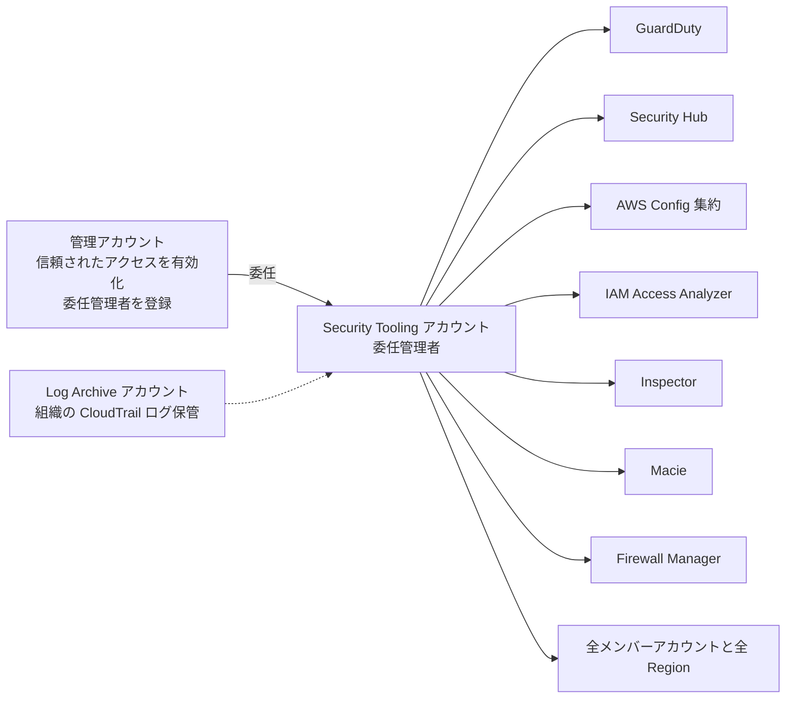

#### 2.1 委任管理者に任せられる主なサービス

| サービス | 委任管理者の役割 | 補足 |
|---|---|---|
| Amazon GuardDuty | 組織内の全アカウントで自動有効化、検出結果の集約 | 新規アカウントは自動で有効化できる |
| AWS Security Hub | 設定ポリシー(central configuration)で標準・コントロールを一括適用、Region 集約 | CSPM の設定ポリシーは委任管理者が作成 |
| AWS Config | 組織の**アグリゲーター**でマルチアカウント・マルチ Region のデータを集約、組織の適合パックのデプロイ | アグリゲーターは委任管理者から作成可能 |
| Amazon Inspector | 脆弱性スキャンを組織全体で有効化 | |
| Amazon Macie | 機密データ検出を組織全体で管理 | |
| IAM Access Analyzer | 組織レベルのアナライザーで外部アクセスや未使用アクセスを検出 | 信頼ゾーン = 組織 |
| AWS Firewall Manager | 組織全体の WAF / Shield / SG / ネットワークファイアウォールのポリシー管理 | 管理アカウントが初期管理者、その後委任 |
| CloudFormation StackSets | サービスマネージド StackSets を委任管理者から作成 | |
| AWS Audit Manager | 組織全体の評価を一元管理 | 新規利用不可(第12章) |
| IAM(ルートアクセス管理) | 集中ルートアクセスの管理を委任 | 第6章 |
| AWS Systems Manager、AWS Backup、IAM Identity Center など | 各サービスの組織管理を委任 | 対応状況はサービスごとに確認 |

> 実際の委任可否と API は、サービスごとに異なります。最新の「Organizations と連携する AWS サービス」のページ(`orgs_integrate_services`)で確認してください。

#### 2.2 推奨するセキュリティ系アカウント構成(SRA)

| アカウント | 役割 | 置くもの |
|---|---|---|
| 管理アカウント | 組織管理・請求・SCP/RCP の管理 | 最小限(ワークロードを置かない) |
| **Log Archive** | ログの不変・長期保管 | 組織の CloudTrail、Config の配信先 S3、VPC フローログ |
| **Security Tooling(Audit)** | 検出・監査の運用 | GuardDuty / Security Hub / Config アグリゲーター / Access Analyzer などの委任管理者 |
| Security Forensics(任意) | インシデント時の調査環境 | 隔離された調査用リソース |

> 補足: Control Tower の共有アカウントの 1 つは **Audit アカウント**です。SRA の Security Tooling アカウントと役割が重なるため、「Audit = セキュリティツールの委任管理者を置く場所」として設計することが多いです。

#### 2.3 設定の流れ(例: 全アカウント・全 Region に GuardDuty を展開)

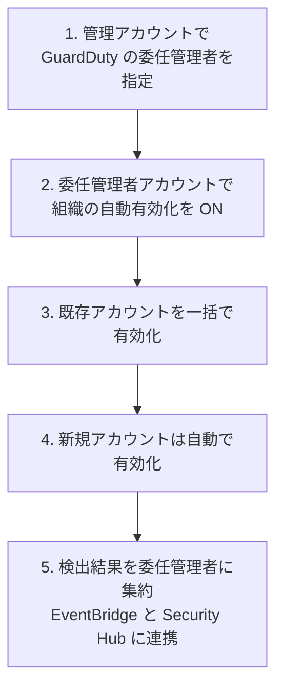

```bash
# 管理アカウントで委任管理者を指定(GuardDuty の例)
aws guardduty enable-organization-admin-account \
  --admin-account-id 222233334444

# 委任管理者アカウントで、新規メンバーを自動的に有効化
aws guardduty update-organization-configuration \
  --detector-id <detector-id> \
  --auto-enable-organization-members ALL
```

### Step 3. ベストプラクティス

| # | ベストプラクティス | 理由 |
|---|---|---|
| 1 | 管理アカウントは**有効化と委任のみ**に使う | 最重要アカウントの権限使用を最小化 |
| 2 | **サービスごとに分散せず、Security Tooling アカウントに集約**する(同じ委任管理者に統一) | 運用・権限管理がシンプルになり、相関分析もしやすい |
| 3 | **新規アカウントの自動有効化**を ON にする | アカウント追加時の漏れを防ぐ |
| 4 | **すべての Region** で有効化する(使わない Region も) | 攻撃者は使われていない Region を狙うため |
| 5 | ログは **Log Archive アカウント**へ集約し、S3 バケットは Object Lock、KMS 暗号化、削除防止の SCP で保護 | 証跡の改ざん対策 |
| 6 | 委任管理者アカウントへのアクセスは**最小権限・MFA 必須・変更監視** | 侵害されると全アカウントのセキュリティ設定が操作できるため |
| 7 | 委任管理者アカウントを**SCP で保護**(誤ってサービスを無効化できないようにする) | 設定の無効化・削除を防ぐ |

### Step 4. 試験での狙われ方

| 問われ方 | 答え |
|---|---|
| 「全アカウントの GuardDuty 結果を一か所で確認したい」 | 委任管理者(Security Tooling アカウント)に集約 |
| 「管理アカウントにセキュリティ運用者を入れたくない」 | **委任管理者**に運用を任せる |
| 「新しいアカウントが作られたら自動でセキュリティサービスを有効化したい」 | 組織の**自動有効化**設定 |
| 「委任管理者は何個のアカウントか」 | サービスごとに登録可(サービスによって上限や制約が異なる)。**考え方としては 1 つのセキュリティ専用アカウントに統一**する |
| 「信頼されたアクセスが有効でない」 | まず Organizations 側で `enable-aws-service-access` |

### 参考 URL(根拠)

- Organizations と連携する AWS サービス(信頼されたアクセス・委任管理者): https://docs.aws.amazon.com/organizations/latest/userguide/orgs_integrate_services.html
- SRA(Security Tooling アカウント): https://docs.aws.amazon.com/prescriptive-guidance/latest/security-reference-architecture/security-tooling.html
- SRA(Log Archive アカウント): https://docs.aws.amazon.com/prescriptive-guidance/latest/security-reference-architecture/log-archive.html
- Organizations ベストプラクティス: https://docs.aws.amazon.com/organizations/latest/userguide/orgs_best-practices.html

---

## 6. Skill 6.1.5 ルートユーザー認証情報の管理

### Step 1. 何のためのものか

AWS アカウントのルートユーザーは、**そのアカウントのすべてのリソース・設定に制限なくアクセス**できます(IAM ポリシーでは制限できません。SCP の対象にはなりますが、メンバーアカウントのみ)。何百ものアカウントがあれば、**ルートユーザーも何百個**存在し、それぞれの認証情報(パスワード・アクセスキー・MFA)を守る必要があります。これが大きな負担と攻撃面になります。

そこで AWS は次の 2 つの方針を提示しています。

1. **日常の操作にルートユーザーを使わない**(IAM Identity Center などを使う)
2. **メンバーアカウントのルート認証情報そのものを無くし、必要時だけ「集中ルートアクセス」で特権作業を行う**

### Step 2. 仕組み

#### 2.1 ルートユーザーが本当に必要な作業

ルートユーザー専用の作業は限られています(例: アカウント名・メールアドレスの変更、アカウントの閉鎖、サポートプランの変更、**全アクセス拒否のバケットポリシーの修復**など)。

#### 2.2 集中ルートアクセス管理(Centralized root access)

Organizations の管理アカウント(または委任管理者)から、**メンバーアカウントのルート認証情報を管理**し、**短期の、タスク範囲を限定した特権セッション**でルート操作を行える機能です。

**2 つの機能(個別に有効化)**

| 機能 | 目的 |
|---|---|
| **ルート認証情報の管理**(Root credentials management) | メンバーアカウントのルート認証情報(パスワード・アクセスキー・署名証明書・MFA)を**確認・削除**し、**ルートのパスワード回復も禁止**できる |
| **ルートセッション**(Root sessions) | メンバーアカウントで `sts:AssumeRoot` を呼び、**限定されたルート特権セッション**を取得できる |

有効化の例(管理アカウントで実行)です。

```bash
# 信頼されたアクセスの有効化
aws organizations enable-aws-service-access \
  --service-principal iam.amazonaws.com

# 2 つの機能を有効化
aws iam enable-organizations-root-credentials-management
aws iam enable-organizations-root-sessions
```

**ルートセッションで行える特権タスク(タスクポリシー)**

| タスクポリシー(`arn:aws:iam::aws:policy/root-task/...`) | できること |
|---|---|
| `IAMAuditRootUserCredentials` | メンバーアカウントのルート認証情報の状況を**監査**(読み取り) |
| `IAMCreateRootUserPassword` | ルートユーザーのパスワードを作成(復旧用) |
| `IAMDeleteRootUserCredentials` | ルートのパスワード、アクセスキー、署名証明書、MFA を**削除** |
| `S3UnlockBucketPolicy` | **全アクセスを拒否**している S3 バケットポリシーを削除して復旧 |
| `SQSUnlockQueuePolicy` | **全アクセスを拒否**している SQS キューポリシーを削除して復旧 |

```bash
# メンバーアカウントのルート特権セッションを取得(S3 バケットポリシーの復旧の例)
aws sts assume-root \
  --target-principal 123456789012 \
  --task-policy-arn arn=arn:aws:iam::aws:policy/root-task/S3UnlockBucketPolicy \
  --duration-seconds 900
```

**特徴**

| 特徴 | 内容 |
|---|---|
| ルート認証情報が不要 | メンバーアカウントに**ルートのパスワード・アクセスキー・MFA を持たせずに運用**できる |
| タスク単位の最小権限 | セッションは**指定したタスクポリシーの範囲だけ**。短時間(最大 15 分) |
| 監査可能 | **`sts:AssumeRoot` の呼び出しは CloudTrail に記録**される |
| 新規アカウント | 機能を有効化した組織では、新規メンバーアカウントは**ルート認証情報なし**で作られる |
| 委任可能 | 委任管理者アカウントから運用できる |

> 重要: 上記のタスクが対象です。**それ以外のルート専用作業**は、引き続きルートユーザーとしてのサインインが必要になる場合があります。最新の対象作業は公式の「ルートユーザー認証情報が必要なタスク」を確認してください。

#### 2.3 `sts:AssumeRoot` を安全に使うための制限

`sts:AssumeRoot` は強力なので、利用できる人・タスクを制限します。

```json
{
  "Version": "2012-10-17",
  "Statement": [
    {
      "Sid": "AllowOnlyUnlockTasks",
      "Effect": "Allow",
      "Action": "sts:AssumeRoot",
      "Resource": "*",
      "Condition": {
        "StringEquals": {
          "sts:TaskPolicyArn": [
            "arn:aws:iam::aws:policy/root-task/S3UnlockBucketPolicy",
            "arn:aws:iam::aws:policy/root-task/SQSUnlockQueuePolicy"
          ]
        }
      }
    }
  ]
}
```

- 条件キー **`sts:TaskPolicyArn`** で、実行できるタスクを限定できます。
- `sts:AssumeRoot` の権限を持つプリンシパルは**必要最小限の人員・自動化**に限定し、MFA・ネットワーク制御を併用します。
- ルート認証情報そのものでは、メンバーアカウントへロールを引き受けることができません(管理アカウントから行う設計になります)。

#### 2.4 ルートユーザー保護の基本(集中管理を使えない場合や管理アカウント)

| 項目 | 推奨 |
|---|---|
| MFA | **必須**。可能なら **パスキー / FIDO2 セキュリティキー**(フィッシング耐性)を使い、**複数の MFA デバイス**を登録(1 つ紛失しても復旧できる) |
| アクセスキー | **作成しない**。既存があれば削除 |
| パスワード | 長く一意なパスワードを使い、パスワードマネージャーまたは物理保管 |
| 連絡先メール | 個人ではなく**共有メールボックス(配布リスト)**。**代替連絡先**(請求・運用・セキュリティ)を設定 |
| 日常利用 | しない。**IAM Identity Center** のユーザー/ロールを使う |
| 監視 | ルートのサインイン・API 呼び出しを **CloudTrail → EventBridge → SNS** で通知 |
| 予防 | 組織全体の SCP でメンバーアカウントのルート操作を拒否(例 3、前述) |

**ルート利用の検知: EventBridge ルールのイベントパターン例**

```json
{
  "detail-type": ["AWS Console Sign In via CloudTrail"],
  "detail": {
    "userIdentity": {
      "type": ["Root"]
    }
  }
}
```

関連する検出の仕組みとして、**GuardDuty**(ルート認証情報の使用の検出)、**AWS Config**(`root-account-mfa-enabled` など)、**Security Hub CSPM**(ルートの MFA・アクセスキーに関するコントロール)があります。

#### 2.5 Break-glass(緊急用アクセス)の設計

IdP(外部 ID プロバイダー)や IAM Identity Center が**障害・設定ミスで使えない緊急事態**に備え、**常用しない緊急用の経路**を事前に設計しておきます。

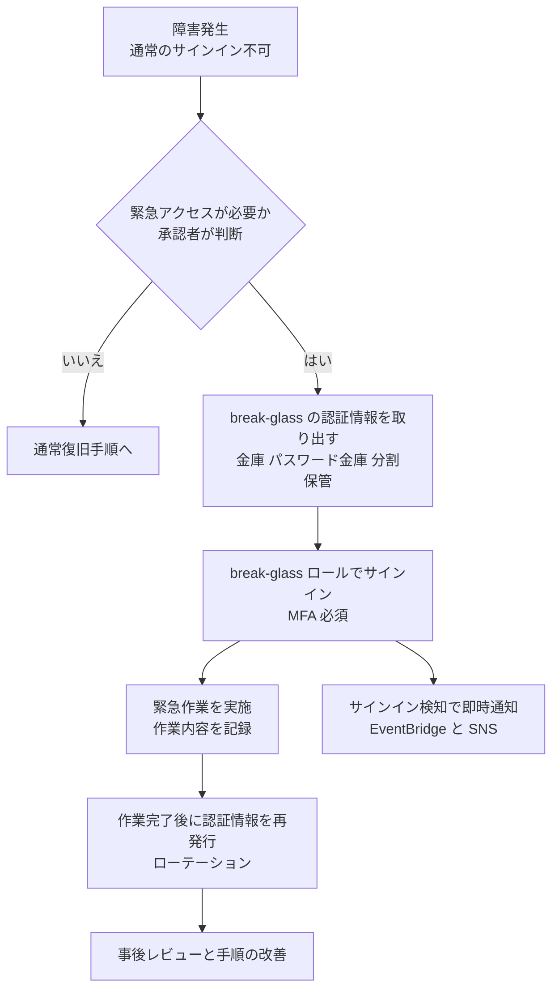

| 設計項目 | 推奨 |
|---|---|
| 対象 | 管理アカウントに**専用の IAM ロール/ユーザー**(break-glass)を用意。ルートユーザーそのものを常用経路にしない |
| 認証情報の保管 | **物理的に分離した場所**(金庫など)に分割保管し、**複数人の承認**で取り出す |
| MFA | ハードウェア MFA を使い、**別の場所に保管** |
| 権限 | 必要な範囲に限定。SCP の除外ロールとしても最小限 |
| 利用検知 | 使用されたら**即時にセキュリティチームへ通知**し、CloudTrail で追跡 |
| 利用後 | **認証情報・MFA を再発行**し、作業を事後レビュー |
| 訓練 | 手順どおりに**定期的にテスト**する(いざという時に使えないことが最大のリスク) |

### Step 3. ベストプラクティス

| # | ベストプラクティス | 理由 |
|---|---|---|
| 1 | メンバーアカウントは**集中ルートアクセス**でルート認証情報を**削除**し、必要時だけ `sts:AssumeRoot` | 数百のルート認証情報を守る負担と攻撃面を削減 |
| 2 | `sts:AssumeRoot` は `sts:TaskPolicyArn` 条件と最小限のプリンシパルで制限する | 強力な権限の濫用を防ぐ |
| 3 | 管理アカウントのルートは **MFA(複数のフィッシング耐性デバイス)、共有メール、代替連絡先** | 最重要アカウントの保護 |
| 4 | **ルートのアクセスキーは作らない** | 漏えい時の被害が最大 |
| 5 | **ルート使用を検知**して通知(CloudTrail + EventBridge、GuardDuty) | 不正利用の早期発見 |
| 6 | **break-glass 手順を文書化し、定期的に訓練** | 緊急時に機能しない緊急経路は意味がない |
| 7 | break-glass の使用は**必ず事後レビュー**し、認証情報を更新する | 一度使った認証情報を残さない |

### Step 4. 試験での狙われ方

| 問われ方 | 答え |
|---|---|
| 「数百のメンバーアカウントのルート認証情報の管理負担を減らしたい」 | **集中ルートアクセス管理**(ルート認証情報を削除し、`sts:AssumeRoot` を使う) |
| 「誤って全アクセス拒否のバケットポリシーを設定してしまい、IAM でも直せない」 | `sts:AssumeRoot` + **`S3UnlockBucketPolicy`** |
| 「AssumeRoot で行える操作を限定したい」 | IAM ポリシーの条件キー **`sts:TaskPolicyArn`** |
| 「ルートセッションの監査」 | **CloudTrail**(`AssumeRoot` が記録される) |
| 「ルートユーザーに最も推奨される MFA」 | **フィッシング耐性のある MFA(FIDO2 / パスキー)**、複数デバイス登録 |
| 「ルートユーザーのアクセスキー」 | **作成しない/削除する** |
| 「IdP 障害時にも管理者がアクセスできるようにしたい」 | **break-glass** アクセスを事前に設計(通常は使わない、使用時に通知、事後に再発行) |
| 「メンバーアカウントのルートユーザーを一律で使用禁止にしたい」 | **SCP** で `aws:PrincipalArn` がルートの場合を拒否(集中ルートアクセスとセットで運用) |

### 参考 URL(根拠)

- 集中ルートアクセス(AWS ニュースブログ): https://aws.amazon.com/de/blogs/aws/centrally-managing-root-access-for-customers-using-aws-organizations/
- 集中ルートアクセスの利点・考慮事項・ベストプラクティス(AWS re:Post 公式記事): https://repost.aws/articles/AR0YHZ3VskTzqhJKyEDPnSPQ/centralized-root-access-in-aws-organizations-benefits-considerations-and-best-practices
- IAM ルートユーザー: https://docs.aws.amazon.com/IAM/latest/UserGuide/id_root-user.html
- ルートユーザーのベストプラクティス: https://docs.aws.amazon.com/IAM/latest/UserGuide/root-user-best-practices.html
- AssumeRoot API: https://docs.aws.amazon.com/STS/latest/APIReference/API_AssumeRoot.html

---

# Part B. Task 6.2 安全で一貫したリソースのデプロイ戦略

## 7. Skill 6.2.1 IaC による一貫したデプロイ

### Step 1. 何のためのものか

手作業(コンソール操作)でリソースを作ると、**人によって設定が異なり、再現できず、監査もできません**。そこで、インフラをコード(IaC: Infrastructure as Code)として定義し、**レビュー → 自動検査 → 自動デプロイ**の流れで、複数アカウント・複数 Region に**同じ設定を安全に**展開します。

| 手段 | 役割 |
|---|---|
| AWS CloudFormation | AWS ネイティブの IaC。テンプレートからスタックを作成 |
| **CloudFormation StackSets** | **1 つのテンプレートを複数アカウント・複数 Region に展開** |
| サードパーティ IaC(Terraform、Pulumi など)、AWS CDK | CloudFormation 以外の IaC。Control Tower では AFT(Terraform)なども利用可能 |
| **CloudFormation Guard(cfn-guard)** | **ポリシーをコードとして記述**し、テンプレートがルールに沿うか検証 |
| **cfn-lint** | テンプレートの**文法・ベストプラクティス**を静的に検査(リンター) |
| CloudFormation Hooks | デプロイ時にリソース設定を検査し、**非準拠なら中断**(Control Tower のプロアクティブコントロールの実体) |

### Step 2. 仕組み

#### 2.1 CloudFormation StackSets

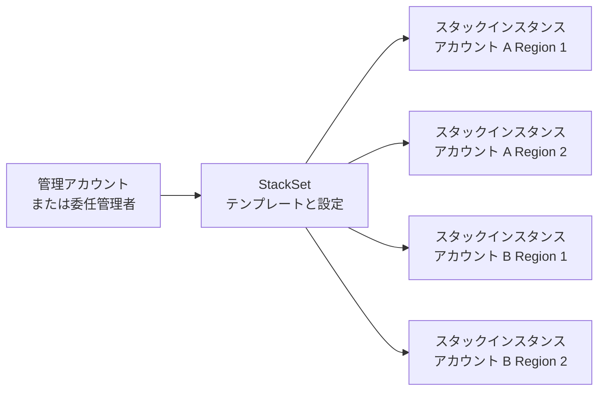

**権限モデル(最重要)**

| モデル | 説明 | 使いどころ |
|---|---|---|
| **サービスマネージド権限** | Organizations と連携。StackSets が**必要な IAM ロールを自動作成**し、**OU を対象**にできる | **組織内のアカウント**への展開(推奨) |
| 自己管理権限 | 管理側と実行側の IAM ロール(`AWSCloudFormationStackSetAdministrationRole` と `AWSCloudFormationStackSetExecutionRole`)を**自分で作成** | Organizations を使っていないアカウント、細かい制御が必要な場合 |

**サービスマネージド権限の主な機能**

| 機能 | 説明 |
|---|---|
| **自動デプロイ(Automatic deployment)** | 対象 OU に**新しいアカウントが追加されると自動でスタックを展開**。OU から外れると削除(または保持)を選べる |
| 委任管理者 | 管理アカウントではなく**メンバーアカウントから StackSets を運用**できる(信頼されたアクセスと登録が必要) |
| オペレーション設定 | **同時実行数**、**失敗許容数**(failure tolerance)、リージョン順序で、**段階的ロールアウト**ができる |
| **ドリフト検出** | 手動変更でテンプレートと実際の状態がずれていないか確認できる |
| マネージド実行 | 競合しない操作を並行実行し、競合する操作はキューに入れる |

```yaml
# StackSet で全アカウントに展開するベースラインの例(IAM パスワードポリシーではなく、Config の有効化など)
AWSTemplateFormatVersion: "2010-09-09"
Description: Baseline - 全アカウント共通のセキュリティ設定
Resources:
  SecurityAuditRole:
    Type: AWS::IAM::Role
    Properties:
      RoleName: SecurityAuditReadOnly
      AssumeRolePolicyDocument:
        Version: "2012-10-17"
        Statement:
          - Effect: Allow
            Principal:
              AWS: arn:aws:iam::222233334444:root   # Security Tooling アカウント
            Action: sts:AssumeRole
            Condition:
              Bool:
                aws:MultiFactorAuthPresent: "true"
      ManagedPolicyArns:
        - arn:aws:iam::aws:policy/SecurityAudit
```

#### 2.2 CloudFormation Guard と cfn-lint の違い

| 項目 | **cfn-lint** | **CloudFormation Guard(cfn-guard)** |
|---|---|---|
| 一言で | **文法・仕様チェック(リンター)** | **ポリシーチェック(ルールを自分で書く)** |
| 主な目的 | プロパティの誤り、不正な値、非推奨の使い方、ベストプラクティス違反を見つける | **組織固有のセキュリティ・コンプライアンスルール**を満たすかを検証する |
| ルールの定義 | 組み込みルール(拡張可能) | **Guard DSL** で自由に記述 |
| 対象 | CloudFormation テンプレート | CloudFormation、Terraform の plan、Kubernetes マニフェスト、JSON/YAML 全般 |
| 実行場所 | 開発者の PC、CI/CD | 開発者の PC、CI/CD、**Hooks**(デプロイ時) |

**Guard ルールの例: S3 バケットは暗号化とパブリックアクセスブロックが必須**

```ruby
let s3_buckets = Resources.*[ Type == 'AWS::S3::Bucket' ]

rule s3_bucket_encrypted when %s3_buckets !empty {
    %s3_buckets.Properties.BucketEncryption exists
    <<
      Violation: S3 バケットはサーバー側の暗号化が必須です
    >>
}

rule s3_public_access_blocked when %s3_buckets !empty {
    %s3_buckets.Properties.PublicAccessBlockConfiguration {
        BlockPublicAcls == true
        BlockPublicPolicy == true
        IgnorePublicAcls == true
        RestrictPublicBuckets == true
    }
}
```

```bash
# CI/CD でテンプレートを検査
cfn-lint template.yaml
cfn-guard validate --data template.yaml --rules s3-rules.guard
```

#### 2.3 安全なデプロイパイプライン(全体像)

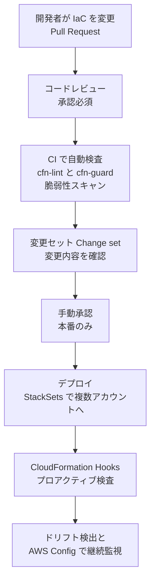

### Step 3. ベストプラクティス

| # | ベストプラクティス | 理由 |
|---|---|---|
| 1 | 組織内の展開には **サービスマネージド権限の StackSets + 自動デプロイ** | 新規アカウントにもベースラインが漏れなく入る |
| 2 | StackSets の運用は**委任管理者アカウント**から行う | 管理アカウントの利用を最小化 |
| 3 | **同時実行数と失敗許容数**を小さく設定して段階展開 | 不具合のあるテンプレートが全アカウントに広がる前に止める |
| 4 | **cfn-lint と cfn-guard を CI/CD に組み込む**(シフトレフト) | 本番に入る前に問題を発見 |
| 5 | Control Tower の**プロアクティブコントロール**(Hooks)でデプロイ時の最終防衛線を作る | CI を回避した手動デプロイにも効く |
| 6 | **シークレットをテンプレートに直書きしない**。`NoEcho`、Secrets Manager の動的参照 `{{resolve:secretsmanager:...}}`、SSM パラメータを使う | 認証情報の漏えい防止 |
| 7 | デプロイ用 IAM ロール(CloudFormation サービスロール)は**最小権限** | デプロイ権限の濫用を防ぐ |
| 8 | **変更セット**で変更内容を確認してから実行、重要スタックは**終了保護**と**スタックポリシー**、`DeletionPolicy` を設定 | 意図しない更新・削除を防ぐ |
| 9 | **ドリフト検出**を定期実行し、手動変更を検知・是正 | IaC が「正」であり続ける |
| 10 | テンプレートは **Git で管理**し、コードレビューを必須にする | 監査可能性と再現性 |

### Step 4. 試験での狙われ方

| 問われ方 | 答え |
|---|---|
| 「新しいアカウントが組織に追加されたら、自動で標準のセキュリティスタックを展開したい」 | **StackSets のサービスマネージド権限 + 自動デプロイ** |
| 「OU 全体へ展開したい」 | サービスマネージド権限(OU を指定) |
| 「テンプレートが組織のルール(暗号化必須など)に沿っているか、デプロイ前に自動検査したい」 | **CloudFormation Guard**(CI/CD 組み込み)、または **CloudFormation Hooks** |
| 「テンプレートの書き方の誤りやベストプラクティス違反を検出したい」 | **cfn-lint** |
| 「Guard と cfn-lint の違い」 | Guard=自分でポリシーを書く、cfn-lint=文法とベストプラクティス |
| 「パスワードをテンプレートに書きたくない」 | Secrets Manager の動的参照、`NoEcho` |
| 「手動で変更されたリソースを検知したい」 | **ドリフト検出** |
| 「デプロイ前に変更内容を確認したい」 | **変更セット** |

### 参考 URL(根拠)

- CloudFormation StackSets: https://docs.aws.amazon.com/AWSCloudFormation/latest/UserGuide/what-is-cfnstacksets.html
- StackSets のサービスマネージド権限(信頼されたアクセス): https://docs.aws.amazon.com/AWSCloudFormation/latest/UserGuide/stacksets-orgs-activate-trusted-access.html
- StackSets の自己管理権限: https://docs.aws.amazon.com/AWSCloudFormation/latest/UserGuide/stacksets-prereqs-self-managed.html
- AWS CloudFormation Guard: https://docs.aws.amazon.com/cfn-guard/latest/ug/what-is-guard.html
- cfn-lint(GitHub): https://github.com/aws-cloudformation/cfn-lint
- CloudFormation Hooks: https://docs.aws.amazon.com/cloudformation-cli/latest/hooks-userguide/what-is-cloudformation-hooks.html

---

## 8. Skill 6.2.2 タグによるリソースのグルーピング

### Step 1. 何のためのものか

**タグ**は、リソースに付けるキーと値のメタデータです。部署、コストセンター、環境、オーナー、データ分類などを付けることで、**コスト配分、運用の自動化、アクセス制御(ABAC)、コンプライアンス確認**ができます。タグがバラバラ(`Env` / `env` / `Environment`)だと、これらすべてが機能しません。

### Step 2. 仕組み

#### 2.1 タグの用途

| 用途 | 内容 | 関連機能 |
|---|---|---|
| リソースの整理・検索 | 部署・環境などでグルーピング | Resource Groups、タグエディタ |
| コスト配分 | コストセンターごとの請求の可視化 | **コスト配分タグ**(Billing で有効化が必要) |
| 運用の自動化 | 特定タグの付いたインスタンスだけ停止/バックアップ | Systems Manager、AWS Backup(タグでリソース選択) |
| **アクセス制御(ABAC)** | タグ値の一致で権限を付与 | `aws:ResourceTag`、`aws:PrincipalTag`、`aws:RequestTag` |
| セキュリティ・コンプライアンス | データ分類タグでセキュリティ要件を適用 | AWS Config(`required-tags`)、Security Hub の AWS Resource Tagging Standard |

#### 2.2 タグを統制する 4 つの手段

| 手段 | 役割 | 層 |
|---|---|---|
| **タグポリシー**(Organizations の管理ポリシー) | タグ**キーの大文字小文字**、**許可する値**、対象リソースタイプを定義。準拠状況をレポート。**強制(`enforced_for`)を有効にすると、非準拠のタグ付け操作をブロック**できる | 標準化・(一部)予防 |
| **SCP** | `aws:RequestTag/キー` や `aws:TagKeys` の条件で、**必須タグが無いリソース作成を拒否**(作成時のタグ強制) | 予防 |
| **AWS Config ルール** | `required-tags` ルールで、タグが無いリソースを**検出** | 検出 |
| **IaC でタグを付与** | CloudFormation のスタックレベルタグはスタック内の対応リソースへ伝播 | 配備時の標準化 |

**タグポリシーの例**

```json
{
  "tags": {
    "CostCenter": {
      "tag_key": {
        "@@assign": "CostCenter"
      },
      "tag_value": {
        "@@assign": ["CC-1001", "CC-1002", "CC-2001"]
      },
      "enforced_for": {
        "@@assign": ["ec2:instance", "s3:bucket"]
      }
    }
  }
}
```

> 注意: タグポリシーは**タグが付いていない**リソースの作成を止めません(付けるなら正しい形式、という制御)。**「必須タグ」をリソース作成時に強制**したい場合は **SCP**(`Null` 条件や `aws:RequestTag`)を使います。

**SCP の例: `CostCenter` タグ無しで EC2 インスタンスを起動できないようにする**

```json
{
  "Version": "2012-10-17",
  "Statement": [
    {
      "Sid": "DenyRunInstancesWithoutCostCenterTag",
      "Effect": "Deny",
      "Action": "ec2:RunInstances",
      "Resource": "arn:aws:ec2:*:*:instance/*",
      "Condition": {
        "Null": {
          "aws:RequestTag/CostCenter": "true"
        }
      }
    }
  ]
}
```

#### 2.3 タグ戦略の設計

| カテゴリ | タグキーの例 | 目的 |
|---|---|---|
| 技術 | `Environment`、`Application`、`Version` | 運用・自動化 |
| ビジネス | `CostCenter`、`Owner`、`Department`、`Project` | コスト配分・責任の明確化 |
| セキュリティ | `DataClassification`、`Compliance` | データ分類に基づく制御 |
| 自動化 | `Backup`、`Patch-Group`、`Schedule` | バックアップ・パッチ・起動停止の対象指定 |

**ABAC の例: 自分と同じ `Project` タグのインスタンスだけ停止できる**

```json
{
  "Version": "2012-10-17",
  "Statement": [
    {
      "Effect": "Allow",
      "Action": ["ec2:StartInstances", "ec2:StopInstances"],
      "Resource": "*",
      "Condition": {
        "StringEquals": {
          "aws:ResourceTag/Project": "${aws:PrincipalTag/Project}"
        }
      }
    }
  ]
}
```

### Step 3. ベストプラクティス

| # | ベストプラクティス | 理由 |
|---|---|---|
| 1 | **タグ付け規則を先に決める**(キー名、大文字小文字、許可値、必須タグ)。タグのキーと値は**大文字小文字を区別する** | 不統一を防ぐ |
| 2 | **タグポリシーで標準化**し、レポートで準拠状況を確認。重要なキーは強制を有効化 | 組織全体で一貫性を担保 |
| 3 | **必須タグは SCP の作成時チェック**で強制、既存リソースは **Config の `required-tags`** で検出 | 予防と検出の両面 |
| 4 | **IaC・Account Factory で自動付与**する | 人手による付け忘れを防ぐ |
| 5 | **タグに機密情報(個人情報、パスワードなど)を入れない** | タグは多くのサービスで可視化・ログ出力される |
| 6 | **コスト配分タグは Billing コンソールで有効化**(有効化しないとコストレポートに現れない) | よくある設定漏れ |
| 7 | ABAC を使う場合、**タグを変更できる権限を厳しく制限**する(`aws:TagKeys`、`aws:RequestTag` の条件) | タグを書き換えてアクセス権を奪取されるのを防ぐ |
| 8 | **タグを持たない/サポートしないリソース**があることを理解し、アカウント・OU 構造と併用する | タグだけで分離の保証はできない |

### Step 4. 試験での狙われ方

| 問われ方 | 答え |
|---|---|
| 「全アカウントでタグのキー名・許可する値を統一したい」 | **タグポリシー** |
| 「`CostCenter` タグが無いリソースを作らせたくない」 | **SCP**(`aws:RequestTag` / `Null` 条件) |
| 「既存リソースでタグが付いていないものを一覧化したい」 | **AWS Config `required-tags`**、タグポリシーのコンプライアンスレポート |
| 「部署ごとのコストを可視化」 | **コスト配分タグ**を有効化 |
| 「プロジェクト単位でアクセス権を付与し、ロールの数を増やしたくない」 | **ABAC**(`aws:PrincipalTag` と `aws:ResourceTag`) |
| 「タグ名が `Env` と `env` に分かれている」 | タグは大文字小文字を区別。**タグポリシー**で統一 |

### 参考 URL(根拠)

- タグポリシー(Organizations): https://docs.aws.amazon.com/organizations/latest/userguide/orgs_manage_policies_tag-policies.html
- AWS リソースのタグ付け: https://docs.aws.amazon.com/tag-editor/latest/userguide/tagging.html
- タグ付けのベストプラクティス(ホワイトペーパー): https://docs.aws.amazon.com/whitepapers/latest/tagging-best-practices/tagging-best-practices.html
- ABAC(IAM): https://docs.aws.amazon.com/IAM/latest/UserGuide/introduction_attribute-based-access-control.html

---

## 9. Skill 6.2.3 AWS Firewall Manager による中央配信

### Step 1. 何のためのものか

組織内の何百ものアカウントに、**WAF のルール、Shield Advanced の保護、セキュリティグループ、ネットワークファイアウォール、DNS ファイアウォール**を一貫して適用し、**新しいリソースやアカウントにも自動で適用**したい。これを一か所のポリシーで実現するのが **AWS Firewall Manager** です。

### Step 2. 仕組み

#### 2.1 ポリシーの種類

| ポリシー | 内容 |
|---|---|
| **AWS WAF** | WAF の Web ACL(ルールグループ)を対象リソース(ALB、API Gateway、CloudFront など)に適用 |
| **Shield Advanced** | Shield Advanced の保護(および自動アプリケーション層 DDoS 緩和)を適用 |
| **セキュリティグループ** | **共通 SG ポリシー**(ベースラインの SG を配布)、**コンテンツ監査ポリシー**(許可/禁止ルールの検査)、**使用状況監査ポリシー**(未使用・冗長な SG の整理) |
| **ネットワーク ACL** | 全組織共通の最初・最後の NACL ルールを適用 |
| **AWS Network Firewall** | VPC にネットワークファイアウォールを自動展開 |
| **Route 53 Resolver DNS Firewall** | VPC に DNS ファイアウォールのルールグループを関連付け |
| サードパーティファイアウォール | Palo Alto Cloud NGFW、Fortigate CNF など |

#### 2.2 前提条件(必ず覚える)

| 前提 | 内容 |
|---|---|
| **AWS Organizations(All features)** | 組織に所属していること |
| **Firewall Manager 管理者アカウント** | 組織の**管理アカウント**または**委任管理者**を指定(指定したアカウントが Firewall Manager の委任管理者になる) |
| **AWS Config を有効化** | **すべてのメンバーアカウントと管理者アカウント**、使用する Region で有効化。**ポリシー種類ごとに Config が記録すべきリソースタイプが決まっている**(例: WAF ポリシーは CloudFront ディストリビューション、ALB、API Gateway、WAF WebACL など) |
| Shield Advanced ポリシーの場合 | Shield Advanced の**サブスクリプション**が必要 |

#### 2.3 動作の流れ

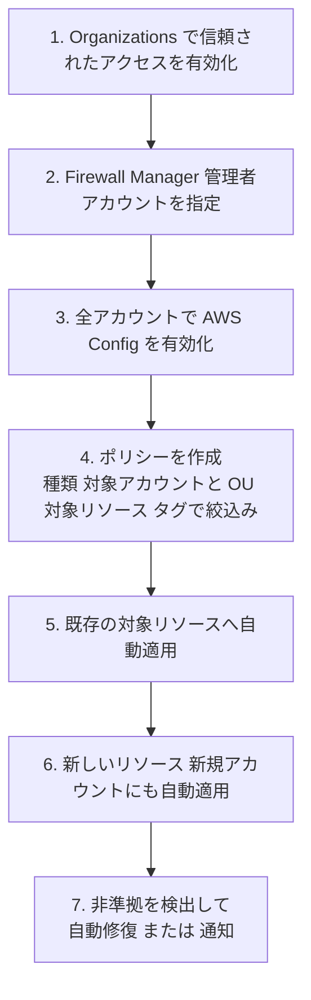

**ポリシーのスコープ(適用範囲)**

| 設定 | 内容 |
|---|---|
| アカウント | 組織全体 / 特定の OU / 特定のアカウントを**含める**・**除外する** |
| リソースタイプ | ALB、CloudFront、EC2 インスタンス、VPC など(ポリシー種類ごと) |
| タグ | 特定のタグが付いたリソースのみ対象(含める/除外) |
| Region | 対象 Region |
| **自動修復(Auto remediation)** | ON にすると、非準拠リソースへ自動でポリシーを適用。OFF の場合は非準拠を**報告のみ** |

> Firewall Manager のポリシーを削除する際は、**クリーンアップ**の設定で、配布した SG や Web ACL の関連付けを解除するかを選択できます(ポリシー種類により動作が異なります)。

#### 2.4 Firewall Manager と他サービスの役割分担

| サービス | 役割 | 範囲 |
|---|---|---|
| WAF / Shield / Network Firewall / SG | **保護そのもの**(単一アカウント内の設定) | アカウント |
| **Firewall Manager** | 上記を**組織全体へ中央配布・強制** | 組織 |
| SCP | 「SG を勝手に変更させない」などの**操作の制限** | 組織(API 層) |
| AWS Config | 準拠状況の検出(Firewall Manager の内部でも利用) | アカウント/組織 |

### Step 3. ベストプラクティス

| # | ベストプラクティス | 理由 |
|---|---|---|
| 1 | Firewall Manager は**委任管理者(セキュリティアカウント)**から運用する | 管理アカウントの使用を最小化 |
| 2 | **全アカウント・全 Region で Config を有効化**し、必要なリソースタイプを記録 | 無いとポリシーが機能・評価されない |
| 3 | まず**自動修復 OFF(報告のみ)**で影響を確認してから ON にする | 本番トラフィックへの影響を避ける |
| 4 | **OU とタグでスコープを設計**し、例外は除外リストで管理 | 本番/検証で保護レベルを変えられる |
| 5 | WAF は**カウントモード**で検証後に**ブロック**へ移行 | 誤検知で正規トラフィックを止めない |
| 6 | **共通 SG ポリシー**で基本の通信ルールを配布し、**コンテンツ監査**で危険なルール(`0.0.0.0/0` の SSH など)を検出 | 設定ミスの是正 |
| 7 | **SCP で、Firewall Manager が管理するリソースの変更を制限** | 現場による迂回・削除を防ぐ |
| 8 | 準拠状況を **Security Hub** で集約・通知 | 運用の一元化 |

### Step 4. 試験での狙われ方

| 問われ方 | 答え |
|---|---|
| 「組織内の全 ALB と CloudFront に同じ WAF ルールを適用し、新しいリソースにも自動適用」 | **Firewall Manager の WAF ポリシー** |
| 「全 VPC に Network Firewall を自動デプロイ」 | Firewall Manager の **Network Firewall ポリシー** |
| 「危険なルール(例: 全世界からの SSH 許可)を持つ SG を検出・修復」 | Firewall Manager の **セキュリティグループ コンテンツ監査ポリシー** |
| 「Firewall Manager が動作しない」 | **AWS Config が有効か**、管理者アカウントの設定、Shield なら**サブスクリプション** |
| 「Firewall Manager と AWS WAF の違い」 | WAF=保護機能、Firewall Manager=それを組織全体へ**中央配布・強制** |
| 「Firewall Manager の管理者になれるアカウント」 | **管理アカウントまたは委任管理者**(通常はセキュリティ専用アカウント) |

### 参考 URL(根拠)

- Firewall Manager(開発者ガイド): https://docs.aws.amazon.com/waf/latest/developerguide/fms-chapter.html
- 前提条件: https://docs.aws.amazon.com/waf/latest/developerguide/fms-prereq.html
- Firewall Manager 用に AWS Config を有効化する: https://docs.aws.amazon.com/waf/latest/developerguide/enable-config.html
- ポリシーの種類(CloudFormation `AWS::FMS::Policy`): https://docs.aws.amazon.com/AWSCloudFormation/latest/UserGuide/aws-resource-fms-policy.html

---

## 10. Skill 6.2.4 リソースの安全な共有(RAM / Service Catalog)

### Step 1. 何のためのものか

アカウントを分けると、「共通のネットワーク(サブネット、Transit Gateway)」や「承認済みのテンプレート」を**複数アカウントで使い回したい**場面が出てきます。リソースを**コピーせずに安全に共有**し、また**承認済みの構成だけを利用者に提供**する方法を学びます。

| サービス | 共有するもの | 一言で |
|---|---|---|
| **AWS Resource Access Manager(RAM)** | **リソースそのもの**(サブネット、Transit Gateway、Route 53 Resolver ルール、License Manager 構成、プレフィックスリストなど) | 「作ったリソースを他アカウントに**貸す**」 |
| **AWS Service Catalog** | **承認済みの製品(テンプレート)** | 「承認済みの構成だけを利用者が**自分で払い出せる**」 |

### Step 2. 仕組み

#### 2.1 AWS RAM

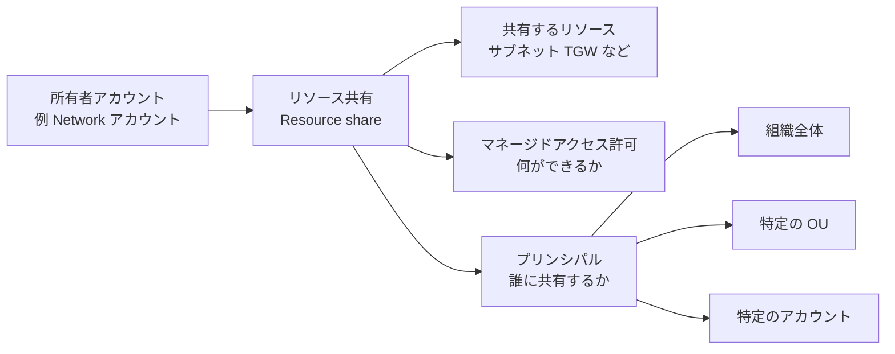

| 概念 | 説明 |
|---|---|
| リソース共有 | 「共有するリソース」「許可」「共有先(プリンシパル)」をまとめたもの |
| 所有者と利用者 | リソースの**所有権は所有者のまま**。利用者は許可された範囲で利用する |
| **組織との共有の有効化** | 管理アカウントで「Organizations との共有を有効化」すると、**招待の承諾なしで**組織内のアカウント/OU/組織全体へ共有できる |
| マネージドアクセス許可 | リソースタイプごとの**AWS マネージド許可**と、**カスタマーマネージド許可**(最小権限で絞る)がある |
| 組織外への共有 | リソースタイプにより可能。**招待の承諾が必要**。組織外への共有を禁止したい場合は、**RAM の設定や SCP 等で制御**する |

**典型例**

| 構成 | 内容 |
|---|---|
| **VPC サブネットの共有** | Network アカウントが VPC とサブネットを所有し、ワークロードアカウントに**サブネットを共有**。ワークロード側はそのサブネットにリソースを起動できる。**ネットワーク管理とワークロード管理を分離** |
| **Transit Gateway の共有** | 1 つの TGW を組織全体で共有し、各アカウントの VPC をアタッチ |
| **Route 53 Resolver ルールの共有** | ハイブリッド DNS ルールを一元管理 |
| **Private CA の共有** | 組織内で共通の認証局を利用 |

> 補足: RAM に加え、**リソースベースポリシー**に `aws:PrincipalOrgID` / `aws:PrincipalOrgPaths` を使う方法(S3 バケット、KMS キー、AMI の共有など)があります。共有先を「組織内に限定」する基本の技です。

#### 2.2 AWS Service Catalog

IT 管理者が承認した **製品(CloudFormation / Terraform などのテンプレート)** を**ポートフォリオ**にまとめ、利用者に提供します。利用者は**広い IAM 権限を持たなくても**、承認済みの構成だけを**自分で払い出せます**。

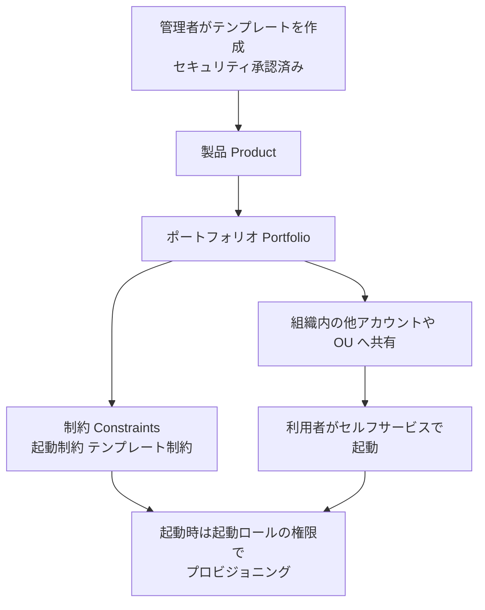

| 概念 | 説明 |
|---|---|
| 製品(Product) | 承認済みのテンプレート(EC2 構成、RDS 構成など) |
| ポートフォリオ | 製品の集まり。利用者(IAM ユーザー/ロール/グループ)に**アクセス権を付与** |
| **起動制約(Launch constraint)** | 製品の起動時に使う**IAM ロール**を指定。**利用者本人には強い権限を与えずに**リソースを作成できる(重要) |
| テンプレート制約 | 起動時に選べるパラメータ(インスタンスタイプなど)を制限 |
| StackSet 制約 | 複数アカウント・Region への展開を設定 |
| タグオプション(TagOptions) | 起動時のタグ付けを標準化・強制 |
| 共有 | **組織内共有**(OU・組織全体)により、メンバーアカウントにポートフォリオを提供。ポートフォリオの**更新は共有先に自動で反映**される(共有元が管理) |
| Control Tower との関係 | **Account Factory は Service Catalog の製品**として提供される |

#### 2.3 RAM と Service Catalog の使い分け

| 質問 | RAM | Service Catalog |
|---|---|---|
| 何を共有する | **既存のリソース**(自分が所有するもの) | **テンプレート(製品)** |
| 利用者はどうする | 共有されたリソースを**そのまま利用** | 製品を**自分のアカウントに新規作成** |
| 主な目的 | 重複排除・一元管理(ネットワークなど) | **承認済み構成のセルフサービス提供**、利用者の権限最小化 |
| 典型例 | 共有 VPC サブネット、Transit Gateway | 標準 EC2 構成、承認済み RDS 構成、Account Factory |

### Step 3. ベストプラクティス

| # | ベストプラクティス | 理由 |
|---|---|---|
| 1 | RAM は**組織との共有を有効化**し、**OU 単位**で共有する | 招待承認の手間を省き、新アカウントにも自動で適用 |
| 2 | 共有は**必要な相手・必要な権限だけ**。**カスタマーマネージド許可**で絞る | 最小権限の原則 |
| 3 | **組織外へ共有されていないか**を継続的に検知(IAM Access Analyzer の外部アクセス検出、Config) | 意図しない共有の発見 |
| 4 | **ネットワークは共有 VPC(RAM)で集約**し、ワークロードアカウントでは SG やリソースだけを管理 | ガバナンスと運用分離 |
| 5 | Service Catalog では**起動制約でロールを指定**し、利用者に直接の広い権限を与えない | **セルフサービスと統制の両立** |
| 6 | 製品テンプレートは **IaC + cfn-guard で検査**してから登録し、**バージョン管理** | 承認済み構成の品質担保 |
| 7 | リソースベースポリシーは **`aws:PrincipalOrgID`** で組織内に限定 | `Principal: "*"` の公開を避ける |

### Step 4. 試験での狙われ方

| 問われ方 | 答え |
|---|---|
| 「Transit Gateway を組織の全アカウントで使いたい」 | **RAM**(組織との共有を有効化) |
| 「アプリアカウントでネットワークを管理させず、共通のサブネットを使わせたい」 | **RAM による VPC サブネット共有** |
| 「開発者に IAM の強い権限を与えず、承認済みの EC2 構成だけを作らせたい」 | **Service Catalog**(起動制約) |
| 「S3 バケットを組織内のアカウントからのみアクセス可能にしたい」 | バケットポリシーの **`aws:PrincipalOrgID`**(+ RCP) |
| 「招待の承認なしで組織内に共有したい」 | RAM の **Organizations との共有を有効化** |
| 「Account Factory の実体」 | **Service Catalog の製品** |

### 参考 URL(根拠)

- AWS RAM とは: https://docs.aws.amazon.com/ram/latest/userguide/what-is.html
- Organizations での RAM の共有有効化: https://docs.aws.amazon.com/ram/latest/userguide/getting-started-sharing.html
- AWS Service Catalog 管理者ガイド: https://docs.aws.amazon.com/servicecatalog/latest/adminguide/introduction.html
- Service Catalog の制約(起動制約など): https://docs.aws.amazon.com/servicecatalog/latest/adminguide/constraints.html
- グローバル条件キー `aws:PrincipalOrgID`: https://docs.aws.amazon.com/IAM/latest/UserGuide/reference_policies_condition-keys.html

---

# Part C. Task 6.3 リソースのコンプライアンス評価

## 11. Skill 6.3.1 検出と自動修復(AWS Config / Security Hub)

### Step 1. 何のためのものか

予防的な統制(SCP など)をかけていても、設定ミス・例外・統制の対象外になっているケースは必ず残ります。そこで、**「今の設定がルールに沿っているか」を継続的に評価し、違反を検出して、通知・自動修復する**仕組みが必要です。

| サービス | 役割 |
|---|---|
| **AWS Config** | リソースの**設定の記録**と**ルールによる準拠評価**、**修復**(Systems Manager Automation) |
| **AWS Security Hub** | セキュリティ**標準**(ベストプラクティス)に対するチェック結果と、他サービスの**検出結果を集約** |
| Amazon EventBridge | 準拠状態の変化・検出結果をトリガーに、通知や自動処理を実行 |
| AWS Systems Manager Automation | 修復の**実行手順(ランブック)** |

### Step 2. 仕組み

#### 2.1 AWS Config の基本

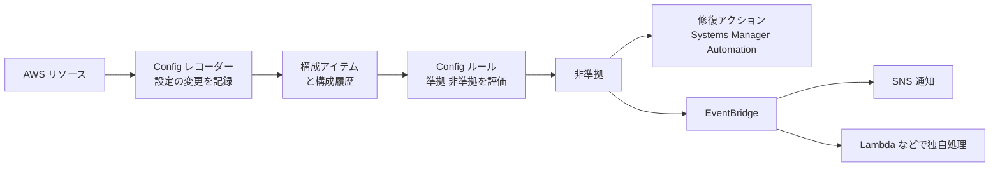

| 概念 | 説明 |
|---|---|
| **レコーダー** | リソースの設定変更を記録する。**継続的記録**か**日次記録**を選べる。記録対象のリソースタイプも指定可能 |
| 構成アイテム | ある時点のリソース設定のスナップショット(変更履歴を追跡できる) |
| **ルール** | 「あるべき設定」の定義。**マネージドルール**(AWS が提供)と**カスタムルール**(Lambda または Guard の**ポリシー**ルール) |
| 評価タイミング(トリガー) | **構成変更時**(変更されたとき)、**定期**(1・3・6・12・24 時間ごと)。さらに**プロアクティブ評価**(リソース作成前に評価する **評価モード**) |
| **適合パック(Conformance pack)** | 複数のルールと修復アクションを**1 つの YAML テンプレート**にまとめたもの。**PCI DSS、NIST、CIS** などのサンプルがある。**組織の適合パック**で組織全体へ展開 |
| **アグリゲーター** | **複数アカウント・複数 Region** のデータ(構成と準拠状態)を**1 か所に集約**して確認。組織単位で作成できる |
| 高度なクエリ | SQL ライクなクエリで、リソースの構成を検索 |

**マネージドルールの例**

| ルール名 | 内容 |
|---|---|
| `s3-bucket-public-read-prohibited` | S3 バケットの公開読み取りを禁止 |
| `encrypted-volumes` | EBS ボリュームの暗号化 |
| `root-account-mfa-enabled` | ルートユーザーの MFA 有効化 |
| `restricted-ssh` | SG で SSH(22)が `0.0.0.0/0` に開放されていないか |
| `required-tags` | 必須タグの有無 |
| `cloudtrail-enabled` | CloudTrail の有効化 |

#### 2.2 自動修復

Config ルールの**修復アクション**は、**Systems Manager Automation ドキュメント**(AWS 管理のランブック、またはカスタム)を実行します。

| 設定 | 内容 |
|---|---|
| **自動修復** | 非準拠を検出すると**自動で修復**。**再試行回数・間隔**を設定可能 |
| 手動修復 | コンソールや API で**承認して実行**(影響の大きい修復に向く) |
| 実行ロール | Automation が引き受ける **IAM ロール**(最小権限) |
| 例 | `AWS-DisablePublicAccessForSecurityGroup`、`AWS-EnableS3BucketEncryption` など |

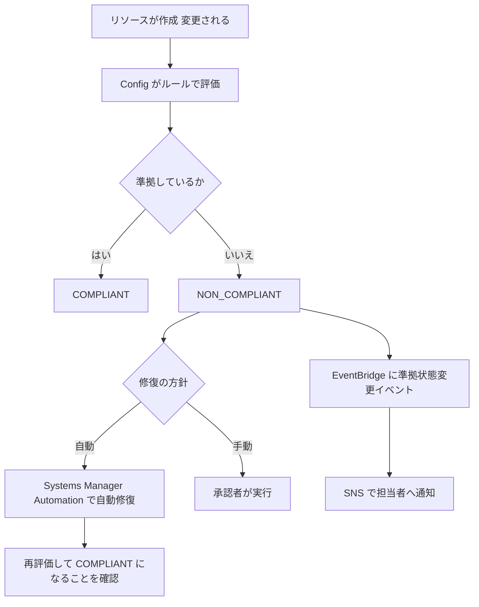

```yaml
# Config ルール + 自動修復の例(CloudFormation)
Resources:
  RestrictedSSHRule:
    Type: AWS::Config::ConfigRule
    Properties:
      ConfigRuleName: restricted-ssh
      Source:
        Owner: AWS
        SourceIdentifier: INCOMING_SSH_DISABLED

  RestrictedSSHRemediation:
    Type: AWS::Config::RemediationConfiguration
    Properties:
      ConfigRuleName: !Ref RestrictedSSHRule
      TargetType: SSM_DOCUMENT
      TargetId: AWS-DisablePublicAccessForSecurityGroup
      Automatic: true
      MaximumAutomaticAttempts: 3
      RetryAttemptSeconds: 60
      Parameters:
        GroupId:
          ResourceValue:
            Value: RESOURCE_ID
        AutomationAssumeRole:
          StaticValue:
            Values:
              - !Sub arn:aws:iam::${AWS::AccountId}:role/ConfigRemediationRole
```

#### 2.3 AWS Security Hub

Security Hub は、**ベストプラクティスのチェック(CSPM)** と、**GuardDuty、Inspector、Macie、IAM Access Analyzer、Firewall Manager、パートナー製品などの検出結果の集約**を行う、セキュリティ状況の**ダッシュボード兼ハブ**です。

公式ドキュメントでは、従来の Security Hub は **Security Hub CSPM(Cloud Security Posture Management)** と呼ばれ、**統合型の AWS Security Hub**(エクスポージャーの検出結果、攻撃パス、効率化された対応などを含む)も案内されています。いずれにしても、本ドメインで押さえるべき中心は次の機能です。

| 機能 | 説明 |
|---|---|
| **セキュリティ標準** | **AWS Foundational Security Best Practices(FSBP)**(組み込み)、CIS AWS Foundations Benchmark、PCI DSS、NIST SP 800-53 などに対するチェック |
| **コントロール** | 個々のチェック項目。**Config のサービスリンクルール**で実行されるものが多く、**AWS Config の有効化(リソース記録)が前提** |
| 検出結果の集約 | 複数のサービス・パートナーの検出結果を共通の形式で集約 |
| **委任管理者** | 組織の管理を委任し、全アカウントへ展開 |
| **集中設定(Central configuration / 設定ポリシー)** | 委任管理者が、**組織・OU・アカウント単位で** Security Hub の有効化、標準、コントロールを**一括適用**。**Config のレコーダー設定は含まれない** |
| **集約リージョン** | 複数 Region の検出結果を**1 つの Region に集約** |
| **自動化ルール** | 検出結果を**ほぼリアルタイムで自動更新・抑制**(重要度の変更、メモ付与、抑制など) |
| EventBridge 連携 | 検出結果をイベントとして送信。Lambda、Step Functions、Systems Manager Automation を起動 |
| カスタムアクション | ユーザーが選択したときに EventBridge へ送信する手動トリガー |
| **Automated Security Response on AWS(ASR)** | あらかじめ用意された修復ランブックと EventBridge ルールを CloudFormation で展開するソリューション |

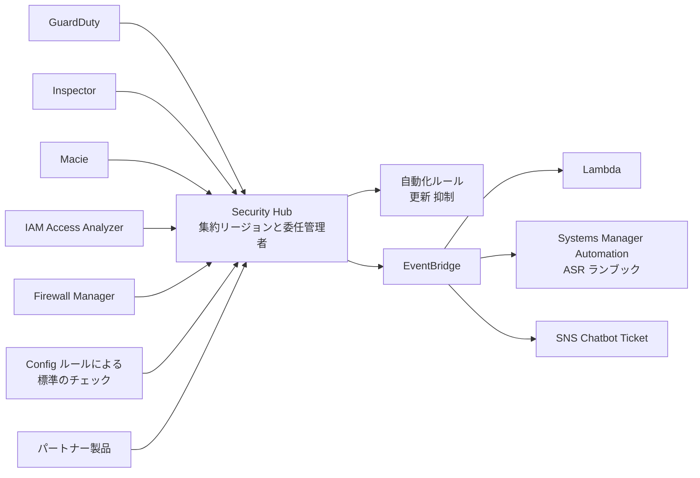

> 試験では「**Config は個々のリソース設定の準拠評価と修復**」「**Security Hub は標準に対するスコアと、複数サービスの検出結果の集約・優先順位付け**」という役割分担を押さえておきます。

#### 2.4 Control Tower、Config、Security Hub の関係

| 仕組み | 関係 |
|---|---|
| Control Tower の**検出コントロール** | **Config ルール**で実装される |
| Control Tower の任意コントロール(Security Hub CSPM 標準) | **Security Hub CSPM の標準**に基づくチェック |
| Security Hub のコントロール | 多くは **Config のサービスリンクルール**で実行される |

### Step 3. ベストプラクティス

| # | ベストプラクティス | 理由 |
|---|---|---|
| 1 | **全アカウント・全 Region で Config を有効化**し、**委任管理者に組織アグリゲーターを作成** | 組織全体の構成・準拠状況を 1 か所で確認 |
| 2 | 基準となるルール群は**適合パック**で組織全体にデプロイ(Control Tower の検出コントロールとも整理して重複を避ける) | 一貫した評価、コンプライアンス単位での管理 |
| 3 | **影響の小さい修復から自動化**。破壊的な修復は**手動承認**を挟む | 自動修復による業務影響を避ける |
| 4 | **再試行回数**と**実行ロールの最小権限**を設定 | 修復の暴走・権限過大を防ぐ |
| 5 | Security Hub は**委任管理者 + 集中設定(設定ポリシー)**で全アカウント・OU に標準を一括適用、**集約リージョン**を設定 | 管理負荷の削減 |
| 6 | **自動化ルール**で、検証アカウントの低リスク検出結果を抑制するなど**ノイズを減らす** | 重要な検出結果に集中 |
| 7 | **EventBridge + SNS** で重大な検出結果・非準拠を**担当者へ通知** | 検出から対応までの時間短縮 |
| 8 | **予防(SCP / 宣言型)で防げるものは予防**し、検出は「漏れ」の確認に使う | 層で守る(第1章) |
| 9 | Config の記録対象は**必要なリソースタイプ**を意識(コストとのバランス)。**グローバルリソース**の記録 Region に注意 | コスト最適化と漏れ防止 |

### Step 4. 試験での狙われ方

| 問われ方 | 答え |
|---|---|
| 「全アカウント・全 Region の Config 準拠状況を一か所で見たい」 | **Config アグリゲーター**(組織) |
| 「PCI DSS などの要件に対応するルール群をまとめて展開」 | **適合パック**(組織の適合パック) |
| 「暗号化されていない EBS を検出して自動で対処」 | **Config ルール + 修復アクション(SSM Automation)** |
| 「リソース作成**前**に非準拠をブロック」 | **CloudFormation Hooks(プロアクティブ)** / Config のプロアクティブ評価(評価モード) |
| 「S3 が公開されたら SNS に通知」 | Config ルール or Security Hub → **EventBridge → SNS** |
| 「複数アカウントの Security Hub の標準を一括有効化」 | **委任管理者 + 集中設定(設定ポリシー)** |
| 「複数 Region の検出結果を 1 つに」 | Security Hub の**集約リージョン** |
| 「Security Hub が評価しない」 | **AWS Config が有効か**を確認 |
| 「特定の検出結果を自動で重要度変更・抑制」 | **自動化ルール** |

### 参考 URL(根拠)

- AWS Config とは: https://docs.aws.amazon.com/config/latest/developerguide/WhatIsConfig.html
- 適合パック: https://docs.aws.amazon.com/config/latest/developerguide/conformance-packs.html
- マルチアカウント・マルチ Region のデータ集約: https://docs.aws.amazon.com/config/latest/developerguide/aggregate-data.html
- Config ルールの修復: https://docs.aws.amazon.com/config/latest/developerguide/remediation.html
- Security Hub とは: https://docs.aws.amazon.com/securityhub/latest/userguide/what-is-securityhub.html
- Security Hub CSPM の設定ポリシー(集中設定): https://docs.aws.amazon.com/securityhub/latest/userguide/configuration-policies-overview.html
- Security Hub CSPM の機能: https://aws.amazon.com/security-hub/cspm/features
- Security Hub CSPM ベストプラクティスガイド: https://aws.github.io/aws-security-services-best-practices/guides/security-hub-cspm/

---

## 12. Skill 6.3.2 監査証拠の収集(Audit Manager / Artifact)

### Step 1. 何のためのものか

監査(SOC 2、PCI DSS、ISO 27001、HIPAA など)では、**「AWS 側がどう守っているか」の証拠**と、**「お客様自身の環境が基準を満たしている証拠」**の両方が必要です。これは共有責任モデルの 2 つの面に対応します。

| 証拠の対象 | 該当サービス | 内容 |
|---|---|---|
| **クラウド「の」セキュリティ**(AWS の責任) | **AWS Artifact** | AWS のコンプライアンスレポートと契約書 |
| **クラウド「における」セキュリティ**(お客様の責任) | **AWS Audit Manager**(および Config・Security Hub・CloudTrail) | お客様の AWS 環境の証拠を継続的に収集 |

### Step 2. 仕組み

#### 2.1 AWS Artifact

**AWS Artifact** は、AWS のコンプライアンス文書へのセルフサービスのポータルです。

| 区分 | 内容 | 例 |
|---|---|---|
| **Artifact Reports(レポート)** | 第三者監査機関による AWS の認証・証明書類 | SOC 1 / 2 / 3、ISO 27001、PCI DSS(AOC)、各国の規制関連レポート |
| **Artifact Agreements(契約)** | AWS との契約の確認・承諾・管理 | **BAA(HIPAA の事業提携契約)**、秘密保持契約(NDA)など |

| 項目 | 内容 |
|---|---|
| 利用コスト | **無料** |
| アクセス | AWS マネジメントコンソールから。**IAM の権限**で制御(レポートの閲覧・契約の承諾) |
| 機密性 | レポートの多くは**機密**。ダウンロード前に利用規約への同意が必要。**共有範囲に注意** |
| 組織単位の契約 | **管理アカウント**から契約を承諾すると、**組織内の全アカウントに適用**できる |
| 通知 | 新しいレポートや更新の**通知**を設定できる(AWS User Notifications) |

> 重要: Artifact は **「AWS 側」の証拠**です。お客様の**構成の準拠状況を証明するものではありません**。

#### 2.2 AWS Audit Manager

**Audit Manager** は、**AWS の使用状況を継続的に監査**し、**監査証拠を自動収集**して、監査向けのレポートを作成するサービスです。

> **提供状況(重要)**: AWS 公式ドキュメントによると、**Audit Manager は 2026 年 4 月 30 日以降、新規のアカウントでは設定できません(メンテナンスモードへ移行)**。既存のお客様は引き続き利用できます。代替として、**AWS Config の適合パック**、**Security Hub**、**CloudTrail** による証拠収集が案内されています(ただし Config は Audit Manager のようなレポート出力機能や「結論が出せない」証拠の扱いは持たない旨が公式に記載されています)。一方で、**SCS-C03 の公式試験ガイドには引き続き Audit Manager が記載**されているため、**試験対策としては仕組みを理解**しておきましょう。

| 概念 | 説明 |
|---|---|
| **フレームワーク** | 規格(SOC 2、PCI DSS、HIPAA、GDPR、NIST など)に対応した**コントロールの集合**。**標準フレームワーク**と**カスタムフレームワーク**がある |
| **評価(Assessment)** | フレームワークを**対象アカウント(・サービス)に適用**して証拠収集を開始 |
| **コントロール** | 要件を表す単位。**自動**(AWS の API・ログから収集)と**手動**(アップロード、テキスト回答)の両方のデータソース |
| **証拠(Evidence)** | **Config のコンプライアンスチェック、Security Hub の結果、CloudTrail ログ、AWS API 呼び出し**などから自動収集 |
| **評価レポート** | 証拠を要約した**監査人向けのレポート**。**改ざん検知用のダイジェスト**付き。証拠は専用 S3 バケットに保存 |
| **委任管理者** | 組織全体の評価を一元管理 |
| 証拠の保管 | 評価に関連する証拠は**保管期間が決まっている**(長期保存は別途 S3 にエクスポート) |
| 注意点 | **手順(プロセス)に関するコントロールは自動検証できず**、手動の証拠収集が必要 |

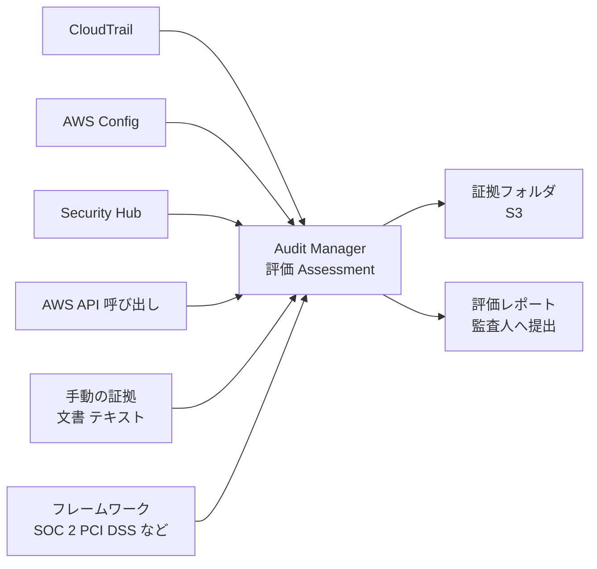

#### 2.3 Artifact と Audit Manager の使い分け

| 質問 | AWS Artifact | AWS Audit Manager |
|---|---|---|
| 何を証明するか | **AWS** のインフラ・サービスの**認証・監査結果** | **お客様**の AWS 環境が基準を満たしているか |
| 責任の所在 | クラウド「の」セキュリティ | クラウド「における」セキュリティ |
| 証拠の形式 | 第三者機関のレポート、契約書 | 自動収集した証拠 + 手動証拠 + レポート |
| 例 | 「AWS の SOC 2 レポートが欲しい」「BAA を締結したい」 | 「自社の PCI DSS 対応状況の証拠を継続的に集めたい」 |

#### 2.4 監査対応のための証拠の整理(サービスの組み合わせ)

| 目的 | 使うサービス |
|---|---|
| 誰が・いつ・何をしたか | **CloudTrail**(組織の証跡、ログファイルの整合性検証)/ CloudTrail Lake |
| 設定の履歴と準拠 | **AWS Config**(構成履歴、適合パック) |
| セキュリティ標準の達成状況 | **Security Hub** |
| 外部アクセスの確認 | **IAM Access Analyzer** |
| AWS 側の証跡 | **Artifact** |
| 継続的な証拠収集とレポート(既存利用者) | **Audit Manager** |

### Step 3. ベストプラクティス

| # | ベストプラクティス | 理由 |
|---|---|---|
| 1 | 監査証拠は**責任分界(AWS側/お客様側)ごとに整理**し、AWS 側は Artifact、お客様側は Config / Security Hub / CloudTrail などで取得する | 監査人の質問に素早く答えられる |
| 2 | **組織の CloudTrail** を Log Archive に集約し、**ログファイルの整合性検証**と **S3 Object Lock** を有効化 | 証拠の信頼性(改ざん防止) |
| 3 | **Artifact のレポートは機密として扱い**、共有先を制限。アクセスは IAM で最小権限に | 契約上・機密上の要件 |
| 4 | **BAA 等の契約は組織の管理アカウント**で承諾して組織全体に適用 | アカウントごとの承諾漏れを防ぐ |
| 5 | 継続的に証拠を集める(**監査直前に集めるのではなく、日常的に自動収集**) | 監査の負担削減 |
| 6 | **手動のコントロール(手順書、研修記録など)**も、証拠の保管場所を事前に決める | 自動化できない証拠の漏れを防ぐ |
| 7 | Audit Manager を使えない新規環境では、**Config 適合パック + Security Hub + CloudTrail** で証拠を組み立てる | 公式が案内する代替の考え方 |
| 8 | 証拠を保管する S3 バケットは**暗号化(KMS)・アクセス制限・ライフサイクル**を設定 | 証拠データ自体の保護 |

### Step 4. 試験での狙われ方

| 問われ方 | 答え |
|---|---|
| 「AWS の SOC 2 / ISO 27001 レポートを監査人に提出したい」 | **AWS Artifact** |
| 「HIPAA 対象データを扱うため、AWS と BAA を結びたい」 | **AWS Artifact Agreements** |
| 「PCI DSS に対する自社環境の証拠を継続的に自動収集し、レポート化」 | **AWS Audit Manager** |
| 「Audit Manager が収集する証拠の元データ」 | **CloudTrail、Config、Security Hub、API 呼び出し**(+手動) |
| 「AWS 側の責任範囲の証明」と「お客様側の証明」の違い | Artifact=AWS 側、Audit Manager 等=お客様側 |
| 「手順の遵守(研修実施など)も評価に含めたい」 | Audit Manager の**手動の証拠**(自動収集の対象外) |
| 「監査ログが改ざんされていないことを示したい」 | CloudTrail の**ログファイル整合性検証**、S3 Object Lock |

### 参考 URL(根拠)

- AWS Artifact とは: https://docs.aws.amazon.com/artifact/latest/ug/what-is-aws-artifact.html
- AWS Audit Manager とは: https://docs.aws.amazon.com/audit-manager/latest/userguide/what-is.html
- Audit Manager の提供状況の変更(2026 年 4 月 30 日以降は新規受付終了): https://docs.aws.amazon.com/audit-manager/latest/userguide/audit-manager-availability-change.html
- AWS Audit Manager のドキュメント履歴: https://docs.aws.amazon.com/audit-manager/latest/userguide/doc-history.md
- 共有責任モデル: https://aws.amazon.com/compliance/shared-responsibility-model/
- CloudTrail ログファイルの整合性検証: https://docs.aws.amazon.com/awscloudtrail/latest/userguide/cloudtrail-log-file-validation-intro.html

---

## 13. Skill 6.3.3 Well-Architected Tool

### Step 1. 何のためのものか

「自分の構成は、AWS のベストプラクティスに沿っているか?」を**質問に答える形式でレビュー**し、**改善点(リスク)を優先順位付けして改善計画を作る**ためのサービスが **AWS Well-Architected Tool** です。Config や Security Hub が**リソースの設定**を自動チェックするのに対し、Well-Architected Tool は**アーキテクチャ・運用プロセス・設計判断**を**人が評価する**ツールです。

### Step 2. 仕組み

#### 2.1 Well-Architected Framework の 6 つの柱

| 柱 | 内容 |
|---|---|
| 運用上の優秀性 | 運用・監視・改善 |
| **セキュリティ** | データ・システム・資産の保護(本試験に最も関連) |
| 信頼性 | 障害からの復旧、需要への対応 |
| パフォーマンス効率 | リソースの効率的な利用 |
| コスト最適化 | 不要なコストの回避 |
| 持続可能性 | 環境への影響の最小化 |

**セキュリティの柱の設計原則(要点)**

| 設計原則 | 要点 |
|---|---|
| 強固なアイデンティティ基盤の実装 | 最小権限、職務分掌、一元管理、長期認証情報への依存を減らす |
| トレーサビリティの確保 | 環境内の操作・変更をリアルタイムに監視、ログ・メトリクスの取得 |
| すべてのレイヤーでセキュリティを適用 | 多層防御 |
| セキュリティのベストプラクティスを自動化 | コードとして統制し、スケーラブルに |
| 転送中・保管中のデータを保護 | 暗号化、機密度による分類 |
| データへの人のアクセスを遠ざける | 直接アクセスの削減(ミスや誤用のリスク低下) |
| セキュリティイベントに備える | インシデント対応の準備・訓練 |

**セキュリティの柱のベストプラクティス領域(Security Foundations、IAM、検出、インフラ保護、データ保護、インシデント対応、アプリケーションセキュリティ)** に沿って質問が構成されています。

#### 2.2 Well-Architected Tool の使い方

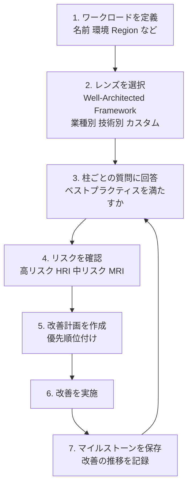

| 概念 | 説明 |
|---|---|
| **ワークロード** | レビュー対象のアプリケーション・システム(アカウント、Region、環境などの情報) |
| **レンズ(Lens)** | レビューの観点を定義した質問集。**Well-Architected Framework レンズ**、**業種別・技術別レンズ**(例: サーバーレス、SaaS、機械学習)、**カスタムレンズ**(自社基準) |
| **質問** | 各柱ごとのベストプラクティスに対する質問。選択肢で現状を回答 |
| **リスクの判定** | **高リスク(HRI: High Risk Issue)**、**中リスク(MRI: Medium Risk Issue)**、リスクなし。改善計画の優先順位の基準 |
| **マイルストーン** | レビューのスナップショット。改善の進捗を時系列で比較 |
| **改善計画** | リスク項目を優先順位付けし、改善手順の資料へのリンクを提供 |
| **共有** | ワークロードを**他のアカウントや組織(Organizations)と共有**できる(閲覧のみ/編集可) |
| レポート | PDF のレポートを出力できる |
| **Trusted Advisor 連携** | 既存の AWS アカウントの**Trusted Advisor のチェック結果**を、関連する質問に自動で反映する連携がある |

#### 2.3 他サービスとの位置づけ

| サービス | 評価の対象 | 方法 |
|---|---|---|
| **Well-Architected Tool** | **アーキテクチャ・設計・運用プロセス全体** | **人が質問に回答**してレビュー(定期的なレビュー) |
| AWS Config | **リソースの設定** | 自動(継続的) |
| Security Hub | **セキュリティ標準**への準拠・検出結果 | 自動(継続的) |
| Trusted Advisor | コスト、パフォーマンス、**セキュリティ**、耐障害性などの**推奨事項** | 自動 |

> 覚え方: **自動の継続チェックは Config / Security Hub / Trusted Advisor、人が行う設計レビューは Well-Architected Tool**。

### Step 3. ベストプラクティス

| # | ベストプラクティス | 理由 |
|---|---|---|
| 1 | **設計時、リリース前、重大な変更時、定期的(例: 半年〜1 年)**にレビューを実施する | 構成は時間とともに劣化する |
| 2 | **セキュリティの柱だけでなく**、複数の柱を含めて総合的にレビュー | 柱間のトレードオフ(セキュリティとコスト・運用性)を把握 |
| 3 | **高リスク(HRI)から優先**して改善計画を立てる | 最も影響の大きい課題から対処 |
| 4 | **マイルストーン**を保存して改善の推移を可視化 | 継続的改善の根拠となる |
| 5 | 自社の基準を**カスタムレンズ**として定義 | 標準に加えて組織固有のルールを反映 |
| 6 | レビュー結果を**開発・運用チームと共有**し、改善を**バックログに登録**する | レビューで終わらせず、実行する |
| 7 | **自動チェック(Config / Security Hub)と併用**する | 設計レビューと設定チェックは補完関係 |

### Step 4. 試験での狙われ方

| 問われ方 | 答え |
|---|---|
| 「ワークロードが AWS のベストプラクティスに沿っているかを、質問形式でレビューしたい」 | **AWS Well-Architected Tool** |
| 「自社固有のセキュリティ基準でレビューしたい」 | **カスタムレンズ** |
| 「改善の進捗を時系列で比較」 | **マイルストーン** |
| 「レビュー結果で最優先に対処すべきもの」 | **高リスク(HRI)** |
| 「リソースの設定違反を自動で継続的に検出」 | Well-Architected Tool**ではなく** Config / Security Hub |
| 「ワークロードのレビューを他アカウントや組織と共有」 | Well-Architected Tool の**共有機能** |

### 参考 URL(根拠)

- AWS Well-Architected Tool ユーザーガイド: https://docs.aws.amazon.com/wellarchitected/latest/userguide/intro.html
- セキュリティの柱: https://docs.aws.amazon.com/wellarchitected/latest/security-pillar/welcome.html
- AWS Well-Architected Framework: https://docs.aws.amazon.com/wellarchitected/latest/framework/welcome.html
- AWS Security Reference Architecture: https://docs.aws.amazon.com/prescriptive-guidance/latest/security-reference-architecture/welcome.html

---

# Part D. 総まとめ

## 14. 全体を一枚で理解する(リファレンス構成)

ここまでの Skill を、1 つのマルチアカウント構成として統合します。

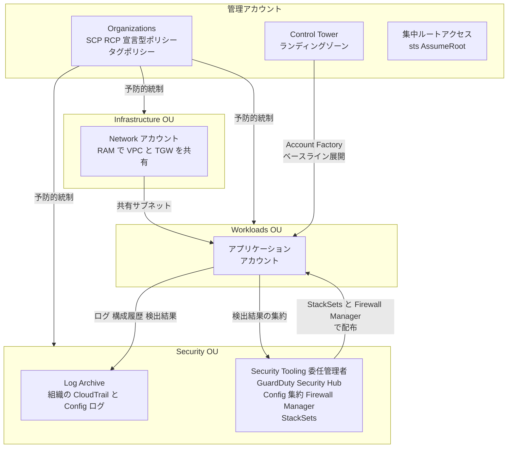

### 14.1 サービス役割マップ(層別)

| 層 | サービス・機能 | 役割 |
|---|---|---|
| 土台 | Organizations、Control Tower、Account Factory | アカウントの器・ベースライン |
| 予防 | SCP、RCP、宣言型ポリシー、タグポリシー(強制)、Firewall Manager、CloudFormation Hooks、Service Catalog | 違反の未然防止 |
| 配備 | CloudFormation / StackSets、cfn-guard、cfn-lint、RAM | 安全・一貫した展開と共有 |
| 検出 | Config、Security Hub、GuardDuty など | 違反と脅威の発見 |
| 是正 | Config 修復、EventBridge、Systems Manager Automation、ASR | 自動対処・通知 |
| 証拠・評価 | CloudTrail、Audit Manager、Artifact、Well-Architected Tool | 監査・設計レビュー |
| 特権管理 | 集中ルートアクセス、break-glass | ルート認証情報の排除 |

### 14.2 新しい組織を作るときの導入ステップ(例)

| 手順 | 作業 | 該当章 |
|---|---|---|
| 1 | 管理アカウントを保護(ルート MFA、共有メール、日常利用しない) | 第6章 |
| 2 | Organizations を **All features** で作成、OU 設計 | 第2章 |
| 3 | Control Tower でランディングゾーンを構築(Log Archive、Audit) | 第3章 |
| 4 | SCP / RCP / 宣言型ポリシーを**テスト OU → 本番 OU** の順に展開 | 第4章 |
| 5 | セキュリティサービスの**委任管理者**を Security Tooling に指定、自動有効化 | 第5章 |
| 6 | **集中ルートアクセス**を有効化し、メンバーのルート認証情報を削除 | 第6章 |
| 7 | StackSets(自動デプロイ)でベースライン、CI に cfn-guard / cfn-lint | 第7章 |
| 8 | タグポリシーと必須タグの SCP | 第8章 |
| 9 | Firewall Manager ポリシー(WAF、SG、Network Firewall) | 第9章 |
| 10 | RAM でネットワーク共有、Service Catalog で承認済み製品 | 第10章 |
| 11 | Config 組織アグリゲーターと適合パック、Security Hub 集中設定、自動修復 | 第11章 |
| 12 | 証拠の収集体制(Artifact、CloudTrail、Config)と Well-Architected レビュー | 第12〜13章 |

---

## 15. 紛らわしいサービスの比較表

### 15.1 SCP / RCP / 宣言型ポリシー / IAM ポリシー

| | SCP | RCP | 宣言型ポリシー | IAM ポリシー |
|---|---|---|---|---|
| 制御の軸 | プリンシパル | リソース | サービス設定 | プリンシパル / リソース |
| 権限を付与 | しない | しない | しない | **する** |
| 組織外プリンシパルの制御 | できない | **できる** | 設定による | リソースポリシーで可能 |
| 管理アカウントへの効果 | なし | なし(管理アカウントのリソースは対象外) | 適用先の設定に依存(公式ドキュメントで確認) | あり |
| サービスリンクロール | 対象外 | 対象外 | 対象 | - |
| 新機能への追従 | Deny 追加が必要 | Deny 追加が必要 | 自動で維持 | - |

### 15.2 Control Tower と Organizations

| | Organizations | Control Tower |
|---|---|---|
| 位置づけ | 基盤(アカウント・OU・ポリシー) | Organizations の上で動く**ベストプラクティスの自動化** |
| アカウントの払い出し | API / コンソール | **Account Factory** |
| 統制 | SCP などを**自分で設計** | **コントロールライブラリ**(予防・検出・プロアクティブ) |
| ログ・監査基盤 | 自分で構築 | Log Archive / Audit を自動構築 |

### 15.3 Config / Security Hub / Audit Manager / Well-Architected Tool

| | AWS Config | Security Hub | Audit Manager | Well-Architected Tool |
|---|---|---|---|---|
| 目的 | リソース設定の記録と準拠評価、修復 | セキュリティ状況の集約と標準チェック | 監査証拠の自動収集 | 設計レビュー |
| 評価の方法 | 自動(ルール) | 自動(標準) | 自動 + 手動 | **人が回答** |
| 修復 | **できる**(SSM Automation) | EventBridge 経由 | できない | - |
| 出力 | 準拠状況 | 検出結果とスコア | **監査レポート** | 改善計画 |

### 15.4 CloudFormation Guard / cfn-lint / Hooks / Config ルール

| | cfn-lint | cfn-guard | CloudFormation Hooks | Config ルール |
|---|---|---|---|---|
| タイミング | 開発・CI | 開発・CI | **デプロイ時** | デプロイ**後**(継続) |
| 内容 | 文法・ベストプラクティス | 自作のポリシー検査 | 非準拠ならデプロイ中断 | 設定の準拠評価 |
| 止められるか | CI で止める | CI で止める | **止める** | 止めない(検出のみ。修復は可) |

### 15.5 RAM と Service Catalog と リソースポリシー

| | RAM | Service Catalog | `aws:PrincipalOrgID` 付きリソースポリシー |
|---|---|---|---|
| 共有対象 | 既存リソース | テンプレート製品 | 特定リソース(S3、KMS、AMI など) |
| 共有単位 | リソース共有 | ポートフォリオ | ポリシー |

### 15.6 Artifact と Audit Manager

| | Artifact | Audit Manager |
|---|---|---|
| 対象 | AWS の認証・レポート、契約 | お客様の環境の証拠 |
| 責任範囲 | クラウド**の**セキュリティ | クラウド**における**セキュリティ |

---

## 16. シナリオ別 解答パターン集

試験は「要件文 → 最適な組み合わせ」を選ぶ形式です。**キーワードから答えを引く**練習をしましょう。

| # | 要件のキーワード | 最適解 |
|---|---|---|
| 1 | メンバーアカウントで特定サービス・Region を一括禁止 | **SCP**(拒否リスト、グローバルサービス除外) |
| 2 | 組織外の ID から S3 / KMS / SQS へのアクセスを防ぎたい | **RCP**(`aws:PrincipalOrgID`) |
| 3 | 新機能が追加されても VPC のパブリックアクセスブロックを維持 | **宣言型ポリシー** |
| 4 | AI サービスにコンテンツを利用させない | **AI サービスオプトアウトポリシー** |
| 5 | 管理アカウントに SCP が効かない | 仕様。**ワークロードを置かない** |
| 6 | 既存の組織に Control Tower を導入 | **既存 OU の登録、Account Factory** |
| 7 | デプロイ前にテンプレートの違反をブロック | **プロアクティブコントロール(Hooks)** |
| 8 | 全アカウントの GuardDuty を管理アカウント以外で運用 | **委任管理者 + 自動有効化** |
| 9 | 数百アカウントのルート認証情報を排除 | **集中ルートアクセス管理** |
| 10 | 全拒否バケットポリシーの修復 | **AssumeRoot + `S3UnlockBucketPolicy`** |
| 11 | IdP 障害時の緊急アクセス | **break-glass**(事前設計・使用時通知・事後再発行) |
| 12 | 新規アカウントへ自動でベースライン展開 | **StackSets(サービスマネージド + 自動デプロイ)** |
| 13 | IaC に組織独自のルールを適用して CI で検査 | **cfn-guard** |
| 14 | タグのキー・値を統一 | **タグポリシー** |
| 15 | 必須タグなしのリソース作成を拒否 | **SCP**(`aws:RequestTag`) |
| 16 | 全 ALB に WAF ルールを自動適用 | **Firewall Manager WAF ポリシー** |
| 17 | 共通 VPC サブネットをアプリアカウントへ | **RAM** |
| 18 | 承認済み構成のみセルフサービスで提供 | **Service Catalog(起動制約)** |
| 19 | 全アカウント・Region の準拠状況を集約 | **Config 組織アグリゲーター** |
| 20 | 非準拠リソースの自動修復 | **Config 修復(SSM Automation)** |
| 21 | 複数サービスの検出結果を集約し標準で評価 | **Security Hub(委任管理者 + 集中設定)** |
| 22 | AWS の SOC 2 レポートや BAA | **Artifact** |
| 23 | 自社環境の監査証拠を自動収集 | **Audit Manager**(※新規は提供終了、代替は Config + Security Hub + CloudTrail) |
| 24 | ワークロードのベストプラクティス準拠を質問形式でレビュー | **Well-Architected Tool** |

---

## 17. 確認問題(10問)

**Q1.** ある企業が組織内の全メンバーアカウントで、組織外のプリンシパルから自社の S3 バケットへのアクセスを、バケットポリシーの内容に関わらず拒否したい。最適な手段はどれか。
- A. SCP で `s3:*` を拒否する
- B. RCP で `aws:PrincipalOrgID` を使い、組織外のアクセスを拒否する
- C. 各バケットにバケットポリシーを設定する
- D. IAM ポリシーに Deny を追加する

**Q2.** 管理アカウントに SCP を適用しても制限されない。原因として最も適切なものは?
- A. SCP のサイズ超過
- B. 管理アカウントは SCP の対象外
- C. All features が未有効
- D. 信頼されたアクセスが未有効

**Q3.** Control Tower で、CloudFormation テンプレートからのデプロイ前に非準拠リソースを検出してデプロイを止めたい。どのコントロールか。
- A. 予防コントロール
- B. 検出コントロール
- C. プロアクティブコントロール
- D. 必須コントロール

**Q4.** 数百のメンバーアカウントのルート認証情報の管理負担を減らしたい。誤って全アクセス拒否の S3 バケットポリシーを作成した場合も、安全に復旧したい。最適な手段は?
- A. 各アカウントのルートパスワードを共有金庫に保管する
- B. 集中ルートアクセスを有効化し、`sts:AssumeRoot` と `S3UnlockBucketPolicy` を使う
- C. SCP でルートを全拒否する
- D. 各アカウントでルートのアクセスキーを作成する

**Q5.** 新しいアカウントが OU に追加されたら、自動で標準のセキュリティスタックを展開したい。最適な方法は?
- A. 自己管理権限の StackSets を手動実行
- B. サービスマネージド権限の StackSets で自動デプロイを有効化
- C. Lambda で定期的にスタックを作成
- D. Service Catalog にテンプレートを登録

**Q6.** 組織内の全 ALB と CloudFront に同じ WAF ルールを配布し、新規リソースにも自動適用したい。動作の前提条件はどれか(2 つ)。
- A. 全アカウントで AWS Config を有効化
- B. Firewall Manager の管理者アカウントを指定
- C. 全アカウントに Shield Advanced を購入(WAF ポリシーの場合)
- D. 全アカウントに GuardDuty を有効化

**Q7.** 開発者に強い IAM 権限を与えず、承認済みの構成の EC2 だけを作成できるようにしたい。最適なサービスは?
- A. AWS RAM
- B. AWS Service Catalog(起動制約)
- C. AWS Config
- D. IAM Access Analyzer

**Q8.** 全 Region・全アカウントの Config 準拠状況を一元的に確認したい。最適な手段は?
- A. Config アグリゲーター
- B. CloudTrail Lake
- C. Trusted Advisor
- D. Well-Architected Tool

**Q9.** HIPAA 対象データを扱うため、AWS と BAA を締結し、AWS の SOC 2 レポートも取得したい。使うサービスは?
- A. AWS Audit Manager
- B. AWS Artifact
- C. AWS Security Hub
- D. AWS Config

**Q10.** 「タグが付いていないリソースを作成させない」要件を満たすのに最も適切なものは?
- A. タグポリシーのみ
- B. SCP で `aws:RequestTag` / `Null` 条件を使って拒否
- C. Config `required-tags` ルールのみ
- D. Cost Explorer

### 解答と解説

| 問 | 答 | 解説 |
|---|---|---|
| Q1 | **B** | 組織外プリンシパルの制御は **RCP** の役割。SCP は組織外のプリンシパルを制御できない |
| Q2 | **B** | 管理アカウントは SCP / RCP の対象外。ワークロードを置かない設計にする |
| Q3 | **C** | **プロアクティブ**コントロール(CloudFormation Hooks)がデプロイ前に検査・ブロックする |
| Q4 | **B** | 集中ルートアクセスで認証情報を排除し、`AssumeRoot` のタスクポリシーで復旧。C は復旧作業ができなくなる |
| Q5 | **B** | サービスマネージド権限 + 自動デプロイが OU への新規アカウント追加に追従する |
| Q6 | **A, B** | Config の有効化と管理者アカウントの指定が前提。C は Shield Advanced ポリシーの場合のみ |
| Q7 | **B** | Service Catalog の起動制約で、利用者に直接の権限を与えずに承認済み構成を払い出せる |
| Q8 | **A** | 組織のアグリゲーターで、マルチアカウント・マルチ Region の構成と準拠状態を集約 |
| Q9 | **B** | AWS 側のレポートと契約(BAA)は Artifact |
| Q10 | **B** | 作成時の強制は SCP。タグポリシーは付けるなら正しい形式、Config は検出のみ |

---

## 18. 用語集

| 用語 | 意味 |
|---|---|
| OU | 組織単位。アカウントをまとめ、ポリシーを継承させる単位 |
| 管理アカウント | 組織を作成したアカウント。SCP/RCP の対象外 |
| 委任管理者 | サービスの管理を委任されたメンバーアカウント |
| 信頼されたアクセス | 組織全体でサービスが動作することを許可する設定 |
| SCP | プリンシパルの最大権限を決める組織ポリシー |
| RCP | リソースへの最大権限を決める組織ポリシー |
| 宣言型ポリシー | サービスのベースライン設定を強制する組織ポリシー |
| データ境界 | 信頼された ID・リソース・ネットワークだけがデータにアクセスできる状態 |
| ランディングゾーン | Control Tower が構築するマルチアカウント環境 |
| Account Factory | Control Tower のアカウント払い出し機構(Service Catalog 製品) |
| 予防 / 検出 / プロアクティブ | Control Tower のコントロールの動作区分 |
| ドリフト | 管理対象の設定が手動変更などでずれること |
| 集中ルートアクセス | 組織からメンバーのルート認証情報を管理し、`sts:AssumeRoot` で短期特権セッションを使う機能 |
| break-glass | 緊急時だけ使う特権アクセス経路 |
| StackSets | CloudFormation テンプレートを複数アカウント・Region に展開する機能 |
| cfn-guard | ポリシーをコードで書いて検査する CloudFormation Guard |
| CloudFormation Hooks | デプロイ時にリソース設定を検査する仕組み |
| ABAC | 属性(タグ)に基づくアクセス制御 |
| RAM | リソースを他アカウントと共有するサービス |
| 起動制約 | Service Catalog で製品起動時に使う IAM ロールの指定 |
| 適合パック | Config ルールと修復をまとめた展開単位 |
| アグリゲーター | 複数アカウント・Region の Config データの集約先 |
| CSPM | クラウドのセキュリティ態勢管理 |
| HRI / MRI | Well-Architected の高リスク / 中リスク項目 |

---

## 19. 参考ソース URL

> 注記: 以下は本ガイドの根拠です。★は本ガイド作成時に実際に内容を取得・確認したページです。それ以外は各サービスの公式ドキュメントの標準的なページで、仕様更新が速いため試験直前に最新内容を確認してください。

### 19.1 試験ガイド

| ソース | URL |
|---|---|
| ★ AWS Certified Security - Specialty (SCS-C03) 試験ガイド | https://docs.aws.amazon.com/aws-certification/latest/security-specialty-03/security-specialty-03.html |
| ★ Content Domain 6: Security Foundations and Governance | https://docs.aws.amazon.com/aws-certification/latest/security-specialty-03/security-specialty-03-domain6.html |

### 19.2 Task 6.1(Organizations / Control Tower / ポリシー / ルートユーザー)

| ソース | URL |
|---|---|
| AWS Organizations ユーザーガイド | https://docs.aws.amazon.com/organizations/latest/userguide/orgs_introduction.html |
| ★ 宣言型ポリシー | https://docs.aws.amazon.com/organizations/latest/userguide/orgs_manage_policies_declarative.html |
| ★ RCP | https://docs.aws.amazon.com/organizations/latest/userguide/orgs_manage_policies_rcps.html |
| SCP | https://docs.aws.amazon.com/organizations/latest/userguide/orgs_manage_policies_scps.html |
| AI サービスオプトアウトポリシー | https://docs.aws.amazon.com/organizations/latest/userguide/orgs_manage_policies_ai-opt-out.html |
| ★ 予防的統制の実装(AWS Cloud Operations Blog) | https://aws.amazon.com/blogs/mt/enforcing-enterprise-wide-preventive-controls-with-aws-organizations |
| ★ SRA: Org Management アカウント | https://docs.aws.amazon.com/prescriptive-guidance/latest/security-reference-architecture/org-management.html |
| Organizations と連携する AWS サービス | https://docs.aws.amazon.com/organizations/latest/userguide/orgs_integrate_services.html |
| ★ Control Tower の仕組み | https://docs.aws.amazon.com/controltower/latest/userguide/how-control-tower-works.html |
| ★ Control Tower のカスタマイズ | https://docs.aws.amazon.com/controltower/latest/userguide/console-customize.html |
| ★ Control Tower のコントロール(Prescriptive Guidance) | https://docs.aws.amazon.com/prescriptive-guidance/latest/designing-control-tower-landing-zone/controls.html |
| ★ 集中ルートアクセス(AWS ニュースブログ) | https://aws.amazon.com/de/blogs/aws/centrally-managing-root-access-for-customers-using-aws-organizations/ |
| ★ 集中ルートアクセスのベストプラクティス(re:Post) | https://repost.aws/articles/AR0YHZ3VskTzqhJKyEDPnSPQ/centralized-root-access-in-aws-organizations-benefits-considerations-and-best-practices |
| IAM ルートユーザーのベストプラクティス | https://docs.aws.amazon.com/IAM/latest/UserGuide/root-user-best-practices.html |

### 19.3 Task 6.2(IaC / タグ / Firewall Manager / 共有)

| ソース | URL |
|---|---|
| CloudFormation StackSets | https://docs.aws.amazon.com/AWSCloudFormation/latest/UserGuide/what-is-cfnstacksets.html |
| CloudFormation Guard | https://docs.aws.amazon.com/cfn-guard/latest/ug/what-is-guard.html |
| cfn-lint | https://github.com/aws-cloudformation/cfn-lint |
| CloudFormation Hooks | https://docs.aws.amazon.com/cloudformation-cli/latest/hooks-userguide/what-is-cloudformation-hooks.html |
| タグポリシー | https://docs.aws.amazon.com/organizations/latest/userguide/orgs_manage_policies_tag-policies.html |
| タグ付けのベストプラクティス | https://docs.aws.amazon.com/whitepapers/latest/tagging-best-practices/tagging-best-practices.html |
| Firewall Manager | https://docs.aws.amazon.com/waf/latest/developerguide/fms-chapter.html |
| ★ Firewall Manager 用 Config の有効化 | https://docs.aws.amazon.com/waf/latest/developerguide/enable-config.html |
| AWS RAM | https://docs.aws.amazon.com/ram/latest/userguide/what-is.html |
| AWS Service Catalog | https://docs.aws.amazon.com/servicecatalog/latest/adminguide/introduction.html |

### 19.4 Task 6.3(Config / Security Hub / Audit Manager / Artifact / Well-Architected)

| ソース | URL |
|---|---|
| AWS Config | https://docs.aws.amazon.com/config/latest/developerguide/WhatIsConfig.html |
| Config 適合パック | https://docs.aws.amazon.com/config/latest/developerguide/conformance-packs.html |
| Config アグリゲーター | https://docs.aws.amazon.com/config/latest/developerguide/aggregate-data.html |
| Config 修復 | https://docs.aws.amazon.com/config/latest/developerguide/remediation.html |
| Security Hub | https://docs.aws.amazon.com/securityhub/latest/userguide/what-is-securityhub.html |
| ★ Security Hub CSPM 設定ポリシー | https://docs.aws.amazon.com/securityhub/latest/userguide/configuration-policies-overview.html |
| ★ Security Hub CSPM ベストプラクティス | https://aws.github.io/aws-security-services-best-practices/guides/security-hub-cspm/ |
| AWS Artifact | https://docs.aws.amazon.com/artifact/latest/ug/what-is-aws-artifact.html |
| ★ Audit Manager とは | https://docs.aws.amazon.com/audit-manager/latest/userguide/what-is.html |
| ★ Audit Manager 提供状況の変更 | https://docs.aws.amazon.com/audit-manager/latest/userguide/audit-manager-availability-change.html |
| Well-Architected Tool | https://docs.aws.amazon.com/wellarchitected/latest/userguide/intro.html |
| Well-Architected セキュリティの柱 | https://docs.aws.amazon.com/wellarchitected/latest/security-pillar/welcome.html |

---

*このガイドは、公式試験ガイドの出題範囲に沿って作成した学習資料です。AWS のサービス仕様は頻繁に更新されるため、受験前に最新の公式ドキュメントと試験ガイドをご確認ください。*
