# AWS Certified Security - Specialty (SCS-C03) 初学者向けステップバイステップ完全ガイド

> 対象試験: AWS Certified Security - Specialty (SCS-C03)
> 試験ガイド(公式): https://docs.aws.amazon.com/aws-certification/latest/security-specialty-03/security-specialty-03.html
> 本ガイドの構成: 公式試験ガイドの 6 コンテンツドメイン / 全 17 タスクに沿って、各スキル(Skill)の「何か」「なぜ必要か」「どう設定するか」「ベストプラクティス」「根拠 URL」を解説します。
> 図解ルール: ASCII 図は使わず、フローは Mermaid、表は Markdown 表で表現します。

---

## 目次

- [0. はじめに: 試験の全体像](#0-はじめに-試験の全体像)
- [1. 前提知識: これだけは先に押さえる](#1-前提知識-これだけは先に押さえる)
- [Domain 1: Detection(検出) 16%](#domain-1-detection検出-16)
- [Domain 2: Incident Response(インシデント対応) 14%](#domain-2-incident-responseインシデント対応-14)
- [Domain 3: Infrastructure Security(インフラストラクチャセキュリティ) 18%](#domain-3-infrastructure-securityインフラストラクチャセキュリティ-18)
- [Domain 4: Identity and Access Management(IAM) 20%](#domain-4-identity-and-access-managementiam-20)
- [Domain 5: Data Protection(データ保護) 18%](#domain-5-data-protectionデータ保護-18)
- [Domain 6: Security Foundations and Governance 14%](#domain-6-security-foundations-and-governance-14)
- [7. 横断チートシート](#7-横断チートシート)
- [8. 確認問題](#8-確認問題)
- [9. 学習プラン](#9-学習プラン)
- [10. 参考 URL 一覧](#10-参考-url-一覧)

---

## 0. はじめに: 試験の全体像

### 0.1 この試験は何を測るのか

公式ガイドによると、この試験は「クラウドソリューションを守る責任を持つ人」向けで、AWS の製品・サービスを安全にするための知識を問います。具体的には次の能力が検証されます。

| 検証される能力 | かみ砕いた意味 |
|---|---|
| データ分類と保護メカニズムの適用 | 機密度に応じてデータの守り方を変えられる |
| 暗号化方式の実装 | 保存時・転送時の暗号化を正しく選び設定できる |
| 安全なインターネットプロトコルの実装 | TLS などを強制し、古い設定を排除できる |
| セキュリティサービスによる本番環境の保護 | GuardDuty / WAF / Config などを使いこなせる |
| コスト・セキュリティ・複雑さのトレードオフ判断 | 「最強」ではなく「要件に合う最小構成」を選べる |
| セキュリティ運用とリスクの理解 | 検知から復旧までの運用を理解している |

根拠: 試験ガイド Introduction https://docs.aws.amazon.com/aws-certification/latest/security-specialty-03/security-specialty-03.html

### 0.2 想定受験者と範囲外

- 想定: クラウドソリューションの保護に **3〜5 年相当** の経験
- 範囲外(試験で問われない): 暗号アルゴリズムの設計、パケットレベルのトラフィック解析、クラウド全体のアーキテクチャ設計、エンドユーザーコンピューティング管理、機械学習モデルの訓練

> **ポイント**: 範囲外が明示されているので、「パケットを 1 つずつ読み解く」ような深掘りは不要です。サービスの選択と設定判断に集中しましょう。

### 0.3 試験形式とスコア

| 項目 | 内容 |
|---|---|
| 問題数 | 採点対象 50 問 + 採点対象外 15 問(どれが採点外かは分からない) |
| 問題形式 | 多肢選択、複数選択、並べ替え(Ordering)、マッチング |
| 合格スコア | 100〜1,000 のスケールスコアで 750 以上 |
| 採点モデル | 補償型(ドメインごとの足切りなし。全体で合格すればよい) |
| 未回答 | 不正解扱い。推測回答のペナルティはなし |

> **ポイント**: 未回答は不正解なので、わからなくても必ず何か選びます。補償型なので、苦手ドメインがあっても得意ドメインでカバーできます。

### 0.4 ドメイン配分

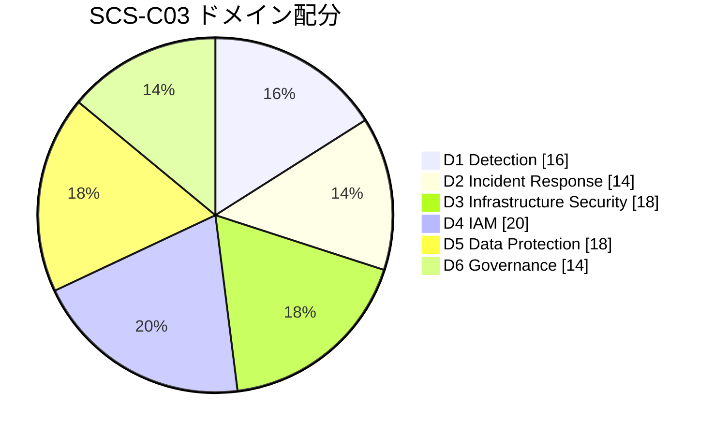

IAM(20%)が最大で、次いでインフラ(18%)とデータ保護(18%)です。IAM は他ドメインの問題にも登場するため、最優先で固めるのが効率的です。

### 0.5 SCS-C02 から SCS-C03 への主な変更点

SCS-C03 は 2025 年 12 月 2 日以降の試験です。

| 区分 | 主な内容 |
|---|---|
| 構造変更 | 旧「Threat Detection and Incident Response」と「Security Logging and Monitoring」が、新 Domain 1 Detection と Domain 2 Incident Response に再編。Domain 6 は「Security Foundations and Governance」に名称変更 |
| 追加 | 検出結果の妥当性検証(2.2.3)、OCSF 形式や外部 WAF ルールとの統合(3.1.4)、生成 AI アプリのガードレール(3.2.7)、リソース間の転送中暗号化(5.1.3)、インポート鍵と AWS 生成鍵の違い(5.3.3)、機微データのマスキング(5.3.4)、単一/複数リージョンでの鍵・証明書管理(5.3.5) |
| 削除 | ASFF、AWS Security Incident Response Guide、ホストベースセキュリティ、TCP/IP 基礎、IAM ポリシー要素の基礎、TLS の概念、S3 静的ウェブサイトホスティングなど |

根拠: Appendix: Comparison of SCS-C02 and SCS-C03 https://docs.aws.amazon.com/aws-certification/latest/security-specialty-03/security-specialty-03-appendix-b.html

> **補足**: 「IAM ポリシー要素の基礎」「TLS の概念」は出題範囲の記述から外れましたが、設定を判断する問題の前提にはなります。本ガイドでも最小限は解説します。

### 0.6 学習の進め方(全体ロードマップ)

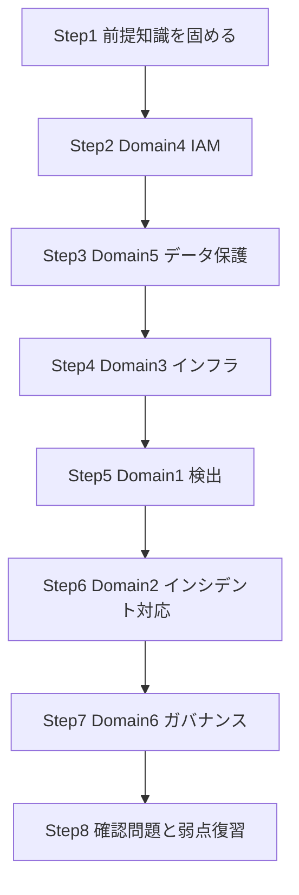

IAM と暗号化(KMS)を先にやると、後続ドメインの「なぜこの権限・この鍵が必要か」が理解しやすくなります。

---

## 1. 前提知識: これだけは先に押さえる

### 1.1 責任共有モデル

AWS は「クラウド**の**セキュリティ」(データセンター、ハードウェア、ホスト OS、仮想化層)を担い、お客様は「クラウド**における**セキュリティ」(データ、IAM、OS パッチ、ネットワーク設定、暗号化の選択)を担います。サービスの抽象度が上がるほど AWS の担当範囲が広がります。

| サービス種別 | 例 | お客様の主な責任 |
|---|---|---|
| IaaS 型 | Amazon EC2 | ゲスト OS パッチ、SG、IAM、データ暗号化、アプリ |
| コンテナ型 | Amazon ECS / EKS(EC2 起動タイプ) | コンテナイメージ、タスク/Pod の権限、ネットワークポリシー |
| 抽象化サービス | Amazon S3、DynamoDB | データ分類、アクセス制御、暗号化設定、ログ |
| サーバーレス | AWS Lambda | コード、実行ロール、依存ライブラリ |

根拠: https://aws.amazon.com/compliance/shared-responsibility-model/

### 1.2 セキュリティの基本原則

| 原則 | 意味 | 代表的な AWS 手段 |
|---|---|---|
| 最小権限 | 必要な権限だけを付ける | IAM ポリシー、Permission Boundary、Access Analyzer |
| 多層防御 | 1 か所が破られても次で止める | WAF、SG、NACL、Network Firewall、SCP |
| 職務分離 | 1 人・1 アカウントに権限を集中させない | マルチアカウント、ロール分離 |
| トレーサビリティ | 誰がいつ何をしたか追える | CloudTrail、Config、各種ログ |
| 自動化 | 人手を減らして一貫性を保つ | EventBridge、SSM Automation、IaC |
| 暗号化の徹底 | 保存時も転送時も暗号化 | KMS、ACM、TLS 強制 |

根拠: AWS Well-Architected Framework Security Pillar https://docs.aws.amazon.com/wellarchitected/latest/security-pillar/welcome.html

### 1.3 IAM ポリシーの最低限の読み方

試験ガイドの旧版にあった「Principal / Action / Resource / Condition」は、問題文のポリシー JSON を読むために今でも必要です。

```json
{
  "Version": "2012-10-17",
  "Statement": [
    {
      "Sid": "AllowReadOnlyToReportsBucket",
      "Effect": "Allow",
      "Action": ["s3:GetObject", "s3:ListBucket"],
      "Resource": [
        "arn:aws:s3:::example-reports",
        "arn:aws:s3:::example-reports/*"
      ],
      "Condition": {
        "Bool": { "aws:SecureTransport": "true" }
      }
    }
  ]
}
```

| 要素 | 役割 | 補足 |
|---|---|---|
| Effect | Allow か Deny | 明示的 Deny は常に最優先 |
| Action | 許可/拒否する API | ワイルドカードは最小限に |
| Resource | 対象リソースの ARN | バケット自体(ListBucket)とオブジェクト(GetObject)で ARN が異なる点に注意 |
| Principal | 誰に対してか | リソースベースポリシーと信頼ポリシーにのみ登場 |
| Condition | 追加条件 | タグ、送信元 IP、TLS 使用有無、MFA など |

### 1.4 主要サービスの地図

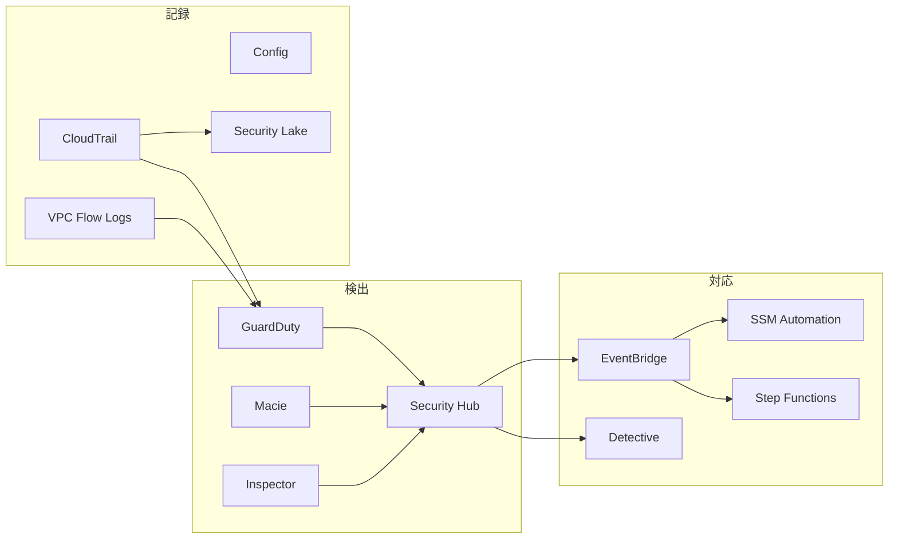

> **ポイント**: 「記録(Logs)を集め、検出サービスが分析し、Security Hub に集約され、EventBridge から自動対応につながる」という一本の流れで全体を理解すると、各サービスの位置づけが迷いません。

---

## Domain 1: Detection(検出) 16%

公式ガイド: https://docs.aws.amazon.com/aws-certification/latest/security-specialty-03/security-specialty-03-domain1.html

このドメインは 3 つのタスクで構成されます。

| タスク | 内容 | 主なサービス |
|---|---|---|
| 1.1 | 監視とアラートの設計・実装 | GuardDuty、Security Hub、Macie、Security Lake、Config、SSM State Manager |
| 1.2 | ログ収集・保存・分析の設計・実装 | CloudTrail、CloudWatch Logs、VPC Flow Logs、Athena、OpenSearch、Security Lake |
| 1.3 | 監視・ログ・アラートのトラブルシューティング | CloudWatch Agent、Lambda / API Gateway / CloudFront ログ設定 |

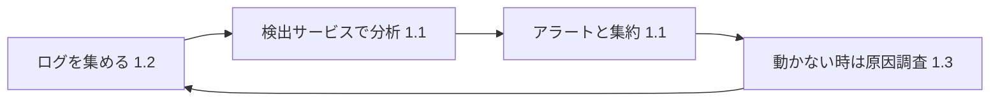

---

### Task 1.1: 監視とアラートの設計・実装

#### Skill 1.1.1 / 1.1.2: ワークロードを分析し、監視要件と監視戦略を決める

**何をするか**: 「何を」「どの粒度で」「どれくらいの速さで」検知したいかを先に決めます。ツールを入れる前に要件を決めるのが出発点です。

| 観点 | 問いかけの例 | 選択の目安 |
|---|---|---|
| 守る対象 | 本番データはどこに? | S3 なら Macie、EC2/コンテナなら Inspector と GuardDuty |
| 脅威 | 認証情報の漏えい? マルウェア? 暗号通貨マイニング? | GuardDuty の保護プランを有効化 |
| 即時性 | 数分以内に通知が必要か? | EventBridge ルール、CloudWatch アラーム |
| 規制 | 監査証跡を何年保持? | CloudTrail Lake / S3 + Object Lock |
| 規模 | アカウント数、リージョン数は? | Organizations + 委任管理者による一括有効化 |

**ヘルスチェック(Skill 1.1.2 の例)**: ELB のターゲットヘルスチェック、Route 53 ヘルスチェック、CloudWatch Synthetics カナリアなど。可用性の異常は攻撃(DDoS など)の兆候でもあるため、セキュリティ監視にも組み込みます。

**ベストプラクティス**
- 要件(脅威モデル、規制、RTO/RPO)から逆算して監視対象を決める
- 全リージョンで検出サービスを有効化する(未使用リージョンでの不正利用を見逃さないため)
- 検出と通知を分離し、通知先は一元化する(Security Hub や専用の SNS/Chatbot)

根拠: https://docs.aws.amazon.com/wellarchitected/latest/security-pillar/detection.html

#### Skill 1.1.3: セキュリティイベントとモニタリングイベントを集約する

複数アカウント・複数リージョンの検出結果を 1 か所に集める設計が基本です。

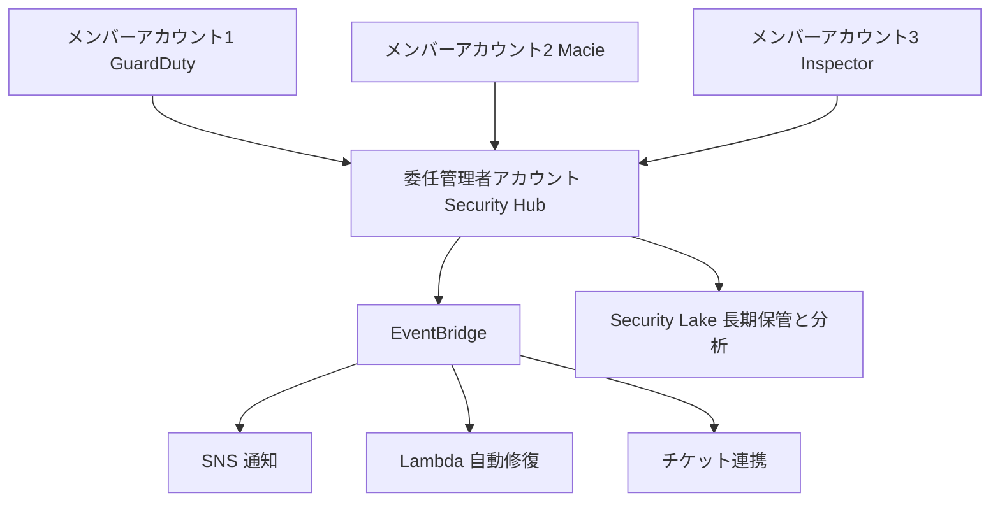

**ポイント**
- **委任管理者(delegated administrator)** を使うと、管理アカウントを日常運用から切り離せる(最小権限と職務分離)
- Organizations と連携すると、新規アカウントに**自動で有効化**できる
- 集約リージョン(Security Hub の finding aggregation region)を決めると、リージョン横断で 1 画面に集約できる

根拠:
- Security Hub: https://docs.aws.amazon.com/securityhub/latest/userguide/what-is-securityhub.html
- Organizations 委任管理者: https://docs.aws.amazon.com/organizations/latest/userguide/orgs_integrate_delegated_admin.html

> **補足(名称の更新に注意)**: Security Hub は近年機能拡張が続き、従来の「コンプライアンスチェック中心の機能」と新しい集約・分析機能の位置づけが整理されています。試験対策では「Security Hub = 複数サービスの検出結果を集約し、標準(CIS、AWS Foundational Security Best Practices など)に対する準拠状況も評価する」と押さえ、最新の名称は上記ドキュメントで確認してください。

#### Skill 1.1.4: メトリクス・アラート・ダッシュボードで異常を検知する

主要サービスを「何を見つけるか」で整理します。

| サービス | 見つけるもの | データソース | 試験でのキーワード |
|---|---|---|---|
| Amazon GuardDuty | 脅威(不審な API 呼び出し、侵害された EC2、マルウェア、不審な DNS) | CloudTrail、VPC Flow Logs、DNS ログ(基盤)+ 各保護プラン | 脅威検出、機械学習、エージェント不要(基盤部分) |
| Amazon Macie | S3 内の機微データ(PII など)とバケットの公開状態 | S3 | 機密データ探索、PII |
| Amazon Inspector | ソフトウェア脆弱性(CVE)、ネットワーク到達性 | EC2、ECR、Lambda | 脆弱性スキャン |
| AWS Security Hub | 上記の集約と標準への準拠評価 | 各サービス | 集約、CIS、ベストプラクティス |
| Amazon Security Lake | OCSF 形式で正規化したセキュリティデータレイク | 各種 AWS ログ + 外部 | OCSF、データレイク |
| CloudWatch | メトリクス・アラーム・ダッシュボード | CloudWatch Logs のメトリクスフィルター等 | メトリクスフィルター、アラーム |

**GuardDuty の保護プラン(主なもの)**: S3 Protection、EKS Protection(監査ログ)、Runtime Monitoring(EC2 / ECS / EKS)、Malware Protection(EBS / S3)、RDS Protection、Lambda Protection。必要なものを選んで有効化します。

**CloudWatch で「ルートユーザー使用」を検知する例**

```bash
# CloudTrail のログが送られている CloudWatch Logs グループにメトリクスフィルターを作る
aws logs put-metric-filter \
  --log-group-name "CloudTrail/management-events" \
  --filter-name "RootAccountUsage" \
  --filter-pattern '{ $.userIdentity.type = "Root" && $.userIdentity.invokedBy NOT EXISTS && $.eventType != "AwsServiceEvent" }' \
  --metric-transformations metricName=RootAccountUsageCount,metricNamespace=SecurityMetrics,metricValue=1
```

**ベストプラクティス**
- GuardDuty は**全アカウント・全リージョン**で有効化し、Organizations の自動有効化を使う
- 検出結果は**重大度でルーティング**(High は即時通知+自動隔離、Low は集計して週次レビュー)
- アラートの量が多すぎると見逃しにつながるため、抑制ルール(suppression rule)で既知の許容パターンを除外する
- ダッシュボードは「誰が見るか」(経営層、SOC、開発者)で分ける

根拠:
- GuardDuty: https://docs.aws.amazon.com/guardduty/latest/ug/what-is-guardduty.html
- Macie: https://docs.aws.amazon.com/macie/latest/user/what-is-macie.html
- Inspector: https://docs.aws.amazon.com/inspector/latest/user/what-is-inspector.html
- Security Lake: https://docs.aws.amazon.com/security-lake/latest/userguide/what-is-security-lake.html
- CloudWatch Logs メトリクスフィルター: https://docs.aws.amazon.com/AmazonCloudWatch/latest/logs/MonitoringLogData.html

#### Skill 1.1.5: 定期的な評価と調査を自動化する

| 手段 | 何を自動化するか | 補足 |
|---|---|---|
| AWS Config ルール | リソース設定の継続評価(例: S3 公開禁止、EBS 暗号化) | 変更トリガー型と定期実行型がある |
| Config コンフォーマンスパック | 複数ルールと修復アクションを 1 つの単位で配布 | Organizations 単位でデプロイ可能 |
| Config 修復アクション | 非準拠リソースを SSM Automation で自動修復 | 手動承認 / 自動修復を選べる |
| SSM State Manager | インスタンスを望ましい状態に保つ(エージェント設定、パッチ設定など) | 関連付け(association)で定期適用 |
| Security Hub 標準 | CIS / AWS Foundational Security Best Practices などの自動チェック | 全アカウントに一括有効化 |

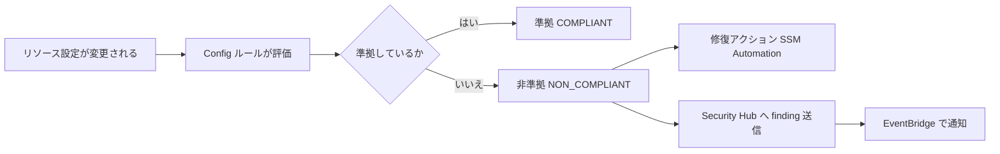

**ベストプラクティス**
- 評価ルールは**コンフォーマンスパック**でまとめ、Organizations から全アカウントへ展開する
- Config アグリゲーターで複数アカウント・リージョンの準拠状況を 1 か所で確認する
- 自動修復は影響範囲の小さいものから始め、重要リソースは承認ステップを挟む

根拠:
- Config: https://docs.aws.amazon.com/config/latest/developerguide/WhatIsConfig.html
- コンフォーマンスパック: https://docs.aws.amazon.com/config/latest/developerguide/conformance-packs.html
- State Manager: https://docs.aws.amazon.com/systems-manager/latest/userguide/state-manager.html

---

### Task 1.2: ログソリューションの設計・実装

#### Skill 1.2.1: 要件に基づきログの取り込み元と保存先を決める

| ログ | 何がわかるか | 保存先の定番 |
|---|---|---|
| CloudTrail 管理イベント | コントロールプレーン操作(誰がどの API を呼んだか) | S3、CloudWatch Logs、CloudTrail Lake |
| CloudTrail データイベント | S3 オブジェクトや Lambda 呼び出し等のデータプレーン操作(既定では無効) | 同上(量とコストが大きい) |
| VPC Flow Logs | ネットワークの通信メタデータ(パケット内容は含まない) | S3、CloudWatch Logs、Firehose |
| Route 53 Resolver クエリログ | VPC 内からの DNS クエリ | S3、CloudWatch Logs、Firehose |
| ELB アクセスログ | ロードバランサー経由のリクエスト | S3 |
| CloudFront ログ | エッジでのリクエスト | S3(標準ログ)、Kinesis(リアルタイムログ) |
| AWS WAF ログ | 検査したリクエストとルール一致結果 | S3、CloudWatch Logs、Firehose |
| アプリ / OS ログ | アプリの挙動 | CloudWatch Agent 経由で CloudWatch Logs |

> **ポイント**: ログは「監査用の長期保存(S3)」と「即時分析・アラート(CloudWatch Logs)」の 2 系統に分ける設計が定番です。

#### Skill 1.2.2: AWS サービスとアプリケーションのログを設定する

**CloudTrail(組織トレイル)**

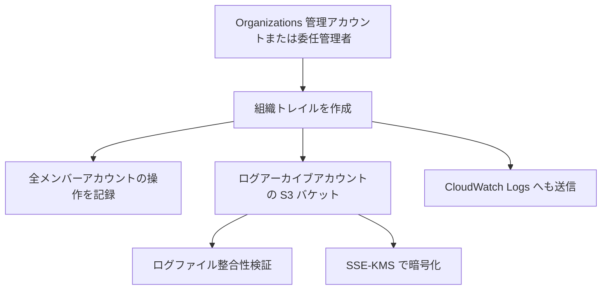

- 組織トレイルは**全メンバーアカウント**で有効になり、メンバーは**無効化・変更できない**(改ざん耐性)
- **マルチリージョントレイル**にして、未使用リージョンの操作も記録する
- **ログファイル整合性検証**(SHA-256 ハッシュと電子署名のダイジェストファイル)で改ざんを検知できる

```bash
aws cloudtrail create-trail \
  --name org-trail \
  --s3-bucket-name example-central-cloudtrail-logs \
  --is-organization-trail \
  --is-multi-region-trail \
  --enable-log-file-validation \
  --kms-key-id arn:aws:kms:ap-northeast-1:111122223333:key/EXAMPLE-KEY-ID
aws cloudtrail start-logging --name org-trail
```

**専用の CloudWatch ログアカウント**: 複数アカウントのログを 1 つの監視アカウントで見たい場合、CloudWatch の**クロスアカウント・クロスリージョン可観測性**(Observability Access Manager)や、ログのサブスクリプションフィルターを使って、専用アカウントに集約します。

**CloudWatch Agent**: EC2 / オンプレのメモリ・ディスク・アプリログを CloudWatch に送るエージェント。設定ファイルは SSM パラメータストアに置いて一元管理できます。IAM には `CloudWatchAgentServerPolicy` が使えます。

**ベストプラクティス**
- ログアーカイブ用のアカウントを**ワークロードと分離**し、書き込みだけ許可・削除不可にする
- S3 バケットは**バージョニング + Object Lock + SSE-KMS + パブリックアクセスブロック**
- ログ保存期間は規制要件で決め、S3 ライフサイクルで安価なクラスへ移行する

根拠:
- 組織トレイル: https://docs.aws.amazon.com/awscloudtrail/latest/userguide/creating-trail-organization.html
- 整合性検証: https://docs.aws.amazon.com/awscloudtrail/latest/userguide/cloudtrail-log-file-validation-intro.html
- CloudWatch クロスアカウント可観測性: https://docs.aws.amazon.com/AmazonCloudWatch/latest/monitoring/CloudWatch-Unified-Cross-Account.html
- CloudWatch Agent: https://docs.aws.amazon.com/AmazonCloudWatch/latest/monitoring/Install-CloudWatch-Agent.html

#### Skill 1.2.3: ログの保管とデータレイク(Security Lake)、外部ツール連携

**Amazon Security Lake** は、AWS 各サービスや外部ソースのセキュリティログを **OCSF(Open Cybersecurity Schema Framework)** に正規化し、**Apache Parquet 形式で S3 に保存**するサービスです。

| 項目 | 内容 |
|---|---|
| 何が嬉しいか | 形式の違うログを 1 つのスキーマに揃え、横断分析しやすくする |
| ソース | CloudTrail、VPC Flow Logs、Route 53 Resolver ログ、Security Hub の検出結果、S3 / Lambda のデータイベント、EKS 監査ログ、WAF ログなど、および外部ソース |
| 利用者(サブスクライバー) | データアクセス型(S3 を直接読む)とクエリアクセス型(Athena などで参照) |
| 集約 | ロールアップリージョンへ複数リージョンのデータを集約可能 |
| 外部連携 | SIEM などサードパーティツールがサブスクライバーとして取り込む |

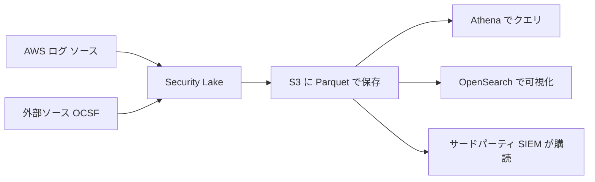

根拠: https://docs.aws.amazon.com/security-lake/latest/userguide/what-is-security-lake.html

#### Skill 1.2.4: ログを分析する

| ツール | 向いている用途 | 特徴 |
|---|---|---|
| CloudWatch Logs Insights | 直近ログの対話的調査 | 専用クエリ言語、CloudWatch Logs に保存済みのログ対象 |
| Amazon Athena | S3 上の大量ログの SQL 分析 | サーバーレス、パーティション化でコスト削減 |
| CloudTrail Lake | CloudTrail イベントの SQL 検索 | イベントデータストアに保存、保持期間を設定 |
| Security Hub | 検出結果の集計と優先度付け | 重大度・リソース単位で確認 |

```sql
-- Athena の例: 直近で ConsoleLogin に失敗したユーザーを集計
SELECT useridentity.arn, sourceipaddress, COUNT(*) AS failures
FROM cloudtrail_logs
WHERE eventname = 'ConsoleLogin'
  AND responseelements LIKE '%Failure%'
  AND eventtime > date_format(date_add('day', -1, now()), '%Y-%m-%dT%H:%i:%sZ')
GROUP BY useridentity.arn, sourceipaddress
ORDER BY failures DESC;
```

**ベストプラクティス**: Athena ではログを日付などで**パーティション化**し、可能なら Parquet 等の列指向形式にしてスキャン量を減らす。

根拠:
- CloudWatch Logs Insights: https://docs.aws.amazon.com/AmazonCloudWatch/latest/logs/AnalyzingLogData.html
- Athena: https://docs.aws.amazon.com/athena/latest/ug/what-is.html
- CloudTrail Lake: https://docs.aws.amazon.com/awscloudtrail/latest/userguide/cloudtrail-lake.html

#### Skill 1.2.5: ログの正規化・解析・相関

| サービス | 役割 |
|---|---|
| AWS Lambda | ログの変換・エンリッチ(Firehose のデータ変換、サブスクリプションフィルターの受け手) |
| Amazon OpenSearch Service | 全文検索、相関分析、ダッシュボード、アラート |
| Amazon Managed Grafana | 複数データソース(CloudWatch、Athena、OpenSearch 等)の可視化 |

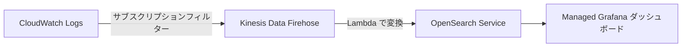

根拠:
- OpenSearch: https://docs.aws.amazon.com/opensearch-service/latest/developerguide/what-is.html
- Managed Grafana: https://docs.aws.amazon.com/grafana/latest/userguide/what-is-Amazon-Managed-Service-Grafana.html

#### Skill 1.2.6: ネットワーク設計・脅威に応じたログソース

| ログ | 見える範囲 | 使いどころ |
|---|---|---|
| VPC Flow Logs | ENI 単位の通信(送信元/宛先/ポート/許可・拒否) | 不審な通信、SG / NACL の拒否の確認 |
| Transit Gateway Flow Logs | TGW を通過する通信 | ハブ&スポーク構成の拠点間通信の可視化 |
| Route 53 Resolver クエリログ | DNS クエリ | マルウェアの C2 通信、DNS トンネリングの調査 |

> **ポイント**: VPC Flow Logs は**パケットの中身を含まない**メタデータです。「ペイロードを調べたい」問題では、別の手段(Traffic Mirroring など)が選択肢に出ます。ただし試験範囲外とされている「パケットレベル解析」に深入りする必要はありません。

根拠:
- VPC Flow Logs: https://docs.aws.amazon.com/vpc/latest/userguide/flow-logs.html
- TGW Flow Logs: https://docs.aws.amazon.com/vpc/latest/tgw/tgw-flow-logs.html
- Route 53 Resolver クエリログ: https://docs.aws.amazon.com/Route53/latest/DeveloperGuide/resolver-query-logs.html

---

### Task 1.3: 監視・ログ・アラートのトラブルシューティング

#### Skill 1.3.1: リソースの機能・権限・設定を分析する

「ログが出ない」問題の原因は大きく 4 種類です。順番に切り分けます。

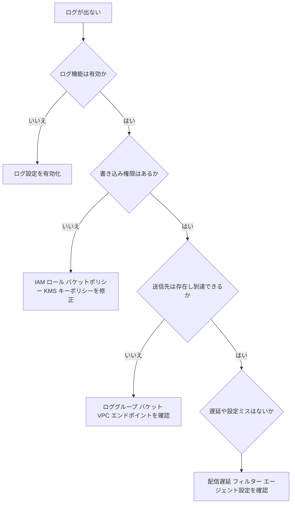

| 対象 | よくある原因 | 対処 |
|---|---|---|
| Lambda | 実行ロールに CloudWatch Logs への書き込み権限がない | `AWSLambdaBasicExecutionRole` 相当の権限を付与 |
| API Gateway | アカウント設定に CloudWatch Logs 用の IAM ロール ARN が未設定 / ステージでログ未有効 | アカウントレベルのロール設定 + ステージのログ有効化 |
| CloudFront | 標準ログの出力先 S3 の権限不足、リアルタイムログの Kinesis 側権限不足 | 出力先バケット/ストリームの権限を修正 |
| CloudTrail | S3 バケットポリシーが CloudTrail からの書き込みを許可していない、KMS キーポリシーが CloudTrail に暗号化を許可していない | バケットポリシー / キーポリシーを修正 |
| ヘルスチェック | SG やファイアウォールがヘルスチェック元を拒否 | ヘルスチェック元からの通信を許可 |

#### Skill 1.3.2: 設定ミスの修正(CloudWatch Agent、欠損ログ)

CloudWatch Agent のトラブルシュート手順:

1. EC2 に**インスタンスプロファイル**(`CloudWatchAgentServerPolicy` など)が付いているか
2. エージェントが**起動**しているか(サービス状態、エージェント自身のログ)
3. **設定ファイル**のパス・ロググループ名・ファイルパターンが正しいか
4. **ネットワーク**(インターネット、または CloudWatch Logs 用 VPC エンドポイント)に到達できるか
5. ログファイルの**読み取り権限**がエージェントのユーザーにあるか

```bash
# 設定を取得して適用する例(SSM パラメータに設定を保存している場合)
sudo /opt/aws/amazon-cloudwatch-agent/bin/amazon-cloudwatch-agent-ctl \
  -a fetch-config -m ec2 \
  -c ssm:AmazonCloudWatch-linux -s

# エージェント自身のログを確認
sudo tail -n 50 /opt/aws/amazon-cloudwatch-agent/logs/amazon-cloudwatch-agent.log
```

**ベストプラクティス**
- ログ配信の失敗自体を**アラーム化**する(Firehose の配信失敗、Lambda のエラー数、CloudTrail の停止検知)
- ログ設定は IaC で管理し、手動変更によるドリフトを Config で検知する

根拠:
- Lambda ログ: https://docs.aws.amazon.com/lambda/latest/dg/monitoring-cloudwatchlogs.html
- API Gateway ログ: https://docs.aws.amazon.com/apigateway/latest/developerguide/set-up-logging.html
- CloudFront ログ: https://docs.aws.amazon.com/AmazonCloudFront/latest/DeveloperGuide/logging.html
- CloudWatch Agent トラブルシュート: https://docs.aws.amazon.com/AmazonCloudWatch/latest/monitoring/troubleshooting-CloudWatch-Agent.html

---

## Domain 2: Incident Response(インシデント対応) 14%

公式ガイド: https://docs.aws.amazon.com/aws-certification/latest/security-specialty-03/security-specialty-03-domain2.html

| タスク | 内容 |
|---|---|
| 2.1 | インシデント対応計画の設計とテスト |
| 2.2 | セキュリティイベントへの対応(証拠保全、調査、封じ込め、復旧、根本原因分析) |

### インシデント対応のライフサイクル

業界標準(NIST SP 800-61 など)に沿った流れが AWS のガイドでも基本になります。

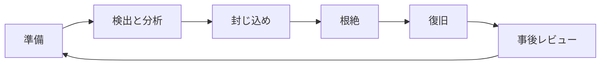

| フェーズ | やること | 主な AWS サービス |
|---|---|---|
| 準備 | 手順書、権限、ツール、演習 | SSM、IAM、Shield Advanced、FIS |
| 検出と分析 | 検出結果の妥当性確認、影響範囲の特定 | GuardDuty、Security Hub、Detective、CloudTrail Lake |
| 封じ込め | 被害の拡大を止める | SG 変更、NACL、ロールセッション無効化、アカウント隔離 |
| 根絶 | 原因(マルウェア、不正アクセス経路)の除去 | 脆弱性修正、認証情報のローテーション、イメージ再作成 |
| 復旧 | 正常状態へ戻す | AWS Backup、AMI、IaC での再構築 |
| 事後レビュー | 教訓を手順や自動化へ反映 | ポストモーテム、Runbook 更新 |

根拠: AWS Security Incident Response Guide https://docs.aws.amazon.com/whitepapers/latest/aws-security-incident-response-guide/welcome.html

> **補足**: SCS-C03 では「AWS Security Incident Response Guide」自体は出題範囲の記述から外れましたが、考え方は実問題の判断基準そのものなので、一読をおすすめします。

---

### Task 2.1: インシデント対応計画の設計とテスト

#### Skill 2.1.1: 対応計画と Runbook の設計・実装

**Runbook とは**: 「この検出結果が出たら、この順で、この操作をする」という手順書です。AWS では**手順をコード化**できます。

| 手段 | 役割 |
|---|---|
| SSM Automation ランブック | 手順(インスタンスの隔離、スナップショット取得など)を自動実行・承認付きで実行 |
| SSM OpsCenter | 運用上の問題(OpsItem)を一元管理し、関連リソース・ランブックと紐付け |
| SageMaker AI ノートブック | 調査・分析用のノートブック環境として、ログ分析などを再現可能な手順にする(試験ガイドの例示) |
| Step Functions | 複数ステップ(承認、並列処理、リトライ)の対応フローを定義 |

**ベストプラクティス**
- 検出結果の種類ごとに Runbook を用意し、**誰が・いつ・何を**を明記する
- 手動手順は**自動化できる部分から段階的に**コード化する
- Runbook は IaC で管理し、バージョン管理・レビューを通す

根拠:
- SSM Automation: https://docs.aws.amazon.com/systems-manager/latest/userguide/systems-manager-automation.html
- OpsCenter: https://docs.aws.amazon.com/systems-manager/latest/userguide/OpsCenter.html

#### Skill 2.1.2: インシデントに備えたサービス設定

「事故が起きてから準備」では遅いため、事前に以下を整えます。

| 準備項目 | 具体策 |
|---|---|
| アクセスの事前付与 | 調査用の**読み取り専用ロール**を事前に用意(平常時は使わない)。緊急時のみ引き受け |
| セキュリティツールの事前展開 | GuardDuty、Detective、Inspector、CloudTrail、Config を全アカウントで有効化 |
| 爆発半径の最小化 | マルチアカウント、最小権限、ネットワーク分離、SCP による制限 |
| 隔離用の仕組み | 隔離専用 SG(インバウンド / アウトバウンドなし)、隔離用 OU / アカウント |
| フォレンジック環境 | 証拠保全用アカウント、スナップショット共有手順、暗号鍵の共有設定 |
| DDoS 対策 | AWS Shield Advanced、AWS WAF のレート制限 |
| 連絡体制 | エスカレーション先、AWS サポートへの連絡手順 |

**AWS Shield Advanced の主な特徴**

| 項目 | 内容 |
|---|---|
| 対象 | CloudFront、Route 53、Global Accelerator、ALB / CLB、NLB、Elastic IP など |
| 高度な検知 | 保護対象リソースに合わせた検知、アプリケーション層(L7)の自動緩和(WAF ルールの自動作成)への対応 |
| Shield Response Team(SRT) | DDoS 発生時に支援。事前にロールを設定し、SRT がアカウントへアクセスできるようにする |
| プロアクティブエンゲージメント | ヘルスチェックの異常と連動して、SRT から能動的に連絡を受ける |
| コスト保護 | DDoS による請求増加(スケールアウト分)の返金申請に対応 |

> **ポイント**: Shield Standard は全 AWS 顧客に無料で自動適用(L3/L4 の一般的な攻撃)。Shield Advanced は有料で、高度な防御・SRT 支援・コスト保護が付きます。

根拠:
- Shield Advanced: https://docs.aws.amazon.com/waf/latest/developerguide/ddos-advanced-summary.html
- IR 準備: https://docs.aws.amazon.com/whitepapers/latest/aws-security-incident-response-guide/preparation.html

#### Skill 2.1.3: 対応計画の有効性をテスト・検証する

| サービス | 用途 |
|---|---|
| AWS Fault Injection Service(FIS) | 意図的に障害を注入(インスタンス停止、ネットワーク遅延など)し、検知・対応が機能するか実験する |
| AWS Resilience Hub | アプリの回復力を評価し、RTO / RPO 目標に対するギャップと改善策を示す |
| ゲームデイ / 机上演習 | 実際の担当者でシナリオ演習し、手順の穴を洗い出す |

**ベストプラクティス**: 演習は**定期的に**行い、結果をランブックに反映する。本番に近い環境で、事前に停止条件(FIS の stop condition)を設定して安全に行う。

根拠:
- FIS: https://docs.aws.amazon.com/fis/latest/userguide/what-is.html
- Resilience Hub: https://docs.aws.amazon.com/resilience-hub/latest/userguide/what-is.html

#### Skill 2.1.4: 自動修復

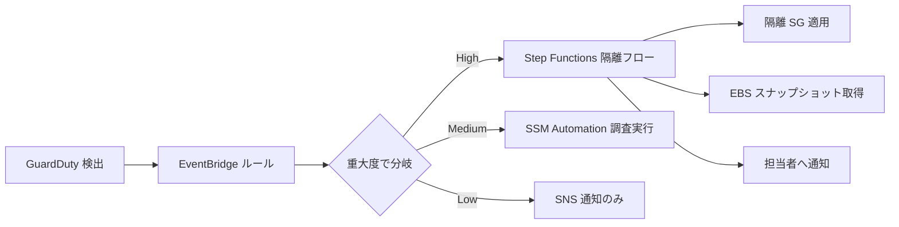

| 手段 | 向いている場面 |
|---|---|
| EventBridge + Lambda | 単一アクションの軽量な修復(例: 公開 S3 を非公開に戻す) |
| SSM Automation | OS 内外にまたがる標準的な手順、承認付き |
| Step Functions | 複数ステップ、分岐、待機、人手承認を含むフロー |
| Automated Forensics Orchestrator for Amazon EC2 | EC2 の侵害が疑われるとき、証拠(ディスク、メモリ)の保全を自動化するソリューション |
| Amazon Application Recovery Controller(ARC) | リージョン / AZ 障害時のトラフィック切替・復旧制御(準備状況の確認、ルーティング制御) |

```python
# Lambda の例: GuardDuty の検出から対象インスタンスに隔離 SG を適用する(簡略版)
import boto3

ec2 = boto3.client("ec2")
ISOLATION_SG = "sg-0123456789abcdef0"  # インバウンド・アウトバウンドとも全拒否の SG

def handler(event, context):
    detail = event["detail"]
    instance_id = detail["resource"]["instanceDetails"]["instanceId"]
    # 既存 SG をすべて隔離 SG に置換(ネットワーク封じ込め)
    ec2.modify_instance_attribute(InstanceId=instance_id, Groups=[ISOLATION_SG])
    # 証拠保全のため、削除せず停止もしない(メモリ上の証拠を保つ)
    return {"isolated": instance_id}
```

**ベストプラクティス**
- 自動修復は**冪等**(何度実行しても同じ結果)に作る
- 破壊的な操作(終了、削除)は自動にせず、**証拠保全後に人が承認**する
- 自動修復の実行結果は必ずログ・通知に残す

根拠:
- EventBridge: https://docs.aws.amazon.com/eventbridge/latest/userguide/eb-what-is.html
- Automated Forensics Orchestrator for Amazon EC2: https://aws.amazon.com/solutions/implementations/automated-forensic-orchestrator-for-amazon-ec2/
- ARC: https://docs.aws.amazon.com/r53recovery/latest/dg/what-is-route-53-recovery.html
- Step Functions: https://docs.aws.amazon.com/step-functions/latest/dg/welcome.html

---

### Task 2.2: セキュリティイベントへの対応

#### Skill 2.2.1: フォレンジック用の証拠としてログを取得・保存する

**保全の原則**: 「**揮発性の高いものから順に**取る」「元の証拠を変更しない(コピーを調査する)」「保管の記録(誰がいつ触れたか)を残す」。

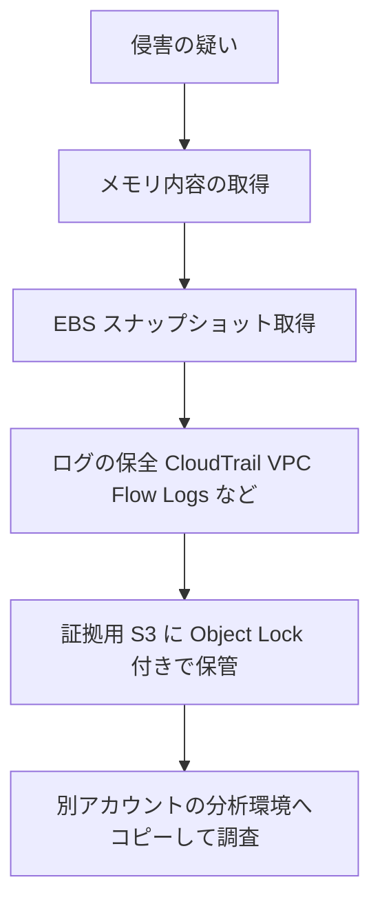

| 証拠 | 取得方法 |
|---|---|
| ディスク | EBS スナップショット(暗号化されている場合は KMS キーの共有設定も必要) |
| メモリ | 専用ツール(SSM 経由での取得やフォレンジックツール) |
| ログ | CloudTrail、Flow Logs、アプリログを S3 へ(Object Lock + バージョニング) |
| 構成情報 | Config の構成履歴 |

> **ポイント**: 調査は**元のインスタンスではなくコピー**(スナップショットから作ったボリューム)で行います。証拠の完全性を保つためです。

根拠: AWS Security Incident Response Guide(フォレンジックの章を参照) https://docs.aws.amazon.com/whitepapers/latest/aws-security-incident-response-guide/welcome.html

#### Skill 2.2.2: アプリと AWS サービス全体でログを検索・相関する

| 目的 | ツール |
|---|---|
| 「このアクセスキーで他に何が実行された?」 | CloudTrail Lake / Athena で `userIdentity.accessKeyId` を検索 |
| 「この IP と通信したリソースは?」 | VPC Flow Logs を Athena で検索 |
| 「この DNS 名を引いたのは?」 | Route 53 Resolver クエリログ |
| 横断的な相関 | Security Lake(OCSF)+ Athena / OpenSearch |

#### Skill 2.2.3: 検出結果を検証して範囲と影響を評価する(SCS-C03 で追加)

検出結果(finding)は**必ず本物とは限りません**(誤検知、テスト、許可された活動)。次の観点で検証します。

| 確認項目 | 内容 |
|---|---|
| 正当な活動か | 該当ユーザー / ロールの通常の動きと比較(Detective の行動グラフ) |
| 影響範囲 | 侵害された認証情報で操作されたリソースの全洗い出し |
| 重大度 | 本番 / 機密データへの到達の有無 |
| 時系列 | いつ始まり、いつ止まったか |

**ベストプラクティス**: 検証結果を**記録**し、誤検知と判断したものは抑制ルールで次回以降の無駄なアラートを減らす。

#### Skill 2.2.4: 封じ込め・根絶・復旧

**ケース A: EC2 の侵害**

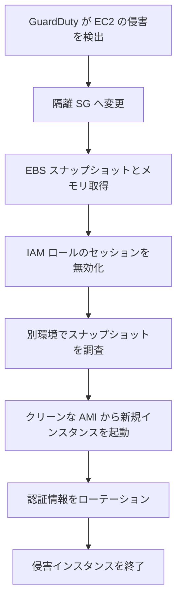

**ケース B: IAM 認証情報の漏えい**

| 手順 | 操作 |
|---|---|
| 1 | アクセスキーを**無効化**(削除ではなく、まず無効化して調査の余地を残す) |
| 2 | ロールの場合、**既存セッションを無効化**(下記ポリシーを付与) |
| 3 | CloudTrail で、その認証情報によるすべての操作を洗い出す |
| 4 | 不正に作成されたリソース、ユーザー、キーの削除 |
| 5 | 認証情報のローテーション |

ロールの既存セッションを無効化するインラインポリシー例(コンソールの「Revoke active sessions」が付与するものと同等の考え方):

```json
{
  "Version": "2012-10-17",
  "Statement": [
    {
      "Effect": "Deny",
      "Action": "*",
      "Resource": "*",
      "Condition": {
        "DateLessThan": { "aws:TokenIssueTime": "2026-10-17T00:00:00Z" }
      }
    }
  ]
}
```

> **ポイント**: ロールの一時認証情報は、**ロールの権限を消してもセッション期限まで有効**に見える場合があるため、上記の「発行時刻が指定時刻より前のセッションを拒否する」ポリシーで既存セッションを無効にします。

**ケース C: S3 データの漏えいや暗号化(ランサムウェア)**

| 対策 | 内容 |
|---|---|
| 復旧 | S3 バージョニングで以前のバージョンへ復元、AWS Backup から復元 |
| 防止 | Object Lock、MFA Delete、バックアップの別アカウントへのコピー、論理的エアギャップ Vault |

根拠:
- ロールセッションの無効化: https://docs.aws.amazon.com/IAM/latest/UserGuide/id_roles_use_revoke-sessions.html
- AWS Backup: https://docs.aws.amazon.com/aws-backup/latest/devguide/whatisbackup.html

#### Skill 2.2.5: 根本原因分析(Amazon Detective)

**Amazon Detective** は、CloudTrail、VPC Flow Logs、GuardDuty の検出結果などを自動で取り込み、**グラフモデル(行動グラフ)**で関係性を可視化するサービスです。

| 項目 | 内容 |
|---|---|
| 何ができるか | ユーザー / ロール / IP / リソース間の関係を時系列で可視化し、「何が起きたか」「どこから始まったか」を調べられる |
| 向いている問い | 「この不審な IP はどのリソースと通信した?」「この IAM ロールは平常時と比べて何が違う?」 |
| 前提 | GuardDuty の有効化後(約 48 時間のデータが推奨)など、データ取り込みが必要 |

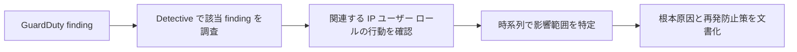

**根本原因分析のベストプラクティス**: 「なぜ」を 5 回繰り返し、**人のミス**ではなく**仕組みの欠陥**(ガードレール不足、検知の遅れ)にたどり着く。再発防止は SCP、Config ルール、自動修復として実装する。

根拠: Detective https://docs.aws.amazon.com/detective/latest/userguide/what-is-detective.html

---

## Domain 3: Infrastructure Security(インフラストラクチャセキュリティ) 18%

公式ガイド: https://docs.aws.amazon.com/aws-certification/latest/security-specialty-03/security-specialty-03-domain3.html

| タスク | 内容 | 主なサービス |
|---|---|---|
| 3.1 | ネットワークエッジのセキュリティ | CloudFront、AWS WAF、Shield Advanced、S3 CORS、IoT ポリシー |
| 3.2 | コンピュートワークロードのセキュリティ | EC2 Image Builder、Inspector、Patch Manager、Session Manager、GuardDuty、Bedrock Guardrails |
| 3.3 | ネットワークセキュリティ制御 | SG、NACL、Network Firewall、VPN、Direct Connect、Verified Access |

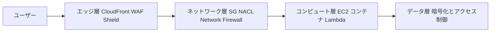

---

### Task 3.1: ネットワークエッジサービスのセキュリティ制御

#### Skill 3.1.1: 想定する脅威に基づきエッジのセキュリティ戦略を選ぶ

| 想定する脅威 | 有効な手段 |
|---|---|
| SQL インジェクション、XSS など(OWASP Top 10) | AWS WAF のマネージドルール(コアルールセット、SQL データベースルールなど) |
| ブルートフォース、スクレイピング、過剰なリクエスト | WAF のレートベースルール、Bot Control |
| 認証情報の不正利用(アカウント乗っ取り) | WAF Account Takeover Prevention(ATP) |
| 大規模 DDoS | Shield Advanced(L3 / L4 / L7)+ CloudFront + WAF |
| 地域制限が必要 | CloudFront の地理的制限、WAF の Geo 一致ルール |
| オリジンへの直接アクセス | CloudFront OAC、オリジンへの通信制限(カスタムヘッダー、マネージドプレフィックスリスト) |

> **ポイント**: ユーザーに近い**エッジ(CloudFront)で止める**と、オリジンへの負荷とコストを抑えられます。

#### Skill 3.1.2: ネットワークエッジ保護の実装

**(1) CloudFront + S3 オリジン: OAC(Origin Access Control)**

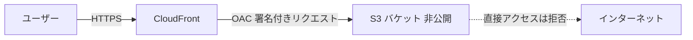

- **OAC** は旧 OAI の後継で、SSE-KMS やすべての S3 リージョンなどに対応し、より安全な方式
- バケットポリシーで CloudFront ディストリビューションからのアクセスのみを許可する

```json
{
  "Version": "2012-10-17",
  "Statement": [
    {
      "Sid": "AllowCloudFrontServicePrincipalReadOnly",
      "Effect": "Allow",
      "Principal": { "Service": "cloudfront.amazonaws.com" },
      "Action": "s3:GetObject",
      "Resource": "arn:aws:s3:::example-static-site/*",
      "Condition": {
        "StringEquals": {
          "AWS:SourceArn": "arn:aws:cloudfront::111122223333:distribution/EDISTEXAMPLE"
        }
      }
    }
  ]
}
```

**(2) CloudFront の署名付き URL / 署名付き Cookie**: 有料コンテンツなど、**限定された相手にだけ配信**するための仕組み(単一ファイルは署名付き URL、複数ファイルは署名付き Cookie が向く)。

**(3) CloudFront のセキュリティヘッダー**: **レスポンスヘッダーポリシー**で HSTS、CSP、X-Frame-Options、X-Content-Type-Options などを付与できます。

**(4) フィールドレベル暗号化**: 特定の入力項目(クレジットカード番号など)をエッジで公開鍵により暗号化し、秘密鍵を持つ特定のアプリだけが復号できるようにする。

**(5) AWS WAF**

| 概念 | 内容 |
|---|---|
| Web ACL | ルールの集合。CloudFront に付けるものは **us-east-1(グローバル)**、ALB / API Gateway などは**リージョン** |
| ルールグループ | AWS マネージド、Marketplace(サードパーティ)、独自 |
| アクション | Allow / Block / Count / CAPTCHA / Challenge |
| ベストプラクティス | 新しいルールはまず **Count** モードで誤検知を確認してから Block へ |

**(6) S3 CORS**: ブラウザが別オリジンの S3 リソースにアクセスする際の許可ルール。**認可の仕組みではなくブラウザの制約**なので、IAM / バケットポリシーの代わりにはなりません。

```json
[
  {
    "AllowedOrigins": ["https://app.example.com"],
    "AllowedMethods": ["GET", "PUT"],
    "AllowedHeaders": ["Content-Type"],
    "ExposeHeaders": ["ETag"],
    "MaxAgeSeconds": 3000
  }
]
```

> **ポイント**: `AllowedOrigins` に `*` を指定すると全オリジンを許可してしまうため、**必要なオリジンだけ**を明示します。

**(7) AWS IoT ポリシー**: デバイス証明書に紐づく権限。`iot:Connect` や `iot:Publish` を、**クライアント ID やトピック単位に絞る**(最小権限)。

**(8) OWASP Top 10 対策のまとめ**

| OWASP の脅威 | AWS での対策例 |
|---|---|
| インジェクション | WAF の SQLi ルール、パラメータ化クエリ(アプリ側) |
| 認証の不備 | Cognito、MFA、WAF ATP |
| 機微データの露出 | TLS 強制、KMS 暗号化 |
| アクセス制御の不備 | IAM 最小権限、ABAC |
| セキュリティの設定ミス | Config、Security Hub |
| 脆弱なコンポーネント | Inspector による依存関係スキャン |

根拠:
- CloudFront OAC: https://docs.aws.amazon.com/AmazonCloudFront/latest/DeveloperGuide/private-content-restricting-access-to-s3.html
- CloudFront 署名付き URL: https://docs.aws.amazon.com/AmazonCloudFront/latest/DeveloperGuide/private-content-signed-urls.html
- レスポンスヘッダーポリシー: https://docs.aws.amazon.com/AmazonCloudFront/latest/DeveloperGuide/adding-response-headers.html
- フィールドレベル暗号化: https://docs.aws.amazon.com/AmazonCloudFront/latest/DeveloperGuide/field-level-encryption.html
- AWS WAF: https://docs.aws.amazon.com/waf/latest/developerguide/waf-chapter.html
- S3 CORS: https://docs.aws.amazon.com/AmazonS3/latest/userguide/cors.html
- IoT ポリシー: https://docs.aws.amazon.com/iot/latest/developerguide/iot-policies.html

#### Skill 3.1.3: 要件に基づくエッジ制御とルール(地域、レート制限、フィンガープリント)

| 要件 | 実装 |
|---|---|
| 特定の国からのアクセス禁止 | CloudFront 地理的制限(国単位の許可 / 拒否)、または WAF の Geo 一致ルール(より細かい条件と組み合わせ可能) |
| 過剰なリクエストの抑制 | WAF **レートベースルール**(指定期間内の同一 IP などからのリクエスト数で制限) |
| 自動化ボットの識別 | WAF Bot Control、**クライアントフィンガープリント**(TLS ハンドシェイクの特徴で識別する JA3 / JA4 ベースの一致ルール) |

```json
{
  "Name": "RateLimitPerIP",
  "Priority": 10,
  "Statement": {
    "RateBasedStatement": {
      "Limit": 2000,
      "AggregateKeyType": "IP"
    }
  },
  "Action": { "Block": {} },
  "VisibilityConfig": {
    "SampledRequestsEnabled": true,
    "CloudWatchMetricsEnabled": true,
    "MetricName": "RateLimitPerIP"
  }
}
```

> **ポイント**: IP だけで識別すると、NAT の背後にいる多数の正規ユーザーを巻き込む場合があります。**転送された IP ヘッダー**や**他の属性との組み合わせ**で集計キーを工夫します。

根拠:
- レートベースルール: https://docs.aws.amazon.com/waf/latest/developerguide/waf-rule-statement-type-rate-based.html
- Bot Control: https://docs.aws.amazon.com/waf/latest/developerguide/waf-bot-control.html
- CloudFront 地理的制限: https://docs.aws.amazon.com/AmazonCloudFront/latest/DeveloperGuide/georestrictions.html

#### Skill 3.1.4: エッジサービスとサードパーティの統合(SCS-C03 で追加)

| 統合 | 内容 |
|---|---|
| OCSF 形式での取り込み | Security Lake などで**OCSF** に揃えたデータを使い、AWS とサードパーティの検出結果を共通スキーマで扱う |
| サードパーティ WAF ルール | AWS Marketplace のマネージドルールグループを Web ACL に追加(例: 特定の脅威インテリジェンスや業界特化ルール) |
| ログ連携 | WAF ログを Firehose / S3 経由で外部 SIEM へ送る |

根拠:
- OCSF: https://ocsf.io/
- Marketplace ルールグループ: https://docs.aws.amazon.com/waf/latest/developerguide/waf-managed-rule-groups-marketplace.html

---

### Task 3.2: コンピュートワークロードのセキュリティ制御

#### Skill 3.2.1: 強化(ハードニング)した AMI とコンテナイメージ

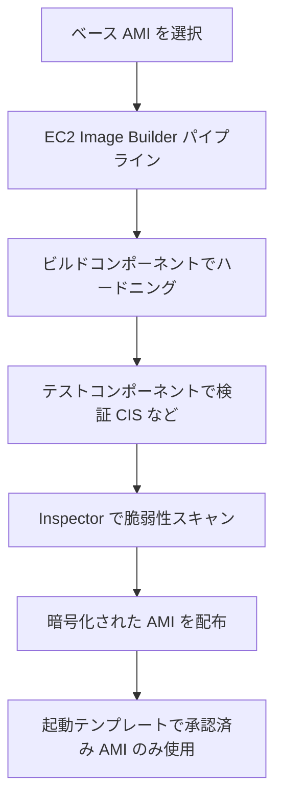

| 手段 | 内容 |
|---|---|
| EC2 Image Builder | AMI / コンテナイメージのビルド・テスト・配布を自動化。定期的に最新パッチで再ビルド |
| ゴールデン AMI | 組織の標準構成を焼き込んだ AMI。承認済み AMI のみ起動を許可(**Allowed AMIs** 設定や SCP / 宣言型ポリシーなど) |
| コンテナ | 最小限のベースイメージ(distroless 等)、root で動かさない、ECR のスキャンと署名 |

**ベストプラクティス**: **不要なパッケージとサービスを削除**し、**SSH キーや認証情報をイメージに焼き込まない**。パッチは「稼働中インスタンスに当てる」より「新しいイメージで置き換える(イミュータブル)」を優先。

根拠: EC2 Image Builder https://docs.aws.amazon.com/imagebuilder/latest/userguide/what-is-image-builder.html

#### Skill 3.2.2: インスタンスプロファイル・サービスロール・実行ロールの使い分け

| 名称 | 誰が引き受ける? | 例 |
|---|---|---|
| インスタンスプロファイル | EC2 インスタンス上のアプリ(ロールの入れ物) | EC2 から S3 を読む |
| 実行ロール(Execution role) | Lambda 関数、ECS タスクなど | Lambda が DynamoDB に書き込む |
| サービスロール | AWS サービス自身(ユーザーの代わりに動く) | CloudFormation、CodeBuild、Config |
| サービスにリンクされたロール | 特定サービス専用に AWS が定義・管理 | Auto Scaling、ELB |

```json
{
  "Version": "2012-10-17",
  "Statement": [
    {
      "Effect": "Allow",
      "Principal": { "Service": "ec2.amazonaws.com" },
      "Action": "sts:AssumeRole"
    }
  ]
}
```

**ベストプラクティス**
- **アクセスキーを EC2 に置かず、ロール**を使う(一時認証情報が自動ローテーション)
- **IMDSv2 を必須**にして、SSRF による認証情報窃取を防ぐ

```bash
# 既存インスタンスで IMDSv2 を必須にする
aws ec2 modify-instance-metadata-options \
  --instance-id i-0123456789abcdef0 \
  --http-tokens required \
  --http-endpoint enabled
```

根拠:
- インスタンスプロファイル: https://docs.aws.amazon.com/IAM/latest/UserGuide/id_roles_use_switch-role-ec2_instance-profiles.html
- IMDSv2: https://docs.aws.amazon.com/AWSEC2/latest/UserGuide/configuring-instance-metadata-service.html
- Lambda 実行ロール: https://docs.aws.amazon.com/lambda/latest/dg/lambda-intro-execution-role.html

#### Skill 3.2.3: 既知の脆弱性のスキャン(Inspector、GuardDuty)

| サービス | スキャン対象 | 内容 |
|---|---|---|
| Amazon Inspector | EC2、ECR のコンテナイメージ、Lambda 関数(依存パッケージとコード) | CVE ベースの脆弱性を継続的にスキャンし、優先度付きの検出結果を出す |
| GuardDuty Runtime Monitoring | EC2、ECS(Fargate を含む)、EKS のランタイム | 実行中のワークロードの不審な挙動(不正なプロセス、ファイルアクセス、ネットワーク)を検出 |
| GuardDuty Malware Protection | EBS ボリューム、S3 オブジェクト | マルウェアスキャン |

> **ポイント(区別して覚える)**: **Inspector = 脆弱性(まだ悪用されていない弱点)**、**GuardDuty = 脅威(悪用や不審行動)**。

根拠:
- Inspector: https://docs.aws.amazon.com/inspector/latest/user/what-is-inspector.html
- GuardDuty Runtime Monitoring: https://docs.aws.amazon.com/guardduty/latest/ug/runtime-monitoring.html

#### Skill 3.2.4: パッチ適用の自動化と継続的な検証

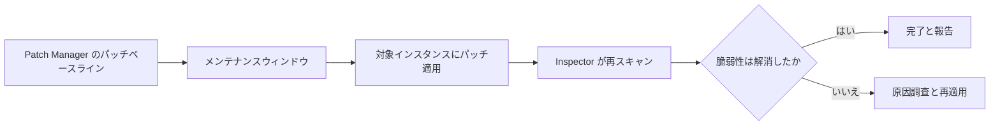

| 概念 | 内容 |
|---|---|
| パッチベースライン | どのパッチを承認するか(重大度、承認までの日数)の定義 |
| メンテナンスウィンドウ | パッチ適用の実施時間帯 |
| パッチグループ | タグで対象インスタンスをグループ化 |
| コンプライアンス | 適用済み / 未適用の状況をレポート |

根拠: https://docs.aws.amazon.com/systems-manager/latest/userguide/patch-manager.html

#### Skill 3.2.5: コンピュートリソースへの安全な管理アクセス

| 手段 | 特徴 | 使いどころ |
|---|---|---|
| **Session Manager** | インバウンドポート不要、踏み台不要、IAM で認可、操作ログを S3 / CloudWatch Logs へ記録 | 標準の管理アクセス |
| EC2 Instance Connect | SSH 公開鍵を一時的(約 60 秒)にインスタンスへ送る方式。IAM で制御。**EC2 Instance Connect Endpoint** でパブリック IP なしの接続も可能 | SSH を使いたい場合 |
| 従来の踏み台(Bastion)+ SSH | 管理負荷が高い | できるだけ避ける |

```json
{
  "Version": "2012-10-17",
  "Statement": [
    {
      "Effect": "Allow",
      "Action": "ssm:StartSession",
      "Resource": "arn:aws:ec2:ap-northeast-1:111122223333:instance/*",
      "Condition": {
        "StringEquals": { "ssm:resourceTag/Environment": "dev" }
      }
    }
  ]
}
```

**ベストプラクティス**: Session Manager は**タグ条件で接続可能な範囲を制限**し、セッションログを**暗号化して保存**。SSH(22)や RDP(3389)をインターネットに開放しない。

根拠:
- Session Manager: https://docs.aws.amazon.com/systems-manager/latest/userguide/session-manager.html
- EC2 Instance Connect: https://docs.aws.amazon.com/AWSEC2/latest/UserGuide/connect-linux-inst-eic.html

#### Skill 3.2.6: パイプライン内で脆弱性を発見・修復するツール

| ツール | 内容 |
|---|---|
| Amazon Q Developer | コードのセキュリティスキャンと修正案の提示(IDE 等で利用) |
| Amazon CodeGuru Security | ソースコードの脆弱性検出と修正提案(CI/CD へ統合可能) |
| Amazon Inspector | コンテナイメージと依存関係のスキャン(ECR 連携) |
| CodeBuild / CodePipeline | 上記スキャンをパイプラインのステージとして組み込み、重大な指摘でビルドを失敗させる |

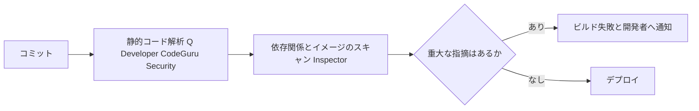

> **ポイント(シフトレフト)**: 問題を**本番より前の工程で**見つけるほど、修正コストが低くなります。

根拠:
- CodeGuru Security: https://docs.aws.amazon.com/codeguru/latest/security-ug/what-is-codeguru-security.html
- Amazon Q Developer: https://docs.aws.amazon.com/amazonq/latest/qdeveloper-ug/what-is.html

#### Skill 3.2.7: 生成 AI アプリのガードレール(SCS-C03 で追加)

**OWASP Top 10 for LLM Applications**(2025 年版の主な項目)

| 項目 | 脅威の内容 | 主な対策 |
|---|---|---|
| LLM01 プロンプトインジェクション | 入力でモデルの挙動を乗っ取る | 入力検証、Guardrails の**プロンプト攻撃フィルター**、権限分離 |
| LLM02 機微情報の漏えい | 個人情報や機密を出力してしまう | **機微情報フィルター**、データのマスキング、最小限のデータ利用 |
| LLM03 サプライチェーン | 汚染されたモデルや依存関係 | 信頼できるソース、モデル / 依存の検証 |
| LLM04 データとモデルの汚染 | 学習・ファインチューニングデータの汚染 | データ検証、アクセス制御 |
| LLM05 不適切な出力処理 | 出力をそのまま実行・表示して脆弱性になる | 出力の検証とサニタイズ |
| LLM06 過剰なエージェント権限 | エージェントに権限を与えすぎる | 最小権限、人手承認、ツール制限 |
| LLM07 システムプロンプトの漏えい | 内部指示や秘密情報の流出 | プロンプトに秘密を入れない |
| LLM08 ベクトルと埋め込みの弱点 | RAG の検索基盤を悪用 | ベクトル DB のアクセス制御 |
| LLM09 誤情報 | もっともらしい誤り | **コンテキストグラウンディング**による根拠確認 |
| LLM10 無制限の消費 | 過剰利用によるコスト / DoS | レート制限、クォータ |

**Amazon Bedrock Guardrails**: コンテンツフィルター、拒否トピック、単語フィルター、機微情報フィルター、プロンプト攻撃の検出、コンテキストグラウンディングチェックなどを、**モデルに依存せず**適用できる仕組みです。

**AWS での実装のコツ**
- モデルへのアクセスは IAM で最小権限(使えるモデルを限定)
- Bedrock への通信は **VPC エンドポイント(PrivateLink)** で閉域化
- モデル呼び出しログを有効にして監査
- エージェントのツール権限は最小化し、重要な操作には人の承認を挟む

根拠:
- OWASP Top 10 for LLM Applications: https://genai.owasp.org/llm-top-10/
- Bedrock Guardrails: https://docs.aws.amazon.com/bedrock/latest/userguide/guardrails.html

---

### Task 3.3: ネットワークセキュリティ制御の設計とトラブルシューティング

#### Skill 3.3.1: トラフィックの許可・拒否(SG、NACL、Network Firewall)

| 項目 | セキュリティグループ | ネットワーク ACL | AWS Network Firewall |
|---|---|---|---|
| 適用単位 | ENI(インスタンス等) | サブネット | VPC(ファイアウォールエンドポイント経由) |
| 状態 | **ステートフル**(戻りの通信は自動許可) | **ステートレス**(戻りの通信も明示) | ステートレス + ステートフル両方 |
| ルールの種類 | **許可のみ** | 許可と**拒否** | 許可 / 拒否 / アラート |
| 評価順 | 全ルールを評価 | **番号の小さい順** | ルールグループの優先度順 |
| 向いている用途 | 基本のアクセス制御(最小権限) | サブネット全体のブロック(特定 IP の遮断など) | ドメインフィルタリング、侵入防止(IPS)、TLS 検査、集中管理 |

```mermaid
flowchart LR
    I["インターネット"] --> IGW["Internet Gateway"]
    IGW --> NFW["Network Firewall 検査用サブネット"]
    NFW --> ALB["ALB パブリックサブネット"]
    ALB --> APP["アプリ EC2 プライベートサブネット"]
    APP --> DB["DB 分離サブネット"]
```

**ベストプラクティス**
- SG は**参照 SG**(送信元に別の SG を指定)で絞り、`0.0.0.0/0` の開放は最小限に
- NACL は「**明確な拒否**」が必要な場面のみ使い、基本は SG に任せる
- Network Firewall は**ドメインリスト**で許可する送信先を限定(エグレス制御)

**トラブルシューティングの考え方**(通信できない時)

```mermaid
flowchart TD
    A["通信できない"] --> B{"ルートテーブルは正しいか"}
    B -->|"いいえ"| B1["ルート修正"]
    B -->|"はい"| C{"SG は許可しているか"}
    C -->|"いいえ"| C1["SG を修正"]
    C -->|"はい"| D{"NACL は往路復路とも許可か"}
    D -->|"いいえ"| D1["NACL を修正 エフェメラルポートに注意"]
    D -->|"はい"| E["Network Firewall と OS 内ファイアウォールを確認"]
```

根拠:
- SG: https://docs.aws.amazon.com/vpc/latest/userguide/vpc-security-groups.html
- NACL: https://docs.aws.amazon.com/vpc/latest/userguide/vpc-network-acls.html
- Network Firewall: https://docs.aws.amazon.com/network-firewall/latest/developerguide/what-is-aws-network-firewall.html

#### Skill 3.3.2: ハイブリッド / マルチクラウド接続のセキュア設計

| 接続方式 | 暗号化 | 特徴 |
|---|---|---|
| Site-to-Site VPN | **IPsec で暗号化** | インターネット経由、短期間で構築可能 |
| Direct Connect | **既定では暗号化されない** | 専用線、安定した帯域と低遅延 |
| Direct Connect + VPN(IPsec over DX) | IPsec で暗号化 | 専用線の上で暗号化も確保 |
| **MACsec** | レイヤー 2 の暗号化 | Direct Connect の**専用接続(高速)**で、オンプレミス機器と AWS 間のリンクを暗号化 |

> **ポイント**: 「Direct Connect = 暗号化されている」は典型的な**引っかけ**です。暗号化が要件なら、**VPN を重ねる**か **MACsec** を検討します。

根拠:
- Site-to-Site VPN: https://docs.aws.amazon.com/vpn/latest/s2svpn/VPC_VPN.html
- Direct Connect MACsec: https://docs.aws.amazon.com/directconnect/latest/UserGuide/MACsec.html

#### Skill 3.3.3: ハイブリッド環境との通信に必要なセキュリティ要件(Verified Access)

**AWS Verified Access** は、VPN を使わずに社内アプリへ**ゼロトラスト**でアクセスさせるサービスです。

| 項目 | 内容 |
|---|---|
| 判断材料 | ユーザーの ID(IdP)と**デバイスの状態**(信頼プロバイダー) |
| ポリシー | Cedar 言語でアクセスポリシーを記述 |
| メリット | アプリ単位の細かい制御、VPN の接続管理が不要、ログの一元化 |

根拠: https://docs.aws.amazon.com/verified-access/latest/ug/what-is-verified-access.html

#### Skill 3.3.4: ネットワークのセグメンテーション設計

| 視点 | 内容 | 手段 |
|---|---|---|
| 南北(North/South)トラフィック | 外部との出入り | WAF、Network Firewall、NAT ゲートウェイ、ALB |
| 東西(East/West)トラフィック | 内部のサービス間通信 | SG の参照、サブネット分離、Network Firewall(TGW 経由で集中検査)、PrivateLink |
| 分離サブネット | インターネットへのルートを**持たない**サブネット | DB などの機微なデータ層 |
| アカウント分離 | 環境(本番 / 開発)ごとに別アカウント | Organizations |

**ベストプラクティス**: 層(Web / App / DB)ごとにサブネットと SG を分け、**上位層からのみ**下位層へ通信を許可する。

#### Skill 3.3.5: 不要なネットワークアクセスの特定

| ツール | 何がわかるか |
|---|---|
| **Network Access Analyzer** | 「インターネットから DB へ到達できる経路はないか」など、意図しないネットワーク経路を**要件(スコープ)に基づいて**検出 |
| Amazon Inspector ネットワーク到達性の検出結果 | EC2 がインターネットなどから到達可能なポートと経路 |
| VPC Reachability Analyzer | 2 つのリソース間の通信可否と、阻んでいる設定の特定 |
| Verified Access | アクセスの実態ログから不要なアクセスを把握 |

> **ポイント**: Network Access Analyzer は「**あってはならない経路がないか**」を探す用途、Reachability Analyzer は「**この 2 点間は通じるか**」を確認する用途、と区別します。

根拠:
- Network Access Analyzer: https://docs.aws.amazon.com/vpc/latest/network-access-analyzer/what-is-vaa.html
- Reachability Analyzer: https://docs.aws.amazon.com/vpc/latest/reachability/what-is-reachability-analyzer.html

---

## Domain 4: Identity and Access Management(IAM) 20%

公式ガイド: https://docs.aws.amazon.com/aws-certification/latest/security-specialty-03/security-specialty-03-domain4.html

最大配点のドメインです。「認証(あなたは誰か)」と「認可(何をしてよいか)」を分けて理解します。

| タスク | 内容 |
|---|---|
| 4.1 | 認証戦略の設計・実装・トラブルシューティング |
| 4.2 | 認可戦略の設計・実装・トラブルシューティング |

```mermaid
flowchart LR
    A["認証 Authentication あなたは誰か"] --> B["一時認証情報の発行 STS"]
    B --> C["認可 Authorization 何をしてよいか"]
    C --> D["リソースへのアクセス"]
    D --> E["CloudTrail に記録"]
```

---

### Task 4.1: 認証戦略

#### Skill 4.1.1: 人・アプリ・システムの認証ソリューション

| 主体 | 推奨される認証手段 |
|---|---|
| 従業員(人) | **IAM Identity Center** + 外部 IdP(SAML / SCIM)による SSO、MFA |
| 顧客(アプリのエンドユーザー) | **Amazon Cognito** |
| AWS 上のアプリ・サービス | **IAM ロール**(EC2 インスタンスプロファイル、Lambda 実行ロールなど) |
| AWS 外のシステム(オンプレ等) | **IAM Roles Anywhere**(X.509 証明書で一時認証情報を取得) |
| 外部の CI/CD(GitHub Actions など) | OIDC フェデレーション(`AssumeRoleWithWebIdentity`) |

**IAM Identity Center**

| 概念 | 内容 |
|---|---|
| ID ソース | Identity Center 内蔵ディレクトリ、Active Directory、外部 IdP |
| 権限セット(Permission set) | 各アカウントに作られる IAM ロールの**テンプレート** |
| 割り当て | ユーザー / グループ × アカウント × 権限セット |
| 利点 | 長期アクセスキーを持たず、**一時認証情報**でアクセス。一元的な入退社管理 |

**Amazon Cognito(ここは頻出の区別)**

| 種類 | 役割 | 出力 |
|---|---|---|
| **ユーザープール** | **認証**(サインアップ、サインイン、MFA、ソーシャル / SAML / OIDC 連携) | JWT(ID / アクセス / リフレッシュトークン) |
| **ID プール(フェデレーテッドアイデンティティ)** | **AWS リソースへの認可**用の一時認証情報を発行 | AWS 一時認証情報(STS) |

```mermaid
flowchart LR
    U["アプリのユーザー"] --> UP["Cognito ユーザープールで認証"]
    UP -->|"JWT"| IP["Cognito ID プール"]
    IP -->|"STS"| CRED["AWS 一時認証情報"]
    CRED --> S3["S3 など AWS リソース"]
```

**MFA のベストプラクティス**
- ルートユーザーと全ての人間ユーザーに MFA を有効化する
- 可能なら**フィッシング耐性のある MFA**(FIDO2 / パスキー、セキュリティキー)を使う
- API 呼び出しで MFA を必須にする条件(`aws:MultiFactorAuthPresent`)で重要操作を保護する

```json
{
  "Version": "2012-10-17",
  "Statement": [
    {
      "Sid": "DenyDeleteWithoutMFA",
      "Effect": "Deny",
      "Action": ["s3:DeleteBucket", "ec2:TerminateInstances"],
      "Resource": "*",
      "Condition": {
        "BoolIfExists": { "aws:MultiFactorAuthPresent": "false" }
      }
    }
  ]
}
```

根拠:
- IAM Identity Center: https://docs.aws.amazon.com/singlesignon/latest/userguide/what-is.html
- Cognito: https://docs.aws.amazon.com/cognito/latest/developerguide/what-is-amazon-cognito.html
- IAM Roles Anywhere: https://docs.aws.amazon.com/rolesanywhere/latest/userguide/introduction.html
- IAM ベストプラクティス: https://docs.aws.amazon.com/IAM/latest/UserGuide/best-practices.html
- MFA 条件: https://docs.aws.amazon.com/IAM/latest/UserGuide/id_credentials_mfa_configure-api-require.html

#### Skill 4.1.2: 一時認証情報の発行(STS、S3 署名付き URL)

**AWS STS の主な API**

| API | 使いどころ |
|---|---|
| `AssumeRole` | IAM ロールの引き受け(クロスアカウント、サービス間) |
| `AssumeRoleWithSAML` | SAML 2.0 IdP でのフェデレーション |
| `AssumeRoleWithWebIdentity` | OIDC(Web ID)フェデレーション(Cognito や GitHub Actions など) |
| `GetSessionToken` | IAM ユーザーが MFA 付きの一時認証情報を得る |
| `GetFederationToken` | 独自の ID ブローカーが一時認証情報を発行 |
| `AssumeRoot` | 組織管理側が、メンバーアカウントのルート権限が必要な特定の操作を**短時間だけ**実行(Skill 6.1.5 で後述) |

```mermaid
sequenceDiagram
    participant U as ユーザー
    participant IdP as 外部IdP
    participant STS as AWS STS
    participant R as AWSリソース
    U->>IdP: サインイン
    IdP-->>U: SAMLアサーション
    U->>STS: AssumeRoleWithSAML
    STS-->>U: 一時認証情報
    U->>R: 一時認証情報でアクセス
```

```bash
# クロスアカウントのロールを引き受ける例
aws sts assume-role \
  --role-arn arn:aws:iam::222233334444:role/CrossAccountAuditRole \
  --role-session-name audit-session \
  --duration-seconds 3600 \
  --external-id 12345-example
```

**S3 署名付き URL(Presigned URL)**: 認証情報を持たない相手に、**期限付きで**特定オブジェクトへのアクセスを与える仕組みです。

| 注意点 | 内容 |
|---|---|
| 権限 | URL を作った主体の権限で動く(権限がなければ使えない) |
| 有効期限 | 一時認証情報(ロール等)で作った URL は、**URL の期限と認証情報の期限のうち早い方**で失効する |
| 管理 | 期限は必要最小限にする |

**ベストプラクティス**: 長期認証情報(アクセスキー)より一時認証情報を優先する。クロスアカウント引き受けには、**ExternalId**(サードパーティ向けの混乱した代理問題の対策)と、信頼ポリシーでの**条件指定**を使う。

根拠:
- 一時認証情報: https://docs.aws.amazon.com/IAM/latest/UserGuide/id_credentials_temp.html
- STS API: https://docs.aws.amazon.com/STS/latest/APIReference/welcome.html
- 署名付き URL: https://docs.aws.amazon.com/AmazonS3/latest/userguide/using-presigned-url.html
- ExternalId: https://docs.aws.amazon.com/IAM/latest/UserGuide/id_roles_create_for-user_externalid.html

#### Skill 4.1.3: 認証の問題のトラブルシューティング

| 症状 | 確認先 |
|---|---|
| ロールの引き受けに失敗(AccessDenied) | ロールの**信頼ポリシー**(Principal / Condition)、呼び出し側の `sts:AssumeRole` 権限、SCP |
| SSO でアカウントに入れない | Identity Center の**割り当て**、権限セット、IdP 側のグループ同期 |
| Cognito でトークンが拒否される | トークンの有効期限、アプリクライアント設定、スコープ、発行者(issuer) |
| AD ログインに失敗 | AWS Directory Service(AWS Managed Microsoft AD、AD Connector)の信頼関係、ネットワーク、SG |
| 原因が不明 | **CloudTrail**(`AssumeRole`、`ConsoleLogin` などのイベントとエラーコード)を確認 |

根拠:
- Directory Service: https://docs.aws.amazon.com/directoryservice/latest/admin-guide/what_is.html
- IAM のトラブルシューティング: https://docs.aws.amazon.com/IAM/latest/UserGuide/troubleshoot.html

---

### Task 4.2: 認可戦略

#### Skill 4.2.1: 人・アプリ・システムへの認可制御の設計と評価

**ポリシーの種類**

| 種類 | 付ける先 | 付与 / 制限 | 用途 |
|---|---|---|---|
| ID ベースポリシー | ユーザー / グループ / ロール | 付与 | 基本の権限 |
| リソースベースポリシー | S3 / KMS / SQS / Lambda など | 付与 | クロスアカウント共有、サービスからの呼び出し許可 |
| Permission Boundary | ユーザー / ロール | **上限**を制限 | 権限委任時の「暴走」防止 |
| セッションポリシー | 一時セッション | **上限**を制限 | その場限りの権限縮小 |
| SCP(組織) | OU / アカウント | **上限**を制限 | 組織全体のガードレール |
| RCP(リソース制御ポリシー) | OU / アカウント | リソースに対する**上限**を制限 | データ境界(許可されたプリンシパルのみ) |

**ポリシー評価の流れ(ざっくり)**

```mermaid
flowchart TD
    A["リクエスト"] --> B{"明示的な Deny はあるか"}
    B -->|"あり"| X["拒否"]
    B -->|"なし"| C{"SCP と RCP が許可しているか"}
    C -->|"いいえ"| X
    C -->|"はい"| D{"リソースベースポリシーが許可しているか"}
    D -->|"はい 同一アカウント"| Y["許可"]
    D -->|"いいえ"| E{"Permission Boundary が許可しているか"}
    E -->|"いいえ"| X
    E -->|"はい"| F{"セッションポリシーが許可しているか"}
    F -->|"いいえ"| X
    F -->|"はい"| G{"ID ベースポリシーが許可しているか"}
    G -->|"はい"| Y
    G -->|"いいえ"| X
```

> **ポイント(最重要)**
> 1. **明示的な Deny がすべてに優先**
> 2. 何も許可されていなければ**暗黙の拒否**
> 3. **同一アカウント**: ID ベースまたはリソースベースのどちらかが許可すれば OK(境界などの上限内で)
> 4. **クロスアカウント**: **両方のアカウントで許可**が必要(リソース側とプリンシパル側)
> 5. SCP / RCP / Permission Boundary / セッションポリシーは**権限を与えず、上限を決める**だけ

**クロスアカウントアクセスの設計**

| 方法 | 特徴 |
|---|---|
| ロールの引き受け(推奨) | 引き受けると**元のアカウントの権限を一時的に手放し**、ロール側の権限で動く。信頼ポリシーと呼び出し側の許可の両方が必要 |
| リソースベースポリシー | プリンシパルのまま直接アクセスできる(S3、SQS、KMS など対応サービスのみ) |

**ロールの信頼ポリシー例(組織内の特定ロールのみ引き受け可、MFA 必須)**

```json
{
  "Version": "2012-10-17",
  "Statement": [
    {
      "Effect": "Allow",
      "Principal": { "AWS": "arn:aws:iam::111122223333:root" },
      "Action": "sts:AssumeRole",
      "Condition": {
        "Bool": { "aws:MultiFactorAuthPresent": "true" },
        "StringEquals": { "aws:PrincipalOrgID": "o-exampleorgid" }
      }
    }
  ]
}
```

**そのほかの重要サービス**

| サービス | 内容 |
|---|---|
| **Amazon Verified Permissions** | アプリケーション内のきめ細かな認可を、**Cedar** ポリシー言語で外部化して管理 |
| **IAM パス** | IAM エンティティを階層(`/engineering/`)で整理し、ポリシーの `Resource` でパス単位に制御 |
| **IAM Roles Anywhere** | AWS 外のワークロードが証明書で一時認証情報を取得 |

根拠:
- ポリシー評価ロジック: https://docs.aws.amazon.com/IAM/latest/UserGuide/reference_policies_evaluation-logic.html
- クロスアカウントのリソースアクセス: https://docs.aws.amazon.com/IAM/latest/UserGuide/access_policies-cross-account-resource-access.html
- Verified Permissions: https://docs.aws.amazon.com/verifiedpermissions/latest/userguide/what-is-avp.html
- IAM 識別子(パス): https://docs.aws.amazon.com/IAM/latest/UserGuide/reference_identifiers.html

#### Skill 4.2.2: ABAC と RBAC

| 方式 | 考え方 | 長所 | 短所 |
|---|---|---|---|
| RBAC(ロールベース) | 職務(開発者、監査人)ごとにロールを作る | 分かりやすい | リソースが増えるとロールとポリシーが増える |
| ABAC(属性ベース) | **タグ**(ユーザーとリソースの属性)の一致で許可 | 新規リソースにポリシー変更不要で**スケールする** | タグ管理の統制が重要 |

```json
{
  "Version": "2012-10-17",
  "Statement": [
    {
      "Sid": "AllowEC2ActionsOnSameProjectTag",
      "Effect": "Allow",
      "Action": ["ec2:StartInstances", "ec2:StopInstances"],
      "Resource": "arn:aws:ec2:*:*:instance/*",
      "Condition": {
        "StringEquals": {
          "aws:ResourceTag/Project": "${aws:PrincipalTag/Project}"
        }
      }
    }
  ]
}
```

**ABAC のベストプラクティス**
- **タグを変更できる権限自体**を厳しく管理する(自分のタグを書き換えれば権限を拡大できてしまうため)
- タグポリシー(Organizations)で、タグのキーと値の標準を強制する
- IAM Identity Center の属性や IdP のセッションタグを、プリンシパルのタグとして利用する

根拠: https://docs.aws.amazon.com/IAM/latest/UserGuide/introduction_attribute-based-access-control.html

#### Skill 4.2.3: 最小権限の IAM ポリシー(Permission Boundary、セッションポリシー)

**Permission Boundary の使いどころ**: 開発者に「ロールを作る権限」を委任するが、「管理者より強いロールは作らせたくない」場合。

```mermaid
flowchart LR
    A["管理者"] -->|"Permission Boundary を必須にして委任"| B["開発者"]
    B -->|"新規ロールを作成 境界が必須"| C["アプリ用ロール"]
    C --> D["実効権限 = ID ポリシーと境界の共通部分"]
```

```json
{
  "Version": "2012-10-17",
  "Statement": [
    {
      "Sid": "AllowRoleCreationOnlyWithBoundary",
      "Effect": "Allow",
      "Action": ["iam:CreateRole", "iam:AttachRolePolicy", "iam:PutRolePolicy"],
      "Resource": "arn:aws:iam::111122223333:role/app-*",
      "Condition": {
        "StringEquals": {
          "iam:PermissionsBoundary": "arn:aws:iam::111122223333:policy/DeveloperBoundary"
        }
      }
    }
  ]
}
```

| 比較 | Permission Boundary | セッションポリシー |
|---|---|---|
| 付ける対象 | IAM ユーザー / ロール(恒久) | `AssumeRole` などの**セッション**(一時) |
| 目的 | 権限の上限を固定 | その場限りでさらに絞る |
| 権限を付与するか | しない | しない |

**最小権限を実現するステップ**

```mermaid
flowchart LR
    A["広めの権限で開始 もしくは AWS 管理ポリシー"] --> B["CloudTrail のアクティビティを分析"]
    B --> C["Access Analyzer でポリシーを生成"]
    C --> D["未使用の権限を削除"]
    D --> E["定期的に見直し"]
    E --> B
```

根拠:
- Permission Boundary: https://docs.aws.amazon.com/IAM/latest/UserGuide/access_policies_boundaries.html
- セッションポリシー: https://docs.aws.amazon.com/IAM/latest/UserGuide/access_policies.html#policies_session

#### Skill 4.2.4 / 4.2.5: 認可エラーの分析と意図しない権限の修正

| ツール | 用途 |
|---|---|
| **IAM ポリシーシミュレーター** | 「このユーザーがこの操作をできるか」を、実際に実行せず**評価**して原因を特定 |
| **IAM Access Analyzer** | 外部アクセス(組織外に公開されているリソース)、**未使用アクセス**、ポリシー生成、ポリシー検証、**カスタムポリシーチェック**(CI/CD で権限拡大を阻止) |
| CloudTrail | 拒否イベントのエラーメッセージ(どのポリシータイプで拒否されたか)を確認 |
| Last accessed 情報 | サービス / アクションの最終利用日時から、不要な権限を特定 |

```mermaid
flowchart TD
    A["AccessDenied が発生"] --> B["エラーメッセージで拒否の種類を確認"]
    B --> C{"明示的 Deny か 暗黙の拒否か"}
    C -->|"明示的 Deny"| D["SCP RCP 境界 ID ポリシーの Deny を探す"]
    C -->|"暗黙の拒否"| E["Allow が不足 ポリシー追加を検討"]
    D --> F["ポリシーシミュレーターで検証"]
    E --> F
    F --> G["修正後に CloudTrail で再確認"]
```

**Access Analyzer の検出タイプ**

| タイプ | 見つけるもの |
|---|---|
| 外部アクセス | 信頼ゾーン(アカウント / 組織)外に共有されている S3、KMS、IAM ロール、Lambda など |
| 未使用アクセス | 使われていないロール、アクセスキー、パスワード、権限 |
| ポリシー検証 | ポリシーの文法ミス、セキュリティ上の警告 |
| カスタムポリシーチェック | 「新しい版は既存版より権限が増えていないか」「特定のアクションを許可していないか」を検査 |

> **ポイント**: 「組織外に公開されている S3 / KMS / ロールを探せ」→ **IAM Access Analyzer(外部アクセス)**。「使っていない権限を削れ」→ **未使用アクセスのアナライザー**。

根拠:
- ポリシーシミュレーター: https://docs.aws.amazon.com/IAM/latest/UserGuide/access_policies_testing-policies.html
- Access Analyzer: https://docs.aws.amazon.com/IAM/latest/UserGuide/what-is-access-analyzer.html
- 最終アクセス情報: https://docs.aws.amazon.com/IAM/latest/UserGuide/access_policies_access-advisor.html

---

## Domain 5: Data Protection(データ保護) 18%

公式ガイド: https://docs.aws.amazon.com/aws-certification/latest/security-specialty-03/security-specialty-03-domain5.html

| タスク | 内容 |
|---|---|
| 5.1 | 転送中データ(in transit)の保護 |
| 5.2 | 保存データ(at rest)の保護 |
| 5.3 | 機密データ・認証情報・シークレット・暗号鍵の保護 |

```mermaid
flowchart LR
    D["データ"] --> T["転送中 TLS VPN PrivateLink"]
    D --> R["保存時 KMS CloudHSM SSE CSE"]
    D --> S["シークレットと鍵 Secrets Manager KMS Private CA"]
    T --> Z["監査 CloudTrail Config"]
    R --> Z
    S --> Z
```

---

### Task 5.1: 転送中データの保護

#### Skill 5.1.1: 接続時に暗号化を必須にする

| 対象 | 設定 |
|---|---|
| ALB / NLB | HTTPS / TLS リスナー + **ELB セキュリティポリシー**(例: TLS 1.3 / 1.2 のみを許可するポリシー)。HTTP は HTTPS へリダイレクト |
| CloudFront | ビューワープロトコルポリシーを **Redirect HTTP to HTTPS** または **HTTPS only**、最小 TLS バージョンを設定、オリジンとの通信も HTTPS |
| S3 | バケットポリシーで **`aws:SecureTransport` が false の通信を拒否** |
| API Gateway | HTTPS が既定。カスタムドメインの最小 TLS バージョンを設定 |
| RDS / Aurora | `require_ssl` などのパラメータで TLS を強制 |
| 証明書 | **AWS Certificate Manager(ACM)** で発行・自動更新 |

```json
{
  "Version": "2012-10-17",
  "Statement": [
    {
      "Sid": "DenyInsecureTransport",
      "Effect": "Deny",
      "Principal": "*",
      "Action": "s3:*",
      "Resource": [
        "arn:aws:s3:::example-secure-bucket",
        "arn:aws:s3:::example-secure-bucket/*"
      ],
      "Condition": {
        "Bool": { "aws:SecureTransport": "false" }
      }
    }
  ]
}
```

**ベストプラクティス**: 古いプロトコル(TLS 1.0 / 1.1)を**無効化**し、強力な暗号スイートを持つポリシーを選ぶ。有効期限切れを避けるため、証明書は ACM の**自動更新**を使う。

根拠:
- ELB セキュリティポリシー: https://docs.aws.amazon.com/elasticloadbalancing/latest/application/describe-ssl-policies.html
- ACM: https://docs.aws.amazon.com/acm/latest/userguide/acm-overview.html
- CloudFront HTTPS: https://docs.aws.amazon.com/AmazonCloudFront/latest/DeveloperGuide/using-https.html
- S3 の転送中暗号化: https://docs.aws.amazon.com/AmazonS3/latest/userguide/security-best-practices.html

#### Skill 5.1.2: セキュアでプライベートなアクセス

| 手段 | 内容 | 使いどころ |
|---|---|---|
| **ゲートウェイ型 VPC エンドポイント** | ルートテーブルに追加。**S3 と DynamoDB** のみ。無料 | VPC 内から S3 / DynamoDB へインターネットを経由せずアクセス |
| **インターフェイス型 VPC エンドポイント(PrivateLink)** | サブネットに ENI を作成。多くの AWS サービスや自社 / SaaS サービスに接続 | プライベート IP でサービスへアクセス |
| エンドポイントポリシー | エンドポイント経由で許可する操作・リソースを制限 | データ流出の抑止 |
| **Client VPN** | クライアント(従業員)から VPC へのマネージド VPN(OpenVPN ベース) | リモートアクセス |
| **Verified Access** | VPN なしでゼロトラストでアプリにアクセス | 社内 Web アプリの公開 |

```json
{
  "Statement": [
    {
      "Sid": "AllowOnlyOrgBuckets",
      "Effect": "Allow",
      "Principal": "*",
      "Action": "s3:*",
      "Resource": "*",
      "Condition": {
        "StringEquals": { "aws:ResourceOrgID": "o-exampleorgid" }
      }
    }
  ]
}
```

> **ポイント(データ境界)**: VPC エンドポイントポリシーで「**自組織のリソースだけ**」へのアクセスに絞ると、社内の端末から外部アカウントの S3 へデータをコピーされる経路を塞げます(上記は考え方の例)。

根拠:
- PrivateLink: https://docs.aws.amazon.com/vpc/latest/privatelink/what-is-privatelink.html
- ゲートウェイエンドポイント: https://docs.aws.amazon.com/vpc/latest/privatelink/gateway-endpoints.html
- エンドポイントポリシー: https://docs.aws.amazon.com/vpc/latest/privatelink/vpc-endpoints-access.html
- Client VPN: https://docs.aws.amazon.com/vpn/latest/clientvpn-admin/what-is.html

#### Skill 5.1.3: リソース間の転送中暗号化(SCS-C03 で追加)

| 対象 | 設定の考え方 |
|---|---|
| **Amazon EMR** | セキュリティ設定で**転送中暗号化**(ノード間通信、Hadoop / Spark の各コンポーネント)を有効化。証明書を指定 |
| **Amazon EKS** | Pod 間通信は既定で暗号化されない場合があるため、**サービスメッシュの mTLS** や CNI の暗号化機能を検討。コントロールプレーンとの通信は TLS |
| **Amazon SageMaker AI** | 分散学習の**コンテナ間通信の暗号化**を有効化 |
| **Nitro システム** | 対応する Nitro ベースのインスタンス間では、**VPC 内のトラフィックが自動的に暗号化**される(別途設定は不要。対応インスタンスタイプなどの条件あり) |

> **ポイント**: 「アプリ側で TLS を実装せずに、インスタンス間通信を透過的に暗号化したい」→ **Nitro 暗号化(対応インスタンス)**、という発想が問われます。

根拠:
- EMR 暗号化: https://docs.aws.amazon.com/emr/latest/ManagementGuide/emr-data-encryption-options.html
- SageMaker 学習の暗号化: https://docs.aws.amazon.com/sagemaker/latest/dg/train-encrypt.html
- Nitro の転送中暗号化: https://docs.aws.amazon.com/AWSEC2/latest/UserGuide/data-protection.html
- EKS のセキュリティ: https://docs.aws.amazon.com/eks/latest/best-practices/security.html

---

### Task 5.2: 保存データの保護

#### Skill 5.2.1: 保存時の暗号化(KMS、CloudHSM、SSE / CSE)

**暗号化を行う場所**

| 方式 | 誰が暗号化 | 鍵の管理 |
|---|---|---|
| サーバー側暗号化(SSE) | AWS サービス側 | サービスが管理 or お客様が KMS で管理 |
| クライアント側暗号化(CSE) | **お客様のアプリ**(AWS に送る前) | お客様(KMS、独自の鍵) |

**S3 のサーバー側暗号化の種類**

| 種類 | 鍵 | 特徴 |
|---|---|---|
| SSE-S3 | S3 が管理 | 既定。追加設定なし。鍵の利用ログは取れない |
| SSE-KMS | KMS のキー(AWS 管理 / カスタマー管理) | キーポリシーでアクセス制御、CloudTrail で鍵使用を監査 |
| DSSE-KMS | KMS | 2 層の暗号化(規制要件向け) |
| SSE-C | お客様が提供 | リクエストごとに鍵を渡す。鍵管理はお客様の責任 |

**KMS と CloudHSM の使い分け**

| 項目 | AWS KMS | AWS CloudHSM |
|---|---|---|
| 管理 | マネージド(AWS が HSM を運用) | **お客様専用**の HSM クラスター(お客様が鍵とユーザーを管理) |
| 鍵への排他的な制御 | KMS サービス内 | **シングルテナント**で、AWS は鍵にアクセスできない |
| 統合 | 多くの AWS サービスとネイティブ統合 | 独自アプリ(PKCS#11、JCE、CNG)や KMS のカスタムキーストア経由 |
| 向いている要件 | 一般的な暗号化 | 厳格なコンプライアンスで**専用 HSM**を求められる場合 |

**エンベロープ暗号化(KMS の基本)**

```mermaid
flowchart TD
    A["アプリが KMS に GenerateDataKey を要求"] --> B["KMS が平文のデータキーと暗号化されたデータキーを返す"]
    B --> C["平文のデータキーでデータを暗号化"]
    C --> D["平文のデータキーをメモリから破棄"]
    D --> E["暗号化データと暗号化されたデータキーを一緒に保存"]
    E --> F["復号時は KMS で暗号化データキーを復号してからデータを復号"]
```

> **ポイント**: KMS の直接暗号化は**最大 4 KB** のデータ向けです。大きなデータは**データキーによるエンベロープ暗号化**で扱います。

**KMS キーポリシーの重要ポイント**

| 項目 | 内容 |
|---|---|
| キーポリシーは必須 | 他のアクセス制御と違い、**キーポリシーが許可しなければ IAM ポリシーだけでは使えない** |
| IAM への委任 | キーポリシーでアカウントルートを許可すると、そのアカウントの IAM ポリシーで鍵の利用を制御できる |
| グラント | 特定の主体に一時的・限定的に鍵の利用権限を委任(AWS サービスが内部で使う) |
| クロスアカウント | **鍵側のキーポリシー**と、**利用側の IAM ポリシー**の両方が必要 |

```json
{
  "Sid": "AllowUseOfTheKeyByAppRole",
  "Effect": "Allow",
  "Principal": { "AWS": "arn:aws:iam::111122223333:role/AppRole" },
  "Action": ["kms:Encrypt", "kms:Decrypt", "kms:GenerateDataKey"],
  "Resource": "*",
  "Condition": {
    "StringEquals": { "kms:ViaService": "s3.ap-northeast-1.amazonaws.com" }
  }
}
```

**ベストプラクティス**
- **管理者(鍵の管理)と利用者(暗号化・復号)の権限を分離**する
- `kms:ViaService` や暗号化コンテキストで、使える場面を絞る
- EBS / RDS / S3 などは**既定の暗号化**を有効にする(EBS は「アカウント単位の既定暗号化」)
- カスタマー管理キーは、サービス間の**キー使用状況を CloudTrail で監視**する

根拠:
- KMS: https://docs.aws.amazon.com/kms/latest/developerguide/overview.html
- KMS キーポリシー: https://docs.aws.amazon.com/kms/latest/developerguide/key-policies.html
- CloudHSM: https://docs.aws.amazon.com/cloudhsm/latest/userguide/introduction.html
- S3 の暗号化: https://docs.aws.amazon.com/AmazonS3/latest/userguide/UsingEncryption.html
- AWS Encryption SDK: https://docs.aws.amazon.com/encryption-sdk/latest/developer-guide/introduction.html

#### Skill 5.2.2: データの完全性の保護

| 手段 | 内容 |
|---|---|
| **S3 バージョニング** | 上書き / 削除されても前のバージョンから復元可能 |
| **S3 Object Lock** | WORM(Write Once Read Many)。**ガバナンスモード**(特権のあるユーザーは解除可)と**コンプライアンスモード**(**誰も**、ルートでも解除不可)、**リーガルホールド** |
| **S3 Glacier Vault Lock** | ボールトロックポリシー(**ロック後は変更不可**)で、保持期間などを強制 |
| MFA Delete | バージョン削除に MFA を要求 |
| デジタルコード署名 | AWS Signer / Lambda コード署名で、**改ざんされていないコード**だけを実行 |
| ファイル検証 | CloudTrail のログファイル整合性検証、S3 のチェックサム(SHA-256 など) |

| 比較 | ガバナンスモード | コンプライアンスモード |
|---|---|---|
| 保持期間中の削除 | 特別な権限(`s3:BypassGovernanceRetention`)があれば可 | **不可**(ルートユーザーも) |
| 保持期間の短縮 | 可(権限あり) | **不可** |
| 用途 | 内部統制、誤削除防止 | 法規制(SEC、FINRA など)の WORM 要件 |

> **ポイント**: Object Lock には**バージョニングが必須**です。

根拠:
- Object Lock: https://docs.aws.amazon.com/AmazonS3/latest/userguide/object-lock.html
- Glacier Vault Lock: https://docs.aws.amazon.com/amazonglacier/latest/dev/vault-lock.html
- AWS Signer: https://docs.aws.amazon.com/signer/latest/developerguide/Welcome.html

#### Skill 5.2.3: ライフサイクルと保持の自動化

| サービス | 機能 |
|---|---|
| S3 ライフサイクル | 一定日数後に低コストのストレージクラスへ移行、または期限切れで削除 |
| S3 Object Lock | 保持期間中の削除を禁止 |
| EFS ライフサイクル管理 | 一定期間アクセスのないファイルを EFS IA / Archive へ自動移行 |
| FSx for Lustre のバックアップ方針 | 自動バックアップと保持期間の設定 |
| AWS Backup | バックアップ計画で保持ルールを一元化 |

```json
{
  "Rules": [
    {
      "ID": "ArchiveThenExpireLogs",
      "Status": "Enabled",
      "Filter": { "Prefix": "logs/" },
      "Transitions": [
        { "Days": 30, "StorageClass": "STANDARD_IA" },
        { "Days": 90, "StorageClass": "GLACIER" }
      ],
      "Expiration": { "Days": 2555 }
    }
  ]
}
```

> **ポイント**: ライフサイクルは**コスト最適化**と**保持要件の遵守**の両面で使います。ただし Object Lock の保持期間中は、ライフサイクルによる削除も実行されません。

根拠:
- S3 ライフサイクル: https://docs.aws.amazon.com/AmazonS3/latest/userguide/object-lifecycle-mgmt.html
- EFS ライフサイクル: https://docs.aws.amazon.com/efs/latest/ug/lifecycle-management-efs.html

#### Skill 5.2.4: セキュアなレプリケーションとバックアップ(ランサムウェア対策を含む)

| サービス | 用途 |
|---|---|
| **AWS Backup** | 複数サービスのバックアップを**一元管理**。バックアップポリシー(Organizations)、**クロスアカウント / クロスリージョンコピー**、**Backup Vault Lock**(WORM)、**論理的エアギャップ Vault** |
| Amazon Data Lifecycle Manager(DLM) | EBS スナップショットと AMI の作成・保持・削除の自動化 |
| AWS DataSync | オンプレ・他クラウドとの**暗号化された**データ転送と同期 |
| S3 レプリケーション(CRR / SRR) | 別リージョン / 別アカウントへ複製(ランサムウェア対策や DR) |

```mermaid
flowchart TD
    A["本番アカウント"] -->|"AWS Backup 計画"| B["本番アカウントの Vault"]
    B -->|"クロスアカウント クロスリージョンコピー"| C["バックアップ専用アカウントの Vault"]
    C --> D["Vault Lock コンプライアンスモードで削除不可"]
    D --> E["ランサムウェア被害時にここから復旧"]
```

**ランサムウェア対策のベストプラクティス**: バックアップを**別アカウント**に複製し、**ロック(削除不可)**をかける。本番アカウントの管理者権限が奪われても、バックアップは守られる設計にする。

根拠:
- AWS Backup: https://docs.aws.amazon.com/aws-backup/latest/devguide/whatisbackup.html
- Backup Vault Lock: https://docs.aws.amazon.com/aws-backup/latest/devguide/vault-lock.html
- DLM: https://docs.aws.amazon.com/ebs/latest/userguide/snapshot-lifecycle.html
- DataSync: https://docs.aws.amazon.com/datasync/latest/userguide/what-is-datasync.html

---

### Task 5.3: 機密データ・認証情報・シークレット・暗号鍵の保護

#### Skill 5.3.1: 認証情報とシークレットの管理・ローテーション

| 項目 | AWS Secrets Manager | SSM Parameter Store(SecureString) |
|---|---|---|
| 自動ローテーション | **あり**(Lambda による。RDS などはマネージドローテーション) | なし(自前で実装) |
| 暗号化 | KMS で常に暗号化 | SecureString のみ KMS |
| クロスアカウント | リソースポリシーで可能 | 標準パラメータは制約あり |
| マルチリージョン | **レプリカシークレット**に対応 | なし |
| コスト | シークレットごとに課金 | 標準パラメータは無料 |
| 向いている用途 | DB 認証情報、API キーなど**ローテーションしたい**もの | 設定値、ローテーション不要のシークレット |

```mermaid
flowchart LR
    A["Secrets Manager がローテーションを起動"] --> B["Lambda が新しい認証情報を作成"]
    B --> C["DB 側のパスワードを更新"]
    C --> D["新しい認証情報をテスト"]
    D --> E["新バージョンを AWSCURRENT に切り替え"]
```

```python
import boto3, json

client = boto3.client("secretsmanager")
secret = json.loads(client.get_secret_value(SecretId="prod/app/db")["SecretString"])
# アプリは起動時やキャッシュ期限ごとに取得する。コードやイメージに埋め込まない
```

**ベストプラクティス**: シークレットを**コード・環境変数・イメージに埋め込まない**。アクセスは IAM ロールで制御し、**ローテーション**を有効にする。

根拠:
- Secrets Manager: https://docs.aws.amazon.com/secretsmanager/latest/userguide/intro.html
- ローテーション: https://docs.aws.amazon.com/secretsmanager/latest/userguide/rotating-secrets.html
- Parameter Store: https://docs.aws.amazon.com/systems-manager/latest/userguide/systems-manager-parameter-store.html

#### Skill 5.3.2 / 5.3.3: インポートした鍵マテリアルと AWS 生成の違い(SCS-C03 で追加)

| 項目 | AWS 生成の鍵マテリアル(Origin = AWS_KMS) | インポートした鍵マテリアル(Origin = EXTERNAL) |
|---|---|---|
| 生成 | KMS(FIPS 検証済み HSM)が生成 | **お客様**が生成してインポート |
| 自動ローテーション | **対応**(カスタマー管理キーは設定可能) | **非対応**。新しい鍵マテリアルを**手動でインポート**して管理 |
| 有効期限 | なし | **設定可能**(期限切れで使用不可に) |
| 削除 | キーの削除には待機期間 | **鍵マテリアルだけを即座に削除**可能(キー自体は残る) |
| コピーの保持 | 不要 | お客様が**元の鍵マテリアルを保持**する責任 |
| 向いている要件 | 一般的な用途 | 「鍵の生成源を自社で管理したい」「必要に応じて AWS 側の鍵マテリアルを失効させたい」 |

**外部キーストア(XKS)**: 鍵が**AWS の外**(お客様が管理する外部の HSM など)に存在し、KMS の API から外部の鍵管理システムを呼び出して暗号操作を行います。

| 比較 | KMS(標準) | インポート鍵 | XKS |
|---|---|---|---|
| 鍵の保管場所 | KMS HSM | KMS HSM(お客様が持ち込み) | **AWS の外**(お客様の HSM) |
| 暗号操作の実行場所 | KMS | KMS | **外部** |
| 可用性への影響 | AWS に依存 | AWS に依存 | **外部システムの可用性・遅延にも依存** |

```mermaid
flowchart TD
    A["鍵の要件を確認"] --> B{"鍵を AWS の外に置く必要があるか"}
    B -->|"はい"| C["外部キーストア XKS"]
    B -->|"いいえ"| D{"鍵の生成源を自社で管理したいか"}
    D -->|"はい"| E["インポートした鍵マテリアル"]
    D -->|"いいえ"| F{"専用 HSM が必須か"}
    F -->|"はい"| G["CloudHSM カスタムキーストア"]
    F -->|"いいえ"| H["KMS の標準キー 自動ローテーション"]
```

> **ポイント**: インポート鍵は**自動ローテーションできない**、**有効期限を設定できる**、**鍵マテリアルのコピーをお客様が保管する**、の 3 点が頻出です。

根拠:
- 鍵マテリアルのインポート: https://docs.aws.amazon.com/kms/latest/developerguide/importing-keys.html
- 外部キーストア: https://docs.aws.amazon.com/kms/latest/developerguide/keystore-external.html
- カスタムキーストア: https://docs.aws.amazon.com/kms/latest/developerguide/key-store-overview.html

#### Skill 5.3.4: 機微データのマスキング(SCS-C03 で追加)

| 機能 | 内容 |
|---|---|
| **CloudWatch Logs データ保護ポリシー** | ログに含まれる機微データ(クレジットカード番号、メールアドレスなど)を**マネージドデータ識別子**で検出し、**マスク**する。監査結果の出力も可能。マスクされたデータは、`logs:Unmask` 権限がある主体のみが確認できる |
| **Amazon SNS メッセージデータ保護** | トピックに**データ保護ポリシー**を設定し、メッセージ内の機微データを**監査 / 拒否 / マスク(匿名化)**する |
| Macie | S3 内の機微データを**検出**(マスクではなく発見が主目的) |

```json
{
  "Name": "data-protection-policy",
  "Version": "2021-06-01",
  "Statement": [
    {
      "Sid": "audit-policy",
      "DataIdentifier": ["arn:aws:dataprotection::aws:data-identifier/EmailAddress"],
      "Operation": { "Audit": { "FindingsDestination": {} } }
    },
    {
      "Sid": "redact-policy",
      "DataIdentifier": ["arn:aws:dataprotection::aws:data-identifier/EmailAddress"],
      "Operation": { "Deidentify": { "MaskConfig": {} } }
    }
  ]
}
```

> **ポイント**: ログにうっかり出力された機微データへの対策は、**事後の削除**ではなく、**取り込み時点でマスク**する(データ保護ポリシー)のが定石です。

根拠:
- CloudWatch Logs データ保護: https://docs.aws.amazon.com/AmazonCloudWatch/latest/logs/mask-sensitive-log-data.html
- SNS データ保護: https://docs.aws.amazon.com/sns/latest/dg/sns-message-data-protection.html

#### Skill 5.3.5: 単一 / 複数リージョンでの鍵と証明書の管理(SCS-C03 で追加)

**KMS のマルチリージョンキー**

| 項目 | 内容 |
|---|---|
| 概要 | 同じ**キー ID(`mrk-` で始まる)**と同じ鍵マテリアルを、複数リージョンに複製できる鍵 |
| 構成 | プライマリキーと、リージョンごとのレプリカキー |
| 独立性 | **キーポリシーは各リージョンで独立**(自動で同期されない)。リージョンをまたいで共通化されるのは鍵マテリアルなど |
| 使いどころ | DynamoDB グローバルテーブル、クロスリージョンの災害対策、クライアント側暗号化(あるリージョンで暗号化し別リージョンで復号) |
| 注意 | 通常のキーは**リージョン固有**で、リージョン間でそのままは使えない |

**キーローテーション**

| 種類 | ローテーション |
|---|---|
| カスタマー管理キー(対称) | 自動ローテーションを有効化できる(ローテーション周期は設定可能)。**古いキーマテリアルは保持**されるため、過去に暗号化したデータも復号できる。キー ID と ARN は変わらない |
| AWS 管理キー | AWS が自動でローテーション |
| 非対称キー / HMAC キー / インポート鍵 | 自動ローテーションの対象外(手動で新しいキーへ切り替える) |

**AWS Private Certificate Authority(Private CA)**

| 項目 | 内容 |
|---|---|
| 目的 | 社内のサーバー、デバイス、コンテナなどのための**プライベート証明書**を発行・管理 |
| 統合 | ACM、ELB、API Gateway、EKS、IoT など |
| 構成 | ルート CA と下位 CA の階層。**ルート CA は厳格に管理**し、運用は下位 CA で行うのが基本 |
| 共有 | AWS RAM で別アカウントと CA を共有 |

> **ポイント**: パブリックな Web サイト向けは **ACM のパブリック証明書**(無料、自動更新)、社内向けは **Private CA** の証明書(有料)、と使い分けます。

根拠:
- マルチリージョンキー: https://docs.aws.amazon.com/kms/latest/developerguide/multi-region-keys-overview.html
- キーローテーション: https://docs.aws.amazon.com/kms/latest/developerguide/rotate-keys.html
- Private CA: https://docs.aws.amazon.com/privateca/latest/userguide/PcaWelcome.html

---

## Domain 6: Security Foundations and Governance 14%

公式ガイド: https://docs.aws.amazon.com/aws-certification/latest/security-specialty-03/security-specialty-03-domain6.html

| タスク | 内容 | 主なサービス |
|---|---|---|
| 6.1 | アカウントを一元的にデプロイ・管理する戦略 | Organizations、Control Tower、SCP / RCP、委任管理者、ルートユーザー管理 |
| 6.2 | 安全で一貫性のあるデプロイ戦略 | CloudFormation StackSets、CloudFormation Guard、タグ、Firewall Manager、Service Catalog、RAM |
| 6.3 | リソースのコンプライアンス評価 | Config、Security Hub、Audit Manager、Artifact、Well-Architected Tool |

---

### Task 6.1: アカウントの一元的なデプロイと管理

#### Skill 6.1.1: AWS Organizations の構成

**マルチアカウントにする理由**: アカウントは AWS で最も強い**分離境界**です。爆発半径の縮小、環境の分離、請求の分離、権限の分離に効果があります。

```mermaid
flowchart TD
    R["Root"] --> M["管理アカウント 最小限の用途のみ"]
    R --> SEC["Security OU"]
    R --> INF["Infrastructure OU"]
    R --> WL["Workloads OU"]
    SEC --> LA["Log Archive アカウント"]
    SEC --> AU["Security Tooling アカウント 委任管理者"]
    INF --> NW["Network アカウント"]
    WL --> PROD["Prod OU"]
    WL --> DEV["Dev OU"]
    PROD --> P1["本番アカウント群"]
    DEV --> D1["開発アカウント群"]
```

**ベストプラクティス**
- **管理アカウントにはワークロードを置かない**(権限が強いため)
- OU は「**ポリシーの適用単位**」で設計する(環境、セキュリティ要件、事業部門)
- ログ保管、セキュリティツール、ネットワークなどの**共通機能は専用アカウント**に分離する(AWS Security Reference Architecture の考え方)

根拠:
- Organizations: https://docs.aws.amazon.com/organizations/latest/userguide/orgs_introduction.html
- Security Reference Architecture: https://docs.aws.amazon.com/prescriptive-guidance/latest/security-reference-architecture/welcome.html
- マルチアカウント戦略: https://docs.aws.amazon.com/whitepapers/latest/organizing-your-aws-environment/organizing-your-aws-environment.html

#### Skill 6.1.2: AWS Control Tower

**Control Tower** は、Organizations を土台に、**ベストプラクティスに沿ったマルチアカウント環境(ランディングゾーン)**を自動構築・統制するサービスです。

| 構成要素 | 内容 |
|---|---|
| ランディングゾーン | 基本の OU、Log Archive / Audit アカウント、IAM Identity Center、組織レベルのログなどを含む環境 |
| **コントロール**(旧ガードレール) | **予防的**(SCP / RCP で禁止)、**検出的**(Config ルールで検知)、**プロアクティブ**(CloudFormation フックでデプロイ前に検査) |
| Account Factory | 標準構成の**新規アカウントを自動作成**(承認済みの設定で) |
| 選択的 / カスタムコントロール | 必須・推奨・選択的の各コントロールを OU 単位で有効化。**カスタムコントロール**も追加可能 |
| 既存環境への適用 | 既存の Organizations に Control Tower を設定し、既存アカウントを**登録(enroll)**できる |

| コントロールの種類 | 仕組み | 効果 |
|---|---|---|
| 予防的 | SCP / RCP | 操作そのものを**禁止** |
| 検出的 | AWS Config ルール | 違反を**検知**して通知 |
| プロアクティブ | CloudFormation Hooks | 非準拠リソースの**プロビジョニングを事前に阻止** |

根拠: https://docs.aws.amazon.com/controltower/latest/userguide/what-is-control-tower.html

#### Skill 6.1.3: 組織ポリシーによる権限管理(SCP、RCP、AI オプトアウト、宣言型ポリシー)

| ポリシー | 何を制御するか | ポイント |
|---|---|---|
| **SCP**(サービスコントロールポリシー) | **プリンシパル(IAM ユーザー / ロール)**が実行できる操作の上限 | 権限を**付与しない**。管理アカウントには効かない。サービスにリンクされたロールには影響しない |
| **RCP**(リソースコントロールポリシー) | **リソース**に対して許可できるアクセスの上限(例: 組織外のプリンシパルによる S3 アクセスを拒否) | **データ境界**の実装に使う。対応サービスが限定される |
| **宣言型ポリシー** | サービスの**基準構成**(例: EC2 のパブリック AMI 共有をブロック、IMDSv2 を既定化、VPC のパブリックアクセスをブロック)を**組織全体で強制** | API が将来変わっても**構成を維持**できる。ガードレールを API の呼び出しではなく「状態」で宣言 |
| **AI サービスのオプトアウトポリシー** | AWS が AI サービスの改善のために**お客様のコンテンツを利用すること**を、組織全体でオプトアウト | データ利用に関する統制 |
| タグポリシー | タグのキー / 値の標準を強制 | ABAC やコスト配賦の基盤 |
| バックアップポリシー | AWS Backup 計画を組織全体に適用 | 一貫したバックアップ |

**SCP の例(承認済みリージョン以外を拒否)**

```json
{
  "Version": "2012-10-17",
  "Statement": [
    {
      "Sid": "DenyOutsideApprovedRegions",
      "Effect": "Deny",
      "NotAction": ["iam:*", "organizations:*", "route53:*", "cloudfront:*", "support:*"],
      "Resource": "*",
      "Condition": {
        "StringNotEquals": {
          "aws:RequestedRegion": ["ap-northeast-1", "ap-northeast-3"]
        }
      }
    }
  ]
}
```

**RCP の例(組織外のプリンシパルによる S3 アクセスを拒否)**

```json
{
  "Version": "2012-10-17",
  "Statement": [
    {
      "Sid": "EnforceOrgIdentities",
      "Effect": "Deny",
      "Principal": "*",
      "Action": "s3:*",
      "Resource": "*",
      "Condition": {
        "StringNotEqualsIfExists": { "aws:PrincipalOrgID": "o-exampleorgid" },
        "BoolIfExists": { "aws:PrincipalIsAWSService": "false" }
      }
    }
  ]
}
```

| 比較 | SCP | RCP |
|---|---|---|
| 守る観点 | 「**誰が**何をできるか」(アイデンティティ側) | 「**そのリソースに**誰がアクセスできるか」(リソース側) |
| 典型例 | リージョン制限、特定サービスの禁止、CloudTrail 停止の禁止 | データ境界、TLS 必須、組織外からのアクセス遮断 |

> **ポイント**: SCP は**許可リスト型(Allow を明示)**と**拒否リスト型(Deny を明示)**のどちらでも設計できますが、運用のしやすさから、既定の `FullAWSAccess` を残して**必要な Deny を足す拒否リスト型**が一般的です。

根拠:
- SCP: https://docs.aws.amazon.com/organizations/latest/userguide/orgs_manage_policies_scps.html
- RCP: https://docs.aws.amazon.com/organizations/latest/userguide/orgs_manage_policies_rcps.html
- 宣言型ポリシー: https://docs.aws.amazon.com/organizations/latest/userguide/orgs_manage_policies_declarative.html
- AI サービスのオプトアウトポリシー: https://docs.aws.amazon.com/organizations/latest/userguide/orgs_manage_policies_ai-opt-out.html
- タグポリシー: https://docs.aws.amazon.com/organizations/latest/userguide/orgs_manage_policies_tag-policies.html

#### Skill 6.1.4: セキュリティサービスの一元管理(委任管理者)

```mermaid
flowchart LR
    M["管理アカウント"] -->|"委任管理者を指定"| S["Security Tooling アカウント"]
    S --> G["GuardDuty"]
    S --> H["Security Hub"]
    S --> I["Inspector"]
    S --> C["Config アグリゲーター"]
    S --> F["Firewall Manager"]
    G --> A["全メンバーアカウントへ自動展開"]
    H --> A
    I --> A
```

**ベストプラクティス**: 管理アカウントでの操作を最小化し、セキュリティサービスの運用は**専用のセキュリティアカウント(委任管理者)**で行う。

根拠: https://docs.aws.amazon.com/organizations/latest/userguide/orgs_integrate_delegated_admin.html

#### Skill 6.1.5: ルートユーザーの認証情報管理

| 方針 | 内容 |
|---|---|
| ルートの使用を最小化 | ルートでしかできない操作以外は、IAM のロールやユーザーで行う |
| MFA | ルートユーザーに MFA(可能ならフィッシング耐性のあるもの)を設定 |
| **メンバーアカウントのルートアクセスを一元化** | 組織の管理側で、メンバーアカウントの**ルート認証情報(パスワード、アクセスキー、MFA)を削除**し、新規アカウントでは**ルート認証情報を持たない状態**にできる。ルートが必要な特定操作は、管理側から**特権セッション(`sts:AssumeRoot`)で短時間だけ**実行する |
| ブレークグラス手順 | 緊急時にのみ使う認証情報と**承認フロー**を事前に用意し、使用時は**アラートで通知**、使用後は**ローテーション** |

```mermaid
flowchart TD
    A["緊急事態 通常のアクセス経路が使えない"] --> B["承認者がブレークグラス利用を承認"]
    B --> C["保管庫から認証情報を取得 MFA 必須"]
    C --> D["作業実施 全操作を記録"]
    D --> E["CloudWatch アラームで関係者へ通知"]
    E --> F["作業後に認証情報をローテーション"]
    F --> G["事後レビュー"]
```

**ルートユーザーでしかできない操作の例**: アカウント設定の変更(アカウント名など)、アカウントの閉鎖、特定の S3 バケットポリシー / SQS キューポリシーの誤設定の修復(他の手段で修復できないとき)など。

根拠:
- ルートユーザー: https://docs.aws.amazon.com/IAM/latest/UserGuide/id_root-user.html
- ルートアクセスの一元管理: https://docs.aws.amazon.com/IAM/latest/UserGuide/id_root-user.html#id_root-user-access-management
- ルートが必要なタスク: https://docs.aws.amazon.com/IAM/latest/UserGuide/root-user-tasks.html

---

### Task 6.2: 安全で一貫性のあるデプロイ戦略

#### Skill 6.2.1: IaC による一貫したデプロイ(StackSets、CloudFormation Guard、cfn-lint)

```mermaid
flowchart LR
    A["IaC テンプレートをコミット"] --> B["cfn-lint で文法とベストプラクティスを検査"]
    B --> C["CloudFormation Guard でポリシーを検査"]
    C --> D{"合格か"}
    D -->|"いいえ"| E["ビルド失敗と修正"]
    D -->|"はい"| F["StackSets で複数アカウント 複数リージョンへ展開"]
    F --> G["Config でドリフトと準拠を継続監視"]
```

| ツール | 役割 |
|---|---|
| CloudFormation | 宣言的にインフラを定義 |
| **StackSets** | 1 つのテンプレートを**複数アカウント・複数リージョン**へ展開。Organizations 統合による**サービス管理型**で、新規アカウントへ自動展開 |
| **CloudFormation Guard** | ポリシーをコード(Guard ルール)として記述し、テンプレートを**デプロイ前に検証** |
| **cfn-lint** | テンプレートの文法・ベストプラクティスの静的解析 |
| ドリフト検出 | 手動変更による差分を検出 |
| サードパーティ IaC(Terraform など) | 同様に、検証(ポリシーチェック)と承認済みパイプラインでのデプロイを徹底 |

```ruby
# CloudFormation Guard ルール例: S3 バケットは暗号化が必須
let s3_buckets = Resources.*[ Type == 'AWS::S3::Bucket' ]

rule s3_bucket_encryption when %s3_buckets !empty {
    %s3_buckets.Properties.BucketEncryption exists
    %s3_buckets.Properties.BucketEncryption.ServerSideEncryptionConfiguration[*]
        .ServerSideEncryptionByDefault.SSEAlgorithm in ["aws:kms", "AES256"]
}
```

**ベストプラクティス**: 手動のコンソール変更を禁止し(SCP と変更管理)、**すべての変更をパイプライン経由**にする。デプロイロールは**最小権限**にし、承認プロセスを組み込む。

根拠:
- StackSets: https://docs.aws.amazon.com/AWSCloudFormation/latest/UserGuide/what-is-cfnstacksets.html
- CloudFormation Guard: https://docs.aws.amazon.com/cfn-guard/latest/ug/what-is-guard.html
- cfn-lint: https://github.com/aws-cloudformation/cfn-lint

#### Skill 6.2.2: タグによるリソースのグルーピング

| 目的 | 例 |
|---|---|
| 管理・所有 | `Owner`、`Department`、`Environment` |
| コスト配賦 | `CostCenter`(コスト配分タグを有効化) |
| 認可(ABAC) | `Project` タグの一致でアクセスを許可 |
| 運用の自動化 | `Backup=daily` でバックアップ対象を選択、`PatchGroup` でパッチ対象を選択 |

**ベストプラクティス**: **タグ戦略を先に決め**、タグポリシーで標準化し、Config(`required-tags` ルール)で欠落を検知する。**タグの変更権限**も制限する(特に ABAC 利用時)。

根拠: https://docs.aws.amazon.com/whitepapers/latest/tagging-best-practices/tagging-best-practices.html

#### Skill 6.2.3: 中央からのポリシー・構成の展開と強制(Firewall Manager)

**AWS Firewall Manager** は、Organizations 全体で、次のセキュリティポリシーを**一元的に展開・強制**します。

| 対象 | 内容 |
|---|---|
| AWS WAF | Web ACL / ルールグループを全アカウントへ |
| Shield Advanced | 保護対象の自動登録 |
| セキュリティグループ | 共通ルールの強制、**非準拠 SG の監査・修復** |
| Network Firewall | ファイアウォールを全 VPC に展開 |
| Route 53 Resolver DNS Firewall | 悪性ドメインの遮断 |
| サードパーティファイアウォール | 対応製品の管理 |

**前提**: Organizations、AWS Config の有効化、Firewall Manager の**管理者アカウント**の指定。**新規アカウント・新規リソース**にも自動適用されます。

> **ポイント**: 「全アカウントの ALB に、**自動的に** WAF を付けたい」→ **Firewall Manager**。

根拠: https://docs.aws.amazon.com/waf/latest/developerguide/fms-chapter.html

#### Skill 6.2.4: アカウント間でのリソースの安全な共有

| サービス | 用途 |
|---|---|
| **AWS Service Catalog** | 承認済みの製品(CloudFormation / Terraform テンプレート)をポートフォリオとして提供し、利用者は**制約内でセルフサービス**デプロイ(起動時のロール制約により、利用者に強い権限を与えずにデプロイさせられる) |
| **AWS RAM(Resource Access Manager)** | サブネット、Transit Gateway、Private CA、ルールグループなどを、**コピーせずに**別アカウント / 組織と共有 |
| 組織内での共有 | RAM の「Organizations との共有」を有効化すると、招待の承認なしで共有できる |

根拠:
- Service Catalog: https://docs.aws.amazon.com/servicecatalog/latest/adminguide/introduction.html
- RAM: https://docs.aws.amazon.com/ram/latest/userguide/what-is.html

---

### Task 6.3: リソースのコンプライアンス評価

#### Skill 6.3.1: 非準拠リソースの検出・修復・通知

```mermaid
flowchart LR
    A["Config ルール"] --> B["非準拠を検出"]
    B --> C["Config アグリゲーターで全アカウントを集約"]
    B --> D["修復アクション SSM Automation"]
    B --> E["EventBridge から SNS 通知"]
    C --> F["Security Hub に finding として集約"]
```

| 項目 | 内容 |
|---|---|
| Config マネージドルール | 事前定義の多数のルール(`s3-bucket-public-read-prohibited`、`encrypted-volumes`、`iam-password-policy` など) |
| カスタムルール | Lambda または **CloudFormation Guard** で独自に定義 |
| **アグリゲーター** | 複数アカウント・リージョンの準拠状況を**1 か所で閲覧** |
| **コンフォーマンスパック** | ルール + 修復をパッケージ化し、組織全体へ展開 |
| Security Hub | 標準(CIS、AWS Foundational Security Best Practices、PCI DSS など)に対する準拠スコアと自動チェック |

根拠:
- Config: https://docs.aws.amazon.com/config/latest/developerguide/WhatIsConfig.html
- Config 修復: https://docs.aws.amazon.com/config/latest/developerguide/remediation.html
- Security Hub 標準: https://docs.aws.amazon.com/securityhub/latest/userguide/standards-reference.html

#### Skill 6.3.2: 監査サービスによる証拠の収集と整理

| サービス | 何をするか |
|---|---|
| **AWS Audit Manager** | 規制・標準(例: PCI DSS、SOC 2 など)に対する**証拠の収集を自動化**し、監査人向けの評価レポートを生成 |
| **AWS Artifact** | **AWS 自身**のコンプライアンスレポート(SOC、ISO、PCI など)のダウンロード、各種契約(BAA など)の締結 |

> **ポイント(区別)**: **お客様の環境**の証拠を集める → **Audit Manager**。**AWS 側**の認証・監査報告書がほしい → **Artifact**。

根拠:
- Audit Manager: https://docs.aws.amazon.com/audit-manager/latest/userguide/what-is.html
- Artifact: https://docs.aws.amazon.com/artifact/latest/ug/what-is-aws-artifact.html

#### Skill 6.3.3: アーキテクチャのベストプラクティス評価(Well-Architected Tool)

**AWS Well-Architected Framework** の**セキュリティの柱**には、次の領域があります。

| 領域 | 内容 |
|---|---|
| セキュリティの基盤 | 責任共有、マルチアカウント、運用の安全性 |
| ID とアクセス管理 | 強力な ID 基盤、最小権限、一時認証情報 |
| 検出 | ログ、監視、アラート |
| インフラストラクチャ保護 | ネットワーク保護、コンピュート保護 |
| データ保護 | データ分類、保存時 / 転送時の暗号化 |
| インシデント対応 | 準備、シミュレーション、反復 |
| アプリケーションセキュリティ | ライフサイクル全体での組み込み |

**Well-Architected Tool**: 質問に答えることで、設計のリスクと改善策を**ワークロード単位で評価**・追跡するサービスです。

根拠:
- Security Pillar: https://docs.aws.amazon.com/wellarchitected/latest/security-pillar/welcome.html
- Well-Architected Tool: https://docs.aws.amazon.com/wellarchitected/latest/userguide/intro.html

---

## 7. 横断チートシート

### 7.1 「この要件ならこのサービス」早見表

| 要件・キーワード | 答えの候補 |
|---|---|
| 脅威検出(不審な API、侵害された EC2、暗号通貨マイニング) | **GuardDuty** |
| S3 内の個人情報(PII)を見つけたい | **Macie** |
| ソフトウェアの脆弱性(CVE)、ECR / Lambda のスキャン | **Inspector** |
| 検出結果の集約、標準への準拠スコア | **Security Hub** |
| OCSF、セキュリティデータレイク、サードパーティ SIEM 連携 | **Security Lake** |
| 侵害の根本原因分析、行動グラフ | **Detective** |
| 誰がいつ API を呼んだか | **CloudTrail**(長期保管・SQL 検索は CloudTrail Lake / Athena) |
| リソース設定の変更履歴・準拠評価 | **Config** |
| 全アカウントに WAF / SG / Network Firewall ポリシーを自動適用 | **Firewall Manager** |
| Web 攻撃(SQLi / XSS)、レート制限、Bot | **AWS WAF** |
| 大規模 DDoS、SRT の支援、コスト保護 | **Shield Advanced** |
| SSH / RDP を開けずにサーバーへ接続 | **Session Manager** |
| EC2 のパッチ自動化 | **Patch Manager** |
| ゴールデン AMI の自動ビルド | **EC2 Image Builder** |
| 組織外に公開されているリソースの検出 | **IAM Access Analyzer(外部アクセス)** |
| 使っていない権限の削除 | **Access Analyzer(未使用アクセス)**、最終アクセス情報 |
| 権限の上限を委任する | **Permission Boundary** |
| 組織全体の権限の上限 | **SCP**(リソース側は **RCP**) |
| 組織全体で構成を強制(IMDSv2、パブリック AMI など) | **宣言型ポリシー** |
| 暗号鍵の管理(一般) | **KMS** |
| 専用 HSM が必須 | **CloudHSM** |
| 鍵を AWS の外に置く | **KMS 外部キーストア(XKS)** |
| 自動ローテーションが必要な DB パスワード | **Secrets Manager** |
| 社内向けプライベート証明書 | **Private CA** |
| S3 の削除不可(WORM) | **Object Lock(コンプライアンスモード)** |
| ランサムウェア対策のバックアップ | **AWS Backup + Vault Lock + 別アカウントへコピー** |
| VPN なしで社内アプリへゼロトラストアクセス | **Verified Access** |
| インターネットを経由せず AWS サービスへ接続 | **VPC エンドポイント / PrivateLink** |
| 意図しないネットワーク経路を洗い出す | **Network Access Analyzer** |
| ログの機微データをマスク | **CloudWatch Logs データ保護ポリシー** |
| 生成 AI の入出力フィルター | **Bedrock Guardrails** |
| AWS のコンプライアンス報告書を取得 | **Artifact** |
| 自社の監査証拠を自動収集 | **Audit Manager** |

### 7.2 よくある「引っかけ」ポイント

| 引っかけ | 正しい理解 |
|---|---|
| Direct Connect は暗号化されている | **既定では暗号化されない**。VPN の重ね掛け、または MACsec |
| SCP が権限を付与する | SCP は**上限を決めるだけ**。付与はしない |
| SCP は管理アカウントにも効く | **管理アカウントには効かない** |
| Permission Boundary で権限が付く | 付かない。**ID ポリシーと境界の共通部分**が有効 |
| ロールの権限を消せば既存セッションも無効 | 既存セッションは残る。**`aws:TokenIssueTime` による拒否**で無効化 |
| KMS キーは IAM ポリシーだけで制御できる | **キーポリシーが起点**。キーポリシーが許可していることが前提 |
| インポート鍵は自動ローテーション | **非対応**。手動で管理 |
| KMS キーはリージョンをまたいで使える | 通常は**リージョン固有**。必要ならマルチリージョンキー |
| 組織トレイルはメンバーが停止できる | メンバーアカウントは**変更・停止できない** |
| VPC Flow Logs はパケットの中身を記録 | **メタデータのみ** |
| SG は拒否ルールを書ける | **許可のみ**。拒否は NACL |
| NACL はステートフル | **ステートレス**(戻りの通信も明示が必要) |
| S3 CORS はアクセス制御の仕組み | ブラウザの制約。**認可は IAM / バケットポリシー** |
| 署名付き URL は誰でも作れて常に有効 | **作成者の権限**で動き、一時認証情報由来なら**認証情報の期限**で失効 |
| ガバナンスモードの Object Lock は誰も削除できない | 特権を持つ主体は**解除可能**。誰も不可なのは**コンプライアンスモード** |
| Cognito ユーザープールが AWS 認証情報を出す | **ID プール**が一時認証情報を発行。ユーザープールは JWT |
| Security Hub が脅威を検出する | 検出は各サービス。Security Hub は**集約と評価** |
| Inspector と GuardDuty の混同 | Inspector = **脆弱性**、GuardDuty = **脅威** |

### 7.3 問題文の読み方(シナリオ問題のコツ)

```mermaid
flowchart TD
    A["問題文を読む"] --> B["制約条件に印を付ける 最小の運用負荷 コスト 自動化 既存環境 リージョン"]
    B --> C["何を守るかを特定 データ アカウント ネットワーク"]
    C --> D["選択肢を絞る 要件を満たさないものを除外"]
    D --> E{"残りが複数か"}
    E -->|"はい"| F["運用負荷が小さく AWS マネージドで最小権限のものを選ぶ"]
    E -->|"いいえ"| G["回答"]
    F --> G
```

| よく出る制約 | 選び方の傾向 |
|---|---|
| 「**運用上のオーバーヘッドが最小**」 | マネージドサービス(GuardDuty、Config、Control Tower)、自動化 |
| 「**最小権限**」 | 条件(Condition)付きポリシー、ロール、Permission Boundary |
| 「**全アカウント / 新規アカウントにも**」 | Organizations 連携、自動有効化、StackSets、Firewall Manager、SCP |
| 「**改ざん防止 / 削除不可**」 | Object Lock(コンプライアンス)、Vault Lock、ログ整合性検証、別アカウント |
| 「**コストを最小に**」 | ゲートウェイエンドポイント、サービスのネイティブ機能、ライフサイクルルール |
| 「**インターネットを経由しない**」 | VPC エンドポイント、PrivateLink、Direct Connect |
| 「**鍵を自社で管理**」 | カスタマー管理キー、インポート鍵、XKS、CloudHSM(要件の厳しさで選択) |

---

## 8. 確認問題

答えは各問題の下にあります。まず自分で考えてから確認しましょう。

### 問題 1(Domain 1)

企業は AWS Organizations を使い、100 のアカウントを運用している。すべてのアカウントとリージョンで API 操作の記録を取得し、**メンバーアカウントの管理者が記録を無効化できない**ようにしたい。最も適切な方法はどれか。

- A. 各アカウントで個別に CloudTrail トレイルを作成する
- B. 管理アカウント(または委任管理者)で組織トレイルを作成する
- C. 各アカウントで Config を有効化する
- D. 各アカウントで VPC Flow Logs を有効化する

<details>
<summary>答えと解説</summary>

**B**。組織トレイルは全メンバーアカウントの操作を記録し、メンバーアカウントからは**変更・停止ができません**。A は無効化を防げず、C / D は API 操作の記録ではありません。

</details>

### 問題 2(Domain 2)

GuardDuty が EC2 インスタンスの侵害を検出した。**証拠を保全しつつ**被害拡大を防ぐ最初の対応として最も適切なのはどれか。

- A. インスタンスを直ちに終了する
- B. インスタンスに隔離用セキュリティグループを適用し、EBS スナップショットを取得する
- C. インスタンスを再起動する
- D. EBS ボリュームを削除する

<details>
<summary>答えと解説</summary>

**B**。ネットワークを**隔離**して拡大を防ぎ、**スナップショットで証拠を保全**します。終了・再起動・削除は、メモリ上の情報やディスク上の証拠を失います。

</details>

### 問題 3(Domain 3)

ウェブアプリケーションが、同一 IP から短時間に大量のログイン試行を受けている。**運用負荷を抑えて**これを緩和したい。最も適切なのはどれか。

- A. NACL に IP を手動で追加する
- B. AWS WAF のレートベースルールを設定する
- C. SG のインバウンドを全て閉じる
- D. EC2 のインスタンスタイプを大きくする

<details>
<summary>答えと解説</summary>

**B**。WAF の**レートベースルール**は、一定期間内のリクエスト数が閾値を超えた送信元を自動でブロックできます。A は手動で運用負荷が高く、C はサービス停止、D は根本対策になりません。

</details>

### 問題 4(Domain 4)

開発者にロール作成権限を委任したいが、**管理者権限を超えるロールを作らせたくない**。最も適切な手段はどれか。

- A. SCP で IAM を全面禁止する
- B. 開発者の作成するロールに Permission Boundary の付与を必須にする
- C. 開発者に管理者権限を与え、監査ログで確認する
- D. セッションポリシーを恒久的に付与する

<details>
<summary>答えと解説</summary>

**B**。`iam:PermissionsBoundary` 条件で、境界の付与を必須にして権限委任します。A は委任の目的を損ない、C は事後対応、D のセッションポリシーは一時セッション向けです。

</details>

### 問題 5(Domain 4)

別アカウントの S3 バケットのデータを、ユーザーのアカウントのロールから読み取れるようにしたい。**必要な条件**として正しいものはどれか。(2 つ選択)

- A. バケット側のリソースポリシーでそのロールを許可する
- B. ロール側の ID ポリシーでバケットへのアクセスを許可する
- C. バケット側のアカウントで SCP を設定する
- D. 両方の VPC をピアリングする
- E. バケットを公開する

<details>
<summary>答えと解説</summary>

**A、B**。クロスアカウントでは**リソース側とプリンシパル側の両方の許可**が必要です。

</details>

### 問題 6(Domain 5)

規制により、保存したデータを**保持期間中は誰も(ルートユーザーも)削除できない**ようにしたい。最も適切なのはどれか。

- A. S3 バージョニングのみ
- B. S3 Object Lock のガバナンスモード
- C. S3 Object Lock のコンプライアンスモード
- D. MFA Delete のみ

<details>
<summary>答えと解説</summary>

**C**。コンプライアンスモードは、保持期間中は**ルートユーザーを含め誰も**削除や保持期間の短縮ができません。ガバナンスモードは特権のある主体が解除できます。

</details>

### 問題 7(Domain 5)

お客様が生成した鍵マテリアルを KMS にインポートして使っている。この鍵について**正しい**記述はどれか。

- A. 自動ローテーションを有効化できる
- B. 鍵マテリアルに有効期限を設定できる
- C. お客様は元の鍵マテリアルを保持する必要がない
- D. 外部の HSM でのみ暗号操作が行われる

<details>
<summary>答えと解説</summary>

**B**。インポート鍵は**自動ローテーション非対応**で、**有効期限の設定が可能**です。お客様はコピーを保持する責任があり、暗号操作は KMS 内で行われます(外部で行うのは XKS)。

</details>

### 問題 8(Domain 6)

組織全体で、**今後 AWS の API が変わっても**EC2 の IMDSv2 を既定で必須とする構成を維持したい。最も適切なのはどれか。

- A. 各アカウントに Config ルールを配布する
- B. 宣言型ポリシー(Declarative policies)を適用する
- C. 各インスタンスで手動設定する
- D. タグポリシーを設定する

<details>
<summary>答えと解説</summary>

**B**。宣言型ポリシーは、サービスの**基準構成を組織全体で強制**します。Config は検知中心で、タグポリシーはタグの標準化用です。

</details>

---

## 9. 学習プラン

### 9.1 4 週間プラン(目安)

| 週 | 内容 | ゴール |
|---|---|---|
| 1 | 前提知識 + Domain 4(IAM) | ポリシー評価ロジックを自分の言葉で説明できる |
| 2 | Domain 5(データ保護)+ Domain 3(インフラ) | KMS のキーポリシーと、SG / NACL / WAF の使い分けを説明できる |
| 3 | Domain 1(検出)+ Domain 2(IR)+ Domain 6(ガバナンス) | 検出から自動対応までの一連の流れを図で描ける |
| 4 | 確認問題、弱点の復習、公式模擬問題 | 苦手領域を絞り込み、引っかけポイントを復習 |

### 9.2 ハンズオンのおすすめ(学習効果が高い順)

| 演習 | 学べること |
|---|---|
| 組織トレイル + ログアーカイブ用 S3(SSE-KMS、バケットポリシー) | Domain 1 / 5 |
| GuardDuty → EventBridge → Lambda でインスタンス隔離 | Domain 1 / 2 |
| ABAC のポリシーを書いて、タグで権限が変わることを確認 | Domain 4 |
| クロスアカウントのロール + 外部 ID + Access Analyzer | Domain 4 |
| KMS カスタマー管理キー + キーポリシー + エンベロープ暗号化 | Domain 5 |
| SCP / RCP を OU に適用し、拒否されることを確認 | Domain 6 |
| Config コンフォーマンスパック + 自動修復 | Domain 1 / 6 |
| Network Firewall でドメインフィルタリング | Domain 3 |

> **注意**: ハンズオンは**検証用アカウント**で行い、終了後は課金されるリソース(Network Firewall、CloudHSM、GuardDuty の有料機能など)を**必ず削除**してください。

### 9.3 試験当日の心得

1. 未回答は不正解。**必ず全問に回答**する(推測のペナルティなし)
2. 難問で時間を使いすぎない。**フラグを付けて後で戻る**
3. 「最も運用負荷が低い」「最小権限」などの**制約語**に必ず印を付ける
4. 複数選択問題は**選ぶ個数**を確認する
5. 並べ替え / マッチング問題は**全部正しくて初めて得点**になるため、落ち着いて順序を確認する

---

## 10. 参考 URL 一覧

> **根拠の確認状況について**
> - 試験範囲(ドメイン、タスク、スキル、配点、問題形式、C02 との差分)は、冒頭に示した**公式試験ガイドの各ページから直接確認**した内容に基づきます。
> - 各サービスの説明や設定例は、AWS 公式ドキュメントの内容に基づいて整理していますが、サービスの機能・名称・画面は**頻繁に更新**されます。受験前に、各リンク先の最新ドキュメントで確認してください。

### 10.1 試験ガイド(公式)

| 内容 | URL |
|---|---|
| 試験ガイド SCS-C03(トップ) | https://docs.aws.amazon.com/aws-certification/latest/security-specialty-03/security-specialty-03.html |
| Domain 1: Detection | https://docs.aws.amazon.com/aws-certification/latest/security-specialty-03/security-specialty-03-domain1.html |
| Domain 2: Incident Response | https://docs.aws.amazon.com/aws-certification/latest/security-specialty-03/security-specialty-03-domain2.html |
| Domain 3: Infrastructure Security | https://docs.aws.amazon.com/aws-certification/latest/security-specialty-03/security-specialty-03-domain3.html |
| Domain 4: Identity and Access Management | https://docs.aws.amazon.com/aws-certification/latest/security-specialty-03/security-specialty-03-domain4.html |
| Domain 5: Data Protection | https://docs.aws.amazon.com/aws-certification/latest/security-specialty-03/security-specialty-03-domain5.html |
| Domain 6: Security Foundations and Governance | https://docs.aws.amazon.com/aws-certification/latest/security-specialty-03/security-specialty-03-domain6.html |
| 対象サービス(In-Scope) | https://docs.aws.amazon.com/aws-certification/latest/security-specialty-03/scs-02-in-scope-services.html |
| 対象外サービス(Out-of-Scope) | https://docs.aws.amazon.com/aws-certification/latest/security-specialty-03/scs-02-out-of-scope-services.html |
| 技術と概念 | https://docs.aws.amazon.com/aws-certification/latest/security-specialty-03/scs-technologies-concepts.html |
| SCS-C02 と SCS-C03 の比較 | https://docs.aws.amazon.com/aws-certification/latest/security-specialty-03/security-specialty-03-appendix-b.html |

> **次のステップ**: 対象サービス(In-Scope)と対象外サービス(Out-of-Scope)、技術と概念のページは、本ガイドの作成時には個別に取り込んでいません。学習の最終段階で必ず確認し、本ガイドで触れていないサービスがないかチェックしてください。

### 10.2 ドメイン別の主要ドキュメント

| ドメイン | 主要ドキュメント |
|---|---|
| 全体 | Well-Architected Security Pillar https://docs.aws.amazon.com/wellarchitected/latest/security-pillar/welcome.html / Security Reference Architecture https://docs.aws.amazon.com/prescriptive-guidance/latest/security-reference-architecture/welcome.html / 責任共有モデル https://aws.amazon.com/compliance/shared-responsibility-model/ |
| D1 検出 | GuardDuty https://docs.aws.amazon.com/guardduty/latest/ug/what-is-guardduty.html / Security Hub https://docs.aws.amazon.com/securityhub/latest/userguide/what-is-securityhub.html / Macie https://docs.aws.amazon.com/macie/latest/user/what-is-macie.html / Security Lake https://docs.aws.amazon.com/security-lake/latest/userguide/what-is-security-lake.html / CloudTrail https://docs.aws.amazon.com/awscloudtrail/latest/userguide/cloudtrail-user-guide.html / Config https://docs.aws.amazon.com/config/latest/developerguide/WhatIsConfig.html |
| D2 インシデント対応 | IR ガイド https://docs.aws.amazon.com/whitepapers/latest/aws-security-incident-response-guide/welcome.html / Detective https://docs.aws.amazon.com/detective/latest/userguide/what-is-detective.html / FIS https://docs.aws.amazon.com/fis/latest/userguide/what-is.html / Shield Advanced https://docs.aws.amazon.com/waf/latest/developerguide/ddos-advanced-summary.html |
| D3 インフラ | AWS WAF https://docs.aws.amazon.com/waf/latest/developerguide/waf-chapter.html / Network Firewall https://docs.aws.amazon.com/network-firewall/latest/developerguide/what-is-aws-network-firewall.html / Inspector https://docs.aws.amazon.com/inspector/latest/user/what-is-inspector.html / Verified Access https://docs.aws.amazon.com/verified-access/latest/ug/what-is-verified-access.html / Bedrock Guardrails https://docs.aws.amazon.com/bedrock/latest/userguide/guardrails.html |
| D4 IAM | IAM ベストプラクティス https://docs.aws.amazon.com/IAM/latest/UserGuide/best-practices.html / ポリシー評価ロジック https://docs.aws.amazon.com/IAM/latest/UserGuide/reference_policies_evaluation-logic.html / Identity Center https://docs.aws.amazon.com/singlesignon/latest/userguide/what-is.html / Access Analyzer https://docs.aws.amazon.com/IAM/latest/UserGuide/what-is-access-analyzer.html |
| D5 データ保護 | KMS https://docs.aws.amazon.com/kms/latest/developerguide/overview.html / CloudHSM https://docs.aws.amazon.com/cloudhsm/latest/userguide/introduction.html / Secrets Manager https://docs.aws.amazon.com/secretsmanager/latest/userguide/intro.html / S3 Object Lock https://docs.aws.amazon.com/AmazonS3/latest/userguide/object-lock.html / AWS Backup https://docs.aws.amazon.com/aws-backup/latest/devguide/whatisbackup.html / Private CA https://docs.aws.amazon.com/privateca/latest/userguide/PcaWelcome.html |
| D6 ガバナンス | Organizations https://docs.aws.amazon.com/organizations/latest/userguide/orgs_introduction.html / Control Tower https://docs.aws.amazon.com/controltower/latest/userguide/what-is-control-tower.html / SCP https://docs.aws.amazon.com/organizations/latest/userguide/orgs_manage_policies_scps.html / RCP https://docs.aws.amazon.com/organizations/latest/userguide/orgs_manage_policies_rcps.html / Firewall Manager https://docs.aws.amazon.com/waf/latest/developerguide/fms-chapter.html / Audit Manager https://docs.aws.amazon.com/audit-manager/latest/userguide/what-is.html |

### 10.3 補助教材

| 種類 | 内容 |
|---|---|
| ホワイトペーパー | AWS Security Best Practices、AWS Security Incident Response Guide、Organizing Your AWS Environment Using Multiple Accounts |
| 公式模擬問題 | AWS Skill Builder の公式練習問題(試験ガイドから案内されています) |
| 実機演習 | AWS Workshops(https://workshops.aws/)のセキュリティ関連ワークショップ |
| 技術ブログ | AWS Security Blog(https://aws.amazon.com/blogs/security/) |

---

*このガイドは、公式試験ガイド(SCS-C03)の範囲に沿った学習用の解説です。実際の試験内容は変更される可能性があるため、受験前に必ず公式の試験ガイドで最新情報を確認してください。*
