# Develop Serverless Applications on Cloud Run: Challenge Lab 完全解説ガイド

> **Pet Theory 請求アプリ（Billing）をCloud Runでサーバーレス化する 全7タスク**
> 初学者向け・ステップバイステップ・ベストプラクティス準拠版
>
> 作成日: 2026-10-30 ／ 想定読者: Google Cloud初学者、Cloud Runコース受講者

---

## 目次

0. [この文書の使い方](#0-この文書の使い方)
1. [ラボの全体像](#1-ラボの全体像)
2. [先に押さえる基礎知識](#2-先に押さえる基礎知識)
3. [環境準備（Provision the lab environment）](#3-環境準備provision-the-lab-environment)
4. [Task 1: 公開サービスを有効化する](#task-1-公開billingサービスをデプロイする)
5. [Task 2: フロントエンドをデプロイする](#task-2-ステージングのフロントエンドをデプロイする)
6. [Task 3: 非公開（認証あり）サービスへ置き換える](#task-3-非公開billingサービスへ置き換える)
7. [Task 4: Billing用サービスアカウントを作る](#task-4-billing用サービスアカウントを作る)
8. [Task 5: 本番Billingサービスをデプロイする](#task-5-本番billingサービスをデプロイする)
9. [Task 6: Frontend用サービスアカウントを作り権限を付ける](#task-6-frontend用サービスアカウントを作り権限を付ける)
10. [Task 7: 本番Frontendを再デプロイする](#task-7-本番frontendを再デプロイする)
11. [全タスク通しのコマンドまとめ](#11-全タスク通しのコマンドまとめ)
12. [トラブルシューティング](#12-トラブルシューティング)
13. [ベストプラクティス解説（本番運用の視点）](#13-ベストプラクティス解説本番運用の視点)
14. [理解度チェック](#14-理解度チェック)
15. [参考情報](#15-参考情報)

---

## 0. この文書の使い方

### 0.1 チャレンジラボとは

通常のラボは「この通りに打てばOK」という手順書がありますが、**チャレンジラボは手順が書かれていません**。コースで学んだスキルを使い、自分でコマンドを組み立てて課題をクリアします。採点は自動で、**制限時間内に全タスクを完了すると100%** になります。

この文書は、手順書が無い部分を埋める **「考え方 → コマンド → 確認方法 → つまずきポイント」** の4点セットで解説します。

### 0.2 重要な注意: 名前の「表記ゆれ」について

ラボの手順書テキストには、`Billing service account` や `Private billing service` のように **人間向けの説明表記** で書かれた値があります。実際のラボ画面（左パネルの表）では、`private-billing-service` のような **実際に使う名前** が書かれているのが一般的です。

> **鉄則: ラボ画面に表示されている値を最優先する。**
> この文書では、命名規則（小文字・数字・ハイフンのみ）に沿った一般的な名前を使います。画面の値と違う場合は、**画面の値に置き換えて** ください。後述の「名前の対応表」と「変数」を使えば、1か所の修正で全コマンドに反映できます。

### 0.3 学習の進め方

| ステップ | やること | 目安 |
|---|---|---|
| 1 | 第1〜2章で全体像と用語をつかむ | 10分 |
| 2 | 第3章で環境を整える | 5分 |
| 3 | Task 1〜7を順に実施し、各タスク後に **Check my progress** を押す | 各5〜10分 |
| 4 | つまずいたら第12章を見る | 随時 |
| 5 | 終わったら第13〜14章で「なぜそうするのか」を復習 | 15分 |

---

## 1. ラボの全体像

### 1.1 シナリオ

動物病院 **Pet Theory** は、既存のモノリシック（一枚岩）な **請求（Billing）アプリ** をサーバーレス化したいと考えています。あなたは開発チームの一員として、**開発チームから渡されたコードとイメージ** を Cloud Run にデプロイし、**ステージング環境 → 本番環境** へ段階的に移行します。

### 1.2 完了条件（Definition of Done）

| Ref | 完了条件 | 対応タスク |
|---|---|---|
| 1 | ステージング構成をデプロイする | Task 1, 2, 3 |
| 2 | 本番構成をデプロイする | Task 4, 5, 7 |
| 3 | 本番構成のコンポーネント間アクセスを保護する | Task 4, 5, 6, 7 |

### 1.3 7タスクの一覧

| Task | 内容 | 成果物 | 認証 | ポイント |
|---|---|---|---|---|
| 1 | 公開Billing APIを作る | `billing-staging-api:0.1` を Cloud Run へ | なし（公開） | ビルド → デプロイ → 疎通確認 |
| 2 | ステージングFrontendを作る | `frontend-staging:0.1` を Cloud Run へ | なし（公開） | Task 1と同じ型の繰り返し |
| 3 | Billingを非公開版へ置き換える | `billing-staging-api:0.2` を Cloud Run へ | **あり** | 既存サービス削除、IDトークンで呼ぶ |
| 4 | Billing用サービスアカウントを作る | サービスアカウント | - | ロールは付けない（N/A） |
| 5 | 本番Billingをデプロイ | `billing-prod-api:0.1` を Cloud Run へ | **あり** | 専用サービスアカウントを紐付け |
| 6 | Frontend用サービスアカウントを作る | サービスアカウント＋権限 | - | `run.invoker` をBillingに付与 |
| 7 | 本番Frontendを再デプロイ | `frontend-prod:0.1` を Cloud Run へ | なし（公開） | Frontend用サービスアカウントを紐付け |

### 1.4 タスクの流れ（フローチャート）

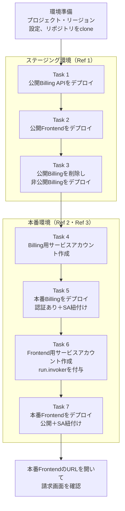

### 1.5 最終的に完成する本番構成

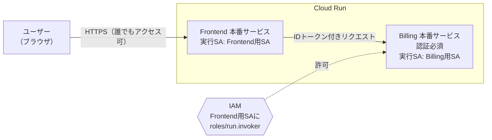

> **ここが設計の肝**: 外部に公開するのは Frontend だけ。Billing（お金に関わるAPI）は **認証必須** にして、このラボでは **Frontend用サービスアカウントに呼び出し権限（`roles/run.invoker`）を付与** します。認証必須のBillingを呼べるのは `run.routes.invoke` 権限を実効的に持つIDに限られますが、Frontend用SAが唯一の呼び出し元になるわけではありません（Owner・Editor など、ほかのロールでこの権限を持つIDも呼べます）。これが「Secure Access between components（コンポーネント間アクセスの保護）」の意味です。

---

## 2. 先に押さえる基礎知識

### 2.1 用語集

| 用語 | 一言で言うと | 本ラボでの登場場面 |
|---|---|---|
| **Cloud Run** | コンテナをサーバー管理なしで動かすサービス。リクエストが無いときは0台まで縮退する | 全タスクのデプロイ先 |
| **コンテナイメージ** | アプリと実行環境をひとまとめにした「配布物」 | `billing-staging-api:0.1` など |
| **Dockerfile** | イメージの作り方を書いたレシピ | 各コードのフォルダに入っている |
| **Cloud Build** | クラウド上でイメージをビルドするサービス | `gcloud builds submit` |
| **gcr.io** | イメージ保管先のドメイン。現在は **Artifact Registry** が裏で保管する | イメージ名 `gcr.io/PROJECT_ID/名前:タグ` |
| **サービス（Service）** | Cloud Runで動くアプリの単位。URLが1つ払い出される | `public-billing-service` など |
| **リビジョン** | サービスのデプロイごとに作られる不変のスナップショット | 再デプロイで増える |
| **サービスアカウント（SA）** | 人ではなく **プログラムが使う身元（ID）** | Task 4, 6 |
| **IAMロール** | 「何をしてよいか」の権限セット | `roles/run.invoker` |
| **roles/run.invoker** | Cloud Runサービスを **呼び出せる** 権限 | Task 6 |
| **認証なし / 認証あり** | 誰でも呼べる / 許可されたIDだけ呼べる | Task 1, 2, 7 / Task 3, 5 |
| **IDトークン** | 「私は誰か」を証明する短命のトークン | `gcloud auth print-identity-token` |
| **ステージング / 本番** | 動作確認用環境 / 実際にユーザーが使う環境 | Task 1〜3 / Task 4〜7 |

### 2.2 「認証なし」とは実は何をしているのか

Cloud Run の「認証なし（unauthenticated）」は、内部的には **`allUsers`（全員）に `roles/run.invoker` を付与** している状態です。

| オプション | 実際の意味 | 呼び出し時 |
|---|---|---|
| `--allow-unauthenticated` | 全員に呼び出し権限を付ける | そのまま `curl URL` で応答する |
| `--no-allow-unauthenticated` | 誰にも付けない（許可したIDだけ） | トークン無しだと **403 Forbidden** |

### 2.3 イメージ作成からサービス公開までの流れ

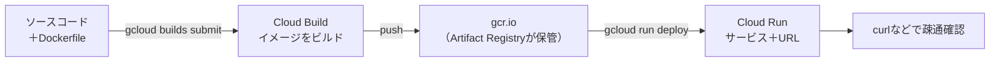

**この「ビルド → デプロイ → 疎通確認」の3段が、Task 1, 2, 3, 5, 7 で繰り返し出てきます。** 一度型を覚えれば、残りは「フォルダ・イメージ名・サービス名・オプション」を差し替えるだけです。

### 2.4 gcr.io に関する最新の注意点（2026-10-30時点）

- 旧 **Container Registry は2025年3月18日にシャットダウン済み** で、既存の旧形式イメージには依存できません。
- 一方、**Artifact Registry 上の `gcr.io` リポジトリ** は引き続き利用でき、`gcr.io/...` という従来のイメージ名のまま使えます。
- 過去にContainer Registryを使っていないプロジェクト（ラボ用の新規プロジェクトなど）では、`gcr.io` は最初から **Artifact Registry がホスト** します。

つまり、ラボで `gcr.io/$PROJECT_ID/...` と書いても問題ありません。ただし **本番運用では `REGION-docker.pkg.dev` 形式の Artifact Registry リポジトリが推奨** です（第13章で解説）。

---

## 3. 環境準備（Provision the lab environment）

### 3.1 前提チェックリスト

| 確認項目 | OK条件 |
|---|---|
| ブラウザ | **シークレットウィンドウ** を使っている（個人アカウントとの混線を防ぐ） |
| アカウント | ラボ画面の **Student用アカウント** のみでログインしている |
| 課金 | 個人のGoogle Cloudアカウントでログインしていない |
| タイマー | ラボは一時停止できない。時間配分を意識する |

### 3.2 Step 1: Cloud Shell を開く

Google Cloud コンソール右上の **Cloud Shell を有効化** アイコンをクリックします。ブラウザ内にLinuxターミナルが開きます。`gcloud` や `git` は最初から入っています。

### 3.3 Step 2: プロジェクトを設定する

まず、候補のプロジェクトを一覧表示します。

```bash
gcloud projects list --format='value(PROJECT_ID)' --filter='qwiklabs-gcp'
```

一覧の中から、**ラボ画面のプロジェクトIDと一致するものを 1 つだけ** 選び、`SELECTED_PROJECT_ID` に入れて設定します。

```bash
export SELECTED_PROJECT_ID=一覧から選んだプロジェクトID
gcloud config set project "$SELECTED_PROJECT_ID"
```

**何をしているか**: `gcloud projects list` で名前が `qwiklabs-gcp` を含むプロジェクトだけを一覧し、選んだ 1 つのIDを **既定プロジェクト** に設定します。一覧の結果をそのまま渡さないのは、候補が複数あると `gcloud config set project` の引数が多すぎてエラーになるためです。

### 3.4 Step 3: リージョンを設定する

ラボ画面に書かれている **リージョン名** を、`REGION` の部分にそのまま使います（例: `us-central1` のような値。**必ずラボ画面の値** を使う）。

```bash
export REGION=ラボ画面に表示されているリージョン
gcloud config set run/region $REGION
```

> `export` で変数にしておくと、以降のコマンドで `$REGION` と書くだけで済み、**打ち間違いを防げます**。

### 3.5 Step 4: 共通変数を一括設定する

```bash
# プロジェクトID
export PROJECT_ID=$(gcloud config get-value project)

# サービス名・サービスアカウント名（ラボ画面の値と違う場合はここだけ直す）
export PUBLIC_BILLING_SVC=public-billing-service
export FRONTEND_STG_SVC=frontend-staging-service
export PRIVATE_BILLING_SVC=private-billing-service
export BILLING_SA=billing-service-sa
export PROD_BILLING_SVC=billing-prod-service
export FRONTEND_SA=frontend-service-sa
export PROD_FRONTEND_SVC=frontend-prod-service

# 確認
echo "PROJECT_ID=$PROJECT_ID  REGION=$REGION"
```

> **注意**: Cloud Shell は一定時間操作がないと **再接続** され、`export` した変数が消えます。コマンドが急に失敗したら、まず `echo $PROJECT_ID $REGION` で変数が残っているか確認し、消えていたらこの章をやり直してください。

### 3.6 Step 5: 必要なAPIの有効化（念のため）

ラボ環境では有効化済みのことが多いですが、**何度実行しても安全（冪等）** なので念のため実行します。

```bash
gcloud services enable \
  run.googleapis.com \
  cloudbuild.googleapis.com \
  artifactregistry.googleapis.com \
  policytroubleshooter.googleapis.com
```

### 3.7 Step 6: コードを取得する

```bash
# 内容を確認したリビジョンに固定して取得する（main は更新されうるため）
git clone https://github.com/rosera/pet-theory.git \
  && git -C pet-theory checkout --detach 3a255117580ecda8ffd77becdba665081653dfec \
  && cd pet-theory/lab07

# ラボのルートを固定する（以降のタスクは常にここを起点に移動する）
export LAB_ROOT="$(pwd)"
echo "LAB_ROOT=$LAB_ROOT"
ls
```

`ls` で、各タスクで使うフォルダが並んでいることを確認します。

**なぜコミットを固定するのか**: `main` ブランチは予告なく更新されるため、この文書の手順と中身がずれる可能性があります。ここで指定したコミット `3a25511`（2026-11-04）は、本文書の作成時にソースコードを読んで確認したリビジョンです（ラボ全体の実行検証ではありません）。以前の固定先 `d902c4d` のベースイメージ Node.js 20 は 2026-04-30 にサポートが終了しました。そのため、アプリのコードは同じまま Node.js 24 LTS、`package-lock.json`、`npm ci --omit=dev` へ更新されたこのコミットへ移しています。このリビジョンの本番Frontendには修正が必要な箇所があり、Task 7 で手順を示します。

> **なぜ `LAB_ROOT` を使うのか**: `cd pet-theory/lab07/...` のような相対パスは、**今いるディレクトリ** によって成功・失敗が変わります（Task 1 でフォルダに入ったまま Task 2 の `cd` を打つと失敗します）。各タスクは `cd "$LAB_ROOT/<フォルダ>"` で始めれば、どこにいても同じ場所へ移動できます。Cloud Shell が再接続されて `LAB_ROOT` が消えた場合は、clone 先（`pet-theory/lab07`）へ移動して `export LAB_ROOT="$(pwd)"` をやり直してください。

| フォルダ | 使うタスク | 内容 |
|---|---|---|
| `unit-api-billing` | Task 1 | 公開Billing API（初版） |
| `staging-frontend-billing` | Task 2 | ステージング用Frontend |
| `staging-api-billing` | Task 3 | 更新版Billing API（非公開用） |
| `prod-api-billing` | Task 5 | 本番用Billing API |
| `prod-frontend-billing` | Task 7 | 本番用Frontend |

### 3.8 名前の対応表（ここだけ見れば迷わない）

| Task | 手順書の表記 | この文書で使う値 | 用途 |
|---|---|---|---|
| 1 | Billing Service | `public-billing-service` | 公開Billingサービス名 |
| 1 | Billing Image | `billing-staging-api:0.1` | イメージ名:タグ |
| 2 | Frontend staging service | `frontend-staging-service` | ステージングFrontend名 |
| 2 | Image Name | `frontend-staging:0.1` | イメージ名:タグ |
| 3 | Private billing service | `private-billing-service` | 非公開Billingサービス名 |
| 3 | Image Name | `billing-staging-api:0.2` | イメージ名:タグ |
| 4 | Billing service account | `billing-service-sa` | SAのID |
| 4 | Display Name | `Billing Service Cloud Run` | SAの表示名 |
| 5 | Billing production service | `billing-prod-service` | 本番Billing名 |
| 5 | Image Name | `billing-prod-api:0.1` | イメージ名:タグ |
| 6 | Frontend service account | `frontend-service-sa` | SAのID |
| 6 | Display Name | `Billing Service Cloud Run Invoker` | SAの表示名 |
| 7 | Frontend production service | `frontend-prod-service` | 本番Frontend名 |
| 7 | Image Name | `frontend-prod:0.1` | イメージ名:タグ |

> **再確認**: 上記のサービス名・SA名は「一般的な命名」です。ラボ画面に別の指定があれば **そちらが正** です。特に **イメージ名とタグ（`0.1` / `0.2`）は採点に関わりやすい** ので、一文字も変えないでください。

---

## Task 1: 公開Billingサービスをデプロイする

### 1.1 ゴール

| 項目 | 値 |
|---|---|
| イメージ | `billing-staging-api:0.1` |
| サービス | 公開Billingサービス |
| 認証 | **なし（unauthenticated）** |
| コード | `pet-theory/lab07/unit-api-billing` |

**採点される3点**: ① Cloud Buildでイメージをビルド ② 認証なしでCloud Runにデプロイ ③ エンドポイントにアクセスして応答がある

### 1.2 Step 1: ソースフォルダへ移動し、中身を確認する

```bash
cd "$LAB_ROOT/unit-api-billing"
ls
cat Dockerfile
```

**なぜ中身を見るのか**: チャレンジラボでは「何が入っているか」を自分で確認する習慣が大切です。`Dockerfile` があれば、そのフォルダがビルド対象だと分かります。

### 1.3 Step 2: Cloud Buildでイメージをビルドする

```bash
gcloud builds submit \
  --tag gcr.io/$PROJECT_ID/billing-staging-api:0.1 .
```

| 部分 | 意味 |
|---|---|
| `gcloud builds submit` | 現在のフォルダをCloud Buildに送ってビルドする |
| `--tag gcr.io/$PROJECT_ID/billing-staging-api:0.1` | 完成したイメージの **名前:タグ** |
| 末尾の `.` | ビルド対象は **現在のフォルダ**（ピリオドの付け忘れに注意） |

成功すると、最後に `SUCCESS` と表示されます。

### 1.4 Step 3: Cloud Runにデプロイする（認証なし）

```bash
gcloud run deploy $PUBLIC_BILLING_SVC \
  --image gcr.io/$PROJECT_ID/billing-staging-api:0.1 \
  --region $REGION \
  --allow-unauthenticated
```

| オプション | 意味 |
|---|---|
| `gcloud run deploy サービス名` | サービスを作成（既にあれば新リビジョンで更新） |
| `--image` | Step 2で作ったイメージを指定 |
| `--region` | デプロイ先リージョン |
| `--allow-unauthenticated` | **認証なし（全員が呼べる）** |

> 途中で対話的に質問された場合（APIの有効化やリージョン選択など）は、ラボ画面のリージョンを選び、有効化は `y` で進めます。

### 1.5 Step 4: 疎通確認

```bash
PUBLIC_BILLING_URL=$(gcloud run services describe $PUBLIC_BILLING_SVC \
  --region $REGION \
  --format "value(status.url)")
echo $PUBLIC_BILLING_URL
curl -sS -w '\nHTTP %{http_code}\n' "$PUBLIC_BILLING_URL"
```

**ここで確認すること**: トークン無しの `curl` で、出力の最後の行が **`HTTP 200`** になる（`HTTP 403` ではない）。これが「公開サービス」の正しい状態です。

> `-w '\nHTTP %{http_code}\n'` は、本文の後に **HTTPステータスコード** を1行で表示するオプションです。本文が表示されただけでは成功とは限らない（エラーページの本文も表示される）ため、**ステータスコードで判定** します。

### 1.6 つまずきポイント

| 症状 | 原因 | 対処 |
|---|---|---|
| `curl` が **403** | `--allow-unauthenticated` を付け忘れた | 同じ `deploy` コマンドを `--allow-unauthenticated` 付きで再実行 |
| ビルドで `Dockerfile` が見つからない | 別のフォルダでコマンドを実行した | `pwd` で場所を確認し、正しいフォルダへ `cd` |
| 進捗チェックが通らない | 反映待ち | **30秒待って** 再度 Check my progress |

---

## Task 2: ステージングのフロントエンドをデプロイする

### 2.1 ゴール

| 項目 | 値 |
|---|---|
| イメージ | `frontend-staging:0.1` |
| サービス | ステージングFrontendサービス |
| 認証 | **なし（unauthenticated）** |
| コード | `pet-theory/lab07/staging-frontend-billing` |

### 2.2 手順

Task 1 とまったく同じ型です。**変わるのは、フォルダ・イメージ名・サービス名だけ** です。

```bash
cd "$LAB_ROOT/staging-frontend-billing"
ls

# ビルド
gcloud builds submit \
  --tag gcr.io/$PROJECT_ID/frontend-staging:0.1 .

# デプロイ（認証なし）
gcloud run deploy $FRONTEND_STG_SVC \
  --image gcr.io/$PROJECT_ID/frontend-staging:0.1 \
  --region $REGION \
  --allow-unauthenticated
```

### 2.3 疎通確認

```bash
FRONTEND_STG_URL=$(gcloud run services describe $FRONTEND_STG_SVC \
  --region $REGION \
  --format "value(status.url)")
echo $FRONTEND_STG_URL
curl -sS -w '\nHTTP %{http_code}\n' "$FRONTEND_STG_URL"   # 最後の行が HTTP 200 なら成功
```

ブラウザで `$FRONTEND_STG_URL` を開いても確認できます。

### 2.4 ポイント

- Frontendは **ユーザーのブラウザから直接開かれる** ため、「認証なし（公開）」が正しい設計です。
- 「Frontendは公開、Billing（お金のAPI）は非公開」という **役割による使い分け** が、このラボ全体のテーマです。

---

## Task 3: 非公開Billingサービスへ置き換える

### 3.1 状況の整理

開発チームがアプリを更新しました。**更新版（`0.2`）を、今度は認証必須でデプロイ** します。

| 項目 | 値 |
|---|---|
| イメージ | `billing-staging-api:0.2` |
| サービス | 非公開Billingサービス |
| リポジトリ | `gcr.io` |
| 認証 | **あり（authenticated）** |
| コード | `pet-theory/lab07/staging-api-billing` |

**採点される4点**: ① 既存Billingサービスの削除 ② Cloud Buildでビルド ③ 認証ありでデプロイ ④ サービスURLを環境変数に入れて疎通確認

### 3.2 なぜ既存サービスを削除するのか

Task 1 で作った公開Billingサービスは、**誰でも呼べる状態でインターネットに残っています**。非公開版に置き換えるなら、公開版を残しておく理由はありません。放置すると **セキュリティ上の穴** になります。

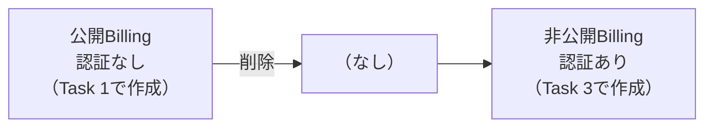

### 3.3 Step 1: 既存の公開Billingサービスを削除する

```bash
gcloud run services delete $PUBLIC_BILLING_SVC \
  --region $REGION \
  --quiet
```

`--quiet` は確認プロンプトを省略するオプションです。削除は取り消せないので、**サービス名が正しいか** を事前に `gcloud run services list` で確認してください。

```bash
gcloud run services list --region $REGION
```

### 3.4 Step 2: 更新版をビルドする

```bash
cd "$LAB_ROOT/staging-api-billing"
ls

gcloud builds submit \
  --tag gcr.io/$PROJECT_ID/billing-staging-api:0.2 .
```

### 3.5 Step 3: 認証必須でデプロイする

```bash
gcloud run deploy $PRIVATE_BILLING_SVC \
  --image gcr.io/$PROJECT_ID/billing-staging-api:0.2 \
  --region $REGION \
  --no-allow-unauthenticated
```

**Task 1との違いはたった1つ**: `--allow-unauthenticated` が `--no-allow-unauthenticated` に変わっただけです。

### 3.6 Step 4: URLを環境変数に入れる

```bash
BILLING_URL=$(gcloud run services describe $PRIVATE_BILLING_SVC \
  --region $REGION \
  --format "value(status.url)")
echo $BILLING_URL
```

| 部分 | 意味 |
|---|---|
| `gcloud run services describe サービス名` | サービスの詳細情報を取得 |
| `--format "value(status.url)"` | 詳細のうち **URLの値だけ** を取り出す |
| `BILLING_URL=$(...)` | 出力をシェル変数に保存 |

> **注意（手順書の表記について）**: 手順書の `describe` の後ろには `Private billing service` と書かれていますが、これは説明表記です。**実際のサービス名**（`$PRIVATE_BILLING_SVC`）を指定してください。スペースを含む名前はCloud Runのサービス名にできません。

### 3.7 Step 5: 疎通確認（2パターンで理解する）

**まず、トークン無しで呼ぶ（失敗するのが正解）**

```bash
curl -sS -w '\nHTTP %{http_code}\n' "$BILLING_URL"
```

最後の行が **`HTTP 403`**（Forbidden）になります。**これは「保護が効いている」証拠** です。

**次に、IDトークン付きで呼ぶ（成功するのが正解）**

IDトークンは「あなたが誰か」を証明するだけで、**呼び出し権限を与えるものではありません**。HTTP 200 になるのは、現在の `gcloud` ユーザーが対象サービスに対して **実効的に `run.routes.invoke` 権限** を持っている場合だけです。この権限は `roles/run.invoker` のほか `roles/run.servicesInvoker`・`roles/run.developer`・`roles/run.admin`・Owner・Editor・カスタムロール、さらにグループ経由や上位リソースからの継承でも付与されうるため、ロール名の一覧ではなく **権限そのもの** を確認します。ラボの学生アカウントは通常これを満たしますが、念のため先に確認できます。**最終判定は、後述の `curl` の実際の応答で行います。**

方法1の Policy Troubleshooter は任意の診断手段です。実行するアカウントには次の権限が必要で（「条件付き」の行は、その条件に当てはまる評価でだけ必要です）、Student アカウントに付与されているとは限りません。

| 必要な権限 | 付与先 | 用途 |
|---|---|---|
| `roles/iam.securityReviewer` | 対象リソースを含む組織 | 組織配下の許可ポリシーを読む |
| `roles/iam.denyReviewer` | 対象リソースを含む組織 | 条件付き: 拒否ポリシーを評価する場合に必要 |
| `roles/browser` | 対象リソースを含む組織 | 条件付き: ポリシーにサービスアカウントのプリンシパルセットが含まれる場合に、その評価で必要 |
| `roles/serviceusage.serviceUsageConsumer` | 対象リソースを含む組織 | gcloud CLI から Policy Troubleshooter を使う |
| Google Workspace Admin API の `groups.read` | Google Workspace の管理者ロール | グループのメンバーを評価する |

権限が不足していると、判定が `Unknown` になることがあります。`Unknown` は許可でも拒否でもありません。権限を保証できない場合は方法1を省略してかまいません。

```bash
# 方法1（任意の診断）: Policy Troubleshooter で実効権限を評価する
# 必要な権限があれば、グループ経由・フォルダ/組織からの継承・カスタムロールもまとめて評価される
gcloud policy-intelligence troubleshoot-policy iam \
  "//run.googleapis.com/projects/${PROJECT_ID}/locations/${REGION}/services/${PRIVATE_BILLING_SVC}" \
  --principal-email="$(gcloud config get-value account)" \
  --permission=run.routes.invoke
```

```bash
# 方法2（方法1が使えない場合）: 直接付与されたロールを展開し、run.routes.invoke を含むか調べる
# グループ経由や上位リソースからの継承は拾えないため、該当なしでも直ちに権限なしとは断定しない
ACCOUNT=$(gcloud config get-value account)
{
  gcloud projects get-iam-policy "$PROJECT_ID" \
    --flatten=bindings --filter="bindings.members:user:${ACCOUNT}" \
    --format='value(bindings.role)'
  gcloud run services get-iam-policy "$PRIVATE_BILLING_SVC" --region "$REGION" \
    --flatten=bindings --filter="bindings.members:user:${ACCOUNT}" \
    --format='value(bindings.role)'
} | sort -u | while read -r ROLE; do
  PERMS_STATUS=0
  case "$ROLE" in
    projects/*/roles/*) PERMS=$(gcloud iam roles describe "${ROLE##*/}" --project "$PROJECT_ID" --format='value(includedPermissions)') || PERMS_STATUS=$? ;;
    organizations/*/roles/*)
      # 組織のカスタムロール: organizations/<ORG_ID>/roles/<ROLE_ID> から組織IDとロールIDを取り出す
      ORG_ID=${ROLE#organizations/}
      ORG_ID=${ORG_ID%%/*}
      PERMS=$(gcloud iam roles describe "${ROLE##*/}" --organization "$ORG_ID" --format='value(includedPermissions)') || PERMS_STATUS=$? ;;
    *) PERMS=$(gcloud iam roles describe "$ROLE" --format='value(includedPermissions)') || PERMS_STATUS=$? ;;
  esac
  # ロール定義を取得できない場合は、権限の有無を判定しない
  if [ "$PERMS_STATUS" -ne 0 ]; then
    echo "UNKNOWN: ${ROLE} のロール定義を取得できないため判定できない"
    continue
  fi
  case "$PERMS" in
    *run.routes.invoke*) echo "OK: ${ROLE} は run.routes.invoke を含む" ;;
    *) echo "--: ${ROLE} は run.routes.invoke を含まない" ;;
  esac
done
```

方法2で `OK:` の行が1つも出なくても、**それだけでは拒否の証拠になりません**。方法2はグループ経由や上位リソースからの継承を拾えないため、実際には権限を持っている場合があります。`UNKNOWN:` の行は、ロール定義を読めなかったことを示すだけで、権限の有無は判定していません。方法1の判定（`Unknown` を含む）も診断の手掛かりです。アクセスできるかどうかは、次の `curl` の実際の応答（`HTTP 200` か `HTTP 403` か）を最終判定としてください。ロール名（`roles/run.invoker` の有無など）だけで判断せず、確認する権限は `run.routes.invoke` です。

```bash
curl -sS -w '\nHTTP %{http_code}\n' -H "Authorization: Bearer $(gcloud auth print-identity-token)" "$BILLING_URL"
```

最後の行が **`HTTP 200`** なら成功です。

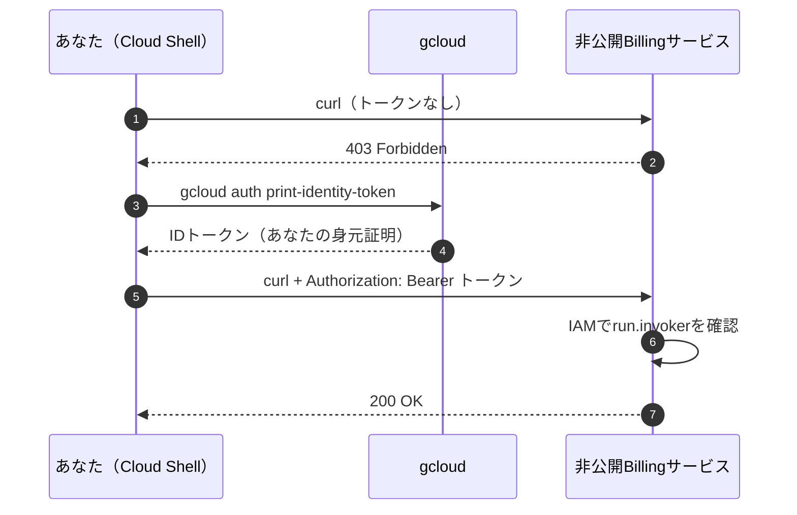

> **補足**: 手順書では `curl -X get` と小文字で書かれていますが、`curl` は **何も指定しなければGETで送る** ため `-X` は不要です。HTTPメソッド名は本来大文字（`GET`）なので、明示するなら `-X GET` とします。

### 3.8 つまずきポイント

| 症状 | 原因 | 対処 |
|---|---|---|
| トークン付きでも403 | 反映待ち、別アカウントで実行、または実行ユーザーに実効的な `run.routes.invoke` 権限がない | 少し待つ。`gcloud auth list` で学生アカウントか確認し、3.7 Step 5 のコマンドで `run.routes.invoke` の有無を確認 |
| `Service not found` | サービス名の打ち間違い | `gcloud run services list` で名前を確認 |
| 削除前にデプロイしてしまった | 順序ミス | 公開版が残っていれば削除してから再確認 |

---

## Task 4: Billing用サービスアカウントを作る

### 4.1 そもそもなぜサービスアカウントが必要か

Cloud Runのサービスは、デプロイ時に特に指定しないと **デフォルトのサービスアカウント**（Compute Engineのデフォルトアカウント）で動きます。このアカウントは **広い権限を持っていることが多く**、アプリが乗っ取られた場合の被害が大きくなります。

**ベストプラクティスは「サービスごとに専用のサービスアカウントを作り、必要最小限の権限だけを付ける」** ことです。

| 方式 | 権限 | リスク |
|---|---|---|
| デフォルトSAを使う | 広い（プロジェクトの編集権限を持つ場合もある） | 高い |
| **専用SAを使う** | **必要なものだけ** | **低い** |

### 4.2 ゴール

| 項目 | 値 |
|---|---|
| サービスアカウント | Billing用サービスアカウント |
| 表示名（Display Name） | `Billing Service Cloud Run` |
| ロール | **N/A（付けない）** |

### 4.3 手順

```bash
gcloud iam service-accounts create $BILLING_SA \
  --display-name "Billing Service Cloud Run"
```

| 部分 | 意味 |
|---|---|
| `gcloud iam service-accounts create ID` | サービスアカウントを作成。**ID** は後で変更できない |
| `--display-name` | コンソールに表示される分かりやすい名前 |

### 4.4 確認

```bash
gcloud iam service-accounts list
```

作成したSAのメールアドレスは次の形式になります。

```text
billing-service-sa@PROJECT_ID.iam.gserviceaccount.com
```

### 4.5 「ロール N/A」の意味

**Billingサービスは他のGoogle Cloudリソース（Cloud Storageなど）を使わない** ため、追加のロールは不要です。「何も付けない」のが **最小権限の原則** に沿った正しい姿です。

> **よくある誤解**: 「SAを作ったらEditorなどを付けておこう」は **NG** です。必要になった時点で、必要なロールだけを付けます。

---

## Task 5: 本番Billingサービスをデプロイする

### 5.1 ゴール

| 項目 | 値 |
|---|---|
| イメージ | `billing-prod-api:0.1` |
| サービス | 本番Billingサービス |
| リポジトリ | `gcr.io` |
| 認証 | **あり（authenticated）** |
| コード | `pet-theory/lab07/prod-api-billing` |
| サービスアカウント | Task 4 で作ったBilling用SA |

**採点される4点**: ① デプロイ ② 認証有効 ③ サービスアカウント紐付け ④ 応答確認

### 5.2 Step 1: ビルド

```bash
cd "$LAB_ROOT/prod-api-billing"
ls

gcloud builds submit \
  --tag gcr.io/$PROJECT_ID/billing-prod-api:0.1 .
```

### 5.3 Step 2: デプロイ（認証あり＋サービスアカウント）

```bash
gcloud run deploy $PROD_BILLING_SVC \
  --image gcr.io/$PROJECT_ID/billing-prod-api:0.1 \
  --region $REGION \
  --no-allow-unauthenticated \
  --service-account $BILLING_SA@$PROJECT_ID.iam.gserviceaccount.com
```

| オプション | 意味 |
|---|---|
| `--no-allow-unauthenticated` | 認証必須 |
| `--service-account` | **このサービスが実行時に使う身元**。メールアドレス形式で指定 |

> **ポイント**: `--service-account` は **「このサービス自身が何者として動くか」** を決めるオプションです。「誰がこのサービスを呼べるか」とは **別の話** です（呼べる人は `run.invoker` で決まります。Task 6 で扱います）。

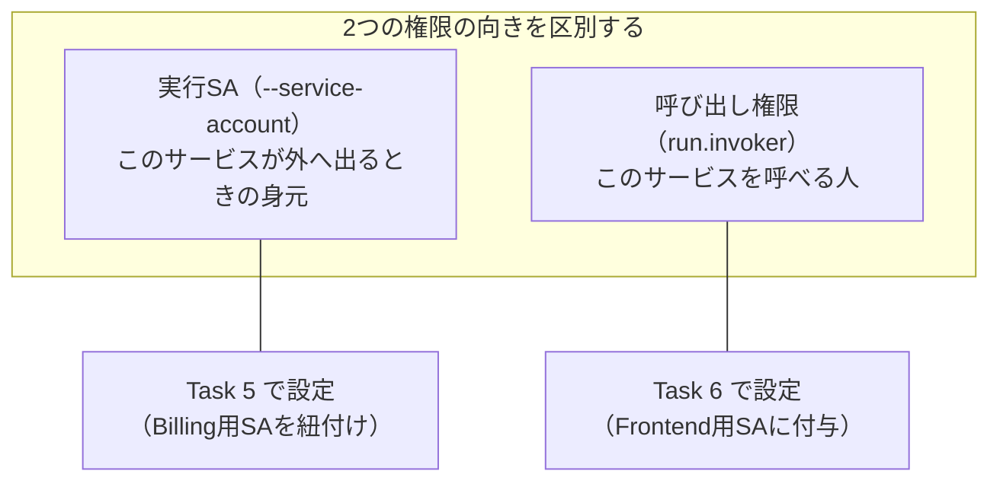

### 5.4 Step 3: 疎通確認

```bash
PROD_BILLING_URL=$(gcloud run services describe $PROD_BILLING_SVC \
  --region $REGION \
  --format "value(status.url)")
echo $PROD_BILLING_URL

# 本番Billingは POST / で請求データを返す（GET / のルートは無い）
curl -sS -X POST -d '' -w '\nHTTP %{http_code}\n' \
  -H "Authorization: Bearer $(gcloud auth print-identity-token)" \
  "$PROD_BILLING_URL"   # 最後の行が HTTP 200 なら成功
```

> **なぜ POST なのか**: 本番Billingのコード（`prod-api-billing/index.js`）が受け付けるのは `POST /`、`GET /billing`、`GET /billing/:ref` で、`GET /` のルートはありません。既定の GET で `/` を呼ぶと、認証に成功しても 404 になるため、この疎通確認では `POST /` を使います。`-d ''` は空の本文と `Content-Length: 0` を送り、本文なしの POST が 411 で拒否されるのを防ぎます。
>
> **権限の前提**: Task 3 と同じく、HTTP 200 になるのは現在の `gcloud` ユーザーが本番Billingに対する実効的な `run.routes.invoke` 権限を持つ場合だけです。IDトークンの作成は権限を与えません。3.7 Step 5 の権限確認コマンドを、サービス名を `$PROD_BILLING_SVC` に替えて実行してから確認してください。

### 5.5 SA紐付けの確認

```bash
gcloud run services describe $PROD_BILLING_SVC \
  --region $REGION \
  --format "value(spec.template.spec.serviceAccountName)"
```

`billing-service-sa@...` と表示されれば、期待通りに紐付いています。

### 5.6 トークン無しでも確認する（保護の確認）

```bash
curl -sS -X POST -d '' -w '\nHTTP %{http_code}\n' "$PROD_BILLING_URL"
```

最後の行が **`HTTP 403`** になることを確認します。**「通る確認」と「止まる確認」の両方をやる** のが、セキュリティ設定の基本です。

---

## Task 6: Frontend用サービスアカウントを作り権限を付ける

### 6.1 状況の整理

Task 5 で本番Billingを **認証必須** にしたため、そのままではFrontendもBillingを呼べません。そこで **Frontend専用のサービスアカウントを作り、本番Billingを呼べる権限だけを付けます**。

| 項目 | 値 |
|---|---|
| サービスアカウント | Frontend用サービスアカウント |
| 表示名 | `Billing Service Cloud Run Invoker` |
| ロール | `run.invoker` |

**採点される4点**: ① SA作成 ② Frontendサービスで使う準備 ③ `run.invoker` 付与 ④ サービスへのバインド

### 6.2 Step 1: サービスアカウントを作成する

```bash
gcloud iam service-accounts create $FRONTEND_SA \
  --display-name "Billing Service Cloud Run Invoker"
```

### 6.3 Step 2: 本番Billingサービスに `run.invoker` を付与する

```bash
gcloud run services add-iam-policy-binding $PROD_BILLING_SVC \
  --region $REGION \
  --member "serviceAccount:$FRONTEND_SA@$PROJECT_ID.iam.gserviceaccount.com" \
  --role "roles/run.invoker"
```

| オプション | 意味 | 本ラボの値 |
|---|---|---|
| `add-iam-policy-binding` | 既存のポリシーに **1件追加** する（他の権限は消えない） | - |
| 対象（位置引数） | **どのリソースに** 権限を付けるか | 本番Billingサービス |
| `--member` | **誰に** 付けるか | Frontend用SA |
| `--role` | **どの権限を** 付けるか | `roles/run.invoker` |

### 6.4 「誰に・何を・どこに」を図で理解する

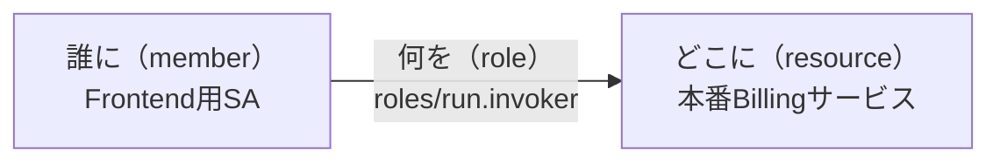

> **ベストプラクティス**: 権限は **プロジェクト全体ではなく、サービス単位** で付けます。プロジェクト全体に `run.invoker` を付けると、他のすべてのCloud Runサービスも呼べてしまいます（権限が広すぎる）。今回の「Bind Account to Service」は、まさに **サービス単位のバインド** を指しています。

### 6.5 Step 3: 確認

```bash
gcloud run services get-iam-policy $PROD_BILLING_SVC --region $REGION
```

出力に、次のような部分があれば成功です。

```text
- members:
  - serviceAccount:frontend-service-sa@PROJECT_ID.iam.gserviceaccount.com
  role: roles/run.invoker
```

### 6.6 つまずきポイント

| 症状 | 原因 | 対処 |
|---|---|---|
| `Service account ... does not exist` | SA作成直後で反映待ち | 数十秒待ってから再実行 |
| `Service not found` | Billing本番サービスが未作成 | Task 5 を先に完了する |
| 付与したのに後で403 | 付与先サービスの取り違え | `get-iam-policy` で **本番Billing** に付いているか確認 |

---

## Task 7: 本番Frontendを再デプロイする

### 7.1 ゴール

| 項目 | 値 |
|---|---|
| イメージ | `frontend-prod:0.1` |
| サービス | 本番Frontendサービス |
| リポジトリ | `gcr.io` |
| 認証 | **なし（unauthenticated）** |
| コード | `pet-theory/lab07/prod-frontend-billing` |
| サービスアカウント | Task 6 で作ったFrontend用SA |

### 7.2 「認証なし」と「Enable Authentication」は矛盾しない

手順書の表は認証が **unauthenticated**、評価項目には **Enable Authentication** と書かれていて混乱しやすい箇所です。次のように整理します。

| 通信の区間 | 認証 | 理由 |
|---|---|---|
| ユーザーのブラウザ → Frontend | **なし（公開）** | ブラウザからトークン無しで画面を開けるようにするため |
| Frontend → Billing | **あり（IDトークン）** | Billingは非公開。Frontend用SAの身元で呼ぶ |

> 表の `unauthenticated` は **Frontend自身の公開設定**、`Enable Authentication` は **FrontendがBillingへ認証付きでアクセスする仕組み（SAの利用）** を指していると読み取れます。デプロイ時は **表の値（認証なし）** に従ってください。

### 7.3 Step 1: コードを確認する（重要）

```bash
cd "$LAB_ROOT/prod-frontend-billing"
ls
cat Dockerfile
grep -rn "process.env" . --include=*.js --exclude-dir=node_modules
```

**なぜ確認するのか**: FrontendがBillingのURLを **環境変数で受け取る設計** の場合、デプロイ時にその値を渡さないと画面にデータが出ません。手順書に書かれていなくても、**コードが環境変数を読んでいるなら渡す** のがエンジニアの仕事です。

固定したリビジョンでは、`render.js` が `process.env.BILLING_URL` を読み、未設定なら `BILLING_URL needs to be set.` というエラーで処理を止めます。したがって **`BILLING_URL` に本番BillingのURLを渡す必要があります**（`PORT` は Cloud Run が自動で設定します）。

### 7.3.1 固定リビジョンの不具合を直す

このリビジョンの本番Frontendには、そのままでは動かない箇所、またはBillingの失敗時に壊れる箇所が7つあります。

| ファイル | 問題 | 影響 |
|---|---|---|
| `index.js` | 使っていない `node-fetch` を `require` しているが、`package.json` に依存がない | 起動時に `Cannot find module 'node-fetch'` で落ちる可能性がある |
| `render.js` | `const got = import('got')` は **Promise** を返すため、`got(...)` を関数として呼べない | Billingの呼び出しが `got is not a function` で失敗する |
| `render.js` | got v12 以降は `timeout` に数値を渡せない（`{ request: ミリ秒 }` 形式） | リクエスト作成時にエラーになる |
| `index.js` | Billing呼び出しの失敗時に `res.status(800)` を返す（HTTPに存在しないステータス） | `800` は標準のHTTPステータスではないため、サーバーエラーとして確実に扱えるよう `500` に置き換える |
| `public/app.js` | `fetchLocalData` が `response.ok` を確認する前に本文を `JSON.parse` している | Frontendがエラー応答を返すと、ステータスを判定する前にJSONの解析で例外になる |
| `public/app.js` | 失敗時の `console.log` が `response.text`（読み取り済みの本文ではなく関数そのもの）を出力している | ログにエラー本文ではなく関数定義が出て、失敗の原因を追えない |
| `public/app.js` | `getPageInfo` が `info.bills[0]` を無条件に参照している | 取得失敗（空文字・`undefined`）や請求データ0件のとき `TypeError` で画面が止まる |

ビルドの前に、次のコマンドで修正します（`perl -pi` はファイルをその場で書き換えます）。

```bash
cd "$LAB_ROOT/prod-frontend-billing"

# 1. 未使用の node-fetch の読み込みを削除する
perl -ni -e "print unless /require\('node-fetch'\)/" index.js

# 2. got（ESM 専用）を呼び出し時に動的 import し、timeout をオブジェクト形式にする
perl -ni -e "print unless /^const got = import\('got'\);/" render.js
perl -pi -e "s/await got\(serviceUrl/await (await import('got')).default(serviceUrl/; s/timeout: 3000/timeout: { request: 3000 }/" render.js

# 3. Billing失敗時は標準のサーバーエラー（500）を返す
perl -pi -e 's/res\.status\(800\)\.send\(error\)/res.status(500).send({ error: String(error && error.message || error) })/' index.js

# 4. response.ok を確認してから JSON として解析する（成功時の return でだけ解析する）
perl -ni -e 'print unless /^\s*let test = JSON\.parse\(text\);/' public/app.js
perl -pi -e 's/^(\s*)return test;/${1}return JSON.parse(text);/' public/app.js
# 失敗時のログは、既に読み取った本文 text を出力する（response.text は関数で本文ではない）
perl -pi -e 's/(console\.log\(.*?)\bresponse\.text\b(?!\s*\()/${1}text/' public/app.js

# 5. 請求データがない・空のときは先頭要素を参照せずに表示を終える
perl -0pi -e 's/(htmlContent = document\.querySelector\(\x27#info\x27\);)/$1\n  if (!info || !Array.isArray(info.bills) || info.bills.length === 0) {\n    htmlContent.textContent = \x27No billing data available.\x27;\n    return;\n  }/' public/app.js

# 確認: node-fetch が消え、got と timeout が修正されていること
grep -n "node-fetch" index.js || echo "node-fetch の読み込みなし（OK）"
grep -n "import('got')\|timeout" render.js
grep -n "res.status(" index.js
grep -n "response.ok\|JSON.parse\|info.bills\|console.log" public/app.js
```

`render.js` の `grep` で `await (await import('got')).default(serviceUrl, ...)` と `timeout: { request: 3000 }`、`index.js` で `res.status(500)`（`800` が残っていない）、`public/app.js` で `if (!response.ok)` が `return JSON.parse(text);` より前にあり、その失敗分岐の `console.log` が `response.text` ではなく `text` を出力し、`info.bills.length === 0` のガードが表示されれば修正済みです。

> **保護されたBillingへの直接アクセスは変わりません**: この修正はFrontend側の失敗時の扱いだけを変えます。Task 5 のとおり、本番BillingのURLをトークンなしで直接呼ぶと引き続き `HTTP 403` になります。

### 7.4 Step 2: ビルド

```bash
gcloud builds submit \
  --tag gcr.io/$PROJECT_ID/frontend-prod:0.1 .
```

### 7.5 Step 3: デプロイ（公開＋サービスアカウント）

**基本形**（環境変数を読まないFrontendの場合の一般形。本ラボでは下の形を使う）

```bash
gcloud run deploy $PROD_FRONTEND_SVC \
  --image gcr.io/$PROJECT_ID/frontend-prod:0.1 \
  --region $REGION \
  --allow-unauthenticated \
  --service-account $FRONTEND_SA@$PROJECT_ID.iam.gserviceaccount.com
```

**本ラボの形（`BILLING_URL` を渡す）**

`render.js` は `BILLING_URL` が無いと失敗するため、実際には次の形でデプロイします。

```bash
PROD_BILLING_URL=$(gcloud run services describe $PROD_BILLING_SVC \
  --region $REGION --format "value(status.url)")

gcloud run deploy $PROD_FRONTEND_SVC \
  --image gcr.io/$PROJECT_ID/frontend-prod:0.1 \
  --region $REGION \
  --allow-unauthenticated \
  --service-account $FRONTEND_SA@$PROJECT_ID.iam.gserviceaccount.com \
  --set-env-vars "BILLING_URL=$PROD_BILLING_URL"
```

### 7.6 Step 4: 動作確認（最終ゴール）

```bash
PROD_FRONTEND_URL=$(gcloud run services describe $PROD_FRONTEND_SVC \
  --region $REGION \
  --format "value(status.url)")
echo $PROD_FRONTEND_URL

# ブラウザと同じく POST / を呼び、Frontend経由でBillingのデータが返るか確認する
curl -sS -X POST -d '' -w '\nHTTP %{http_code}\n' "$PROD_FRONTEND_URL"
```

最後の行が **`HTTP 200`** で、本文に `{"bills":[...]}` 形式の請求データが含まれれば、Frontend → Billing の認証付き呼び出しが成功しています。そのうえで表示されたURLを **ブラウザで開き**、**Billing Service のページ（請求情報の画面）** に請求データの表が表示されれば完成です。

画面のデータは、FrontendがFrontend用SAの身元で、非公開の本番Billingから取得しています。

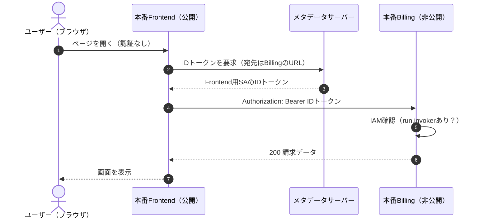

### 7.7 画面にデータが出ないときの切り分け

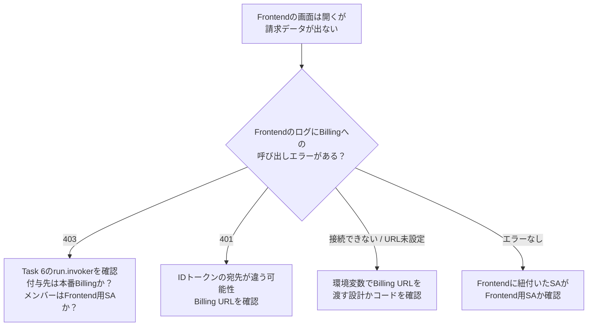

ログの確認コマンド:

```bash
gcloud logging read \
  "resource.type=cloud_run_revision AND resource.labels.service_name=$PROD_FRONTEND_SVC" \
  --limit 20 \
  --format "value(timestamp, textPayload)"
```

---

## 11. 全タスク通しのコマンドまとめ

> **使い方**: 各タスクの意味を理解したあとに、復習用として使ってください。**意味を理解せずにコピペするのは非推奨** です（名前の違いや、Task 7のコード修正と環境変数など、確認が必要な箇所があるため）。

```bash
# ===== 環境準備 =====
# 一覧の中からラボ画面のプロジェクトIDと一致するものを 1 つ選ぶ
gcloud projects list --format='value(PROJECT_ID)' --filter='qwiklabs-gcp'
export SELECTED_PROJECT_ID=一覧から選んだプロジェクトID
gcloud config set project "$SELECTED_PROJECT_ID"
export REGION=ラボ画面に表示されているリージョン
gcloud config set run/region $REGION
export PROJECT_ID=$(gcloud config get-value project)

export PUBLIC_BILLING_SVC=public-billing-service
export FRONTEND_STG_SVC=frontend-staging-service
export PRIVATE_BILLING_SVC=private-billing-service
export BILLING_SA=billing-service-sa
export PROD_BILLING_SVC=billing-prod-service
export FRONTEND_SA=frontend-service-sa
export PROD_FRONTEND_SVC=frontend-prod-service

gcloud services enable run.googleapis.com cloudbuild.googleapis.com artifactregistry.googleapis.com policytroubleshooter.googleapis.com
git clone https://github.com/rosera/pet-theory.git \
  && git -C pet-theory checkout --detach 3a255117580ecda8ffd77becdba665081653dfec \
  && cd pet-theory/lab07
export LAB_ROOT="$(pwd)"

# ===== Task 1: 公開Billing =====
cd "$LAB_ROOT/unit-api-billing"
gcloud builds submit --tag gcr.io/$PROJECT_ID/billing-staging-api:0.1 .
gcloud run deploy $PUBLIC_BILLING_SVC \
  --image gcr.io/$PROJECT_ID/billing-staging-api:0.1 \
  --region $REGION --allow-unauthenticated
curl -sS -w '\nHTTP %{http_code}\n' "$(gcloud run services describe $PUBLIC_BILLING_SVC --region $REGION --format "value(status.url)")"   # HTTP 200

# ===== Task 2: ステージングFrontend =====
cd "$LAB_ROOT/staging-frontend-billing"
gcloud builds submit --tag gcr.io/$PROJECT_ID/frontend-staging:0.1 .
gcloud run deploy $FRONTEND_STG_SVC \
  --image gcr.io/$PROJECT_ID/frontend-staging:0.1 \
  --region $REGION --allow-unauthenticated

# ===== Task 3: 非公開Billing（置き換え）=====
gcloud run services delete $PUBLIC_BILLING_SVC --region $REGION --quiet
cd "$LAB_ROOT/staging-api-billing"
gcloud builds submit --tag gcr.io/$PROJECT_ID/billing-staging-api:0.2 .
gcloud run deploy $PRIVATE_BILLING_SVC \
  --image gcr.io/$PROJECT_ID/billing-staging-api:0.2 \
  --region $REGION --no-allow-unauthenticated
BILLING_URL=$(gcloud run services describe $PRIVATE_BILLING_SVC --region $REGION --format "value(status.url)")
curl -sS -w '\nHTTP %{http_code}\n' "$BILLING_URL"   # HTTP 403（トークンなし）
curl -sS -w '\nHTTP %{http_code}\n' -H "Authorization: Bearer $(gcloud auth print-identity-token)" "$BILLING_URL"   # HTTP 200（実行ユーザーに run.routes.invoke 権限が必要）

# ===== Task 4: Billing用SA =====
gcloud iam service-accounts create $BILLING_SA --display-name "Billing Service Cloud Run"

# ===== Task 5: 本番Billing =====
cd "$LAB_ROOT/prod-api-billing"
gcloud builds submit --tag gcr.io/$PROJECT_ID/billing-prod-api:0.1 .
gcloud run deploy $PROD_BILLING_SVC \
  --image gcr.io/$PROJECT_ID/billing-prod-api:0.1 \
  --region $REGION --no-allow-unauthenticated \
  --service-account $BILLING_SA@$PROJECT_ID.iam.gserviceaccount.com
PROD_BILLING_URL=$(gcloud run services describe $PROD_BILLING_SVC --region $REGION --format "value(status.url)")
curl -sS -X POST -d '' -w '\nHTTP %{http_code}\n' "$PROD_BILLING_URL"   # HTTP 403（トークンなし）
curl -sS -X POST -d '' -w '\nHTTP %{http_code}\n' -H "Authorization: Bearer $(gcloud auth print-identity-token)" "$PROD_BILLING_URL"   # HTTP 200（実行ユーザーに run.routes.invoke 権限が必要）

# ===== Task 6: Frontend用SA + run.invoker =====
gcloud iam service-accounts create $FRONTEND_SA --display-name "Billing Service Cloud Run Invoker"
gcloud run services add-iam-policy-binding $PROD_BILLING_SVC \
  --region $REGION \
  --member "serviceAccount:$FRONTEND_SA@$PROJECT_ID.iam.gserviceaccount.com" \
  --role "roles/run.invoker"

# ===== Task 7: 本番Frontend =====
cd "$LAB_ROOT/prod-frontend-billing"
grep -rn "process.env" . --include=*.js --exclude-dir=node_modules   # BILLING_URL を読むことを確認
# 固定リビジョンの不具合を修正（7.3.1 参照）
perl -ni -e "print unless /require\('node-fetch'\)/" index.js
perl -ni -e "print unless /^const got = import\('got'\);/" render.js
perl -pi -e "s/await got\(serviceUrl/await (await import('got')).default(serviceUrl/; s/timeout: 3000/timeout: { request: 3000 }/" render.js
perl -pi -e 's/res\.status\(800\)\.send\(error\)/res.status(500).send({ error: String(error && error.message || error) })/' index.js
perl -ni -e 'print unless /^\s*let test = JSON\.parse\(text\);/' public/app.js
perl -pi -e 's/^(\s*)return test;/${1}return JSON.parse(text);/' public/app.js
# 失敗時のログは、既に読み取った本文 text を出力する（response.text は関数で本文ではない）
perl -pi -e 's/(console\.log\(.*?)\bresponse\.text\b(?!\s*\()/${1}text/' public/app.js
perl -0pi -e 's/(htmlContent = document\.querySelector\(\x27#info\x27\);)/$1\n  if (!info || !Array.isArray(info.bills) || info.bills.length === 0) {\n    htmlContent.textContent = \x27No billing data available.\x27;\n    return;\n  }/' public/app.js
gcloud builds submit --tag gcr.io/$PROJECT_ID/frontend-prod:0.1 .
# render.js は BILLING_URL が未設定だと失敗するため、本番BillingのURLを渡す
ENV_FLAGS=(--set-env-vars "BILLING_URL=$PROD_BILLING_URL")
gcloud run deploy $PROD_FRONTEND_SVC \
  --image gcr.io/$PROJECT_ID/frontend-prod:0.1 \
  --region $REGION --allow-unauthenticated \
  --service-account $FRONTEND_SA@$PROJECT_ID.iam.gserviceaccount.com \
  "${ENV_FLAGS[@]}"
PROD_FRONTEND_URL=$(gcloud run services describe $PROD_FRONTEND_SVC --region $REGION --format "value(status.url)")
curl -sS -X POST -d '' -w '\nHTTP %{http_code}\n' "$PROD_FRONTEND_URL"   # HTTP 200 と請求データ
```

### 完了チェックリスト

| 確認 | 内容 | OK |
|---|---|---|
| Task 1 | 公開Billingがトークン無しで応答 | ☐ |
| Task 2 | ステージングFrontendが応答 | ☐ |
| Task 3 | 公開Billing削除済み。非公開Billingはトークン無し403、トークン付き成功 | ☐ |
| Task 4 | Billing用SAが一覧に存在 | ☐ |
| Task 5 | 本番BillingにBilling用SAが紐付き、トークン無し403、トークン付き `POST /` がHTTP 200 | ☐ |
| Task 6 | Frontend用SAが本番Billingの `run.invoker` に入っている | ☐ |
| Task 7 | 本番Frontendのブラウザ表示でBillingのデータが見える | ☐ |

---

## 12. トラブルシューティング

### 12.1 エラー別の早見表

| 症状 | 主な原因 | 対処 |
|---|---|---|
| `curl` が **403 Forbidden** | 認証必須サービスにトークン無しで呼んだ / 権限不足 | 非公開サービスなら正常。呼びたいなら `Authorization: Bearer $(gcloud auth print-identity-token)` を付ける |
| `curl` が **401 Unauthorized** | トークンが無効・期限切れ | トークンを再取得して再実行 |
| `curl` が **404** | URLのパスが違う / アプリ側の仕様 | `curl -i URL` でヘッダと本文を確認 |
| `PERMISSION_DENIED`（デプロイ時） | 学生アカウント以外でログインしている | `gcloud auth list` で確認 |
| `Image not found` | ビルドが失敗した / イメージ名・タグの打ち間違い | `gcloud builds list` と、イメージ名の `0.1` / `0.2` を確認 |
| `Service account ... does not exist` | SA作成直後、またはメールアドレスの綴りミス | 数十秒待つ。`gcloud iam service-accounts list` で確認 |
| デプロイは成功したが起動しない | アプリがポートで待ち受けていない | Cloud Runは環境変数 `PORT` で受け付ける。ログを確認 |
| 変数が空（`echo` で何も出ない） | Cloud Shellが再接続された | 第3章の変数設定をやり直す |
| Check my progress が通らない | 反映待ち / 名前・タグの不一致 | **30秒待つ** → 名前・タグ・認証設定をラボ画面と照合 |

### 12.2 切り分けフローチャート

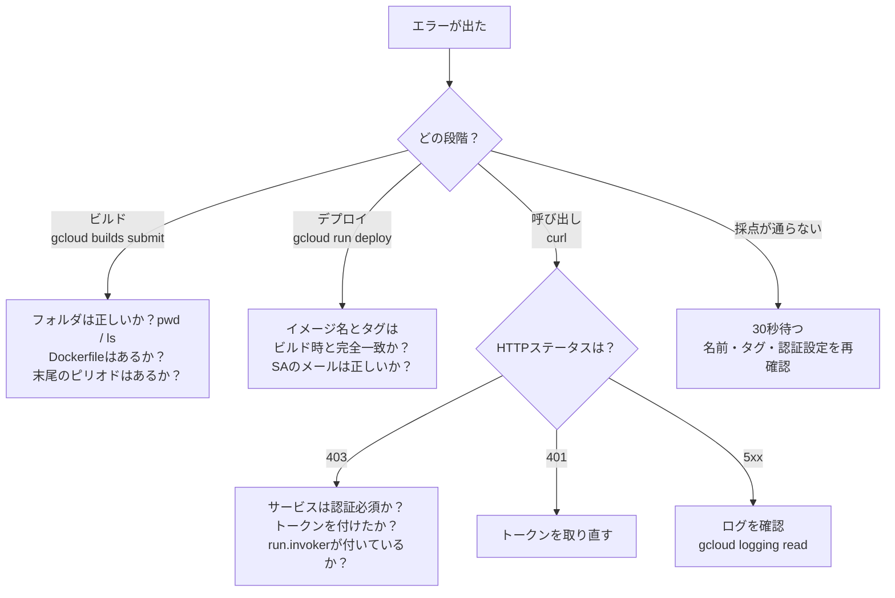

### 12.3 エラーメッセージを読む習慣（チャレンジラボの本質）

チャレンジラボでは、**エラーメッセージの調査と修正が学習の一部** として想定されています。次の順で読むと、原因にたどり着きやすくなります。

| 順番 | 見る場所 | 例 |
|---|---|---|
| 1 | エラーの **1行目** | `ERROR: (gcloud.run.deploy) ...` |
| 2 | **どのリソース** の話か | サービス名、イメージ名、SA名 |
| 3 | **何が足りない・違う** と言っているか | `not found` / `permission denied` / `invalid` |
| 4 | `gcloud ... --help` | オプション名の確認 |

---

## 13. ベストプラクティス解説（本番運用の視点）

このラボは学習用に簡略化されています。実際の本番運用では、次の観点を加えます。

### 13.1 本ラボで実践している良い設計

| 実践項目 | 内容 | 効果 |
|---|---|---|
| **公開範囲の最小化** | 公開するのはFrontendだけ。Billingは認証必須 | 攻撃対象領域を縮小 |
| **専用サービスアカウント** | サービスごとに別のSAを使う | 被害の影響範囲を限定 |
| **最小権限** | Billing用SAにはロールなし。Frontend用SAには `run.invoker` のみ | 権限の過剰付与を防ぐ |
| **サービス単位のIAM** | プロジェクト全体ではなく特定サービスにバインド | 横展開を防ぐ |
| **段階的なリリース** | ステージング → 本番 | 本番前に問題を検出 |
| **不要リソースの削除** | 公開Billingを削除 | 放置された公開口をなくす |

### 13.2 本番運用で追加したいこと

| 観点 | 推奨事項 |
|---|---|
| **イメージの保管先** | 新規には `REGION-docker.pkg.dev/PROJECT/REPO/IMAGE:TAG` 形式のArtifact Registryを推奨。`gcr.io` は互換のために残された形式 |
| **イメージのバージョン固定** | `latest` を避け、タグ固定やダイジェスト（`@sha256:...`）で指定し、再現性を確保 |
| **環境の分離** | ステージングと本番を **別プロジェクト** に分ける。IAMや課金も分離できる |
| **秘密情報** | パスワードやAPIキーは環境変数に直書きせず **Secret Manager** を使う（URLのような非機密値は環境変数で可） |
| **CI/CD** | 手動の `gcloud` ではなく、Cloud Buildトリガーなどで自動化し、再現性と監査性を確保 |
| **ネットワーク制御** | バックエンド側は Ingress 制限の利用を検討（Cloud Run同士で内部限定にする場合は、VPC経由の接続設計が別途必要） |
| **監視** | Cloud Logging / Cloud Monitoring でエラー率・レイテンシのアラートを設定 |
| **スケール設定** | `--min-instances`（コールドスタート対策）、`--max-instances`（コスト上限）、`--concurrency` を要件に合わせて調整 |
| **ロールバック** | リビジョンは残るため、問題発生時は **過去リビジョンにトラフィックを戻す** だけで復旧できる |

### 13.3 認証方式の整理

| シナリオ | 推奨される認証 |
|---|---|
| 人間が検証でCloud Shellから呼ぶ | `gcloud auth print-identity-token` |
| **Cloud Run → Cloud Run（本ラボ）** | **サービスアカウントのIDトークン＋`run.invoker`** |
| 外部の一般ユーザー向けAPI | 公開 ＋ アプリ層での認証（API Gateway、Identity Platformなど） |

### 13.4 設計判断の理由（なぜこうするのか）

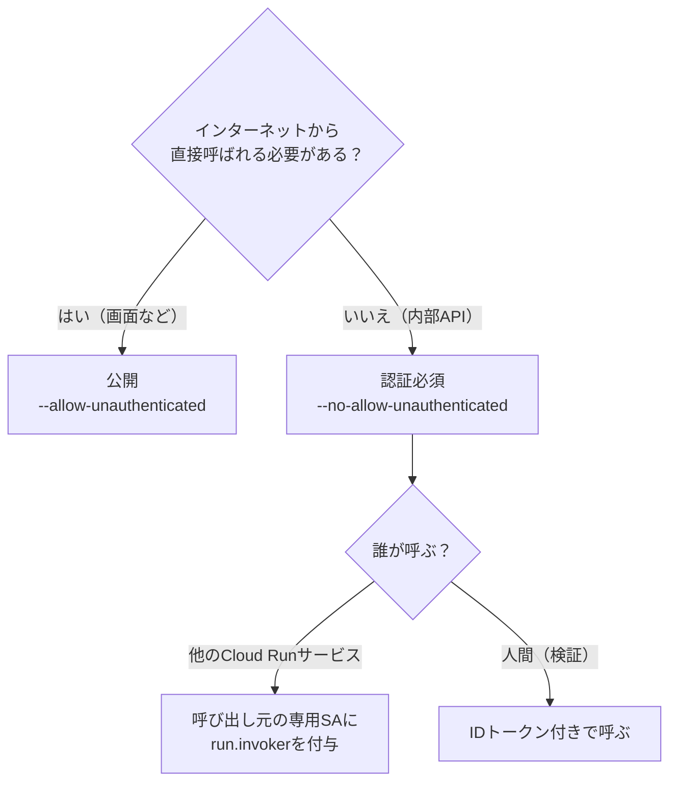

---

## 14. 理解度チェック

### Q1. `--allow-unauthenticated` を付けたサービスは、内部的には何をしている？

<details>
<summary>答えを見る</summary>

`allUsers`（全員）に `roles/run.invoker` を付与している。そのため誰でもトークン無しで呼び出せる。

</details>

### Q2. 認証必須のサービスにトークン無しで `curl` したときのステータスは？ それは失敗？

<details>
<summary>答えを見る</summary>

`403 Forbidden`。**失敗ではなく、保護が正しく効いている状態**。

</details>

### Q3. `--service-account` と `roles/run.invoker` の違いは？

<details>
<summary>答えを見る</summary>

`--service-account` は **そのサービスが実行時に使う身元（外へ出るときの身元）**。`run.invoker` は **そのサービスを呼び出せる権限（入ってくる側の許可）**。向きが逆。

</details>

### Q4. Task 4 でBilling用SAにロールを付けない理由は？

<details>
<summary>答えを見る</summary>

Billingサービスは他のGoogle Cloudリソースを使わないため。**最小権限の原則** により、必要になるまで何も付けない。

</details>

### Q5. `run.invoker` をプロジェクト全体ではなくサービスに付ける理由は？

<details>
<summary>答えを見る</summary>

プロジェクト全体に付けると、そのSAが **すべてのCloud Runサービスを呼べてしまう** ため。必要な呼び先（本番Billing）だけに限定する。

</details>

### Q6. Task 3 で公開Billingを削除する理由は？

<details>
<summary>答えを見る</summary>

認証なしの公開サービスを残すと、請求APIが **誰でも呼べる状態で放置される** ため。非公開版へ置き換え、攻撃対象を減らす。

</details>

### Q7. 本番Frontendを公開（認証なし）にするのに、安全といえる理由は？

<details>
<summary>答えを見る</summary>

公開するのはユーザー向け画面だけで、**重要なデータを持つBillingは認証必須のまま** だから。そのうえで、FrontendがBillingを呼べるよう、このラボではFrontend用SAに本番Billingへの呼び出し権限を付与している（Frontend用SAが唯一の呼び出し元になるわけではない）。

</details>

### Q8. 本番運用でイメージを `latest` タグで管理しないのはなぜ？

<details>
<summary>答えを見る</summary>

`latest` は中身が変わるため、**どのバージョンが動いているか追跡できず、再現性とロールバックが難しくなる** ため。タグ固定やダイジェスト指定が望ましい。

</details>

---

## 15. 参考情報

### 15.1 2026-10-30にウェブで確認した情報

| 内容 | URL |
|---|---|
| Container Registryの廃止とシャットダウン | https://docs.cloud.google.com/container-registry/docs/deprecations/container-registry-deprecation |
| Container Registryシャットダウンへの備え（2025年3月18日以降の段階） | https://docs.cloud.google.com/artifact-registry/docs/transition/prepare-gcr-shutdown |
| Artifact Registry の gcr.io リポジトリ概要 | https://docs.cloud.google.com/artifact-registry/docs/transition/gcr-repositories |

### 15.2 公式ドキュメント（最新の仕様は必ずここで確認）

| 内容 | URL |
|---|---|
| Cloud Run ドキュメント | https://cloud.google.com/run/docs |
| Cloud Run のサービス間認証 | https://cloud.google.com/run/docs/authenticating/service-to-service |
| Cloud Run のアクセス管理（IAM） | https://cloud.google.com/run/docs/securing/managing-access |
| Cloud Build ドキュメント | https://cloud.google.com/build/docs |

### 15.3 この文書の前提と限界

- ラボの手順書テキストでは、一部の名前が **説明表記** になっているため、サービス名・SA名は一般的な命名で補っています。**ラボ画面の値が常に優先** です。
- Task 7 のFrontendが `BILLING_URL` を読むこと、およびコード修正の内容は、固定コミット `3a25511` のソースを読んで確認したものです。ラボ環境での実行検証は行っていません。**手順どおりにコードを確認してから進めてください。**
- ラボの内容・画面・リポジトリは更新されることがあります。**差異があればラボ画面の指示に従ってください。**

---

**お疲れさまでした。** このラボで身につく型は、**「ビルド → デプロイ → 疎通確認」** と **「公開は最小限、内部は認証必須＋専用SA＋最小権限」** の2つです。この2つを説明できれば、Cloud Runの基礎設計は十分に理解できています。
