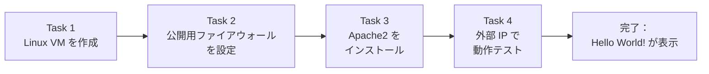
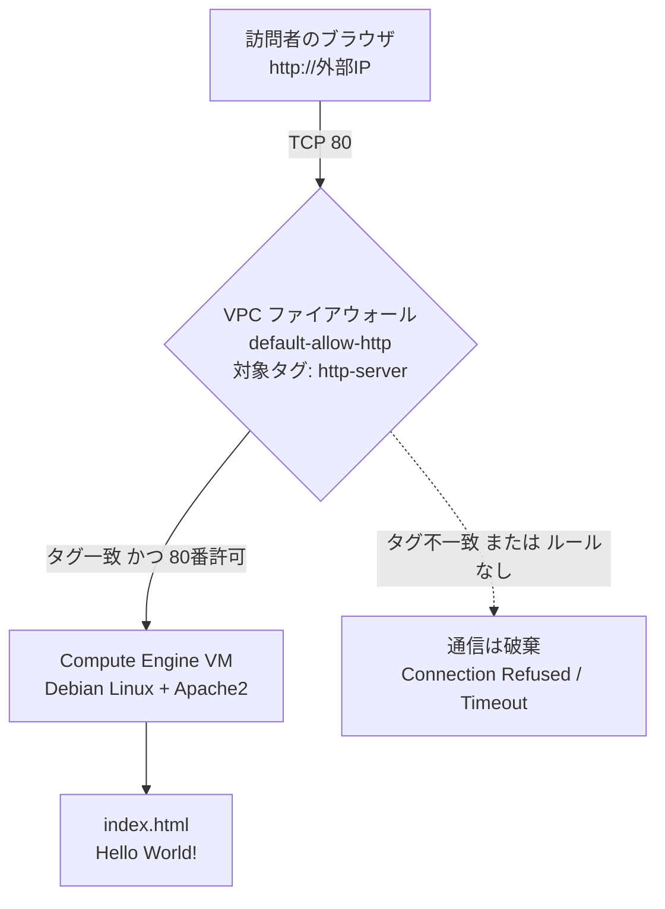
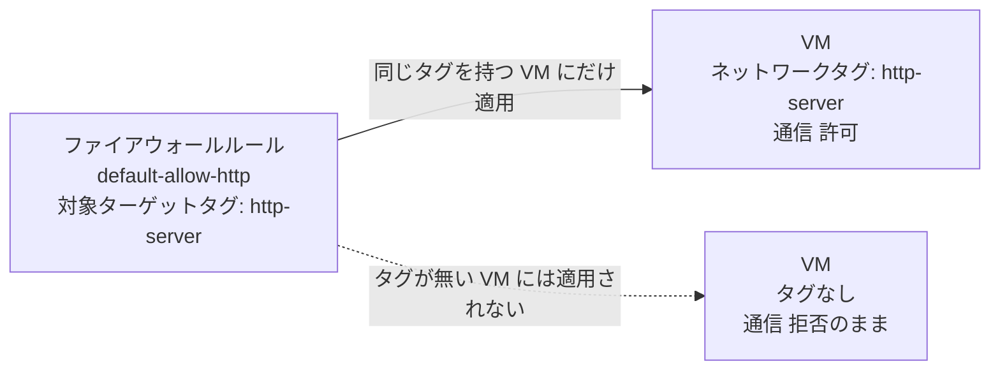
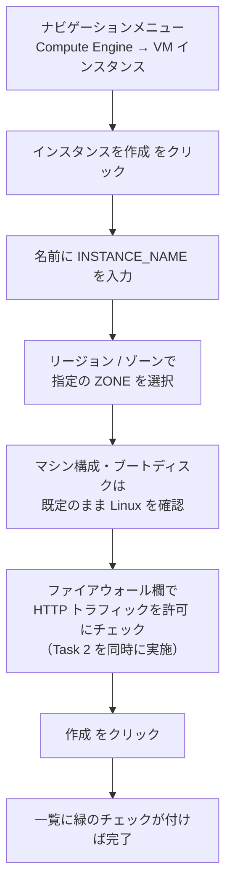
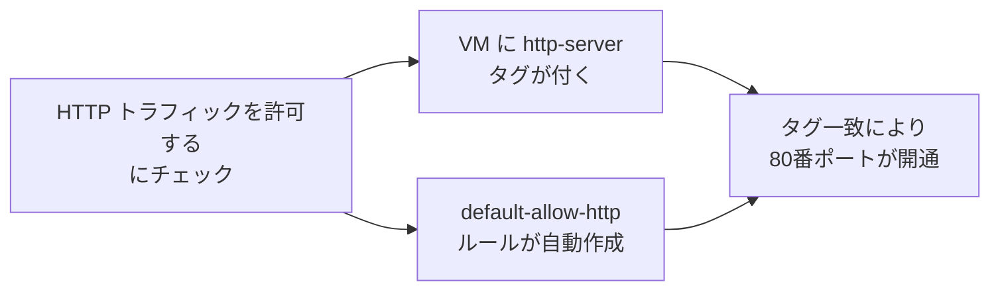
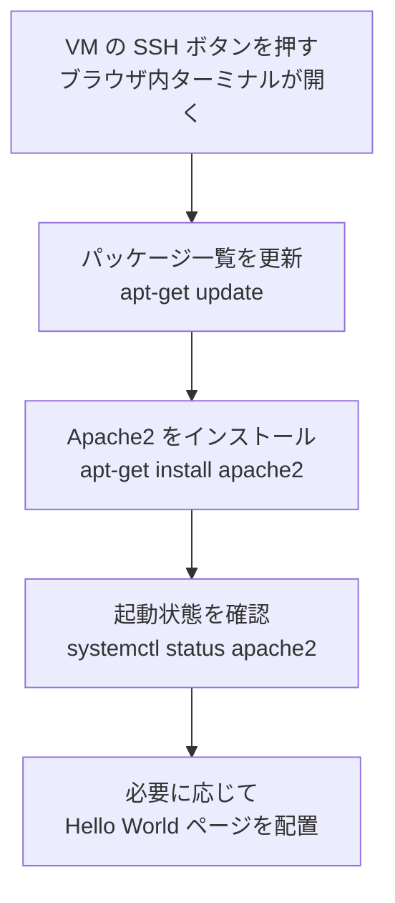
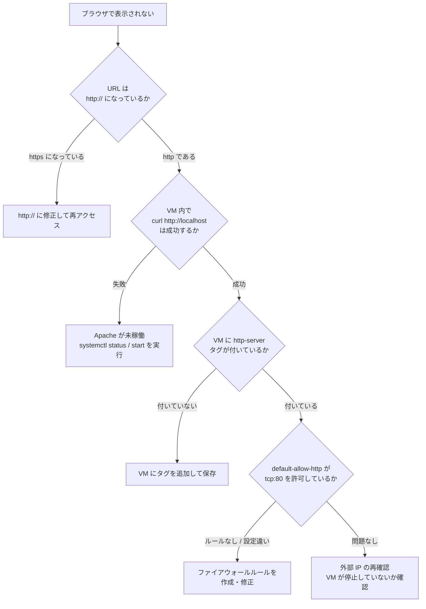

# Google Cloud チャレンジラボ解説ガイド：Compute Engine で Apache Web サーバーを公開する

> **対象読者**：Google Cloud 初学者（Professional Cloud Architect 試験の土台づくりにも最適）
> **所要時間の目安**：読む 20 分 ＋ 実習 10〜15 分
> **このラボの本質**：「VM を作る」→「外から入れる穴（ファイアウォール）を開ける」→「Web サーバーを入れる」→「ブラウザで確認する」という、**クラウドで Web サイトを公開する最小の流れ**を自力で再現できるかを試すものです。

---

## 目次

1. [このラボのゴールと全体像](#1-このラボのゴールと全体像)
2. [先に押さえる基礎知識](#2-先に押さえる基礎知識)
3. [事前準備と注意点](#3-事前準備と注意点)
4. [Task 1：Linux VM インスタンスを作成する](#4-task-1linux-vm-インスタンスを作成する)
5. [Task 2：VM への公開アクセスを有効にする](#5-task-2vm-への公開アクセスを有効にする)
6. [Task 3：Apache Web サーバーをインストールする](#6-task-3apache-web-サーバーをインストールする)
7. [Task 4：サーバーをテストする](#7-task-4サーバーをテストする)
8. [トラブルシューティング](#8-トラブルシューティング)
9. [ベストプラクティス（本番運用の視点）](#9-ベストプラクティス本番運用の視点)
10. [後片付け（クリーンアップ）](#10-後片付けクリーンアップ)
11. [最終チェックリストと確認問題](#11-最終チェックリストと確認問題)

---

## 1. このラボのゴールと全体像

### 1.1 シナリオの整理

新製品の Web サイトが完成したが、構築した担当者が退職してしまい、誰も公開できていない状況です。あなたは **Apache を仮のサイト（プレースホルダー）として** Compute Engine 上に公開し、インターネット越しに「Hello World!」が表示される状態を作ります。

### 1.2 4 つのタスクの関係



### 1.3 完成時の構成図

訪問者のリクエストが VM に届くまでの経路です。**ファイアウォールを通過できるかどうか**が成否を分けます。



### 1.4 各タスクで「何を学ぶか」

| タスク | やること | 学べること | 対応する GCP サービス |
|---|---|---|---|
| Task 1 | VM を作る | 名前・ゾーン・マシンタイプ・OS イメージの選択 | Compute Engine |
| Task 2 | 公開用の穴を開ける | ファイアウォールルールとネットワークタグの関係 | VPC ファイアウォール |
| Task 3 | Apache を入れる | Linux サーバーとして VM を操作する基本 | SSH / apt / systemd |
| Task 4 | 動作確認する | 外部 IP・HTTP と HTTPS の違い・切り分け方 | ブラウザ / curl |

---

## 2. 先に押さえる基礎知識

実習前に、この 6 つの用語だけ理解しておくと、手順の「なぜ」が見えてきます。

| 用語 | 意味 | このラボでの役割 |
|---|---|---|
| **Compute Engine** | Google Cloud の仮想マシン（VM）サービス | Web サーバーを動かす土台 |
| **ゾーン (Zone)** | データセンターの区画（例：`us-central1-a`） | VM の置き場所。ラボ指定のゾーンを必ず使う |
| **外部 IP アドレス** | インターネットから VM に到達するための住所 | ブラウザでアクセスする宛先 |
| **VPC ネットワーク** | プロジェクト内の仮想ネットワーク | 本ラボでは `default` ネットワークを使用 |
| **ファイアウォールルール** | 通信を許可・拒否するルール（**既定では外部からの受信は拒否**） | 80 番ポートを開けるために作成 |
| **ネットワークタグ** | VM に付ける目印のラベル | ルールの適用対象を VM に絞り込む |

### 2.1 最重要ポイント：ルールとタグはセットで機能する

このラボで最も多い失敗は「ルールは作ったのに VM にタグを付け忘れた」ケースです。ファイアウォールルールは **「どの VM に適用するか」をタグで指定**します。



### 2.2 HTTP と HTTPS の違い

| 項目 | HTTP | HTTPS |
|---|---|---|
| ポート番号 | **80** | 443 |
| 暗号化 | なし | あり（TLS） |
| このラボでの扱い | **こちらを使う** | Apache の既定状態では未設定のため接続できない |

> ブラウザは `https://` に自動で書き換えることがあります。URL は必ず **`http://外部IP`** で確認してください。

---

## 3. 事前準備と注意点

### 3.1 ラボ開始前のチェックリスト

| # | 確認項目 | 理由 |
|---|---|---|
| 1 | シークレットウィンドウでブラウザを開いている | 個人アカウントとの競合・課金事故を防ぐ |
| 2 | ラボ画面に表示された **Username / Password** を使ってログイン | 個人の Google アカウントは使用しない |
| 3 | ラボ画面の **Instance name** と **Compute zone** の値をメモ | Task 1 で指定する必須の値 |
| 4 | Start Lab 後は一時停止できないと理解している | 時間内に全タスクを完了する必要がある |

### 3.2 この文書での表記ルール

ラボごとに指定値が異なるため、以下のプレースホルダーで表記します。**実際の値はラボ画面（左パネル）の表示に置き換えてください。**

| プレースホルダー | 置き換える値 | 例 |
|---|---|---|
| `INSTANCE_NAME` | ラボ画面の「Instance name」 | `my-vm`（※ダミー値） |
| `ZONE` | ラボ画面の「Compute zone」 | `us-central1-a`（※ダミー値） |
| `EXTERNAL_IP` | 作成後に表示される外部 IP | 実習中に確認 |

### 3.3 進め方の選択肢

| 方法 | 向いている人 | 特徴 |
|---|---|---|
| **Cloud Console（GUI）** | 初学者 | 画面で確認しながら進められる。本ガイドのメイン手順 |
| **Cloud Shell + gcloud** | 慣れてきた人・再現性を重視する人 | コマンドで素早く正確に実行できる。各タスクに併記 |

---

## 4. Task 1：Linux VM インスタンスを作成する

### 4.1 要件

- Linux の仮想マシンを作る
- **名前**はラボ指定の Instance name
- **ゾーン**はラボ指定の Compute zone

### 4.2 手順（Cloud Console）



**詳細ステップ**

1. Cloud Console の左上 **ナビゲーションメニュー（≡）** を開き、**Compute Engine → VM インスタンス** を選びます。
2. 初回は API の有効化に 1 分ほどかかることがあります。完了したら **インスタンスを作成** をクリックします。
3. **名前** に、ラボ画面の Instance name を **一字一句そのまま** 入力します（大文字小文字・ハイフンに注意）。
4. **リージョン** と **ゾーン** で、ラボ指定の Compute zone を選びます。
5. **マシン構成**：ラボから別の指定がなければ既定（汎用 E2 シリーズ）のままで構いません。
6. **ブートディスク**：既定の **Debian GNU/Linux** のままで OK です（Linux であることが要件）。
7. **ファイアウォール**：この画面で後述の Task 2 の設定を行います（次章参照）。
8. **作成** をクリックし、一覧でインスタンス名の左に緑のチェックが付くまで待ちます。

### 4.3 設定値の早見表

| 項目 | 設定値 | 補足 |
|---|---|---|
| 名前 | ラボ指定の Instance name | 作成後は変更不可。間違えたら作り直し |
| ゾーン | ラボ指定の Compute zone | 採点はこの値を見る |
| マシンタイプ | 既定（E2 系） | 指定がなければ変更不要 |
| ブートディスク | Debian GNU/Linux（既定） | `apt` コマンドが使える |
| ネットワーク | `default` | 既定のまま |
| 外部 IP | エフェメラル（既定） | 再起動すると変わる場合がある |

### 4.4 gcloud での同等コマンド（Task 2 のタグ指定込み）

```bash
gcloud compute instances create INSTANCE_NAME \
  --zone=ZONE \
  --machine-type=e2-medium \
  --image-family=debian-12 \
  --image-project=debian-cloud \
  --tags=http-server
```

| オプション | 意味 |
|---|---|
| `--zone` | VM を作るゾーン |
| `--machine-type` | CPU とメモリの組み合わせ |
| `--image-family` / `--image-project` | 使用する OS イメージ（Debian 12） |
| `--tags=http-server` | **Task 2 で必要なネットワークタグ**。作成時に付けておくと漏れない |

---

## 5. Task 2：VM への公開アクセスを有効にする

### 5.1 なぜ必要か

Google Cloud の `default` ネットワークには SSH（22）や ICMP などの許可ルールはありますが、**HTTP（80）の許可ルールは最初からは存在しません**。外部からの受信通信は既定で拒否されるため、自分で穴を開ける必要があります。

### 5.2 方法 A：VM 作成画面のチェックボックスを使う（最も簡単）

VM 作成画面の **ファイアウォール** 欄で **HTTP トラフィックを許可する** にチェックを入れます。

| 自動的に行われること | 内容 |
|---|---|
| ネットワークタグの付与 | VM に `http-server` タグが付く |
| ファイアウォールルールの作成 | `default-allow-http`（TCP 80、ソース `0.0.0.0/0`、ターゲットタグ `http-server`）が作られる |



### 5.3 方法 B：後から手動で設定する

作成時にチェックを忘れた場合は、次の 2 ステップで修正できます。

**Step 1：VM にネットワークタグを追加する**

1. **Compute Engine → VM インスタンス** で対象 VM 名をクリックします。
2. **編集** をクリックします。
3. **ネットワーク タグ** に `http-server` を入力して Enter を押します。
4. **保存** をクリックします。

**Step 2：ファイアウォールルールを作成する**

1. ナビゲーションメニューから **VPC ネットワーク → ファイアウォール** を開きます。
2. **ファイアウォール ルールを作成** をクリックし、下表のとおり入力します。

| 項目 | 設定値 | 意味 |
|---|---|---|
| 名前 | `default-allow-http` | 分かりやすい名前なら何でも可 |
| ネットワーク | `default` | VM が所属するネットワーク |
| トラフィックの方向 | **上り（Ingress）** | 外から VM に入る通信 |
| 一致したときのアクション | **許可** | |
| ターゲット | **指定されたターゲットタグ** | |
| ターゲットタグ | `http-server` | **VM に付けたタグと完全一致させる** |
| ソースフィルタ | IPv4 範囲 | |
| ソース IPv4 範囲 | `0.0.0.0/0` | 全世界からの公開（一般公開サイトのため） |
| プロトコルとポート | **TCP**、ポート **80** | HTTP |

3. **作成** をクリックします。

### 5.4 gcloud での同等コマンド

```bash
# 1) VM に既にあるタグを追加する場合
gcloud compute instances add-tags INSTANCE_NAME \
  --zone=ZONE \
  --tags=http-server

# 2) ファイアウォールルールを作成する
gcloud compute firewall-rules create default-allow-http \
  --network=default \
  --direction=INGRESS \
  --action=allow \
  --rules=tcp:80 \
  --source-ranges=0.0.0.0/0 \
  --target-tags=http-server
```

> 方法 A で既に `default-allow-http` が作られている場合、同名で再作成するとエラー（already exists）になります。**まず一覧で存在を確認**してください。

### 5.5 設定の確認方法

```bash
gcloud compute firewall-rules list --filter="name=default-allow-http"
gcloud compute instances describe INSTANCE_NAME --zone=ZONE --format="get(tags.items)"
```

| 確認項目 | 期待される結果 |
|---|---|
| ルール一覧 | `default-allow-http` が `tcp:80`・`http-server` で表示される |
| VM のタグ | `http-server` が含まれる |

ここまで終えたら、ラボ画面の **Check my progress** で Task 1〜2 の判定を受けましょう。

---

## 6. Task 3：Apache Web サーバーをインストールする

### 6.1 全体の流れ



### 6.2 SSH で VM に接続する

1. **Compute Engine → VM インスタンス** で、対象 VM の行の **SSH** ボタンをクリックします。
2. 別ウィンドウでターミナルが開き、`ユーザー名@INSTANCE_NAME:~$` のように表示されれば接続成功です。

> 接続できない場合は、`default` ネットワークの `default-allow-ssh`（TCP 22）ルールが削除されていないか確認してください。

### 6.3 Apache2 をインストールする

VM のターミナルで次の 2 コマンドを順に実行します。

```bash
sudo apt-get update
sudo apt-get install apache2 -y
```

| コマンド | 意味 | なぜ必要か |
|---|---|---|
| `sudo` | 管理者権限で実行 | パッケージの導入には root 権限が必要 |
| `apt-get update` | パッケージ一覧を最新化 | 古い一覧のままだと取得に失敗することがある |
| `apt-get install apache2` | Apache2 本体を導入 | Debian 系では Apache のパッケージ名は `apache2` |
| `-y` | 確認プロンプトに自動で Yes | 対話入力を省略するため |

### 6.4 起動状態を確認する

```bash
sudo systemctl status apache2
```

| 表示 | 意味 |
|---|---|
| `active (running)` | 正常に稼働中（`q` キーで画面を抜ける） |
| `inactive (dead)` | 停止中 → `sudo systemctl start apache2` で起動 |
| `failed` | 起動失敗 → `sudo journalctl -u apache2 -n 50` でログ確認 |

```bash
# 参考：自動起動の設定（Debian では通常インストール時に有効）
sudo systemctl enable apache2
```

### 6.5 「Hello World!」ページについて

Debian に Apache2 を入れると、**既定で「Apache2 Debian Default Page」が表示**されます。ラボの文言は「Hello World! ページが見える」ですが、ラボの採点は Apache が稼働しインストールされていることを確認する形式です。**表示内容を課題の文言に合わせたい場合**は、次のコマンドでページを置き換えます。

```bash
echo '<!doctype html><html><body><h1>Hello World!</h1></body></html>' | sudo tee /var/www/html/index.html
```

| 要素 | 意味 |
|---|---|
| `/var/www/html/` | Apache が公開するフォルダ（ドキュメントルート） |
| `index.html` | フォルダ名だけで開いたときに最初に返されるファイル |
| `tee` | 標準出力とファイル書き込みを同時に行う（`sudo` 付きで権限問題を回避） |

> `sudo echo ... > file` と書くと、リダイレクト（`>`）は `sudo` の権限外で実行されるため失敗します。**`tee` を使うのがポイント**です。

### 6.6 VM 内部から先に動作確認する（切り分けの基本）

外部から見る前に、VM の中から確認すると原因の切り分けが楽になります。

```bash
curl http://localhost
```

| 結果 | 意味 | 次の一手 |
|---|---|---|
| HTML が返る | **Apache は正常** | 問題があるなら Task 2（ファイアウォール）側 |
| 接続拒否 | Apache が動いていない | `systemctl status apache2` を確認 |

ここで **Check my progress** を押して Task 3 の判定を受けます。

---

## 7. Task 4：サーバーをテストする

### 7.1 外部 IP アドレスを確認する

1. **Compute Engine → VM インスタンス** を開きます。
2. 対象 VM の **外部 IP** 列の値をコピーします。

```bash
# gcloud で確認する場合
gcloud compute instances describe INSTANCE_NAME \
  --zone=ZONE \
  --format="get(networkInterfaces[0].accessConfigs[0].natIP)"
```

### 7.2 ブラウザでアクセスする

新しいタブで、次の形式の URL を開きます。

```text
http://EXTERNAL_IP
```

| 入力例 | 結果 |
|---|---|
| `http://EXTERNAL_IP` | **正しい**（HTTP） |
| `https://EXTERNAL_IP` | 失敗（HTTPS は未設定） |
| `EXTERNAL_IP`（スキームなし） | ブラウザが https に補完する場合があり、失敗しやすい |

### 7.3 Cloud Shell から確認する方法

ブラウザで表示されない場合、Cloud Shell からも確認できます（ブラウザの https 自動変換の影響を避けられます）。

```bash
curl http://EXTERNAL_IP
```

### 7.4 判定

ページが表示されたら、ラボ画面で **Check my progress** を押して Task 4 の判定を受けます。すべて緑になれば完了です。

---

## 8. トラブルシューティング

### 8.1 原因の切り分けフロー



### 8.2 症状別の対処表

| 症状 | 主な原因 | 対処 |
|---|---|---|
| **Connection Refused**（接続拒否） | ① VM にタグがない　② ファイアウォールルールがない　③ `https://` で接続している | タグ付与・ルール作成・URL を `http://` に修正 |
| 読み込み中のまま**タイムアウト** | ファイアウォールで通信が破棄されている | ルールのタグ・ポート・ソース範囲を確認 |
| 「Apache2 Debian Default Page」が出る | 正常。既定ページが表示されている | 必要なら 6.5 の手順で Hello World に置き換え |
| `apt-get install` が失敗する | `update` 未実施・一時的なネットワーク障害 | `sudo apt-get update` を実行して再試行 |
| `default-allow-http` 作成時に「already exists」 | 作成時のチェックボックスで既に作成済み | 新規作成せず、内容が正しいか確認する |
| SSH ボタンで接続できない | `default-allow-ssh` が無い／VM が起動中でない | ルールと VM の状態を確認 |
| Check my progress が通らない | 名前・ゾーンの入力違い | 指定値と完全一致しているか確認。違う場合は VM を作り直す |

---

## 9. ベストプラクティス（本番運用の視点）

本ラボは学習用の最小構成です。実務や試験（PCA など）では、次の観点で**「なぜラボのやり方は本番に向かないのか」**を理解しておくことが重要です。

### 9.1 ラボ構成と本番構成の比較

| 観点 | このラボの構成 | 本番での推奨 | 理由 |
|---|---|---|---|
| **通信の暗号化** | HTTP（80 番）のみ | **HTTPS（443）** ＋ 証明書（Google マネージド証明書など） | 盗聴・改ざんの防止 |
| **公開経路** | VM の外部 IP に直接アクセス | **外部アプリケーション ロードバランサ** 経由 | 可用性・スケール・DDoS 対策 |
| **外部 IP** | エフェメラル（再起動で変わりうる） | **静的 IP** または LB の IP + DNS 名 | アドレスの固定化 |
| **VM の台数** | 1 台 | **マネージド インスタンス グループ（MIG）** で複数台・複数ゾーン | 単一障害点の排除 |
| **セットアップ方法** | SSH で手動実行 | **起動スクリプト** やカスタムイメージで自動化 | 再現性・作業ミス防止 |
| **SSH 接続** | ブラウザ SSH | **OS Login** ＋ IAP トンネル | 認証の一元管理・ポート 22 を公開しない |
| **ソース範囲** | `0.0.0.0/0` | 必要に応じて Cloud Armor・IP 制限 | 攻撃面の縮小 |
| **サービスアカウント** | 既定の Compute Engine SA | **専用の最小権限 SA** | 権限の最小化 |
| **VM のセキュリティ** | 既定 | **Shielded VM**、最新 OS パッチの定期適用 | OS レベルの保護 |
| **管理** | ラベルなし | **ラベル** でコスト・環境・担当を識別 | コスト管理・運用の見通し |

### 9.2 ベストプラクティスを活かした作成例（参考）

起動スクリプトで Apache の導入を自動化し、タグと最小権限の考え方を取り入れた例です。

```bash
gcloud compute instances create INSTANCE_NAME \
  --zone=ZONE \
  --machine-type=e2-small \
  --image-family=debian-12 \
  --image-project=debian-cloud \
  --tags=http-server \
  --labels=env=lab,app=product-site \
  --shielded-secure-boot \
  --shielded-vtpm \
  --shielded-integrity-monitoring \
  --metadata=startup-script='#! /bin/bash
apt-get update
apt-get install -y apache2
echo "<h1>Hello World!</h1>" > /var/www/html/index.html
systemctl enable --now apache2'
```

| 要素 | 狙い |
|---|---|
| `startup-script` | VM 起動時に自動でセットアップ。手作業の再現ミスを排除 |
| `--labels` | 環境や用途を明示し、請求や棚卸しで追跡しやすくする |
| `--shielded-*` | ブートレベルの改ざん検知を有効化 |
| `--machine-type=e2-small` | 用途に合った適正サイズ（コスト最適化） |

> **注意**：本ラボでは指定されたとおりの手順で採点されます。上記は理解を深めるための参考例であり、**ラボ本番では既定値・指示どおりに進めてください**。

### 9.3 ファイアウォール設計の原則

| 原則 | 説明 |
|---|---|
| **最小権限** | 必要なポート・必要な送信元だけを許可する |
| **タグ／サービスアカウントで対象を絞る** | 「ネットワーク全体」ではなく、該当する VM だけに適用 |
| **意味のある名前** | `allow-http-from-internet` のように目的が分かる名前にする |
| **不要なルールの棚卸し** | 使わなくなったルールは削除して攻撃面を減らす |
| **ログの活用** | ファイアウォールルール ログや VPC フローログで通信を可視化する |

---

## 10. 後片付け（クリーンアップ）

チャレンジラボのリソースはラボ終了時に自動で破棄されますが、**個人プロジェクトで試した場合は課金を避けるため必ず削除**してください。

```bash
gcloud compute instances delete INSTANCE_NAME --zone=ZONE --quiet
gcloud compute firewall-rules delete default-allow-http --quiet
```

| 削除対象 | 理由 |
|---|---|
| VM インスタンス | 稼働中は CPU・メモリ・ディスクが課金対象 |
| ファイアウォールルール | 不要な公開ルールを残さないため |

---

## 11. 最終チェックリストと確認問題

### 11.1 提出前チェックリスト

| # | 確認項目 | 結果 |
|---|---|---|
| 1 | VM 名がラボ指定の Instance name と一致している | ☐ |
| 2 | ゾーンがラボ指定の Compute zone と一致している | ☐ |
| 3 | VM にネットワークタグ `http-server` が付いている | ☐ |
| 4 | `default-allow-http`（TCP 80・Ingress・許可）が存在する | ☐ |
| 5 | `apache2` がインストールされ `active (running)` である | ☐ |
| 6 | `http://EXTERNAL_IP` でページが表示される | ☐ |
| 7 | 各タスクの **Check my progress** がすべて通っている | ☐ |

### 11.2 理解度チェック

<details>
<summary>Q1. ファイアウォールルールを作ったのに接続できない。最初に疑うべきことは？</summary>

**A.** VM に、ルールのターゲットタグと**同じネットワークタグ**が付いているかです。ルールとタグが一致しないと、ルールは VM に適用されません。
</details>

<details>
<summary>Q2. Google Cloud の VPC ファイアウォールの既定の挙動は？</summary>

**A.** **受信（Ingress）は既定で拒否**、送信（Egress）は既定で許可（暗黙のルール）です。外部公開するには受信を許可するルールを明示的に作成します。
</details>

<details>
<summary>Q3. `Connection Refused` が出たとき、URL の確認ポイントは？</summary>

**A.** `https://` ではなく **`http://`** になっているかを確認します。本ラボでは HTTPS（443）は設定していません。
</details>

<details>
<summary>Q4. Apache が動いているか VM 内で確認する最短コマンドは？</summary>

**A.** `curl http://localhost`。応答があれば Apache は正常で、問題はネットワーク（ファイアウォール）側と切り分けられます。
</details>

<details>
<summary>Q5. 本番環境で VM の外部 IP に直接アクセスさせない理由と代替案は？</summary>

**A.** 単一障害点になり、暗号化・負荷分散・攻撃対策も難しいためです。**外部アプリケーション ロードバランサ ＋ マネージド インスタンス グループ ＋ HTTPS ＋ Cloud Armor** の構成が代表的な代替案です。
</details>

---

## まとめ

| ポイント | 要点 |
|---|---|
| 流れ | VM 作成 → ファイアウォール（ルール＋タグ）→ Apache 導入 → HTTP で確認 |
| 最大の落とし穴 | **ルールとタグの不一致**、および **`https://` でのアクセス** |
| 切り分けの型 | VM 内の `curl localhost` → タグ → ルール → URL の順で確認 |
| 本番への視点 | HTTPS 化・ロードバランサ・MIG・起動スクリプト・最小権限へ発展させる |

この「公開の最小構成」を自力で再現できれば、PCA 試験で問われるネットワーク設計・可用性設計の基礎理解にもつながります。
