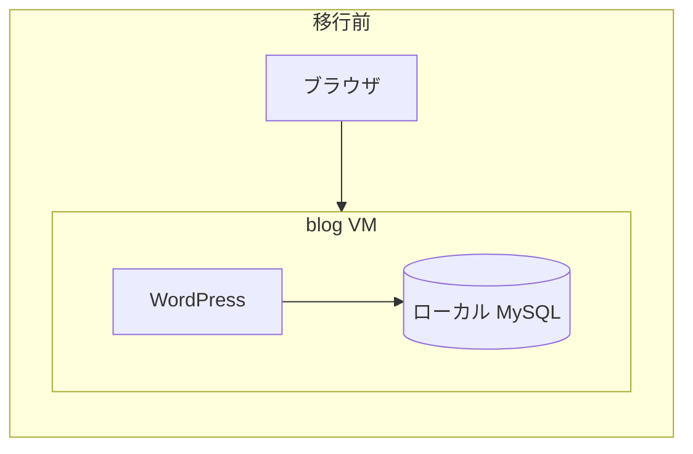
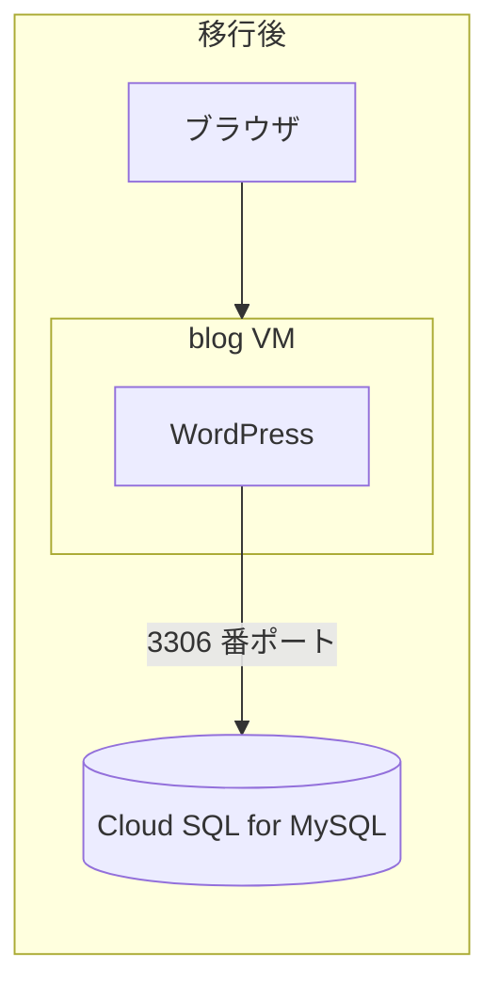
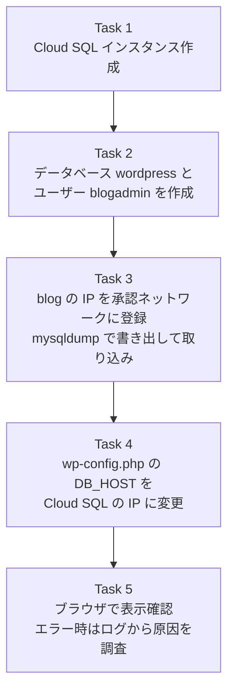
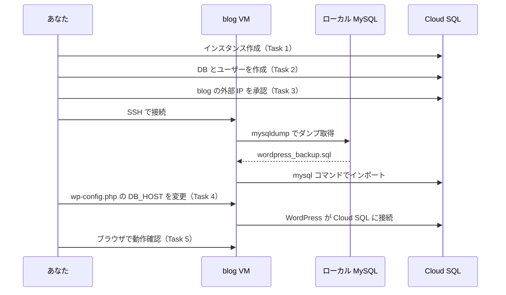
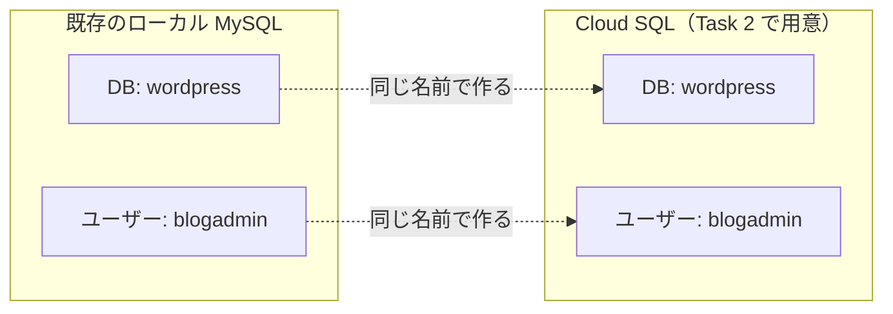
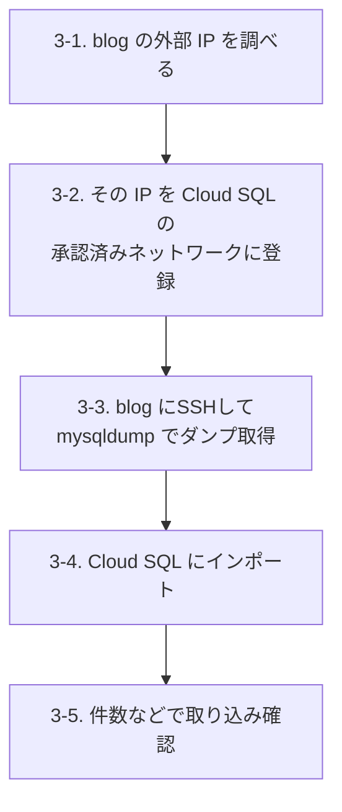
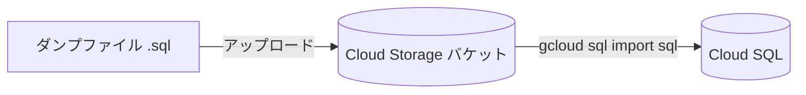
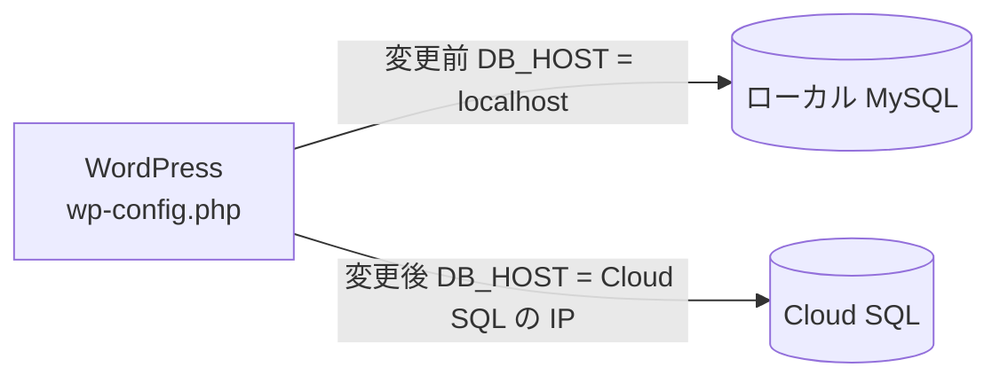
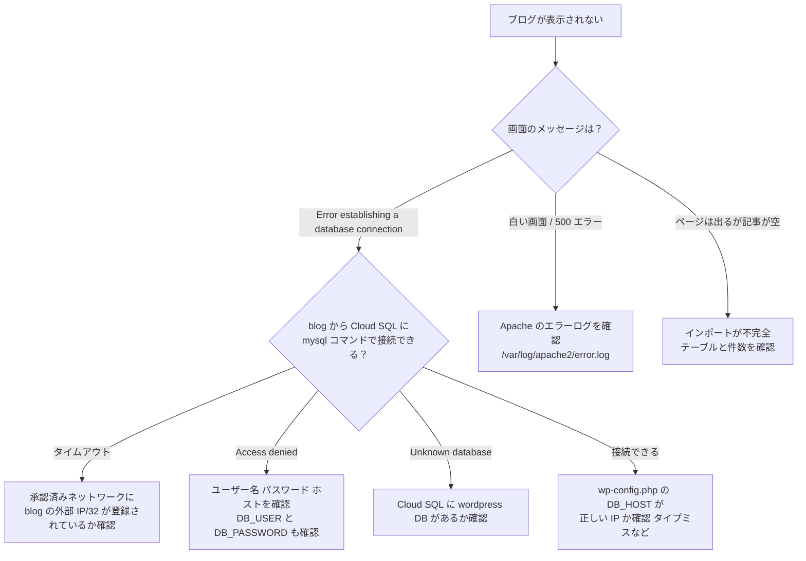
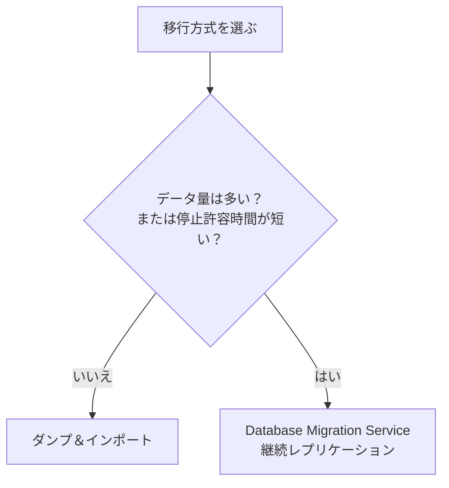

# Google Cloud チャレンジラボ完全ガイド

## WordPress のローカル MySQL を Cloud SQL へ移行する（初学者向け）

> **対象**: Google Cloud 初学者〜Professional Cloud Architect（PCA）試験対策中の方
> **ゴール**: `blog` インスタンス上の WordPress が、ローカル MySQL ではなく **Cloud SQL** を使って動く状態にする
> **全 5 タスク**: 作成 → 設定 → ダンプ＆インポート → 再設定 → 検証

---

## 目次

1. [このラボで何をするのか（全体像）](#1-このラボで何をするのか全体像)
2. [先に知っておきたい用語](#2-先に知っておきたい用語)
3. [事前準備（変数・API・接続）](#3-事前準備変数api接続)
4. [Task 1: Cloud SQL インスタンスを作成する](#4-task-1-cloud-sql-インスタンスを作成する)
5. [Task 2: データベースとユーザーを設定する](#5-task-2-データベースとユーザーを設定する)
6. [Task 3: ダンプを取得してインポートする](#6-task-3-ダンプを取得してインポートする)
7. [Task 4: WordPress の接続先を変更する](#7-task-4-wordpress-の接続先を変更する)
8. [Task 5: 検証とトラブルシューティング](#8-task-5-検証とトラブルシューティング)
9. [ベストプラクティス（本番運用ならこうする）](#9-ベストプラクティス本番運用ならこうする)
10. [PCA 試験に向けたポイント](#10-pca-試験に向けたポイント)
11. [最終チェックリスト](#11-最終チェックリスト)
12. [コマンド一括リファレンス](#12-コマンド一括リファレンス)

---

## 1. このラボで何をするのか（全体像）

### 1.1 シナリオの整理

| 項目 | 内容 |
|---|---|
| 現状 | VM `blog` の中で **WordPress と MySQL が同居** している |
| WordPress の場所 | `/var/www/html/wordpress` |
| 設定ファイル | `/var/www/html/wordpress/wp-config.php` |
| 既存 DB 名 | `wordpress` |
| 既存 DB ユーザー | `blogadmin`（パスワード `Password1*`） |
| 目標 | DB を **マネージドサービス Cloud SQL** へ移し、WordPress の接続先だけを差し替える |

### 1.2 移行前と移行後





**ポイント**: アプリ（WordPress）と DB を別々の場所に分離します。これが「マイグレーションの第一歩」であり、DB の運用（バックアップ・パッチ適用・高可用性）を Google に任せられるのが利点です。

### 1.3 5 つのタスクの流れ



### 1.4 データ移行の時系列（シーケンス図）



---

## 2. 先に知っておきたい用語

| 用語 | 意味 | このラボでの役割 |
|---|---|---|
| **Cloud SQL** | Google Cloud のマネージドなリレーショナル DB サービス（MySQL / PostgreSQL / SQL Server） | 移行先の DB |
| **マネージドサービス** | パッチ適用・バックアップ・フェイルオーバー等を Google が代行する仕組み | 運用負荷の削減 |
| **インスタンス** | Cloud SQL の「DB サーバー 1 台分」の単位 | Task 1 で作成 |
| **データベース** | インスタンスの中にある論理的な DB（スキーマ） | `wordpress` |
| **ユーザー** | DB へのログインアカウント | `blogadmin` |
| **承認済みネットワーク（Authorized networks）** | パブリック IP の Cloud SQL に接続できる送信元 IP の許可リスト | `blog` の外部 IP を登録 |
| **mysqldump** | MySQL のデータを SQL 文として書き出すツール | 移行データの作成 |
| **wp-config.php** | WordPress の接続設定ファイル | Task 4 で編集 |
| **DB_HOST** | WordPress が接続する DB のホスト名または IP | ここを Cloud SQL の IP に変える |
| **Cloud Shell** | ブラウザ内で使える Google Cloud 用ターミナル | 操作の起点 |

---

## 3. 事前準備（変数・API・接続）

### 3.1 ラボ画面の値を確認する

ラボ左側のパネルに **Region（リージョン）** と **Zone（ゾーン）** が表示されています。問題文中の `REGION` `ZONE` はこの値のことです。**必ず指定された値を使ってください**（別のリージョンで作ると、チェックに通らない可能性があります）。

### 3.2 Cloud Shell を開いて変数を設定する

コンソール右上の **Cloud Shell アクティブ化** アイコンをクリックし、以下を実行します。

```bash
# ★ 自分のラボの値に置き換える（例: us-central1 / us-central1-a）
export REGION=us-central1
export ZONE=us-central1-a

# 以降のタスクで使う名前
export INSTANCE_NAME=wordpress-sql
export DB_NAME=wordpress
export DB_USER=blogadmin
```

> **パスワードの扱い**: パスワードは変数やコマンド引数に書かず、Task 2 の `gcloud sql users set-password --prompt-for-password` で**対話入力**します（入力は画面に表示されず、シェル履歴やプロセス一覧にも残りません）。ラボでは、既存の `wp-config.php` の `DB_PASSWORD` と同じ、ラボ画面で指定された値を入力します。本番では一意のパスワードを生成して **Secret Manager** に保管し、そこから取り出して入力・設定してください（9.2 参照）。
>
> **補足**: Cloud Shell を閉じたり再接続したりすると変数は消えます。作業を中断した場合は、上のブロックをもう一度実行してください。

### 3.3 プロジェクトと API の確認

```bash
# 現在のプロジェクトを確認
gcloud config get-value project

# Cloud SQL Admin API を有効化（ラボでは既に有効なことが多い）
gcloud services enable sqladmin.googleapis.com

# リージョン・ゾーンの既定値を設定しておくと入力が楽になる
gcloud config set compute/region $REGION
gcloud config set compute/zone $ZONE
```

---

## 4. Task 1: Cloud SQL インスタンスを作成する

### 4.1 このタスクの目的

WordPress が使える **MySQL 互換のインスタンス** を、指定リージョン・ゾーンに作ります。

### 4.2 考え方（設計判断の理由）

| 判断項目 | 選択 | 理由 |
|---|---|---|
| DB エンジン | **Cloud SQL for MySQL** | WordPress は MySQL（または MariaDB）を前提としているため |
| バージョン | **既存 MySQL と同じメジャーバージョン以上** | 古いバージョンから新しいバージョンへの移行は互換性が高い。逆方向は失敗しやすい |
| 場所 | **指定された Region / Zone** | 問題文の指示。`blog` と近いほど遅延が小さい |
| 接続方式 | **パブリック IP ＋ 承認済みネットワーク** | ラボの構成が最も簡単。本番では Private IP 推奨（9 章参照） |
| マシンサイズ | 小さめの専用コア（例: 1 vCPU・3,840 MiB = `--cpu=1 --memory=3840MiB`） | ラボ用途なので十分。Enterprise エディションの専用コア構成として指定できる |

### 4.3 先に既存 MySQL のバージョンを確認する（推奨）

`blog` へ SSH 接続して確認します。

```bash
gcloud compute ssh blog --zone=$ZONE
```

接続後、`blog` の中で次を実行します。

```bash
# ローカルのデータベースサーバーへ接続し、サーバー自身のバージョンを表示する
sudo mysql -e "SELECT VERSION();"
# root にパスワードが設定されている場合: mysql -u root -p -e "SELECT VERSION();"
```

> **見方**: `8.0.xx` なら MySQL 8.0、`5.7.xx` なら MySQL 5.7、`10.x.xx-MariaDB` のように `MariaDB` を含む場合は MariaDB です。`mysql --version` はインストール済みクライアントの版であり、サーバーの版とは一致しない場合があるため、ここでは使いません。確認できたら `exit` で Cloud Shell に戻ります。
> MariaDB の場合も、WordPress の標準的なテーブル程度であれば MySQL 8.0 へ取り込めます。
>
> **バージョンの前提**: 本ガイドのコマンドは、既存が **MySQL 8.0 以前（または MariaDB）** であることを前提に `MYSQL_8_0` を指定しています。既存が MySQL 8.4 など 8.0 より新しい場合は、新しい版から古い版へは取り込めないため、`DB_VERSION` を同じ版（例: `MYSQL_8_4`）に変更してください。

```bash
# 4.3 の結果に合わせて設定する（MySQL 8.0 以前／MariaDB → MYSQL_8_0、MySQL 8.4 → MYSQL_8_4）
export DB_VERSION=MYSQL_8_0
```

### 4.4 手順 A: コンソール（GUI）で作成する

1. ナビゲーションメニュー → **SQL** を開く
2. **インスタンスを作成** をクリック
3. **MySQL を選択**
4. 次のように設定する

| 設定項目 | 値 |
|---|---|
| インスタンス ID | `wordpress-sql` |
| パスワード（root） | 任意の強いパスワード（控えておく） |
| データベースのバージョン | 4.3 で確認した既存バージョンと互換のもの（既存が MySQL 8.0 以前または MariaDB なら MySQL 8.0、MySQL 8.4 なら MySQL 8.4） |
| エディション | **Enterprise**（小さいマシンタイプを使うため） |
| リージョン | ラボで指定された REGION |
| ゾーンの可用性 | **シングルゾーン** → 指定された ZONE |
| マシン構成 | 専用コア: 1 vCPU・3.75 GB（3,840 MiB） |
| 接続 | **パブリック IP** を有効のまま |

5. **インスタンスを作成** をクリック（完了まで **5〜10 分** かかります）

### 4.5 手順 B: gcloud で作成する（再現性が高い）

```bash
gcloud sql instances create $INSTANCE_NAME \
  --database-version=$DB_VERSION \
  --edition=ENTERPRISE \
  --cpu=1 \
  --memory=3840MiB \
  --region=$REGION \
  --zone=$ZONE \
  --storage-type=SSD \
  --storage-size=10GB

# root のパスワードは引数に書かず、対話入力で設定する
gcloud sql users set-password root \
  --instance=$INSTANCE_NAME \
  --host=% \
  --prompt-for-password
```

| オプション | 意味 |
|---|---|
| `--database-version` | MySQL のバージョン |
| `--edition=ENTERPRISE` | 専用コアのカスタム構成（CPU・メモリ指定）を使うためのエディション指定 |
| `--cpu` / `--memory` | 専用コアの vCPU 数とメモリ量（メモリは 256 MiB の倍数で、vCPU あたり 0.9〜6.5 GB の範囲） |
| `--region` / `--zone` | 配置場所（問題文で指定された値） |
| `set-password root --prompt-for-password` | 管理者 `root` のパスワードを、画面に表示せず対話入力で設定する（コマンド引数やシェル履歴に残さない） |
| `--storage-type` / `--storage-size` | ディスク種別と容量 |

> **ヒント**: エラーでエディションやマシンタイプの組み合わせが拒否された場合は、メッセージに従って `--edition` と `--cpu` / `--memory` の組み合わせを見直してください。**エラーメッセージを読んで自分で直す**ことがこのチャレンジラボの趣旨です。

### 4.6 作成できたか確認する

```bash
gcloud sql instances list
```

`STATUS` が **RUNNABLE** になっていれば成功です。ラボ画面の **Check my progress** を押して Task 1 を確認します。

---

## 5. Task 2: データベースとユーザーを設定する

### 5.1 このタスクの目的

空の Cloud SQL インスタンスの中に、**既存と同じ名前の DB とユーザー** を用意します。こうすると、Task 4 で変更する箇所が `DB_HOST` だけで済みます。



### 5.2 手順 A: コンソール

1. **SQL** → `wordpress-sql` をクリック
2. 左メニュー **データベース** → **データベースを作成** → 名前 `wordpress` → 作成
3. 左メニュー **ユーザー** → **ユーザー アカウントを追加**
   - ユーザー名: `blogadmin`
   - パスワード: `Password1*`
   - ホスト名: **任意のホスト（%）**
4. **追加** をクリック

> **権限に注意**: MySQL 8.0 の Cloud SQL でコンソールや `gcloud sql users create`（`--database-roles` 指定なし）から作成したユーザーには、管理者相当の `cloudsqlsuperuser` ロールが付与されます。最小権限にしたい場合は、次の手順 B で `wordpress.*` だけに権限を絞ったロールを割り当ててください。

### 5.3 手順 B: gcloud

```bash
# データベースを作成
gcloud sql databases create $DB_NAME --instance=$INSTANCE_NAME

# wordpress.* だけに権限を絞ったカスタムロールを作成する
# （Cloud Shell から root で接続。root のパスワードは対話入力。接続中だけ Cloud Shell の IP が一時的に許可される）
gcloud sql connect $INSTANCE_NAME --user=root
```

接続した MySQL プロンプトで次を実行し、`exit` で抜けます。

```sql
CREATE ROLE 'wordpress_app';
GRANT ALL PRIVILEGES ON wordpress.* TO 'wordpress_app';
```

```bash
# ユーザーを作成（ホストは % = どこからでも）。--database-roles を指定すると
# cloudsqlsuperuser は付与されず、指定したロールだけが割り当てられる
gcloud sql users create $DB_USER \
  --instance=$INSTANCE_NAME \
  --host=% \
  --database-roles=wordpress_app

# パスワードを対話入力で設定する（ラボ画面で指定された値）
gcloud sql users set-password $DB_USER \
  --instance=$INSTANCE_NAME \
  --host=% \
  --prompt-for-password
```

続けて `gcloud sql connect $INSTANCE_NAME --user=root` で再接続し、ログイン時にロールが有効になるよう既定ロールを設定してから権限を確認します（既定ロールが未設定だと、Task 3 のインポートが Access denied で失敗します）。

```sql
SET DEFAULT ROLE 'wordpress_app' TO 'blogadmin'@'%';
SHOW GRANTS FOR 'blogadmin'@'%';
```

> **確認**: `SHOW GRANTS` の結果に `cloudsqlsuperuser` が含まれず、`wordpress_app` だけが付与されていれば成功です。

### 5.4 確認

```bash
gcloud sql databases list --instance=$INSTANCE_NAME
gcloud sql users list --instance=$INSTANCE_NAME
```

一覧に `wordpress` と `blogadmin` が表示されれば成功です。**Check my progress** を押します。

### 5.5 よくある疑問

| 質問 | 回答 |
|---|---|
| ホストを `%` にして大丈夫？ | ユーザーの許可は広いですが、実際の接続元は **承認済みネットワーク** で絞れます（Task 3）。本番では更に絞るか Private IP を使います |
| 権限（GRANT）は要る？ | `--database-roles` を指定せずに作ったユーザーは `cloudsqlsuperuser` を持ち、権限が広すぎます。5.3 のように `wordpress.*` に限定したロールを割り当てます |
| root は使わない？ | はい。アプリ用は **専用ユーザー** を使うのが最小権限の原則です |

---

## 6. Task 3: ダンプを取得してインポートする

このタスクには、実は **3 つの作業** が含まれています。



> **ラボの確認ポイント**: Task 3 の **Check my progress** は「blog インスタンスが Cloud SQL にアクセスを承認されているか」を見ます。つまり **3-2 の承認設定が重要** です。

### 6.1 手順 3-1: blog の外部 IP を取得する

Cloud Shell で実行します。

```bash
export BLOG_IP=$(gcloud compute instances describe blog \
  --zone=$ZONE \
  --format='get(networkInterfaces[0].accessConfigs[0].natIP)')

echo $BLOG_IP
```

IP アドレス（例: `34.xx.xx.xx`）が表示されれば OK です。

### 6.2 手順 3-2: 承認済みネットワークに登録する

**コンソールの場合**

1. **SQL** → `wordpress-sql` → 左メニュー **接続**
2. **ネットワーキング** タブ → **ネットワークを追加**
3. 名前: `blog` ／ ネットワーク: `<BLOG_IP>/32` → **完了** → **保存**

**gcloud の場合**

```bash
gcloud sql instances patch $INSTANCE_NAME \
  --authorized-networks=${BLOG_IP}/32 \
  --quiet
```

> **`/32` とは？**
> CIDR 表記で「その 1 つの IP アドレスだけ」を意味します。`blog` 1 台だけを許可する、最小権限の設定です。
>
> **注意**: `--authorized-networks` は **既存リストを上書き** します。複数の IP を許可したい場合は、カンマ区切りで全部書いてください（例: `--authorized-networks=1.2.3.4/32,5.6.7.8/32`）。

### 6.3 手順 3-3: Cloud SQL の IP を調べる

```bash
export SQL_IP=$(gcloud sql instances describe $INSTANCE_NAME \
  --format='get(ipAddresses[0].ipAddress)')

echo $SQL_IP
```

この IP は **Task 4 でも使う** ので、控えておきます。

#### 暗号化（TLS）接続を必須にする

パブリック IP 経由の接続はインターネットを通るため、Cloud SQL 側で **暗号化されていない接続を拒否** する設定にします。以降の `mysql` コマンドと WordPress の接続も TLS を必須にします。

```bash
gcloud sql instances patch $INSTANCE_NAME \
  --ssl-mode=ENCRYPTED_ONLY \
  --quiet
```

> **補足**: TLS を自分で設定する代わりに、**Cloud SQL Auth Proxy** を `blog` で動かし、`127.0.0.1` の別ポート経由で接続する方法もあります（9 章参照）。Auth Proxy は通信を自動で暗号化し、IAM で接続を認可します。

### 6.4 手順 3-4: blog に SSH してダンプを取得する

```bash
gcloud compute ssh blog --zone=$ZONE
```

#### ダンプの前にサイトを読み取り専用にする

ダンプ取得後に記事・コメント・設定が書き込まれると、その変更は Cloud SQL へ移らず失われます。そこで、**ダンプ取得からインポート、`DB_HOST` の切り替え、検証（8 章）が終わるまで**、Apache で書き込み系のリクエスト（POST など）を拒否し、閲覧（GET／HEAD）だけを許可します。予約投稿などを GET でも実行する `wp-cron.php` は、メソッドに関係なく拒否します。接続後、`blog` の中で次を実行します。

```bash
sudo tee /etc/apache2/conf-available/wp-readonly.conf > /dev/null <<'EOF'
# 移行中は WordPress への書き込み系リクエストを拒否する（閲覧のみ許可）
<Directory /var/www/html/wordpress>
  <LimitExcept GET HEAD>
    Require all denied
  </LimitExcept>
  # wp-cron.php は GET でも DB に書き込むため、メソッドを問わず拒否する
  <Files "wp-cron.php">
    Require all denied
  </Files>
</Directory>
EOF
sudo a2enconf wp-readonly
sudo systemctl reload apache2

# ページ表示のたびに WP-Cron が起動しないよう、検証が終わるまで無効化する
# 有効な（コメントではない）定義が true の場合だけ変更しない。false や判別できない値の定義は、
# 元の行を目印付きのコメントにして退避し、true の行を追加する（8.6 で追加行を削除し、退避した行を元に戻す）
WP_CONFIG=/var/www/html/wordpress/wp-config.php
CRON_DEFINE="[[:space:]]*define\([[:space:]]*[\"']DISABLE_WP_CRON[\"'][[:space:]]*,"
if sudo grep -Eiq "^${CRON_DEFINE}[[:space:]]*true[[:space:]]*\)" "$WP_CONFIG"; then
  echo "DISABLE_WP_CRON は既に true で定義されているため変更しません"
else
  sudo sed -i -E "s#^(${CRON_DEFINE}.*)\$#// migration-readonly-orig \1#" "$WP_CONFIG"
  # DB_HOST の定義が単一引用符でも二重引用符でも、その直後に追加する
  sudo sed -i "/define( *[\"']DB_HOST[\"']/a define( 'DISABLE_WP_CRON', true ); // migration-readonly" "$WP_CONFIG"
fi
# 有効な（コメントではない）定義が true の 1 行だけであることを検証し、満たさない場合は移行を中止する
ACTIVE_CRON=$(sudo grep -Ei "^${CRON_DEFINE}" "$WP_CONFIG")
if [ "$(printf '%s\n' "$ACTIVE_CRON" | grep -c .)" -ne 1 ] || \
  ! printf '%s\n' "$ACTIVE_CRON" | grep -Eiq "^${CRON_DEFINE}[[:space:]]*true[[:space:]]*\)"; then
  echo "DISABLE_WP_CRON を true の 1 行にできませんでした。移行を中止します（SSH セッションを終了します）" >&2
  sudo grep -n "DISABLE_WP_CRON" "$WP_CONFIG" >&2
  exit 1
fi
# 退避した行は「// migration-readonly-orig」で始まる
sudo grep -n "DISABLE_WP_CRON" "$WP_CONFIG"

# WP-Cron や WP-CLI を外部から定期実行するジョブがあれば一覧に出る
sudo grep -rn "wp-cron\|wp cron" /etc/crontab /etc/cron.d /var/spool/cron 2>/dev/null
```

最後の `grep` で行が表示された場合は、検証（8 章）が終わるまで、その行の先頭に `#` を付けてジョブを止めてください（ユーザーごとの crontab は `sudo crontab -e -u <ユーザー>` で編集します）。何も表示されなければ、外部の定期実行はありません。

> **ポイント**: 閲覧（GET）はできるため、8 章の `curl -I` やブラウザでの表示確認はそのまま行えます。書き込みと WP-Cron を再開するのは、8 章で移行が確認できてからです（8.6）。

#### ダンプを取得する

引き続き `blog` の中で次のコマンドを実行します。

```bash
mysqldump -u blogadmin -p \
  --databases wordpress \
  --hex-blob \
  --no-tablespaces \
  --single-transaction \
  --set-gtid-purged=OFF \
  --default-character-set=utf8mb4 \
  > wordpress_backup.sql
```

| 部分 | 意味 |
|---|---|
| `mysqldump` | DB を SQL 文として書き出すコマンド |
| `-u blogadmin` | 使用するユーザー |
| `-p` | パスワードを対話入力する（値をコマンド引数に書かない。プロンプトでラボ指定のパスワードを入力） |
| `--databases wordpress` | ダンプ対象のデータベース名。`CREATE DATABASE IF NOT EXISTS` と `USE` 文もダンプに含める |
| `--hex-blob` | バイナリ列を 16 進数で書き出し、取り込み時の文字化け・破損を防ぐ |
| `--no-tablespaces` | テーブルスペース情報を出力しない。`blogadmin` に PROCESS 権限がなくてもダンプできる（MariaDB の `mysqldump` にも同名のオプションがあり、そのまま使える） |
| `--single-transaction` | InnoDB のテーブルを、ロックせずに一貫した時点の状態で取得する |
| `--set-gtid-purged=OFF` | GTID の設定文を出力しない（Cloud SQL への取り込み時のエラーを防ぐ）。MariaDB の `mysqldump` にはないため、MariaDB の場合だけ外す |
| `--default-character-set=utf8mb4` | 絵文字などを含む文字列を utf8mb4 で正しく書き出す |
| `> wordpress_backup.sql` | 出力先ファイル |

#### ダンプの中身を軽く確認する

```bash
ls -lh wordpress_backup.sql
head -n 20 wordpress_backup.sql
grep -c "CREATE TABLE" wordpress_backup.sql
```

`CREATE TABLE` が **約 12 個前後**（WordPress 標準テーブル）出てくれば、基本的なデータは取れています。ファイルサイズが 0 の場合は、ユーザー名・パスワード・DB 名を見直してください。

### 6.5 手順 3-5: Cloud SQL にインポートする

引き続き `blog` の中で、MySQL クライアントを使って流し込みます。`<SQL_IP>` は 6.3 で調べた値に置き換えてください。

```bash
mysql -h <SQL_IP> -u blogadmin -p \
  --ssl-mode=REQUIRED \
  --default-character-set=utf8mb4 \
  wordpress < wordpress_backup.sql
```

> **TLS の指定**: `--ssl-mode=REQUIRED` は暗号化できない場合に接続を中止します（MySQL クライアントの書き方）。`mysql --version` が MariaDB の場合は、代わりに `--ssl` を指定します。Cloud SQL 側も 6.3 で暗号化必須にしているため、暗号化されていない接続は拒否されます。
>
> **ここが重要**: `blog` の外部 IP が承認済みネットワークに入っていないと、この接続は **タイムアウト（ERROR 2003 / 2002）** になります。つながらない場合は 6.2 に戻って確認してください。

### 6.6 取り込みの確認

```bash
# MySQL クライアントの場合
mysql -h <SQL_IP> -u blogadmin -p --ssl-mode=REQUIRED wordpress -e "SHOW TABLES;"
mysql -h <SQL_IP> -u blogadmin -p --ssl-mode=REQUIRED wordpress -e "SELECT COUNT(*) FROM wp_posts;"

# MariaDB クライアントの場合（--ssl-mode は使えないため --ssl を指定）
mysql -h <SQL_IP> -u blogadmin -p --ssl wordpress -e "SHOW TABLES;"
mysql -h <SQL_IP> -u blogadmin -p --ssl wordpress -e "SELECT COUNT(*) FROM wp_posts;"
```

- `SHOW TABLES;` で `wp_posts` `wp_users` `wp_options` などが並んでいれば成功です。
- テーブル接頭辞（`wp_`）は環境によって異なります。`SHOW TABLES;` の結果に合わせて読み替えてください。

確認できたら、ラボ画面で **Check my progress** を押します。

### 6.7 （別解）Cloud Storage 経由でインポートする方法

Cloud Storage にダンプを置き、Cloud SQL の **インポート機能** を使う方法もあります。大きな DB や、DB に直接ネットワーク接続できない場合に向いています。



```bash
gcloud sql import sql $INSTANCE_NAME gs://<バケット名>/wordpress_backup.sql \
  --database=$DB_NAME
```

> この方法では、**Cloud SQL のサービスアカウントにバケットの読み取り権限** が必要です。このラボでは手順 3-4／3-5 の直接インポートが手軽です。

---

## 7. Task 4: WordPress の接続先を変更する

### 7.1 このタスクの目的

WordPress が見に行く DB を、ローカル（`localhost`）から Cloud SQL の IP に切り替えます。



### 7.2 設定ファイルの該当箇所を理解する

`wp-config.php` には、概ね次の 4 行があります。

```php
define( 'DB_NAME', 'wordpress' );
define( 'DB_USER', 'blogadmin' );
define( 'DB_PASSWORD', 'Password1*' );
define( 'DB_HOST', 'localhost' );
```

| 定数 | 変更の要否 | 理由 |
|---|---|---|
| `DB_NAME` | **不要** | Task 2 で同名の DB を作成済み |
| `DB_USER` | **不要** | 同名のユーザーを作成済み |
| `DB_PASSWORD` | **不要** | 同じパスワードで作成済み |
| `DB_HOST` | **必要** | `localhost` → **Cloud SQL の IP** に変更する |

### 7.3 手順

**1. blog に SSH して、必ず先にバックアップを取る**

```bash
gcloud compute ssh blog --zone=$ZONE
sudo install -m 0600 -o root -g root /var/www/html/wordpress/wp-config.php /root/wp-config.php.bak
```

> **ベストプラクティス**: 設定ファイルを触る前のバックアップは基本です。失敗してもすぐ戻せます。バックアップは Web ルート（`/var/www/html`）の外の `/root` に、所有者 root・権限 `0600` で保存します。Web ルート内に置くと、DB パスワードを含むファイルが HTTP 経由で取得されるおそれがあります。

**2. 現在の設定を確認**

```bash
# DB_PASSWORD を画面に出さないよう、DB_NAME・DB_USER・DB_HOST の行だけを表示する
grep -e "'DB_NAME'" -e "'DB_USER'" -e "'DB_HOST'" /var/www/html/wordpress/wp-config.php
```

**3. DB_HOST を変更する（方法 A: エディタ）**

```bash
sudo nano /var/www/html/wordpress/wp-config.php
```

`DB_HOST` の行を次のように書き換え、`Ctrl + O` → Enter → `Ctrl + X` で保存します。

```php
define( 'DB_HOST', '<SQL_IP>' );
```

**3'. DB_HOST を変更する（方法 B: sed でワンライナー）**

```bash
sudo sed -i "s/define( *'DB_HOST', *'[^']*' *);/define( 'DB_HOST', '<SQL_IP>' );/" \
  /var/www/html/wordpress/wp-config.php
```

**4. 変更結果を確認**

```bash
grep DB_HOST /var/www/html/wordpress/wp-config.php
```

`<SQL_IP>` に置き換えた値が表示されていれば OK です。

**5. WordPress から Cloud SQL への接続にも TLS を必須にする**

`wp-config.php` の `DB_HOST` の行の直後に、次の 1 行を追加します（Cloud SQL 側は 6.3 で暗号化必須にしているため、この設定がないと接続できません）。

```bash
sudo sed -i "/define( *'DB_HOST'/a define( 'MYSQL_CLIENT_FLAGS', MYSQLI_CLIENT_SSL | MYSQLI_CLIENT_SSL_DONT_VERIFY_SERVER_CERT );" \
  /var/www/html/wordpress/wp-config.php
grep -E "DB_HOST|MYSQL_CLIENT_FLAGS" /var/www/html/wordpress/wp-config.php
```

> **注意**: この設定は通信を暗号化しますが、サーバー証明書の検証は省略します（ラボ向け）。本番ではサーバー CA 証明書で検証するか、Cloud SQL Auth Proxy を使います（9 章）。

ラボ画面で **Check my progress** を押します。

> **ポイント**: Apache や PHP の再起動は通常不要です。WordPress はリクエストのたびに `wp-config.php` を読み込みます。ただし表示が更新されない場合は `sudo systemctl restart apache2` を試します。

---

## 8. Task 5: 検証とトラブルシューティング

### 8.1 動作確認

**方法 1: ブラウザ**

1. コンソール → **Compute Engine** → **VM インスタンス**
2. `blog` の **外部 IP** を `http://<外部IP>` で開く
3. ブログのトップページが表示されることを確認

**方法 2: コマンド**（`blog` の中で）

```bash
curl -I http://localhost/wordpress/
```

> `HTTP/1.1 200 OK` なら正常です。URL のパスは環境により `/` のこともあります。

### 8.2 「本当に Cloud SQL を見ているか」を確かめる（任意）

ローカル MySQL を一時停止しても表示されれば、確実に Cloud SQL を参照している証拠になります。

実際のサービス名（`mysql` / `mysqld` / `mariadb`）を調べて停止し、**停止したことを確認できた場合だけ** `curl` で判定します。停止や確認に失敗した場合は、判定を行わずに中止します。

```bash
# blog の中で
LOCAL_DB_SVC=""
for svc in mysql mysqld mariadb; do
  if systemctl list-unit-files "${svc}.service" --no-legend | grep -q "^${svc}\.service"; then
    LOCAL_DB_SVC=$svc
    break
  fi
done

if [ -z "$LOCAL_DB_SVC" ]; then
  echo "ローカル DB のサービスが見つかりません。確認を中止します" >&2
elif ! sudo systemctl stop "$LOCAL_DB_SVC"; then
  echo "$LOCAL_DB_SVC を停止できませんでした。確認を中止します" >&2
elif systemctl is-active --quiet "$LOCAL_DB_SVC"; then
  echo "$LOCAL_DB_SVC がまだ動作しています。確認を中止します" >&2
else
  echo "$LOCAL_DB_SVC の停止を確認しました"
  curl -I http://localhost/wordpress/
fi
```

- **200 が返る** → Cloud SQL を使えている
- **エラーになる** → まだローカル MySQL を参照している（`DB_HOST` を再確認）
- **「中止します」と表示された** → 判定は行われていません。サービス名と状態（`systemctl status`）を確認してください

> 確認後、ラボを続けるうえで問題があれば `sudo systemctl start "$LOCAL_DB_SVC"` で戻せます。

### 8.3 エラー診断フローチャート



### 8.4 よくあるエラーと対処

| 症状・エラー | 主な原因 | 対処 |
|---|---|---|
| `Error establishing a database connection` | `DB_HOST` の誤り／接続拒否 | `grep -e "'DB_NAME'" -e "'DB_USER'" -e "'DB_HOST'" /var/www/html/wordpress/wp-config.php` で値を確認し（`DB_PASSWORD` は表示しない）、`mysql -h` で直接接続テスト |
| `ERROR 2003 (HY000): Can't connect to MySQL server` | 承認済みネットワーク未設定 | `blog` の外部 IP を `/32` で登録（6.2） |
| `ERROR 1045 (28000): Access denied` | ユーザー名・パスワード違い | `gcloud sql users list` で存在確認、必要ならパスワード再設定 |
| `ERROR 1049 (42000): Unknown database` | DB 未作成 | `gcloud sql databases create wordpress ...` |
| インポート時に権限系のエラー（SUPER 等） | ダンプに特権が必要な文が含まれる | `mysqldump` のオプション見直し、メッセージ内容を確認 |
| ブログの記事が消えている | インポート漏れ・別 DB に取り込んだ | `SHOW TABLES;` と `COUNT(*)` を確認し再インポート |
| blog の IP が変わって接続できない | 外部 IP が **一時的（エフェメラル）** で再起動により変化 | 再度 IP を調べて承認リストを更新（9 章で恒久対策） |
| `gcloud sql instances create` が拒否される | エディションとマシンタイプの組み合わせ不一致 | メッセージに従い `--edition` と `--cpu` / `--memory` を調整 |

### 8.5 最終確認コマンド

```bash
# Cloud Shell で
gcloud sql instances describe $INSTANCE_NAME \
  --format='yaml(name,state,region,gceZone,databaseVersion,ipAddresses,settings.ipConfiguration.authorizedNetworks)'
```

- `state: RUNNABLE`
- `authorizedNetworks` に `blog` の外部 IP
- `region` / `gceZone` が指定どおり

ラボ画面で **Check my progress** を押し、**Task 5（blog が応答する）** も確認します。

### 8.6 書き込みを再開する

8.1〜8.5 で、ブログが Cloud SQL を参照して正しく表示されることを確認できてから、6.4 で設定した読み取り専用と WP-Cron の停止を解除します。

```bash
# blog の中で
sudo a2disconf wp-readonly
sudo systemctl reload apache2

# 6.4 で追加した DISABLE_WP_CRON の行だけを削除する
sudo sed -i "\#define( 'DISABLE_WP_CRON', true ); // migration-readonly\$#d" \
  /var/www/html/wordpress/wp-config.php
# 6.4 で退避した元の定義（false など）を元の値のまま戻す（退避していなければ何も変わらない）
sudo sed -i "s#^// migration-readonly-orig ##" /var/www/html/wordpress/wp-config.php
sudo grep -n "DISABLE_WP_CRON" /var/www/html/wordpress/wp-config.php
```

6.4 で外部の定期実行ジョブを `#` で止めた場合は、ここで `#` を外して再開します。

> 移行が確認できない場合は、読み取り専用のまま `/root/wp-config.php.bak` に戻して原因を調べます。書き込みを再開する前に切り戻せば、ローカル DB との差分は生じません。
>
> ```bash
> # 既存ファイルへ上書きコピーするため、wp-config.php の所有者・権限は変わらない
> sudo cp /root/wp-config.php.bak /var/www/html/wordpress/wp-config.php
> ```

---

## 9. ベストプラクティス（本番運用ならこうする）

ラボは「動くこと」が目的ですが、実務では次の点を押さえます。

### 9.1 接続方式の選択

| 方式 | 概要 | 適した場面 |
|---|---|---|
| パブリック IP ＋ 承認済みネットワーク | 本ラボの方式。IP 許可リストで制御 | 学習・検証・小規模 |
| **Cloud SQL Auth Proxy** | IAM 認証＋自動で暗号化された接続 | **推奨**。IP 管理が不要 |
| **Private IP（VPC 内部接続）** | インターネットに出さず VPC 内で接続 | **本番の推奨構成** |
| Cloud SQL コネクタ（言語ライブラリ） | アプリコードから安全に接続 | 新規アプリ開発 |

### 9.2 セキュリティ

| 項目 | ベストプラクティス |
|---|---|
| 承認済みネットワーク | `0.0.0.0/0`（全開放）は **絶対に使わない**。必要な IP のみ `/32` で許可 |
| 暗号化通信 | SSL/TLS を必須にし、暗号化されていない接続を拒否する |
| パスワード管理 | **Secret Manager** に保管。`wp-config.php` への直書きを避ける仕組みを検討 |
| ユーザー権限 | アプリ用ユーザーには **必要最小限の権限** のみ付与 |
| 固定 IP | `blog` の外部 IP は **静的 IP に予約** して、再起動での変化を防ぐ |

### 9.3 可用性・運用

| 項目 | ベストプラクティス |
|---|---|
| 高可用性 | 本番では **高可用性（リージョン）構成** を有効にし、自動フェイルオーバーを確保 |
| バックアップ | **自動バックアップ** と **ポイントインタイムリカバリ** を有効化 |
| メンテナンス | メンテナンスウィンドウを業務時間外に設定 |
| 監視 | Cloud Monitoring でCPU・接続数・ディスク使用率にアラートを設定 |
| 削除保護 | 誤削除を防ぐ **削除保護** を有効化 |
| ラベル | 環境・用途のラベルを付けてコスト管理を容易にする |

### 9.4 移行手法の選択

| 手法 | 特徴 | 停止時間 |
|---|---|---|
| **ダンプ＆インポート（本ラボ）** | シンプル。データ量が小さい場合に最適 | 取得〜切替の間は更新を止める必要あり |
| **Database Migration Service（DMS）** | 継続的レプリケーションで切替直前まで同期 | **最小化できる**（本番向き） |



---

## 10. PCA 試験に向けたポイント

| 観点 | 押さえるべき内容 |
|---|---|
| サービス選定 | RDB でマネージドが良い → **Cloud SQL**。グローバル分散・水平スケールが必要 → **Spanner** |
| 移行 | 停止時間を最小化したい → **Database Migration Service**。シンプルなら **ダンプ＆インポート** |
| 接続セキュリティ | 本番は **Private IP** や **Cloud SQL Auth Proxy**。IP 許可は最終手段 |
| 高可用性 | Cloud SQL の **HA 構成**（プライマリ＋スタンバイを別ゾーンに配置し自動フェイルオーバー） |
| 読み取り負荷対策 | **リードレプリカ** で読み取りを分散 |
| バックアップ | 自動バックアップ＋PITR で障害時に復旧可能 |
| 責任共有 | OS・DB エンジンのパッチ適用は Google、スキーマ・クエリ・アクセス制御はユーザー |
| 最小権限 | IAM と DB ユーザー、どちらも最小権限を意識 |

---

## 11. 最終チェックリスト

| # | 確認項目 | 確認方法 | 完了 |
|---|---|---|---|
| 1 | Cloud SQL インスタンスが RUNNABLE | `gcloud sql instances list` | ☐ |
| 2 | リージョン・ゾーンが指定どおり | `gcloud sql instances describe` | ☐ |
| 3 | `wordpress` DB が存在する | `gcloud sql databases list` | ☐ |
| 4 | `blogadmin` ユーザーが存在する | `gcloud sql users list` | ☐ |
| 5 | `blog` の外部 IP が承認済みネットワークに登録済み | コンソール または `describe` | ☐ |
| 6 | ダンプのインポートが完了し、テーブルが存在する | `SHOW TABLES;` | ☐ |
| 7 | `wp-config.php` の `DB_HOST` が Cloud SQL の IP | `grep DB_HOST` | ☐ |
| 8 | ブログがブラウザで表示される | `http://<blog外部IP>` | ☐ |
| 9 | 各タスクで **Check my progress** が緑 | ラボ画面 | ☐ |

---

## 12. コマンド一括リファレンス

> **使い方**: 値（`REGION` `ZONE` `<SQL_IP>`）を自分のラボに合わせてから、上から順に実行します。各ステップの結果は本文の確認コマンドで検証してください。

### 12.1 Cloud Shell で実行する部分

```bash
# ---------- 変数 ----------
export REGION=us-central1          # ★ラボ指定の値に変更
export ZONE=us-central1-a          # ★ラボ指定の値に変更
export INSTANCE_NAME=wordpress-sql
export DB_NAME=wordpress
export DB_USER=blogadmin
# パスワードは変数に置かず、Task 2 で対話入力する
export DB_VERSION=MYSQL_8_0        # ★既存 MySQL のバージョン（4.3）に合わせる。8.0 以前／MariaDB は MYSQL_8_0

# ---------- Task 1: インスタンス作成 ----------
gcloud services enable sqladmin.googleapis.com
gcloud sql instances create $INSTANCE_NAME \
  --database-version=$DB_VERSION \
  --edition=ENTERPRISE \
  --cpu=1 \
  --memory=3840MiB \
  --region=$REGION \
  --zone=$ZONE \
  --storage-type=SSD \
  --storage-size=10GB
gcloud sql users set-password root --instance=$INSTANCE_NAME --host=% --prompt-for-password

# ---------- Task 2: DB とユーザー ----------
gcloud sql databases create $DB_NAME --instance=$INSTANCE_NAME
# 先に root で接続し、5.3 の CREATE ROLE / GRANT を実行してから exit する
gcloud sql connect $INSTANCE_NAME --user=root
gcloud sql users create $DB_USER --instance=$INSTANCE_NAME --host=% --database-roles=wordpress_app
gcloud sql users set-password $DB_USER --instance=$INSTANCE_NAME --host=% --prompt-for-password
# 再度 root で接続し、5.3 の SET DEFAULT ROLE を実行してから exit する
gcloud sql connect $INSTANCE_NAME --user=root

# ---------- Task 3: 承認済みネットワーク ----------
export BLOG_IP=$(gcloud compute instances describe blog --zone=$ZONE \
  --format='get(networkInterfaces[0].accessConfigs[0].natIP)')
gcloud sql instances patch $INSTANCE_NAME --authorized-networks=${BLOG_IP}/32 --quiet

# ---------- Cloud SQL の IP を取得（控える） ----------
export SQL_IP=$(gcloud sql instances describe $INSTANCE_NAME \
  --format='get(ipAddresses[0].ipAddress)')
echo "SQL_IP=$SQL_IP"

# ---------- 暗号化（TLS）接続を必須にする ----------
gcloud sql instances patch $INSTANCE_NAME --ssl-mode=ENCRYPTED_ONLY --quiet

# ---------- blog に接続 ----------
gcloud compute ssh blog --zone=$ZONE
```

### 12.2 blog の中で実行する部分

```bash
# ★ REPLACE_WITH_SQL_IP を、Cloud Shell の echo で表示された SQL_IP の値（例: 34.xx.xx.xx の形式）に置き換える
export SQL_IP="REPLACE_WITH_SQL_IP"

# ---------- 移行中は読み取り専用にする ----------
sudo tee /etc/apache2/conf-available/wp-readonly.conf > /dev/null <<'EOF'
# 移行中は WordPress への書き込み系リクエストを拒否する（閲覧のみ許可）
<Directory /var/www/html/wordpress>
  <LimitExcept GET HEAD>
    Require all denied
  </LimitExcept>
  # wp-cron.php は GET でも DB に書き込むため、メソッドを問わず拒否する
  <Files "wp-cron.php">
    Require all denied
  </Files>
</Directory>
EOF
sudo a2enconf wp-readonly && sudo systemctl reload apache2
# 有効な定義が true なら変更しない。それ以外は元の行を退避して true を追加する（6.4 参照）
WP_CONFIG=/var/www/html/wordpress/wp-config.php
CRON_DEFINE="[[:space:]]*define\([[:space:]]*[\"']DISABLE_WP_CRON[\"'][[:space:]]*,"
if ! sudo grep -Eiq "^${CRON_DEFINE}[[:space:]]*true[[:space:]]*\)" "$WP_CONFIG"; then
  sudo sed -i -E "s#^(${CRON_DEFINE}.*)\$#// migration-readonly-orig \1#" "$WP_CONFIG"
  # DB_HOST の定義が単一引用符でも二重引用符でも、その直後に追加する
  sudo sed -i "/define( *[\"']DB_HOST[\"']/a define( 'DISABLE_WP_CRON', true ); // migration-readonly" "$WP_CONFIG"
fi
# 有効な（コメントではない）定義が true の 1 行だけであることを検証し、満たさない場合は移行を中止する
ACTIVE_CRON=$(sudo grep -Ei "^${CRON_DEFINE}" "$WP_CONFIG")
if [ "$(printf '%s\n' "$ACTIVE_CRON" | grep -c .)" -ne 1 ] || \
  ! printf '%s\n' "$ACTIVE_CRON" | grep -Eiq "^${CRON_DEFINE}[[:space:]]*true[[:space:]]*\)"; then
  echo "DISABLE_WP_CRON を true の 1 行にできませんでした。移行を中止します（SSH セッションを終了します）" >&2
  sudo grep -n "DISABLE_WP_CRON" "$WP_CONFIG" >&2
  exit 1
fi
sudo grep -n "DISABLE_WP_CRON" "$WP_CONFIG"
# 外部の定期実行ジョブを確認し、表示された行は 6.4 のとおり検証完了まで # で止める
sudo grep -rn "wp-cron\|wp cron" /etc/crontab /etc/cron.d /var/spool/cron 2>/dev/null

# ---------- Task 3: ダンプ → インポート ----------
# MariaDB の場合は mysqldump の --set-gtid-purged=OFF を外し、mysql の --ssl-mode=REQUIRED を --ssl に置き換える
mysqldump -u blogadmin -p --databases wordpress --hex-blob --no-tablespaces \
  --single-transaction --set-gtid-purged=OFF --default-character-set=utf8mb4 \
  > wordpress_backup.sql
mysql -h $SQL_IP -u blogadmin -p --ssl-mode=REQUIRED \
  --default-character-set=utf8mb4 wordpress < wordpress_backup.sql
mysql -h $SQL_IP -u blogadmin -p --ssl-mode=REQUIRED wordpress -e "SHOW TABLES;"

# ---------- Task 4: wp-config.php 更新 ----------
sudo install -m 0600 -o root -g root /var/www/html/wordpress/wp-config.php /root/wp-config.php.bak
sudo sed -i "s/define( *'DB_HOST', *'[^']*' *);/define( 'DB_HOST', '$SQL_IP' );/" \
  /var/www/html/wordpress/wp-config.php
sudo sed -i "/define( *'DB_HOST'/a define( 'MYSQL_CLIENT_FLAGS', MYSQLI_CLIENT_SSL | MYSQLI_CLIENT_SSL_DONT_VERIFY_SERVER_CERT );" \
  /var/www/html/wordpress/wp-config.php
grep -E "DB_HOST|MYSQL_CLIENT_FLAGS" /var/www/html/wordpress/wp-config.php

# ---------- Task 5: 動作確認 ----------
curl -I http://localhost/wordpress/

# ---------- 移行を確認できたら書き込みと WP-Cron を再開 ----------
sudo a2disconf wp-readonly && sudo systemctl reload apache2
sudo sed -i "\#define( 'DISABLE_WP_CRON', true ); // migration-readonly\$#d" \
  /var/www/html/wordpress/wp-config.php
sudo sed -i "s#^// migration-readonly-orig ##" /var/www/html/wordpress/wp-config.php
# 6.4 で外部の定期実行ジョブを止めた場合は、ここで # を外して再開する
```

---

## まとめ

| 学んだこと | 要点 |
|---|---|
| マネージド DB への移行 | **作成 → 設定 → ダンプ＆インポート → 接続先変更 → 検証** の 5 ステップ |
| 同名の DB／ユーザーを先に用意 | 変更箇所を `DB_HOST` だけに絞れる |
| 承認済みネットワーク | 接続元 IP を `/32` で最小限に許可。ここが一番の詰まりポイント |
| 検証 | ブラウザ表示に加え、ローカル MySQL 停止でも動くかを確認すると確実 |
| 本番化に向けて | Private IP・Auth Proxy・HA・自動バックアップ・Secret Manager・DMS を検討 |

> **最後に**: 詰まったときは、エラーメッセージの **最初の 1 行** を読み、「どの層の問題か（Cloud SQL の設定／ネットワーク／認証／アプリ設定）」を切り分けるのが近道です。8 章のフローチャートを活用してください。
