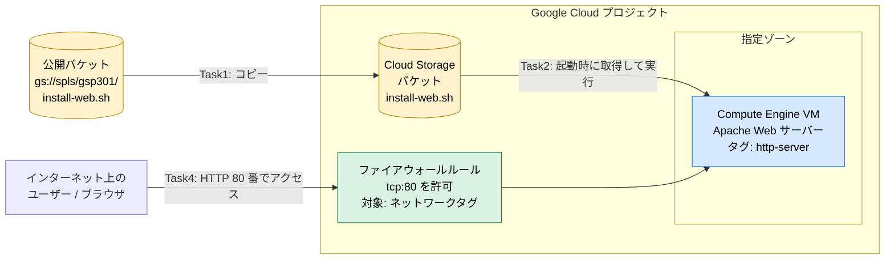
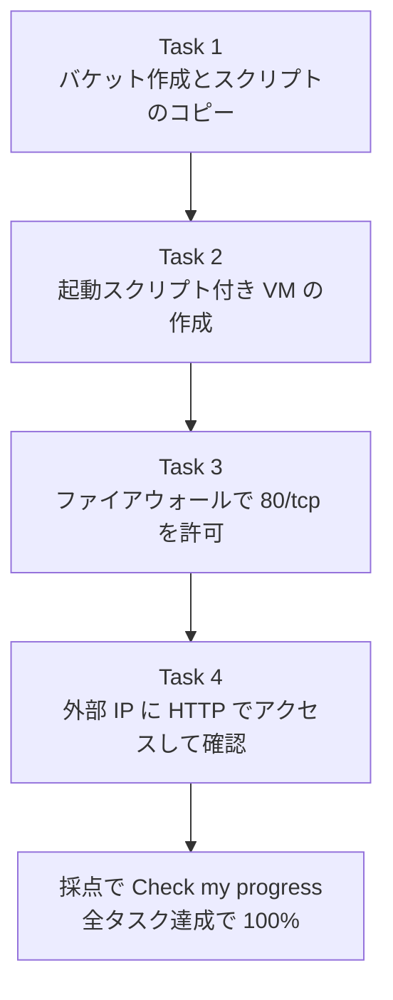
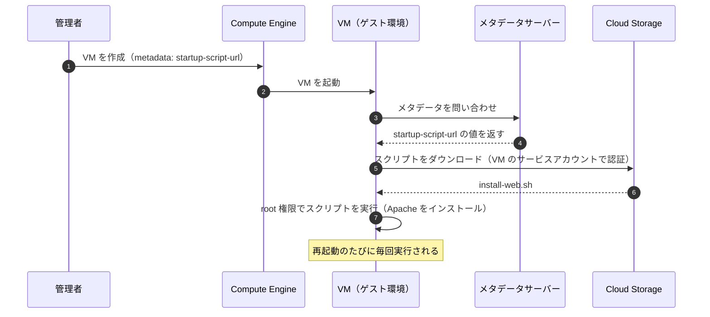
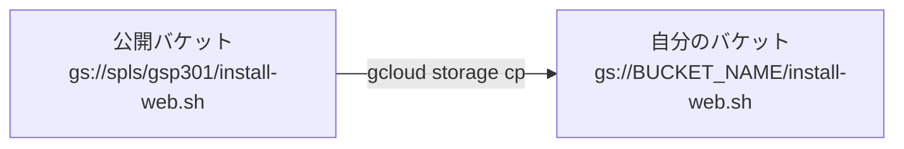
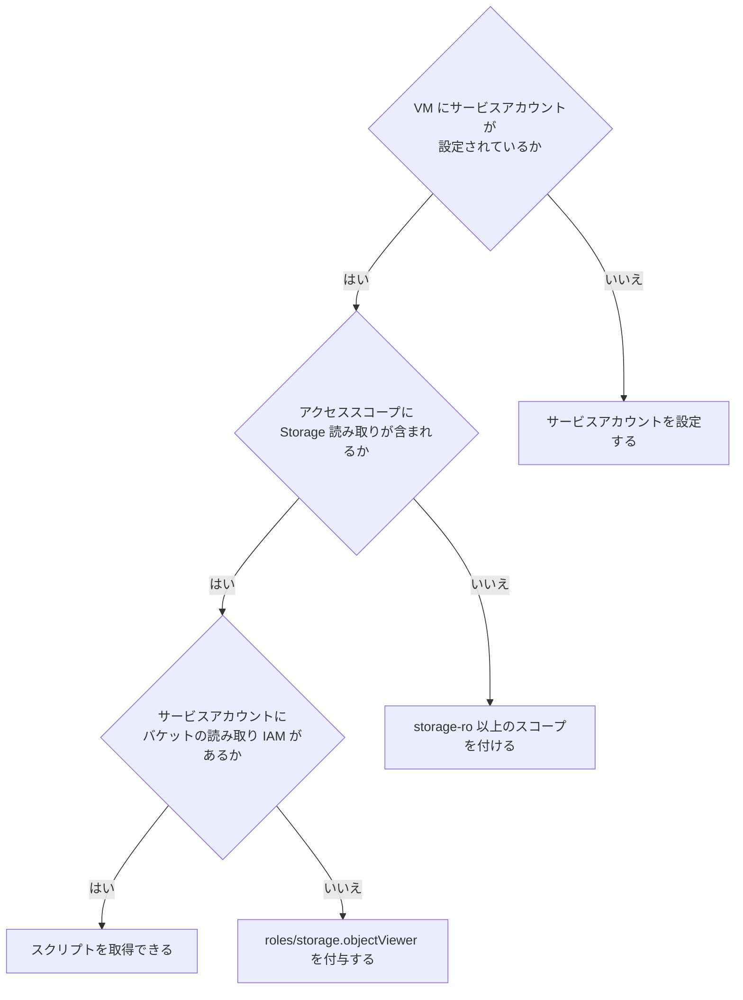
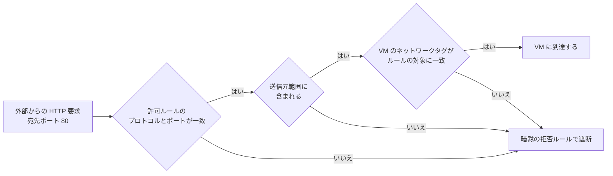
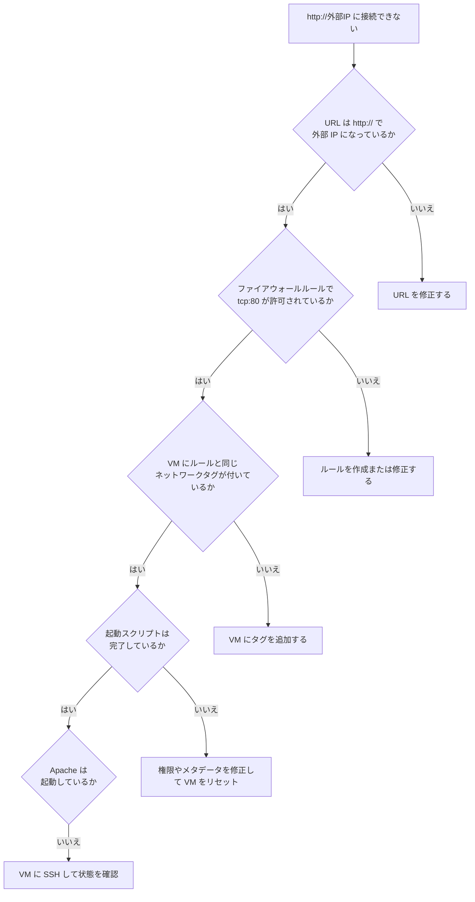
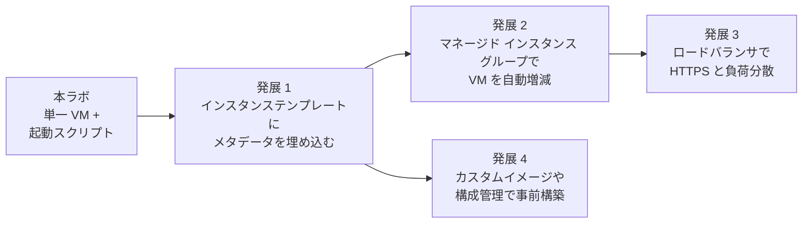

# Google Cloud チャレンジラボ GSP301 完全ガイド

## リモート起動スクリプトで Apache を自動インストールする Compute Engine VM を構築する

> **対象読者**: Google Cloud を学び始めた初学者（Compute Engine・Cloud Storage・VPC ファイアウォールを一度は触ったことがある方）
> **対応コース**: Cloud Architecture: Design, Implement, and Manage スキルバッジ（Professional Cloud Architect 試験対策にも有効）
> **ラボ形式**: チャレンジラボ（手順書なし・自動採点あり・制限時間内に全タスク完了で 100%）
> **ゴール**: 起動スクリプトを Cloud Storage バケットに置き、VM がそれを読み込んで Apache をインストールし、インターネットから HTTP で到達できる状態にする

---

## 目次

1. [このラボで何を作るのか（全体像）](#1-このラボで何を作るのか全体像)
2. [事前に押さえる基礎知識](#2-事前に押さえる基礎知識)
3. [作業前の準備（Cloud Shell と変数）](#3-作業前の準備cloud-shell-と変数)
4. [Task 1: バケットを作成し起動スクリプトをコピーする](#4-task-1-バケットを作成し起動スクリプトをコピーする)
5. [Task 2: リモート起動スクリプト付きの VM を作成する](#5-task-2-リモート起動スクリプト付きの-vm-を作成する)
6. [Task 3: ファイアウォールルール（80/tcp）を作成する](#6-task-3-ファイアウォールルール80tcpを作成する)
7. [Task 4: VM が Web コンテンツを配信していることを確認する](#7-task-4-vm-が-web-コンテンツを配信していることを確認する)
8. [うまくいかないときのトラブルシューティング](#8-うまくいかないときのトラブルシューティング)
9. [ベストプラクティス集](#9-ベストプラクティス集)
10. [試験（PCA）とのつながり](#10-試験pcaとのつながり)
11. [最終チェックリスト](#11-最終チェックリスト)
12. [参考文献](#12-参考文献)

---

## 1. このラボで何を作るのか（全体像）

### 1.1 シナリオを一言でまとめると

「VM の**メタデータに直接スクリプトを書く**方式をやめ、スクリプトを **Cloud Storage に置いて VM から参照させる**方式に変える」というのが、このラボの本質です。

### 1.2 なぜバケットに置くのか

| 比較項目 | メタデータに直接記述（`startup-script`） | バケットを参照（`startup-script-url`） |
|---|---|---|
| スクリプトの修正 | VM ごとにメタデータを編集する必要がある | バケット内のファイルを 1 つ差し替えるだけ |
| 複数 VM への展開 | VM の数だけ同じ内容を設定する | 全 VM が同じ URL を指すだけ |
| バージョン管理 | しづらい | バケットのオブジェクトバージョニングで履歴を残せる |
| アクセス制御 | VM 編集権限を持つ人は中身が見える | バケットの IAM で読み取り権限を分離できる |
| 文字数の制約 | メタデータ値のサイズ上限がある | ファイルとして置くため制約が緩やか |

### 1.3 完成形のアーキテクチャ



### 1.4 4 つのタスクの流れ



> 💡 **ベストプラクティス**: Task 3 は Task 2 の前に済ませても構いません。依存関係があるのは「Task 1 → Task 2」（スクリプトがないと VM が参照できない）と「Task 2・3 → Task 4」（VM とルールが揃わないと確認できない）の 2 点だけです。

---

## 2. 事前に押さえる基礎知識

### 2.1 用語集

| 用語 | 意味 | このラボでの役割 |
|---|---|---|
| 起動スクリプト（startup script） | VM が起動するたびに実行されるスクリプト | Apache をインストールする |
| メタデータ | VM に紐づく key-value 形式の設定情報 | `startup-script-url` で参照先 URL を渡す |
| Cloud Storage バケット | オブジェクト（ファイル）を保存するコンテナ。名前はグローバルで一意 | 起動スクリプトの置き場所 |
| サービスアカウント | VM などワークロードが使う「人ではない ID」 | VM がバケットからスクリプトを読む際の身元 |
| アクセススコープ | VM がどの API を呼べるかを制限する従来の仕組み | Storage の読み取りを許可する |
| ネットワークタグ | VM に付ける文字列ラベル | ファイアウォールルールの適用対象を絞る |
| VPC ファイアウォールルール | ネットワークの通信を許可・拒否するルール | 外部からの 80 番ポートを許可する |
| シリアルコンソール出力 | VM の起動ログ | 起動スクリプトの実行状況を確認する |

### 2.2 VM が起動スクリプトを実行するまでの仕組み



ここで重要なポイントは 3 つです。

1. VM は**自分のサービスアカウント**でバケットにアクセスします。このため、サービスアカウントに「バケットの読み取り権限」が必要です。
2. API 呼び出しには**アクセススコープ**も関係します。スコープが `storage-ro`（読み取り専用）以上であれば取得できます。
3. 起動スクリプトは**起動のたびに**実行されます。このため、スクリプトは何度実行しても同じ結果になる（冪等な）書き方が望ましいです。

### 2.3 `startup-script` と `startup-script-url` の違い

| メタデータキー | 値に入れるもの | 使いどころ |
|---|---|---|
| `startup-script` | スクリプトの**本文そのもの** | 短い一回限りの処理 |
| `startup-script-url` | Cloud Storage 上の**ファイルの URL**（`gs://...` など） | 複数 VM で共有・頻繁に更新したい処理（今回のラボ） |

> ⚠️ 両方を同時に設定した場合は `startup-script-url` が優先されます（公式ドキュメントの仕様）。意図しない上書きを避けるため、どちらか一方だけを使いましょう。

---

## 3. 作業前の準備（Cloud Shell と変数）

### 3.1 作業環境の選び方

| 方法 | 向いている場面 |
|---|---|
| Cloud Shell（ブラウザ内ターミナル） | コマンドで素早く・再現性高く進めたい（本ガイドの主軸） |
| Google Cloud コンソール（GUI） | 画面で設定項目を確認しながら理解を深めたい |

本ガイドでは、各タスクで **gcloud コマンド版**と **コンソール版**の両方を示します。

### 3.2 手順

1. 画面右上の **Cloud Shell をアクティブにする**（`>_` アイコン）をクリックします。
2. 次のコマンドで変数を設定します。`ZONE` の値は、**ラボの左パネルに表示されているゾーン**に置き換えてください。

```bash
# ラボ画面に表示されたゾーンをそのまま入れる（例: us-central1-a）
export ZONE="ここにラボ指定のゾーンを入れる"

# ゾーンからリージョンを算出（末尾の -a などを取り除く）
export REGION="${ZONE%-*}"

# 現在のプロジェクト ID を取得
export PROJECT_ID="$(gcloud config get-value project)"

# バケット名（グローバルで一意にする必要があるため、プロジェクト ID を含める）
export BUCKET_NAME="${PROJECT_ID}-startup-scripts"

# VM 名
export VM_NAME="web-server"

# 変数の確認
echo "ZONE=${ZONE}  REGION=${REGION}  PROJECT=${PROJECT_ID}  BUCKET=${BUCKET_NAME}"
```

> 💡 **ベストプラクティス**: ゾーン・名前などの値を最初に変数へ入れておくと、入力ミスを減らせて、後から同じ手順を再実行しやすくなります。これは Infrastructure as Code（IaC）の第一歩でもあります。
>
> ⚠️ **注意（チャレンジラボ特有）**: 採点は「ラボが指定する条件」で行われます。バケット名・VM 名・ネットワークタグなどの指定がラボ画面に書かれている場合は、本ガイドの例よりもラボの指定を優先してください。また、事前作成済みのリソース（特に `lab-monitor` インスタンス）は**変更・削除しない**でください。

---

## 4. Task 1: バケットを作成し起動スクリプトをコピーする

### 4.1 このタスクで達成すること



### 4.2 手順 A: gcloud コマンド（推奨）

**ステップ 1: バケットを作成する**

```bash
gcloud storage buckets create "gs://${BUCKET_NAME}" \
  --location="${REGION}" \
  --uniform-bucket-level-access \
  --public-access-prevention
```

| オプション | 意味 | なぜ指定するか |
|---|---|---|
| `--location` | バケットを置くリージョン | VM と同じリージョンにするとレイテンシと転送コストの面で有利 |
| `--uniform-bucket-level-access` | 権限を IAM だけで管理する（旧 ACL を使わない） | 権限の管理が一本化され、設定ミスを減らせる |
| `--public-access-prevention` | バケットの一般公開を禁止する | 起動スクリプトが誤って全世界に公開されるのを防ぐ |

**ステップ 2: スクリプトをコピーする**

```bash
gcloud storage cp gs://spls/gsp301/install-web.sh "gs://${BUCKET_NAME}/install-web.sh"
```

**ステップ 3: コピーできたか確認する**

```bash
gcloud storage ls "gs://${BUCKET_NAME}/"
```

`gs://（バケット名）/install-web.sh` が表示されれば成功です。

> 💡 **補足**: 従来の `gsutil`（`gsutil mb` / `gsutil cp`）でも同じことができます。現在の公式ドキュメントでは `gcloud storage` コマンドが推奨されています。ラボの過去の解説では `gsutil` が使われることが多いので、どちらを見ても混乱しないようにしておくと安心です。

### 4.3 手順 B: Google Cloud コンソール

1. ナビゲーションメニューから **Cloud Storage > バケット** を開きます。
2. **作成** をクリックします。
3. バケット名を入力します（グローバルで一意）。
4. ロケーションタイプで **Region** を選び、VM と同じリージョンを選択します。
5. ストレージクラスは **Standard** のままで構いません。
6. 「アクセス制御」では **均一（Uniform）** を選び、「公開アクセスの防止」を有効にします。
7. **作成** をクリックします。
8. スクリプトはコンソールから直接コピーできないため、Cloud Shell で手順 A のステップ 2 を実行します（`gs://spls/gsp301/install-web.sh` は公開バケットです）。

### 4.4 スクリプトの中身を確認する習慣

```bash
gcloud storage cat "gs://${BUCKET_NAME}/install-web.sh"
```

中身は、Apache をインストールする数行の bash スクリプトです。パッケージ更新（`apt-get update`）に続けて、Apache のパッケージを `apt-get install` する構成になっています。

> 💡 **ベストプラクティス**: **実行する前に中身を読む**習慣を付けましょう。起動スクリプトは VM 上で root 権限で動くため、出所の不明なスクリプトを無確認で実行するのは危険です。

### 4.5 この Task のチェックポイント

| 確認項目 | 期待される状態 |
|---|---|
| バケットが存在する | `gcloud storage buckets list` に自分のバケットが出る |
| ファイルが入っている | `install-web.sh` がバケット直下にある |
| ファイル名が変わっていない | `install-web.sh` のまま |

ここで、ラボ画面の **Check my progress** をクリックして採点を確認します。

---

## 5. Task 2: リモート起動スクリプト付きの VM を作成する

### 5.1 この Task で決めること

| 設計項目 | このラボでの選択 | 理由 |
|---|---|---|
| ゾーン | ラボ指定のゾーン | 指定どおりでないと採点に失敗する |
| OS イメージ | Debian（既定） | 配布スクリプトが `apt-get` 前提のため |
| メタデータ | `startup-script-url=gs://バケット名/install-web.sh` | スクリプトを外部ファイルから読ませる |
| ネットワークタグ | `http-server` | Task 3 のファイアウォールルールの適用対象にする |
| 外部 IP | 付与する（既定） | インターネットからアクセスするため |
| 権限（スコープ） | Storage 読み取りが可能なこと | バケットからスクリプトを取得するため |

### 5.2 手順 A: gcloud コマンド（推奨）

まず、VM が使うサービスアカウントを特定し、そのアカウントにバケット単位で `roles/storage.objectViewer`（オブジェクトの読み取り）を付与します。ここでは Compute Engine の既定のサービスアカウントを使います。

```bash
# VM が使うサービスアカウント（Compute Engine の既定のサービスアカウント）を特定する
PROJECT_NUMBER=$(gcloud projects describe "${PROJECT_ID}" --format="value(projectNumber)")
VM_SA="${PROJECT_NUMBER}-compute@developer.gserviceaccount.com"
echo "VM_SA=${VM_SA}"

# バケット単位で読み取りロールを付与する（プロジェクト全体には付与しない）
gcloud storage buckets add-iam-policy-binding "gs://${BUCKET_NAME}" \
  --member="serviceAccount:${VM_SA}" \
  --role="roles/storage.objectViewer"

# 付与されたことを確認する（VM_SA を含む行が表示されれば OK）
gcloud storage buckets get-iam-policy "gs://${BUCKET_NAME}" \
  --flatten="bindings[].members" \
  --filter="bindings.role=roles/storage.objectViewer AND bindings.members=serviceAccount:${VM_SA}" \
  --format="value(bindings.members)"
```

次に、同じサービスアカウントを明示して VM を作成します。

```bash
gcloud compute instances create "${VM_NAME}" \
  --zone="${ZONE}" \
  --machine-type=e2-medium \
  --image-family=debian-12 \
  --image-project=debian-cloud \
  --tags=http-server \
  --service-account="${VM_SA}" \
  --scopes=storage-ro \
  --metadata=startup-script-url="gs://${BUCKET_NAME}/install-web.sh"
```

| オプション | 意味 |
|---|---|
| `--zone` | VM を作るゾーン（ラボ指定） |
| `--machine-type` | マシンタイプ。Apache を動かすだけなら `e2-medium` 程度で十分 |
| `--image-family` / `--image-project` | OS イメージ。Debian の最新版ファミリーを使う |
| `--tags=http-server` | ネットワークタグ。Task 3 のルールの対象になる |
| `--service-account` | VM が使うサービスアカウント。上で `roles/storage.objectViewer` を付与したものを明示する |
| `--scopes=storage-ro` | Cloud Storage の読み取り専用スコープ。必要最小限の API アクセス |
| `--metadata=startup-script-url=...` | **このラボの核心**。起動時に取得して実行するスクリプトの場所 |

> ⚠️ **注意**: イメージファミリー名（`debian-12` など）は世代交代で変わります。コマンドがエラーになる場合は、`gcloud compute images list --filter="family~debian"` で現在使えるファミリーを確認してください。ラボの指定（OS・マシンタイプ）がある場合はそちらを優先します。

### 5.3 手順 B: Google Cloud コンソール

1. **Compute Engine > VM インスタンス > インスタンスを作成** をクリックします。
2. **名前** を入力し、**リージョン** と **ゾーン** にラボ指定のゾーンを選びます。
3. マシン構成は既定のまま、または `e2-medium` にします。
4. 左メニューの **ネットワーキング** を開き、**ネットワークタグ** に `http-server` を追加します。
5. 左メニューの **セキュリティ**（または「アクセススコープ」）で、Cloud Storage の読み取りが許可されていることを確認します。
6. **詳細設定 > 管理 > メタデータ** で **項目を追加** をクリックし、次の値を入力します。

| 項目 | 値 |
|---|---|
| キー | `startup-script-url` |
| 値 | `gs://（自分のバケット名）/install-web.sh` |

7. **作成** をクリックします。

> ⚠️ **よくある間違い**: コンソールの「起動スクリプト」欄は、**スクリプトの本文**を貼る欄（キーは `startup-script`）です。URL を入れる場合は、上のとおり**メタデータ欄に `startup-script-url`** を追加します。
>
> 💡 **ベストプラクティス**: コンソールの「HTTP トラフィックを許可する」チェックを入れると、タグ `http-server` の付与とファイアウォールルールの作成が自動で行われます。ただし、チャレンジラボでは「自分でルールを作る」ことが目的のため、Task 3 で明示的にルールを作成する流れを本ガイドでは採用します。

### 5.4 VM が起動時に取得できる権限の考え方



> 📘 **補足**: スコープと IAM は**両方**が満たされて初めて API が成功します（「入場券」と「部屋の鍵」の両方が必要なイメージ）。本番運用では、スコープは広め（`cloud-platform`）にして IAM で絞る方法が公式に推奨されています。

### 5.5 起動スクリプトの実行状況を確認する

VM を作成してから、Apache がインストールされるまでに**1〜数分**かかります。この間に実行状況を確認できます。

```bash
gcloud compute instances get-serial-port-output "${VM_NAME}" --zone="${ZONE}" | grep -i startup-script
```

| ログに出る内容の例 | 意味 |
|---|---|
| `startup-script-url` から取得を開始した旨 | メタデータの参照に成功している |
| スクリプトのダウンロードに成功した旨 | バケットの権限が正しい |
| `Finished running startup script` に相当する行 | スクリプトが完了した |
| 認証や権限（403 など）に関するエラー | スコープまたは IAM の不足 |

### 5.6 この Task のチェックポイント

| 確認項目 | 確認コマンド |
|---|---|
| VM が `RUNNING` | `gcloud compute instances list --filter="name=${VM_NAME}"` |
| ゾーンがラボ指定どおり | 同上（`ZONE` 列を確認） |
| メタデータが設定されている | `gcloud compute instances describe "${VM_NAME}" --zone="${ZONE}" --format="value(metadata.items)"` |
| 外部 IP がある | 一覧の `EXTERNAL_IP` 列 |

---

## 6. Task 3: ファイアウォールルール（80/tcp）を作成する

### 6.1 なぜ必要か

VPC のファイアウォールは、既定で**外部からの受信（ingress）通信を拒否**します（暗黙の拒否ルール）。Apache がインストールされていても、80 番ポートへの通信を許可するルールがなければ、ブラウザから見えません。

### 6.2 通信が通る条件



### 6.3 手順 A: gcloud コマンド（推奨）

```bash
gcloud compute firewall-rules create allow-http \
  --network=default \
  --direction=INGRESS \
  --action=ALLOW \
  --rules=tcp:80 \
  --source-ranges=0.0.0.0/0 \
  --target-tags=http-server
```

| オプション | 意味 | 設定の考え方 |
|---|---|---|
| `--network` | ルールを作る VPC ネットワーク | VM が接続しているネットワークと一致させる |
| `--direction=INGRESS` | 受信方向 | 外部から VM への通信 |
| `--action=ALLOW` | 許可 | |
| `--rules=tcp:80` | TCP の 80 番ポート | HTTP は 80。**443 ではない** |
| `--source-ranges=0.0.0.0/0` | 全世界のどこからでも | 公開 Web サーバーなのでこのラボでは必須 |
| `--target-tags=http-server` | このタグを持つ VM だけに適用 | 他の VM に影響を与えない |

> ⚠️ **ネットワーク名の確認**: ラボ環境で VM が `default` 以外のネットワークにある場合は、`--network` をその名前に変更してください。`gcloud compute instances describe "${VM_NAME}" --zone="${ZONE}" --format="value(networkInterfaces[0].network)"` で確認できます。

### 6.4 手順 B: Google Cloud コンソール

1. **VPC ネットワーク > ファイアウォール** を開きます。
2. **ファイアウォール ルールを作成** をクリックします。
3. 次の内容を入力します。

| 項目 | 設定値 |
|---|---|
| 名前 | `allow-http` |
| ネットワーク | VM と同じネットワーク（通常は `default`） |
| 優先度 | `1000`（既定） |
| トラフィックの方向 | 上り（Ingress） |
| 一致したときのアクション | 許可 |
| ターゲット | 指定されたターゲットタグ |
| ターゲットタグ | `http-server` |
| ソースフィルタ | IPv4 範囲 |
| ソース IPv4 範囲 | `0.0.0.0/0` |
| プロトコルとポート | 指定したプロトコルとポート → TCP にチェック → `80` |

4. **作成** をクリックします。

### 6.5 この Task のチェックポイント

```bash
gcloud compute firewall-rules describe allow-http \
  --format="yaml(name,direction,allowed,sourceRanges,targetTags)"
```

| 確認項目 | 期待値 |
|---|---|
| `direction` | `INGRESS` |
| `allowed` | `IPProtocol: tcp` と `ports: ['80']` |
| `sourceRanges` | `0.0.0.0/0` |
| `targetTags` | `http-server` |

---

## 7. Task 4: VM が Web コンテンツを配信していることを確認する

### 7.1 外部 IP アドレスを取得する

```bash
export EXTERNAL_IP="$(gcloud compute instances describe "${VM_NAME}" \
  --zone="${ZONE}" \
  --format='get(networkInterfaces[0].accessConfigs[0].natIP)')"
echo "${EXTERNAL_IP}"
```

### 7.2 アクセスして確認する

**方法 A: Cloud Shell から確認する**

```bash
curl -s -o /dev/null -w "HTTP ステータス: %{http_code}\n" "http://${EXTERNAL_IP}"
curl -s "http://${EXTERNAL_IP}" | head -n 20
```

`HTTP ステータス: 200` と、Apache の既定ページ（タイトルに Apache と It works! を含む HTML）が返れば成功です。

**方法 B: ブラウザで確認する**

アドレスバーに `http://（外部 IP）` を入力します。

### 7.3 URL の落とし穴

| 入力した URL | 結果 | 理由 |
|---|---|---|
| `http://外部IP` | ✅ 表示される | 正しい |
| `https://外部IP` | ❌ 接続できない | 443 番を許可しておらず、Apache も TLS 未設定 |
| `http://内部IP` | ❌ 接続できない | 内部 IP はプロジェクト内の VPC からしか届かない |

> ⚠️ ブラウザが自動で `https://` に書き換えることがあります。接続できないときは、アドレスバーを確認してください。

### 7.4 ラボの採点

ラボ画面で **Check my progress** をクリックして、全タスクが緑色（達成済み）になったか確認します。

---

## 8. うまくいかないときのトラブルシューティング

### 8.1 切り分けフロー



### 8.2 症状別の対処表

| 症状 | 考えられる原因 | 確認方法 | 対処 |
|---|---|---|---|
| ブラウザがタイムアウトする | ファイアウォールで 80 番が未許可、またはタグ不一致 | `gcloud compute firewall-rules list` と VM のタグ確認 | ルール作成・タグ追加 |
| 接続拒否（Connection refused） | Apache が未インストール・未起動 | シリアルポート出力、VM 内で `systemctl status apache2` | スクリプト失敗の原因を修正 |
| スクリプトが実行されない | メタデータのキー名が違う | `describe` でメタデータ確認 | `startup-script-url` に修正 |
| ログに 403 / 権限エラー | スコープまたは IAM の不足 | シリアルポート出力 | `storage-ro` スコープ追加、`objectViewer` 付与 |
| スクリプトが見つからない（404） | バケット名・ファイル名の誤り | `gcloud storage ls` | URL を修正 |
| スコープの変更ができない | VM 稼働中はスコープを変更できない | `describe` で確認 | VM を停止してから変更するか、作り直す |

### 8.3 VM 内で直接ログを見る

VM に SSH 接続します。

```bash
gcloud compute ssh "${VM_NAME}" --zone="${ZONE}"
```

VM 内で次を実行します。

```bash
# 起動スクリプトの実行ログ
sudo journalctl -u google-startup-scripts.service --no-pager | tail -n 50

# Apache の状態
systemctl status apache2 --no-pager
```

### 8.4 起動スクリプトを再実行する

メタデータやバケット側を直した後は、次のどちらかで再実行できます。

| 方法 | コマンド | 特徴 |
|---|---|---|
| VM を再起動（リセット） | `gcloud compute instances reset "${VM_NAME}" --zone="${ZONE}"` | 起動スクリプトが再度実行される |
| VM 内で手動実行 | `sudo google_metadata_script_runner startup` | 再起動せずに今すぐ試せる |

---

## 9. ベストプラクティス集

### 9.1 セキュリティ

| 項目 | 推奨 | 理由 |
|---|---|---|
| 最小権限 | VM に付けるスコープ・IAM を「バケットの読み取り」に絞る | 万一 VM が侵害されたときの被害を限定する |
| 専用サービスアカウント | 本番では既定のサービスアカウントではなく用途別に作成する | 既定のアカウントは権限が広くなりがち |
| バケットの非公開 | 公開アクセスの防止と均一なバケットレベルアクセスを有効にする | スクリプトに秘密情報が混入しても漏えいしにくい |
| ファイアウォールの絞り込み | ターゲットタグと必要なポートだけを許可する | 不要な露出を避ける |
| 管理用アクセス | SSH（22 番）を全世界に開けず、IAP TCP 転送を使う | 管理ポートを直接公開しない |
| 秘密情報の扱い | パスワードや API キーをスクリプトへ直書きしない | Secret Manager を使う |

### 9.2 運用・信頼性

| 項目 | 推奨 | 理由 |
|---|---|---|
| 冪等なスクリプト | 何度実行しても同じ結果になるように書く（`apt-get install -y` など） | 起動のたびに実行されるため |
| バージョニング | バケットのオブジェクトバージョニングを有効にする | 誤った変更を元に戻せる |
| 変更時の影響範囲 | スクリプトを差し替えると、**次回起動する全 VM** に影響することを理解する | リモート方式の利点であり同時にリスクでもある |
| ログの確認 | シリアルポート出力や Cloud Logging で実行結果を確認する | 失敗に早く気づく |
| 命名規則 | `プロジェクトID-用途` のようにバケット名を統一する | 一意性と可読性を両立する |

### 9.3 スケールするための発展形



> 💡 **ベストプラクティス**: 起動のたびに毎回インストールするのは、台数が増えると起動が遅くなります。Apache など変わらないものは**カスタムイメージ**に焼き込み、起動スクリプトは「設定の最終調整」だけにするのが定石です。

---

## 10. 試験（PCA）とのつながり

このラボで触れた内容は、Professional Cloud Architect 試験の次のような観点につながります。

| このラボの要素 | 関連する試験の観点 | 押さえるポイント |
|---|---|---|
| 起動スクリプトのバケット化 | コンピュートのプロビジョニングと自動化 | 構成を VM から切り離して一元管理する発想 |
| サービスアカウントとスコープ | IAM とセキュリティ設計 | スコープと IAM の両方が必要、最小権限 |
| バケットの公開防止・均一アクセス | データ保護 | 権限を IAM に一本化する |
| ネットワークタグとファイアウォール | ネットワーク設計・セキュリティ制御 | 暗黙の拒否、タグによる対象の絞り込み |
| 外部 IP と HTTP の確認 | 可用性・運用 | 動作確認とログによる切り分け |
| 本番への発展（MIG・LB） | スケーラビリティ・信頼性設計 | 単一 VM は単一障害点になる |

### 10.1 試験で問われやすい「判断軸」

| 状況 | 選ぶ方法 |
|---|---|
| 多数の VM に同じ初期設定を配りたい | `startup-script-url`（またはインスタンステンプレート） |
| 秘密情報を VM に渡したい | Secret Manager（メタデータへ直書きしない） |
| 特定の VM だけに通信を許可したい | ネットワークタグ（またはサービスアカウント）をターゲットにしたルール |
| 起動時間を短くしたい | カスタムイメージで事前構築 |
| 管理用 SSH を安全に使いたい | IAP TCP 転送 |

---

## 11. 最終チェックリスト

**Task 1**
- [ ] バケットを作成した（均一アクセス・公開防止を有効にした）
- [ ] `install-web.sh` をバケットへコピーした
- [ ] `gcloud storage ls` でファイルを確認した

**Task 2**
- [ ] VM をラボ指定のゾーンに作成した
- [ ] メタデータ `startup-script-url` にバケット内スクリプトの URL を設定した
- [ ] ネットワークタグ `http-server` を付けた
- [ ] Storage 読み取りのスコープ（`storage-ro` 以上）を付けた
- [ ] 事前作成済みの `lab-monitor` を変更していない

**Task 3**
- [ ] `tcp:80` を許可する ingress ルールを作成した
- [ ] ルールのターゲットタグと VM のタグが一致している

**Task 4**
- [ ] `http://外部IP` で Apache の既定ページが表示された
- [ ] ラボ画面の **Check my progress** で全タスクが達成済みになった

---

## 12. 参考文献

| # | 内容 | URL |
|---|---|---|
| 1 | Linux VM で起動スクリプトを使う（`startup-script` / `startup-script-url`） | https://cloud.google.com/compute/docs/instances/startup-scripts/linux |
| 2 | Cloud Storage バケットの作成 | https://cloud.google.com/storage/docs/creating-buckets |
| 3 | VPC ファイアウォールルールの使用 | https://cloud.google.com/vpc/docs/using-firewalls |
| 4 | Compute Engine のサービスアカウント | https://cloud.google.com/compute/docs/access/service-accounts |
| 5 | Cloud Storage の IAM ロール | https://cloud.google.com/storage/docs/access-control/iam-roles |

> 📝 **補足**: Google Cloud の画面表示・既定のイメージファミリー・コマンドのオプションは更新されることがあります。本ガイドの内容と実際の画面が異なる場合は、上記の公式ドキュメントとラボ画面の指示を優先してください。
