# Google Cloud チャレンジラボ解説ガイド

## セキュアな Windows 環境を踏み台ホスト（Bastion Host）と VPC で構築する

> **対象読者**: Google Cloud 初学者〜Professional Cloud Architect（PCA）受験準備中の方
> **ゴール**: 「インターネットから完全に隔離された Windows サーバー」を作り、「踏み台サーバー経由でのみ」管理できる構成を自力で構築できるようになる

---

## 目次

1. [このラボで学ぶこと](#1-このラボで学ぶこと)
2. [事前知識：用語をまず理解する](#2-事前知識用語をまず理解する)
3. [完成形のアーキテクチャ](#3-完成形のアーキテクチャ)
4. [作業の全体フロー](#4-作業の全体フロー)
5. [Step 0：準備（リージョン・ゾーンの設定）](#5-step-0準備リージョンゾーンの設定)
6. [Task 1：VPC ネットワーク・サブネット・ファイアウォールルール](#6-task-1vpc-ネットワークサブネットファイアウォールルール)
7. [Task 2：Windows インスタンスのデプロイとパスワード設定](#7-task-2windows-インスタンスのデプロイとパスワード設定)
8. [Task 3：踏み台経由でセキュアホストに接続し IIS を構成](#8-task-3踏み台経由でセキュアホストに接続し-iis-を構成)
9. [検証：うまくいったか確認する](#9-検証うまくいったか確認する)
10. [トラブルシューティング](#10-トラブルシューティング)
11. [ベストプラクティスと本番環境での発展](#11-ベストプラクティスと本番環境での発展)
12. [PCA 試験との関連ポイント](#12-pca-試験との関連ポイント)
13. [コマンド一括まとめ（コピペ用）](#13-コマンド一括まとめコピペ用)
14. [チェックリスト](#14-チェックリスト)

---

## 1. このラボで学ぶこと

### 1.1 シナリオの要約

会社が新しいアプリケーションをクラウドに展開します。あなたは **Windows サーバーを安全に管理する枠組み** を作る担当です。

| 要件 | 内容 |
|---|---|
| 本番サーバーの隔離 | インターネットから **直接アクセスできない**、かつ **インターネットへ直接接続もできない** |
| 管理用の入口 | **踏み台ホスト** を用意し、インターネットから **RDP のみ** で接続できる |
| 踏み台の通信制限 | 踏み台は VPC 内の他の VM と **RDP のみ** で通信できる |
| 監視システム | 監視は `default` VPC で稼働しているため、**全 VM に第2ネットワークインターフェース**（default VPC への内部接続のみ）が必要 |

### 1.2 習得できるスキル

| スキル | 説明 |
|---|---|
| カスタムモードVPCの作成 | 自分で IP 範囲を決めるネットワーク設計 |
| ネットワークタグによる FW 制御 | 「特定の VM だけ」にルールを適用する方法 |
| マルチ NIC インスタンス | 1台の VM を複数の VPC に同時接続する構成 |
| 外部 IP の有無による隔離 | 外部 IP を持たせないことでインターネットから隔離 |
| 踏み台（Bastion）パターン | 安全な管理アクセスの定番設計 |
| Windows VM の初期設定 | パスワードリセットと RDP 接続 |

---

## 2. 事前知識：用語をまず理解する

### 2.1 基本用語

| 用語 | 意味 | たとえ話 |
|---|---|---|
| **VPC ネットワーク** | Google Cloud 上の仮想的なプライベートネットワーク | 会社の敷地 |
| **サブネット** | VPC を分割した IP アドレスの区画（リージョン単位） | 敷地内の建物 |
| **ファイアウォールルール** | 通信を許可・拒否するルール | 守衛室の入館ルール |
| **ネットワークタグ** | VM に付けるラベル。FW ルールの適用対象指定に使う | 社員証の部署シール |
| **外部 IP（External NAT）** | インターネットから到達できるグローバル IP | 外から見える代表電話番号 |
| **内部 IP** | VPC 内でのみ使えるプライベート IP | 社内の内線番号 |
| **RDP** | Remote Desktop Protocol。Windows の画面を遠隔操作する仕組み（TCP 3389） | 遠隔で席に座る |
| **踏み台ホスト（Bastion Host / Jump Box）** | 内部サーバーへ入るための唯一の中継サーバー | 受付ロビー |
| **IIS** | Internet Information Services。Windows 標準の Web サーバー | Windows 版の Web サーバー |
| **NIC** | Network Interface Card。VM のネットワーク接続口 | 差込口 |

### 2.2 重要な Google Cloud の仕様（必ず押さえる）

| 仕様 | 内容 |
|---|---|
| **暗黙の拒否ルール** | 受信（Ingress）は **デフォルトで全拒否**。許可ルールを作らない限り通信できない |
| **暗黙の許可ルール** | 送信（Egress）は **デフォルトで全許可** |
| **カスタムモード VPC** | 自動でサブネットが作られず、自分で作る。さらに **デフォルトで FW ルールが 1 つもない** |
| **マルチ NIC の制約** | 各 NIC は **異なる VPC ネットワーク** に接続する必要がある |
| **IP 範囲の重複禁止** | マルチ NIC で接続する VPC 同士のサブネット範囲は **重複不可** |
| **NIC ごとの外部 IP** | 外部 IP は NIC ごとに設定する。付けなければ内部専用 |
| **デフォルトゲートウェイ** | マルチ NIC VM では **nic0 がデフォルトゲートウェイ** を持つ |

> ⚠️ **注意**: `default` VPC（自動モード）には `default-allow-rdp`（0.0.0.0/0 から TCP 3389）や `default-allow-internal` が最初から存在します。この事実が Task 3 の挙動に影響します（後述）。

### 2.3 踏み台ホストパターンとは

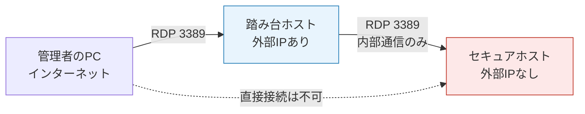

**ポイント**: 守るべきサーバーはインターネットに **一切露出させず**、露出するのは「厳重に監視する踏み台 1 台だけ」にします。攻撃面（Attack Surface）を最小化する設計です。

---

## 3. 完成形のアーキテクチャ

### 3.1 構成図

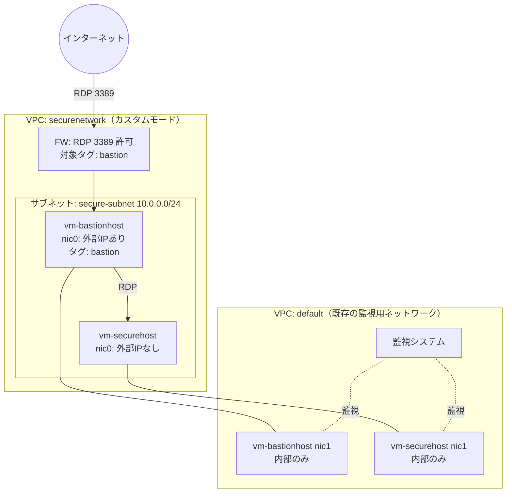

### 3.2 リソース一覧

| リソース | 名前 | 主要設定 |
|---|---|---|
| VPC ネットワーク | `securenetwork` | カスタムモード |
| サブネット | `secure-subnet`（名称は任意） | `10.0.0.0/24`、指定リージョン |
| FW ルール | `allow-rdp-bastion`（名称は任意） | Ingress / TCP 3389 / 対象タグ `bastion` |
| VM（セキュア） | `vm-securehost` | Windows Server 2016 Desktop Experience、NIC 2 つ、外部 IP なし |
| VM（踏み台） | `vm-bastionhost` | 同上、nic0 のみ外部 IP（エフェメラル）、タグ `bastion` |

### 3.3 2つの NIC の役割まとめ

| VM | nic0 | nic1 |
|---|---|---|
| `vm-securehost` | `securenetwork` / `secure-subnet`（**外部 IP なし**） | `default`（**外部 IP なし**） |
| `vm-bastionhost` | `securenetwork` / `secure-subnet`（**外部 IP あり・エフェメラル**） | `default`（**外部 IP なし**） |

---

## 4. 作業の全体フロー

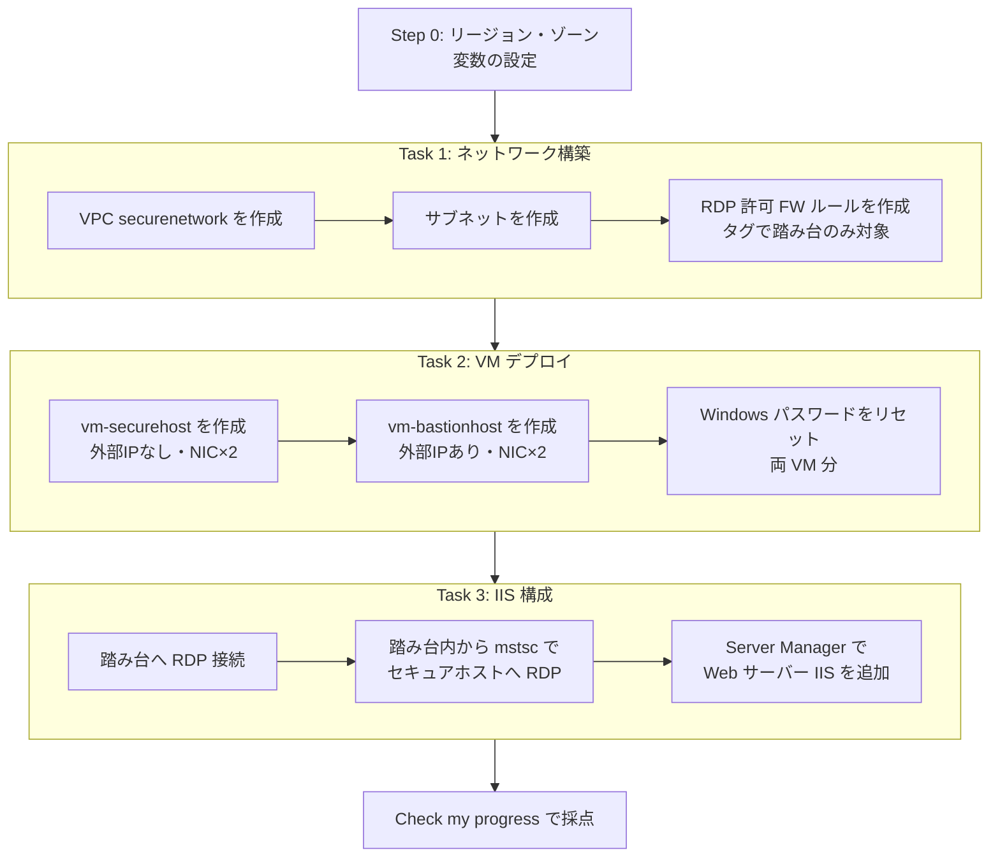

---

## 5. Step 0：準備（リージョン・ゾーンの設定）

ラボの画面左側に **リージョン** と **ゾーン** が表示されています。Cloud Shell を開いて、環境変数に設定しておくとコマンドの打ち間違いを防げます。

### 5.1 Cloud Shell を開く

1. Google Cloud コンソール右上の **Cloud Shell をアクティブにする**（`>_` アイコン）をクリック
2. 認証の確認が出たら **承認** をクリック

### 5.2 変数を設定する

> 以下の `REGION_VALUE` と `ZONE_VALUE` は、**ラボ画面に表示されている値** に必ず置き換えてください。

```bash
export REGION="REGION_VALUE"     # 例: us-central1 ※ラボ画面の値を使う
export ZONE="ZONE_VALUE"         # 例: us-central1-a ※ラボ画面の値を使う

gcloud config set compute/region $REGION
gcloud config set compute/zone $ZONE
```

### 5.3 設定確認

```bash
gcloud config list
```

| 確認項目 | 期待する結果 |
|---|---|
| `region` | ラボ指定のリージョン |
| `zone` | ラボ指定のゾーン |

> 💡 **なぜ変数にするのか**: ラボごとに地域が異なるため、値を 1 か所で管理すれば **コピペだけで再利用** できます。ベストプラクティスとしても、設定値のハードコードは避けます。

---

## 6. Task 1：VPC ネットワーク・サブネット・ファイアウォールルール

### 6.1 VPC ネットワーク `securenetwork` の作成

#### 6.1.1 考え方：自動モード vs カスタムモード

| 項目 | 自動モード | カスタムモード |
|---|---|---|
| サブネット作成 | 全リージョンに自動作成 | **自分で作成** |
| IP 範囲 | Google が決める（10.128.0.0/9 内） | **自分で設計** |
| 本番推奨 | 非推奨 | **推奨** |
| 今回の選択 | ❌ | ✅ |

> 🔑 **ベストプラクティス**: 本番環境では **カスタムモード** を使います。使うリージョンだけにサブネットを作り、IP 設計を意図的に管理できるためです。

#### 6.1.2 コンソールでの手順

1. ナビゲーションメニュー（≡）→ **VPC ネットワーク** → **VPC ネットワーク**
2. **VPC ネットワークを作成** をクリック
3. 以下を入力

| 項目 | 設定値 |
|---|---|
| 名前 | `securenetwork` |
| サブネット作成モード | **カスタム** |

#### 6.1.3 gcloud コマンドでの手順

```bash
gcloud compute networks create securenetwork \
  --subnet-mode=custom
```

| オプション | 意味 |
|---|---|
| `securenetwork` | 作成するネットワーク名（ラボ指定） |
| `--subnet-mode=custom` | カスタムモードで作成 |

### 6.2 サブネットの作成

#### 6.2.1 IP 範囲の決め方

| 検討ポイント | 内容 |
|---|---|
| default VPC との重複 | **重複不可**。default は `10.128.0.0/9` 内を使うため、`10.0.0.0/24` は安全 |
| 規模 | VM は数台なので `/24`（約 250 台分）で十分 |
| 予約アドレス | 各サブネットで先頭 2 つと末尾 2 つの計 4 アドレスは Google が予約 |

#### 6.2.2 コンソールでの手順

1. 作成した `securenetwork` をクリック → **サブネットを追加**（または作成画面の「新しいサブネット」）
2. 以下を入力

| 項目 | 設定値 |
|---|---|
| 名前 | `secure-subnet` |
| リージョン | **ラボ指定のリージョン** |
| IP スタックタイプ | IPv4 |
| IPv4 範囲 | `10.0.0.0/24` |

#### 6.2.3 gcloud コマンドでの手順

```bash
gcloud compute networks subnets create secure-subnet \
  --network=securenetwork \
  --region=$REGION \
  --range=10.0.0.0/24
```

#### 6.2.4 確認

```bash
gcloud compute networks subnets list --network=securenetwork
```

### 6.3 ファイアウォールルールの作成（RDP 許可）

#### 6.3.1 要件の整理

> 「**インターネットから** 踏み台ホストへの **RDP（TCP 3389）のみ** を許可。ルールは **ネットワークタグ** で適切なホストに適用する」

| 要素 | 設定値 | 理由 |
|---|---|---|
| ネットワーク | `securenetwork` | 作成した VPC に適用 |
| 方向 | **Ingress（受信）** | 外から入ってくる通信 |
| アクション | **許可** | |
| ターゲット | **指定されたターゲットタグ** `bastion` | 踏み台だけに適用し、セキュアホストには適用しない |
| ソース IPv4 範囲 | `0.0.0.0/0` | ラボでは全許可（本番は後述の通り絞る） |
| プロトコル/ポート | **TCP: 3389** | RDP |

#### 6.3.2 ここが最重要ポイント：なぜタグを使うのか

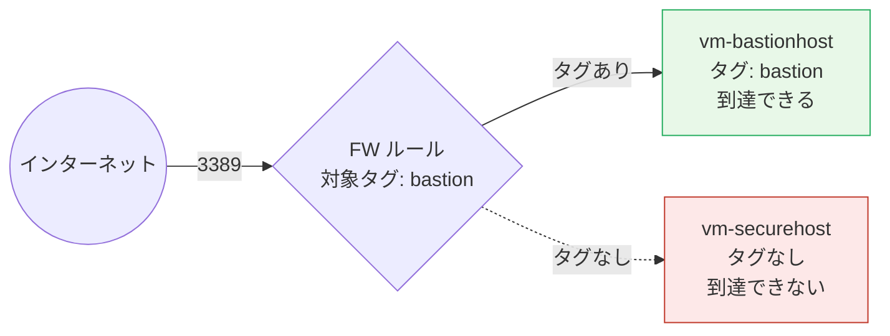

タグを使わず「ネットワーク内のすべてのインスタンス」にすると、セキュアホストにも許可ルールが適用されてしまいます。**最小権限の原則** に従い、必要な VM だけにタグで絞ります。

#### 6.3.3 コンソールでの手順

1. **VPC ネットワーク** → **ファイアウォール** → **ファイアウォール ルールを作成**
2. 以下を入力

| 項目 | 設定値 |
|---|---|
| 名前 | `allow-rdp-bastion` |
| ネットワーク | `securenetwork` |
| トラフィックの方向 | 上り（Ingress） |
| 一致したときのアクション | 許可 |
| ターゲット | 指定されたターゲットタグ |
| ターゲットタグ | `bastion` |
| ソースフィルタ | IPv4 範囲 |
| ソース IPv4 範囲 | `0.0.0.0/0` |
| プロトコルとポート | 指定したプロトコルとポート → **TCP** にチェック → `3389` |

#### 6.3.4 gcloud コマンドでの手順

```bash
gcloud compute firewall-rules create allow-rdp-bastion \
  --network=securenetwork \
  --direction=INGRESS \
  --action=ALLOW \
  --rules=tcp:3389 \
  --source-ranges=0.0.0.0/0 \
  --target-tags=bastion
```

| オプション | 意味 |
|---|---|
| `--direction=INGRESS` | 受信ルール |
| `--action=ALLOW` | 許可 |
| `--rules=tcp:3389` | TCP 3389（RDP）のみ |
| `--source-ranges=0.0.0.0/0` | 全 IPv4 から（ラボ用） |
| `--target-tags=bastion` | `bastion` タグを持つ VM にだけ適用 |

> ⚠️ **タグ名は一字一句同じに**: ここで `bastion` と決めたら、Task 2 で踏み台を作るときにも `bastion` を付けます。**タグが一致しないとルールが効かず RDP できません。**

#### 6.3.5 Task 1 の採点

**Check my progress** を 3 回（VPC、サブネット、FW ルール）クリックして確認します。

---

## 7. Task 2：Windows インスタンスのデプロイとパスワード設定

### 7.1 事前に理解：マルチ NIC の考え方

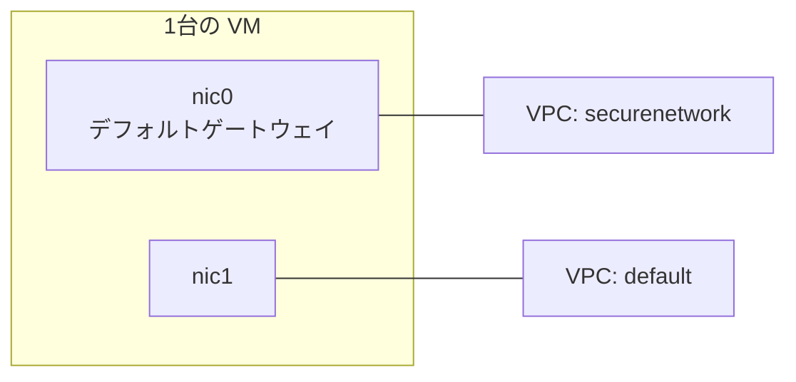

| ルール | 内容 |
|---|---|
| NIC の数 | 1 台に複数持たせられる（マシンタイプにより上限あり） |
| NIC と VPC | **1 NIC = 1 VPC**。同じ VPC に複数の NIC は接続できない |
| 作成タイミング | **VM 作成時にのみ** 追加可能（後から NIC を追加できない） |
| 最初の NIC | nic0 がデフォルトルートを持つ |

> 💡 **なぜ後から追加できないのか**: 構成ミスの手戻りが大きいため、**作成時の NIC 設計が重要** です。このラボでも作成コマンドを間違えると作り直しになります。

### 7.2 セキュアサーバー `vm-securehost` の作成

#### 7.2.1 要件

| 項目 | 設定値 |
|---|---|
| 名前 | `vm-securehost` |
| ゾーン | ラボ指定のゾーン |
| OS | Windows Server 2016 **Datacenter**（Desktop Experience） |
| nic0 | `securenetwork` / `secure-subnet`、**外部 IP: なし** |
| nic1 | `default` / default サブネット、**外部 IP: なし** |

#### 7.2.2 コンソールでの手順

1. **Compute Engine** → **VM インスタンス** → **インスタンスを作成**
2. **基本設定**

| 項目 | 設定値 |
|---|---|
| 名前 | `vm-securehost` |
| リージョン / ゾーン | ラボ指定の値 |
| マシンタイプ | `e2-standard-2` 程度（Windows は 2 vCPU 以上を推奨） |

3. **OS とストレージ** → **変更**

| 項目 | 設定値 |
|---|---|
| オペレーティング システム | **Windows Server** |
| バージョン | **Windows Server 2016 Datacenter**（Desktop Experience が付くもの。Core ではない） |
| ブートディスクのサイズ | 50 GB 以上 |

4. **ネットワーキング** → **ネットワーク インターフェース** → **デフォルトを編集**

   - **nic0（1つ目）**: ネットワーク `securenetwork`、サブネット `secure-subnet`、**外部 IPv4 アドレス: なし**
   - **ネットワーク インターフェースを追加** → **nic1（2つ目）**: ネットワーク `default`、サブネットは default のもの、**外部 IPv4 アドレス: なし**

5. **作成** をクリック

#### 7.2.3 gcloud コマンドでの手順

```bash
gcloud compute instances create vm-securehost \
  --zone=$ZONE \
  --machine-type=e2-standard-2 \
  --image-family=windows-2016 \
  --image-project=windows-cloud \
  --boot-disk-size=50GB \
  --network-interface=network=securenetwork,subnet=secure-subnet,no-address \
  --network-interface=network=default,no-address
```

| オプション | 意味 |
|---|---|
| `--image-family=windows-2016` | Windows Server 2016 Datacenter（Desktop Experience） |
| `--image-project=windows-cloud` | Google 提供の Windows イメージ置き場 |
| `--network-interface=...,no-address`（1つ目） | securenetwork に接続し、**外部 IP を付けない** |
| `--network-interface=network=default,no-address`（2つ目） | default に接続し、**外部 IP を付けない** |

> 🔑 **最重要**: `no-address` が「インターネットから隔離される」ことの実体です。**外部 IP がなければ、インターネットから直接到達できず、インターネットへ直接接続もできません。**
>
> ⚠️ **イメージ名について**: ラボ環境や時期によってイメージファミリー名が異なる場合があります。エラーが出たら `gcloud compute images list --filter="family~windows-2016"` で確認してください。

### 7.3 踏み台ホスト `vm-bastionhost` の作成

#### 7.3.1 要件

| 項目 | 設定値 |
|---|---|
| 名前 | `vm-bastionhost` |
| ゾーン | ラボ指定のゾーン |
| OS | Windows Server 2016 Datacenter（Desktop Experience） |
| nic0 | `securenetwork` / `secure-subnet`、**外部 IP: エフェメラル** |
| nic1 | `default`、**外部 IP: なし** |
| ネットワークタグ | `bastion`（Task 1 の FW ルールと一致させる） |

#### 7.3.2 外部 IP の種類

| 種類 | 特徴 | 今回 |
|---|---|---|
| **エフェメラル** | VM に一時的に割り当て。停止/削除で解放 | ✅ ラボ指定 |
| **静的** | 予約して固定。課金に注意 | 本番では検討 |
| **なし** | 内部専用 | nic1 |

#### 7.3.3 コンソールでの手順

セキュアホストとほぼ同じ手順で、以下だけ変更します。

| 項目 | 設定値 |
|---|---|
| 名前 | `vm-bastionhost` |
| ネットワーキング → ネットワーク タグ | `bastion` |
| nic0 の外部 IPv4 アドレス | **エフェメラル** |
| nic1（default）の外部 IPv4 アドレス | **なし** |

> 💡 ネットワークタグは **ネットワーキング** セクションの「ネットワーク タグ」欄に入力します。

#### 7.3.4 gcloud コマンドでの手順

```bash
gcloud compute instances create vm-bastionhost \
  --zone=$ZONE \
  --machine-type=e2-standard-2 \
  --image-family=windows-2016 \
  --image-project=windows-cloud \
  --boot-disk-size=50GB \
  --tags=bastion \
  --network-interface=network=securenetwork,subnet=secure-subnet \
  --network-interface=network=default,no-address
```

| 違い | 内容 |
|---|---|
| `--tags=bastion` | FW ルールの対象になるためのタグ |
| 1つ目の NIC に `no-address` がない | 既定で **エフェメラル外部 IP** が付く |
| 2つ目の NIC は `no-address` | default 側は内部専用 |

### 7.4 作成結果の確認

```bash
gcloud compute instances list --filter="name~vm-"
```

| 確認項目 | `vm-securehost` | `vm-bastionhost` |
|---|---|---|
| 内部 IP | 2 つ（`10.0.0.x` と `10.128.x.x`） | 2 つ |
| 外部 IP | **なし** | **1 つだけ** |

**Check my progress** を 2 回（セキュアホスト、踏み台）クリックします。

### 7.5 Windows パスワードのリセット

Windows VM には初期状態で使えるパスワードがありません。**パスワードをリセットして、ユーザー名とパスワードを発行** します。

#### 7.5.1 起動完了まで待つ

Windows は初回起動に数分かかります。早すぎるとリセットに失敗します。

```bash
gcloud compute instances get-serial-port-output vm-bastionhost --zone=$ZONE | tail -n 5
```

`Instance setup finished. vm-bastionhost is ready to use.` のような表示が出ればリセット可能です。

#### 7.5.2 gcloud コマンドでの手順

```bash
gcloud compute reset-windows-password vm-bastionhost \
  --user app_admin \
  --zone=$ZONE
```

```bash
gcloud compute reset-windows-password vm-securehost \
  --user app_admin \
  --zone=$ZONE
```

実行すると確認が出るので `Y` を入力します。出力例（値は毎回異なります）:

```text
ip_address: 34.xx.xx.xx
password:   xxxxxxxxxxxxxxx
username:   app_admin
```

#### 7.5.3 注意点

| 注意 | 内容 |
|---|---|
| **メモを取る** | ユーザー名とパスワードを **両方のサーバー分** 控える（後で必ず使う） |
| **パスワードは別々** | 2 台のパスワードは異なる。取り違えに注意 |
| ユーザー名 | 問題文は `app-admin` と `app_admin` の表記が混在。**コマンド例の `app_admin`** を使えばよい |
| `vm-securehost` の ip_address | 外部 IP がないため空欄や内部 IP になる場合がある。問題なし |

#### 7.5.4 コンソールから行う場合

1. **VM インスタンス** 一覧で対象 VM の右端メニュー → **Windows パスワードを設定**
2. ユーザー名に `app_admin` と入力 → **設定**
3. 表示されたパスワードをコピーして保存（この画面を閉じると再表示できない）

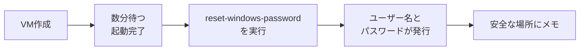

---

## 8. Task 3：踏み台経由でセキュアホストに接続し IIS を構成

### 8.1 接続の全体像

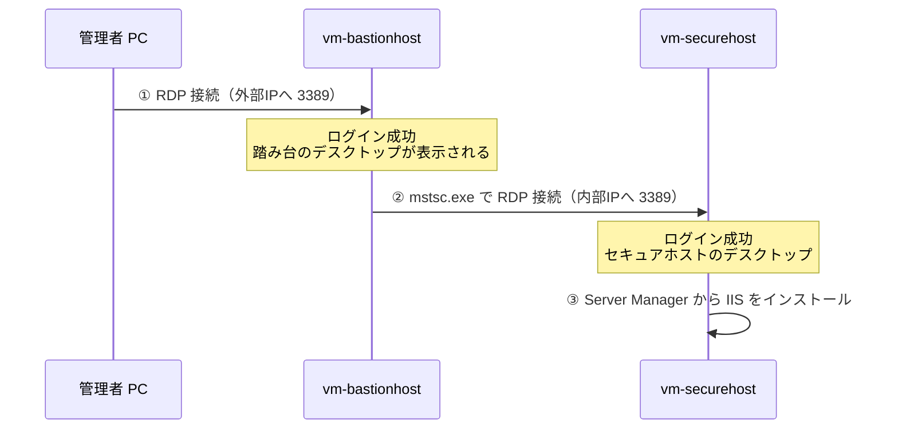

### 8.2 手順 1：踏み台ホストへ RDP 接続

#### 8.2.1 接続情報の確認

```bash
gcloud compute instances describe vm-bastionhost --zone=$ZONE \
  --format="get(networkInterfaces[0].accessConfigs[0].natIP)"
```

#### 8.2.2 コンソールからの接続

1. **VM インスタンス** 一覧で `vm-bastionhost` の **RDP** ボタンをクリック
2. 以下のいずれかを選択

| 方法 | 内容 |
|---|---|
| **Chrome RDP 拡張機能** | ブラウザ内で接続（拡張機能インストールが必要な場合あり） |
| **RDP ファイルをダウンロード** | `.rdp` ファイルを開いて Windows のリモートデスクトップで接続 |

3. ユーザー名 `app_admin` と **vm-bastionhost 用パスワード** を入力
4. 証明書の警告が出たら **はい** で続行（ラボ環境のため）

> ⚠️ **接続先は外部 IP**: 踏み台の **外部（パブリック）IP** に接続します。内部 IP では接続できません。

### 8.3 手順 2：踏み台の中からセキュアホストへ RDP

#### 8.3.1 セキュアホストの内部 IP を確認

**Cloud Shell で確認する場合**:

```bash
gcloud compute instances describe vm-securehost --zone=$ZONE \
  --format="get(networkInterfaces[1].networkIP)"
```

→ `default` VPC に接続した nic1 の内部 IP（`10.128.x.x` のような値）が表示されます。8.3.3 のとおり踏み台からの RDP は `default` 側の内部通信で成立するため、nic0（`securenetwork` 側の `10.0.0.x`）ではなく nic1 の IP を使います。コンソールの VM 一覧の「内部 IP」列でも確認できます（`default` ネットワーク側の値を選びます）。

#### 8.3.2 踏み台内での操作

1. 踏み台の Windows で **スタート** を右クリック → **ファイル名を指定して実行**（または Windows キー + R）
2. `mstsc.exe` と入力して **OK**（スタートメニューから「リモート デスクトップ接続」を検索してもよい）
3. **コンピューター** 欄に **vm-securehost の nic1（default）の内部 IP**（例: `10.128.0.3`）を入力 → **接続**
4. 資格情報の入力画面で以下を入力

| 項目 | 値 |
|---|---|
| ユーザー名 | `app_admin` |
| パスワード | **vm-securehost 用パスワード**（踏み台のものとは別） |

5. 証明書の警告は **はい**

#### 8.3.3 なぜこの接続が成立するのか

| 通信 | 経路 | 許可している設定 |
|---|---|---|
| 管理者 PC → 踏み台 | インターネット → 外部 IP | `allow-rdp-bastion`（securenetwork） |
| 踏み台 → セキュアホスト | VPC 内の内部通信 | 下記の説明 |

> 🔑 **補足（重要）**: 受信はデフォルトで全拒否なので、`securenetwork` 側にはセキュアホストへの許可ルールがありません。一方、**`default` VPC には `default-allow-internal`（内部通信を全許可）が最初から存在**します。両 VM は nic1 で `default` に接続されているため、**踏み台からセキュアホストへの RDP は default 側の内部通信で成立**します。これが「全 VM に default VPC への第2 NIC を付ける」要件が、結果的に管理経路としても機能する理由です。
>
> ただし、この構成は「default 側のルールに依存している」ともいえます。意図を明示するには、11 章の「RDP を内部だけに許可する FW ルール」を `securenetwork` に追加するのがよい設計です。

### 8.4 手順 3：IIS（Web サーバー）のインストール

セキュアホストにログインした状態で実施します。

#### 8.4.1 GUI で行う手順（ラボの指示どおり）

1. **サーバー マネージャー** が自動で開く（開かない場合はスタートメニューから起動）
2. **ローカル サーバー**（Local Server）が選択されていることを確認
3. 右上の **管理** → **役割と機能の追加**
4. ウィザードを進める

| ウィザードの画面 | 操作 |
|---|---|
| 開始する前に | **次へ** |
| インストールの種類 | **役割ベースまたは機能ベースのインストール** を選択 → 次へ |
| 対象サーバーの選択 | ローカルサーバーが選択された状態で → 次へ |
| サーバーの役割 | **Web サーバー (IIS)** にチェック |
| 機能の追加ダイアログ | **機能の追加** をクリック（管理ツールを含める） |
| 機能 / Web サーバー役割 / 役割サービス | 既定のまま **次へ** |
| インストールオプションの確認 | **インストール** |

5. 進行状況が **インストールが正常に完了しました** になれば成功 → **閉じる**

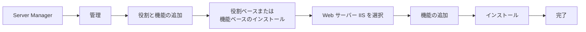

#### 8.4.2 PowerShell で行う方法（時短・再現性が高い）

セキュアホスト上で **PowerShell を管理者として実行** し、以下を入力します。

```powershell
Install-WindowsFeature -Name Web-Server -IncludeManagementTools
```

| 要素 | 意味 |
|---|---|
| `Install-WindowsFeature` | Windows の役割・機能を追加するコマンド |
| `-Name Web-Server` | IIS の役割名 |
| `-IncludeManagementTools` | IIS マネージャーなど管理ツールも導入 |

結果の `Success` が `True` になっていれば完了です。

> 💡 **ベストプラクティス**: GUI は学習に向きますが、本番では **PowerShell やスタートアップスクリプト、イメージの事前構築** で自動化し、手作業を排除します。

#### 8.4.3 インストール確認

セキュアホスト上のブラウザで `http://localhost` を開き、**IIS のウェルカムページ** が表示されれば OK です。

```powershell
Get-WindowsFeature -Name Web-Server
```

`Install State` が `Installed` になっていれば成功です。

**Check my progress**（Configure the IIS web server software）をクリックして採点します。

---

## 9. 検証：うまくいったか確認する

### 9.1 隔離の検証

| 検証 | 方法 | 期待結果 |
|---|---|---|
| セキュアホストに外部 IP がない | `gcloud compute instances list` の外部 IP 列 | **空** |
| セキュアホストにインターネットから直接 RDP できない | 外部 IP がないため接続先が存在しない | 接続不可 |
| セキュアホストからインターネットへ出られない | セキュアホスト上のブラウザで外部サイトを開く | **開けない** |
| 踏み台だけ RDP 可能 | 踏み台の外部 IP に RDP | 接続成功 |

### 9.2 NIC 構成の検証

```bash
gcloud compute instances describe vm-securehost --zone=$ZONE \
  --format="table(networkInterfaces[].network.basename(),networkInterfaces[].networkIP)"
```

| 期待結果 |
|---|
| `securenetwork` と `default` の 2 つの NIC が表示される |

### 9.3 FW ルールの検証

```bash
gcloud compute firewall-rules list --filter="network:securenetwork"
```

---

## 10. トラブルシューティング

### 10.1 症状別の対処表

| 症状 | 想定原因 | 対処 |
|---|---|---|
| 踏み台に RDP できない | 内部 IP に接続している | **外部 IP** に接続する |
| 同上 | FW ルールの対象タグと VM のタグが不一致 | VM の `bastion` タグとルールの `bastion` を確認 |
| 同上 | ルールの Ingress / TCP 3389 / ソース範囲の誤り | `0.0.0.0/0`、`tcp:3389` を確認 |
| 同上 | 自分のネットワークが外向き 3389 を遮断 | 別ネットワーク（スマホテザリング等）で試す |
| 踏み台からセキュアホストに RDP できない | 両 VM が同じ VPC に接続されていない | NIC 構成を確認（nic1 の default が両方に必要） |
| 同上 | 内部 IP の入力ミス | `gcloud compute instances describe` で再確認 |
| パスワードリセットに失敗する | 起動直後で Windows の初期設定が未完了 | 数分待ち、シリアル出力で完了を確認して再実行 |
| 認証に失敗する | 2 台のパスワードを取り違えた | 各 VM 用パスワードを再確認。必要ならもう一度リセット |
| 外部 IP が付いてしまった | `no-address` の付け忘れ | VM を削除して作り直す（または nic の外部 IP を削除） |
| NIC が追加できない | NIC は作成後に追加不可 | VM を削除して再作成 |
| default ネットワークが見つからない | ラボ環境で削除されている | ラボ環境を確認（通常は存在する） |

### 10.2 診断の考え方

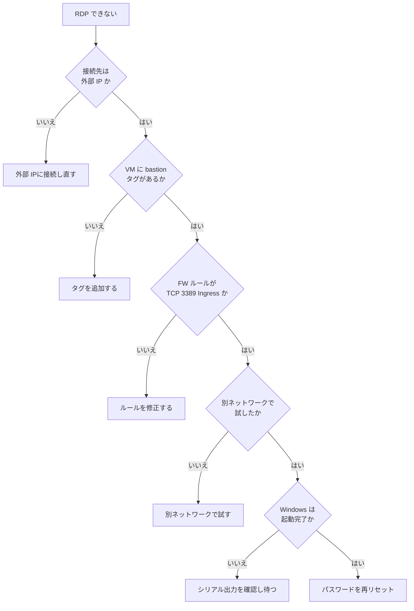

### 10.3 便利な診断コマンド

```bash
# VM のタグと NIC を確認
gcloud compute instances describe vm-bastionhost --zone=$ZONE \
  --format="yaml(tags,networkInterfaces)"

# FW ルールの詳細
gcloud compute firewall-rules describe allow-rdp-bastion
```

---

## 11. ベストプラクティスと本番環境での発展

ラボは「学習用に簡略化」されています。本番ではさらに以下を検討します。

### 11.1 ラボと本番の違い

| 項目 | このラボ | 本番でのベストプラクティス |
|---|---|---|
| RDP のソース範囲 | `0.0.0.0/0` | **社内 IP / VPN の範囲のみ** |
| 踏み台への接続方式 | 外部 IP + RDP | **IAP（Identity-Aware Proxy）TCP 転送**（外部 IP 不要） |
| 認証 | パスワード | **Windows 認証 + 多要素認証**、IAM で制御 |
| インターネット送信 | 外部 IP なしで遮断 | **Cloud NAT + Egress FW ルール** で許可先を限定 |
| OS 管理 | 手動パッチ | **VM Manager（OS パッチ管理）** |
| 監視・監査 | 簡易 | **Cloud Logging、VPC フローログ、FW ルールロギング** |
| VM 保護 | 既定 | **Shielded VM** を有効化 |
| 構成管理 | 手作業 | **Terraform** などの IaC |

### 11.2 追加推奨：securenetwork 内の RDP を明示的に許可（最小限）

「踏み台はセキュアホストと RDP のみ通信」を `securenetwork` 側でも明示する場合の例です（任意）。まずセキュアホストにネットワークタグ `securehost` を付与し、そのうえで送信元を `bastion` タグ、宛先を `securehost` タグに限定したルールを作成します。

```bash
# セキュアホストにルールの適用対象となるタグを付与する
gcloud compute instances add-tags vm-securehost \
  --zone=$ZONE \
  --tags=securehost

# bastion タグの VM から securehost タグの VM への TCP 3389 だけを許可する
gcloud compute firewall-rules create allow-rdp-internal \
  --network=securenetwork \
  --direction=INGRESS \
  --action=ALLOW \
  --rules=tcp:3389 \
  --source-tags=bastion \
  --target-tags=securehost
```

| 項目 | 内容 |
|---|---|
| ソース | タグ `bastion` を持つ VM（踏み台）のみ |
| ターゲット | タグ `securehost` を持つ VM（セキュアホスト）のみ |
| 効果 | 内部経路でも RDP（3389）以外は許可しない設計を明示できる |

### 11.3 追加推奨：IAP TCP 転送（外部 IP すら不要）

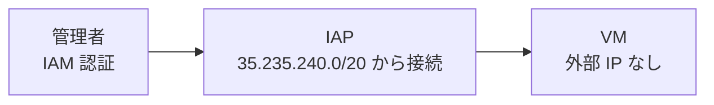

| 要素 | 内容 |
|---|---|
| FW ルール | ソース `35.235.240.0/20`（IAP の範囲）から TCP 3389 を許可 |
| 必要な IAM 権限 | `roles/iap.tunnelResourceAccessor` |
| メリット | 踏み台自体が不要になる場合もある。IAM とログで統制できる |

> 📘 試験・実務では「**踏み台 vs IAP**」の比較が頻出です。IAP は外部 IP が不要で、IAM に基づく認可と監査ログが得られる点が強みです。

### 11.4 セキュリティ観点まとめ

| 原則 | このラボでの具体例 |
|---|---|
| **最小権限** | FW ルールをタグで踏み台のみに限定 |
| **攻撃面の最小化** | 外部 IP を持つのは踏み台 1 台のみ |
| **多層防御** | ネットワーク隔離 + FW + OS 認証 |
| **職務分離** | 管理用経路（踏み台）と業務用サーバーを分ける |
| **監視の分離** | 監視は default VPC の別経路で実施 |

---

## 12. PCA 試験との関連ポイント

| 出題テーマ | このラボとの関係 | 押さえるポイント |
|---|---|---|
| VPC 設計 | カスタムモード VPC | 本番はカスタムモード、IP 設計は重複回避 |
| FW ルール設計 | タグベースのルール | **ネットワークタグ vs サービスアカウント**（サービスアカウントの方が安全で推奨） |
| 暗黙のルール | 受信拒否 / 送信許可 | 優先度（0〜65535、小さいほど優先） |
| マルチ NIC | 監視用ネットワーク接続 | 1 NIC = 1 VPC、作成時のみ指定可能 |
| 外部 IP の制御 | 隔離サーバー | 組織ポリシー `constraints/compute.vmExternalIpAccess` で外部 IP を禁止 |
| 安全なリモート管理 | 踏み台 | **IAP TCP 転送** が推奨される場面が多い |
| 外向き通信 | 隔離サーバーのアップデート | **Cloud NAT** を使えば外部 IP なしで外向き通信できる |
| 限定的なアクセス | Google API への接続 | **限定公開の Google アクセス** |

### 12.1 タグ vs サービスアカウント

| 比較軸 | ネットワークタグ | サービスアカウント |
|---|---|---|
| 設定の容易さ | ◎ 簡単 | ○ |
| 変更の統制 | △ VM の編集権限があれば誰でも付け外し可能 | ◎ IAM で統制 |
| セキュリティ | △ | ◎ |
| 本ラボ | ✅ 指示どおり使用 | 本番では優先検討 |

---

## 13. コマンド一括まとめ（コピペ用）

> ⚠️ `REGION_VALUE` / `ZONE_VALUE` は **ラボ画面の値に置き換え** てください。

```bash
# ===== Step 0: 変数設定 =====
export REGION="REGION_VALUE"
export ZONE="ZONE_VALUE"
gcloud config set compute/region $REGION
gcloud config set compute/zone $ZONE

# ===== Task 1: ネットワーク =====
gcloud compute networks create securenetwork --subnet-mode=custom

gcloud compute networks subnets create secure-subnet \
  --network=securenetwork \
  --region=$REGION \
  --range=10.0.0.0/24

gcloud compute firewall-rules create allow-rdp-bastion \
  --network=securenetwork \
  --direction=INGRESS \
  --action=ALLOW \
  --rules=tcp:3389 \
  --source-ranges=0.0.0.0/0 \
  --target-tags=bastion

# ===== Task 2: VM =====
gcloud compute instances create vm-securehost \
  --zone=$ZONE \
  --machine-type=e2-standard-2 \
  --image-family=windows-2016 \
  --image-project=windows-cloud \
  --boot-disk-size=50GB \
  --network-interface=network=securenetwork,subnet=secure-subnet,no-address \
  --network-interface=network=default,no-address

gcloud compute instances create vm-bastionhost \
  --zone=$ZONE \
  --machine-type=e2-standard-2 \
  --image-family=windows-2016 \
  --image-project=windows-cloud \
  --boot-disk-size=50GB \
  --tags=bastion \
  --network-interface=network=securenetwork,subnet=secure-subnet \
  --network-interface=network=default,no-address

# ===== 数分待ってからパスワードリセット =====
gcloud compute reset-windows-password vm-bastionhost --user app_admin --zone=$ZONE
gcloud compute reset-windows-password vm-securehost --user app_admin --zone=$ZONE
```

セキュアホスト上（踏み台経由で接続後、PowerShell 管理者）:

```powershell
Install-WindowsFeature -Name Web-Server -IncludeManagementTools
```

---

## 14. チェックリスト

### 14.1 作業チェック

| # | 項目 | 確認 |
|---|---|---|
| 1 | リージョン・ゾーンの変数を設定した | ☐ |
| 2 | `securenetwork` をカスタムモードで作成した | ☐ |
| 3 | サブネットを指定リージョンに作成した | ☐ |
| 4 | RDP 許可 FW ルール（Ingress / TCP 3389 / タグ対象）を作成した | ☐ |
| 5 | `vm-securehost` を作成した（NIC×2、外部 IP なし） | ☐ |
| 6 | `vm-bastionhost` を作成した（NIC×2、nic0 のみ外部 IP、タグ `bastion`） | ☐ |
| 7 | 両 VM のパスワードをリセットし、別々にメモした | ☐ |
| 8 | 踏み台に外部 IP で RDP 接続できた | ☐ |
| 9 | 踏み台内の `mstsc.exe` でセキュアホストに接続できた | ☐ |
| 10 | IIS（Web サーバー）をインストールした | ☐ |
| 11 | 各 **Check my progress** で緑のチェックを確認した | ☐ |

### 14.2 採点ポイントと対応表

| 採点項目 | 対応する作業 | よくある失敗 |
|---|---|---|
| Create the VPC network | 6.1 | 自動モードで作成してしまう |
| Create the VPC subnet | 6.2 | リージョンの指定ミス |
| Create the firewall rule | 6.3 | タグ未指定、ポート誤り |
| Create the vm-securehost instance | 7.2 | 外部 IP が付く、NIC が 1 つ |
| Create the vm-bastionhost instance | 7.3 | タグの付け忘れ、default 側にも外部 IP |
| Configure the IIS web server software | 8.4 | 踏み台に入れてしまった（**セキュアホスト**に入れる） |

### 14.3 補足：問題文の「キータスク」について

> 問題文の冒頭「Tasks」一覧には「**スタートアップスクリプトを指す VM の作成**」と「**HTTP アクセス許可のファイアウォールルール**」が含まれていますが、詳細な Task 1〜3 には対応する手順がなく、採点項目にも含まれていません。別ラボの文面が残っている可能性が高く、**詳細手順（Task 1〜3）に従えば 100% に到達できます**。もし HTTP でのアクセス確認をしたい場合は、次のようなルールを任意で追加できます（採点対象外）。
>
> ```bash
> gcloud compute firewall-rules create allow-http-secure \
>   --network=securenetwork \
>   --direction=INGRESS \
>   --action=ALLOW \
>   --rules=tcp:80 \
>   --source-ranges=10.0.0.0/24
> ```
>
> ただし「本番サーバーは当初インターネットから完全に隔離」という要件に反しないよう、ソースは内部範囲に限定しています。

---

## まとめ

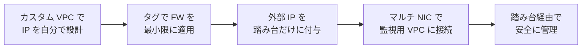

| キーワード | 一言でいうと |
|---|---|
| **隔離** | 外部 IP を付けない |
| **踏み台** | 唯一の入口を 1 台に絞る |
| **タグ** | ルールの適用先を絞る道具 |
| **マルチ NIC** | 1 VM を複数 VPC に接続（作成時のみ） |
| **最小権限** | 必要な通信だけを許可する |
