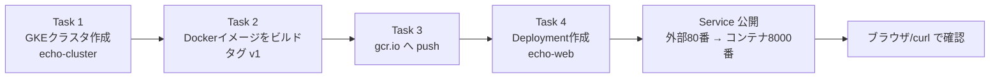
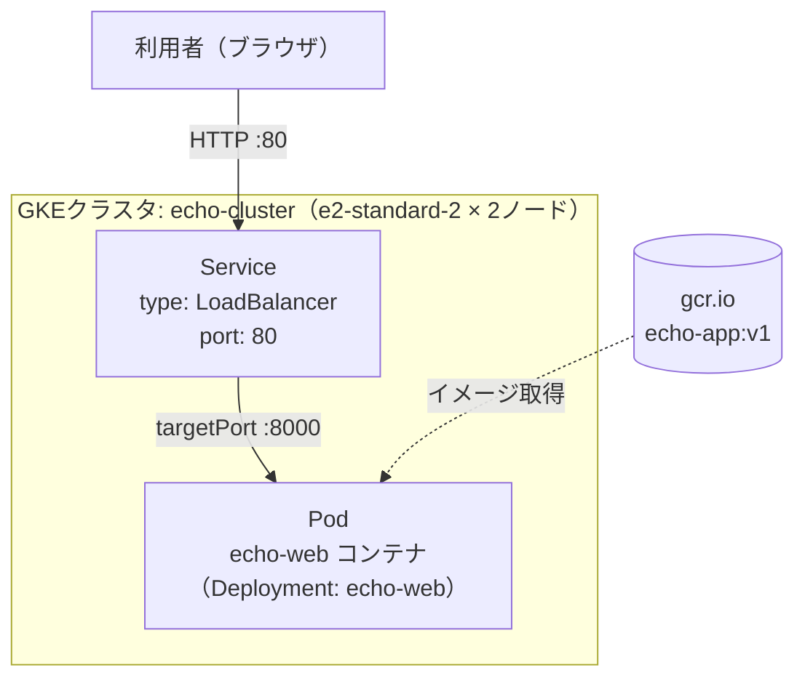
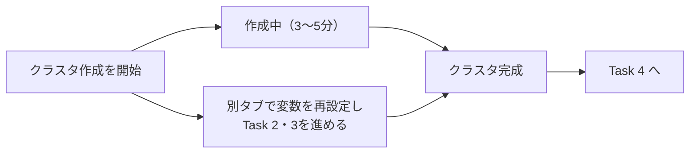
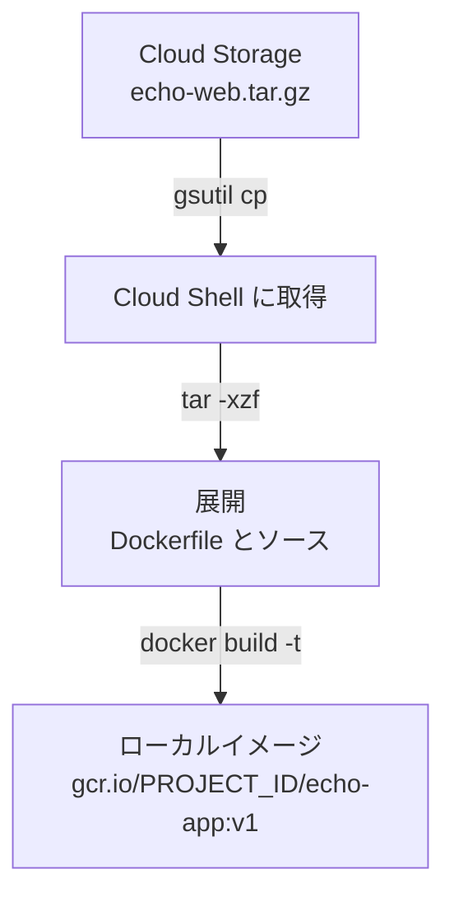
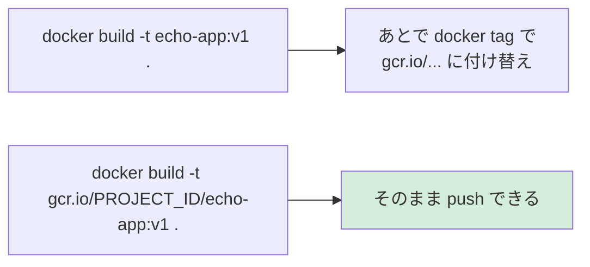
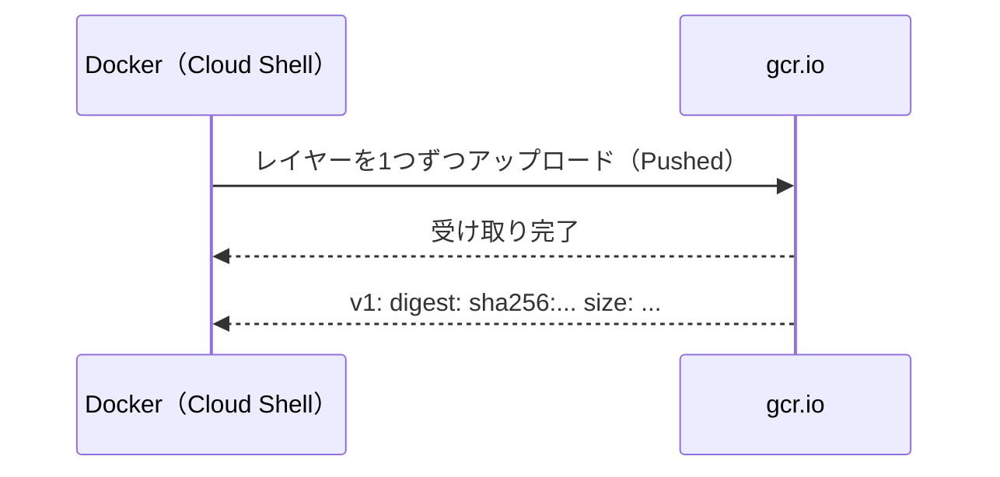
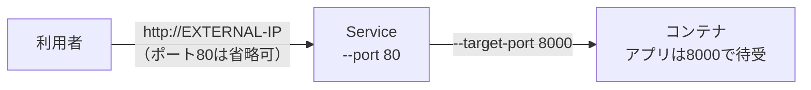
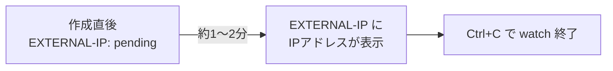
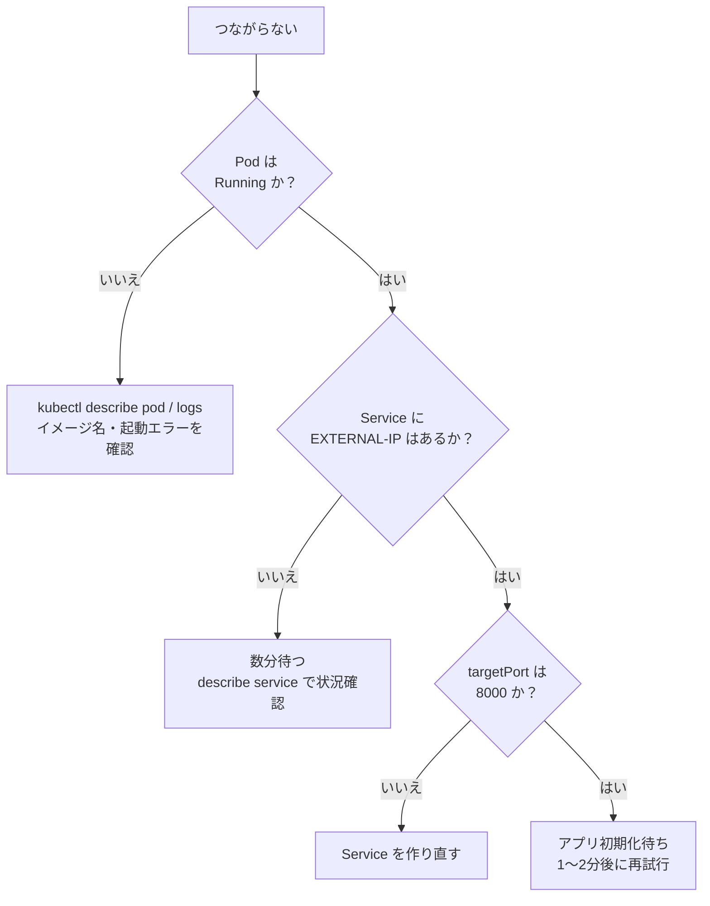

# Google Cloud チャレンジラボ解説ガイド

## コンテナイメージのビルド・push と GKE へのデプロイ（echo-web）

> **対象読者**: Docker・Kubernetes・Google Cloud を初めて触る方
> **関連資格**: Google Cloud Professional Cloud Architect（PCA）
> **所要時間の目安**: 慣れていない場合 30〜45 分（ノード起動待ちを含む）

---

## 目次

1. [このラボで何をするのか（全体像）](#1-このラボで何をするのか全体像)
2. [登場する用語を先に整理する](#2-登場する用語を先に整理する)
3. [事前準備（Cloud Shell と変数の設定）](#3-事前準備cloud-shell-と変数の設定)
4. [Task 1: Kubernetes クラスタを作成する](#4-task-1-kubernetes-クラスタを作成する)
5. [Task 2: タグ付き Docker イメージをビルドする](#5-task-2-タグ付き-docker-イメージをビルドする)
6. [Task 3: イメージを gcr.io に push する](#6-task-3-イメージを-gcrio-に-push-する)
7. [Task 4: アプリをクラスタにデプロイして公開する](#7-task-4-アプリをクラスタにデプロイして公開する)
8. [動作確認](#8-動作確認)
9. [トラブルシューティング](#9-トラブルシューティング)
10. [ベストプラクティス（実務・試験向け）](#10-ベストプラクティス実務試験向け)
11. [コマンド一括版（復習用）](#11-コマンド一括版復習用)
12. [クリーンアップ](#12-クリーンアップ)
13. [チェックリスト](#13-チェックリスト)

---

## 1. このラボで何をするのか（全体像）

開発チームから「Go 言語で作った `echo-web` というサンプルアプリを、コンテナ化して Kubernetes 上で動かせるか確認してほしい」と依頼された、というシナリオです。

**チャレンジラボの特徴**: 通常のラボと違い、**手順書は提示されません**。これまでのラボで学んだスキルを使って、自分でコマンドを組み立てます。そのため、本ガイドでは「なぜそのコマンドになるのか」まで解説します。

### 1-1. 作業の流れ



> **補足**: 公式の採点順は Task 1 → 3 → 4 ですが、Task 1（クラスタ作成）は数分かかるため、**先に作成を開始して待ち時間に Task 2・3 を進める**のが効率的です（後述）。

### 1-2. 最終的な構成



### 1-3. ラボの必須ネーミング（採点に影響）

採点システムは名前で確認します。**1文字でも違うと採点されません**。

| 対象 | 指定された名前・値 | 備考 |
|---|---|---|
| コンテナイメージ名 | `echo-app` | リポジトリ名として使用 |
| イメージタグ | `v1` | `latest` ではない |
| クラスタ名 | `echo-cluster` | |
| ゾーン | ラボ画面に表示された `ZONE` | **別ゾーンで作ると採点されない** |
| ノード | `e2-standard-2` を 2 台 | |
| Deployment 名 | `echo-web` | |
| Service の外部ポート | `80` | |
| アプリの待受ポート | `8000` | Dockerfile で設定済み |
| レジストリのホスト名 | `gcr.io` | 組織ルール |

---

## 2. 登場する用語を先に整理する

| 用語 | ひとことで言うと | このラボでの役割 |
|---|---|---|
| **コンテナ** | アプリと実行に必要なものをまとめた軽量な実行単位 | echo-web を動かす入れ物 |
| **Dockerfile** | イメージの作り方を書いたレシピ | アーカイブに同梱済み |
| **イメージ** | コンテナの設計図（読み取り専用） | `gcr.io/PROJECT_ID/echo-app:v1` |
| **タグ** | イメージのバージョン名札 | `v1` |
| **コンテナレジストリ** | イメージの保管庫 | `gcr.io` |
| **GKE** | Google が管理してくれる Kubernetes | `echo-cluster` |
| **クラスタ** | Kubernetes が動くマシン群 | ノード 2 台 |
| **ノード** | クラスタを構成する 1 台のVM | e2-standard-2 |
| **Pod** | Kubernetes が扱う最小単位（1つ以上のコンテナ） | echo-web が入る |
| **Deployment** | 「Pod を N 個、常に維持する」という宣言 | `echo-web` |
| **Service** | Pod への安定した入口（IP・ポート） | 外部公開用 LoadBalancer |
| **Cloud Shell** | ブラウザ上の作業用 Linux 環境 | docker・gcloud・kubectl 導入済み |

### 2-1. イメージ名の読み方

```text
gcr.io / my-project-123 / echo-app : v1
```

上の例は説明用の分解です。各部分の意味は次の表のとおりです。

| 部分 | 例 | 意味 |
|---|---|---|
| ホスト名 | `gcr.io` | どのレジストリか |
| プロジェクトID | `my-project-123` | どのプロジェクトの保管庫か |
| イメージ名 | `echo-app` | アプリの名前 |
| タグ | `v1` | バージョン |

> **重要**: `gcr.io/プロジェクトID/イメージ名:タグ` という**形式そのものが「どこに push するか」を決めます**。ホスト名やプロジェクトIDを間違えると push できません。

---

## 3. 事前準備（Cloud Shell と変数の設定）

### 3-1. Cloud Shell を開く

Google Cloud コンソール右上の **「Cloud Shell をアクティブにする」** ボタン（`>_` アイコン）をクリックします。

### 3-2. 認証とプロジェクトの確認

```bash
gcloud auth list
gcloud config list project
```

| 確認項目 | 期待する結果 |
|---|---|
| アカウント | ラボ用の `student-...@qwiklabs.net` が ACTIVE |
| プロジェクト | ラボ用プロジェクトIDが表示される |

### 3-3. 変数を設定する

何度も使う値は**環境変数にしておく**と、打ち間違いと再入力の手間を防げます。

```bash
# プロジェクトID（現在の設定から自動取得）
export PROJECT_ID=$(gcloud config get-value project)

# ゾーン: ラボ画面左側に表示されている ZONE の値を入れる
read -r -p "ラボ指定のゾーンを入力 (例: us-central1-a): " ZONE
export ZONE

# 確認
echo "PROJECT_ID=${PROJECT_ID}"
echo "ZONE=${ZONE}"
```

> **注意**: `ZONE` は `us-central1-a` のような形式の値です。**ラボ画面に表示されている値をそのままコピー**してください。例の値を使い回さないこと。

### 3-4. 必要な API を有効化（念のため）

ラボ環境では有効済みのことが多いですが、エラー時に備えて覚えておきましょう。

```bash
gcloud services enable container.googleapis.com
```

| API | 用途 |
|---|---|
| `container.googleapis.com` | GKE（クラスタの作成・管理） |

---

## 4. Task 1: Kubernetes クラスタを作成する

### 4-1. 要件

| 要件 | 値 |
|---|---|
| クラスタ名 | `echo-cluster` |
| ゾーン | ラボ指定の `ZONE` |
| ノード数 | 2 |
| マシンタイプ | `e2-standard-2` |

### 4-2. コマンド

```bash
gcloud container clusters create echo-cluster \
  --zone ${ZONE} \
  --num-nodes 2 \
  --machine-type e2-standard-2
```

### 4-3. オプションの解説

| オプション | 意味 | 間違えるとどうなる？ |
|---|---|---|
| `echo-cluster` | クラスタ名 | 採点されない |
| `--zone` | 作成する場所（**ゾーンクラスタ**） | 別ゾーンだと採点されない |
| `--num-nodes 2` | ゾーンあたりのノード数 | 多いとリソース上限に注意 |
| `--machine-type` | ノードのVMスペック（2 vCPU・8 GB） | 指定しないと既定タイプになる |

> **ポイント（ノード数の考え方）**: ゾーンクラスタでは `--num-nodes` は「**そのゾーンのノード数**」です。今回は 1 ゾーンなので合計 2 台になります。リージョンクラスタ（`--region`）で作ると**ゾーン数 × 2 台**になり、「2台まで」という制約を破ってしまうため注意してください。

### 4-4. 作成中の待ち時間を活用する

クラスタ作成には **約 3〜5 分**かかります。完了を待たずに進めたい場合は、`--async` を付けるか、**別の Cloud Shell タブ**を開いて Task 2 に進みます。

> **注意（別タブの変数）**: 環境変数はタブごとに独立しているため、新しいタブでは 3-3 で設定した `PROJECT_ID` と `ZONE` が空のままです。Task 2 に進む前に、新しいタブで次を実行して値が表示されることを確認してください。`--async` を付けた場合は同じタブで続けられるため、この作業は不要です。

```bash
export PROJECT_ID=$(gcloud config get-value project)
read -r -p "ラボ指定のゾーンを入力 (例: us-central1-a): " ZONE
export ZONE
echo "PROJECT_ID=${PROJECT_ID}"
echo "ZONE=${ZONE}"
```



### 4-5. 認証情報を取得して kubectl をつなぐ

`kubectl`（Kubernetes を操作するコマンド）が、作ったクラスタを操作できるようにします。`clusters create` は自動で設定してくれますが、**別のタブや再接続後は明示的に実行**しておくと確実です。

```bash
gcloud container clusters get-credentials echo-cluster --zone ${ZONE}
```

### 4-6. 確認

```bash
kubectl get nodes
```

**期待する結果**: `STATUS` が `Ready` のノードが **2 台**表示される。

| 表示 | 意味 |
|---|---|
| `Ready` | 正常。Pod を受け入れ可能 |
| `NotReady` | 起動途中。1〜2分待って再確認 |

---

## 5. Task 2: タグ付き Docker イメージをビルドする

### 5-1. 要件

- アプリ一式は **Cloud Storage バケット `gs://プロジェクトID`** 内の `echo-web.tar.gz` にある
- ビルドして **タグ `v1`** を付ける
- イメージ名は **`echo-app`**
- 保存先は **`gcr.io`**（Task 3 で push できる名前にしておく）

### 5-2. 手順の全体像



### 5-3. アーカイブをダウンロードして展開

```bash
# 作業用ディレクトリに移動
cd ~

# バケットからコピー
gsutil cp gs://${PROJECT_ID}/echo-web.tar.gz .

# 展開専用の空ディレクトリを作り、そこへ展開する（ホームディレクトリ全体をビルドコンテキストにしないため）
BUILD_DIR=$(mktemp -d ./echo-web-build.XXXXXX)
echo "BUILD_DIR=${BUILD_DIR}"
tar -xzf echo-web.tar.gz -C "$BUILD_DIR"

# 展開された内容を確認（.dockerignore などの隠しファイルも表示する）
ls -la "$BUILD_DIR"
```

| コマンド | 意味 |
|---|---|
| `gsutil cp 元 先` | Cloud Storage とローカルの間でコピー（`.` は現在のディレクトリ） |
| `mktemp -d` | 重複しない名前の空ディレクトリを作る。以降のビルドコンテキストになる |
| `tar -xzf … -C "$BUILD_DIR"` | `x`=展開、`z`=gzip、`f`=ファイル指定、`-C`=展開先ディレクトリ |

> **注意（変数の消失）**: `BUILD_DIR` はシェル変数のため、別タブや再接続後には空になります。その場合は `echo` で表示された値を `BUILD_DIR=...` で設定し直してから続けてください。
>
> **補足**: 新しい環境では `gcloud storage cp gs://${PROJECT_ID}/echo-web.tar.gz .` も使えます。ラボでは `gsutil` でも動作します。

### 5-4. 展開された内容を確認

アーカイブは `Dockerfile`・`main.go`・`manifests/` を展開先の**直下**に置きます。5-3 で展開先を `BUILD_DIR` にしたため、`BUILD_DIR` 直下に `Dockerfile` があるはずです。

```bash
ls -la "$BUILD_DIR"

# Dockerfile がビルドコンテキストから取り込むファイルを確認する
grep -nE '^[[:space:]]*(COPY|ADD)' "$BUILD_DIR/Dockerfile"

# .dockerignore があれば、除外されるファイルを確認する
if [ -f "$BUILD_DIR/.dockerignore" ]; then
  cat "$BUILD_DIR/.dockerignore"
else
  echo ".dockerignore はありません（BUILD_DIR の全ファイルがコンテキストに含まれます）"
fi
```

| 確認するもの | 説明 |
|---|---|
| `Dockerfile` | **`BUILD_DIR` 直下にある**ことを確認する |
| ソースコード（Go） | アプリ本体 |
| `COPY` / `ADD` の取り込み元 | すべて `BUILD_DIR` の中に存在すること |
| `.dockerignore` | `COPY` / `ADD` で必要なファイル（`main.go` など）を除外していないこと |

> **ポイント**: `docker build` は「ビルドコンテキスト」として指定したディレクトリを丸ごと Docker に渡します。ホームディレクトリ（`~`）をコンテキストにすると、無関係なファイルや認証情報まで Docker に送られるうえ、ビルドも遅くなります。そのため、アーカイブだけを展開した `BUILD_DIR` をコンテキストにします。`BUILD_DIR` 直下に `Dockerfile` が見えない場合（サブディレクトリに展開された場合）は、`Dockerfile` のあるディレクトリを `BUILD_DIR` に設定し直してください。

### 5-5. Dockerfile の中身を読んでみる（任意・理解のため）

```bash
cat "$BUILD_DIR/Dockerfile"
```

見るべき観点は次の 3 つです。

| 観点 | 確認内容 |
|---|---|
| ベースイメージ | どの OS／Go のイメージを基にしているか |
| `EXPOSE` | アプリが待ち受けるポート（今回は **8000**） |
| 起動コマンド | コンテナ起動時に何が実行されるか |

> **重要**: Task 4 の Service の `targetPort` は、**アプリが実際に待ち受けているポート**（今回は 8000）と一致させる必要があります。`EXPOSE 8000` はそのポートを示す**説明用のメタデータ**にすぎず、ポートを開いたり待ち受け先を変えたりはしません。Dockerfile の `EXPOSE` はアプリの待ち受けポートを確認する手掛かりとして使います。

### 5-6. イメージをビルドする

```bash
docker build -t gcr.io/${PROJECT_ID}/echo-app:v1 "$BUILD_DIR"
```

| 部分 | 意味 |
|---|---|
| `docker build` | イメージを作る |
| `-t 名前:タグ` | イメージに名前とタグを付ける（**tag の `t`**） |
| `gcr.io/${PROJECT_ID}/echo-app:v1` | push 先を含んだ完全な名前 |
| `"$BUILD_DIR"`（末尾） | 展開専用ディレクトリをビルドコンテキストにする。**省略すると引数不足のエラーになるので注意** |

### 5-7. ビルド結果を確認

```bash
docker images
```

**期待する結果**: `REPOSITORY` が `gcr.io/プロジェクトID/echo-app`、`TAG` が `v1` の行がある。

### 5-8. 【落とし穴】タグ名を最初から push 先の形式にする理由

「まず `echo-app` という名前で作って、あとで付け替えればいい」と考えがちですが、**最初から完全な名前で作る方が安全**です。



| 方法 | 手順数 | ミスの可能性 |
|---|---|---|
| 最初から完全名で build | 少ない | 少ない |
| 後から `docker tag` | 1 手順増える | 付け替えミスの恐れ |

---

## 6. Task 3: イメージを gcr.io に push する

### 6-1. 要件

- レジストリのホスト名は **`gcr.io`**（組織ルール）
- `v1` タグ付きのイメージが保存されていること

### 6-2. Docker に Google Cloud の認証を設定

Docker はそのままでは Google のレジストリにログインできません。`gcloud` を認証ヘルパーとして登録します。

```bash
gcloud auth configure-docker
```

途中で確認を求められたら `Y` を入力します。

| 項目 | 説明 |
|---|---|
| 何をしているか | Docker の設定ファイルに「`gcr.io` へアクセスするときは gcloud の認証情報を使う」と登録 |
| 実行頻度 | 環境ごとに 1 回でよい |

> **Cloud Shell の場合**: 既に設定済みのこともあります。実行しても害はありません。

### 6-3. push する

```bash
docker push gcr.io/${PROJECT_ID}/echo-app:v1
```

**期待する出力の流れ**:



最後に `v1: digest: sha256:...` と表示されれば成功です。

### 6-4. 確認

```bash
gcloud artifacts docker images list us-docker.pkg.dev/${PROJECT_ID}/gcr.io
gcloud artifacts docker tags list us-docker.pkg.dev/${PROJECT_ID}/gcr.io/echo-app
```

| 確認項目 | 期待する結果 |
|---|---|
| イメージ一覧 | `us-docker.pkg.dev/プロジェクトID/gcr.io/echo-app`（イメージ名 `echo-app`）がある |
| タグ一覧 | `v1` が表示される |

### 6-5. 【重要】Container Registry から Artifact Registry へ

| 項目 | 内容 |
|---|---|
| 現状 | **Container Registry は非推奨**で、後継は **Artifact Registry** |
| `gcr.io` ホスト名 | Artifact Registry 側で **`gcr.io` ドメインのリポジトリ**として引き続き利用可能 |
| ラボ | 組織ルールとして `gcr.io` を使う前提で出題 |
| 新規の実務 | `REGION-docker.pkg.dev/PROJECT_ID/REPO/IMAGE:TAG` 形式の Artifact Registry を推奨 |

> **試験対策**: 「イメージ保管に何を使うか」という問題では **Artifact Registry** が現在の推奨解答です。一方、このラボの採点は `gcr.io` 前提なので、**ラボでは指定どおりに `gcr.io` を使う**のが正解です。

---

## 7. Task 4: アプリをクラスタにデプロイして公開する

### 7-1. 要件

| 要件 | 値 |
|---|---|
| Deployment 名 | `echo-web` |
| 使うイメージ | `gcr.io/プロジェクトID/echo-app:v1` |
| 外部に公開するポート | **80**（通常の Web ポート） |
| アプリが待ち受けるポート | **8000** |

### 7-2. 最重要ポイント: 2つのポートを区別する



| 名前 | 誰が持つポート？ | このラボの値 |
|---|---|---|
| `--port`（`port`） | **Service** が外部に見せるポート | 80 |
| `--target-port`（`targetPort`） | **コンテナ**が実際に待ち受けるポート | 8000 |

> **よくあるミス**: `--port 8000` だけ指定すると、ブラウザで `http://IP`（80番）にアクセスしても**つながりません**。これがトラブルシューティングの「504 エラー」の主な原因です。

### 7-3. Deployment を作成

```bash
kubectl create deployment echo-web \
  --image=gcr.io/${PROJECT_ID}/echo-app:v1
```

| 部分 | 意味 |
|---|---|
| `create deployment echo-web` | `echo-web` という名前の Deployment を作る（**採点対象の名前**） |
| `--image=...` | Pod に使うコンテナイメージ。**push した v1 を指定** |

確認します。

```bash
kubectl get deployment echo-web
kubectl get pods
```

| 列 | 期待する値 |
|---|---|
| `READY` | `1/1` |
| `STATUS`（Pod） | `Running` |

### 7-4. Service を作成して外部公開

```bash
kubectl expose deployment echo-web \
  --type=LoadBalancer \
  --port 80 \
  --target-port 8000
```

| オプション | 意味 |
|---|---|
| `expose deployment echo-web` | `echo-web` Deployment に対する Service を作る（Service 名も `echo-web` になる） |
| `--type=LoadBalancer` | Google Cloud のロードバランサを作り、**外部 IP** を割り当てる |
| `--port 80` | 外部から見えるポート |
| `--target-port 8000` | コンテナ側のポート |

### 7-5. 外部 IP が付くのを待つ

```bash
kubectl get service echo-web --watch
```



| 表示 | 意味 |
|---|---|
| `<pending>` | ロードバランサ作成中。待つ |
| IPアドレス | 公開完了。アクセス可能 |

### 7-6. 【参考】宣言的な方法（マニフェスト）

実務では、コマンドの代わりに **YAML ファイルで構成を管理**します（再現性・レビュー・Git 管理のため）。ラボでは上記コマンドで十分ですが、同じ内容は次のように書けます。

```yaml
apiVersion: apps/v1
kind: Deployment
metadata:
  name: echo-web
spec:
  replicas: 1
  selector:
    matchLabels:
      app: echo-web
  template:
    metadata:
      labels:
        app: echo-web
    spec:
      containers:
        - name: echo-web
          image: gcr.io/PROJECT_ID/echo-app:v1
          ports:
            - containerPort: 8000
---
apiVersion: v1
kind: Service
metadata:
  name: echo-web
spec:
  type: LoadBalancer
  selector:
    app: echo-web
  ports:
    - port: 80
      targetPort: 8000
```

```bash
# PROJECT_ID を置換して適用する場合
sed "s/PROJECT_ID/${PROJECT_ID}/" echo-web.yaml | kubectl apply -f -
```

| 項目 | コマンド方式 | マニフェスト方式 |
|---|---|---|
| 手軽さ | 高い | やや手間 |
| 再現性 | 低い | 高い |
| Git 管理 | 不可 | 可能 |
| 本番運用 | 非推奨 | **推奨** |

> **ラベルの重要性**: Service は `selector` のラベル（`app: echo-web`）で Pod を探します。ラベルが一致しないと Service は Pod に届きません。`kubectl create deployment` と `expose` を使うと、これが自動で合うため安全です。

---

## 8. 動作確認

### 8-1. 外部 IP を取得して curl で確認

```bash
export EXTERNAL_IP=$(kubectl get service echo-web \
  -o jsonpath='{.status.loadBalancer.ingress[0].ip}')
echo ${EXTERNAL_IP}

curl http://${EXTERNAL_IP}
```

**期待する結果**: アプリが実行環境の構成情報（ホスト名など）を表示する HTML／テキストが返る。

### 8-2. ブラウザで確認

`http://EXTERNAL-IP` をブラウザで開きます（`https` ではなく **`http`**）。

### 8-3. 採点ボタンの対応表

| 採点ボタン | 確認される内容 | 対応コマンド |
|---|---|---|
| Create the Kubernetes cluster | `echo-cluster` が指定ゾーンに存在 | Task 1 |
| An application image with a v1 tag has been pushed to the gcr.io repository | `gcr.io` に `v1` 付きイメージがある | Task 3 |
| Check that an application has been deployed to the cluster | Deployment が動作している | Task 4 |
| Test that a service exists that responds to requests like Echo-app | Service が外部から応答する | Task 4 |

### 8-4. 全体の確認コマンド

```bash
kubectl get nodes
kubectl get deployments
kubectl get pods
kubectl get services
```

---

## 9. トラブルシューティング

### 9-1. 症状別の早見表

| 症状 | 考えられる原因 | 対処 |
|---|---|---|
| **504 Gateway Timeout** | アプリが未起動、またはポートの不一致 | 1〜2分待つ → `targetPort` が **8000** か確認 |
| 接続できない（タイムアウト） | `--port 8000` だけ指定した | Service を作り直し、`--port 80 --target-port 8000` |
| 最後の3項目が採点されない | **別のゾーン**でクラスタを作った | ラボ指定の `ZONE` で作り直す |
| `EXTERNAL-IP` がずっと `pending` | ロードバランサ作成中、または権限・割り当て不足 | 2〜3分待つ → `kubectl describe service echo-web` |
| Pod が `ImagePullBackOff` | イメージ名・タグ・PROJECT_ID の誤り、または push 漏れ | `kubectl describe pod` で名前を確認、push を再実行 |
| Pod が `CrashLoopBackOff` | アプリが起動直後に落ちている | `kubectl logs POD名` で原因を確認 |
| `docker push` で認証エラー | 認証ヘルパー未設定 | `gcloud auth configure-docker` を実行 |
| `docker build` で `Dockerfile` がない | `BUILD_DIR` が空、または `Dockerfile` のあるディレクトリと違う | `echo "$BUILD_DIR"` と `ls -la "$BUILD_DIR"` で確認し、`Dockerfile` のあるディレクトリを `BUILD_DIR` に設定し直す |
| `kubectl` が別クラスタにつながる | コンテキスト未切替 | `gcloud container clusters get-credentials ...` |

### 9-2. 診断の進め方



### 9-3. 使える診断コマンド

```bash
kubectl describe pod -l app=echo-web
kubectl logs -l app=echo-web
kubectl describe service echo-web
kubectl get endpoints echo-web
```

| コマンド | 分かること |
|---|---|
| `describe pod` | イベント（イメージ取得失敗など）の履歴 |
| `logs` | アプリの標準出力・エラー |
| `describe service` | ポート設定と LB のイベント |
| `get endpoints` | Service が **Pod に結びついているか**（空なら selector 不一致） |

### 9-4. Service を作り直す場合

```bash
kubectl delete service echo-web
kubectl expose deployment echo-web --type=LoadBalancer --port 80 --target-port 8000
```

---

## 10. ベストプラクティス（実務・試験向け）

### 10-1. イメージ管理

| 項目 | ベストプラクティス | 理由 |
|---|---|---|
| タグ | `latest` を避け、`v1` のような**明示的バージョン**を使う | どのバージョンが動いているか追跡できる |
| タグの運用 | 本番では**ダイジェスト（`@sha256:...`）固定**も検討 | タグの上書きによる意図しない変更を防ぐ |
| レジストリ | 新規は **Artifact Registry** を使う | Container Registry は非推奨 |
| 脆弱性 | イメージの**脆弱性スキャン**を有効化 | 既知の脆弱性を早期発見 |
| ベースイメージ | **軽量・最小**（distroless 等）を選ぶ | 攻撃対象領域とサイズを減らす |
| ビルド | 手動ではなく **Cloud Build** で自動化 | 再現性・監査性 |

### 10-2. GKE クラスタ

| 項目 | ベストプラクティス | 理由 |
|---|---|---|
| 運用モード | 運用負荷を下げるなら **Autopilot** を検討 | ノード管理を Google に任せられる |
| 可用性 | 本番は**リージョンクラスタ**（複数ゾーン） | ゾーン障害に耐える |
| 認証 | **Workload Identity** を使う | ノードの権限を広げずに Pod へ最小権限を付与 |
| ノードの権限 | デフォルトのサービスアカウントを避け、**専用のSA＋最小権限** | 権限過多の防止 |
| 更新 | **リリースチャンネル**でバージョン自動更新 | セキュリティパッチを継続適用 |
| 公開範囲 | 本番では**限定公開クラスタ**を検討 | ノードに外部 IP を持たせない |

> 今回のラボは「容量が限られた**テスト環境**」なので、ゾーンクラスタ＋2ノードという最小構成でよいです。本番設計と混同しないようにしましょう。

### 10-3. Kubernetes マニフェスト（本番運用向け）

| 項目 | ベストプラクティス |
|---|---|
| 宣言的管理 | YAML を Git で管理し `kubectl apply` で適用 |
| リソース指定 | `resources.requests` / `limits` を必ず指定 |
| ヘルスチェック | `readinessProbe`（受付可否）・`livenessProbe`（生存確認）を設定 |
| レプリカ数 | 2 以上にして単一障害点を避ける |
| 実行権限 | 非 root で実行（`securityContext`） |

```yaml
# コンテナ定義への追記例（抜粋）
resources:
  requests:
    cpu: "100m"
    memory: "128Mi"
  limits:
    memory: "256Mi"
readinessProbe:
  httpGet:
    path: /
    port: 8000
  initialDelaySeconds: 5
```

### 10-4. 公開方法

| 方法 | 向いている場面 |
|---|---|
| `Service`（LoadBalancer） | **今回のラボ**。単純に1アプリを公開 |
| `Ingress`／Gateway API | 複数サービスの URL パス・ドメイン振り分け、HTTPS 終端 |
| 内部ロードバランサ | 社内向けのみに限定したい場合 |

> **セキュリティの観点**: 今回は検証のため HTTP で全世界に公開していますが、本番では **HTTPS（マネージド証明書）** と **Cloud Armor** などの保護を組み合わせます。

### 10-5. 試験（PCA）で問われやすいポイント

| 論点 | 押さえるべき答え |
|---|---|
| コンテナを簡単に動かしたい | GKE（Kubernetes）／さらに簡単なら Cloud Run |
| イメージの保管 | Artifact Registry |
| 外部公開 | Service(LoadBalancer) または Ingress |
| Pod とレジストリの認証 | Workload Identity／最小権限 |
| 高可用性 | リージョンクラスタ＋複数レプリカ |
| CI/CD | Cloud Build ＋ Cloud Deploy |

---

## 11. コマンド一括版（復習用）

> **注意**: まずは各 Task を理解しながら 1 つずつ実行してください。これは「理解後の復習用」です。`ZONE` はラボの指定値に必ず置き換えます。

```bash
# ===== 0. 変数 =====
export PROJECT_ID=$(gcloud config get-value project)
read -r -p "ラボ指定のゾーンを入力 (例: us-central1-a): " ZONE
export ZONE

# ===== 1. クラスタ作成 =====
gcloud container clusters create echo-cluster \
  --zone ${ZONE} \
  --num-nodes 2 \
  --machine-type e2-standard-2
gcloud container clusters get-credentials echo-cluster --zone ${ZONE}

# ===== 2. ビルド =====
cd ~
gsutil cp gs://${PROJECT_ID}/echo-web.tar.gz .
BUILD_DIR=$(mktemp -d ./echo-web-build.XXXXXX)
tar -xzf echo-web.tar.gz -C "$BUILD_DIR"
ls -la "$BUILD_DIR"   # Dockerfile と .dockerignore の内容を 5-4 のとおり確認する
docker build -t gcr.io/${PROJECT_ID}/echo-app:v1 "$BUILD_DIR"

# ===== 3. push =====
gcloud auth configure-docker
docker push gcr.io/${PROJECT_ID}/echo-app:v1

# ===== 4. デプロイと公開 =====
kubectl create deployment echo-web --image=gcr.io/${PROJECT_ID}/echo-app:v1
kubectl expose deployment echo-web --type=LoadBalancer --port 80 --target-port 8000
kubectl get service echo-web --watch
```

---

## 12. クリーンアップ

ラボ環境は終了時に自動削除されますが、**自分のプロジェクトで試した場合は料金が発生**するため、必ず削除してください。

```bash
kubectl delete service echo-web
kubectl delete deployment echo-web
gcloud container clusters delete echo-cluster --zone ${ZONE}
```

イメージを削除する前に、`echo-app` のタグ一覧を表示し、**`v1` と同じ `DIGEST` を指すタグが他にないか**を確認します。`--delete-tags` は、そのイメージ（ダイジェスト）を指すタグをすべて削除するためです。

```bash
gcloud artifacts docker tags list us-docker.pkg.dev/${PROJECT_ID}/gcr.io/echo-app
```

| 確認結果 | 実行するコマンド |
|---|---|
| `v1` の `DIGEST` を指すタグが `v1` だけ | `gcloud artifacts docker images delete us-docker.pkg.dev/${PROJECT_ID}/gcr.io/echo-app:v1 --delete-tags` |
| 同じ `DIGEST` を指す別のタグがある | イメージは削除せず、`v1` タグだけを外す: `gcloud artifacts docker tags delete us-docker.pkg.dev/${PROJECT_ID}/gcr.io/echo-app:v1` |

| 削除対象 | 理由 |
|---|---|
| Service | **ロードバランサ**が課金対象のため、先に削除 |
| クラスタ | ノード（VM）が課金されるため |
| イメージ | ストレージ課金を止めるため |

---

## 13. チェックリスト

### 13-1. 作業前

- [ ] Cloud Shell を開いた
- [ ] `PROJECT_ID` と `ZONE` を設定した（`ZONE` はラボ指定の値）

### 13-2. 各 Task

| # | 確認項目 | 完了 |
|---|---|---|
| 1 | `echo-cluster` を指定ゾーンに作成した | ☐ |
| 2 | `e2-standard-2` × 2 ノードで `Ready` | ☐ |
| 3 | `echo-web.tar.gz` を取得・展開した | ☐ |
| 4 | `gcr.io/PROJECT_ID/echo-app:v1` をビルドした | ☐ |
| 5 | `docker push` が成功し `v1` が確認できる | ☐ |
| 6 | Deployment `echo-web` が `1/1` で Running | ☐ |
| 7 | Service を `--port 80 --target-port 8000` で作成した | ☐ |
| 8 | `EXTERNAL-IP` に `curl`／ブラウザでアクセスできた | ☐ |
| 9 | 各 **Check my progress** で全項目が緑になった | ☐ |

### 13-3. 学んだことの振り返り

| 質問 | 答え |
|---|---|
| イメージ名の4要素は？ | ホスト名／プロジェクトID／イメージ名／タグ |
| `port` と `targetPort` の違いは？ | 外部に見せるポート／コンテナが待ち受けるポート |
| Deployment と Service の役割の違いは？ | Pod の数を維持する／Pod への入口を提供する |
| 504 エラーの主な原因は？ | 初期化待ち、またはポートの不一致 |
| 今後イメージを保管するなら？ | Artifact Registry |

---

## まとめ

| 段階 | 行ったこと | キーワード |
|---|---|---|
| 準備 | クラスタ作成 | `gcloud container clusters create` |
| 作る | イメージのビルド | `docker build -t gcr.io/...:v1 "$BUILD_DIR"` |
| 預ける | レジストリへ push | `gcloud auth configure-docker` / `docker push` |
| 動かす | Deployment 作成 | `kubectl create deployment` |
| 公開する | Service 作成 | `--port 80 --target-port 8000` |

**この流れ（ビルド → push → デプロイ → 公開）は、コンテナアプリを Google Cloud で動かす際の基本パターンです。** まずこの一連の流れを自分の手で再現できるようにしておくと、CI/CD の自動化や Cloud Run、Ingress など発展的な内容もスムーズに理解できます。
