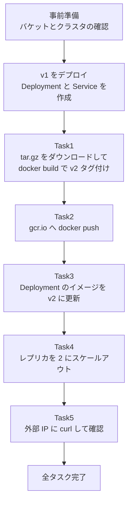
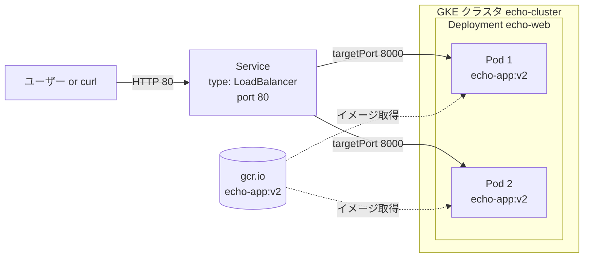
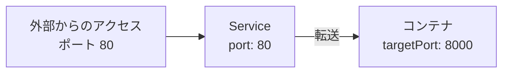
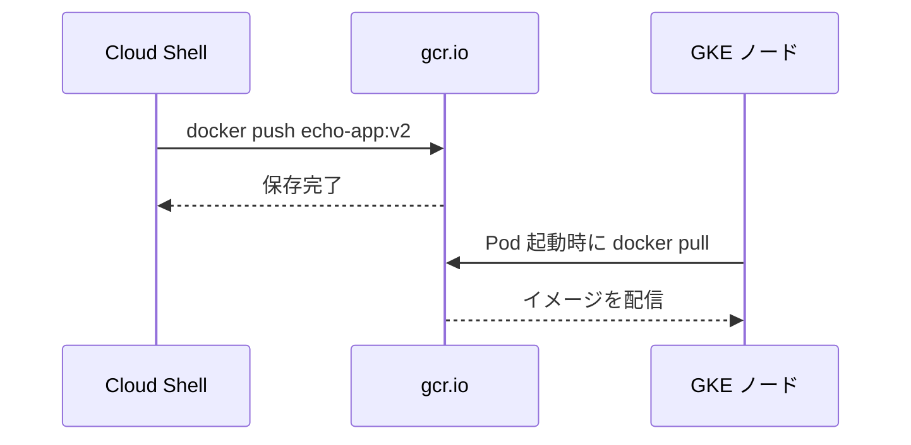
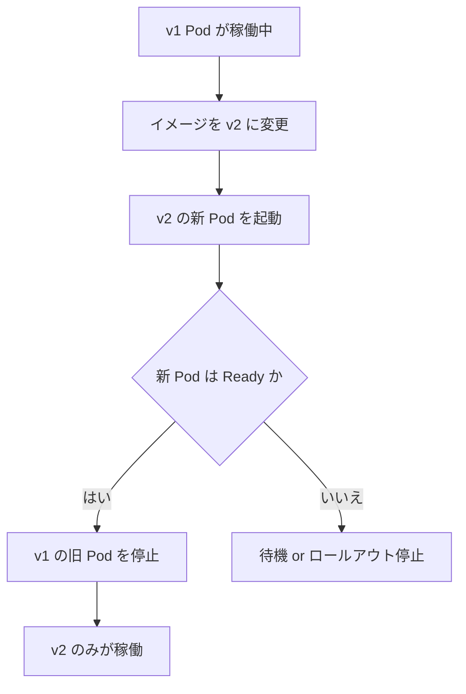
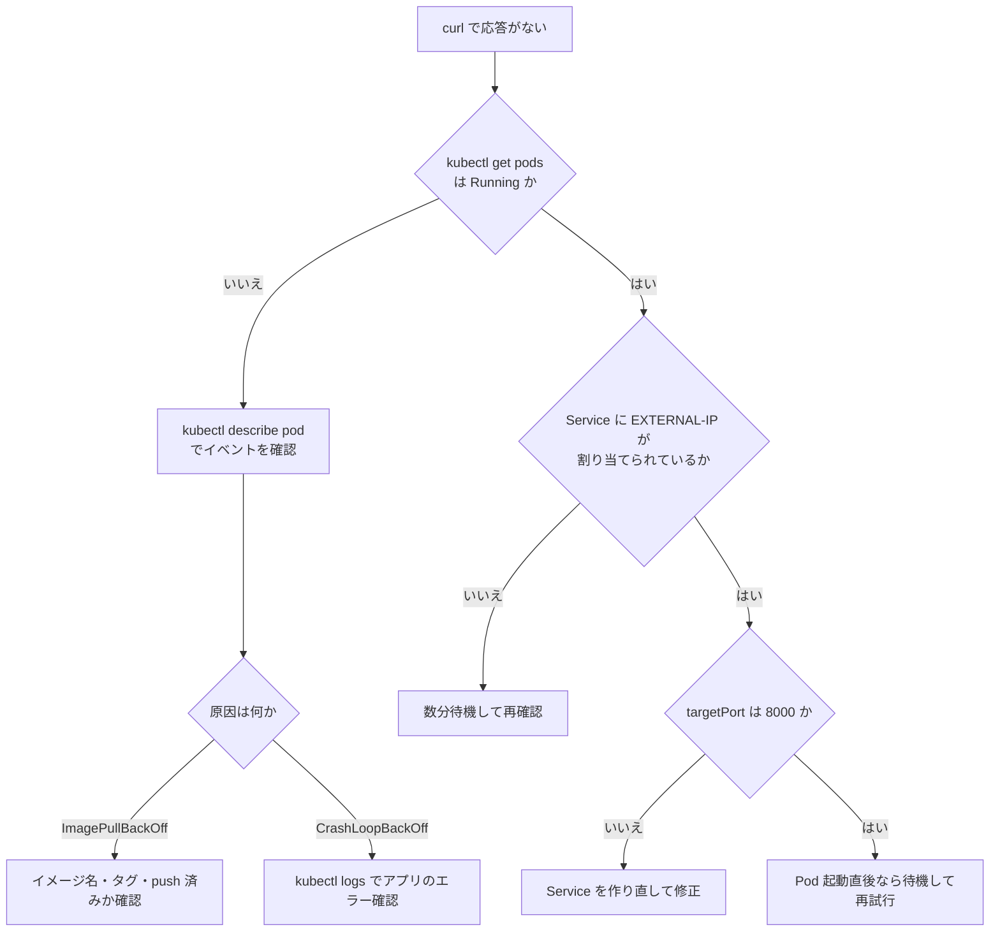

# GKE チャレンジラボ完全ガイド：echo-web を v1 から v2 へ更新してスケールアウトする

> 対象読者：Google Cloud・Docker・Kubernetes を触り始めた初学者
> 関連資格：Google Cloud Certified Professional Cloud Architect（PCA）
> 所要時間の目安：ラボ本体 約20〜30分（ビルド・LB の IP 発行待ちを含む）

---

## 0. このガイドの読み方

チャレンジラボは「手順書が無いテスト形式」です。そのため、**コマンドを暗記するよりも「なぜその操作が必要か」を理解する**ことが合格への近道です。本ガイドでは各タスクを次の順で解説します。

| 順番 | 内容 |
|---|---|
| 1 | そのタスクのゴール（何ができれば合格か） |
| 2 | 登場する概念の解説 |
| 3 | 実行コマンドと一行ずつの意味 |
| 4 | 確認方法・つまずきポイント |
| 5 | ベストプラクティス（実務ではどうするか） |

---

## 1. シナリオの全体像

### 1.1 何をするラボか

あなたはテスト環境を引き継いだ担当者です。すでに GKE クラスタ `echo-cluster` が用意されており、アプリ `echo-app` の **v1** が動いています。これを **v2** に更新し、**2 台構成（レプリカ 2）** に増やし、**外部から応答を確認**します。

### 1.2 登場人物（用語表）

| 用語 | 意味 | このラボでの名前 |
|---|---|---|
| コンテナイメージ | アプリと実行環境を一つにまとめた「配布物」 | `echo-app` |
| タグ | イメージのバージョン名札 | `v1`、`v2` |
| レジストリ | イメージの保管庫 | `gcr.io`（Container Registry のホスト名） |
| GKE クラスタ | Kubernetes を Google が管理してくれる環境 | `echo-cluster` |
| Deployment | 「Pod を何個、どのイメージで動かすか」を宣言するリソース | `echo-web` |
| Pod | コンテナを動かす最小単位 | `echo-web-xxxx` |
| Service | Pod 群への固定の入口（ロードバランサ） | `echo-web`（LoadBalancer） |
| レプリカ | 同じ Pod の複製数 | 2 |

### 1.3 全体の流れ（フローチャート）



### 1.4 システム構成図



**ポイント**：ユーザーは Pod に直接アクセスしません。常に Service（固定の入口）を経由します。だから Pod が入れ替わっても、外部 IP は変わりません。

---

## 2. 事前準備

### 2.1 変数を設定する（最重要の時短テクニック）

ラボ画面に表示される **ZONE** と **バケット名** は、受講ごとに異なります。コマンドに毎回手打ちすると打ち間違いの原因になるため、シェル変数に入れておきます。

```bash
export ZONE="REPLACE_WITH_LAB_ZONE"      # ラボ画面に表示されたゾーンに置き換える
export BUCKET="REPLACE_WITH_LAB_BUCKET"  # ラボ画面に表示されたバケット名に置き換える
export PROJECT_ID=$(gcloud config get-value project)
```

| 変数 | 役割 |
|---|---|
| `ZONE` | クラスタのあるゾーン |
| `BUCKET` | `echo-web-v2.tar.gz` が置いてあるバケット名 |
| `PROJECT_ID` | gcr.io 上のイメージ保存先パスに使うプロジェクト ID |

> **注意**：`<` `>` は入力しません。値だけを書きます。Cloud Shell が切断されると変数は消えるため、再接続したら再設定してください。

### 2.2 バケットにファイルがあるか確認する

コンソールで **Cloud Storage > バケット** を開いて確認するか、コマンドで確認します。

```bash
gcloud storage ls gs://$BUCKET/
```

`echo-web-v2.tar.gz` が表示されれば OK です。

### 2.3 クラスタが作成済みか確認する

コンソールの **Kubernetes Engine > クラスタ** で `echo-cluster` に **緑のチェックマーク**が付くまで待ちます。コマンドでも確認できます。

```bash
gcloud container clusters list
```

`STATUS` 列が `RUNNING` になっていれば準備完了です。

### 2.4 v1 をデプロイする（ラボ指定の手順）

```bash
gcloud container clusters get-credentials echo-cluster --zone=$ZONE
# 既存の v1 Deployment / Service があれば作り直さず、無い場合だけ作成する
if [ -z "$(kubectl get deployment echo-web --ignore-not-found -o name)" ]; then
  kubectl create deployment echo-web --image=gcr.io/qwiklabs-resources/echo-app:v1
fi
if [ -z "$(kubectl get service echo-web --ignore-not-found -o name)" ]; then
  kubectl expose deployment echo-web --type=LoadBalancer --port 80 --target-port 8000
fi
kubectl get deployment,service echo-web
```

| コマンド | 何をしているか |
|---|---|
| `get-credentials` | `kubectl` がどのクラスタを操作するかの接続情報を取得して設定する |
| `create deployment` | `echo-web` という Deployment を作り、v1 イメージで Pod を 1 つ起動する |
| `expose deployment` | Deployment に対する Service を作る |
| `get ... --ignore-not-found -o name` | 既存リソースの有無を確認する。ラボ環境で v1 が作成済みの場合は `create` / `expose` を実行せず、既存の Deployment と Service をそのまま使う（再実行すると `AlreadyExists` エラーになるため） |

#### `expose` の 3 つのオプションを理解する

| オプション | 意味 | 値 |
|---|---|---|
| `--type=LoadBalancer` | クラスタ外から届く Google Cloud のロードバランサを自動作成する | `LoadBalancer` |
| `--port` | **Service が外部に公開するポート** | `80` |
| `--target-port` | **Pod（コンテナ）が実際に待ち受けるポート** | `8000` |



> **これが 504 エラーの最大原因です。** Dockerfile で EXPOSE されているポート（8000）と `--target-port` が食い違うと、ロードバランサは Pod に到達できません。

---

## 3. Task 1：アプリをビルドして v2 タグを付ける

### 3.1 ゴール

`echo-web-v2.tar.gz` をダウンロード → 展開 → Docker イメージをビルド → **`v2` タグ**を付ける。

### 3.2 概念：イメージ名の構造

イメージ名は次の 4 つの部品でできています。

| 部品 | 例 | 説明 |
|---|---|---|
| レジストリのホスト名 | `gcr.io` | 保管庫の住所 |
| プロジェクト ID | `qwiklabs-gcp-xx-xxxx` | あなたのプロジェクト |
| イメージ名 | `echo-app` | アプリの名前 |
| タグ | `v2` | バージョンの名札 |

完成形は次のとおりです。

```text
gcr.io/<プロジェクトID>/echo-app:v2
```

**push 先のレジストリを決めるのは、イメージ名の先頭部分（ホスト名とプロジェクト ID）です。** 先頭を正しく付けないと、push は Docker Hub 側に向かって失敗します。

### 3.3 手順

**手順 1：ダウンロード**

```bash
gcloud storage cp gs://$BUCKET/echo-web-v2.tar.gz .
```

| 部分 | 意味 |
|---|---|
| `gcloud storage cp` | Cloud Storage との間でファイルをコピーする |
| `gs://$BUCKET/...` | バケット内のファイルの場所 |
| `.` | 保存先はカレントディレクトリ |

> 旧来の `gsutil cp` でも同じ結果になります。現在は `gcloud storage` の利用が推奨されています。

**手順 2：展開して中身を確認**

```bash
tar -xzf echo-web-v2.tar.gz
ls
```

`Dockerfile` が見える場所に移動します。展開結果がフォルダにまとまっていた場合は `cd` で入ってください。

| オプション | 意味 |
|---|---|
| `x` | 展開（extract） |
| `z` | gzip 圧縮を解く |
| `f` | ファイル名を指定する |

**手順 3：ビルド（ホスト名つきのタグで）**

```bash
docker build -t gcr.io/$PROJECT_ID/echo-app:v2 .
```

| 部分 | 意味 |
|---|---|
| `docker build` | Dockerfile からイメージを作る |
| `-t` | イメージに名前とタグを付ける（tag） |
| `.` | **ビルドコンテキスト**。Dockerfile とアプリ一式があるディレクトリ |

> **よくある失敗**：末尾の `.` を忘れると「引数が足りません」というエラーになります。

### 3.4 確認

```bash
docker images
```

`gcr.io/<プロジェクトID>/echo-app` の `TAG` 列に `v2` があれば成功です。

---

## 4. Task 2：イメージを Container Registry に push する

### 4.1 ゴール

`gcr.io/<プロジェクトID>/echo-app:v2` をレジストリに保存する。

### 4.2 概念：なぜ push が必要か

GKE の Pod は、あなたの Cloud Shell 内のイメージを見られません。**クラスタがダウンロードできる共有の保管庫（レジストリ）にアップロード**する必要があります。



### 4.3 手順

**手順 1：Docker に Google Cloud の認証を設定（初回のみ）**

```bash
gcloud auth configure-docker
```

Docker が gcr.io に push するときに、ログイン中の Google アカウントの資格情報を使えるようにする設定です。確認メッセージが出たら `Y` を入力します。

**手順 2：push**

```bash
docker push gcr.io/$PROJECT_ID/echo-app:v2
```

**手順 3：確認**

```bash
gcloud artifacts docker tags list gcr.io/$PROJECT_ID/echo-app
```

`TAG` 列に `v2` が表示されれば成功です。ここで **Check my progress** を押します。

### 4.4 つまずきポイント

| 症状 | 原因 | 対処 |
|---|---|---|
| `denied: Token exchange failed` | Docker の認証設定がない | `gcloud auth configure-docker` を実行 |
| `repository does not exist` | プロジェクト ID の打ち間違い | `echo $PROJECT_ID` で値を確認 |
| `tag does not exist` | build 時のタグと push 時のタグが違う | `docker images` で名前を確認 |

### 4.5 ベストプラクティス：Container Registry から Artifact Registry へ

Google Cloud では **Container Registry は非推奨**で、後継の **Artifact Registry** への移行が案内されています。本ラボは試験・学習用に `gcr.io` を使いますが、実務では次を意識してください。

| 観点 | Container Registry（旧） | Artifact Registry（推奨） |
|---|---|---|
| リポジトリ単位の IAM | 不可（バケット単位） | 可能 |
| リージョン指定 | 限定的 | 自由に選択可能 |
| 脆弱性スキャン | 限定的 | 統合されている |
| 対応形式 | コンテナのみ | コンテナ・各種パッケージ |

---

## 5. Task 3：更新したアプリを GKE にデプロイする

### 5.1 ゴール

- Deployment 名は `echo-web` のまま
- イメージを **v2** に変更
- 外部からポート 80 でアクセスできる

### 5.2 概念：ローリングアップデート

Deployment のイメージを書き換えると、Kubernetes は**古い Pod を一度に止めず、新しい Pod を起動してから順に入れ替えます**。これを **ローリングアップデート**と呼び、サービスを止めずに更新できます。



### 5.3 手順

**手順 1：コンテナ名を確認する**

`kubectl set image` では「Deployment 内のどのコンテナを更新するか」をコンテナ名で指定します。`kubectl create deployment --image=.../echo-app:v1` で作った場合、コンテナ名はイメージ名から自動で **`echo-app`** になりますが、念のため確認します。

```bash
kubectl get deployment echo-web -o jsonpath='{.spec.template.spec.containers[*].name}'
```

**手順 2：イメージを更新**

```bash
kubectl set image deployment/echo-web echo-app=gcr.io/$PROJECT_ID/echo-app:v2
```

| 部分 | 意味 |
|---|---|
| `deployment/echo-web` | 更新対象の Deployment |
| `echo-app=` | 更新するコンテナ名（等号の左） |
| `gcr.io/.../echo-app:v2` | 新しいイメージ（等号の右） |

**手順 3：更新の完了を待つ**

```bash
kubectl rollout status deployment/echo-web
```

`successfully rolled out` と出れば完了です。

**手順 4：イメージが v2 になったか確認**

```bash
kubectl get deployment echo-web -o jsonpath='{.spec.template.spec.containers[0].image}'
```

### 5.4 外部公開（Service）について

v1 のデプロイ時に作成した `echo-web` Service（LoadBalancer、80 → 8000）が**そのまま v2 の Pod にも通信を届けます**。Service は Pod の「ラベル」で対象を選ぶため、イメージを更新しても作り直す必要はありません。

もし Service を誤って削除していた場合は、次で再作成します。

```bash
kubectl expose deployment echo-web --type=LoadBalancer --port 80 --target-port 8000
```

### 5.5 ベストプラクティス：宣言的に管理する

`kubectl set image` は手軽ですが、実務ではマニフェストファイル（YAML）で管理し、Git で変更履歴を残します。

```yaml
apiVersion: apps/v1
kind: Deployment
metadata:
  name: echo-web
spec:
  replicas: 2
  selector:
    matchLabels:
      app: echo-web
  strategy:
    type: RollingUpdate
    rollingUpdate:
      maxSurge: 1
      maxUnavailable: 0
  template:
    metadata:
      labels:
        app: echo-web
    spec:
      containers:
        - name: echo-app
          image: gcr.io/PROJECT_ID/echo-app:v2
          ports:
            - containerPort: 8000
          resources:
            requests:
              cpu: 100m
              memory: 128Mi
            limits:
              memory: 256Mi
          readinessProbe:
            httpGet:
              path: /
              port: 8000
            initialDelaySeconds: 3
            periodSeconds: 5
```

| 設定 | 狙い |
|---|---|
| `maxUnavailable: 0` | 更新中に利用可能な Pod 数を減らさない |
| `maxSurge: 1` | 更新中に一時的に 1 つ多く Pod を起動できる |
| `resources.requests` | スケジューラが適切なノードに配置できる |
| `readinessProbe` | 準備ができた Pod にだけ通信を流す（504 の予防） |

---

## 6. Task 4：2 レプリカにスケールアウトする

### 6.1 ゴール

`echo-web` の Pod を **2 つ**にして、すべて Running にする。

### 6.2 概念：スケールアウトとスケールアップ

| 種類 | 意味 | 例 |
|---|---|---|
| スケールアウト（水平） | **台数を増やす** | Pod を 1 → 2 |
| スケールアップ（垂直） | **1 台の性能を上げる** | CPU・メモリを増やす |

Kubernetes は水平スケールが基本です。複数 Pod に分散することで、**負荷分散**と**障害時の可用性**が得られます。

### 6.3 手順

```bash
kubectl scale deployment echo-web --replicas=2
```

確認します。

```bash
kubectl get pods -l app=echo-web
```

| 列 | 期待する値 |
|---|---|
| `READY` | `1/1` |
| `STATUS` | `Running` |
| 行数 | 2 行 |

> **ラベルの注意**：`kubectl create deployment echo-web` で作成した場合、Pod には `app=echo-web` のラベルが自動で付きます。表示されない場合は単に `kubectl get pods` で確認してください。

### 6.4 ベストプラクティス：手動スケールから自動スケールへ

本番では負荷に応じて自動で増減させる **HPA（Horizontal Pod Autoscaler）** が一般的です。

```bash
kubectl autoscale deployment echo-web --min=2 --max=5 --cpu-percent=70
```

> **ラボでの注意**：チェッカーは「レプリカ数が 2」であることを見ます。HPA を設定すると数が変動し、判定に影響する恐れがあるため、**本ラボでは実行しないでください**。実務向けの知識として押さえておきましょう。

---

## 7. Task 5：アプリの動作を確認する

### 7.1 ゴール

外部 IP にアクセスして、**v2 の応答（バージョン番号つき）**が返ることを確認する。

### 7.2 手順

**手順 1：外部 IP を調べる**

```bash
kubectl get service echo-web
```

`EXTERNAL-IP` 列に IP アドレスが表示されるまで待ちます。`<pending>` の間はロードバランサを作成中です。

自動で待機したい場合は次のコマンドを使います。

```bash
kubectl get service echo-web --watch
```

IP が出たら `Ctrl + C` で止めます。

**手順 2：アクセスして確認**

```bash
export EXTERNAL_IP=$(kubectl get service echo-web -o jsonpath='{.status.loadBalancer.ingress[0].ip}')
curl http://$EXTERNAL_IP
```

出力に **バージョン番号（v2）** が含まれていれば成功です。ブラウザで `http://<EXTERNAL-IP>` を開いても確認できます。

**手順 3：Check my progress**

ラボ画面で各タスクの **Check my progress** を押して、すべて緑になることを確認します。

### 7.3 何度かアクセスして負荷分散を確認する（任意）

```bash
for i in $(seq 1 10); do curl -s http://$EXTERNAL_IP; echo; done
```

2 つの Pod に分散して処理されます。応答が同一内容の場合は見分けがつきませんが、ログで確認できます。

```bash
kubectl logs -l app=echo-web --prefix --tail=5
```

---

## 8. トラブルシューティング

### 8.1 症状別の対処表

| 症状 | 想定原因 | 確認コマンド | 対処 |
|---|---|---|---|
| 504 Gateway Timeout | ポートの不一致 | `kubectl describe service echo-web` | `targetPort` が 8000 か確認 |
| 504 Gateway Timeout | 起動直後で未初期化 | `kubectl get pods` | 1〜2 分待って再試行 |
| `ImagePullBackOff` | イメージ名・タグの誤り、または未 push | `kubectl describe pod <Pod名>` | イメージのパスとタグを修正 |
| `ErrImagePull` | レジストリの権限不足 | `kubectl describe pod <Pod名>` | イメージのパスが正しいか確認 |
| `CrashLoopBackOff` | アプリが起動直後に終了 | `kubectl logs <Pod名>` | ログのエラーを確認 |
| `EXTERNAL-IP` が `<pending>` のまま | LB 作成中 | `kubectl describe service echo-web` | 数分待つ |
| `kubectl` が別クラスタに接続 | 認証情報が未設定 | `kubectl config current-context` | `get-credentials` を再実行 |

### 8.2 診断の進め方（フローチャート）



### 8.3 覚えておきたい 3 つの診断コマンド

| コマンド | 分かること |
|---|---|
| `kubectl get <リソース>` | 状態の一覧（まず全体を見る） |
| `kubectl describe <リソース> <名前>` | **イベント**を含む詳細（失敗理由はここに出る） |
| `kubectl logs <Pod名>` | アプリが出力したログ |

---

## 9. 完全版コマンド集（コピーして使う用）

以下を上から順に実行すれば、全タスクが完了します。`ZONE` と `BUCKET` はラボ画面の値に置き換えてください。

```bash
# 0. 変数
export ZONE="REPLACE_WITH_LAB_ZONE"      # ラボ指定のゾーンに置き換える
export BUCKET="REPLACE_WITH_LAB_BUCKET"  # ラボ指定のバケット名に置き換える
export PROJECT_ID=$(gcloud config get-value project)

# 0-1. 接続と v1 のデプロイ
gcloud container clusters get-credentials echo-cluster --zone=$ZONE
# 既存の v1 Deployment / Service があれば作り直さず、無い場合だけ作成する
if [ -z "$(kubectl get deployment echo-web --ignore-not-found -o name)" ]; then
  kubectl create deployment echo-web --image=gcr.io/qwiklabs-resources/echo-app:v1
fi
if [ -z "$(kubectl get service echo-web --ignore-not-found -o name)" ]; then
  kubectl expose deployment echo-web --type=LoadBalancer --port 80 --target-port 8000
fi
kubectl get deployment,service echo-web

# Task 1: ダウンロード・展開・ビルド
gcloud storage cp gs://$BUCKET/echo-web-v2.tar.gz .
mkdir -p echo-web-v2
tar -xzf echo-web-v2.tar.gz -C echo-web-v2
BUILD_DIR=$(dirname "$(find echo-web-v2 -name Dockerfile -print -quit)")
echo "BUILD_DIR=${BUILD_DIR}"
docker build -t gcr.io/$PROJECT_ID/echo-app:v2 "$BUILD_DIR"

# Task 2: push
gcloud auth configure-docker
docker push gcr.io/$PROJECT_ID/echo-app:v2

# Task 3: v2 へ更新
kubectl set image deployment/echo-web echo-app=gcr.io/$PROJECT_ID/echo-app:v2
kubectl rollout status deployment/echo-web

# Task 4: スケールアウト
kubectl scale deployment echo-web --replicas=2
kubectl get pods

# Task 5: 動作確認
kubectl get service echo-web
# LoadBalancer に外部 IP が割り当てられるまで待つ（空のまま curl しない）
EXTERNAL_IP=""
until [ -n "$EXTERNAL_IP" ]; do
  EXTERNAL_IP=$(kubectl get service echo-web -o jsonpath='{.status.loadBalancer.ingress[0].ip}')
  [ -n "$EXTERNAL_IP" ] || { echo "外部 IP の割り当て待ち..."; sleep 10; }
done
export EXTERNAL_IP
curl "http://${EXTERNAL_IP}"
```

> `docker build` のビルドコンテキストは、Dockerfile のあるディレクトリ（上の `BUILD_DIR`）を指定してください。

---

## 10. 実務で役立つベストプラクティス総まとめ

| 分野 | やること | 理由 |
|---|---|---|
| イメージ管理 | `latest` を使わず、明示的なバージョンタグを使う | どのバージョンが動いているか追跡できる |
| イメージ管理 | 可能ならダイジェスト（`@sha256:...`）で固定する | タグの付け替えによる意図しない変更を防ぐ |
| レジストリ | Artifact Registry を使う | Container Registry は非推奨 |
| デプロイ | YAML を Git で管理する | 変更履歴とレビューが可能になる |
| 更新 | ローリングアップデートと `maxUnavailable: 0` を設定する | 無停止で更新できる |
| 可用性 | 2 レプリカ以上にする | 1 つ落ちても継続できる |
| 可用性 | `readinessProbe` を設定する | 準備未完了の Pod に通信を流さない |
| 可用性 | `livenessProbe` を設定する | 固まった Pod を自動で再起動する |
| リソース | `requests` と `limits` を指定する | 他の Pod への影響を防ぎ、配置を適切にする |
| 公開 | 実務では Ingress と HTTPS を使う | 通信の暗号化と柔軟なルーティング |
| セキュリティ | 最小権限のサービスアカウントを使う | 侵害時の被害範囲を小さくする |
| スケール | HPA を設定する | 負荷に応じて自動で増減できる |
| ロールバック | `kubectl rollout undo` を把握しておく | 問題発生時にすぐ戻せる |

### 10.1 困ったときの切り戻し

```bash
kubectl rollout history deployment/echo-web
kubectl rollout undo deployment/echo-web
```

直前のバージョン（v1）に戻せます。Deployment は過去の ReplicaSet を保持しているため、素早い復旧が可能です。

---

## 11. PCA 試験との対応ポイント

| 試験で問われやすい観点 | 本ラボでの対応 |
|---|---|
| コンテナ化したアプリの GKE へのデプロイ | Deployment と Service の作成 |
| 無停止でのアプリ更新 | ローリングアップデート |
| 可用性とスケーラビリティ | レプリカ数の調整、HPA |
| 外部公開の方式 | LoadBalancer と Ingress の使い分け |
| イメージの保管と配布 | Container Registry と Artifact Registry |
| 運用の自動化 | CI/CD（Cloud Build）によるビルドと push の自動化 |

### Service タイプの違い

| タイプ | 公開範囲 | 主な用途 |
|---|---|---|
| ClusterIP | クラスタ内のみ | 内部通信 |
| NodePort | 各ノードのポート経由 | 検証・LB の下層 |
| LoadBalancer | 外部へ公開（L4 LB が自動作成される） | 外部公開（本ラボ） |

---

## 12. 最終チェックリスト

| 確認項目 | OK |
|---|---|
| `echo-cluster` が RUNNING である | ☐ |
| `docker images` に `echo-app:v2` がある | ☐ |
| `gcr.io` に `v2` タグが push されている | ☐ |
| Deployment `echo-web` のイメージが v2 である | ☐ |
| `kubectl get pods` で 2 つの Pod が Running である | ☐ |
| `EXTERNAL-IP` が割り当てられている | ☐ |
| `curl` で v2 の応答（バージョン番号つき）が返る | ☐ |
| 各タスクの Check my progress がすべて緑である | ☐ |

---

## 13. まとめ

1. **イメージ名は `gcr.io/<プロジェクトID>/echo-app:v2` の形**にすると、build から push、デプロイまで一貫して使える。
2. **push しないとクラスタは使えない**。レジストリは Cloud Shell と GKE をつなぐ共有の保管庫。
3. **Service が固定の入口**なので、イメージを更新しても外部 IP は変わらない。
4. **`--port` は外向き、`--target-port` はコンテナ向き**。504 の最大要因はここの食い違い。
5. 失敗したら **`describe` と `logs`** を見れば、ほぼ原因が分かる。

この流れは、実務の CI/CD パイプライン（ビルド → push → デプロイ → スケール → 監視）の縮小版です。手を動かしながら、各コマンドの「なぜ」を意識して取り組んでください。
