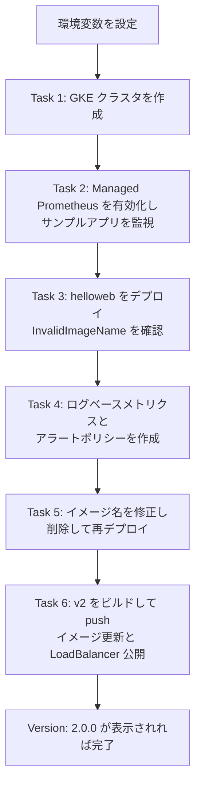
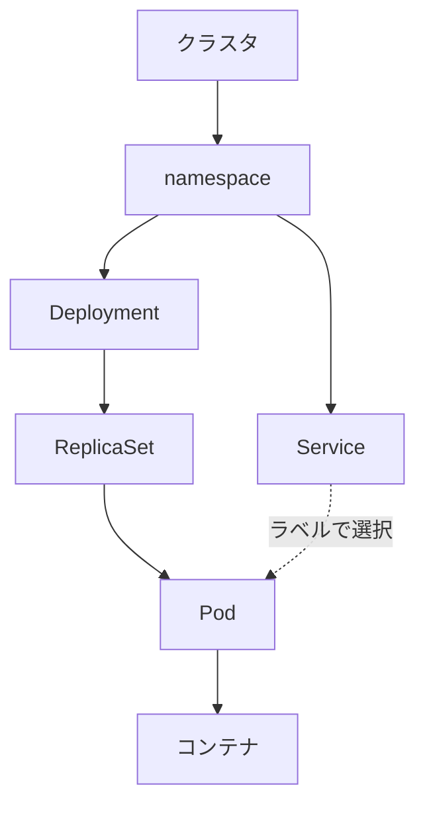
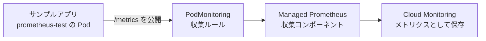
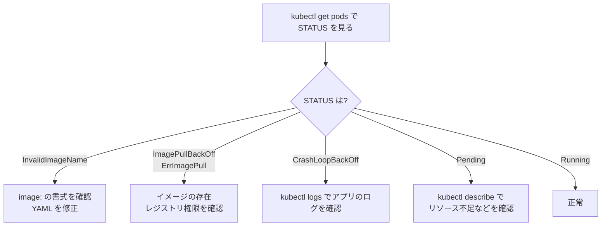
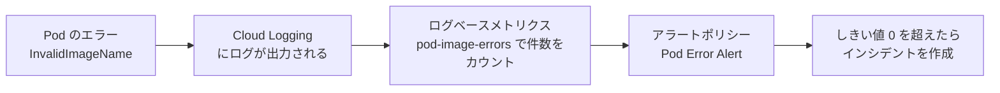
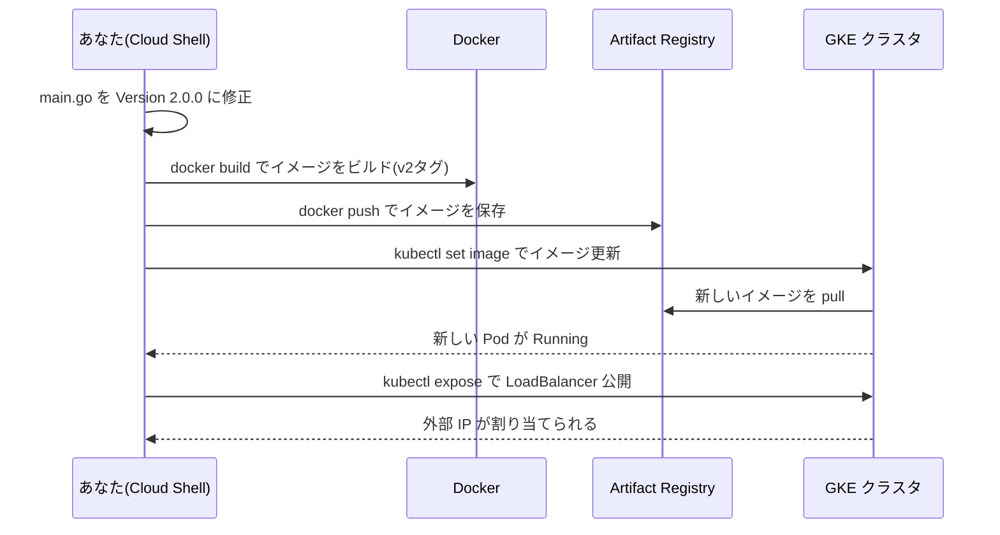
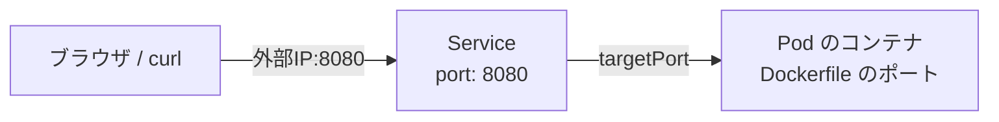
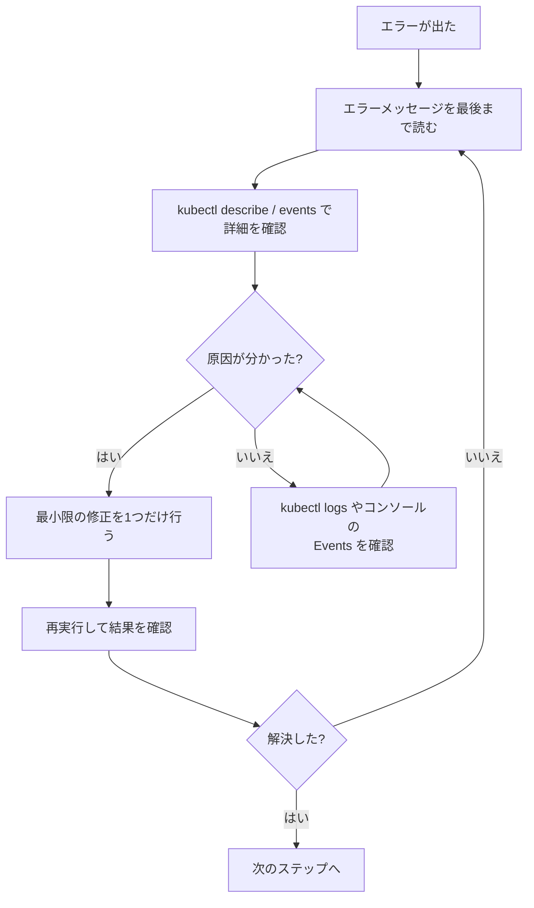

# Manage Kubernetes in Google Cloud チャレンジラボ（GSP510）完全ガイド【初学者向け・ステップバイステップ】

> **対象読者**: GKE（Google Kubernetes Engine）や Docker を学び始めたばかりの方
> **このガイドのゴール**: チャレンジラボの全6タスクを「なぜそうするのか」を理解しながら、自力で完了できるようになること
> **作成日**: 2026年10月30日
> **根拠資料**: ラボの手順書（Cymbal Shops シナリオ）。ラボごとに割り当てられる値（プロジェクトID、ゾーンなど）は異なるため、必ずご自身のラボ画面の値に置き換えてください。

---

## 目次

1. [このラボの全体像](#1-このラボの全体像)
2. [事前準備（環境変数の設定）](#2-事前準備環境変数の設定)
3. [最初に知っておきたい基礎用語](#3-最初に知っておきたい基礎用語)
4. [Task 1: GKE クラスタを作成する](#4-task-1-gke-クラスタを作成する)
5. [Task 2: Managed Prometheus を有効化する](#5-task-2-managed-prometheus-を有効化する)
6. [Task 3: アプリケーションをデプロイしてエラーを確認する](#6-task-3-アプリケーションをデプロイしてエラーを確認する)
7. [Task 4: ログベースメトリクスとアラートポリシーを作成する](#7-task-4-ログベースメトリクスとアラートポリシーを作成する)
8. [Task 5: マニフェストを修正して再デプロイする](#8-task-5-マニフェストを修正して再デプロイする)
9. [Task 6: コンテナ化して Artifact Registry へ push しクラスタへデプロイする](#9-task-6-コンテナ化して-artifact-registry-へ-push-しクラスタへデプロイする)
10. [コマンド一括集（コピペ用）](#10-コマンド一括集コピペ用)
11. [トラブルシューティング](#11-トラブルシューティング)
12. [本番運用に向けたベストプラクティスまとめ](#12-本番運用に向けたベストプラクティスまとめ)
13. [最終チェックリスト](#13-最終チェックリスト)
14. [クリーンアップとコスト意識](#14-クリーンアップとコスト意識)
15. [参考ドキュメント](#15-参考ドキュメント)

---

## 1. このラボの全体像

### 1.1 シナリオ

あなたは Cymbal Shops（架空の EC 企業）に入社したばかりのエンジニアです。開発チームから「新しい EC サイトを GKE 上で安全にリリースできるか、サンドボックスで実力を見せてほしい」と依頼されています。

チャレンジラボでは **手順の答えは書かれていません**。これまでのラボで学んだスキルを使い、自分でコマンドや画面操作を考えて進めます。このガイドは「考え方」と「具体的な実行例」の両方を示します。

### 1.2 6つのタスクの流れ



> **重要な順番の注意**: Task 4（メトリクスとアラート作成）は、**エラーを直す Task 5 より前**に行います。エラーが出ている間にログベースメトリクスを作ることで、「同じ問題が再発したら検知できる」仕組みを実際に体験する設計になっているためです。

### 1.3 各タスクで学ぶこと

| タスク | 目的 | 主な操作 | 使う主なツール |
|---|---|---|---|
| Task 1 | クラスタの構築 | 設定値どおりに GKE クラスタを作成 | `gcloud container clusters create` |
| Task 2 | メトリクス監視の土台づくり | Managed Prometheus 有効化、namespace 作成、アプリと PodMonitoring のデプロイ | `gcloud`、`kubectl` |
| Task 3 | デプロイと障害の観察 | 壊れたマニフェストをデプロイし、エラーを読む | `kubectl`、Console の Workloads 画面 |
| Task 4 | 再発検知の仕組みづくり | ログベースメトリクスとアラートポリシー | Logs Explorer、Cloud Monitoring |
| Task 5 | 障害の復旧 | マニフェスト修正、Deployment 削除、再デプロイ | `kubectl` |
| Task 6 | リリースの一連の流れ | コード修正、Docker ビルド、push、イメージ更新、公開 | `docker`、`kubectl`、Artifact Registry |

### 1.4 手順書の表記ゆれについて

手順書の冒頭に「Artifact Registry リポジトリ名は *cluster name*」と書かれている箇所がありますが、Task 6 では「*repo name*」と書かれています。これは**表記の揺れ**です。ラボ画面の左側に表示される値のうち、**リポジトリ用の値（`REPO_NAME`）を使う**と理解してください。

---

## 2. 事前準備（環境変数の設定）

### 2.1 なぜ環境変数を使うのか

ラボでは同じ値（プロジェクト ID、ゾーン、namespace 名など）を何度も入力します。**環境変数に入れておくと、入力ミスを防ぎ、コマンドをそのまま使い回せます**。これは本番運用でもスクリプトの再利用性を高める基本的なベストプラクティスです。

### 2.2 手順

1. ラボの **Start Lab** を押し、左側パネルに表示される値（Username、Password、プロジェクト ID、各種ラボ指定値）を確認します。
2. **シークレット（Incognito）ウィンドウ**で Google Cloud コンソールを開き、**ラボ用のStudentアカウント**でログインします（個人アカウントと混ざらないようにするため）。
3. コンソール右上の **Cloud Shell をアクティブにする** アイコンを押して Cloud Shell を起動します。
4. 次のコマンドの `"..."` の中身を、**ラボ画面に表示されている値**に置き換えて実行します。

```bash
export PROJECT_ID="ラボのプロジェクトID"
export CLUSTER_NAME="ラボで指定されたクラスタ名"
export REGION="ラボで指定されたリージョン"
export ZONE="ラボで指定されたゾーン"
export NAMESPACE_NAME="ラボで指定されたnamespace名"
export REPO_NAME="ラボで指定されたリポジトリ名"
export SERVICE_NAME="ラボで指定されたサービス名"
```

5. 正しく設定できたか確認します。

```bash
echo "PROJECT_ID=$PROJECT_ID"
echo "CLUSTER_NAME=$CLUSTER_NAME"
echo "REGION=$REGION"
echo "ZONE=$ZONE"
echo "NAMESPACE_NAME=$NAMESPACE_NAME"
echo "REPO_NAME=$REPO_NAME"
echo "SERVICE_NAME=$SERVICE_NAME"
```

6. gcloud の既定プロジェクトとゾーンも合わせておくと、オプションの付け忘れによるエラーを減らせます。

```bash
gcloud config set project "$PROJECT_ID"
gcloud config set compute/zone "$ZONE"
gcloud config set compute/region "$REGION"
```

### 2.3 環境変数に関する注意点

| 注意点 | 説明 | 対処 |
|---|---|---|
| Cloud Shell が再接続されると変数が消える | セッションが切れると `export` した値は失われます | 再接続したら 2.2 の `export` を再実行する |
| ゾーンとリージョンの混同 | ゾーンは `us-central1-a` のような形式、リージョンは `us-central1` の形式です | ラボ画面の値をそのままコピーする |
| 値の前後に空白が入る | コピー時に空白や改行が混入することがあります | `echo` で確認し、変なときは再入力する |
| 引用符を付ける | 値に特殊文字が含まれても安全 | 変数は `"$VAR"` のように二重引用符で囲んで使う |

---

## 3. 最初に知っておきたい基礎用語

| 用語 | 一言でいうと | このラボでの登場場面 |
|---|---|---|
| **GKE** | Google が管理してくれる Kubernetes サービス | Task 1 で作成 |
| **クラスタ** | コンテナを動かすマシン群（ノード）と管理機能のまとまり | Task 1 |
| **ノード** | コンテナが実際に動く仮想マシン | Task 1 の「Number of nodes」 |
| **リリースチャンネル** | GKE のバージョン更新の方針（Rapid / Regular / Stable） | Task 1 で Regular を選択 |
| **クラスタオートスケーラー** | 負荷に応じてノード数を自動で増減する機能 | Task 1 で最小2、最大6 |
| **namespace** | クラスタ内を論理的に分ける区画 | Task 2 以降で利用 |
| **Pod** | コンテナを動かす最小単位 | 各タスク |
| **Deployment** | Pod の「あるべき数と状態」を宣言し維持する仕組み | `helloweb` |
| **Service** | Pod に安定したアクセス先（IP）を与える仕組み | Task 6 の LoadBalancer |
| **マニフェスト** | Kubernetes のリソースを YAML で記述した設計書 | `*.yaml` ファイル |
| **Managed Prometheus** | Google が運用してくれる Prometheus 互換のメトリクス収集 | Task 2 |
| **PodMonitoring** | どの Pod の、どのポートから、何秒ごとにメトリクスを集めるかの定義 | Task 2 |
| **ログベースメトリクス** | ログの出現回数などを数値（メトリクス）に変える機能 | Task 4 |
| **アラートポリシー** | メトリクスが条件を超えたら通知する仕組み | Task 4 |
| **Artifact Registry** | コンテナイメージを保管する Google Cloud のレジストリ | Task 6 |
| **イメージタグ** | イメージのバージョン名（例: `v2`、`1.0`） | Task 5、Task 6 |

### 3.1 Kubernetes のリソースの親子関係



> Deployment を作ると、裏で ReplicaSet が作られ、その ReplicaSet が Pod を作ります。Service は **ラベル（label）** を使って「どの Pod に通信を流すか」を決めます。

---

## 4. Task 1: GKE クラスタを作成する

### 4.1 要件

| 設定 | 値 |
|---|---|
| クラスタ名 | `CLUSTER_NAME` |
| ゾーン | `ZONE` |
| リリースチャンネル | Regular |
| クラスタ / ターゲットバージョン | default（既定のまま） |
| クラスタオートスケーラー | 有効 |
| ノード数 | 3 |
| 最小ノード数 | 2 |
| 最大ノード数 | 6 |

### 4.2 コマンドで作成する方法（推奨）

```bash
gcloud container clusters create "$CLUSTER_NAME" \
  --zone "$ZONE" \
  --release-channel regular \
  --num-nodes 3 \
  --enable-autoscaling \
  --min-nodes 2 \
  --max-nodes 6
```

クラスタ作成には **数分（目安 5〜10 分）** かかります。待っている間に Task 2 以降の手順を読み進めておくと時間を有効に使えます。

### 4.3 コマンドの意味

| オプション | 意味 | ポイント |
|---|---|---|
| `--zone` | クラスタを作るゾーン | ゾーンを指定すると**ゾーンクラスタ**になる |
| `--release-channel regular` | リリースチャンネルを Regular に設定 | バージョンは「default」のまま。`--cluster-version` は指定しない |
| `--num-nodes 3` | 初期ノード数 | ゾーンクラスタでは、この数がそのまま総ノード数 |
| `--enable-autoscaling` | クラスタオートスケーラーを有効化 | `--min-nodes` と `--max-nodes` とセットで使う |
| `--min-nodes 2` / `--max-nodes 6` | 自動増減の下限と上限 | 上限は予期せぬコスト増の防波堤になる |

### 4.4 Console（GUI）で作成する場合

1. ナビゲーションメニュー → **Kubernetes Engine** → **クラスタ** → **作成**
2. **Standard** クラスタの「構成」を選ぶ
3. 名前に `CLUSTER_NAME`、ロケーションタイプは **ゾーン**、ゾーンに `ZONE` を指定
4. 「リリースチャンネル」が **Regular channel**、バージョンが **既定**であることを確認
5. 左メニューの **default-pool** で「ノード数」を 3、「クラスタ オートスケーラーを有効にする」にチェックし、最小 2・最大 6 を入力
6. **作成**

### 4.5 作成後の接続と確認

クラスタに `kubectl` をつなぐための認証情報を取得します。

```bash
gcloud container clusters get-credentials "$CLUSTER_NAME" --zone "$ZONE"
```

```bash
# ノードが3台 Ready であること
kubectl get nodes

# 設定内容の確認（リリースチャンネルとオートスケーリング）
gcloud container clusters describe "$CLUSTER_NAME" --zone "$ZONE" \
  --format="yaml(releaseChannel,currentNodeCount,nodePools[].autoscaling)"
```

期待される結果は次のとおりです。

| 確認項目 | 期待値 |
|---|---|
| `releaseChannel.channel` | `REGULAR` |
| ノード数（`kubectl get nodes`） | 3 台、STATUS が `Ready` |
| `autoscaling.minNodeCount` | 2 |
| `autoscaling.maxNodeCount` | 6 |

### 4.6 ベストプラクティス

| 項目 | 内容 |
|---|---|
| リリースチャンネルを使う | 手動でバージョンを固定せず、チャンネルに任せると安全なアップグレードが自動で行われる |
| オートスケーラーに上限を付ける | 想定外のスケールによる課金増を防ぐ |
| 最小権限 | 本番ではノードに専用のサービスアカウントを使い、広すぎる権限を与えない |
| 本番ではリージョンクラスタを検討 | ゾーン障害に強くなる（ただし料金と台数の考え方が変わる） |

### 4.7 つまずきポイント

| 症状 | 原因 | 対処 |
|---|---|---|
| `ZONE` が空でエラー | 環境変数が未設定 | 2.2 を再実行 |
| 権限エラー | 個人アカウントでログインしている | Student アカウントのシークレットウィンドウで実施 |
| 作成が長い | 通常動作 | 待つ。`gcloud container operations list` で進行状況を確認できる |

---

## 5. Task 2: Managed Prometheus を有効化する

### 5.1 Task 2 の全体像



| 部品 | 役割 |
|---|---|
| サンプルアプリ | `/metrics` というURLでメトリクスを公開する |
| PodMonitoring | 「どの Pod のどのポートを何秒ごとに見るか」を宣言する |
| Managed Prometheus | PodMonitoring の宣言に従ってメトリクスを集める（Google が運用） |
| Cloud Monitoring | 集めたメトリクスを保存し、グラフやアラートに使える |

### 5.2 手順 1: Managed Prometheus を有効化する

```bash
gcloud container clusters update "$CLUSTER_NAME" \
  --zone "$ZONE" \
  --enable-managed-prometheus
```

> **補足**: 新しいバージョンの GKE では、新規クラスタで既に有効になっていることがあります。その場合でも、**手順どおりこのコマンドを実行して状態を確認する**のが安全です（「変更なし」のような表示になっても問題ありません）。

確認コマンド:

```bash
gcloud container clusters describe "$CLUSTER_NAME" --zone "$ZONE" \
  --format="value(monitoringConfig.managedPrometheusConfig.enabled)"
```

`True` と表示されれば有効です。

### 5.3 手順 2: namespace を作成する

```bash
kubectl create namespace "$NAMESPACE_NAME"
kubectl get namespace "$NAMESPACE_NAME"
```

> **ベストプラクティス**: アプリやチームごとに namespace を分けると、権限・リソース上限・監視を区画ごとに管理できます。`default` namespace に何でも入れる運用は避けましょう。

### 5.4 手順 3: サンプルアプリのマニフェストをダウンロードする

```bash
gcloud storage cp gs://spls/gsp510/prometheus-app.yaml .
```

### 5.5 手順 4: `<todo>` を書き換える（35〜38行目）

まず `<todo>` の位置を確認します。

```bash
grep -n "<todo>" prometheus-app.yaml
```

置き換える内容は次のとおりです。

| 項目 | 設定する値 |
|---|---|
| `containers.image` | `nilebox/prometheus-example-app:latest` |
| `containers.name` | `prometheus-test` |
| `ports.name` | `metrics` |

#### 方法 A: エディタで編集する（確実）

Cloud Shell の **エディタを開く** ボタン、または `nano prometheus-app.yaml` で 35〜38 行目を直接編集します。

#### 方法 B: `sed` で置換する（速い）

`ports` の `- name:` を先に置換し、残った `name:` をコンテナ名に置換する順番がポイントです。

```bash
sed -i 's|image: <todo>|image: nilebox/prometheus-example-app:latest|' prometheus-app.yaml
sed -i 's|- name: <todo>|- name: metrics|' prometheus-app.yaml
sed -i 's|name: <todo>|name: prometheus-test|' prometheus-app.yaml
```

> **注意**: 実際のファイルの並びが異なる場合は、`sed` ではなく方法 A で修正してください。置換後は必ず `grep -n "<todo>" prometheus-app.yaml` で **何も表示されない**ことを確認します。

編集後のイメージ（該当部分の例）:

```yaml
      containers:
      - image: nilebox/prometheus-example-app:latest
        name: prometheus-test
        ports:
        - name: metrics
          containerPort: 1234
```

> `containerPort` などの値はファイルに最初から書かれているものを変更しません。

### 5.6 手順 5: namespace へデプロイする

```bash
kubectl apply -f prometheus-app.yaml -n "$NAMESPACE_NAME"
kubectl get pods -n "$NAMESPACE_NAME"
```

Pod の STATUS が `Running` になるまで待ちます（数十秒〜1分）。

### 5.7 手順 6: pod-monitoring.yaml をダウンロードする

```bash
gcloud storage cp gs://spls/gsp510/pod-monitoring.yaml .
```

### 5.8 手順 7: `<todo>` を書き換える（18〜24行目）

| 項目 | 設定する値 |
|---|---|
| `metadata.name` | `prometheus-test` |
| `labels.app.kubernetes.io/name` | `prometheus-test` |
| `matchLabels.app` | `prometheus-test` |
| `endpoints.interval` | **ラボ画面に表示された interval の値**（例: `30s` の形式） |

編集後のイメージ（例）:

```yaml
apiVersion: monitoring.googleapis.com/v1
kind: PodMonitoring
metadata:
  name: prometheus-test
  labels:
    app.kubernetes.io/name: prometheus-test
spec:
  selector:
    matchLabels:
      app: prometheus-test
  endpoints:
  - port: metrics
    interval: 30s
```

> **ここが重要**: `matchLabels.app` は、手順 4 でデプロイしたアプリの Pod ラベル（`app: prometheus-test`）と**一致**している必要があります。また `endpoints.port: metrics` は、手順 4 で付けた `ports.name: metrics` と対応しています。**ラベルとポート名が噛み合わないと、メトリクスは収集されません**。

### 5.9 手順 8: PodMonitoring を適用する

```bash
kubectl apply -f pod-monitoring.yaml -n "$NAMESPACE_NAME"
kubectl get podmonitoring -n "$NAMESPACE_NAME"
```

### 5.10 Task 2 の確認ポイント

| 確認項目 | コマンド | 期待値 |
|---|---|---|
| Managed Prometheus が有効 | `gcloud container clusters describe` | `True` |
| namespace がある | `kubectl get ns "$NAMESPACE_NAME"` | `Active` |
| アプリが動作中 | `kubectl get pods -n "$NAMESPACE_NAME"` | `prometheus-test-...` が `Running` |
| PodMonitoring がある | `kubectl get podmonitoring -n "$NAMESPACE_NAME"` | `prometheus-test` が表示される |

### 5.11 ベストプラクティス

| 項目 | 内容 |
|---|---|
| 収集間隔 | 短すぎると取り込み量と費用が増える。必要十分な間隔にする |
| ラベル設計 | `app.kubernetes.io/name` など標準ラベルを使うと、ツール間で扱いやすい |
| `latest` タグ | 手順書の指定なのでラボでは使うが、**本番では固定タグかダイジェスト**を使う（再現性のため） |

---

## 6. Task 3: アプリケーションをデプロイしてエラーを確認する

### 6.1 狙い

このタスクでは**わざと壊れたマニフェスト**をデプロイし、「エラーをどこでどう読むか」を体験します。

### 6.2 手順 1: デモ用ファイルをダウンロードする

```bash
gcloud storage cp -r gs://spls/gsp510/hello-app/ .
cd hello-app
```

`hello-app` ディレクトリの主な中身（このラボで触るもの）は次のとおりです。

| 場所 | 内容 | 使うタスク |
|---|---|---|
| `manifests/helloweb-deployment.yaml` | Deployment のマニフェスト | Task 3、5 |
| `main.go` | アプリのソースコード（Go 言語） | Task 6 |
| `Dockerfile` | イメージのビルド手順 | Task 6 |

```bash
ls -la
ls -la manifests
```

### 6.3 手順 2: Deployment を作成する

```bash
kubectl apply -f manifests/helloweb-deployment.yaml -n "$NAMESPACE_NAME"
```

> **`create` と `apply` の違い**: `kubectl create` は「新規作成のみ」、`kubectl apply` は「宣言どおりになるよう作成または更新」です。Kubernetes の運用では、再実行しても安全な `apply` が基本です。どちらでもこのラボは進められます。

### 6.4 手順 3: エラーを確認する

#### コマンドで確認

```bash
kubectl get deployments -n "$NAMESPACE_NAME"
kubectl get pods -n "$NAMESPACE_NAME"
```

`helloweb` の Pod が `InvalidImageName` と表示されます。

```bash
# Pod 名を取得して詳細（Events 欄）を見る（Pod の作成直後は名前が取れないことがあるため、数回再試行する）
POD_NAME=""
for attempt in 1 2 3 4 5 6; do
  POD_NAME=$(kubectl get pods -n "$NAMESPACE_NAME" -l app=hello -o jsonpath='{.items[0].metadata.name}' 2>/dev/null)
  [ -n "$POD_NAME" ] && break
  sleep 5
done
if [ -z "$POD_NAME" ]; then
  echo "app=hello の Pod が見つかりません。ラベルと Deployment を確認してください" >&2
else
  kubectl describe pod "$POD_NAME" -n "$NAMESPACE_NAME"
fi

# namespace のイベントを新しい順に見る
kubectl get events -n "$NAMESPACE_NAME" --sort-by=.lastTimestamp
```

> ラベル `app=hello` で Pod が見つからない場合は、`kubectl get pods -n "$NAMESPACE_NAME" --show-labels` でラベルを確認してください。

#### Console で確認

1. **Kubernetes Engine** → **ワークロード**
2. `helloweb` をクリック
3. 赤いバーに **Pod errors: InvalidImageName** と表示される
4. **View details**（または Events セクション）で詳細を確認

### 6.5 エラーの読み方

Events には次のようなメッセージが出ます。

```text
Error: InvalidImageName
Failed to apply default image tag "<todo>": couldn't parse image reference "<todo>": invalid reference format
```

| メッセージの部分 | 意味 |
|---|---|
| `InvalidImageName` | イメージ名の書式が不正で、イメージを取得しようとすらできない |
| `Failed to apply default image tag "<todo>"` | `<todo>` というイメージ名にタグを補おうとして失敗した |
| `invalid reference format` | イメージ参照の書式（`レジストリ/パス/名前:タグ`）に合っていない |

つまり原因は「`image:` に `<todo>` という**プレースホルダのまま**の文字列が入っている」ことです。

### 6.6 Pod の異常を調べる基本の流れ



### 6.7 Task 3 の確認ポイント

| 確認項目 | 期待値 |
|---|---|
| Deployment `helloweb` が存在する | `kubectl get deployments -n "$NAMESPACE_NAME"` で表示される |
| Pod の状態 | `InvalidImageName`（**この時点では正常**） |

> このタスクの「チェック」は **デプロイが作成されていること**で、正常稼働までは求められていません。**エラー状態のまま Task 4 へ進みます**。

---

## 7. Task 4: ログベースメトリクスとアラートポリシーを作成する

### 7.1 狙い

「エラーログが出たら数値として数え、しきい値を超えたら気づける」仕組みを作ります。



### 7.2 パート A: Logs Explorer でクエリを作る

1. ナビゲーションメニュー → **Logging** → **ログ エクスプローラ**
2. クエリ欄に次を入力して **クエリを実行**

```text
resource.type="k8s_pod"
resource.labels.cluster_name="CLUSTER_NAME"
resource.labels.namespace_name="NAMESPACE_NAME"
log_id("events")
severity=WARNING
jsonPayload.message:"Failed to apply default image tag"
```

> `CLUSTER_NAME` と `NAMESPACE_NAME` は、ラボ画面の値に置き換えます。Cloud Shell で次を実行すると、値を埋め込んだクエリを表示できます（そのままコピーして貼り付けられます）。
>
> ```bash
> printf '%s\n' 'resource.type="k8s_pod"' \
>   "resource.labels.cluster_name=\"${CLUSTER_NAME}\"" \
>   "resource.labels.namespace_name=\"${NAMESPACE_NAME}\"" \
>   'log_id("events")' 'severity=WARNING' \
>   'jsonPayload.message:"Failed to apply default image tag"'
> ```

| 条件 | 狙い |
|---|---|
| `resource.type="k8s_pod"` | Kubernetes Pod のログに限定する |
| `resource.labels.cluster_name` / `namespace_name` | このラボのクラスタと namespace のイベントだけを数える |
| `log_id("events")` | Kubernetes イベントのログ（`events`）に限定する |
| `severity=WARNING` | 警告レベルのイベントに限定する |
| `jsonPayload.message:"Failed to apply default image tag"` | `InvalidImageName` の原因となるメッセージだけを数える |

または GUI で次のように選び、残りの条件はクエリ欄に追記します。

| 項目 | 選択 |
|---|---|
| リソースタイプ | **Kubernetes Pod**（1つだけ選ぶ） |
| 重大度 | **WARNING**（1つだけ選ぶ） |

ヒントにあるとおり、**リソースタイプ1つ・重大度1つ**にします。正しければ、次のエラーが結果に表示されます。

```text
Error: InvalidImageName
Failed to apply default image tag "<todo>": couldn't parse image reference "<todo>": invalid reference format
```

> **結果が出ないとき**: 時間範囲（右上）を「過去1時間」などに広げる、Task 3 のデプロイから数分待つ、`kubectl get events -n "$NAMESPACE_NAME"` でエラーが出続けているか確認する、の順に試してください。

### 7.3 パート B: ログベースメトリクスを作成する

1. クエリ結果の画面で **アクション** → **指標を作成**（Create metric）
2. 次のとおり入力

| 項目 | 値 |
|---|---|
| メトリクスの種類 | **カウンタ（Counter）** |
| ログ指標名 | `pod-image-errors` |

3. **指標を作成**

#### 参考: コマンドで作成する場合

7.2 と同じ条件のフィルタで作成します（`CLUSTER_NAME` と `NAMESPACE_NAME` は 2.2 で設定した環境変数から展開されます）。

```bash
gcloud logging metrics create pod-image-errors \
  --description="Pod image errors" \
  --log-filter="resource.type=\"k8s_pod\" AND resource.labels.cluster_name=\"${CLUSTER_NAME}\" AND resource.labels.namespace_name=\"${NAMESPACE_NAME}\" AND log_id(\"events\") AND severity=WARNING AND jsonPayload.message:\"Failed to apply default image tag\""

# 登録されたフィルタを確認する（変数が空のまま展開されていないこと）
gcloud logging metrics describe pod-image-errors --format="value(filter)"
```

> `gcloud logging metrics create` で作られるのは既定でカウンタ型です。**ラボの採点は結果（名前・種類）を見る**ため、GUI でもコマンドでも構いません。

### 7.4 パート C: アラートポリシーを作成する

1. ナビゲーションメニュー → **Monitoring** → **アラート** → **ポリシーを作成**
2. **指標を選択**をクリック
3. 絞り込みの **有効**（Active）フィルタのチェックを外す（新しいログベースメトリクスは、データが入るまで一覧に出ないことがあるため）
4. `pod-image-errors`（`logging.googleapis.com/user/pod-image-errors`）を検索して選択 → **適用**
5. 次の値を設定します。

| 設定項目 | 値 |
|---|---|
| Rolling window（ローリング ウィンドウ） | **10 min** |
| Rolling window function（ローリング ウィンドウ関数） | **Count** |
| Time series aggregation（時系列の集計） | **Sum** |
| Condition type（条件タイプ） | **Threshold** |
| Alert trigger（アラートのトリガー） | **Any time series violates** |
| Threshold position（しきい値の位置） | **Above threshold** |
| Threshold value（しきい値） | **0** |
| Use notification channel（通知チャネル） | **無効（Disable）** |
| Alert policy name（ポリシー名） | **Pod Error Alert** |

6. **ポリシーを作成**

### 7.5 設定値の意味

| 設定 | 意味 | 初心者向けのたとえ |
|---|---|---|
| ローリング ウィンドウ 10 分 | 直近10分間のデータをまとめて見る | 「直近10分の出来事」を毎回見直す |
| ウィンドウ関数 Count | 10分間のデータ点の数を数える | 件数を数える |
| 時系列の集計 Sum | 複数の時系列を合計する | 全ての Pod の合計 |
| しきい値 0 より大きい | 1件でもエラーがあれば違反 | 「1件でも出たら教えて」 |
| Any time series violates | どれか1つでも条件を満たしたら発火 | 1つでも異常なら警報 |

### 7.6 Task 4 の確認ポイント

| 確認項目 | 確認場所 | 期待値 |
|---|---|---|
| ログベースメトリクス | Logging → ログベースの指標 | `pod-image-errors`（カウンタ）がある |
| アラートポリシー | Monitoring → アラート | `Pod Error Alert` がある |

### 7.7 ベストプラクティス

| 項目 | 内容 |
|---|---|
| 通知チャネルを設定する | このラボでは無効だが、**本番では必ず通知先（メール、Slack、PagerDuty など）を設定**する。通知がないアラートは誰にも届かない |
| フィルタは具体的に | 広すぎるクエリはノイズになり、アラート疲れの原因になる |
| しきい値は実測で調整 | 0 は「1件でも検知」で厳しい設定。本番では誤検知とのバランスを見て決める |
| アラートに対応手順を添える | ドキュメント欄に切り分け手順（Runbook）へのリンクを書くと対応が速くなる |

---

## 8. Task 5: マニフェストを修正して再デプロイする

### 8.1 手順 1: イメージを正しい値にする

`manifests/helloweb-deployment.yaml` の `image:` を次の値に置き換えます。

```text
us-docker.pkg.dev/google-samples/containers/gke/hello-app:1.0
```

#### `sed` で置換する場合（`hello-app` ディレクトリ内で実行）

```bash
sed -i 's|image: <todo>|image: us-docker.pkg.dev/google-samples/containers/gke/hello-app:1.0|' manifests/helloweb-deployment.yaml

# 反映の確認
grep -n "image:" manifests/helloweb-deployment.yaml
```

`<todo>` が残っていないことを確認します。

```bash
grep -n "<todo>" manifests/helloweb-deployment.yaml
```

### 8.2 手順 2: Deployment を削除する

```bash
kubectl delete deployment helloweb -n "$NAMESPACE_NAME"
```

> **補足**: 実務では `kubectl apply` を再実行するだけでも更新できます。このラボは「削除して再作成する」手順を指示していますので、指示どおりに実施します。

### 8.3 手順 3: 修正したマニフェストをデプロイする

```bash
kubectl apply -f manifests/helloweb-deployment.yaml -n "$NAMESPACE_NAME"
kubectl get pods -n "$NAMESPACE_NAME" -w
```

`-w`（watch）で Pod が `Running` になるのを確認したら、`Ctrl + C` で監視を止めます。

```bash
kubectl rollout status deployment/helloweb -n "$NAMESPACE_NAME"
```

### 8.4 Task 5 の確認ポイント

| 確認項目 | 期待値 |
|---|---|
| Deployment `helloweb` | `READY` が `1/1`（レプリカ数がマニフェスト値どおり） |
| Pod の状態 | `Running`、エラー表示なし |
| Console の Workloads | 緑のチェック（エラーの赤いバーが消えている） |

### 8.5 ベストプラクティス

| 項目 | 内容 |
|---|---|
| マニフェストは Git で管理 | 誰がいつ何を変えたか追跡でき、ロールバックも容易になる |
| 適用前に検証 | `kubectl apply --dry-run=server -f ...` で事前チェックできる |
| 失敗したら戻せる準備 | `kubectl rollout undo deployment/helloweb` で直前の状態に戻せる |

---

## 9. Task 6: コンテナ化して Artifact Registry へ push しクラスタへデプロイする

### 9.1 全体の流れ



### 9.2 手順 1: `main.go` の Version を 2.0.0 にする（49行目）

まず対象の行を確認します。

```bash
cd && cd hello-app
grep -n "Version" main.go
```

49 行目付近に `Version: 1.0.0` を含む行があるはずです。これを `Version: 2.0.0` にします。

```bash
sed -i 's/Version: 1.0.0/Version: 2.0.0/' main.go
grep -n "Version" main.go
```

> エディタで 49 行目を直接編集しても構いません。`1.0.0` が `2.0.0` に変わったことを必ず確認してください。

### 9.3 手順 2: Docker イメージ名を決める

Artifact Registry のイメージ名は、次の形式です。

| 部分 | 例 | このラボでの値 |
|---|---|---|
| ホスト名 | `REGION-docker.pkg.dev` | `${REGION}-docker.pkg.dev` |
| プロジェクト ID | プロジェクトの識別子 | `${PROJECT_ID}` |
| リポジトリ名 | Artifact Registry のリポジトリ | `${REPO_NAME}` |
| イメージ名 | アプリの名前 | `hello-app` |
| タグ | バージョン | `v2` |

```bash
export IMAGE="${REGION}-docker.pkg.dev/${PROJECT_ID}/${REPO_NAME}/hello-app:v2"
echo "$IMAGE"
```

既存のイメージ名を確認したい場合は、次のコマンドが使えます。

```bash
gcloud artifacts docker images list "${REGION}-docker.pkg.dev/${PROJECT_ID}/${REPO_NAME}"
```

> リポジトリに既に `hello-app` イメージ（v1 など）があるはずです。**同じイメージ名に `v2` タグを追加する**形にすると整合性が取れます。

### 9.4 手順 3: Docker を Artifact Registry に認証する

```bash
gcloud auth configure-docker "${REGION}-docker.pkg.dev" -q
```

> これは `push` する前に必要です。忘れると `unauthorized` や `denied` エラーになります。

### 9.5 手順 4: イメージをビルドする

`Dockerfile` がある `hello-app` ディレクトリで実行します。

```bash
cd && cd hello-app
docker build -t "$IMAGE" .
docker images | grep hello-app
```

| 要素 | 意味 |
|---|---|
| `-t "$IMAGE"` | イメージにフルネーム（タグ付き）を付ける |
| `.` | 現在のディレクトリをビルドの材料（コンテキスト）にする |

### 9.6 手順 5: イメージを push する

```bash
docker push "$IMAGE"
```

確認します。

```bash
gcloud artifacts docker images list "${REGION}-docker.pkg.dev/${PROJECT_ID}/${REPO_NAME}" --include-tags
```

`v2` タグが一覧に表示されれば成功です。

### 9.7 手順 6: Deployment のイメージを v2 に更新する

まず、Deployment 内の実際のコンテナ名を取得して変数に保存します。

```bash
CONTAINER_NAME=$(kubectl get deployment helloweb -n "$NAMESPACE_NAME" \
  -o jsonpath='{.spec.template.spec.containers[0].name}')
echo "CONTAINER_NAME=${CONTAINER_NAME}"
```

一般的には `hello-app` と表示されます。取得した名前を使って更新します。

```bash
kubectl set image deployment/helloweb "${CONTAINER_NAME}=${IMAGE}" -n "$NAMESPACE_NAME"
kubectl rollout status deployment/helloweb -n "$NAMESPACE_NAME"
```

| 部分 | 意味 |
|---|---|
| `deployment/helloweb` | 更新する Deployment |
| `${CONTAINER_NAME}=...` | 「コンテナ名=新しいイメージ」の指定。コンテナ名は直前に Deployment から取得した値 |
| `rollout status` | ローリングアップデートが完了するまで待つ |

> **ローリングアップデート**: 古い Pod を一度に全部止めず、新しい Pod を起動しながら少しずつ入れ替えます。そのためサービスを止めずに更新できます。

### 9.8 手順 7: LoadBalancer サービスで公開する

まず、Dockerfile で指定されているコンテナのポートを確認します。

```bash
grep -n -i "EXPOSE\|PORT" Dockerfile main.go
```

**`8080` であることが多い**ですが、ラボの環境の値をここで確認してください。確認した番号を `TARGET_PORT` に入れて使います。

```bash
export TARGET_PORT=8080   # Dockerfile で確認した値に合わせる

kubectl expose deployment helloweb \
  -n "$NAMESPACE_NAME" \
  --type=LoadBalancer \
  --name="$SERVICE_NAME" \
  --port=8080 \
  --target-port="$TARGET_PORT"
```

| オプション | 意味 | 
|---|---|
| `--type=LoadBalancer` | 外部 IP を持つロードバランサを作る |
| `--name` | サービス名（ラボ指定値） |
| `--port=8080` | 外部（サービス）側で受けるポート（ラボ指定） |
| `--target-port` | コンテナ側のポート（Dockerfile に書かれた値） |

#### port と targetPort の関係



### 9.9 手順 8: 外部 IP にアクセスして確認する

外部 IP が割り当てられるまで少し待ちます。

```bash
kubectl get service "$SERVICE_NAME" -n "$NAMESPACE_NAME" -w
```

`EXTERNAL-IP` が `<pending>` から実際の IP アドレスに変わったら `Ctrl + C` で止め、アクセスします。

```bash
EXTERNAL_IP=$(kubectl get service "$SERVICE_NAME" -n "$NAMESPACE_NAME" \
  -o jsonpath='{.status.loadBalancer.ingress[0].ip}')
echo "$EXTERNAL_IP"

curl "http://${EXTERNAL_IP}:8080"
```

期待される出力（Hostname の部分は Pod ごとに異なります）:

```text
Hello, world!
Version: 2.0.0
Hostname: helloweb-6fc7476576-cvv5f
```

> ページが表示されるまで数分かかることがあります。すぐにつながらなくても、数十秒おいて再実行してください。

### 9.10 Task 6 の確認ポイント

| 確認項目 | 期待値 |
|---|---|
| Artifact Registry に `v2` タグがある | `hello-app:v2` が一覧に表示 |
| Deployment のイメージが v2 | `kubectl describe deployment helloweb -n "$NAMESPACE_NAME"` の Image 欄が `...:v2` |
| Service が LoadBalancer | `EXTERNAL-IP` に実 IP が付いている |
| アクセス結果 | `Version: 2.0.0` が表示される |

### 9.11 ベストプラクティス

| 項目 | 内容 |
|---|---|
| 不変なタグ運用 | `latest` に頼らず、`v2` やコミットハッシュなど**一意で変わらないタグ**を使う |
| リージョンを合わせる | クラスタと同じリージョンのレジストリを使うと、pull が速く、転送コストも抑えられる |
| イメージの脆弱性スキャン | Artifact Registry のスキャン機能で、既知の脆弱性を検出する |
| イメージ更新はパイプライン化 | 本番では Cloud Build などの CI/CD で「ビルド → push → デプロイ」を自動化する |
| 公開範囲を絞る | LoadBalancer は外部公開になる。本番では Ingress や認証、ファイアウォールで制御する |

---

## 10. コマンド一括集（コピペ用）

> **使い方**: 先頭で環境変数を設定し、**コマンドを上から順に**実行します。Task 4（Console 操作）の箇所は、コマンドではなく画面操作です。**途中のコメントを読みながら進めてください**。

```bash
############ 0. 環境変数(ラボの値に置き換える) ############
export PROJECT_ID="ラボのプロジェクトID"
export CLUSTER_NAME="ラボで指定されたクラスタ名"
export REGION="ラボで指定されたリージョン"
export ZONE="ラボで指定されたゾーン"
export NAMESPACE_NAME="ラボで指定されたnamespace名"
export REPO_NAME="ラボで指定されたリポジトリ名"
export SERVICE_NAME="ラボで指定されたサービス名"

gcloud config set project "$PROJECT_ID"
gcloud config set compute/zone "$ZONE"
gcloud config set compute/region "$REGION"

############ Task 1: クラスタ作成 ############
gcloud container clusters create "$CLUSTER_NAME" \
  --zone "$ZONE" \
  --release-channel regular \
  --num-nodes 3 \
  --enable-autoscaling --min-nodes 2 --max-nodes 6

gcloud container clusters get-credentials "$CLUSTER_NAME" --zone "$ZONE"

############ Task 2: Managed Prometheus ############
gcloud container clusters update "$CLUSTER_NAME" --zone "$ZONE" --enable-managed-prometheus
kubectl create namespace "$NAMESPACE_NAME"

gcloud storage cp gs://spls/gsp510/prometheus-app.yaml .
grep -n "<todo>" prometheus-app.yaml          # 位置を確認
sed -i 's|image: <todo>|image: nilebox/prometheus-example-app:latest|' prometheus-app.yaml
sed -i 's|- name: <todo>|- name: metrics|' prometheus-app.yaml
sed -i 's|name: <todo>|name: prometheus-test|' prometheus-app.yaml
grep -n "<todo>" prometheus-app.yaml          # 何も出なければOK
kubectl apply -f prometheus-app.yaml -n "$NAMESPACE_NAME"

gcloud storage cp gs://spls/gsp510/pod-monitoring.yaml .
# pod-monitoring.yaml の <todo>(18〜24行目)をエディタで編集する
#   metadata.name: prometheus-test
#   labels.app.kubernetes.io/name: prometheus-test
#   matchLabels.app: prometheus-test
#   endpoints.interval: ラボ画面の値
kubectl apply -f pod-monitoring.yaml -n "$NAMESPACE_NAME"

############ Task 3: デプロイしてエラーを確認 ############
gcloud storage cp -r gs://spls/gsp510/hello-app/ .
cd hello-app
kubectl apply -f manifests/helloweb-deployment.yaml -n "$NAMESPACE_NAME"
kubectl get pods -n "$NAMESPACE_NAME"          # InvalidImageName を確認

############ Task 4: ログベースメトリクス(メトリクス部分のみコマンド可) ############
gcloud logging metrics create pod-image-errors \
  --description="Pod image errors" \
  --log-filter="resource.type=\"k8s_pod\" AND resource.labels.cluster_name=\"${CLUSTER_NAME}\" AND resource.labels.namespace_name=\"${NAMESPACE_NAME}\" AND log_id(\"events\") AND severity=WARNING AND jsonPayload.message:\"Failed to apply default image tag\""
# アラートポリシー "Pod Error Alert" は Console で作成する(7.4 参照)

############ Task 5: 修正して再デプロイ ############
sed -i 's|image: <todo>|image: us-docker.pkg.dev/google-samples/containers/gke/hello-app:1.0|' manifests/helloweb-deployment.yaml
kubectl delete deployment helloweb -n "$NAMESPACE_NAME"
kubectl apply -f manifests/helloweb-deployment.yaml -n "$NAMESPACE_NAME"
kubectl rollout status deployment/helloweb -n "$NAMESPACE_NAME"

############ Task 6: コンテナ化・push・公開 ############
sed -i 's/Version: 1.0.0/Version: 2.0.0/' main.go
grep -n "Version" main.go

export IMAGE="${REGION}-docker.pkg.dev/${PROJECT_ID}/${REPO_NAME}/hello-app:v2"
gcloud auth configure-docker "${REGION}-docker.pkg.dev" -q
docker build -t "$IMAGE" .
docker push "$IMAGE"

CONTAINER_NAME=$(kubectl get deployment helloweb -n "$NAMESPACE_NAME" \
  -o jsonpath='{.spec.template.spec.containers[0].name}')   # 実際のコンテナ名を取得
kubectl set image deployment/helloweb "${CONTAINER_NAME}=${IMAGE}" -n "$NAMESPACE_NAME"
kubectl rollout status deployment/helloweb -n "$NAMESPACE_NAME"

grep -n -i "EXPOSE\|PORT" Dockerfile          # ターゲットポートを確認
export TARGET_PORT=8080                       # Dockerfile で確認した値に合わせる
kubectl expose deployment helloweb -n "$NAMESPACE_NAME" \
  --type=LoadBalancer --name="$SERVICE_NAME" --port=8080 --target-port="$TARGET_PORT"

kubectl get service "$SERVICE_NAME" -n "$NAMESPACE_NAME" -w
```

---

## 11. トラブルシューティング

### 11.1 症状別の対処表

| 症状 | 考えられる原因 | 確認コマンド / 対処 |
|---|---|---|
| `kubectl` が接続できない | 認証情報を取得していない | `gcloud container clusters get-credentials "$CLUSTER_NAME" --zone "$ZONE"` |
| `namespace not found` | `-n` の指定ミス、namespace 未作成 | `kubectl get ns`、`echo "$NAMESPACE_NAME"` |
| `<todo>` が残っている | 置換漏れ | `grep -n "<todo>" ファイル名` |
| `InvalidImageName` が消えない | 古い Pod が残っている、再 apply 漏れ | `kubectl get pods -n ...`、再度 `kubectl apply` |
| `ImagePullBackOff` | イメージ名の誤り、権限不足、タグが存在しない | `kubectl describe pod ...` の Events を確認 |
| `docker push` が `denied` / `unauthorized` | Docker 認証未設定 | `gcloud auth configure-docker "${REGION}-docker.pkg.dev" -q` |
| `docker push` が `name unknown` | リポジトリ名またはパスの誤り | `gcloud artifacts repositories list` で名前を確認 |
| `set image` が `unable to find container` | コンテナ名の誤り | 9.7 のコマンドでコンテナ名を確認 |
| `EXTERNAL-IP` が `<pending>` のまま | ロードバランサ作成中 | 1〜3 分待つ。長引く場合は `kubectl describe service ...` |
| `curl` で応答がない | ポート不一致、起動途中 | `--target-port` が Dockerfile と一致するか、Pod が Running か確認 |
| Logs Explorer に何も出ない | 時間範囲が狭い、クエリ誤り | 時間範囲を広げ、7.2 のクエリ（`resource.type`・クラスタ名・namespace 名・`log_id("events")`・`severity=WARNING`・メッセージ条件）の値を確認 |
| アラートの指標が選べない | Active フィルタで隠れている | **Active のチェックを外す** |
| PodMonitoring でデータが取れない | ラベルまたはポート名の不一致 | `matchLabels.app` と `ports.name`/`endpoints.port` を確認 |

### 11.2 トラブル対応の基本の姿勢



> **コツ**: 一度に複数箇所を直さず、**1箇所ずつ修正 → 確認**を繰り返すと、原因の切り分けが簡単になります。

### 11.3 時間配分の目安

ラボは時間制限があり、途中で一時停止できません。目安は次のとおりです。

| タスク | 目安 | ポイント |
|---|---|---|
| 環境変数設定 | 2 分 | 先に済ませておく |
| Task 1 | 待ち時間を含め 10 分 | **作成中に Task 2 の手順を読み進める** |
| Task 2 | 10 分 | YAML のラベルとポート名の対応に注意 |
| Task 3 | 5 分 | エラーのままで OK |
| Task 4 | 10 分 | Console 操作が多い |
| Task 5 | 5 分 | `sed` で素早く |
| Task 6 | 15 分 | ポート番号とコンテナ名の確認を忘れない |

---

## 12. 本番運用に向けたベストプラクティスまとめ

このラボは学習用に簡略化されています。実務では次の点を意識しましょう。

### 12.1 ラボと本番の違い

| 観点 | このラボ | 本番でのベストプラクティス |
|---|---|---|
| イメージタグ | `latest` / `v2` | 不変タグ（バージョン、コミットハッシュ）やダイジェスト固定 |
| 通知 | 通知チャネル無効 | メール、チャット、オンコールツールに通知 |
| 公開 | LoadBalancer で直接公開 | Ingress、HTTPS、WAF、認証 |
| デプロイ | 手動の `kubectl` | CI/CD（Cloud Build、Cloud Deploy など）で自動化 |
| 設定管理 | ローカルの YAML 編集 | Git 管理（GitOps） |
| リソース指定 | 指定なしまたは最小 | `requests` と `limits` を必ず設定 |
| ヘルスチェック | なし | `readinessProbe` / `livenessProbe` を設定 |
| 権限 | ラボ用の広い権限 | 最小権限、Workload Identity でサービスアカウントを紐付け |
| 可用性 | 単一ゾーン | リージョンクラスタ、複数レプリカ、PodDisruptionBudget |

### 12.2 マニフェスト設計の基本

```yaml
# 本番を意識した Deployment の例(学習用の抜粋)
apiVersion: apps/v1
kind: Deployment
metadata:
  name: helloweb
  labels:
    app: hello
spec:
  replicas: 3
  selector:
    matchLabels:
      app: hello
  template:
    metadata:
      labels:
        app: hello
    spec:
      containers:
      - name: hello-app
        image: REGION-docker.pkg.dev/PROJECT_ID/REPO_NAME/hello-app:v2
        ports:
        - containerPort: 8080
        resources:
          requests:
            cpu: 100m
            memory: 64Mi
          limits:
            memory: 128Mi
        readinessProbe:
          httpGet:
            path: /
            port: 8080
```

| 追加した設定 | 目的 |
|---|---|
| `replicas: 3` | 1つの Pod が落ちても全体が止まらない |
| `resources.requests` | スケジューラが適切なノードに配置できる |
| `resources.limits` | 1つのアプリが資源を使い切るのを防ぐ |
| `readinessProbe` | 準備ができた Pod にだけ通信を流す |

### 12.3 運用の安全装置

| 仕組み | コマンド / 機能 | 使いどころ |
|---|---|---|
| ロールバック | `kubectl rollout undo deployment/helloweb -n ...` | 新バージョンで問題が出たとき |
| 履歴の確認 | `kubectl rollout history deployment/helloweb -n ...` | どのリビジョンかを調べる |
| ドライラン | `kubectl apply --dry-run=server -f ...` | 適用前の検証 |
| 差分確認 | `kubectl diff -f ...` | 変更内容の事前確認 |

---

## 13. 最終チェックリスト

提出（採点）前に、次を1つずつ確認しましょう。

### 13.1 タスク別チェック

| # | チェック項目 | 確認方法 | 完了 |
|---|---|---|---|
| 1 | クラスタが Regular チャンネル、ノード 3、オートスケール 2〜6 | `gcloud container clusters describe` | ☐ |
| 2 | Managed Prometheus が有効 | `describe` の `managedPrometheusConfig.enabled` が `True` | ☐ |
| 3 | namespace が作成済み | `kubectl get ns` | ☐ |
| 4 | `prometheus-test` が Running | `kubectl get pods -n "$NAMESPACE_NAME"` | ☐ |
| 5 | PodMonitoring `prometheus-test` が存在 | `kubectl get podmonitoring -n "$NAMESPACE_NAME"` | ☐ |
| 6 | `helloweb` を namespace にデプロイした | `kubectl get deployments -n "$NAMESPACE_NAME"` | ☐ |
| 7 | ログベースメトリクス `pod-image-errors`（カウンタ） | Logging → ログベースの指標 | ☐ |
| 8 | アラートポリシー `Pod Error Alert` | Monitoring → アラート | ☐ |
| 9 | `helloweb` のイメージを `1.0` に修正し再デプロイ | Workloads にエラーなし | ☐ |
| 10 | `main.go` が `Version: 2.0.0` | `grep -n "Version" main.go` | ☐ |
| 11 | `hello-app:v2` を Artifact Registry に push | `gcloud artifacts docker images list ...` | ☐ |
| 12 | Deployment のイメージが v2 | `kubectl describe deployment helloweb -n ...` | ☐ |
| 13 | サービスが LoadBalancer、ポート 8080 | `kubectl get svc "$SERVICE_NAME" -n ...` | ☐ |
| 14 | ブラウザ / curl で `Version: 2.0.0` が出る | `curl http://EXTERNAL_IP:8080` | ☐ |

### 13.2 「Check my progress」を押すタイミング

| タイミング | 理由 |
|---|---|
| 各タスクの作業が**終わった直後** | 失敗した箇所を早く見つけられる |
| 失敗したら | 画面のヒントを読み、上の確認表で修正する。**再確認は何度でもできる** |

---

## 14. クリーンアップとコスト意識

### 14.1 ラボ環境の場合

ラボの終了時に、割り当てられた一時プロジェクトとリソースは**自動的に削除**されます。通常、手動のクリーンアップは不要です。

### 14.2 自分のプロジェクトで試した場合（重要）

GKE クラスタ、ロードバランサ、Artifact Registry のイメージは**課金対象**です。練習が終わったら、次の順序で削除しましょう。

```bash
# 1. LoadBalancer サービスを先に削除(外部 IP とロードバランサの課金を止める)
kubectl delete service "$SERVICE_NAME" -n "$NAMESPACE_NAME"

# 2. アプリや namespace を削除
kubectl delete namespace "$NAMESPACE_NAME"

# 3. クラスタを削除
gcloud container clusters delete "$CLUSTER_NAME" --zone "$ZONE"

# 4. 練習用に作ったイメージを削除(不要な場合)
gcloud artifacts docker images delete "${REGION}-docker.pkg.dev/${PROJECT_ID}/${REPO_NAME}/hello-app:v2"
```

| 順序 | 理由 |
|---|---|
| Service を先に削除 | クラスタ削除前にロードバランサ関連リソースを確実に片付けるため |
| クラスタ削除 | 最も課金が大きい |
| イメージ削除 | ストレージ課金の削減 |

---

## 15. 参考ドキュメント

| 分野 | 公式ドキュメント（トップ） |
|---|---|
| GKE | https://cloud.google.com/kubernetes-engine/docs |
| Managed Prometheus | https://cloud.google.com/stackdriver/docs/managed-prometheus |
| Artifact Registry | https://cloud.google.com/artifact-registry/docs |
| Cloud Logging（ログベースメトリクス） | https://cloud.google.com/logging/docs |
| Cloud Monitoring（アラート） | https://cloud.google.com/monitoring/docs |
| Kubernetes（公式） | https://kubernetes.io/docs/ |

> **補足**: このガイドは、ラボの手順書に記載された内容を元に作成しています。Google Cloud の画面表示や既定値は更新されることがあります。**ラボ画面に表示される指示と値を最優先**し、細かな表記が違う場合は最新の公式ドキュメントを確認してください。

---

## 付録: このラボで使う kubectl / gcloud / docker コマンド早見表

| コマンド | 用途 |
|---|---|
| `gcloud container clusters create` | GKE クラスタ作成 |
| `gcloud container clusters update` | クラスタ設定の変更（Managed Prometheus 有効化など） |
| `gcloud container clusters get-credentials` | `kubectl` の接続先設定 |
| `gcloud storage cp` | Cloud Storage からファイルをコピー |
| `gcloud logging metrics create` | ログベースメトリクス作成 |
| `gcloud auth configure-docker` | Docker から Artifact Registry へ認証 |
| `gcloud artifacts docker images list` | レジストリ内のイメージ一覧 |
| `kubectl create namespace` | namespace 作成 |
| `kubectl apply -f` | マニフェストの適用（作成/更新） |
| `kubectl delete deployment` | Deployment 削除 |
| `kubectl get pods / deployments / service` | リソースの状態確認 |
| `kubectl describe` | リソースの詳細と Events 確認 |
| `kubectl set image` | コンテナイメージの更新 |
| `kubectl rollout status` | ロールアウトの完了待ち |
| `kubectl expose` | Service を作成して公開 |
| `docker build -t` | イメージのビルド |
| `docker push` | イメージのアップロード |
