# ISO/IEC 22123-1:2023（クラウドコンピューティング Part 1: 用語）初学者向けステップバイステップ解説

> **対象規格**: ISO/IEC 22123-1:2023 *Information technology — Cloud computing — Part 1: Vocabulary*（第2版）
> **調査時点**: 2026年10月23日までに確認できた公開情報
> **想定読者**: クラウドを使い始めたエンジニア／インフラ担当／設計書・契約書で用語を揃えたい方
> **この文書の読み方**: 上から順に Step 0 → Step 12 へ進むと、規格の全体像から実務での使い方まで一通り理解できます。

---

## 目次

1. [この規格を一言でいうと](#0-この規格を一言でいうと)
2. [Step 1: 規格の基本情報と位置づけ](#step-1-規格の基本情報と位置づけ)
3. [Step 2: 2023年版で何が変わったか](#step-2-2023年版で何が変わったか)
4. [Step 3: 規格の構成（第3章の14カテゴリ）](#step-3-規格の構成第3章の14カテゴリ)
5. [Step 4: 基礎用語 ― cloud computing / cloud service / cloud solution](#step-4-基礎用語--cloud-computing--cloud-service--cloud-solution)
6. [Step 5: 配備モデル（デプロイメントモデル）](#step-5-配備モデルデプロイメントモデル)
7. [Step 6: 役割と関係者（party / role / CSC / CSP / CSN）](#step-6-役割と関係者party--role--csc--csp--csn)
8. [Step 7: クラウドの主要特性](#step-7-クラウドの主要特性)
9. [Step 8: 能力タイプとサービスカテゴリ（IaaS / PaaS / SaaS ほか）](#step-8-能力タイプとサービスカテゴリiaas--paas--saas-ほか)
10. [Step 9: 相互運用性と可搬性](#step-9-相互運用性と可搬性)
11. [Step 10: サービス契約まわりの用語（SLA / SLO / SQO）](#step-10-サービス契約まわりの用語sla--slo--sqo)
12. [Step 11: クラウドデータの分類](#step-11-クラウドデータの分類)
13. [Step 12: 3.10〜3.14 の概観と実務での使い方](#step-12-310314-の概観と実務での使い方)
14. [関連規格・NIST SP 800-145 との比較](#関連規格nist-sp-800-145-との比較)
15. [開発者・アーキテクトの視点（ロックインの議論）](#開発者アーキテクトの視点ロックインの議論)
16. [理解度チェック](#理解度チェック)
17. [調査の限界と注意点](#調査の限界と注意点)
18. [参考ソース一覧（URL）](#参考ソース一覧url)

---

## 0. この規格を一言でいうと

**「クラウドの話をするときに、みんなが同じ意味で言葉を使えるようにするための"辞書"」** です。

- 規格のスコープは1行だけで、クラウドコンピューティング分野で使われる**用語を定義する**ことです。
- 「何をすべきか」を要求する規格（要求事項型）ではなく、**用語集型**の規格です。そのため「準拠認証を取る」という種類のものではありません。
- 一方で、他のクラウド関連規格（アーキテクチャ、SLA、セキュリティなど）が**共通で参照する土台**になります。

| 見方 | 内容 |
|---|---|
| 種別 | 国際規格（用語） |
| 何が決まっているか | 用語と定義（注記つき） |
| 何が決まっていないか | 実装方法・要求事項・認証基準 |
| 誰が嬉しいか | 設計者、調達担当、契約担当、監査人、教育担当 |

---

## Step 1: 規格の基本情報と位置づけ

### 1-1. 基本情報

| 項目 | 内容 |
|---|---|
| 規格番号 | ISO/IEC 22123-1:2023 |
| タイトル | Information technology — Cloud computing — Part 1: Vocabulary |
| 版 | 第2版（Edition 2） |
| 発行 | 2023年2月 |
| ステージ | 60.60（国際規格として発行済み） |
| ページ数 | 18ページ（IEC Webstore / SIS の表記） |
| 担当委員会 | ISO/IEC JTC 1/SC 38（クラウドコンピューティングと分散プラットフォーム） |
| ICS | 35.210（クラウドコンピューティング）／ 01.040.35（IT 用語） |
| 置き換えた規格 | ISO/IEC 17788:2014、ISO/IEC 22123-1:2021 |

### 1-2. 規格ファミリーの中の位置

2014年版の「概要と用語」（ISO/IEC 17788）と参照アーキテクチャ（ISO/IEC 17789）は、現在は 22123 シリーズに引き継がれています。

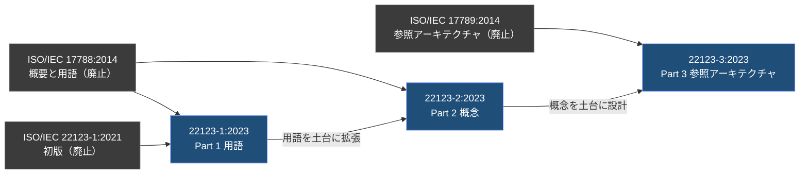

| 規格 | 役割 | 発行時期（確認できた範囲） |
|---|---|---|
| 22123-1 | **用語**（この文書の対象） | 2023年2月 |
| 22123-2 | **概念**（用語を拡張し、基盤となる概念を説明） | 2023年9月 |
| 22123-3 | **参照アーキテクチャ（CCRA）** | 2023年9月 |

> 💡 **ポイント**: 22123-2 の本文では「CSC や CSP のように名前だけなら *party（関係者）*、"CSC role" のように role を付けると *役割*」と使い分けています。これは 22123-1:2023 の改訂内容（Step 2 参照）と直結する重要な考え方です。

---

## Step 2: 2023年版で何が変わったか

規格の「まえがき」には、主な変更点が8つ書かれています。初学者は**「何が"言葉の整理"として変わったのか」**を押さえると理解が速いです。

| # | 変更点（要約） | 初学者向けの意味 |
|---|---|---|
| 1 | hybrid cloud の定義を変更 | 「プライベート＋パブリックを使う形」に整理された |
| 2 | CSC role / CSP role / CSN role を追加 | 「誰か」と「何をするか」を分けて考えられるようになった |
| 3 | CSC / CSP / CSN の定義を role ベースに改訂 | 「party が role を担う」という構造に統一 |
| 4 | ISO/IEC 27000 由来の「機密性・完全性・情報セキュリティ」の定義を削除 | セキュリティ用語は 27000 側を参照する方針 |
| 5 | inter-cloud の定義を変更 | 「プライマリ CSP が他 CSP のサービスを使って提供する形」に整理 |
| 6 | multi-cloud 関連用語を追加 | マルチクラウドが**正式な用語**として定義された |
| 7 | peer cloud service(provider) → secondary cloud service(provider) に名称変更 | 「対等」ではなく「二次的（裏で使われる側）」という意味が明確に |
| 8 | 「複数性と構成」に関する用語を新しい節（3.14）に追加 | 複数 CSP をまたぐ構成用語が独立した |

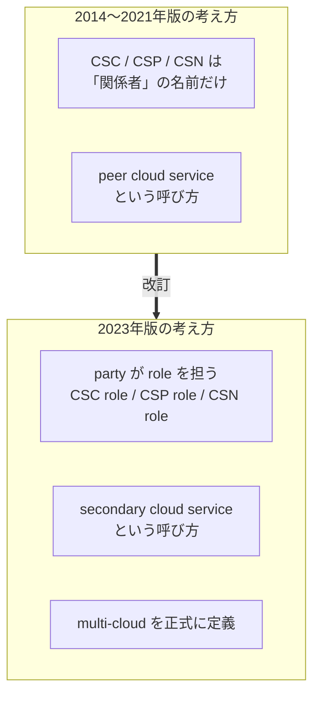

---

## Step 3: 規格の構成（第3章の14カテゴリ）

本文は「1 適用範囲」「2 引用規格（なし）」「3 用語と定義」だけの非常にシンプルな構造で、**中身はほぼ第3章**です。第3章は14の小節に分かれています。

| 節 | カテゴリ（英語） | 日本語での目安 | この文書の Step |
|---|---|---|---|
| 3.1 | cloud computing foundation | 基礎 | Step 4 |
| 3.2 | cloud deployment models | 配備モデル | Step 5 |
| 3.3 | cloud computing roles and activities | 役割と活動 | Step 6 |
| 3.4 | key cloud computing characteristics | 主要特性 | Step 7 |
| 3.5 | cloud capabilities types and cloud service categories | 能力タイプとサービスカテゴリ | Step 8 |
| 3.6 | interoperability | 相互運用性 | Step 9 |
| 3.7 | cloud service agreements | サービス契約 | Step 10 |
| 3.8 | cloud portability | 可搬性 | Step 9 |
| 3.9 | cloud data | クラウドデータ | Step 11 |
| 3.10 | security and privacy | セキュリティとプライバシー | Step 12 |
| 3.11 | inter-cloud | インタークラウド | Step 12 |
| 3.12 | virtualization | 仮想化 | Step 12 |
| 3.13 | miscellaneous terms | その他 | Step 12 |
| 3.14 | multiplicity and organization of cloud services | クラウドサービスの複数性と構成（2023年版で新設） | Step 12 |

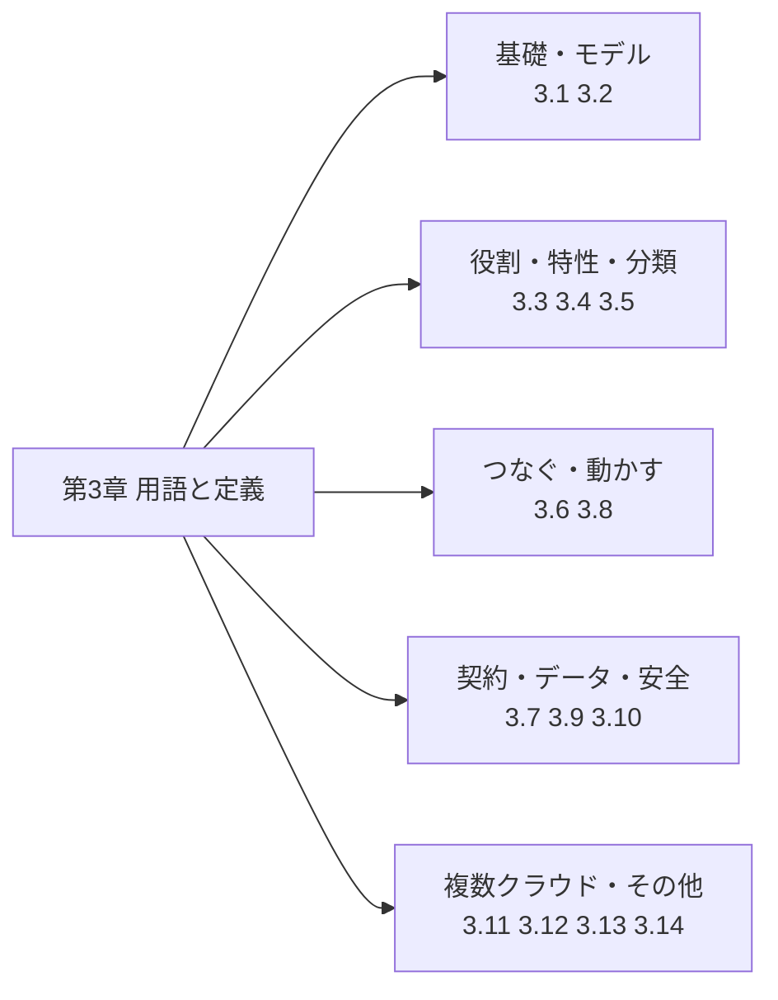

---

## Step 4: 基礎用語 ― cloud computing / cloud service / cloud solution

**対応節: 3.1**（用語は3つだけ）

| 用語 | やさしい言い換え | 押さえどころ |
|---|---|---|
| **cloud computing** | ネットワーク経由で、**伸縮自在**で**共有可能**なリソースの集まりを、**セルフサービス**で、**必要なときに**使い・管理できるようにする考え方（パラダイム） | リソースの例として、サーバー、OS、ネットワーク、ソフトウェア、アプリ、ストレージ装置が挙げられている |
| **cloud service** | cloud computing を通じて提供される**1つ以上の機能**で、**定められたインタフェース**から呼び出せるもの | 「機能」＋「インタフェース」がセット |
| **cloud solution** | 複数の cloud service を**組み合わせ、制御して**、利用者の要件を満たす形にしたもの | 配備モデルはどんな組み合わせでも使える |

### 具体例で理解する

「社内の勤怠システムをクラウドで作る」場合:

1. **cloud service** = 仮想マシン、マネージドDB、オブジェクトストレージ、認証サービス（それぞれ1つの"機能"）
2. **cloud solution** = それらを組み合わせて**勤怠システムとして成立**させた全体
3. **cloud computing** = そうした利用を可能にしている**仕組み・考え方**全体

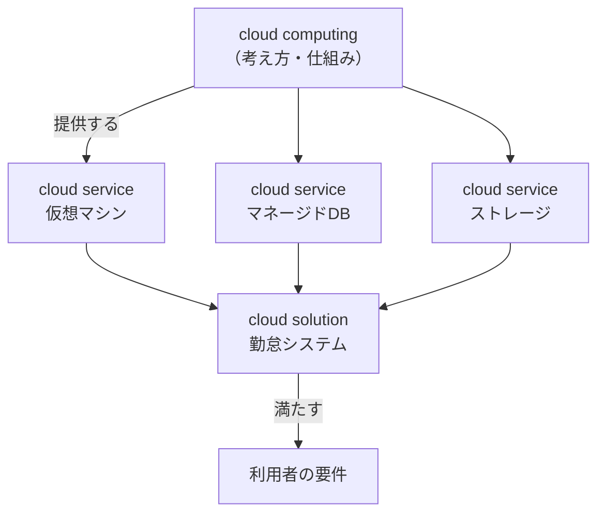

> 💡 **注意**: 上の「仮想マシン」「勤怠システム」は理解のための例です。規格本文に製品名や具体例の記載があるわけではありません。

---

## Step 5: 配備モデル（デプロイメントモデル）

**対応節: 3.2**（10用語）

### 5-1. 配備モデルとは

**「物理・仮想リソースの"管理権（コントロール）"と"共有のされ方"によって、クラウドをどう構成するか」** の分類です。

### 5-2. 基本の4モデル

| モデル | 誰が使う？ | リソースを誰が管理？ |
|---|---|---|
| **private cloud** | 1つの CSC だけが専用に使う | その CSC |
| **public cloud** | 原則どの CSC でも使える | CSP |
| **community cloud** | 共通要件と関係性をもつ**特定のグループ**だけが共有 | グループ内の**少なくとも1メンバー** |
| **hybrid cloud** | private と public の**両方**を使う | （構成要素ごとに異なる） |

### 5-3. 2023年版で整理された複数 CSP 系のモデル

| モデル | 要点 |
|---|---|
| **multi-cloud** | **CSC が**、**2社以上の CSP** の**パブリッククラウド**サービスを使う。**統合と管理の責任は CSC 側**にある |
| **hybrid multi-cloud** | CSC が **hybrid cloud と multi-cloud の両方**のサービスを使う |
| **cloud service federation** | 2つ以上の CSP が、**合意したポリシー・プロセス・信頼**で結びついてサービスを提供する関係（※モデルではなく"連合"という関係の名前） |
| **federated cloud** | federation のメンバーがサービスを提供する配備モデル |
| **inter-cloud** | CSP が、**他の CSP のサービスを1つ以上使って**自社サービスを提供する形。プライマリ CSP が仲介・集約・裁定（アービトラージ）などで提供することが多い、と注記されている |

### 5-4. 「どのモデル？」判定フロー

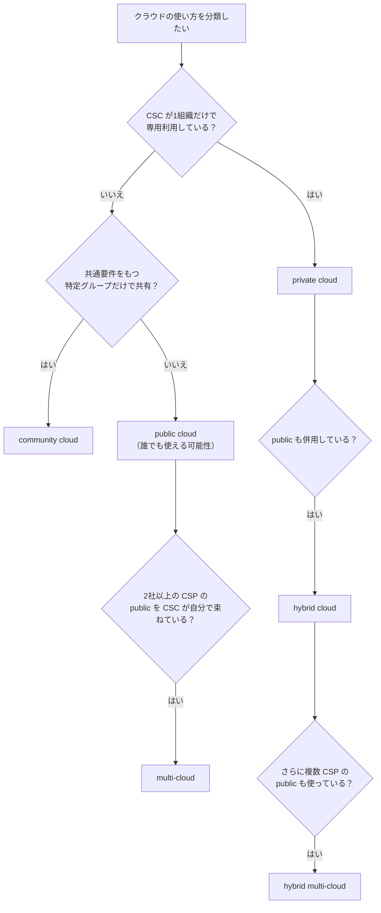

### 5-5. 組み合わせの関係図

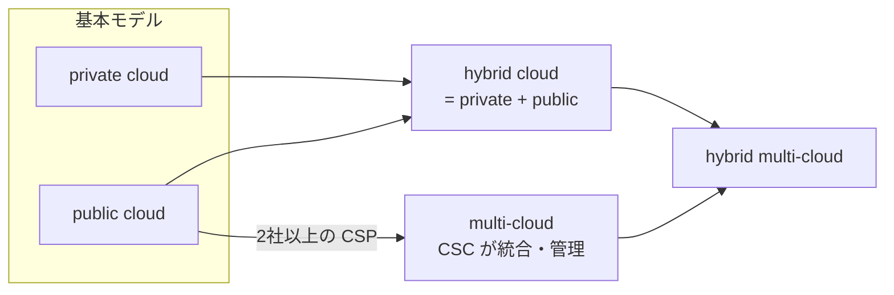

### 5-6. 「multi-cloud」と「inter-cloud」「federated cloud」の違い

ここが初学者が最も混同しやすいポイントです。**「誰が複数のクラウドをつないでいるか」**で整理します。

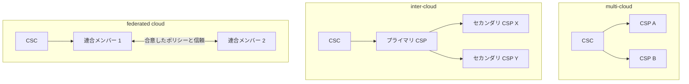

| モデル | 複数 CSP をつなぐのは誰？ | CSC から見える CSP は？ |
|---|---|---|
| multi-cloud | **CSC 自身** | 複数見える |
| inter-cloud | **プライマリ CSP**（裏で他社のサービスを使う） | 基本的にプライマリのみ |
| federated cloud | **CSP 同士**（合意に基づく連合） | 連合として提供される |

> 💡 **ベストプラクティス**: 設計書やRFPで「マルチクラウド」と書く場合、**「CSC が統合責任を持つ前提か」**を明記すると、inter-cloud や federated cloud との取り違えを防げます。

---

## Step 6: 役割と関係者（party / role / CSC / CSP / CSN）

**対応節: 3.3**（16用語）

### 6-1. まず「party」と「role」を分ける（2023年版の重要ポイント）

| 用語 | 意味 | 例えるなら |
|---|---|---|
| **party** | 自然人・法人・それらのグループ。**1つ以上の role を担える** | 「人・組織」そのもの |
| **role** | 共通の目的をもつ**活動（activity）の集合** | 「帽子」 |
| **sub-role** | role の活動の**部分集合** | 「帽子の一部の機能」 |
| **activity** | 特定の営み、またはタスクの集まり | 個別の作業 |
| **functional component** | 活動に必要な機能的な構成要素（実装に裏付けられる） | 作業に使う部品 |

**同じ会社が、あるときは CSC role、別のときは CSP role を担う**ことがあります（例: 自社でクラウドを使いつつ、顧客向けにもクラウドサービスを提供する場合）。

### 6-2. 3つの主役

| party | 担う role | role の意味 |
|---|---|---|
| **CSC**（cloud service customer） | CSC role | クラウドサービスを**使う**ための活動の集合 |
| **CSP**（cloud service provider） | CSP role | クラウドサービスを**利用可能にする**活動の集合 |
| **CSN**（cloud service partner） | CSN role | CSP role や CSC role（または両方）を**支援・補助**する活動の集合 |

### 6-3. その他の関係者

| 用語 | 意味 |
|---|---|
| **CSU**（cloud service user） | CSC に紐づいて cloud service を実際に使う**自然人、またはその代理主体**（デバイスやアプリケーションも含まれ得る） |
| **cloud auditor** | CSN の一種。クラウドサービスの提供・利用について**監査**する責任をもつ |
| **cloud service broker** | CSN の一種。CSC と CSP の**関係を取りもつ（交渉する）** |
| **cloud service developer** | CSN の一種。cloud service の**設計・開発・テスト・保守**に責任をもつ |
| **device platform cloud service** | デバイスプラットフォーム提供者が、そのデバイスプラットフォームを支えるために提供する cloud service（例: アプリマーケットプレイス） |

### 6-4. 関係図

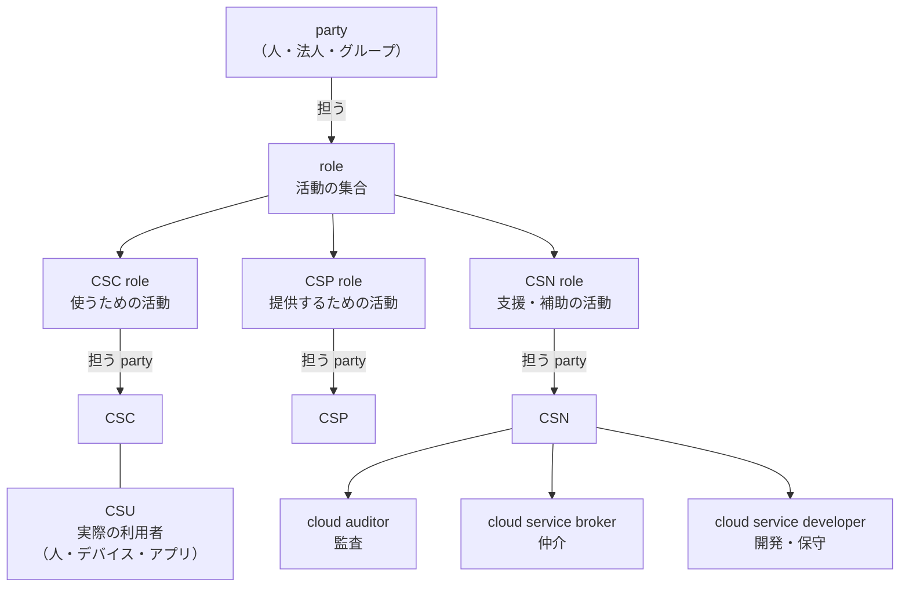

### 6-5. 具体例

| 場面 | CSC | CSP | CSN |
|---|---|---|---|
| 自社システムをパブリッククラウドへ移行 | 自社 | クラウド事業者 | 移行支援ベンダー（支援）、第三者監査法人（auditor） |
| SaaS を従業員が利用 | 自社（契約主体） | SaaS 事業者 | 代理店（broker 的な役割になり得る） |
| 自社アプリの利用者 | （自社が CSP role を担う） | 自社 | ― |

> 💡 **注意**: 上表の具体例は理解用の例示で、規格本文の記載ではありません。

---

## Step 7: クラウドの主要特性

**対応節: 3.4**（5用語）

| 用語 | やさしい言い換え | 実務での確認ポイント |
|---|---|---|
| **on-demand self-service** | CSC が、必要なときに、**自動で／CSP とほぼやり取りせず**コンピューティング能力を用意できる | コンソールや API で即時に払い出せるか |
| **resource pooling** | CSP が持つ物理・仮想リソースを**まとめて**、1つ以上の CSC に提供する | 専有ではなく共有プールから提供される前提 |
| **measured service** | 利用量が**計測**され、監視・制御・報告・**課金**できる形でサービスが提供される | 使用量メトリクスと請求が連動しているか |
| **tenant** | 物理・仮想リソースの集合へのアクセスを**共有する**1人以上の CSU | 「テナント＝契約単位」とは限らず、**利用者の集合**として定義 |
| **multi-tenancy** | 複数のテナントとその計算・データが、**互いに隔離され、相互にアクセスできない**ようにリソースを割り当てること | 隔離の仕組みとレベルの確認が重要 |

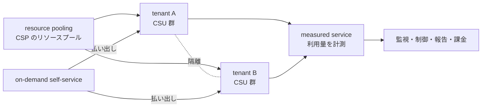

> 💡 **補足**: NIST SP 800-145 は「broad network access」「rapid elasticity」を含む5つの本質的特性を挙げています。22123-1 の 3.4 節に収録されているのは上の5用語で、**特性の数え方が NIST と一致しているわけではない**ことに注意してください（詳細は「NIST との比較」参照）。ただし 22123-1 の cloud computing の定義自体に「scalable and elastic（伸縮自在）」「network access」が含まれています。

---

## Step 8: 能力タイプとサービスカテゴリ（IaaS / PaaS / SaaS ほか）

**対応節: 3.5**（12用語）

### 8-1. 2階層で整理されている

22123-1 は、サービス分類を**2階層**で考えます。

1. **cloud capabilities type（能力タイプ）**: 使われる**リソースの種類**に基づく大分類（3種類）
2. **cloud service category（サービスカテゴリ）**: 共通の性質を持つクラウドサービスの**グループ**（1つ以上の能力タイプを含み得る）

### 8-2. 能力タイプ（3種類）

| 能力タイプ | CSC にできること |
|---|---|
| **application capabilities type** | CSP のアプリケーションを**使う** |
| **infrastructure capabilities type** | 処理・ストレージ・ネットワークリソースを**プロビジョニングして使う** |
| **platform capabilities type** | CSP がサポートする言語・実行環境で、自作／調達したアプリを**デプロイ・管理・実行する** |

### 8-3. サービスカテゴリ（7種類）

| カテゴリ | 略称 | 内容 | 能力タイプとの関係 |
|---|---|---|---|
| infrastructure as a service | **IaaS** | 提供されるのが infrastructure capabilities type | infrastructure |
| platform as a service | **PaaS** | 提供されるのが platform capabilities type | platform |
| software as a service | **SaaS** | 提供されるのが application capabilities type | application |
| communications as a service | CaaS | リアルタイムのやり取りと協働 | application と platform の**両方**を提供し得る |
| compute as a service | CompaaS | ソフトウェアのデプロイ・実行に必要な**処理リソース**の提供と利用 | 注記: 他の能力が別途必要な場合がある |
| data storage as a service | DSaaS | データストレージと関連機能の提供と利用 | **3種類のどれでも**提供し得る |
| network as a service | NaaS | 通信の接続性と関連ネットワーク機能 | **3種類のどれでも**提供し得る |

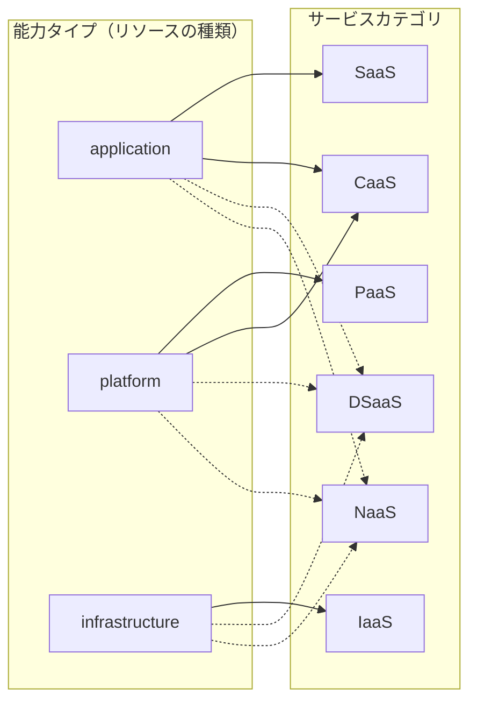

> 実線は「そのカテゴリそのもの／注記で明示された組み合わせ」、点線は「3種類のどれでも提供し得る」を表します。

### 8-4. IaaS の責任範囲（規格が書いている部分）

IaaS の注記では、CSC は**基盤となる物理・仮想リソースを管理も制御もしない**が、**OS・ストレージ・デプロイしたアプリケーションは制御できる**と述べられています。ホストファイアウォールなど**ネットワークの一部を限定的に制御**できる場合もあります。

### 8-5. 責任範囲の目安（※一般的な理解。規格本文の表ではありません）

| レイヤー | IaaS | PaaS | SaaS |
|---|---|---|---|
| アプリケーションのデータ・設定 | CSC | CSC | CSC（設定の範囲内） |
| アプリケーション本体 | CSC | CSC | CSP |
| ランタイム・ミドルウェア | CSC | CSP | CSP |
| OS | CSC | CSP | CSP |
| 仮想化基盤・物理機器 | CSP | CSP | CSP |

> ⚠️ **注意**: 実際の責任分界は各 CSP のサービスごと・契約ごとに異なります。上表は初学者が全体像をつかむための一般的な目安です。

---

## Step 9: 相互運用性と可搬性

**対応節: 3.6（相互運用性）／ 3.8（可搬性）**

### 9-1. 2つの違い

| 概念 | 一言で | 場面 |
|---|---|---|
| **interoperability（相互運用性）** | **つないで一緒に動かせる**か | 稼働中のシステム同士が情報を交換し、使い合えるか |
| **portability（可搬性）** | **移して動かせる**か | データやアプリを別の環境へ移せるか |

### 9-2. 相互運用性の5つのレベル

| 用語 | 確認する観点 | たとえ |
|---|---|---|
| **transport interoperability** | 確立された通信基盤で情報をやり取りできるか | 電話回線がつながるか |
| **syntactic interoperability** | 交換する情報の**形式**を相手が理解できるか | 同じ文字コード・フォーマットか |
| **semantic data interoperability** | データモデルの**意味**を相手が理解できるか | 「顧客」という言葉が同じ意味か |
| **behavioural interoperability** | やり取りの**結果**が期待どおりになるか | 依頼した処理が想定どおり動くか |
| **policy interoperability** | 双方に適用される**法令・組織・ポリシー**を守れるか | 個人情報保護の要件を満たすか |

さらに、一般用語の **cloud interoperability** は「CSC のシステムがクラウドサービスと、またはクラウドサービス同士が、定められた方法で情報を交換し**予測可能な結果**を得られる能力」と定義されています。

### 9-3. 可搬性の整理

可搬性は**データ**と**アプリケーション**の2系統で、それぞれに5つ前後の観点があります。

| 系統 | 用語 | 観点 |
|---|---|---|
| データ | **data portability** | 再入力なしで容易に別システムへ移せる（紙に出して打ち直すのは「容易」とは言えない、と注記されている） |
| データ | cloud data portability | あるクラウドサービスから別のクラウドサービスへの data portability |
| データ | data syntactic portability | 移行先で**デコードできる形式**か |
| データ | data semantic portability | 移行先で**データモデルの意味**が理解されるか |
| データ | data policy portability | 移行元・移行先の**法令・ポリシー**を守れるか |
| アプリ | **application portability** | 移行元システムから移行先システムへ移せる |
| アプリ | cloud application portability | あるクラウドサービスから別のクラウドサービスへの移行 |
| アプリ | application syntactic portability | アプリの成果物（artefact）の形式を移行先でデコードできる |
| アプリ | application instruction portability | 命令セットが移行先で**実行できる** |
| アプリ | application metadata portability | メタデータが移行先で**保持・理解される** |
| アプリ | application behaviour portability | 移行先で**同等の結果**が得られる |
| アプリ | application policy portability | 移行元・移行先の**法令・ポリシー**を守れる |

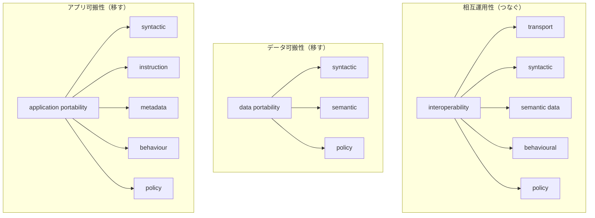

> 💡 **ベストプラクティス**: 5つのレベル／観点は**「形式 → 意味 → 振る舞い → ポリシー」**の順に深くなっています。移行計画やマルチクラウド設計で「どこまで確認したか」を整理するチェックリストとして使えます。

---

## Step 10: サービス契約まわりの用語（SLA / SLO / SQO）

**対応節: 3.7**（11用語）

### 10-1. 用語の整理

| 用語 | 意味（要約） |
|---|---|
| **service level agreement (SLA)** | サービス提供者と顧客の間で、サービスと**サービス目標**を特定する文書化された合意（一般的な SLA） |
| **cloud service agreement** | CSP と CSC の間で、対象の cloud service を**統制する**文書化された合意。複数の文書にまたがってもよい |
| **cloud service level agreement (cloud SLA)** | cloud service agreement の**一部**で、SLO と SQO を含むもの |
| **cloud service level objective (cloud SLO)** | CSP が約束する、**定量的**な特性（間隔尺度・比率尺度の値）。範囲で表現し得る |
| **cloud service qualitative objective (cloud SQO)** | CSP が約束する、**定性的**な特性（名義尺度・順序尺度の値）。列挙リストで表現し得る。人の解釈が要る場合が多い |
| **metric** | 測定の条件とルール、結果の解釈を定める**測定の標準** |
| **cloud service product** | cloud service と、それが提供される**ビジネス条件**（価格、評価、サービスレベルなど）をセットにしたもの |
| **product catalogue** | CSP が CSC に提供する**cloud service product** の一覧 |
| **service catalogue** | ある CSP の**cloud service** の一覧 |
| **failure notification policy** | サービス停止の連絡方法（誰がどう通知し、更新をどう伝えるか）を定める方針 |
| **remedy** | CSP が SLO を満たせなかった場合に CSC が受け取れる**補償** |

### 10-2. 包含関係

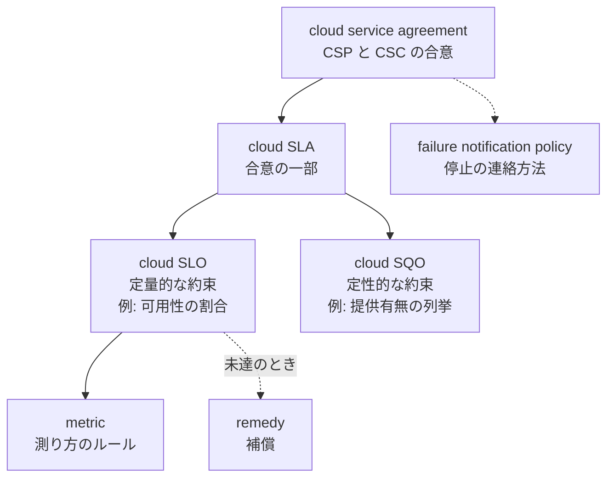

### 10-3. SLO と SQO の見分け方

| 観点 | SLO | SQO |
|---|---|---|
| 性質 | **定量的** | **定性的** |
| 値の尺度 | 間隔尺度・比率尺度 | 名義尺度・順序尺度 |
| 表現の例 | 範囲（上限・下限） | 列挙リスト、有無（existence / nonexistence） |
| 解釈 | 数値で機械的に判定しやすい | 人の解釈が必要になりやすい |

> 💡 **ポイント**: 「99.9% 以上の可用性」のように**数値で測れる約束が SLO**、「暗号化に対応している」のように**有無や分類で表す約束が SQO** というイメージで整理すると理解しやすくなります（この具体例は理解用で、規格本文のものではありません）。

---

## Step 11: クラウドデータの分類

**対応節: 3.9**（本文で確認できた範囲: 3.9.1〜3.9.4）

クラウド上のデータを**「誰が管理権をもつか」**と**「どこから生じたか」**で分類しています。

| 用語 | 管理権 | 何のデータか |
|---|---|---|
| **cloud service customer data** | **CSC** | CSC が cloud service に入力した、または CSC（または代理）が公開インタフェースを通じてサービスの機能を使った結果として生じたデータ |
| **cloud service derived data** | **CSP** | CSC が cloud service を使った**結果として派生**したデータ（利用ログ、設定・カスタマイズ情報など） |
| **cloud service provider data** | **CSP** | cloud service の**運用に固有**のデータ（リソース構成・利用状況、仮想マシンの割り当てなど） |
| **account data** | （CSC ごとに固有） | cloud service を**管理するために必要**な、CSC ごとの固有データ |

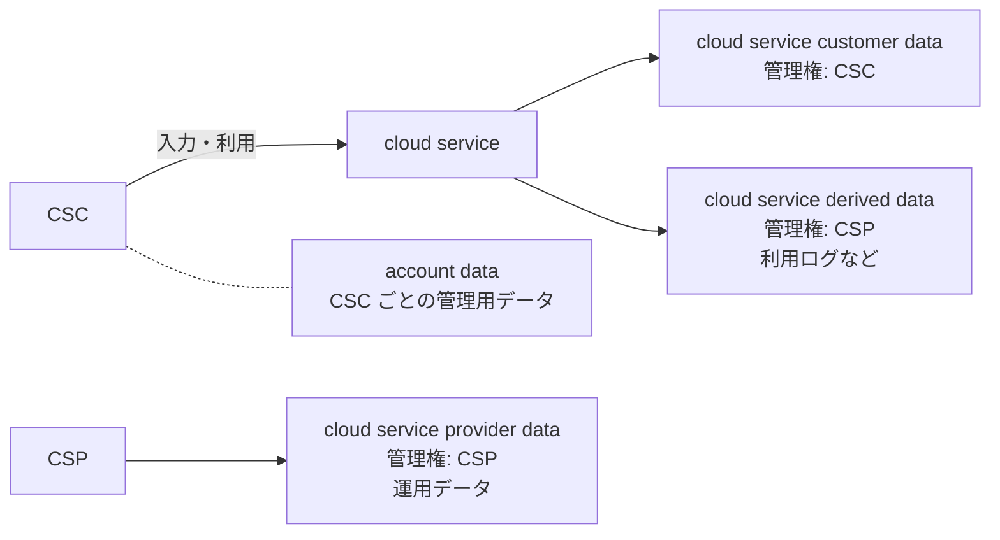

### 注記から学べる重要ポイント

- cloud service が、CSP が用意したデータや公開データを扱うことがあり、それらは customer data ではない場合がある。
- ただし CSC が操作して生み出した**出力データ**は、著作権の一般原則に従って**多くの場合 customer data になり得る**。ただし **cloud service agreement に別段の定めがあればそちらが優先**される、と注記されている。

> ⚠️ **実務での注意**: 「利用ログは CSP が管理するデータ（derived data）」という整理は、**ログの閲覧・エクスポート・保存期間をどう契約に書くか**を考えるきっかけになります。データの扱いは必ず cloud service agreement で確認してください。

---

## Step 12: 3.10〜3.14 の概観と実務での使い方

> ⚠️ **調査の限界**: 公開されているプレビュー本文では 3.7 節途中までしか確認できず、3.9.5 以降および 3.10〜3.14 の**個々の定義文は本調査では確認できていません**。ここでは目次と、他の節の相互参照から確認できた範囲のみを記載します。詳細は ISO のOnline Browsing Platform または購入版で確認してください。

### 12-1. 目次と相互参照から確認できたこと

| 節 | 確認できた範囲 |
|---|---|
| 3.10 security and privacy | 節の存在（目次）。2023年版では ISO/IEC 27000 由来の「機密性・完全性・情報セキュリティ」定義を**削除**した（まえがき） |
| 3.11 inter-cloud | primary cloud service provider（3.11.2）、secondary cloud service provider（3.11.4）が定義されている（inter-cloud の注記の相互参照より） |
| 3.12 virtualization | 節の存在（目次）。virtual machine（3.12.2）が定義されている（3.9.3 の注記の相互参照より） |
| 3.13 miscellaneous terms | device（3.13.4）、device platform（3.13.5）、application marketplace（3.13.6）、audit（3.13.10）、device platform provider（3.13.13）が定義されている（相互参照より） |
| 3.14 multiplicity and organization of cloud services | 2023年版で**新設**された節（まえがき） |

### 12-2. 実務での使いどころ

| 場面 | 規格の使い方 |
|---|---|
| **設計書・提案書** | 「IaaS」「PaaS」「SaaS」「multi-cloud」などを、**22123-1 の定義で用語統一**する。冒頭に「用語は ISO/IEC 22123-1:2023 に従う」と書く |
| **RFP・調達** | multi-cloud を求めるのか inter-cloud を求めるのかを区別して書く（Step 5-6） |
| **契約・SLA レビュー** | SLO／SQO／remedy／failure notification policy の有無を**チェックリスト化**（Step 10） |
| **移行計画** | portability の観点（形式・意味・ポリシー・振る舞い）を確認項目にする（Step 9） |
| **データガバナンス** | customer data／derived data／provider data／account data の**管理権と保存範囲**を整理（Step 11） |
| **教育・オンボーディング** | 役割（CSC / CSP / CSN）と party／role の違いから教える（Step 6） |

### 12-3. 学習ロードマップ

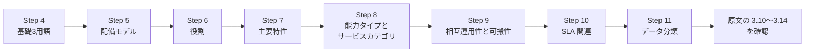

---

## 関連規格・NIST SP 800-145 との比較

### 関連規格

| 規格 | 内容 | 22123-1 との関係 |
|---|---|---|
| ISO/IEC 22123-2:2023 | クラウドコンピューティングの**概念** | 22123-1 の用語を拡張し、概念を詳しく説明（サービスカテゴリの数や配備モデルの説明も拡張・修正） |
| ISO/IEC 22123-3:2023 | **参照アーキテクチャ（CCRA）**。59ページ | 17789:2014 の後継 |
| ISO/IEC 17788:2014 | 概要と用語 | 22123-1 と 22123-2 に引き継がれ廃止 |
| ISO/IEC 17789:2014 | 参照アーキテクチャ | 22123-3 に引き継がれ廃止 |

### NIST SP 800-145（2011年）との比較

NIST SP 800-145 は Peter Mell 氏と Timothy Grance 氏による文書で、**5つの本質的特性・3つのサービスモデル・4つの配備モデル**を整理した、広く参照されている定義です。

| 観点 | NIST SP 800-145（2011） | ISO/IEC 22123-1:2023 |
|---|---|---|
| 性質 | 米国 NIST の特別刊行物（約7ページ） | 国際規格（ISO カタログでは16ページ、IEC Webstore / SIS では約18ページ）。**用語集**の形式 |
| 特性 | on-demand self-service / broad network access / resource pooling / rapid elasticity / measured service | 3.4 節に on-demand self-service / resource pooling / measured service / tenant / multi-tenancy。elastic・network access は cloud computing の定義に含まれる |
| サービスモデル | SaaS / PaaS / IaaS（3つ） | 能力タイプ3種＋サービスカテゴリ（IaaS / PaaS / SaaS に加え CaaS / CompaaS / DSaaS / NaaS） |
| 配備モデル | private / community / public / hybrid（4つ） | 4つに加え multi-cloud / hybrid multi-cloud / federated cloud / inter-cloud など |
| 役割 | （用語としては限定的） | party / role / CSC / CSP / CSN / CSU を体系化 |
| 契約・データ・可搬性 | 範囲外 | SLA／SLO／SQO、データ分類、可搬性・相互運用性を定義 |
| 更新 | 2011年9月発行。大きな更新なし（第三者の解説による） | 2023年2月発行 |

### 注意すべき違い: 「hybrid cloud」

| 出典 | hybrid cloud の捉え方 |
|---|---|
| 22123-1:2023 | **private cloud と public cloud を使う**配備モデル |
| 米国財務省 Shared Cloud Lexicon（NIST 系の定義を踏襲） | 2つ以上のクラウド（オンサイト／オフサイトの private・community、public）が**別々の存在のまま**結び付いた構成 |

「hybrid」という同じ言葉でも、**組み合わせる対象の範囲が異なる**ため、文書で使うときは**どの定義に従うか**を明記すると安全です。

### 欧州での採用状況

DIN の公開情報によると、ISO/IEC 22123-1:2023 を欧州規格として採用する **prEN ISO/IEC 22123-1:2025**（DIN EN ISO/IEC 22123-1:2026-02 草案）が2026年1月に公開されています。DIN ISO/IEC 17788:2016-04 からの変更点として、hybrid cloud の定義変更、CSC／CSP／CSN role の追加、multi-cloud 関連用語の追加などが挙げられています。

---

## 開発者・アーキテクトの視点（ロックインの議論）

22123-1 の multi-cloud／portability／interoperability は、実務の**ロックイン（囲い込み）**の議論と強く結びつきます。

### Gregor Hohpe 氏（『The Software Architect Elevator』著者）の整理

Gregor Hohpe 氏は、Martin Fowler 氏のサイトに掲載された記事 "Don't get locked up into avoiding lock-in" で、ロックインを**単純な真偽ではなく多面的なもの**として整理しています。氏自身のブログによれば、ロックインは次の観点に分解できます。

| ロックインの観点 | 例えるなら |
|---|---|
| vendor lock-in | 特定ベンダーへの依存 |
| product lock-in | 特定製品への依存 |
| version lock-in | 特定バージョンへの依存 |
| architecture lock-in | 特定アーキテクチャへの依存 |
| platform lock-in | 特定プラットフォームへの依存 |
| skill lock-in | 特定スキルセットへの依存 |
| legal lock-in | 契約・法的な拘束 |
| mental lock-in | 思い込みによる固定化 |

さらに氏は、**ロックインを避けると別のロックインに入ってしまうことがある**ため、「避ける」より**切り替えコストと選択肢のコスト**を総合的に判断すべきだと論じています。

### 22123-1 の用語との対応

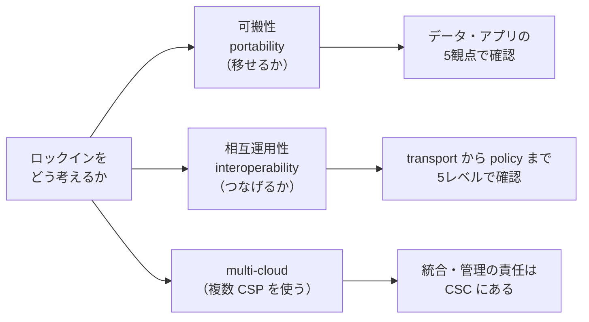

> 💡 **実務上のポイント**: 「マルチクラウドにすればロックインを回避できる」とは限りません。22123-1 の multi-cloud の注記は、**統合と管理の責任が CSC 側に移る**ことを明示しています。可搬性・相互運用性の5観点で**何を確保するか**を決めたうえで、コストと比べて判断するのが現実的です。

Ivan Pepelnjak 氏（ネットワークエンジニア／ipSpace.net）も、Hohpe 氏の連載の「ロックインの色合い（shades of lock-in）」の部分を必読として紹介しています。

---

## 理解度チェック

| # | 質問 | 答え（要約） |
|---|---|---|
| Q1 | 22123-1 はどのような種別の規格か？ | クラウド分野の**用語を定義する**用語集型の規格。要求事項や認証基準を定めるものではない |
| Q2 | 22123-1:2023 が置き換えた規格は？ | ISO/IEC 17788:2014 と ISO/IEC 22123-1:2021 |
| Q3 | party と role の違いは？ | party は人・組織。role は活動の集合。1つの party が複数の role を担える |
| Q4 | multi-cloud で統合・管理の責任をもつのは？ | **CSC** |
| Q5 | hybrid cloud は何と何を使う配備モデル？ | private cloud と public cloud |
| Q6 | multi-cloud と inter-cloud の最大の違いは？ | 複数 CSP をつなぐのが **CSC 自身**か、**プライマリ CSP**か |
| Q7 | SLO と SQO の違いは？ | SLO は**定量的**、SQO は**定性的**な約束 |
| Q8 | cloud service derived data の管理権は誰にある？ | **CSP** |
| Q9 | 3つの能力タイプは？ | application / infrastructure / platform |
| Q10 | 2023年版で peer cloud service(provider) は何に置き換わった？ | secondary cloud service(provider) |

### 自己点検チェックリスト

- [ ] 規格が「用語集型」であり、準拠認証の対象ではないことを説明できる
- [ ] party と role の違いを例で説明できる
- [ ] 5つの配備モデル（private / public / community / hybrid / multi-cloud）を区別できる
- [ ] multi-cloud・inter-cloud・federated cloud の違いを図で描ける
- [ ] IaaS / PaaS / SaaS が能力タイプとどう対応するか説明できる
- [ ] 相互運用性5レベルと可搬性の観点を、移行計画の確認項目に落とせる
- [ ] SLA / SLO / SQO / remedy の関係を説明できる
- [ ] customer data と derived data の違いを説明できる
- [ ] 自社の設計書で hybrid cloud の定義をどれに合わせるか決められる

---

## 調査の限界と注意点

| 項目 | 内容 |
|---|---|
| 規格本文の確認範囲 | 公開プレビューで確認できたのは**3.7.6 まで**（および3.9.1〜3.9.4 の一部は FDIS 版の公開テキストで確認）。**3.9.5 以降〜3.14 の個々の定義文は未確認** |
| 定義の表現 | 規格は著作権で保護されているため、本書は定義を**日本語で要約・言い換え**したものです。**厳密な文言は必ず原文で確認**してください |
| 製品名・具体例 | 「勤怠システム」「99.9%」などの例は**理解のための例示**で、規格本文の記載ではありません |
| 責任範囲の表（Step 8-5） | 一般的な理解にもとづく目安で、規格本文の表ではありません |
| 開発者の発信 | 22123-1 そのものを直接論じた著名開発者の投稿は、今回の検索ではほとんど見つかりませんでした。そのため、**関連テーマ（ロックイン）の議論**として Hohpe 氏らの発信を補足的に紹介しています |
| 最新情報 | 2026年10月23日時点で、ISO のページ上は「Published」（ステージ 60.60）でした。**改訂・訂正の有無は ISO の公式ページで再確認**してください |
| 欧州採用 | prEN ISO/IEC 22123-1:2025 は**草案**の段階の情報です（2026年1月公開） |

---

## 参考ソース一覧（URL）

### A. 規格の一次情報・公的情報

| # | ソース | URL | 確認した内容 |
|---|---|---|---|
| 1 | ISO 公式（22123-1:2023） | https://www.iso.org/standard/82758.html | タイトル、第2版、2023-02、ステージ 60.60、スコープ、SC 38 |
| 2 | iTeh 公開プレビュー（PDF） | https://cdn.standards.iteh.ai/samples/82758/9e30847fd9734768b084500f1e0dcb50/ISO-IEC-22123-1-2023.pdf | まえがき、目次、3.1〜3.7.6 の定義 |
| 3 | iTeh カタログ（HTML プレビュー） | https://iteh.es/catalog/standards/iso/83fb23a3-9c08-4835-999e-40d2338c60b5/iso-iec-22123-1-2023 | 目次、まえがき、第3章冒頭、FDIS 版の 3.9 周辺 |
| 4 | IEC Webstore（22123-1:2023） | https://webstore.iec.ch/publication/82913 | 発行日 2023-02-10、18ページ、ICS |
| 5 | IEC Webstore（17788:2014） | https://webstore.iec.ch/publication/10567 | 17788 が 22123-1 と 22123-2 により部分的に置き換えられた旨 |
| 6 | SIS（スウェーデン規格協会） | https://www.sis.se/en/produkter/information-technology-office-machines/cloud-computing/ISOIEC-22123-12023 | 置き換え関係（17788:2014、22123-1:2021）、18ページ |
| 7 | AFNOR | https://www.boutique.afnor.org/en-gb/standard/iso-iec-2212312023/information-technology-cloud-computing-part-1-vocabulary/xs141293/342177 | 廃止された2規格の概要 |
| 8 | DIN（欧州採用草案） | https://www.dinmedia.de/de/norm-entwurf/din-en-iso-iec-22123-1/398086512 | prEN ISO/IEC 22123-1:2025、変更点（hybrid の定義変更ほか） |

### B. 関連規格

| # | ソース | URL | 確認した内容 |
|---|---|---|---|
| 9 | ISO 公式（22123-3:2023） | https://www.iso.org/standard/82759.html | 参照アーキテクチャ（CCRA）、59ページ |
| 10 | ISS（22123-3） | https://iss.rs/en/project/show/iso:proj:82759 | 17789:2014 の廃止と 22123-3 の発行（2023-09-22） |
| 11 | Genorma（22123-2） | https://genorma.com/en/project/show/iso:proj:80351 | 22123-2 のスコープ、発行 2023-09-22 |
| 12 | iTeh 公開プレビュー（22123-2） | https://cdn.standards.iteh.ai/samples/80351/24a7ef319fe14f5fbb6150d972bff613/ISO-IEC-22123-2-2023.pdf | 22123-1 との関係、party と role の使い分け |

### C. 標準化委員会（JTC 1）の解説

| # | ソース | URL | 確認した内容 |
|---|---|---|---|
| 13 | JTC 1 Flagship standards | https://jtc1info.org/technology/subcommittees/flagship-standards/cloud-computing/ | 用語の統一、multi-cloud／federated／hybrid／inter-cloud の区別 |
| 14 | JTC 1 新規格紹介 | https://jtc1info.org/new-standard-for-cloud-computing-vocabulary/ | 22123-1 の趣旨（用語の統合）、22123-2 との関係 |

### D. 比較・補足資料

| # | ソース | URL | 確認した内容 |
|---|---|---|---|
| 15 | NIST SP 800-145（Mell・Grance） | https://nvlpubs.nist.gov/nistpubs/Legacy/SP/nistspecialpublication800-145.pdf | 5特性・3サービスモデル・4配備モデル |
| 16 | 米国財務省 Shared Cloud Lexicon | https://home.treasury.gov/system/files/216/Shared-Cloud-Lexicon.pdf | hybrid cloud の別定義、multi-cloud の用語 |
| 17 | Wikipedia "Multicloud" | https://en.wikipedia.org/wiki/Multicloud | 22123-1 の multi-cloud 定義の引用状況 |

### E. 開発者・アーキテクトの発信（ロックインの議論）

| # | ソース | URL | 確認した内容 |
|---|---|---|---|
| 18 | Gregor Hohpe "Shades of gray" | https://architectelevator.com/architecture/architects-shades-of-gray/ | ロックインの8つの観点、Martin Fowler 氏のサイト掲載記事への言及 |
| 19 | Ivan Pepelnjak（ipSpace.net） | https://blog.ipspace.net/2019/10/must-read-shades-of-lock-in | Hohpe 氏の連載（shades of lock-in）の推薦 |
| 20 | Slashdot（記事紹介と要旨） | https://tech.slashdot.org/story/19/09/02/2018219/dont-get-locked-up-into-avoiding-lock-in | 記事 "Don't Get Locked Up Into Avoiding Lock-in" の要旨（martinfowler.com 掲載） |

---

*本ドキュメントは、ISO/IEC 22123-1:2023 の公開情報（2026年10月23日時点）にもとづく学習用の解説であり、規格そのものの代替ではありません。定義の正確な文言や最新の版の状況は、ISO の公式ページおよび購入版の原文でご確認ください。*
