# ISO/IEC 22123-2:2023 初学者向け解説ガイド

**Information technology — Cloud computing — Part 2: Concepts（情報技術 — クラウドコンピューティング — 第2部：概念）**

> 本ガイドは 2026年10月23日までに公開されていた情報をもとに作成しています。
> 規格本文は有償・著作権保護の文書のため、本ガイドでは**要点を自分の言葉で言い換えて**解説します。正確な要求・文言は必ず原典で確認してください。

---

## 目次

- [0. このガイドの読み方と注意点](#0-このガイドの読み方と注意点)
- [1. ステップ1：規格の全体像をつかむ](#1-ステップ1規格の全体像をつかむ)
- [2. ステップ2：規格の構成（章立て）を知る](#2-ステップ2規格の構成章立てを知る)
- [3. ステップ3：クラウドの6つの主要特性（Clause 5.2）](#3-ステップ3クラウドの6つの主要特性clause-52)
- [4. ステップ4：能力タイプとサービスカテゴリ（Clause 5.3・5.4）](#4-ステップ4能力タイプとサービスカテゴリclause-5354)
- [5. ステップ5：デプロイメントモデル（Clause 5.5）](#5-ステップ5デプロイメントモデルclause-55)
- [6. ステップ6：関係者（Party）と役割（Role）（Clause 6）](#6-ステップ6関係者partyと役割roleclause-6)
- [7. ステップ7：横断的側面（Clause 7）](#7-ステップ7横断的側面clause-7)
- [8. ステップ8：データとクラウドサービス（Clause 8）](#8-ステップ8データとクラウドサービスclause-8)
- [9. ステップ9：仮想化の概念（Clause 9）](#9-ステップ9仮想化の概念clause-9)
- [10. ステップ10：複数CSPを使う概念（Clause 10）](#10-ステップ10複数cspを使う概念clause-10)
- [11. ステップ11：クラウドの論理・物理構成（Clause 11）](#11-ステップ11クラウドの論理物理構成clause-11)
- [12. ステップ12：NISTの定義との違い・他規格との関係](#12-ステップ12nistの定義との違い他規格との関係)
- [13. 実務で使える早見表](#13-実務で使える早見表)
- [14. よくある誤解](#14-よくある誤解)
- [15. 理解度チェック](#15-理解度チェック)
- [16. 根拠ソース一覧（URL）](#16-根拠ソース一覧url)

---

## 0. このガイドの読み方と注意点

### 0.1 情報の確度について

| 区分 | 内容 | 根拠の強さ |
|---|---|---|
| 確認済み（本文プレビュー） | 目次全体、Foreword、Clause 1〜5.4.5（NaaSの途中）まで | 公開サンプルPDFで本文を直接確認 |
| 目次＋公的機関の解説で確認 | 5.5（デプロイメントモデル）、Clause 6〜11 の項目構成 | 目次、JTC 1・ドイツBSI・Part 3 本文の引用 |
| 一般的な技術解説 | 各項目の初学者向けの補足・具体例 | 本ガイド作成者による一般的な説明（AWS・Google Cloud等の公開資料で裏付け） |

> 注意：公開サンプルで確認できた本文は Clause 5.4.5 付近までです。Clause 5.4.6 以降の細部は、**項目名と公的機関の要約に基づく説明**です。試験・監査・契約など正確さが必要な場面では、原典を購入して確認してください。

### 0.2 表記ルール

- 略語は規格の定義に従います（CSC、CSP、CSN、CSU など。後述）
- 図解は Mermaid（フローチャート）と Markdown の表で表現します
- 「規格がそう書いている」部分と「具体例（本ガイドの補足）」部分は区別して書きます

---

## 1. ステップ1：規格の全体像をつかむ

### 1.1 一言でいうと

**「クラウドコンピューティングとは何か」を、概念の側から整理した規格**です。Part 1（用語）で決めた言葉を使って、特性・サービスの種類・提供形態・関係者・技術的な前提を説明します。

### 1.2 基本情報

| 項目 | 内容 |
|---|---|
| 規格番号 | ISO/IEC 22123-2:2023 |
| タイトル | Information technology — Cloud computing — Part 2: Concepts |
| 種別・版 | 国際規格（International Standard）、第1版（Edition 1.0） |
| 発行時期 | 2023年9月（ストア・機関により 9/21 または 9/22 表記） |
| ページ数 | 35ページ |
| 担当委員会 | ISO/IEC JTC 1/SC 38（Cloud Computing and Distributed Platforms） |
| ICS | 35.210（Cloud computing）、01.040.35（用語） |
| ステータス | 検索時点で Published / Current（現行） |
| 置き換え関係 | Part 1 と合わせて **ISO/IEC 17788:2014 を置き換え**（内容は技術的に改訂） |

### 1.3 スコープ（適用範囲）の要点

- クラウドコンピューティング分野で使われる**概念**を規定する
- Part 1 で定義した用語を**拡張**し、クラウド関連の他の文書の**土台**になる
- 概念を**クラウドでどう適用するか**の詳しい説明も含む

### 1.4 規格ファミリーの中での位置づけ

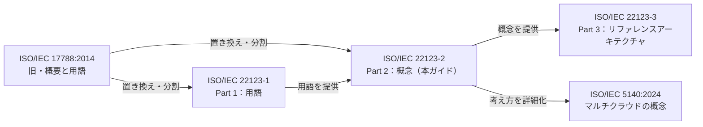

| 文書 | 役割 | 一言でいうと |
|---|---|---|
| Part 1（22123-1） | 用語 | 「言葉の辞書」 |
| **Part 2（22123-2）** | **概念** | **「考え方の教科書」** |
| Part 3（22123-3） | リファレンスアーキテクチャ | 「設計の見取り図」 |
| ISO/IEC 5140 | マルチクラウド等の概念 | Part 2 の Clause 10 を発展させた内容 |

> JTC 1 の公式解説では、Part 2 は Part 1 の用語を土台にし、Part 3 のリファレンスアーキテクチャと組み合わせて使う「要」の文書として紹介されています。ISO/IEC 5140 は複数CSPを使う環境（マルチクラウド、フェデレーション、ハイブリッド、インタークラウド）を扱う規格です。

### 1.5 Part 2 で何が新しくなったか（Foreword より）

旧規格 ISO/IEC 17788 からの主な変更点です。

| 変更点 | 初学者向けの意味 |
|---|---|
| 用語を Part 1 に移動 | 「概念」と「辞書」を分けて読みやすくした |
| 主要特性の説明を拡充 | 特性の中身が詳しくなった |
| サービスカテゴリの数と説明を拡充 | SaaS/PaaS/IaaS 以外も整理された |
| デプロイメントモデルの説明を拡充・訂正 | 誤解されやすい点が直された |
| **Party（関係者）と Role（役割）を区別** | 「誰か」と「何をするか」を別物として扱う |
| 横断的側面の説明を拡充 | セキュリティ等の共通テーマが詳しくなった |
| Clause 8（データ）を新設 | データの流れ・共有を扱う |
| Clause 9（仮想化）を新設 | VM・コンテナ・サーバレス等を扱う |
| Clause 10（複数CSP）を新設 | マルチクラウド等を扱う |
| Clause 11（論理・物理構成）を新設 | リージョン・ゾーン等を扱う |
| Annex A を拡充 | 規格本文で説明しない追加カテゴリを紹介 |

---

## 2. ステップ2：規格の構成（章立て）を知る

### 2.1 章立て一覧

| Clause | 章タイトル | 内容の概要 |
|---|---|---|
| 1 | Scope | 適用範囲 |
| 2 | Normative references | 引用規格（Part 1 のみ） |
| 3 | Terms and definitions | PII principal / PII controller / PII processor の3用語 |
| 4 | Symbols and abbreviated terms | 略語 |
| **5** | **Cloud computing foundational concepts** | **特性・能力タイプ・サービスカテゴリ・デプロイメントモデル** |
| **6** | **Cloud computing parties and roles** | **関係者と役割** |
| **7** | **Cloud computing cross-cutting aspects** | **総論（7.1）＋13の横断的側面（7.2〜7.14）** |
| 8 | Data and cloud services | データ処理・データフロー・共有 |
| 9 | Virtualization concepts | VM、ハイパーバイザー、コンテナ、サーバレス等 |
| 10 | Concepts of cloud computing involving multiple CSPs | 複数CSP利用の概念 |
| 11 | Organization of cloud computing | 論理・物理構成 |
| Annex A | Cloud service categories（参考） | 追加のサービスカテゴリ |
| Bibliography | 参考文献 | — |

### 2.2 学習ロードマップ

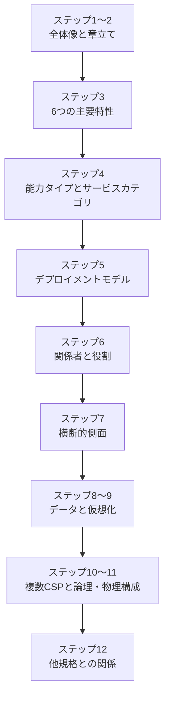

### 2.3 Clause 3：3つの用語（個人情報関連）

Clause 3 で定義されるのは個人情報保護の用語3つで、いずれも ISO/IEC 29100 から引用されています。

| 用語 | 意味（言い換え） |
|---|---|
| PII principal | 個人情報（PII）の主体となる個人。法域によっては「データ主体」とも呼ぶ |
| PII controller | 個人情報の処理の目的と方法を決める当事者 |
| PII processor | PII controller の指示に従って個人情報を処理する当事者 |

> 後述の「Protection of PII（7.9）」を読むときの前提になります。

---

## 3. ステップ3：クラウドの6つの主要特性（Clause 5.2）

### 3.1 主要特性とは

規格では、主要特性を**クラウドを他のIT方式と区別する基本的な性質**と位置づけています。各特性は、利用者が必要とする性質を具体的に表しています。

> 規格は、特性の当てはまり方は CSC（顧客）の要件によって変わり得るため、分析は常に決定的とは限らないとも述べています。ドイツBSIも「各項目を教条的に当てはめすぎない」ことを勧めています。

### 3.2 6つの特性の早見表

| 特性（Clause） | 一言でいうと | 初学者向けの具体例 |
|---|---|---|
| Broad network access（5.2.2） | ネットワーク越しに標準的な方法で使える | スマホ・PC・ブラウザからAPIや画面経由で使う |
| Measured service（5.2.3） | 使った分を計測・管理・課金できる | 使った時間やGB数に応じて請求される |
| Multi-tenancy（5.2.4） | 複数の利用者が同じ基盤を使っても互いに見えない | 同じ物理サーバ上でも他社データは見えない |
| On-demand self-service（5.2.5） | 必要な時に自分で、ほぼ人手を介さず用意できる | コンソールからメモリ・ディスクを増やす |
| Rapid elasticity and scalability（5.2.6） | 素早く増減できる。利用者には無限に見えることが多い | アクセス急増時に台数を増やす |
| Resource pooling（5.2.7） | CSPの資源を束ねて複数顧客に提供する | 場所や詳細を意識せずサービスが動く |

### 3.3 特性ごとの詳細

#### 3.3.1 Broad network access（広範なネットワークアクセス）

- CSPの物理・仮想資源が、**標準的な仕組み**でネットワーク越しに使えること
- 利用者はネットワークにつながっていれば、**携帯電話、タブレット、ノートPC、ワークステーション**など多様な端末から使える
- ネットワークは、公衆インターネット、交換事業者の網、CSP自身の網など様々
- 規格はアクセスの種類として、次の4つを挙げています

| アクセスの種類 | 例 |
|---|---|
| ユーザー（クライアント）からクラウドサービスへ | ブラウザでSaaSを開く |
| アプリケーションからクラウドサービスへ | 自社アプリがAPIを呼ぶ |
| クラウドサービス同士のやり取り（クラウド内・クラウド間） | 別クラウド間のデータ連携 |
| 管理・制御（APIの利用を含む） | IaCでリソースを作成する |

#### 3.3.2 Measured service（計測されるサービス）

- 利用状況を**監視・制御・報告・課金**できること
- 顧客は**使った資源の分だけ支払う**のがポイント
- 従量課金には、**SLAで取り決めた計測方法**が必要
- 規格は、計測の詳細は ISO/IEC 19086（SLAフレームワーク）などを参照するよう案内しています

#### 3.3.3 Multi-tenancy（マルチテナンシー）

- 物理または仮想の資源を割り当て、**複数のテナントの計算処理とデータが互いに隔離され、アクセスできない**ようにする性質
- 通常、1つのテナントは**同じ CSC に属する CSU（利用者）の集まり**
- パブリッククラウドやコミュニティクラウドでは、**複数の異なる CSC の利用者**が混在することもある
- 1つの CSC が、部署・事業部・子会社ごとに**複数のテナンシー**を持つこともある（内部の機密保持や法令遵守のため）
- この仕組みでは**ID・アクセス管理**が重要になる

> 補足：NISTの定義（5つの特性）にはマルチテナンシーが独立項目としてありません。ISOは、これを**独立した特性**として明記している点が特徴です（NISTでは resource pooling の中で触れられています）。

#### 3.3.4 On-demand self-service（オンデマンドのセルフサービス）

- CSC が必要な時に、**自動で、またはCSPとの最小限のやり取りで**サービスを用意できる
- 例：RAM や ディスク容量の変更を、**人手を介さず**行える
- 利用者にとっては、コスト・時間・手間の削減につながる

#### 3.3.5 Rapid elasticity and scalability（迅速な伸縮性とスケーラビリティ）

- サービスの容量を**素早く増減**できる（場合によっては自動）
- CSC から見ると、資源が**ほぼ無制限**に見え、容量計画の心配が減る
- ただし、サービス契約（SLA）による制約はある

スケーリングには2つの方向があります。

| 方向 | 意味 | 例 | 遅延の傾向 |
|---|---|---|---|
| 水平スケーリング（horizontal） | 同じ資源の**数**を増やす | VMやコンテナを並列で増やす | 比較的小さいことが多い |
| 垂直スケーリング（vertical） | 1つの資源の**大きさ**を増やす | 1台のVMのCPU・RAMを増やす | 容量追加の待ち時間が出ることがある |

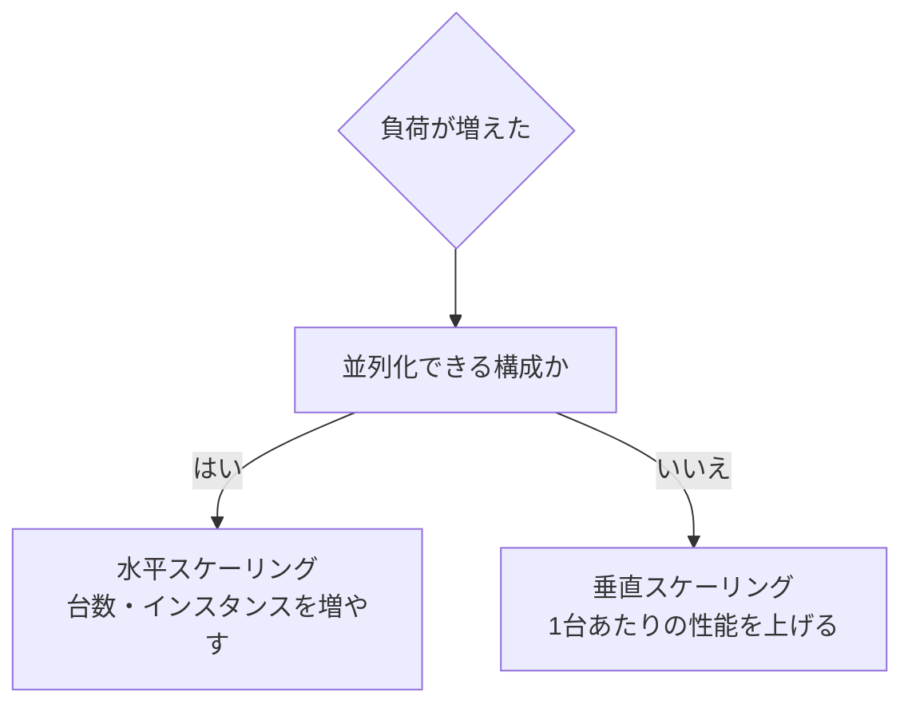

> 規格は、CSP がスケーラビリティの特徴（遅延や制限を含む）を説明し、CSC が自分の要件に合うか判断する、という役割分担も示しています。詳細は ISO/IEC TS 23167 を参照するよう案内されています。なお、ISO/IEC TS 23167:2020 は廃止され、本ガイドの調査時点（2026年10月23日）では後継の ISO/IEC 23167:2026（Cloud computing — Common technologies and techniques）が現行版です。参照する際は ISO/IEC 23167:2026 を確認してください。

#### 3.3.6 Resource pooling（資源のプーリング）

- CSP の物理・仮想資源を**集約**して、1つ以上の CSC に提供する
- CSP は**抽象化**によって、マルチテナンシーの複雑さを利用者から隠す
- CSC は通常、**資源がどこで・どう提供されているかを細かく知らない**（制御もできない）
- ただし、**国・リージョンなど抽象的なレベルで場所を指定**できる場合が多い
- **同種の資源**（例：計算同士、ストレージ同士）はプールできるが、**種類の異なる資源どうしはプールできない**
- CSC は「他の顧客やテナントと資源を共有しない」ことを求めることもできる

### 3.4 6特性の関係

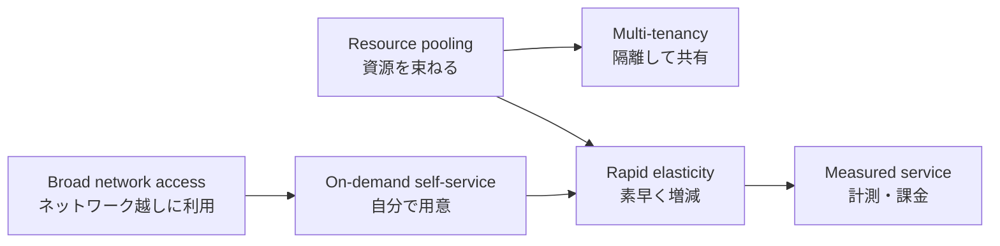

---

## 4. ステップ4：能力タイプとサービスカテゴリ（Clause 5.3・5.4）

### 4.1 まず「能力タイプ」と「サービスカテゴリ」を区別する

この規格で最も重要な整理の1つです。

| 概念 | 意味 | 数 |
|---|---|---|
| **クラウド能力タイプ**（cloud capabilities type） | CSC に提供される機能を、**使われる資源**に基づいて分類したもの | **3つだけ** |
| **クラウドサービスカテゴリ**（cloud service category） | 共通の性質を持つクラウドサービスのグループ | 多数（「as a service」で呼ぶ） |

> 規格は、能力タイプは**関心の分離**の原則に従い、互いの機能の重なりが最小になるようにしている、と説明しています。また、能力タイプを他の分類と混同しないよう注意しています。

### 4.2 3つの能力タイプ（Clause 5.3）

| 能力タイプ | CSC ができること |
|---|---|
| Application（アプリケーション） | CSP のアプリケーションを使う |
| Infrastructure（インフラストラクチャ） | 処理・ストレージ・ネットワーク資源を用意して使う |
| Platform（プラットフォーム） | CSC が作った（または入手した）アプリを、CSP がサポートする言語・実行環境で配備・管理・実行する |

> ここでの「アプリケーション」には、スクリプト、コンテナ、完全／部分的なプログラム、コードや関数ライブラリ、マイクロサービス、AI学習データなど、コンパイル可能・実行可能なソフトウェアの形態が広く含まれる、と規格に注記があります。

### 4.3 サービスカテゴリを決める2つの要素

1. 提供される**能力タイプ**（アプリ／プラットフォーム／インフラ）
2. その**意図された用途**

1つのカテゴリが**複数の能力タイプ**を含むこともあります。

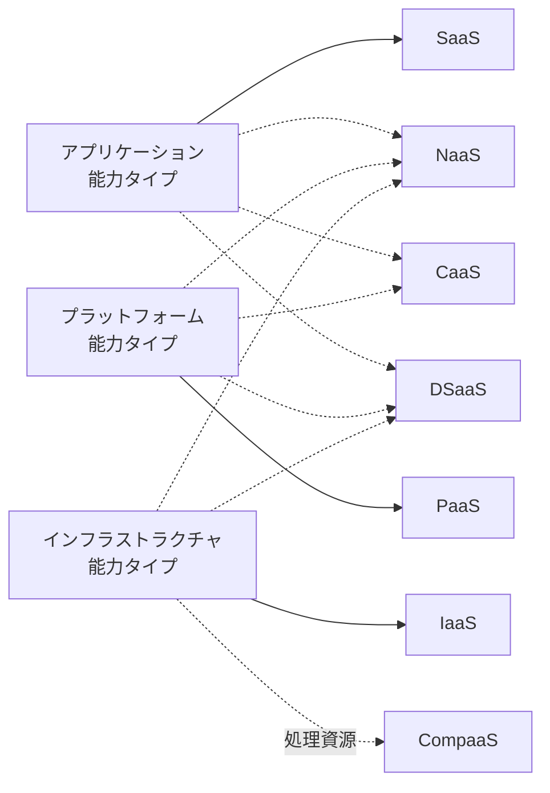

> 実線は「1対1に近い対応」、点線は「複数の能力タイプを含み得る」を表します。NaaS は3つすべて、CaaS はプラットフォームとアプリケーションの両方を提供し得ると、規格に書かれています。DSaaS も Part 1 の定義では3つのどれでも提供し得ます。CompaaS へのラベル付き点線は、提供する**処理資源**がインフラストラクチャ能力タイプの資源に相当することを示す目安です。規格は CompaaS の能力タイプを明示しておらず、他の能力が別途必要な場合があります（4.4節の表は「本文参照」）。

### 4.4 本文で説明される7つのカテゴリ（Clause 5.4）

| 略称 | 正式名称 | Clause | 能力タイプ | 要点 |
|---|---|---|---|---|
| SaaS | Software as a Service | 5.4.2 | アプリケーション | CSP のアプリをそのまま使う |
| PaaS | Platform as a Service | 5.4.3 | プラットフォーム | 自作アプリを CSP の実行環境に配備する |
| IaaS | Infrastructure as a Service | 5.4.4 | インフラストラクチャ | 仮想マシン等の基盤資源を借りて、OS から自分で構成する |
| NaaS | Network as a Service | 5.4.5 | 3種すべて | ネットワーク接続・関連機能を提供 |
| CaaS | Communications as a Service | 5.4.6 | プラットフォーム＋アプリ | 通信サービスを提供 |
| CompaaS | Compute as a Service | 5.4.7 | （本文参照） | 計算資源を提供 |
| DSaaS | Data storage as a Service | 5.4.8 | （本文参照） | データ保存を提供 |

### 4.5 SaaS・PaaS・IaaS の詳細（確認済み本文に基づく）

#### SaaS（5.4.2）

- CSC は CSP のアプリ（CSP の資源上で動く）を使う
- アクセスは、ウェブブラウザ等の**シンクライアント**や **API** 経由
- CSC は、ネットワーク・サーバ・OS・ストレージ、さらには個々のアプリ機能も**管理・制御しない**（限定的なユーザー固有の設定は例外）
- CSP は、ソフトウェアの配備・設定・保守・更新まで担う
- **サービスを提供する主体と、アプリの開発者は別でもよい**
- 一部の SaaS は限定的なスクリプト等で拡張できるが、それがサービスの中心ではない

#### PaaS（5.4.3）

- CSC は、CSP がサポートする言語・ライブラリ・サービス・ツールで作ったアプリを**開発または配備**できる
- 「プラットフォーム」は**クラウド対応アプリの開発・配備基盤**を指す
- **拡張可能な SaaS やウェブアプリとの違いは、主な顧客**（PaaS は開発者・運用担当、SaaS は一般のエンドユーザー）
- CSC は、ネットワーク・サーバ・OS・ストレージを管理しないが、**配備したアプリと、アプリのホスティング環境の設定**には制御権がある

#### IaaS（5.4.4）

- CSC は、物理または仮想の**処理・ストレージ・ネットワーク等の基本資源**を用意し、**任意のソフトウェア**（OS やアプリ）を配備・実行できる
- CSC は基盤資源を管理しないが、**OS・ストレージ・配備したアプリ**を制御でき、ホストファイアウォール等の一部のネットワーク要素は限定的に制御できる
- 例：CSC が定義した VM イメージを、CSP が運用するハイパーバイザー上で動かす
- 自由度が高い反面、**選んだソフトウェアの管理・保守はすべて CSC の責任**
- 「任意のソフトウェア」とは、環境の制約の範囲内であれば何でも、という意味

### 4.6 責任範囲の違い（CSC がどこまで管理するか）

| 項目 | IaaS | PaaS | SaaS |
|---|---|---|---|
| アプリケーション | CSC | CSC（配備したもの） | CSP |
| アプリの実行環境の設定 | CSC | CSC（設定可） | CSP |
| OS | CSC | CSP | CSP |
| ストレージ（論理） | CSC | CSP | CSP |
| サーバ・ネットワーク基盤 | CSP | CSP | CSP |
| CSC が持つ操作の余地 | 大 | 中 | 小（ユーザー設定程度） |

> この表は、規格本文（5.4.2〜5.4.4）の記述を整理したものです。具体的な責任分界は、各CSPの契約・サービス内容で異なります。

### 4.7 NaaS（5.4.5）：ネットワークもサービスになる

- CSC に提供されるのは**転送接続と関連ネットワーク機能**
- CSC は、自分が選ぶ**端点（エンドポイント）間の接続**の作成・管理・削除を制御できる（物理ネットワーク自体は管理しない）
- 扱うネットワーク資源の例：スイッチ、ルーター、伝送路、衛星リンク、CDN、キャッシュ、プロキシ、ファイアウォール、冗長リンクなど
- NaaS 自体はクラウドサービスとして動くが、管理対象には **IP以外の技術**（TDM、光接続、衛星伝送など）も含み得る

### 4.8 CaaS・CompaaS・DSaaS（5.4.6〜5.4.8）

> この3つは公開サンプルの範囲外です。以下は項目名と規格の説明（CaaS が複数の能力タイプを持ち得る点）に基づく概要です。

| カテゴリ | 概要 |
|---|---|
| CaaS | 通信（音声・メッセージ・会議など）をサービスとして提供。プラットフォームとアプリの両方の能力タイプを提供し得る |
| CompaaS | 計算（処理）資源をサービスとして提供 |
| DSaaS | データ保存をサービスとして提供（Clause 9.6 に「仮想化されたDSaaS」の項がある） |

### 4.9 Annex A（参考）：その他のカテゴリ

Annex A は、本文で詳しく説明しない**追加のクラウドサービスカテゴリ**を紹介する参考附属書です。「XaaS」は数多くあり、規格自身もそれを前提にしています。

### 4.10 どのカテゴリを選ぶか：考え方のフローチャート

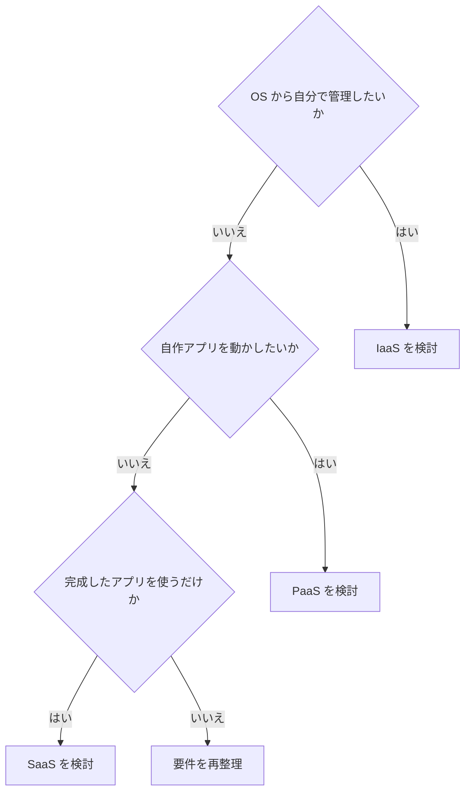

### 4.11 具体例（本ガイドによる補足）

| カテゴリ | 代表的な例（一般的な分類） |
|---|---|
| SaaS | Webメール、オンライン会計、グループウェア |
| PaaS | アプリのデプロイ基盤、マネージドDB |
| IaaS | 仮想マシン、仮想ネットワーク、ブロックストレージ |
| FaaS（サーバレス関数） | AWS Lambda、Google Cloud Functions など |

> サーバレスについて、Martin Fowler のサイトに掲載された Mike Roberts の解説は、サーバレスを BaaS（サードパーティの裏側サービスを使う）と FaaS（管理された一時的なコンテナで関数を動かす）に整理しています。規格の略語表にも FaaS が含まれており、Clause 9.4 のサーバレスコンピューティングにつながる話題です。

---

## 5. ステップ5：デプロイメントモデル（Clause 5.5）

### 5.1 デプロイメントモデルとは

**物理資源・仮想資源をどのように管理し、どの範囲で共有するか**による、クラウドの提供形態の分類です。規格は次の4つを説明しています（5.5.2〜5.5.5）。

| モデル | Clause | 要点（BSI の整理に基づく） |
|---|---|---|
| Private cloud | 5.5.2 | 1つの組織専用。自組織または第三者が運用でき、自社データセンターでも第三者の施設でもよい |
| Public cloud | 5.5.3 | 一般または大きな利用者グループ（例：業界全体）が使える。事業者が提供する |
| Community cloud | 5.5.4 | 似た関心を持つ**複数の組織**で基盤を共有。構成組織または第三者が運用 |
| Hybrid cloud | 5.5.5 | プライベートクラウドとパブリッククラウドを組み合わせて使う。接続には標準化された技術も独自（プロプライエタリ）の技術も使え、相互運用性・データの可搬性・アプリケーションの可搬性を実現する |

> ドイツBSIは、上記4つだけでは全ての提供形態を表せないため、「バーチャルプライベートクラウド」などの派生的な呼び方が生まれていると指摘しています。

### 5.2 モデルの関係

4つのモデルは**並列の選択肢**であり、ある順序で移行・発展していくものではありません。

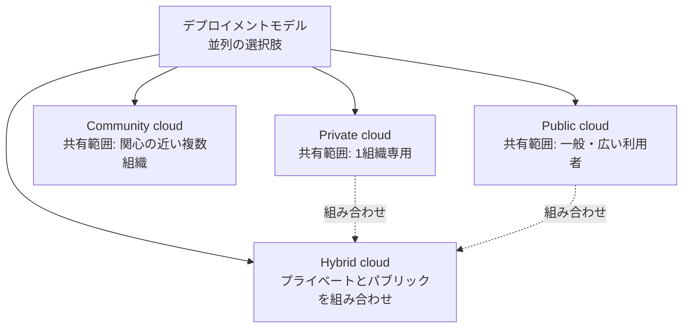

> 共有範囲の表記は、モデル同士を比較するための**非規範的な整理**です。規格が順序や段階を定めているわけではありません。

### 5.3 選び方の目安フローチャート

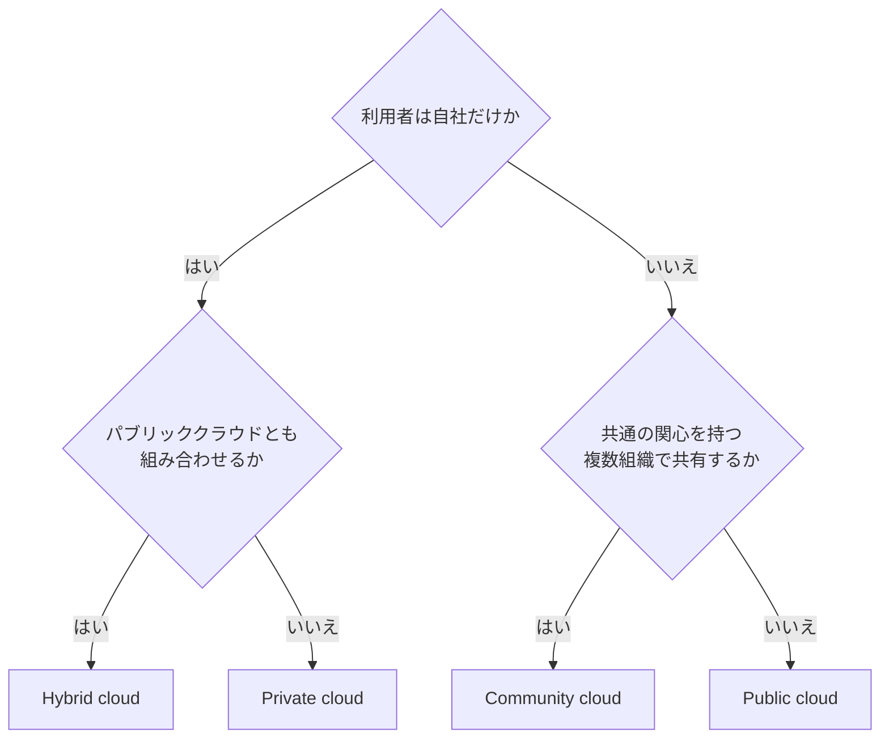

> 実際の判断には、規制、データの所在、コスト、運用体制など多くの要因が関わります。上図は概念を整理するための簡略化です。

### 5.4 マルチテナンシーとの関係

- パブリック・コミュニティクラウドでは、**複数の CSC の利用者が同じ基盤を共有**し得る
- そのため、3.3.3 の**隔離**と**ID・アクセス管理**が特に重要になる

---

## 6. ステップ6：関係者（Party）と役割（Role）（Clause 6）

### 6.1 Party と Role は別の概念

Part 2 で明確に区別された重要点です。

| 概念 | 意味 | 例 |
|---|---|---|
| **Party（関係者）** | 自然人、法人（法人格の有無を問わない）、またはそのいずれかの集まり | 個人、自社、クラウド事業者、事業者の連合 |
| **Role（役割）** | 共通の目的を持つクラウド活動の集まり | 「サービスを使う」「サービスを提供する」 |
| Sub-role（副役割） | ある役割の活動の一部 | 開発、監査、仲介など |

> 規格は、**CSC のような名前は関係者（Party）**、**CSC role のような表現は役割（Role）**を指す、と使い分けを明記しています。1つの関係者が複数の役割を担うこともあります。

### 6.2 3つの Party と 3つの Role

| Party（略称） | 意味 | 対応する Role |
|---|---|---|
| Cloud service customer（CSC） | クラウドサービスを**使う**目的で事業上の関係にある関係者（Party）として振る舞う者。組織に限らず個人もなり得る | CSC role：サービスを**使う**活動 |
| Cloud service provider（CSP） | クラウドサービスを**利用可能にする**関係者（Party）として振る舞う者 | CSP role：サービスを**利用可能にする**活動 |
| Cloud service partner（CSN） | CSC・CSP のどちらか、または両方の活動を**支援・補助**する関係者（Party）として振る舞う者 | CSN role：支援・補助の活動 |

さらに、**Cloud service user（CSU）** は、CSC に関連して実際にサービスを使う個人（またはその代理で動く主体）です。デバイスやアプリケーションも含まれ得ます（Part 1 の定義）。

### 6.3 CSN の代表的な副役割（Part 1 の定義より）

| 副役割 | 役目 |
|---|---|
| Cloud auditor（クラウド監査人） | クラウドサービスの提供と利用を**監査**する |
| Cloud service broker（クラウドサービスブローカー） | CSC と CSP の**関係を仲介・交渉**する |
| Cloud service developer（クラウドサービス開発者） | クラウドサービスの設計・開発・試験・保守を行う |

### 6.4 関係図

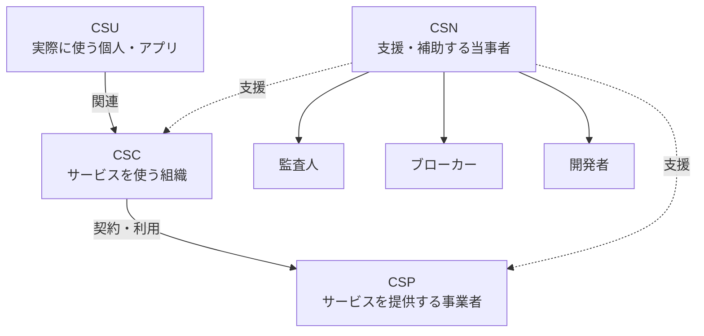

### 6.5 実務でのつまずきポイント

- 「CSPが開発もする」場合、CSPが **CSP role と開発者の副役割**の両方を担っている
- SaaS の場合、**サービスを提供する主体とアプリ開発者が別**のこともある（4.5節）
- 契約書やSLAでは、**誰がどの役割か**を明確にしておくと責任範囲の議論が楽になる

---

## 7. ステップ7：横断的側面（Clause 7）

### 7.1 横断的側面とは

特定の役割・活動・サービスにとどまらず、**複数の役割や活動に共通して影響するテーマ**です。Part 3（リファレンスアーキテクチャ）でも、Part 2 の Clause 7 の横断的側面を参照しています。

### 7.2 13の横断的側面（7.2〜7.14）と総論（7.1）

> Clause 7 は、7.1 General（総論）と、7.2〜7.14 の13の個別の横断的側面から構成されます。以下の表は13の個別項目です。
>
> 以下の説明は、目次の項目名に基づく初学者向けの一般的な補足です。各項目の規格上の正確な記述は原典で確認してください。

| Clause | 横断的側面 | 初学者向けの意味 |
|---|---|---|
| 7.2 | Auditability（監査可能性） | 提供・利用の状況を後から検証できること |
| 7.3 | Availability（可用性） | 必要な時に使えること |
| 7.4 | Governance（ガバナンス） | 方針・責任・統制の枠組み |
| 7.5 | Interoperability（相互運用性） | 異なるシステム間で連携できること |
| 7.6 | Maintenance and versioning（保守とバージョン管理） | 更新・変更を管理すること |
| 7.7 | Performance（性能） | 処理能力・応答の良さ |
| 7.8 | Portability（移植性） | データやアプリを別環境へ移せること |
| 7.9 | Protection of PII（個人情報の保護） | 個人を識別できる情報の扱い（Clause 3 の用語が前提） |
| 7.10 | Regulatory（規制） | 法令・規制への対応 |
| 7.11 | Resiliency（回復力） | 障害から立ち直る力 |
| 7.12 | Reversibility（可逆性） | 利用をやめた時にデータ等を取り戻せること |
| 7.13 | Security（セキュリティ） | 機密性・完全性・可用性の確保 |
| 7.14 | Service levels and service level agreement（サービスレベルとSLA） | 品質目標と合意 |

### 7.3 関連する規格・資料

| 側面 | 関連しやすい規格（例） |
|---|---|
| SLA | ISO/IEC 19086-1（SLAフレームワーク） |
| 相互運用性・移植性 | ISO/IEC 19941 |
| データの流れ・分類 | ISO/IEC 19944-1 |
| データ共有契約 | ISO/IEC 23751 |

> これらは JTC 1 の「クラウドコンピューティング」の主要規格リストに挙がっています。

### 7.4 可用性・回復力の考え方（Google Cloud の公開資料より）

Google Cloud の信頼性ガイドは、**障害ドメイン（failure domain）**を、他と独立して故障し得る資源（またはその集まり）と説明し、ゾーン・リージョンはその例としています。複数の障害ドメインに冗長配置すると、単一のドメインより高い可用性を得られるとされます。

| 配置 | 目安の可用性 | 30日の許容停止時間の目安 |
|---|---|---|
| 単一ゾーン | 99.9% | 約43.2分 |
| 1リージョン内の複数ゾーン | 99.99% | 約4.3分 |
| 複数リージョン | 99.999% | 約26秒 |

> これは Google Cloud のガイドが示す目安です。ISO規格の数値ではありません。可用性や回復力という横断的側面を、実際の設計に落とす例として参考にしてください。

### 7.5 セキュリティと責任共有（AWS の公開資料より）

AWS の「責任共有モデル」は、**クラウド"の"セキュリティ**（AWS が基盤を守る）と**クラウド"内"のセキュリティ**（顧客がデータ・アプリ・設定等を守る）に分けて説明しています。顧客の責任範囲は、選んだサービスによって変わります。

これは、本ガイド 4.6 節の「IaaS・PaaS・SaaS で CSC の管理範囲が違う」という整理と、考え方が同じです。

---

## 8. ステップ8：データとクラウドサービス（Clause 8）

### 8.1 Clause 8 の構成

| Clause | 項目 | 初学者向けの意味 |
|---|---|---|
| 8.1 | General | 全体の導入 |
| 8.2 | Data processing within cloud services | クラウドサービスの内部でデータがどう処理されるか |
| 8.3 | Data flow | データがどこからどこへ流れるか |
| 8.4 | Processing of data from multiple sources | 複数の出どころのデータをまとめて処理する場合 |
| 8.5 | Data sharing | データを共有する場合の考え方 |

> 公開サンプルの範囲外のため、項目名に基づく概要です。略語表には DSA（data sharing agreement：データ共有契約）が含まれており、データ共有には契約の枠組みが関係することがうかがえます（ISO/IEC 23751）。

### 8.2 データの流れを考える視点（一般的な整理）

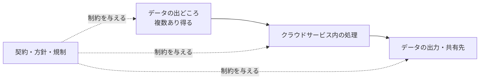

### 8.3 PII との関係

個人情報を扱う場合は、**PII controller と PII processor のどちらの立場か**を意識します（2.3節）。クラウドサービスでは、CSC が controller、CSP が processor になる構図がよく話題になりますが、実際の位置づけは契約や状況によって決まります。

---

## 9. ステップ9：仮想化の概念（Clause 9）

### 9.1 Clause 9 の構成

| Clause | 項目 |
|---|---|
| 9.1 | General |
| 9.2 | System hardware virtualization（9.2.1 General、9.2.2 Virtual machines、9.2.3 Hypervisors） |
| 9.3 | Containers |
| 9.4 | Serverless computing |
| 9.5 | Virtualized networking |
| 9.6 | Virtualized DSaaS |

### 9.2 各概念の初学者向け説明（一般的な整理）

| 概念 | 意味 | ポイント |
|---|---|---|
| 仮想マシン（VM） | 物理機の上に作る、仮想的なコンピュータ | OS ごと丸ごと動かせる |
| ハイパーバイザー | 物理資源を分割して VM に割り当てるソフトウェア | IaaS の VM はこの上で動く（規格 5.4.4 にも例示） |
| コンテナ | OS の機能を共有して、アプリを軽量に隔離して動かす | VM より起動が速く軽い傾向 |
| サーバレス | サーバ管理を意識せずコードを動かす | FaaS・BaaS（Fowler の整理） |
| 仮想化ネットワーク | 物理網の上に論理的なネットワークを作る | VPN や仮想スイッチなど |
| 仮想化DSaaS | ストレージを仮想的に提供する | 利用者は場所を意識しない |

### 9.3 仮想化レイヤーの関係

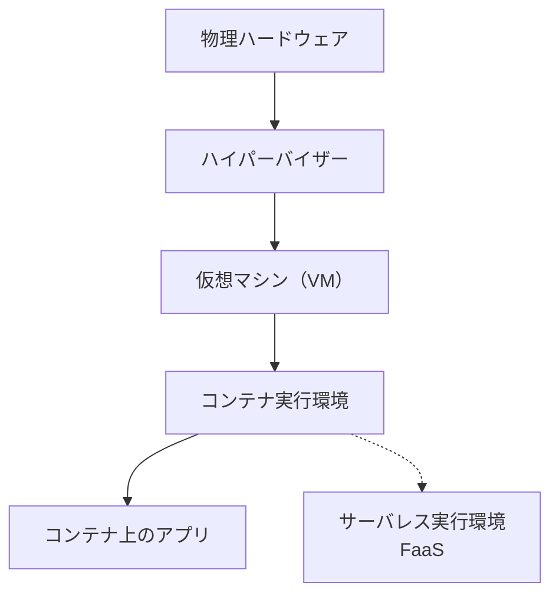

> 実際の構成はCSPによって異なります（例：ハイパーバイザー上でなく物理機上でコンテナを動かす構成もあります）。上図は代表的な階層の概念図です。

### 9.4 サーバレスの注意点（Martin Fowler のサイトの解説より）

Mike Roberts の解説では、サーバレスには**運用コストや複雑さ、リードタイムを下げられる**可能性がある一方、**ベンダーへの依存が増える**こと、**周辺サービスが比較的未成熟**であることが代償として挙げられています（2018年掲載。最新状況は各社ドキュメントで確認してください）。

---

## 10. ステップ10：複数CSPを使う概念（Clause 10）

### 10.1 Clause 10 の構成

| Clause | 項目 |
|---|---|
| 10.1 | General |
| 10.2 | Types of cloud computing involving multiple CSPs（10.2.2 Multi-cloud、10.2.3 Inter-cloud、10.2.4 その他） |
| 10.3 | Considerations when using multiple CSPs（IAM、ポリシー、管理、運用） |

### 10.2 複数CSPの形態

ISO/IEC 5140:2024（JTC 1 の紹介）は、複数CSPを使う形態として、マルチクラウド（CSC が仲介するもの、CSP 同士が接続するもの）、フェデレーテッドクラウド、ハイブリッドクラウド、インタークラウドを区別しています。Part 2 の Clause 10 は、その入口となる概念を扱います。

| 形態 | 初学者向けの意味（ISO/IEC 22123-1:2023 の定義に基づく） |
|---|---|
| Multi-cloud | **CSC** が、2つ以上の CSP の**パブリッククラウド**サービスを使い、その統合・管理を CSC 自身が担う |
| Inter-cloud | ある CSP が、**他の CSP のサービスを1つ以上使って**自社のクラウドサービスを提供する（CSC が複数の CSP を束ねる multi-cloud とは別の形態） |
| その他（10.2.4） | 上記以外の複数CSPの形態 |

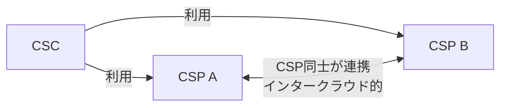

### 10.3 複数CSPを使う時の4つの考慮事項

| 考慮事項 | 内容（一般的な説明） |
|---|---|
| Identity and access management | CSPごとに異なる認証・認可をどう統合・管理するか |
| Policy considerations | セキュリティ・コンプライアンス等の方針をどう揃えるか |
| Management | 構成・コスト・契約などの管理をどう一元化するか |
| Operations | 監視・障害対応・運用手順をどう標準化するか |

> JTC 1 の ISO/IEC 5140 の紹介では、複数CSPの利用は可用性・耐障害性・地理的な到達範囲を高められる一方、管理・統合・セキュリティの複雑さが増すとされています。

---

## 11. ステップ11：クラウドの論理・物理構成（Clause 11）

### 11.1 論理構成（11.1）

| 項目 | 意味 |
|---|---|
| Cloud service instance（11.1.1） | 顧客に提供される、サービスの1つの実体（インスタンス） |
| Multiple cloud services（11.1.2） | 複数のクラウドサービスを組み合わせて使う場合の構成 |

### 11.2 物理構成（11.2）

| Clause | 項目 | 初学者向けの意味 |
|---|---|---|
| 11.2.2 | Cloud service provider | 提供事業者という実体 |
| 11.2.3 | Cloud service resources | 実際の資源（サーバ、ストレージ等） |
| 11.2.4 | Cloud region | 独立した地理的なまとまり |
| 11.2.5 | Availability domain or zone | リージョン内の分離された区画 |
| 11.2.6 | Edge computing | 利用者に近い場所での処理 |
| 11.2.7 | Affinity | 関連する資源を近くに置く（または離す）考え方 |
| 11.2.8 | Geo-dispersion of cloud service instances | インスタンスを地理的に分散させる |

### 11.3 リージョンとゾーンの具体例（Google Cloud の公式ドキュメントより）

Google Cloud の公式ドキュメントは、リージョンを**ゾーンから成る独立した地理的エリア**、ゾーンを**リージョン内の単一の障害ドメイン**と説明しています。リージョンやゾーンは、基盤となる物理資源の**論理的な抽象化**だとも述べています。

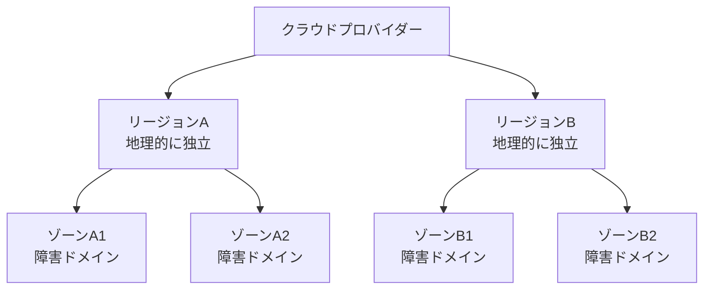

| 設計の目的 | 配置の考え方 |
|---|---|
| ゾーン障害に備える | 同一リージョン内の複数ゾーンに分散 |
| リージョン障害に備える | 複数リージョンに分散 |
| 遅延・コストを下げる | 通信が多い資源は同じリージョンに置く |
| データの所在を制御する | 規制に合うリージョンを選ぶ |

> 用語は事業者ごとに異なります（Google Cloud の zone は、AWS の Availability Zone に相当する考え方）。規格の「Availability domain or zone」は、こうした呼び方の違いを包含する表現と読めます。

### 11.4 エッジとアフィニティ

- **エッジコンピューティング**：データの発生源や利用者に近い場所で処理し、遅延や通信量を減らす
- **アフィニティ**：互いに関連する資源をまとめて配置する（遅延を減らす）、または逆に離して配置する（障害の同時発生を避ける）考え方

---

## 12. ステップ12：NISTの定義との違い・他規格との関係

### 12.1 NIST SP 800-145 との比較

NIST の定義（Mell & Grance, 2011）は、**5つの必須特性、3つのサービスモデル、4つのデプロイメントモデル**で構成されています。ISO/IEC 22123-2 は同じ系譜を発展させつつ、範囲を広げています。

| 観点 | NIST SP 800-145（2011） | ISO/IEC 22123-2:2023 |
|---|---|---|
| 主要特性 | 5つ（セルフサービス、広範なネットワークアクセス、資源プーリング、迅速な伸縮性、計測されるサービス） | **6つ**（上記に**マルチテナンシー**を明示） |
| サービスの分類 | 3つのサービスモデル（SaaS、PaaS、IaaS） | **3つの能力タイプ＋多数のサービスカテゴリ**（NaaS、CaaS、CompaaS、DSaaS等） |
| デプロイメント | 4つ（プライベート、コミュニティ、パブリック、ハイブリッド） | 4つ（説明を拡充・訂正） |
| 関係者・役割 | 範囲外 | **Party と Role を区別**（CSC、CSP、CSN） |
| 横断的側面 | 範囲外 | 総論（7.1）＋**13項目**（7.2〜7.14）を整理 |
| データ・仮想化・複数CSP・構成 | 範囲外 | Clause 8〜11 で扱う |

> BSI（ドイツ連邦情報セキュリティ庁）は、自組織の定義をNISTベースから ISO の定義へ切り替えたと説明し、その理由として、ISO がクラウドコンピューティングを独立したITパラダイムとしてより正確に表現していると考えていることを挙げています。

### 12.2 Part 3（リファレンスアーキテクチャ）との接続

Part 3 は、Part 2 で定義した概念を**設計の枠組み**に落とし込みます。

| Part 3 の視点 | 内容 | Part 2 とのつながり |
|---|---|---|
| ユーザービュー | 関係者、役割、活動、クラウドサービス、デプロイメントモデル、横断的側面の関係 | Clause 5・6・7 の概念 |
| 機能ビュー | 機能を4層（ユーザー、アクセス、サービス、リソース）に整理 | Clause 5.2・5.4・9・11 の概念 |
| 実装ビュー | 機能コンポーネントをサービスとして実装する方法 | Part 3 の本文の範囲外（概要のみ） |
| 配備ビュー | 実装したサービスを実際の環境へ配置・運用する方法 | Part 3 の本文の範囲外（概要のみ） |

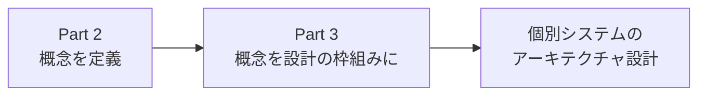

### 12.3 運用の観点：可観測性（オブザーバビリティ）

StandICT の議論グループの記事では、Part 2 は可観測性を明示的に取り上げていないものの、概念としては関連があり、**CSC と CSP の双方**にとって、サービスが期待どおり動いているかを確認する上で重要だと整理されています。

---

## 13. 実務で使える早見表

### 13.1 用語の対応表

| 英語 | 略称 | 日本語 |
|---|---|---|
| cloud service customer | CSC | クラウドサービスカスタマー（顧客） |
| cloud service provider | CSP | クラウドサービスプロバイダー（提供者） |
| cloud service partner | CSN | クラウドサービスパートナー |
| cloud service user | CSU | クラウドサービスユーザー |
| cloud service agreement | CSA | クラウドサービス契約 |
| service level agreement | SLA | サービスレベル合意 |
| service level objective | SLO | サービスレベル目標 |
| service qualitative objective | SQO | サービス定性目標 |
| data sharing agreement | DSA | データ共有契約 |
| privacy information management system | PIMS | プライバシー情報マネジメントシステム |

### 13.2 クラウド選定時のチェックリスト（本ガイドの整理）

- [ ] 必要な**能力タイプ**（アプリ／プラットフォーム／インフラ）は何か
- [ ] どの**サービスカテゴリ**が合うか（SaaS／PaaS／IaaS／その他）
- [ ] **CSC として自分で管理する範囲**はどこまでか（4.6節）
- [ ] **デプロイメントモデル**（プライベート／パブリック／コミュニティ／ハイブリッド）は何か
- [ ] **誰がどの役割**か（CSC、CSP、CSN）が契約上明確か
- [ ] **横断的側面**（SLA、セキュリティ、可用性、可逆性、PII等）の要件は定義したか
- [ ] **データの所在**（リージョン）と規制は確認したか
- [ ] **複数CSPを使う場合**、IAM・ポリシー・管理・運用の方針はあるか
- [ ] **終了時**にデータを取り戻せるか（可逆性・移植性）

### 13.3 規格の使い方（用途別）

| 目的 | 見る箇所 |
|---|---|
| 社内で「クラウドとは何か」を共通認識にしたい | Clause 5（特性・カテゴリ・モデル） |
| 契約・調達で役割分担を明確にしたい | Clause 6、Clause 7.14 |
| 設計レビューで観点を網羅したい | Clause 7（総論＋13の横断的側面） |
| 可用性・DR設計の用語を揃えたい | Clause 11（リージョン・ゾーン等） |
| マルチクラウド戦略を考えたい | Clause 10、ISO/IEC 5140 |

---

## 14. よくある誤解

| 誤解 | 実際 |
|---|---|
| クラウド＝IaaS・PaaS・SaaS の3つだけ | 規格は**3つの能力タイプ**を定義し、サービスカテゴリは**NaaS・CaaS・CompaaS・DSaaS など多数**ある（4.2〜4.4節） |
| 能力タイプとサービスカテゴリは同じ | **別の概念**。カテゴリは複数の能力タイプを含み得る（4.1節） |
| CSP と CSC だけが関係者 | **CSN（パートナー）**も主要な関係者。監査人・ブローカー・開発者が含まれる（6.3節） |
| 関係者と役割は同じ | **別の概念**。1つの関係者が複数の役割を担える（6.1節） |
| クラウドなら自動的に安全 | 責任は**サービス種別で分担**される。CSC の責任範囲は残る（7.5節） |
| ハイブリッド＝オンプレ＋パブリック | 規格では「**プライベートクラウドとパブリッククラウド**の組み合わせ」。オンプレミスであってもクラウドとして提供されていなければ該当しない。接続技術は標準化されたものでも独自のものでもよく、相互運用性・データの可搬性・アプリケーションの可搬性が要点 |
| 資源プーリングなら何でも混ぜられる | **同種の資源**のみプール可能。種類の異なる資源はプールできない（3.3.6節） |
| サーバレスにはサーバがない | サーバは存在するが、**管理を意識しなくてよい**構成（Fowler の整理） |
| NISTの定義がそのまま最新 | NIST は2011年。ISOは6特性、Party/Role、横断的側面等で**拡張**（12.1節） |

---

## 15. 理解度チェック

次の問いに、本ガイドを見ずに答えられるか確認してください。

1. ISO/IEC 22123-2 は、どの規格を（Part 1 と合わせて）置き換えたか。
2. 主要特性6つを挙げよ。NISTの5つに加わった特性はどれか。
3. 能力タイプ3つと、サービスカテゴリの違いを説明せよ。
4. IaaS で CSC が制御できるものと、できないものを述べよ。
5. Party と Role の違いを、CSC を例に説明せよ。
6. 横断的側面を5つ以上挙げよ。
7. 水平スケーリングと垂直スケーリングの違いは何か。
8. リージョンとゾーン（障害ドメイン）の関係を説明せよ。
9. 複数CSPを使う時の4つの考慮事項は何か。
10. Part 3 は Part 2 の概念をどのような4つの視点（ビュー）で設計に使うか。そのうち本文で詳しく扱うのはどれか。

解答の目安

1. ISO/IEC 17788:2014。
2. Broad network access、Measured service、Multi-tenancy、On-demand self-service、Rapid elasticity and scalability、Resource pooling。加わったのは Multi-tenancy（明示的な独立項目として）。
3. 能力タイプは「提供される機能を使われる資源で分類」した3つ（アプリ／インフラ／プラットフォーム）。サービスカテゴリは共通の性質を持つサービスのグループで、複数の能力タイプを含み得る。
4. 制御できる：OS、ストレージ、配備したアプリ、一部のネットワーク要素（ホストファイアウォール等）。できない：基盤となる物理・仮想資源の管理。
5. Party は「組織や人そのもの（CSC）」、Role は「サービスを使う活動の集まり（CSC role）」。
6. 監査可能性、可用性、ガバナンス、相互運用性、保守とバージョン管理、性能、移植性、PIIの保護、規制、回復力、可逆性、セキュリティ、SLA（7.2〜7.14 の13項目から5つ以上）。
7. 水平は資源の数を増やす、垂直は1つの資源の大きさを増やす。
8. リージョンはゾーンから成る独立した地理的エリア。ゾーンはリージョン内の単一の障害ドメイン。
9. IAM、ポリシー、管理、運用。
10. ユーザービュー・機能ビュー・実装ビュー・配備ビューの4つ。本文で詳しく扱うのはユーザービュー（関係者・役割・活動・クラウドサービス・デプロイメントモデル・横断的側面）と機能ビュー（ユーザー・アクセス・サービス・リソースの4層）で、実装ビューと配備ビューは本文の範囲外。

---

## 16. 根拠ソース一覧（URL）

### 16.1 規格本体・規格機関

| 内容 | URL | 参照した点 |
|---|---|---|
| ISO 公式ページ（依頼時に指定されたURL） | https://www.iso.org/cms/live/live/en/sites/isoorg/contents/data/standard/08/03/80351.html | 規格の公式カタログページ（本ガイド作成時はボット対策によりアクセスできず、他のソースで内容を確認） |
| 規格サンプルPDF（iTeh Standards） | https://cdn.standards.iteh.ai/samples/80351/24a7ef319fe14f5fbb6150d972bff613/ISO-IEC-22123-2-2023.pdf | 目次、Foreword、Clause 1〜5.4.5 の本文（確認済み部分の主な根拠） |
| IEC Webstore | https://webstore.iec.ch/publication/88947 | 発行日、版、ページ数、委員会、ICS |
| カナダ規格評議会（SCC）データベース | https://scc-ccn.ca/standardsdb/standards/8184644 | スコープ、ステータス、発行日 |
| UNE（スペイン規格協会） | https://www.en.une.org/encuentra-tu-norma/busca-tu-norma/iso?c=080351 | 公表日、委員会 |
| JTC 1 Flagship standards（クラウド） | https://jtc1info.org/technology/subcommittees/flagship-standards/cloud-computing/ | Part 1〜3、ISO/IEC 5140 等の位置づけ |
| ISO/IEC 22123-1（サンプル） | https://cdn.standards.iteh.ai/samples/82758/9e30847fd9734768b084500f1e0dcb50/ISO-IEC-22123-1-2023.pdf | CSN・監査人・ブローカー・開発者の定義 |
| ISO/IEC 22123-3（サンプル） | https://cdn.standards.iteh.ai/samples/82759/c1f7c9a720dd4ea2968ea01a910bd2b3/ISO-IEC-22123-3-2023.pdf | Part 2 の Party・Role・横断的側面の参照 |

### 16.2 公的機関・標準化関連の解説

| 内容 | URL | 参照した点 |
|---|---|---|
| ドイツ連邦情報セキュリティ庁（BSI）Cloud Computing Basics | https://www.bsi.bund.de/EN/Themen/Unternehmen-und-Organisationen/Informationen-und-Empfehlungen/Empfehlungen-nach-Angriffszielen/Cloud-Computing/Grundlagen/grundlagen_node.html | 6特性・4デプロイメントモデルの整理、NIST定義からの移行 |
| NIST SP 800-145（Mell & Grance, 2011） | https://nvlpubs.nist.gov/nistpubs/Legacy/SP/nistspecialpublication800-145.pdf | 5特性・3サービスモデル・4デプロイメントモデル |
| StandICT：Observability and ISO/IEC 22123-2:2023 | https://standict.eu/discussion-groups/cloud-computing/258/observability-and-isoiec-22123-22023 | 可観測性と Part 2 の関係 |

### 16.3 開発者・クラウド事業者の公開資料

| 内容 | URL | 参照した点 |
|---|---|---|
| Martin Fowler サイト：Serverless Architectures（Mike Roberts） | https://www.martinfowler.com/articles/serverless.html | サーバレス（BaaS／FaaS）の整理、利点と代償 |
| AWS 責任共有モデル | https://aws.amazon.com/en/compliance/shared-responsibility-model/ | クラウド"の"セキュリティと"内"のセキュリティ |
| AWS Well-Architected：Shared responsibility | https://docs.aws.amazon.com/wellarchitected/latest/security-pillar/shared-responsibility.html | 責任共有の公式解説 |
| Google Cloud：Geography and regions | https://docs.cloud.google.com/docs/geography-and-regions | リージョン・ゾーンの定義 |
| Google Cloud：Building blocks of reliability | https://docs.cloud.google.com/architecture/infra-reliability-guide/building-blocks | 障害ドメインと可用性の目安 |

---

> **免責**：本ガイドは学習用の解説です。規格の正式な要求事項・文言は、ISO/IEC 22123-2:2023 の原典（ISO・IEC・各国規格機関から入手可能）でご確認ください。公開サンプルの範囲外の項目は、目次と公的機関の要約に基づく説明である旨を 0.1 節に記載しています。
