# ISO/IEC 22123-3:2023 初学者向け完全ガイド

## クラウドコンピューティング Part 3：リファレンスアーキテクチャ（CCRA）

> **対象読者**：クラウドを触り始めたエンジニア、インフラ／QA担当、設計レビューで「標準の言葉」を使いたい方
> **前提知識**：IaaS / PaaS / SaaS という言葉を聞いたことがある程度
> **調査基準日**：2026年10月24日（確認できた公開情報の範囲）

---

## 目次

1. [この規格を一言でいうと](#1-この規格を一言でいうと)
2. [基本情報と位置づけ](#2-基本情報と位置づけ)
3. [全体像：4つの視点（ビュー）](#3-全体像4つの視点ビュー)
4. [Step 1：用語の土台を作る](#4-step-1用語の土台を作る)
5. [Step 2：ユーザービュー（誰が・何をするか）](#5-step-2ユーザービュー誰が何をするか)
6. [Step 3：横断的側面（11項目）](#6-step-3横断的側面11項目)
7. [Step 4：機能ビュー（4層構造）](#7-step-4機能ビュー4層構造)
8. [Step 5：ユーザービューと機能ビューの対応づけ](#8-step-5ユーザービューと機能ビューの対応づけ)
9. [Step 6：実装ビューとデプロイメントビュー](#9-step-6実装ビューとデプロイメントビュー)
10. [ISO/IEC 17789:2014 からの変更点](#10-isoiec-177892014-からの変更点)
11. [他の著名なモデルとの比較（NIST・AWS）](#11-他の著名なモデルとの比較nistaws)
12. [実務での使い方](#12-実務での使い方)
13. [学習ロードマップ](#13-学習ロードマップ)
14. [よくある誤解 Q&A](#14-よくある誤解-qa)
15. [参考ソース一覧（URL）](#15-参考ソース一覧url)

---

## 1. この規格を一言でいうと

**「クラウドの構造を、誰が読んでも同じ意味で説明できるようにするための"共通の設計図の型"」** です。

- 特定ベンダー（AWS、Azure、Google Cloud など）の製品に依存しません。
- 「こう作れ」と命令する規格ではなく、**クラウドを説明・比較・設計するときの枠組み**を提供します。
- 建築にたとえると、個別の家の設計図ではなく「間取り図の描き方のルール」に近い存在です。

### この規格で答えが得られる問い

| 問い | この規格での答えの置き場所 |
|---|---|
| クラウドには誰が登場するのか？ | ユーザービュー（パーティ、ロール、サブロール） |
| 各登場人物は何をするのか？ | クラウドコンピューティング活動（Activities） |
| どんな品質面を常に気にすべきか？ | 横断的側面（Cross-cutting aspects） |
| システムの中身はどんな部品で構成されるか？ | 機能ビュー（4層＋マルチレイヤー機能） |
| 人の役割と部品はどう結びつくか？ | 両ビューの関係（Section 10） |

---

## 2. 基本情報と位置づけ

### 2.1 規格の基本データ

| 項目 | 内容 |
|---|---|
| 規格番号 | ISO/IEC 22123-3:2023 |
| 正式名称 | Information technology — Cloud computing — Part 3: Reference architecture |
| 日本語での呼び方 | 情報技術 — クラウドコンピューティング — 第3部：リファレンスアーキテクチャ |
| 版 | 第1版（Edition 1） |
| 発行時期 | 2023年9月 |
| ページ数 | 59ページ |
| 担当委員会 | ISO/IEC JTC 1/SC 38（クラウドコンピューティングと分散プラットフォーム） |
| ICS分類 | 35.210（クラウドコンピューティング） |
| ステータス | 国際規格として発行済み（Published, 段階コード 60.60） |
| 範囲（Scope） | クラウドコンピューティング・リファレンスアーキテクチャ（CCRA）を規定する |
| 置き換え対象 | ISO/IEC 17789:2014（技術的に改訂） |

> **CCRA** は *Cloud Computing Reference Architecture* の略です。

### 2.2 ISO/IEC 22123 シリーズの中での位置

22123 は3部構成のシリーズです。Part 3 が「構造」を担当します。

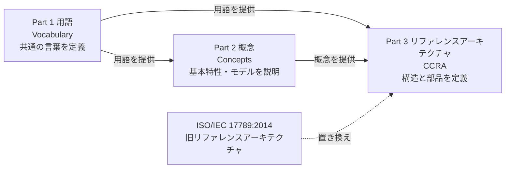

| パート | 役割 | 初学者向けのたとえ |
|---|---|---|
| Part 1 | 用語の統一 | 辞書 |
| Part 2 | 概念・特性・モデルの説明 | 教科書 |
| Part 3（本規格） | 構造・役割・部品の枠組み | 設計図のテンプレート |

Part 3 は、規定文書として Part 1 と Part 2 を引用しています。つまり **Part 1 → Part 2 → Part 3 の順に読むと理解しやすい** 構成です。

### 2.3 関連する他のクラウド規格

SC 38 の公式ページでは、次の規格がクラウド関連の主要規格として並んでいます。

| 規格 | 内容（要約） | CCRAとの関係 |
|---|---|---|
| ISO/IEC 5140:2024 | マルチクラウド等の概念 | CCRAのロールを複数CSPに拡張して考える際に有用 |
| ISO/IEC 19941:2017 | 相互運用性と移植性 | 横断的側面「Interoperability / Portability」の詳細 |
| ISO/IEC 19944-1:2020 | データフロー・データカテゴリ・データ利用 | 横断的側面「PII保護」と関連 |
| ISO/IEC 19086-1:2016 | SLAフレームワーク | 横断的側面「SLA」の詳細 |
| ISO/IEC 23751:2022 | データ共有契約（DSA）フレームワーク | 当事者間の取り決めの整理 |

---

## 3. 全体像：4つの視点（ビュー）

CCRA は「ひとつの巨大な図」ではなく、**目的別に4つの視点（ビュー）に分けて**クラウドを説明します。規格の7章（CCRA viewpoints）で整理されています。

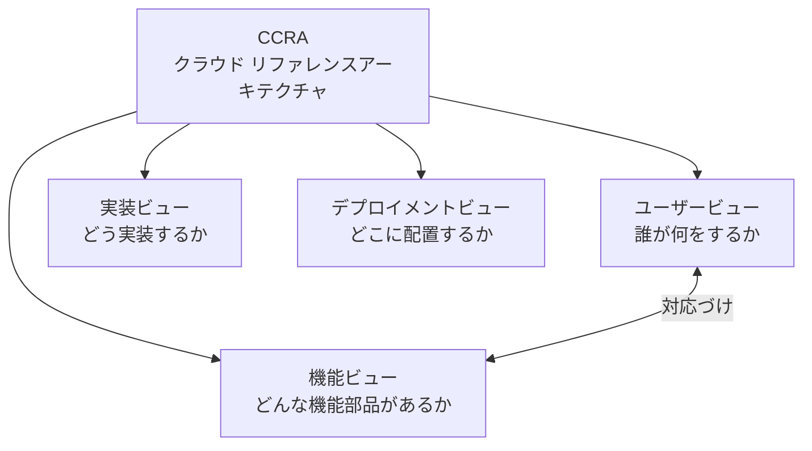

| ビュー | 問い | 主な登場要素 | 本規格の章 |
|---|---|---|---|
| ユーザービュー | 誰が、何をするのか | パーティ、ロール、サブロール、活動、横断的側面 | 7.3 / 第8章 |
| 機能ビュー | どんな機能が必要か | 機能コンポーネント、4つの層、マルチレイヤー機能 | 7.4 / 第9章 |
| 実装ビュー | 機能をどんなソフトウェア・ハードウェアで実現するか | 実装の構成要素 | 7.7 |
| デプロイメントビュー | どこに置いて動かすか | 配置・ホスティングの形態 | 7.8 |

> **ポイント**：本規格が詳細に規定するのは、主に **ユーザービュー（第8章）** と **機能ビュー（第9章）** です。実装ビューとデプロイメントビューは、概念として位置づけた上で、各組織が具体化する余地を残しています。

### 3.1 規格全体の章構成

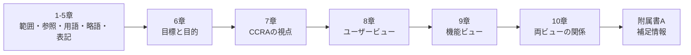

---

## 4. Step 1：用語の土台を作る

規格3章では、Part 1 の用語に加えて2つの用語グループが追加されています。

| 区分 | 用語 | 意味（要約） |
|---|---|---|
| セキュリティとプライバシー | PII（個人を特定できる情報） | 特定の自然人に結びつけられる、または結びつけうる情報 |
| アーキテクチャ | architecture | システムの基本的な概念・性質を、要素・関係・設計および進化の原則として具現化したもの |

### 4.1 最低限覚える略語

| 略語 | 正式名称 | 意味 |
|---|---|---|
| CSC | Cloud Service Customer | クラウドサービスの顧客 |
| CSP | Cloud Service Provider | クラウドサービスの提供者 |
| CSN | Cloud Service Partner | クラウドサービスのパートナー |
| CCRA | Cloud Computing Reference Architecture | クラウドのリファレンスアーキテクチャ |
| SLA | Service Level Agreement | サービスレベル合意 |
| PII | Personally Identifiable Information | 個人を特定できる情報 |

> **注意**：CSC・CSP・CSN は、Part 1（用語）と Part 3（本規格）をまたいで使われる最重要語です。最初にここだけ覚えれば、以降の読み進めが楽になります。

---

## 5. Step 2：ユーザービュー（誰が何をするか）

### 5.1 パーティ・ロール・サブロールの関係

ユーザービューの基本構造は **「パーティ（当事者）がロール（役割）を担い、ロールの中にサブロールがあり、サブロールが活動を行う」** という階層です。

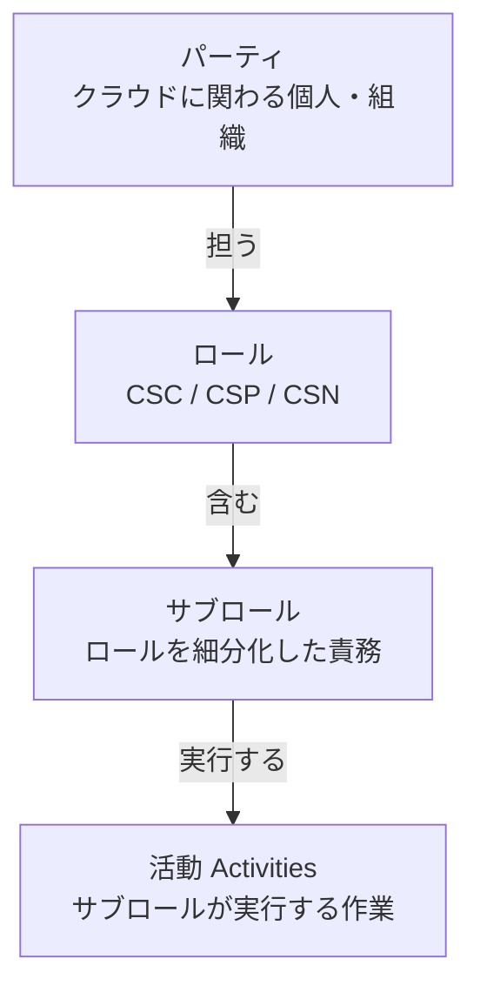

| 概念 | 説明 | 例 |
|---|---|---|
| パーティ | 実在する個人・組織 | 株式会社A、B大学、個人開発者C |
| ロール | クラウド取引上の立場 | CSC（顧客）、CSP（提供者）、CSN（パートナー） |
| サブロール | ロール内の細かな責務 | 運用管理者、ビジネス管理者、監査人 など |
| 活動 | サブロールが実際に行う作業 | サービスの選定・購入、運用監視、サポート対応 など |

> **本規格の重要な改訂点**：旧規格（ISO/IEC 17789:2014）に対し、**「パーティ」と「ロール」を区別する記述が追加**されました。

#### なぜ「パーティ」と「ロール」を分けるのか

1つの組織が、状況によって複数のロールを同時に担うことがあるからです。

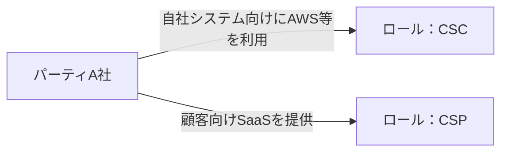

- 例：A社は、AWSのサービスを使う **顧客（CSC）** であり、同時に自社のSaaSを顧客に提供する **提供者（CSP）** でもあります。
- 「組織＝ロール」と固定すると、この現実を説明できません。だから分けて考えます。

### 5.2 3つのロール

| ロール | 英語 | 一言説明 | 規格内の説明箇所 |
|---|---|---|---|
| CSC | Cloud Service Customer | クラウドサービスを使う側 | 8.1.2（12〜14ページ） |
| CSP | Cloud Service Provider | クラウドサービスを提供する側 | 8.1.3（14〜17ページ） |
| CSN | Cloud Service Partner | CSC・CSPを支援する第三者 | 8.1.4（17〜19ページ） |

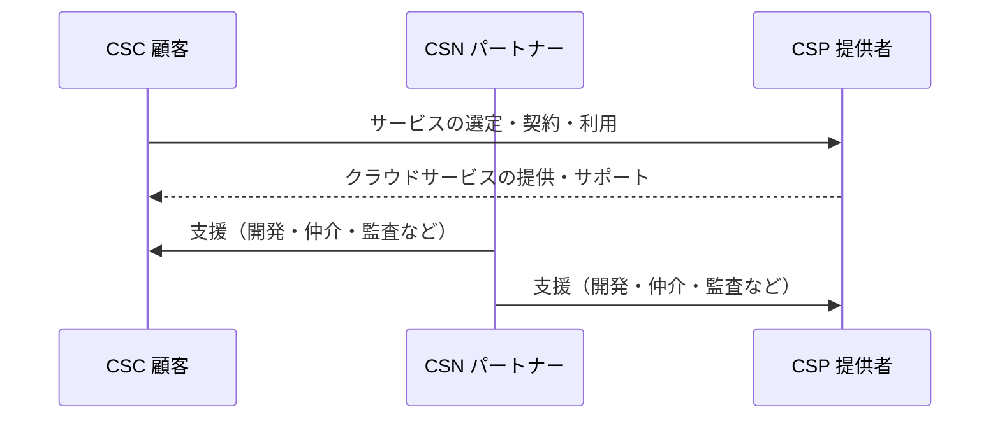

### 5.3 サブロールの代表例

規格に定義される主なサブロールは次のとおりです。（旧規格 ISO/IEC 17789 から引き継がれる体系に基づく代表例です。正確な名称・定義は規格本文で確認してください。）

| ロール | 代表的なサブロール | 役割のイメージ |
|---|---|---|
| CSC | クラウドサービス利用者 | 実際にサービスを使う人 |
| CSC | クラウドサービス管理者 | 利用中サービスの設定・運用を担う人 |
| CSC | クラウドサービスビジネス管理者 | 契約・コスト・利用状況を管理する人 |
| CSC | クラウドサービスインテグレーター | 複数サービスや既存システムを結合する人 |
| CSP | クラウドサービス運用管理者 | 提供サービスの運用を担う人 |
| CSP | クラウドサービスデプロイメント管理者 | サービスの展開・構成を担う人 |
| CSP | クラウドサービス管理者 | サービス全体の管理を担う人 |
| CSP | クラウドサービスビジネス管理者 | 提供側の事業・契約を管理する人 |
| CSP | カスタマーサポート担当 | 顧客の問い合わせに対応する人 |
| CSP | クラウドサービスセキュリティ・リスク管理者 | セキュリティとリスクを管理する人 |
| CSP | ネットワークプロバイダー | ネットワーク接続を提供する人 |
| CSN | クラウドサービス開発者 | サービスの開発を担う人 |
| CSN | クラウドサービスブローカー | サービスの仲介・組み合わせを行う人 |
| CSN | クラウドサービス監査人 | 独立した立場で監査する人 |

### 5.4 クラウドコンピューティング活動（8.2）

活動は **ロールごとに** 整理されています。

| 規格の節 | 内容 | ページ |
|---|---|---|
| 8.2.2 | CSCロールに関連する活動 | 19〜22ページ |
| 8.2.3 | CSPロールに関連する活動 | 22〜28ページ |
| 8.2.4 | CSNロールに関連する活動 | 28〜29ページ |

ページ数からも、**CSPの活動が最も多く、詳細に記述されている**ことが読み取れます。

#### 活動のイメージ（概念的な流れ）

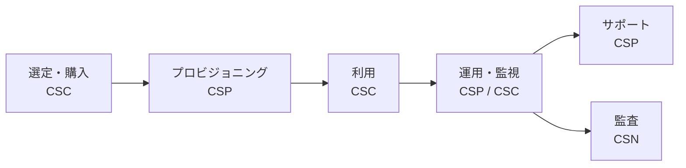

> 上図は初学者が全体の流れを掴むための**説明用の概念図**です。規格本文に同一の図があるわけではありません。

### 5.5 クラウドサービスとデプロイメントモデル（7.3.5 / 7.3.6）

ユーザービューには、サービス自体とその提供形態の整理も含まれます。

| 分類 | 代表例 |
|---|---|
| クラウドサービスのカテゴリ（例） | IaaS、PaaS、SaaS など |
| クラウドデプロイメントモデル | パブリック、プライベート、ハイブリッド、コミュニティ |

デプロイメントモデルの詳細な性質は Part 2（概念）で説明されます。

---

## 6. Step 3：横断的側面（11項目）

**横断的側面（Cross-cutting aspects）** とは、特定の層や役割に閉じず、**クラウド全体で常に考慮すべき品質・統制の観点** です。規格8.3に11項目が列挙されています。

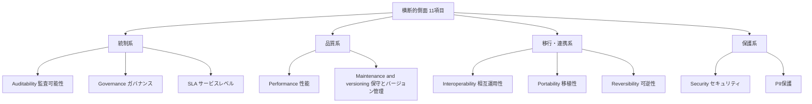

> 上図の「統制系／品質系／移行・連携系／保護系」というグルーピングは、理解を助けるための**本ガイド独自の整理**です。規格本文は11項目を並列に列挙しています。

### 6.1 11項目の一覧と平易な説明

| # | 規格の節 | 項目 | 平易な説明 | 初学者が最初に思い浮かべる問い |
|---|---|---|---|---|
| 1 | 8.3.2 | Auditability（監査可能性） | 操作や状態を後から検証できること | 「誰がいつ何をしたか追跡できるか」 |
| 2 | 8.3.3 | Governance（ガバナンス） | クラウド利用を方針・ルールで統制すること | 「利用ルールと責任者は決まっているか」 |
| 3 | 8.3.4 | Interoperability（相互運用性） | 異なるサービス・システムが連携できること | 「他のサービスと繋がるか」 |
| 4 | 8.3.5 | Maintenance and versioning（保守とバージョン管理） | 更新・変更を管理しながら保守できること | 「更新で既存利用が壊れないか」 |
| 5 | 8.3.6 | Performance（性能） | 求められる性能を満たし続けること | 「必要な速度・処理量が出るか」 |
| 6 | 8.3.7 | Portability（移植性） | データやアプリを別環境へ移せること | 「別のクラウドへ引っ越せるか」 |
| 7 | 8.3.8 | PII protection（PII保護） | 個人を特定できる情報を守ること | 「個人情報は適切に扱われるか」 |
| 8 | 8.3.9 | Reversibility（可逆性） | 利用をやめて、データ等を回収し元に戻せること | 「解約時にデータは返ってくるか」 |
| 9 | 8.3.10 | Security（セキュリティ） | 機密性・完全性・可用性を守ること | 「不正アクセスや漏えいを防げるか」 |
| 10 | 8.3.11 | SLA（サービスレベルと合意） | 提供水準を合意として明確にすること | 「稼働率や応答の約束は何か」 |
| 11 | 8.3.1 | General（総論） | 横断的側面の全体的な考え方 | 「なぜ横断的に扱うのか」 |

> 規格の目次では、8.3.1 が総論、8.3.2〜8.3.11 が10個の個別項目です。表では総論を11番目に置いています。

### 6.2 「Portability」と「Reversibility」の違い（混同しやすい）

| 観点 | Portability（移植性） | Reversibility（可逆性） |
|---|---|---|
| 焦点 | 別のクラウドへ**移す**ことのしやすさ | 利用を**終える**ときにデータ等を取り戻せること |
| 典型的な場面 | AからBのクラウドへ乗り換え | 契約終了、サービス撤退 |
| 守るべきもの | アプリ・データの移行可能性 | データの返却と提供者側での消去 |

### 6.3 横断的側面とセキュリティの責任分担

セキュリティ（8.3.10）は、規格の中でも比較的ページ数が割かれた項目です（32〜34ページ）。クラウドでは **提供者と顧客で責任が分かれる** ため、「どこまでが誰の責任か」を事前に整理することが重要です。この考え方は、AWS の「責任共有モデル」にも通じます（→ [第11章](#11-他の著名なモデルとの比較nistaws)）。

---

## 7. Step 4：機能ビュー（4層構造）

機能ビューは、**クラウドシステムに必要な機能を「層（レイヤー）」で整理**します。規格9章で扱われ、JTC 1 の公式ページでも「**ユーザー層・アクセス層・サービス層・リソース層の4層**」と説明されています。

### 7.1 4層の全体図

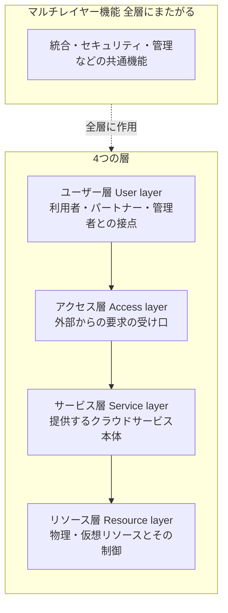

| 層 | 英語 | 役割 | 規格の節 |
|---|---|---|---|
| ユーザー層 | User layer | クラウドを使う主体との接点を担う | 9.2.2 |
| アクセス層 | Access layer | サービスへのアクセス経路・インターフェースを提供する | 9.2.3 |
| サービス層 | Service layer | クラウドサービスそのものを実現・提供する | 9.2.4 |
| リソース層 | Resource layer | 計算・ストレージ・ネットワーク等の資源を扱う | 9.2.5 |
| マルチレイヤー機能 | Multi-layer functions | 複数の層にまたがって働く機能 | 9.2.6 |

### 7.2 なぜ「層」で考えるのか

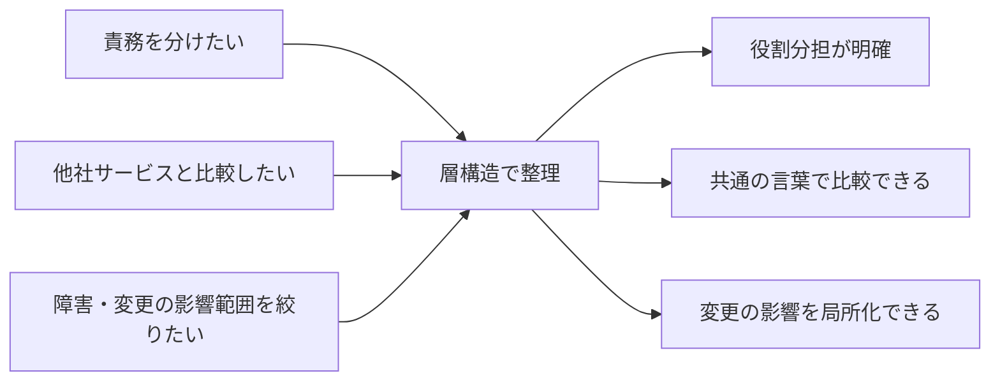

### 7.3 リクエストが層を通過する流れ（概念図）

利用者の操作が、どの層を通ってリソースに届くかを示す**説明用の概念シーケンス**です。

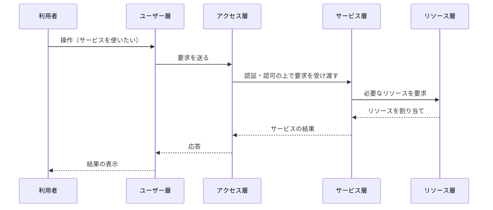

### 7.4 各層の機能コンポーネントの見方

規格9.2 では、各層ごとに **機能コンポーネント（Functional components）** が定義されています。ページ配分は次のとおりです。

| 規格の節 | 内容 | 規格上のページ配分 |
|---|---|---|
| 9.2.2 | ユーザー層の機能コンポーネント | 38ページ |
| 9.2.3 | アクセス層の機能コンポーネント | 38〜39ページ |
| 9.2.4 | サービス層の機能コンポーネント | 39〜40ページ |
| 9.2.5 | リソース層の機能コンポーネント | 40〜41ページ |
| 9.2.6 | マルチレイヤー機能 | 41〜46ページ |

> **読み方のコツ**：マルチレイヤー機能（9.2.6）は約6ページと、層ごとの記述より厚くなっています。セキュリティや管理のように「全層に関わる機能」が多いことの表れです。機能コンポーネントの具体的な名称一覧は、規格本文で確認してください。

### 7.5 マルチレイヤー機能とは

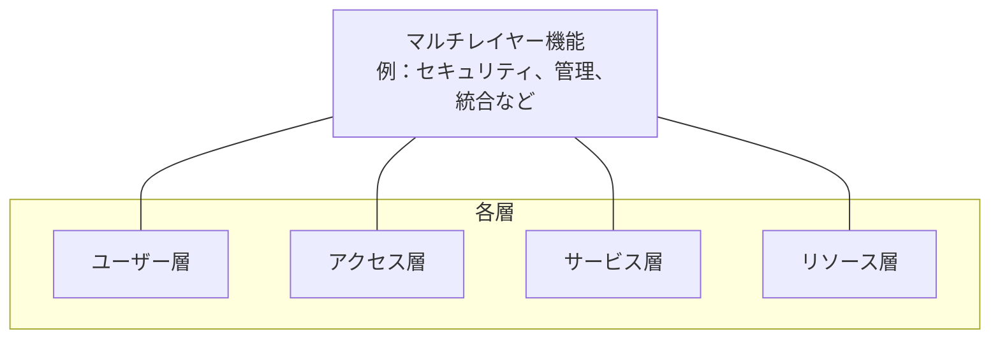

- 「セキュリティだけを1つの層に押し込む」ことはできません。ユーザー認証はユーザー層・アクセス層に、データ保護はリソース層に、というように **あらゆる層に関わる** からです。
- そのため、層とは別に **「複数層にまたがる機能」** という区分が設けられています。

---

## 8. Step 5：ユーザービューと機能ビューの対応づけ

規格10章は、**「人の世界（ユーザービュー）」と「部品の世界（機能ビュー）」を結びつける**章です。

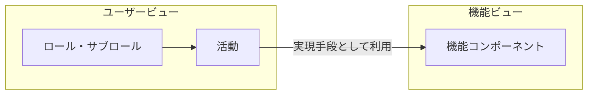

| 規格の節 | 内容 | ページ |
|---|---|---|
| 10.2.1 | サービス能力（Service capabilities）の機能コンポーネント | 48ページ |
| 10.2.2 | 共通のロール・活動・機能コンポーネント | 48〜49ページ |
| 10.2.3 | マルチテナンシーと分離（Multi-tenancy and isolation） | 49ページ |

### 8.1 マルチテナンシーと分離

**マルチテナンシー** とは、複数の顧客（テナント）が同じ基盤を共有して使う形態です。

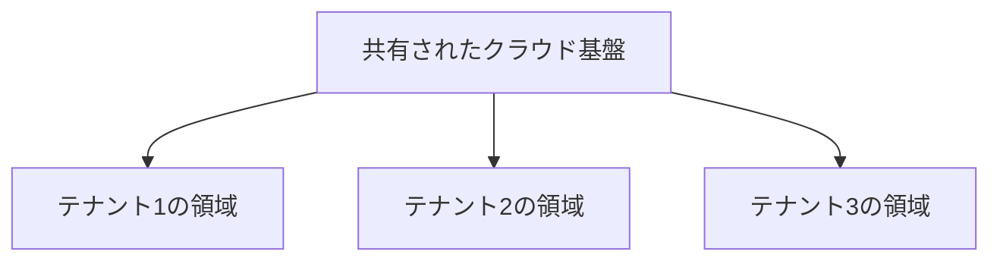

- 共有するからこそ、**テナント同士が互いに見えない・影響しない「分離（isolation）」** が必須になります。
- この分離の考え方は、横断的側面の「セキュリティ」「PII保護」と直結します。

---

## 9. Step 6：実装ビューとデプロイメントビュー

規格では 7.7（実装ビュー）と 7.8（デプロイメントビュー）が、それぞれ約1ページで位置づけられています。

| ビュー | 考える内容 | 具体化の主体 |
|---|---|---|
| 実装ビュー | 機能ビューの各機能を、どのソフトウェア・ハードウェアで実現するか | 各CSP・各システム設計者 |
| デプロイメントビュー | 実装した機能をどこに配置して動かすか | 各CSP・各システム設計者 |

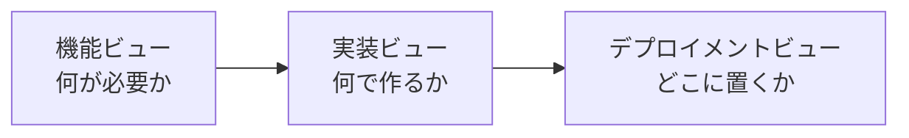

> JTC 1 の説明にあるとおり、CCRA は **技術中立** で、特定製品や特定の参照実装に縛られません。実装・配置の具体策は、利用者側の設計に委ねられます。

---

## 10. ISO/IEC 17789:2014 からの変更点

| 変更点 | 内容 |
|---|---|
| 規格番号の変更 | ISO/IEC 17789:2014 を技術的に改訂し、ISO/IEC 22123-3:2023 に |
| 新規：パーティとロールの区別 | 「当事者（パーティ）」と「役割（ロール）」を区別する記述を追加 |
| 図の削除 | 旧版の図13・14・15を削除 |
| シリーズ化 | 22123-1（用語）、22123-2（概念）と一体で整備 |

旧規格 ISO/IEC 17789:2014 は ITU-T 勧告 Y.3502 と同一の本文でした。ITU-T Y.3502 の目次は、本規格の構成と非常によく似ています。

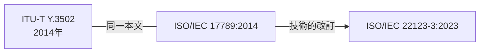

### 10.1 国内外での採用状況（確認できた例）

| 機関 | 採用形態 |
|---|---|
| エストニア規格協会（EVS） | EVS-ISO/IEC 22123-3:2025（ISO/IEC 22123-3:2023と同一、2025年3月17日から有効） |
| スロバキア規格 | STN ISO/IEC 22123-3:2024（英語版をそのまま公式版として採用） |

---

## 11. 他の著名なモデルとの比較（NIST・AWS）

CCRA の考え方は、他の著名なクラウドの枠組みと並べると理解が深まります。

### 11.1 NIST SP 500-292 との比較

米国NIST（国立標準技術研究所）は2011年9月に「NIST Cloud Computing Reference Architecture」（SP 500-292）を公表しました。**5つのアクター**（登場者）でクラウドを説明するモデルです。

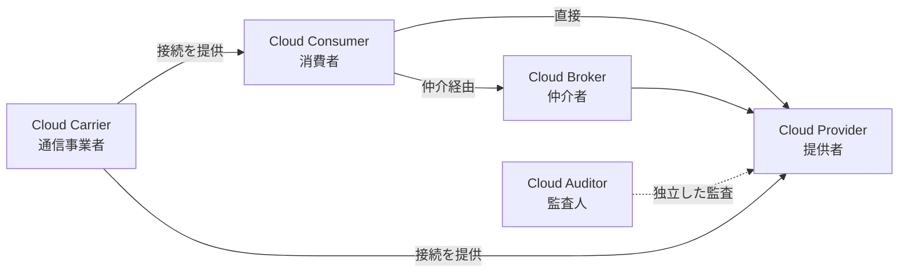

| 比較観点 | NIST SP 500-292 | ISO/IEC 22123-3 |
|---|---|---|
| 登場者の基本単位 | 5つのアクター（Consumer / Provider / Broker / Auditor / Carrier） | 3つのロール（CSC / CSP / CSN）＋パーティの概念 |
| 仲介・監査の扱い | 独立したアクターとして定義 | CSNロールの中のサブロール（仲介＝ブローカー、監査人）として整理 |
| 構造の説明 | アクターと、デプロイメント・オーケストレーション・管理・セキュリティ・プライバシー等の構成要素 | ユーザービュー／機能ビュー／実装ビュー／デプロイメントビュー |
| 層構造 | サービスオーケストレーションの階層が中心 | 4層（ユーザー・アクセス・サービス・リソース）＋マルチレイヤー機能 |
| 発行主体 | 米国の国立標準技術研究所 | 国際標準化機構・国際電気標準会議 |

> **整理のコツ**：NIST の「Broker」「Auditor」は、ISO 側では「CSN（パートナー）」の中に含まれる、と対応づけると理解しやすくなります。

### 11.2 AWS の責任共有モデルとの対応づけ

AWS は、セキュリティとコンプライアンスを **AWSと顧客の責任共有** と位置づけ、AWS が担う範囲を **「クラウドのセキュリティ（security of the cloud）」**、顧客が担う範囲を **「クラウド内のセキュリティ（security in the cloud）」** と呼んでいます。AWS は、顧客側の責任範囲が **選択するサービスによって変わる** ことも明示しています。

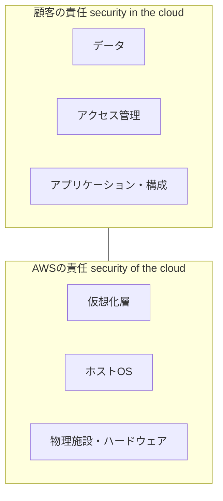

#### CCRAとの対応づけ（本ガイドによる整理の一例）

| 責任共有モデルの考え方 | CCRAでの対応する要素 |
|---|---|
| 提供者の責任（クラウドの安全） | CSPロール、特にセキュリティ・リスク管理に関わるサブロールと活動、リソース層・マルチレイヤー機能の保護 |
| 顧客の責任（クラウド内の安全） | CSCロール（利用者・管理者・インテグレーター）の活動 |
| 「選ぶサービスで責任が変わる」 | 機能ビューの層構造：IaaSでは顧客が管理する範囲が広く、SaaSでは狭くなる |
| ITコントロールの共有 | 横断的側面（セキュリティ、ガバナンス、監査可能性） |

> 上表は、**CCRA と責任共有モデルを学習のために対応づけた一例**です。両者は別の枠組みであり、規格が責任共有モデルを直接規定しているわけではありません。

---

## 12. 実務での使い方

### 12.1 CCRAの活用場面

| 場面 | 使い方 |
|---|---|
| クラウド選定・比較 | 「層」と「横断的側面」を共通のものさしとして各サービスを比較する |
| 設計レビュー | 機能ビューの4層に沿って、抜け漏れがないか点検する |
| 契約・調達 | CSC / CSP / CSN の責任範囲と活動を契約書に反映する |
| 監査・認証対応 | 横断的側面（監査可能性・ガバナンス等）をチェック項目に展開する |
| ドキュメント作成 | 用語と構造をCCRAに揃え、読み手間の認識のずれを防ぐ |
| テスト計画（QA） | 層ごと・横断的側面ごとにテスト観点を整理する |

### 12.2 設計時の判断フロー（実務向けの整理例）

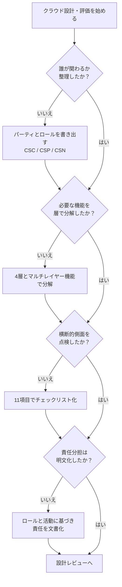

### 12.3 QA視点：横断的側面ごとのテスト観点の例

| 横断的側面 | テスト観点の例 |
|---|---|
| Auditability | 操作ログが漏れなく記録され、改ざんされていないか |
| Governance | 利用ポリシー違反の操作が制限・検知されるか |
| Interoperability | 外部サービスとのAPI連携が仕様どおり動くか |
| Maintenance and versioning | バージョン更新後も既存機能が壊れないか（回帰テスト） |
| Performance | 負荷時に目標の応答時間・処理量を満たすか |
| Portability | データを別環境へエクスポート・インポートできるか |
| PII protection | 個人情報がマスキング・暗号化されているか |
| Reversibility | 解約時にデータが返却・削除されるか |
| Security | 認証・認可・暗号化・脆弱性対策が機能するか |
| SLA | 稼働率・復旧時間などが合意値を満たすか |

---

## 13. 学習ロードマップ

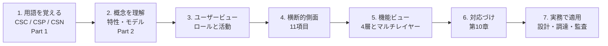

| ステップ | 目安 | ゴール |
|---|---|---|
| 1. 用語 | 30分 | CSC・CSP・CSNを説明できる |
| 2. 概念 | 1時間 | IaaS / PaaS / SaaS とデプロイメントモデルを説明できる |
| 3. ユーザービュー | 1〜2時間 | パーティ・ロール・サブロールの違いを説明できる |
| 4. 横断的側面 | 1〜2時間 | 11項目を挙げ、それぞれ1文で説明できる |
| 5. 機能ビュー | 2時間 | 4層の役割を説明できる |
| 6. 対応づけ | 1時間 | 活動と機能コンポーネントの関係を説明できる |
| 7. 実務適用 | 継続 | 自社設計のレビューに使える |

---

## 14. よくある誤解 Q&A

| 質問 | 回答 |
|---|---|
| CCRAに従わないと違法？ | 本規格は国際規格であり、それ自体が法的義務を課すものではありません。ただし、調達要件・社内基準・認証の参照先として採用される場合があります。 |
| CCRAはAWSやAzureの設計図？ | いいえ。特定製品に依存しない**技術中立**の枠組みです。各社サービスを共通のものさしで説明するために使います。 |
| 4層は必ずその通りに実装する？ | いいえ。機能を整理する**概念上の分け方**であり、実装を強制するものではありません。 |
| ロール＝会社？ | いいえ。1つの組織が複数のロールを同時に担うことがあります。だから「パーティ」と「ロール」を分けます。 |
| CSNは必須？ | CSNは、CSC・CSPを支援する第三者のロールです。必ずしも常に登場するわけではありません。 |
| 旧規格17789は無効？ | 本規格は17789を置き換える（技術的に改訂する）ものとして位置づけられています。 |

---

## 15. 参考ソース一覧（URL）

### 15.1 規格そのものに関する一次・準一次情報

| # | ソース | URL | 参照した内容 |
|---|---|---|---|
| 1 | ISO 公式ページ（ご指定のURL） | https://www.iso.org/cms/live/live/en/sites/isoorg/contents/data/standard/08/27/82759.html | 規格の公式ページ（※アクセス制限のため、下記ミラーで内容を確認） |
| 2 | ISO 公式ページ（ミラー：committee.iso.org） | https://committee.iso.org/standard/82759.html | 名称、版、発行年月、Scope、ICS、委員会、ステータス |
| 3 | 規格プレビューPDF（VDE-Verlag） | https://www.vde-verlag.de/iec-normen/preview-pdf/info_isoiec22123-3{ed1.0}en.pdf | 目次（章・節・ページ構成）、序文（17789の置き換えと主な変更点）、用語、Scope |
| 4 | 規格プレビューPDF（ANSI Webstore） | https://webstore.ansi.org/preview-pages/ISO/preview_ISO+IEC+22123-3-2023.pdf | 目次の補足確認 |
| 5 | JTC 1 公式：クラウドコンピューティング フラッグシップ規格 | https://jtc1info.org/technology/subcommittees/flagship-standards/cloud-computing/ | CCRAの2ビュー・4層の説明、Part 1〜3の関係、関連規格 |
| 6 | エストニア規格協会 EVS-ISO/IEC 22123-3:2025 | https://www.evs.ee/en/evs-iso-iec-22123-3-2025 | 国家規格としての同一採用 |
| 7 | スロバキア規格 STN ISO/IEC 22123-3:2024 | https://normy.normoff.gov.sk/norma/138359/nahlad | 国家規格としての採用、17789置き換えと変更点 |
| 8 | カナダ規格評議会 標準データベース | https://scc-ccn.ca/standardsdb/standards/8185211 | 発行日、ステータス |

### 15.2 旧規格・関連枠組み

| # | ソース | URL | 参照した内容 |
|---|---|---|---|
| 9 | ITU-T Y.3502（ISO/IEC 17789:2014と同一本文）目次 | https://www.itu.int/dms_pubrec/itu-t/rec/y/T-REC-Y.3502-201408-I!!TOC-HTM-E.htm | 旧規格の構成、ユーザービューと機能ビューの構造 |
| 10 | ISO/IEC 17789:2014 プレビュー | https://vde-verlag.de/iec-normen/preview-pdf/info_isoiec17789{ed1.0}en.pdf | 旧規格のScopeと構成 |
| 11 | NIST SP 500-292（概要ページ） | https://2020.standict.eu/node/2883 | NISTの5アクターの定義と概要 |
| 12 | NIST Cloud Computing Standards Roadmap（抜粋） | https://profsandhu.com/cs6393_s19/NIST_SP-500-291_Version-2_2013_June18_extract.pdf | 5アクターと相互作用の説明 |

### 15.3 クラウド事業者・実務者の公開情報

| # | ソース | URL | 参照した内容 |
|---|---|---|---|
| 13 | AWS Well-Architected Framework：責任共有（Security Pillar） | https://docs.aws.amazon.com/wellarchitected/latest/security-pillar/shared-responsibility.html | 「クラウドのセキュリティ」と顧客責任の区分 |
| 14 | AWS：責任共有モデル | https://aws.amazon.com/en/compliance/shared-responsibility-model/ | 「of」と「in」の区分、サービス選択による責任範囲の変化 |

### 15.4 調査上の注意

- **ISO公式ページ**（ご指定のURL）は、自動アクセス制限により直接取得できませんでした。そのため、同一規格番号の公開ミラー、標準機関の公開ページ、規格プレビューPDFの内容を突き合わせています。
- **規格本文は有料**です。本ガイドの章・節・ページ構成、ロールやサブロールの体系、横断的側面の項目名は、公開プレビュー（目次）と公式の概要説明に基づいています。**サブロールの正式名称・活動の一覧・機能コンポーネントの名称など、目次より深い部分は旧規格 17789 の体系を参考にした代表例**であり、厳密な記述が必要な場面では規格本文で確認してください。
- 規格の**改訂・追補の有無**は、2026年10月24日時点で確認できた公開情報の範囲では、新たな版の公表は確認できませんでした。最新状況はISOの公式ページでご確認ください。
- **第11章のNIST・AWSとの対応づけ**、および各所の概念図・チェックリストは、理解を助けるための**本ガイドの整理**であり、規格が直接規定する内容ではありません。

---

*本ガイドは学習目的の解説であり、規格本文の代替ではありません。*
