# AWS Certified Solutions Architect - Professional (SAP-C02)

## Content Domain 3: Continuous Improvement for Existing Solutions 初学者向けステップバイステップガイド

> 既存のシステムを「測って、分析して、直して、また測る」ための考え方と AWS サービスを、初学者向けに順を追って解説します。

| 項目 | 内容 |
|---|---|
| 対象試験 | AWS Certified Solutions Architect - Professional (SAP-C02) |
| 対象ドメイン | Content Domain 3: Continuous Improvement for Existing Solutions |
| 配点 | 試験の採点対象コンテンツの 25% |
| 構成タスク | Task 3.1 運用上の優秀性 / 3.2 セキュリティ / 3.3 パフォーマンス / 3.4 信頼性 / 3.5 コスト最適化 |
| 想定読者 | AWS の基本サービス(EC2, S3, VPC, IAM)を触ったことがある初学者 |
| 一次ソース | AWS 公式 Exam Guide (SAP-C02) |

---

## 目次

1. [この Domain は何を問うのか](#1-この-domain-は何を問うのか)
2. [前提知識: Well-Architected と用語集](#2-前提知識-well-architected-と用語集)
3. [Task 3.1 運用上の優秀性を改善する](#3-task-31-運用上の優秀性を改善する)
4. [Task 3.2 セキュリティを改善する](#4-task-32-セキュリティを改善する)
5. [Task 3.3 パフォーマンスを改善する](#5-task-33-パフォーマンスを改善する)
6. [Task 3.4 信頼性を改善する](#6-task-34-信頼性を改善する)
7. [Task 3.5 コスト最適化の機会を見つける](#7-task-35-コスト最適化の機会を見つける)
8. [横断: 試験問題の読み解き方](#8-横断-試験問題の読み解き方)
9. [学習チェックリスト](#9-学習チェックリスト)
10. [参考ソース URL](#10-参考ソース-url)

---

## 1. この Domain は何を問うのか

### 1.1 一言でいうと

Domain 3 は **「すでに動いているシステムを、より良くする提案ができるか」** を問います。新規設計(Domain 2)や移行(Domain 4)と違い、**現状の課題を見つけ、原因を特定し、最小のリスクで改善する**視点が中心です。

### 1.2 5 つのタスクと Well-Architected の柱

| Task | テーマ | 対応する Well-Architected の柱 | 代表サービス |
|---|---|---|---|
| 3.1 | 運用上の優秀性 | Operational Excellence | CloudWatch, EventBridge, Systems Manager, CodeDeploy, FIS |
| 3.2 | セキュリティ | Security | Config, Secrets Manager, IAM Access Analyzer, GuardDuty, Inspector, AWS Backup |
| 3.3 | パフォーマンス | Performance Efficiency | Auto Scaling, CloudFront, Global Accelerator, ElastiCache, Compute Optimizer |
| 3.4 | 信頼性 | Reliability | Multi-AZ, ELB, Route 53, Service Quotas, Elastic Disaster Recovery |
| 3.5 | コスト最適化 | Cost Optimization | Cost Explorer, Budgets, CUR, Savings Plans, Trusted Advisor |

### 1.3 改善の基本ループ

どのタスクも、次のループを回すことが本質です。

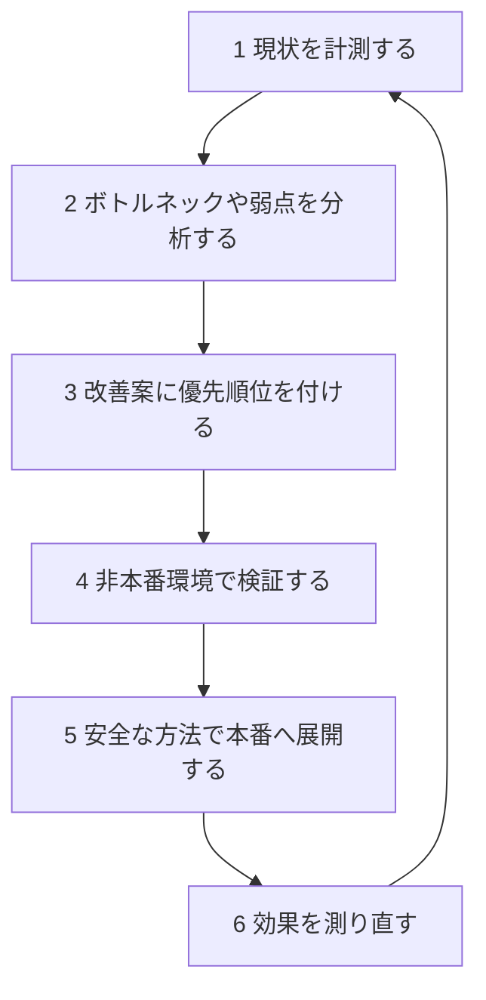

### 1.4 学習のステップ(おすすめ順)

| ステップ | やること | 目安 |
|---|---|---|
| Step 1 | 2 章で用語と 6 つの柱を理解する | 1 時間 |
| Step 2 | 3.1 で「見える化」と「自動化」の道具を覚える | 3 時間 |
| Step 3 | 3.2 から 3.5 を 1 タスクずつ読み、比較表を自分で書き写す | 各 2 から 3 時間 |
| Step 4 | 8 章の読み解きパターンで過去問風の問題を解く | 2 時間 |
| Step 5 | 9 章のチェックリストで抜けを確認する | 1 時間 |

---

## 2. 前提知識: Well-Architected と用語集

### 2.1 AWS Well-Architected Framework の 6 つの柱

SAP-C02 は Well-Architected Framework に基づく設計力を検証する試験です。Domain 3 の 5 タスクは、6 つの柱のうち 5 つに対応しています。

| 柱 | 一言で | 改善の問いかけ例 |
|---|---|---|
| 運用上の優秀性 | 運用を継続的に改善する | 障害に気付く仕組みと自動復旧はあるか |
| セキュリティ | データとシステムを守る | 権限は最小か、変更は追跡できるか |
| 信頼性 | 壊れても動き続け、すぐ戻る | 単一障害点は残っていないか |
| パフォーマンス効率 | 適切なリソースを適切な量で使う | ボトルネックはどこか |
| コスト最適化 | 無駄な支出を避ける | 使っていないリソースはないか |
| 持続可能性 | 環境負荷を減らす | 過剰なリソースを持っていないか |

### 2.2 用語集

| 用語 | 意味 | 例 |
|---|---|---|
| SLA | サービス提供者と利用者の約束(契約) | 月間稼働率 99.9% |
| KPI | 目標達成度を測る業務指標 | 注文完了までの時間 |
| RTO | 障害発生から復旧完了までに許容できる時間 | 1 時間以内に復旧 |
| RPO | 許容できるデータ損失の時間幅 | 直近 5 分のデータまで失ってよい |
| 単一障害点 (SPOF) | それが止まると全体が止まる部品 | AZ が 1 つだけの DB |
| 影響範囲 (blast radius) | 障害や変更ミスの影響が及ぶ範囲 | 全サーバー一斉デプロイは範囲が広い |
| IaC | インフラをコードで管理する手法 | CloudFormation |
| 最小権限 | 必要最小限の権限だけを与える原則 | S3 の特定バケットの読み取りのみ許可 |
| ライトサイジング | 実使用量に合わせてリソース規模を調整する | m5.4xlarge から m5.xlarge へ |

### 2.3 試験の形式(Exam Guide より)

| 項目 | 内容 |
|---|---|
| 設問形式 | 択一式、複数選択式 |
| 採点対象問題 | 65 問(ほかに採点されない問題が 10 問) |
| スコア | 100 から 1,000 のスケールスコア、合格点は 750 |
| 採点方式 | 補償型(セクションごとの合格は不要で、全体で合格すればよい) |

出典: AWS Certified Solutions Architect - Professional Exam Guide (SAP-C02)
https://docs.aws.amazon.com/aws-certification/latest/solutions-architect-professional-02/solutions-architect-professional-02.html

---

## 3. Task 3.1 運用上の優秀性を改善する

### 3.1 このタスクで問われること(Exam Guide より)

| 区分 | 内容 |
|---|---|
| Knowledge | アラートと自動修復の戦略 |
| Knowledge | 災害対策 (DR) の計画 |
| Knowledge | 監視とログの仕組み (例: Amazon CloudWatch) |
| Knowledge | CICD パイプラインとデプロイ戦略 (例: ブルーグリーン、オールアットワンス、ローリング) |
| Knowledge | 構成管理ツール (例: AWS Systems Manager) |
| Skills | 最適なログ・監視戦略を決める |
| Skills | 現在のデプロイ工程の改善余地を評価する |
| Skills | 自動化の優先順位を付ける |
| Skills | 構成管理の自動化に適した AWS ソリューションを推奨する |
| Skills | 障害シナリオを意図的に起こし、復旧手順への理解を鍛える |

### 3.2 全体像: 見える化から自動修復まで

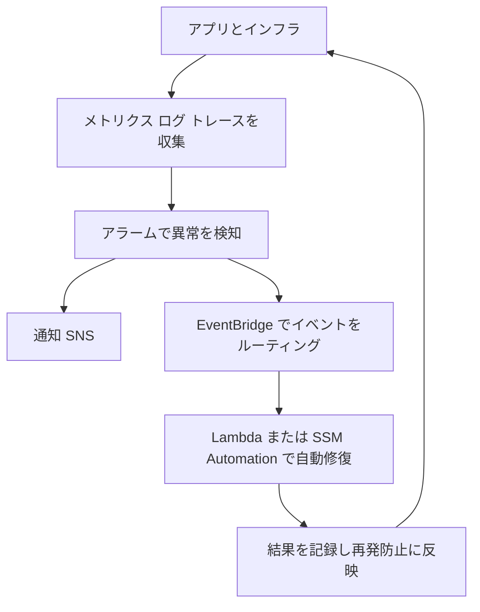

### 3.3 Step 1: 監視とログの戦略を決める

#### 3 つのシグナルを使い分ける

| シグナル | 何がわかるか | 主なサービス |
|---|---|---|
| メトリクス | 数値の推移 (CPU、遅延、エラー数) | Amazon CloudWatch Metrics |
| ログ | 何が起きたかの詳細な記録 | CloudWatch Logs |
| トレース | 1 つのリクエストが各サービスを通る経路と所要時間 | AWS X-Ray |
| 操作履歴 | だれがいつ API を呼んだか | AWS CloudTrail |
| 構成履歴 | リソース設定がいつどう変わったか | AWS Config |

#### CloudWatch の主要機能

| 機能 | 役割 | ポイント |
|---|---|---|
| メトリクス | 数値データの収集 | EC2 の標準メトリクスは 5 分間隔、詳細モニタリングで 1 分間隔 |
| CloudWatch エージェント | メモリやディスク使用率などの OS 内部指標とログを収集 | メモリ使用率は標準では取得されないためエージェントが必要 |
| アラーム | しきい値超過で状態が変わり、アクションを実行 | 状態は OK、ALARM、INSUFFICIENT_DATA |
| 複合アラーム | 複数アラームを AND や OR で組み合わせる | 通知のノイズ削減に有効 |
| 異常検知 | 過去の傾向から正常範囲を学習して逸脱を検知 | 固定しきい値が決めにくい指標に向く |
| Logs Insights | ログを専用クエリで分析 | アドホックな調査向け |
| メトリクスフィルター | ログ中の文字列をメトリクスに変換 | エラー行の数をアラーム化できる |
| サブスクリプションフィルター | ログをリアルタイムで他へ転送 | Kinesis、Firehose、Lambda へ送れる |
| Synthetics | 外形監視 (カナリア) | ユーザー視点で API や画面を定期確認 |

#### ベストプラクティス

| # | プラクティス | 理由 |
|---|---|---|
| 1 | ログのグループに保存期間 (リテンション) を必ず設定する | 既定では無期限保存になり、コストが増え続ける |
| 2 | 長期保管や分析が必要なログは S3 へ出力し、Athena で分析する | 安価に保管でき、SQL で傾向を分析できる |
| 3 | アラームには「だれが何をするか」を決めた対応先 (SNS や自動処理) を付ける | 鳴るだけのアラームは運用負荷になる |
| 4 | 組織全体のログを集約アカウントにまとめる | 横断調査と監査が容易になる |
| 5 | 技術指標だけでなくビジネス指標 (注文数など) もカスタムメトリクスにする | ユーザー影響を直接検知できる |

### 3.4 Step 2: アラートと自動修復を設計する

#### 基本パターン

| 検知元 | 連携 | 修復の実行 | 例 |
|---|---|---|---|
| CloudWatch アラーム | EC2 アクション | インスタンスの再起動や復旧 | システムステータスチェック(StatusCheckFailed_System)失敗時に自動復旧(インスタンスステータスチェックの失敗は復旧アクションの対象外) |
| CloudWatch アラーム | SNS | 人へ通知、または Lambda を起動 | 管理者へメール通知 |
| AWS サービスのイベント | EventBridge ルール | Lambda、SSM Automation、Step Functions | EC2 停止イベントで自動起動 |
| CloudTrail の API 呼び出し | EventBridge ルール | Lambda | セキュリティグループ変更を検知して元に戻す |
| AWS Config のルール違反 | 修復アクション | SSM Automation ドキュメント | デフォルト暗号化が未設定の S3 バケットにデフォルト暗号化を自動設定 (新規アップロードのみ対象。既存オブジェクトは S3 Batch Operations のコピーで別途再暗号化) |

#### EventBridge ルールの例 (EC2 の停止を検知)

```json
{
  "source": ["aws.ec2"],
  "detail-type": ["EC2 Instance State-change Notification"],
  "detail": {
    "state": ["stopped"]
  }
}
```

#### 自動修復を導入する順序

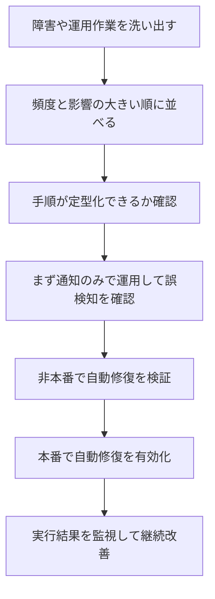

#### ベストプラクティス

| # | プラクティス | 理由 |
|---|---|---|
| 1 | 自動修復は冪等 (何度実行しても同じ結果) に作る | 重複イベントでも壊れない |
| 2 | 繰り返し発生する手作業を優先して自動化する | 効果が大きい |
| 3 | 重要な修復は、まず通知だけで運用して誤検知を確認してから自動化する | 誤った自動修復が障害を広げるのを防ぐ |
| 4 | 自動修復の失敗自体もアラートにする | 修復が止まっていることに気付ける |

### 3.5 Step 3: デプロイ戦略を評価・改善する

#### デプロイ戦略の比較

| 戦略 | 仕組み | ダウンタイム | ロールバック | 影響範囲 | コスト |
|---|---|---|---|---|---|
| オールアットワンス | 全台を一度に新バージョンへ | あり得る | 再デプロイが必要で遅い | 全体 | 低 |
| ローリング | 少数ずつ順に入れ替え | なし (容量は一時的に減る) | 遅い | 段階的 | 低 |
| 追加バッチ付きローリング | 追加の台数を確保しながら順に入れ替え | なし (容量を維持) | 遅い | 段階的 | 中 |
| イミュータブル | 新しい台数を別に作り、成功後に切り替え | なし | 速い (新環境を捨てる) | 小 | 高 |
| ブルーグリーン | 旧環境 (ブルー) と新環境 (グリーン) を並べ、トラフィックを切り替え | なし | 非常に速い (戻すだけ) | 小 | 高 (一時的に 2 倍) |
| カナリア | ごく一部のトラフィックだけ新版へ送り、問題なければ全体へ | なし | 速い | 非常に小 | 中 |
| リニア | 一定割合ずつ時間をかけて新版へ移す | なし | 速い | 段階的 | 中 |

#### 戦略の選び方

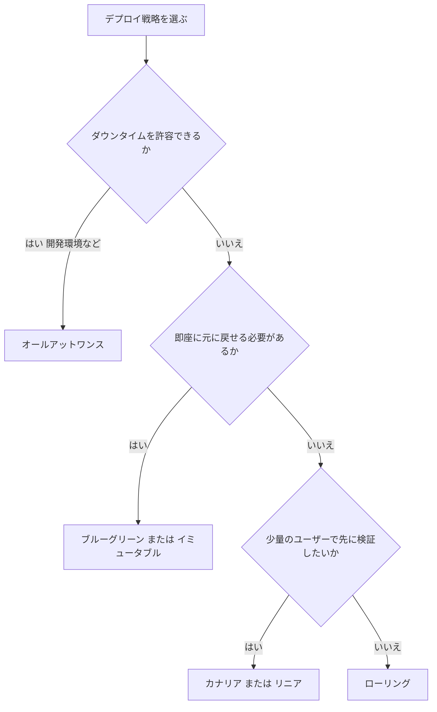

#### AWS サービスと戦略の対応

| サービス | 対応するデプロイ | 補足 |
|---|---|---|
| AWS CodeDeploy (EC2 とオンプレミス) | インプレース (一度に全台、半数ずつ、1 台ずつ) とブルーグリーン | CloudWatch アラームによる自動ロールバックを設定できる |
| AWS CodeDeploy (Lambda) | カナリア、リニア、オールアットワンス | Lambda エイリアスの重み付けでトラフィックを移す |
| AWS CodeDeploy (Amazon ECS) | ブルーグリーン (カナリア、リニア、オールアットワンスのトラフィック移行) | ALB のターゲットグループを切り替える |
| AWS Elastic Beanstalk | オールアットワンス、ローリング、追加バッチ付きローリング、イミュータブル、トラフィック分割 | URL のスワップでブルーグリーン相当を実現 |
| Amazon EC2 Auto Scaling | インスタンスリフレッシュ | 起動テンプレートの更新を段階的に反映 |
| Amazon Route 53 | 加重ルーティング | DNS レベルで新旧環境へ割合を指定 |
| AWS CodePipeline | 一連の CICD の流れを自動化 | ソース、ビルド、テスト、承認、デプロイをつなぐ |

#### CodeDeploy の appspec.yml の例 (Lambda のカナリア)

```yaml
version: 0.0
Resources:
  - MyFunction:
      Type: AWS::Lambda::Function
      Properties:
        Name: "my-function"
        Alias: "live"
        CurrentVersion: "1"
        TargetVersion: "2"
Hooks:
  - BeforeAllowTraffic: "PreTrafficValidationFunction"
  - AfterAllowTraffic: "PostTrafficValidationFunction"
```

#### ベストプラクティス

| # | プラクティス | 理由 |
|---|---|---|
| 1 | 小さく頻繁にデプロイする | 1 回の変更が小さいほど原因の特定と戻しが容易 |
| 2 | デプロイ中の健全性指標にアラームを設定し、悪化したら自動ロールバックする | 人が気付く前に影響を止められる |
| 3 | 手作業の手順書をなくし、パイプラインとコードで管理する | 再現性と監査性が上がる |
| 4 | 本番に近い非本番環境で事前にテストする | 本番での失敗を減らす |
| 5 | データベースのスキーマ変更はアプリの新旧両バージョンと互換な形で段階的に行う | ブルーグリーンで戻せなくなる事態を防ぐ |

### 3.6 Step 4: 構成管理を自動化する (AWS Systems Manager)

AWS Systems Manager は、サーバー群の運用作業をまとめて自動化するための機能群です。

| 機能 | 役割 | 使いどころ |
|---|---|---|
| Run Command | 複数インスタンスへコマンドを一斉実行 | 緊急の設定変更 |
| State Manager | 望ましい構成を定義し、定期的に維持 | 設定のずれ (ドリフト) の自動修正 |
| Patch Manager | パッチの適用と準拠状況の確認 | OS パッチの自動化 |
| Automation | 手順書 (ランブック) を自動実行 | 修復作業の自動化 |
| Session Manager | SSH 不要でインスタンスへ接続 | 踏み台サーバーとキーペアの廃止。セッションログ (S3/CloudWatch Logs) を設定した場合はコマンドと出力を記録 (デフォルトでは記録されず、SSH・ポートフォワーディングのセッションは対象外) |
| Parameter Store | 設定値と機密値の保管 | アプリの設定管理 |
| Inventory | ソフトウェア構成の収集 | 資産管理 |
| Maintenance Windows | メンテナンス実施時間帯の定義 | パッチ適用の計画 |

あわせて、AWS CloudFormation の **ドリフト検出** を使うと、コードで定義した構成と実環境のずれを見つけられます。

| 要件 | 推奨ソリューション |
|---|---|
| 構成のずれを定期的に自動修正したい | Systems Manager State Manager |
| 多数のサーバーのパッチを計画的に当てたい | Systems Manager Patch Manager とメンテナンスウィンドウ |
| SSH ポートを開けずに管理・監査したい | Systems Manager Session Manager |
| 手順書を自動実行したい | Systems Manager Automation |
| コードで定義した構成との差分を検出したい | CloudFormation ドリフト検出 |
| 承認済みのテンプレートだけを利用者へ配布したい | AWS Service Catalog |

### 3.7 Step 5: 災害対策 (DR) を計画し、障害訓練で検証する

#### DR 戦略の 4 パターン

| 戦略 | 概要 | 目安の RTO/RPO | コスト |
|---|---|---|---|
| バックアップと復元 | バックアップから必要時に再構築 | 数時間以上 | 最小 |
| パイロットライト | データ基盤だけ常時稼働、アプリは停止しておく | 数十分 | 小 |
| ウォームスタンバイ | 縮小版のシステムを常時稼働 | 数分 | 中 |
| マルチサイト (アクティブ/アクティブ) | 複数リージョンで同時稼働 | ほぼゼロ | 最大 |

#### 関連サービス

| サービス | 役割 |
|---|---|
| AWS Elastic Disaster Recovery | オンプレミスや他環境のサーバーを継続的にレプリケートし、障害時に AWS 上で素早く復旧 |
| AWS Backup | バックアップの一元管理と自動化 |
| Amazon Route 53 | ヘルスチェックによるフェイルオーバー |
| AWS Fault Injection Service (FIS) | 障害を意図的に注入して耐障害性を検証 |

#### 障害訓練 (ゲームデー) の手順

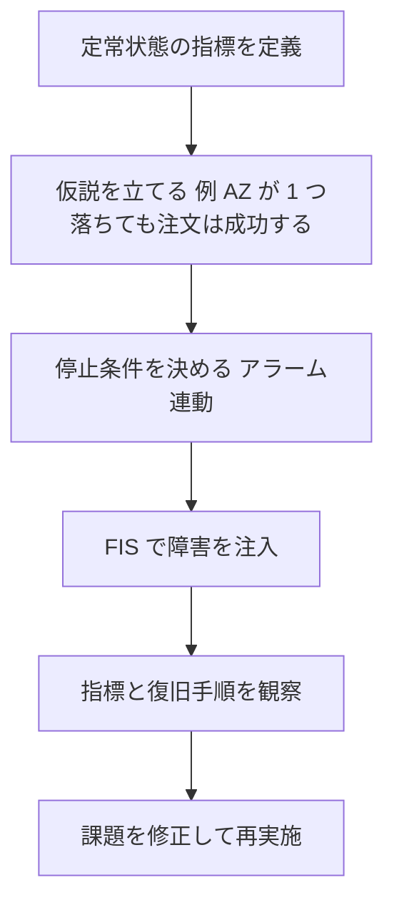

| ポイント | 説明 |
|---|---|
| 停止条件 | CloudWatch アラームと連動し、影響が想定以上なら実験を自動停止 |
| 小さく始める | まず非本番、次に本番の限定範囲で実施 |
| 手順書も検証する | 復旧手順が実際に通用するかを確認する |

### 3.8 Task 3.1 の試験での考え方

| 問題文のキーワード | 選ぶ方向 |
|---|---|
| 手作業の運用を減らしたい | Systems Manager Automation、EventBridge と Lambda |
| 設定のずれを自動修正したい | State Manager、Config の自動修復 |
| 即座に切り戻したい、ダウンタイムなし | ブルーグリーン |
| 少数ユーザーで先に検証したい | カナリア |
| SSH を使わずに接続したい | Session Manager |
| 復旧手順が本当に機能するか確かめたい | FIS による障害注入、DR テスト |

出典:
- https://docs.aws.amazon.com/wellarchitected/latest/operational-excellence-pillar/welcome.html
- https://docs.aws.amazon.com/AmazonCloudWatch/latest/monitoring/WhatIsCloudWatch.html
- https://docs.aws.amazon.com/systems-manager/latest/userguide/what-is-systems-manager.html
- https://docs.aws.amazon.com/codedeploy/latest/userguide/welcome.html
- https://docs.aws.amazon.com/fis/latest/userguide/what-is.html

---

## 4. Task 3.2 セキュリティを改善する

### 4.1 このタスクで問われること(Exam Guide より)

| 区分 | 内容 |
|---|---|
| Knowledge | データ保持、データの機密度、規制要件 |
| Knowledge | 自動監視と自動修復の戦略 (例: AWS Config ルール) |
| Knowledge | シークレット管理 (例: Systems Manager、AWS Secrets Manager) |
| Knowledge | 最小権限の原則 |
| Knowledge | セキュリティ関連の AWS ソリューション |
| Knowledge | パッチ適用とバックアップの実践 |
| Skills | シークレットと認証情報の安全な管理を評価する |
| Skills | 最小権限の観点で環境を監査する |
| Skills | すべての層でセキュリティが確保されているか確認する |
| Skills | ユーザーとサービスの操作を包括的に追跡できるか確認する |
| Skills | 脆弱性検出時の自動対応に優先順位を付ける |
| Skills | パッチと更新のプロセス、バックアッププロセスを設計・実装する |
| Skills | 修復 (remediation) 手法を使う |

### 4.2 全体像: 防ぐ、見つける、直す、残す

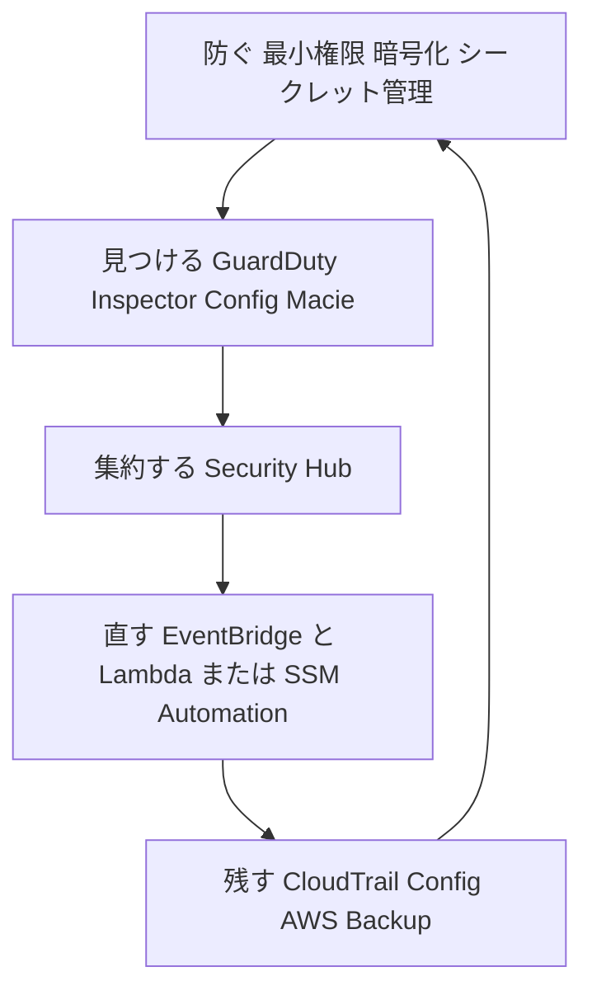

| 目的 | 役割 | 代表サービス |
|---|---|---|
| 防ぐ | 事故が起きにくい状態を作る | IAM、KMS、Secrets Manager、SCP |
| 見つける | 脅威、脆弱性、設定不備を検知 | GuardDuty、Inspector、Config、Macie |
| 直す | 検知後に自動で是正 | EventBridge、Lambda、SSM Automation、Config 修復アクション |
| 残す | 追跡と復元のための記録 | CloudTrail、Config、AWS Backup |

### 4.3 Step 1: データの保持・機密度・規制要件を整理する

まず「どのデータが、どれだけ重要で、どれだけ保管するか」を決めます。技術の選定はその後です。

| 要件 | 使うサービスと機能 | ポイント |
|---|---|---|
| 機密データ (個人情報など) を S3 から見つけたい | Amazon Macie | S3 内の機密データを自動検出し、リスクを可視化 |
| 一定期間は削除も上書きもさせたくない (WORM) | S3 Object Lock | ガバナンスモードとコンプライアンスモードがある。コンプライアンスモードは root でも保持期間中は削除できない |
| 古いデータを自動で低コストの層へ移し、期限後に削除 | S3 ライフサイクル | 保持期間と削除を自動化 |
| バックアップを改ざん・削除から守る | AWS Backup Vault Lock | バックアップの保持ルールを強制 |
| 保管データの暗号化 | AWS KMS | キーポリシーで管理。自動ローテーションは AWS が生成したキーマテリアルを持つ対称カスタマーマネージドキーのみ対象で、それ以外のキーはローテーションが必要なら手動で行う |
| コンプライアンス証跡の入手 | AWS Artifact | AWS の監査レポートを取得 |
| 監査の準備を継続的に自動化 | AWS Audit Manager | 証拠収集を自動化 |

### 4.4 Step 2: 自動監視と自動修復 (AWS Config)

AWS Config は「リソースの設定がどう変わったか」を記録し、「ルールに合っているか」を評価します。

| 機能 | 役割 |
|---|---|
| 構成レコーダー | リソースの設定変更を継続的に記録 |
| Config ルール | 設定がルールに適合か不適合かを評価 (マネージドルールとカスタムルール) |
| 適合パック | ルールと修復アクションをまとめたパッケージ。組織全体へ展開できる |
| アグリゲーター | 複数アカウントとリージョンの結果を 1 か所に集約 |
| 修復アクション | 不適合リソースに対して SSM Automation ドキュメントを実行 (手動または自動) |

#### 修復の流れ

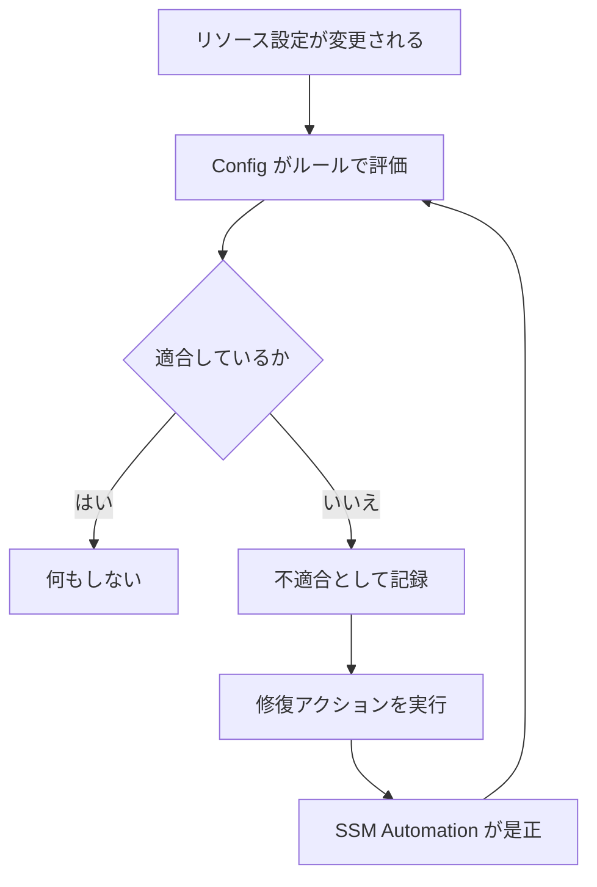

| よくある修復例 | 使うルールの例 | 修復の内容 |
|---|---|---|
| S3 バケットのパブリックアクセスを防ぐ | S3 パブリックアクセス関連のマネージドルール | パブリックアクセスブロックを有効化 |
| EBS ボリュームの暗号化漏れ | 暗号化確認のマネージドルール | 通知し、再作成を促す |
| 不要なポートの開放 | セキュリティグループ関連のルール | 不適切なルールを削除 |

#### ベストプラクティス

| # | プラクティス | 理由 |
|---|---|---|
| 1 | まず「検出と通知」から始め、確認してから自動修復へ進める | 誤った自動修復による障害を防ぐ |
| 2 | 組織単位で適合パックを展開し、アグリゲーターで集約する | アカウントごとの設定漏れを防ぐ |
| 3 | 修復アクションには必要最小限の権限だけを持つロールを使う | 自動修復自体が攻撃経路にならないようにする |

### 4.5 Step 3: シークレットと認証情報を安全に管理する

| 観点 | AWS Secrets Manager | Systems Manager Parameter Store |
|---|---|---|
| 主な用途 | データベースの認証情報や API キー | 設定値と、必要に応じて機密値 |
| 自動ローテーション | あり (Lambda でローテーション。RDS などは統合済み) | 標準機能としてはなし |
| 暗号化 | KMS で常に暗号化 | SecureString で KMS による暗号化 |
| 複数リージョンへの複製 | あり | なし |
| コスト | シークレットごとに課金 | 標準パラメータは無料 (高度なパラメータは有料) |
| 選ぶ目安 | 自動ローテーションが必要なら Secrets Manager | 設定値の管理や、コストを抑えたいときは Parameter Store |

#### よくある悪い例と改善

| 現状 (悪い例) | 改善案 |
|---|---|
| ソースコードや環境変数に DB パスワードを直書き | Secrets Manager から取得し、自動ローテーションを有効にする |
| EC2 に長期のアクセスキーを保存 | IAM ロール (インスタンスプロファイル) を使い、一時認証情報を使う |
| 全員が共通の認証情報を使い回している | 個人ごとの IAM Identity Center やロールへ分ける |

#### CLI の例: シークレットの取得

```bash
aws secretsmanager get-secret-value \
  --secret-id prod/app/db-credentials \
  --query SecretString \
  --output text
```

### 4.6 Step 4: 最小権限を監査して改善する

| 道具 | 何ができるか |
|---|---|
| IAM Access Analyzer (外部アクセス) | 外部のアカウントや公開状態になっているリソースを検出 |
| IAM Access Analyzer (未使用アクセス) | 使われていない権限、ロール、アクセスキーを検出 |
| IAM Access Analyzer (ポリシー生成) | CloudTrail のログから実際に使われた操作だけのポリシーを作成 |
| IAM Access Analyzer (ポリシー検証) | ポリシーの文法やセキュリティ上の警告を確認 |
| IAM 最終アクセス情報 | サービスや操作が最後に使われた時期を確認 |
| IAM 認証情報レポート | アカウント内ユーザーの認証情報の状態を一覧 |
| SCP (Organizations) | アカウントが付与できる権限の上限を組織で制限 |
| アクセス許可の境界 | ユーザーやロールが持てる権限の上限を設定 |

#### 権限を絞り込む手順

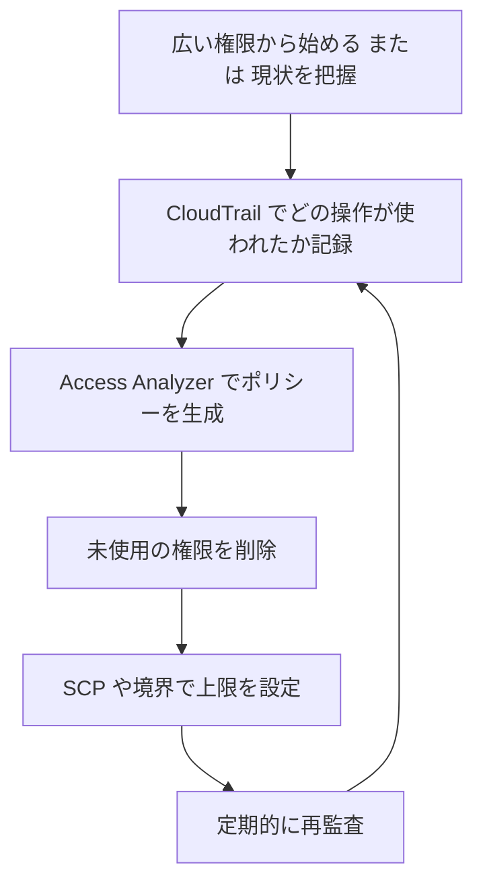

### 4.7 Step 5: すべての層でセキュリティを確保する (多層防御)

| 層 | 対策 | サービス |
|---|---|---|
| エッジ | DDoS 対策、悪意あるリクエスト遮断 | AWS Shield、AWS WAF、CloudFront |
| ネットワーク | 通信の制御と検査 | セキュリティグループ、ネットワーク ACL、AWS Network Firewall |
| ネットワーク (組織全体) | ルールの一括管理 | AWS Firewall Manager |
| コンピュート | 脆弱性管理とパッチ | Amazon Inspector、Patch Manager |
| アプリケーション | 認証と認可 | Amazon Cognito、IAM |
| データ | 暗号化と分類 | AWS KMS、Macie、ACM |
| ID | 最小権限と一時的な認証情報 | IAM、IAM Identity Center、STS |

### 4.8 Step 6: ユーザーとサービスの操作を追跡する

| 追跡したいこと | サービス | 補足 |
|---|---|---|
| だれがどの API を呼んだか | AWS CloudTrail | 管理イベントのイベント履歴は 90 日。長期保管するには証跡を作成して S3 へ保存。証跡が既定で記録するのは管理イベントのみで、S3 オブジェクトレベル操作などのデータイベントは対象リソースを明示的に選択して有効化する |
| 組織全体の API 履歴 | CloudTrail 組織の証跡 | 管理アカウントから全アカウントへ適用 |
| 証跡を SQL で調べたい | CloudTrail Lake (既存顧客のみ) / 新規は Amazon CloudWatch | CloudTrail Lake はイベントデータの保管とクエリ。2026 年 5 月 31 日以降は新規顧客に提供されないため、新規利用者は CloudWatch へ。CloudTrail の証跡の配信先に CloudWatch Logs を設定し、記録するイベント (管理イベント、データイベントなど) を選択する。CloudWatch Logs へ配信されるのは証跡の条件に一致したイベントのみ |
| 設定の変更履歴 | AWS Config | リソースの設定タイムライン |
| ネットワーク通信の記録 | VPC フローログ | 許可と拒否の通信を記録 |
| ログの改ざん検知 | CloudTrail ログファイルの整合性検証 | 検証用のダイジェストで確認 |

#### ベストプラクティス

| # | プラクティス | 理由 |
|---|---|---|
| 1 | 全リージョンの証跡を有効にし、ログ専用アカウントの S3 へ集約する。全リージョン化してもデータイベントは記録されないため、必要な対象リソースを明示的に選んで有効化する | 追跡漏れと改ざんを防ぐ |
| 2 | ログ保管バケットは暗号化し、削除をさせない保護を設定する | 監査証跡の信頼性を保つ |
| 3 | 人にも自動処理にも、個別の識別できる ID を使う | 「だれが」を特定できる |

### 4.9 Step 7: 脆弱性への自動対応に優先順位を付ける

| サービス | 検出するもの | 次の一手 |
|---|---|---|
| Amazon GuardDuty | 不審な動き (異常な API 呼び出し、通信など) | 検出結果を EventBridge へ送り、隔離やチケット化を自動化 |
| Amazon Inspector | EC2、コンテナイメージ、Lambda のソフトウェア脆弱性 | 優先度付き検出結果をもとにパッチを適用 |
| AWS Security Hub | 複数サービスの検出結果を集約し、基準に対する準拠を評価 | 集約結果を自動対応のトリガーにする |
| Amazon Detective | 検出結果の原因調査 | 調査を効率化 |

#### 優先順位の付け方

| 優先度 | 状況 | 対応 |
|---|---|---|
| 高 | 外部から悪用可能で、重要データに触れる脆弱性 | 即時に自動隔離やパッチ |
| 中 | 内部のみ、または影響が限定的 | 計画的にパッチ |
| 低 | 悪用が困難、影響が軽微 | 定期メンテナンスで対応 |

### 4.10 Step 8: パッチとバックアップを仕組み化する

#### パッチ

| ポイント | 内容 |
|---|---|
| Patch Manager | パッチベースラインで対象と承認ルールを定義し、メンテナンスウィンドウで適用 |
| 準拠状況の確認 | Patch Manager の準拠レポートで未適用を確認 |
| 不変インフラ | 稼働中のサーバーへ当てる代わりに、パッチ済みのイメージで置き換える |
| 検出との連携 | Inspector で見つけた脆弱性を Patch Manager で是正 |

#### バックアップ

| 観点 | AWS Backup の機能 |
|---|---|
| 一元管理 | バックアッププランで対象と保持期間を統一 |
| リージョン障害対策 | 別リージョンへコピー |
| アカウント侵害対策 | 別アカウントへコピー |
| 改ざん対策 | Backup Vault Lock |
| 組織展開 | Organizations のバックアップポリシー |
| 検証 | 復元テストで本当に戻せるか確認 |

> 重要: 「バックアップを取っている」ことと「復元できる」ことは別です。復元の検証までを運用に含めます。

### 4.11 Task 3.2 の試験での考え方

| 問題文のキーワード | 選ぶ方向 |
|---|---|
| 認証情報を自動でローテーションしたい | AWS Secrets Manager |
| 権限が広すぎるので実績に基づいて絞りたい | IAM Access Analyzer のポリシー生成と未使用アクセス検出 |
| 設定違反を自動で是正したい | AWS Config ルールと自動修復 |
| 機密データが S3 にあるか知りたい | Amazon Macie |
| 脆弱性スキャンをしたい | Amazon Inspector |
| 不審なアクティビティを検出したい | Amazon GuardDuty |
| 複数サービスの検出結果を 1 か所で見たい | AWS Security Hub |
| 削除や変更を許さず保管したい | S3 Object Lock、Backup Vault Lock |
| 全アカウントで同じ制限を強制したい | SCP |

出典:
- https://docs.aws.amazon.com/wellarchitected/latest/security-pillar/welcome.html
- https://docs.aws.amazon.com/config/latest/developerguide/WhatIsConfig.html
- https://docs.aws.amazon.com/config/latest/developerguide/remediation.html
- https://docs.aws.amazon.com/secretsmanager/latest/userguide/intro.html
- https://docs.aws.amazon.com/IAM/latest/UserGuide/what-is-access-analyzer.html
- https://docs.aws.amazon.com/awscloudtrail/latest/userguide/cloudtrail-user-guide.html
- https://docs.aws.amazon.com/guardduty/latest/ug/what-is-guardduty.html
- https://docs.aws.amazon.com/inspector/latest/user/what-is-inspector.html
- https://docs.aws.amazon.com/securityhub/latest/userguide/what-is-securityhub.html
- https://docs.aws.amazon.com/aws-backup/latest/devguide/whatisbackup.html

---

## 5. Task 3.3 パフォーマンスを改善する

### 5.1 このタスクで問われること(Exam Guide より)

| 区分 | 内容 |
|---|---|
| Knowledge | 高性能なアーキテクチャ (例: Auto Scaling、インスタンスフリート、プレイスメントグループ) |
| Knowledge | グローバルサービス (例: AWS Global Accelerator、Amazon CloudFront、エッジコンピューティング) |
| Knowledge | 監視ツール群 (例: CloudWatch) |
| Knowledge | SLA と KPI |
| Skills | ビジネス要件を測定可能な指標へ変換する |
| Skills | 改善案をテストして推奨する |
| Skills | 新技術やマネージドサービスの採用機会を提案する |
| Skills | 要件に基づく評価とライトサイジングを行う |
| Skills | パフォーマンスのボトルネックを特定して調べる |

### 5.2 Step 1: ビジネス要件を測定可能な指標へ変換する

「遅い」「速くしたい」のままでは改善できません。数値目標に置き換えます。

| ビジネス要件 | 測定可能な指標 (SLI) | 目標値の例 (SLO) |
|---|---|---|
| 画面が速く表示されてほしい | ページ応答時間の 99 パーセンタイル | 1 秒以内 |
| 注文が確実に完了してほしい | 注文 API の成功率 | 99.9% 以上 |
| 繁忙時も止まらないでほしい | ピーク時のスループットと CPU 使用率 | 秒間 1,000 リクエストを処理 |
| 検索がすぐ返ってほしい | 検索クエリの遅延 | 200 ミリ秒以内 |

| 用語 | 意味 |
|---|---|
| SLI | 測定する指標そのもの |
| SLO | 内部で目指す目標値 |
| SLA | 顧客との契約上の約束 (通常は SLO より緩く設定) |
| KPI | 事業の成果を示す指標 |

> ポイント: 平均値だけでなく、パーセンタイル (p95、p99) を見ます。平均は一部の極端に遅いリクエストを隠してしまうためです。

### 5.3 Step 2: ボトルネックを特定する

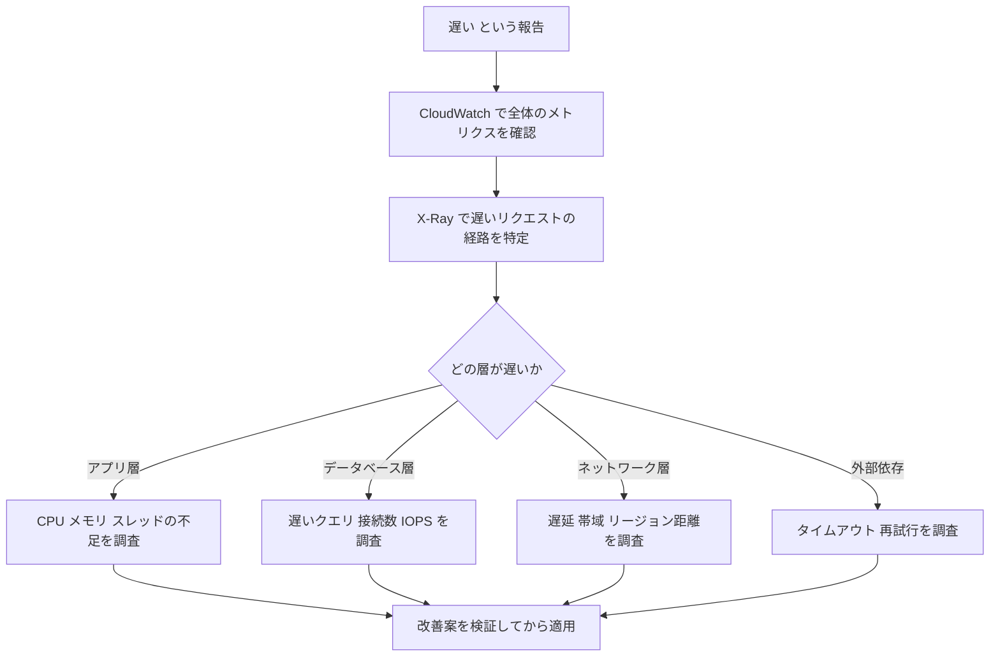

| 層 | 調べる道具 | 見るポイント |
|---|---|---|
| 全体 | CloudWatch ダッシュボードとアラーム | 遅延、エラー率、飽和度 |
| 経路 | AWS X-Ray | サービス間のどこで時間がかかっているか |
| アプリ | CloudWatch Logs Insights、CloudWatch エージェント | エラー、メモリ、スレッド |
| データベース | CloudWatch Database Insights (旧称の Performance Insights は API 名などに残る) | 待機イベント、負荷の高い SQL |
| ネットワーク | VPC フローログ、ELB のメトリクス | 遅延、再送、帯域 |
| リソース規模 | AWS Compute Optimizer | 過剰または不足の判定 |

### 5.4 Step 3: スケーリングと高性能アーキテクチャ

#### EC2 Auto Scaling のポリシー

| ポリシー | 動作 | 向いている場面 |
|---|---|---|
| ターゲット追跡 | 指標を目標値に保つよう自動調整 | 迷ったらまずこれ (例: CPU 使用率を 50% に保つ) |
| ステップ | アラームの超過幅に応じて増減量を変える | 負荷に応じて段階的に増やしたい |
| シンプル | アラーム 1 つにつき決まった量だけ増減し、クールダウン後に次の調整 | 単純な構成 (現在はターゲット追跡/ステップが推奨) |
| スケジュール | 決まった時刻に台数を変更 | 予測できる負荷 (朝の業務開始など) |
| 予測 | 過去の傾向から負荷を予測して事前にスケール | 周期的なパターンがある |

**ウォームプール**はスケーリングポリシーではなく、上記ポリシーと組み合わせる補助機能です。事前に初期化したインスタンスを停止/休止/実行状態で待機させ、スケールアウト時の起動遅延を短縮します (起動に時間がかかるアプリ向け)。

#### インスタンスフリートとプレイスメントグループ

| 項目 | 内容 |
|---|---|
| 混合インスタンスポリシー (Auto Scaling) | 複数のインスタンスタイプとオンデマンド/スポットを混在させ、可用性とコストを両立 |
| EC2 フリート | 複数の購入オプションとインスタンスタイプをまとめて起動 |

| プレイスメントグループ | 特徴 | 向いている用途 |
|---|---|---|
| クラスター | 同じ AZ 内で物理的に近く配置し、低遅延と高スループット | HPC、密結合な分散処理 |
| パーティション | 障害の影響を受けるラックの集合 (パーティション) を分離 | Hadoop、Kafka、Cassandra などの大規模分散システム |
| スプレッド | 少数のインスタンスを別々のハードウェアへ分散 | 重要で少数のインスタンス |
| precision-time | 高精度な時刻ソースへ直接アクセスできるハードウェアへ配置 | 厳密な時刻同期が必要な金融取引、計測、分散 DB |

#### ストレージとデータベースの改善

| 課題 | 改善策 |
|---|---|
| ディスク I/O が足りない | EBS を gp3 へ移行して IOPS とスループットを個別調整。高い要件は io2 |
| 読み取りが多くて DB が重い | リードレプリカ、ElastiCache、DynamoDB の DAX |
| DB 接続が多すぎる (特に Lambda から) | RDS Proxy で接続をプール |
| 同じ結果を何度も計算している | ElastiCache でキャッシュ |
| 非同期にできる処理が同期になっている | SQS でバッファリングして分離 |
| 大量のファイル共有が必要 | EFS または FSx (用途に合う種類を選択) |

### 5.5 Step 4: グローバルサービスとエッジで遅延を減らす

| サービス | 何をするか | 向いている場面 |
|---|---|---|
| Amazon CloudFront | コンテンツをエッジロケーションでキャッシュして配信 | 静的/動的な HTTP コンテンツの配信、動画、API の高速化 |
| AWS Global Accelerator | 固定の Anycast IP と AWS のグローバルネットワークで経路を最適化 | TCP/UDP アプリ、ゲーム、固定 IP が必要、リージョン間の高速フェイルオーバー |
| Lambda@Edge / CloudFront Functions | エッジでリクエストやレスポンスを加工 | リダイレクト、ヘッダー操作、認可 |
| AWS Local Zones | 都市部に近い場所で計算資源を提供 | ユーザーに近い低遅延処理 |
| AWS Wavelength | 5G 網内で計算資源を提供 | モバイル端末向けの超低遅延 |
| AWS Outposts | 自社拠点で AWS のインフラを稼働 | オンプレミスでの低遅延処理 |
| Amazon Route 53 | レイテンシーベースルーティング | 最も遅延の小さいリージョンへ誘導 |

#### CloudFront と Global Accelerator の使い分け

| 観点 | CloudFront | Global Accelerator |
|---|---|---|
| キャッシュ | あり | なし |
| 対応プロトコル | HTTP/HTTPS (と WebSocket) | TCP と UDP |
| IP アドレス | 変動 | 固定の Anycast IP 2 つ |
| 主な効果 | キャッシュによる遅延と負荷の削減 | ネットワーク経路の最適化と高速フェイルオーバー |
| 向いている例 | Web サイト、動画配信 | ゲーム、IoT、固定 IP が必要なアプリ |

### 5.6 Step 5: 改善案をテストし、ライトサイジングを行う

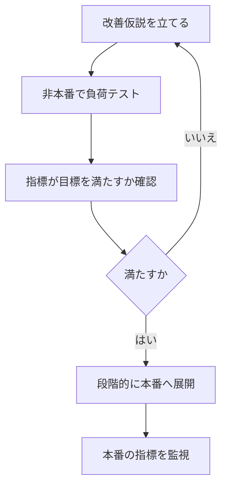

| ライトサイジングの手順 | 内容 |
|---|---|
| 1. データを集める | CloudWatch で CPU、ネットワーク、メモリ (エージェント必須) を取得 |
| 2. 推奨を得る | Compute Optimizer で過剰、不足、最適を判定 |
| 3. 影響を評価する | 変更後のタイプで要件を満たせるか、非本番で確認 |
| 4. 段階的に変更する | 小さな範囲から適用し、指標を監視 |
| 5. 世代を更新する | 新しい世代や Graviton など、性能対価格の良いタイプを検討 |

> 注意: Compute Optimizer のメモリ関連の推奨を得るには、CloudWatch エージェントでメモリ使用率を収集しておく必要があります。

#### マネージドサービスの採用機会

| 現状 | 改善の方向 |
|---|---|
| EC2 上で自前運用の DB | Amazon RDS または Aurora |
| EC2 上のキャッシュサーバー | Amazon ElastiCache |
| 自前の検索クラスター | Amazon OpenSearch Service |
| 常時稼働のバッチ用サーバー | AWS Lambda、AWS Batch、Fargate |
| 自前のメッセージキュー | Amazon SQS、Amazon MQ |

### 5.7 Task 3.3 の試験での考え方

| 問題文のキーワード | 選ぶ方向 |
|---|---|
| 世界中のユーザーに静的コンテンツを速く届けたい | CloudFront |
| 固定 IP、TCP/UDP、高速フェイルオーバー | Global Accelerator |
| 低遅延の密結合な計算 | クラスタープレイスメントグループ |
| 読み取り負荷が高い | リードレプリカ、ElastiCache、DAX |
| Lambda から DB 接続が枯渇する | RDS Proxy |
| インスタンスサイズが適切か知りたい | Compute Optimizer |
| 複数サービスにまたがる遅延の原因を探したい | AWS X-Ray |

出典:
- https://docs.aws.amazon.com/wellarchitected/latest/performance-efficiency-pillar/welcome.html
- https://docs.aws.amazon.com/autoscaling/ec2/userguide/what-is-amazon-ec2-auto-scaling.html
- https://docs.aws.amazon.com/AWSEC2/latest/UserGuide/placement-groups.html
- https://docs.aws.amazon.com/AmazonCloudFront/latest/DeveloperGuide/Introduction.html
- https://docs.aws.amazon.com/global-accelerator/latest/dg/what-is-global-accelerator.html
- https://docs.aws.amazon.com/xray/latest/devguide/aws-xray.html
- https://docs.aws.amazon.com/compute-optimizer/latest/ug/what-is-compute-optimizer.html

---

## 6. Task 3.4 信頼性を改善する

### 6.1 このタスクで問われること(Exam Guide より)

| 区分 | 内容 |
|---|---|
| Knowledge | AWS グローバルインフラストラクチャ |
| Knowledge | データレプリケーション方式 |
| Knowledge | スケーリング手法 (例: ロードバランシング、Auto Scaling) |
| Knowledge | 高可用性とレジリエンス |
| Knowledge | DR の手法とツール |
| Knowledge | サービスクォータと制限 |
| Skills | アプリの成長と利用傾向を把握する |
| Skills | 既存アーキテクチャで信頼性が不十分な箇所を評価する |
| Skills | 単一障害点を解消する |
| Skills | データレプリケーション、自己修復、伸縮性の機能を有効にする |

### 6.2 Step 1: 利用傾向を把握して先回りする

| やること | 道具 |
|---|---|
| 使用量の推移を把握 | CloudWatch メトリクスとダッシュボード |
| 上限に近づいていないか確認 | Service Quotas、CloudWatch の使用状況メトリクス、Trusted Advisor |
| 将来の需要を予測 | 過去のメトリクス、Auto Scaling の予測スケーリング |
| 上限の引き上げを事前に申請 | Service Quotas |

> ポイント: クォータ超過は、想定外の障害の原因になります。ピークの前に引き上げを申請し、使用率にアラームを設定します。DR 先リージョンのクォータも本番と同等に確保しておく必要があります。

### 6.3 Step 2: 単一障害点を見つけて解消する

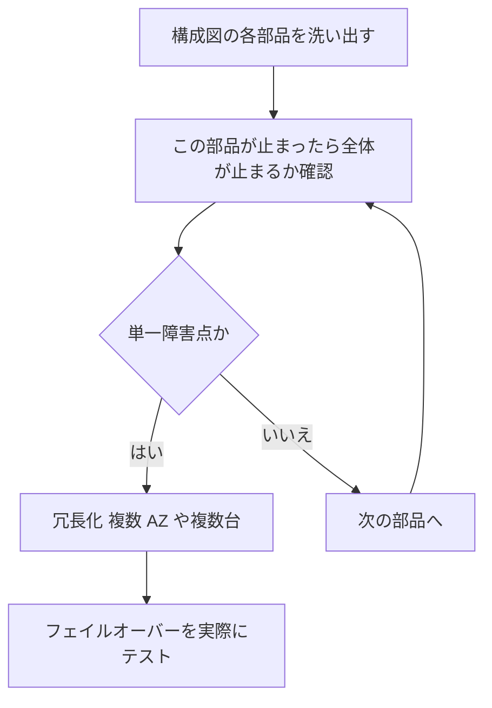

| 単一障害点になりがちな箇所 | 改善策 |
|---|---|
| 1 つの AZ にだけあるインスタンス | 複数 AZ へ分散し、Auto Scaling グループと ELB を使う |
| 単一インスタンスの DB | RDS Multi-AZ、Aurora の複数 AZ 構成 |
| 1 台の NAT ゲートウェイ | AZ ごとに NAT ゲートウェイを配置 |
| 1 つのリージョンだけに依存 | 要件に応じてマルチリージョン化 |
| 1 台の手作業で運用されるサーバー | 自動復旧とコードによる再作成 |
| 同期的に直接つながる処理 | SQS や SNS で疎結合にする |
| 1 本だけの専用線 | 冗長化した Direct Connect か、VPN をバックアップに併用 |

### 6.4 Step 3: データレプリケーションを選ぶ

| サービス | レプリケーション | ポイント |
|---|---|---|
| Amazon RDS Multi-AZ | DB インスタンス配置: 別 AZ のスタンバイへ同期レプリケーション。DB クラスター配置: 2つのリーダーインスタンスを持つ3 AZ 構成 | 障害時に自動フェイルオーバー。DB インスタンス配置のスタンバイは読み取りを処理しない。DB クラスター配置はリーダーインスタンスで読み取りも処理できる |
| Amazon RDS リードレプリカ | 非同期レプリケーション | 読み取りの分散が主目的。リージョンをまたぐことも可能 |
| Amazon Aurora | ストレージが 3 つの AZ にまたがり 6 つのコピーを保持 | 高い耐久性と可用性。レプリカへの高速フェイルオーバー |
| Aurora Global Database | リージョン間で低遅延のレプリケーション | DR と、リージョンをまたぐ読み取り |
| Amazon DynamoDB グローバルテーブル | マルチリージョンのアクティブ/アクティブ | 複数リージョンでの読み書き |
| Amazon S3 レプリケーション (CRR と SRR) | バケット間で非同期にオブジェクトを複製 | 別リージョンへの保護や、別アカウントへの複製。S3 Replication Time Control で複製時間の目安を保証 |
| Amazon EBS | スナップショットを別リージョンや別アカウントへコピー | EBS ボリューム自体は 1 つの AZ 内 |
| Amazon EFS | 複数 AZ に冗長保存。レプリケーションで別リージョンへ | リージョン内の高可用性は標準 |
| Amazon ElastiCache | Multi-AZ と自動フェイルオーバー、グローバルデータストア(いずれも Valkey / Redis OSS が対象。自動フェイルオーバーにはレプリカが必要) | キャッシュの可用性 |

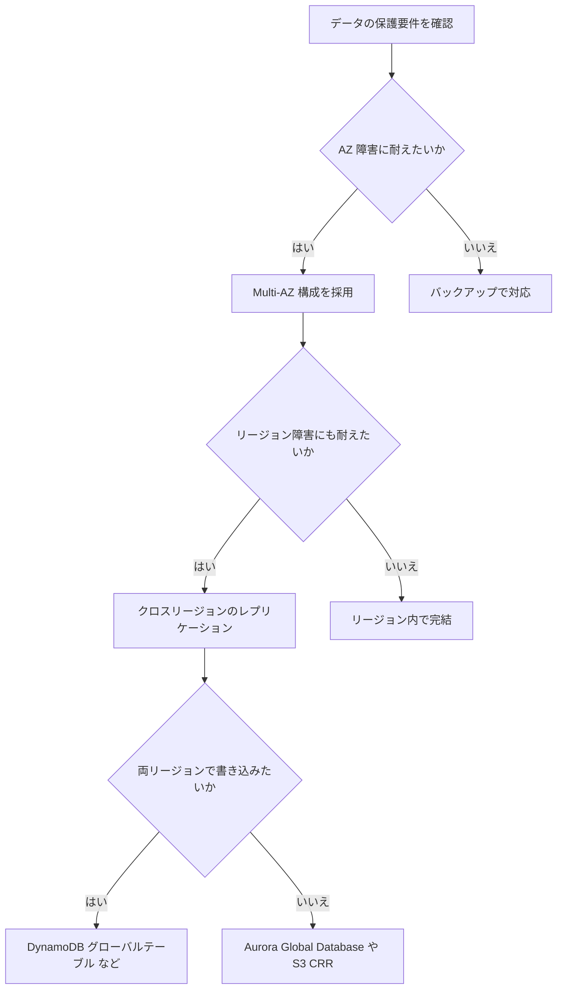

### 6.5 Step 4: スケーリングと自己修復を有効にする

| 仕組み | 自己修復の内容 |
|---|---|
| ELB のヘルスチェック | 異常なターゲットへのルーティングを停止 |
| Auto Scaling グループのヘルスチェック | 異常なインスタンスを終了して置き換える |
| クロスゾーン負荷分散 | AZ 間でトラフィックを均等化 |
| Amazon ECS のサービススケジューラ | 停止したタスクを自動で再起動 |
| Route 53 ヘルスチェックとフェイルオーバー | 異常なエンドポイントから正常な宛先へ DNS を切り替え |
| RDS Multi-AZ | 障害時にスタンバイへ自動切り替え |
| CloudWatch アラームによる EC2 の自動復旧 | システム障害時にインスタンスを復旧 |

| スケーリング手法 | 内容 |
|---|---|
| スケールアップ (垂直) | 1 台あたりの性能を上げる。上限があり、停止を伴うことが多い |
| スケールアウト (水平) | 台数を増やす。可用性の向上にもつながる |
| スケールイン/アウトの自動化 | Auto Scaling で負荷に追従 |

### 6.6 Step 5: DR の方式とツールを選ぶ

| 要件 | 推奨 |
|---|---|
| RTO と RPO に余裕があり、コストを最優先 | バックアップと復元 (AWS Backup) |
| 数十分で復旧したい | パイロットライト |
| 数分で復旧したい | ウォームスタンバイ |
| ほぼ停止ゼロとデータ損失ゼロ | マルチサイト (アクティブ/アクティブ) |
| オンプレミスや他クラウドのサーバーを AWS へ DR したい | AWS Elastic Disaster Recovery |

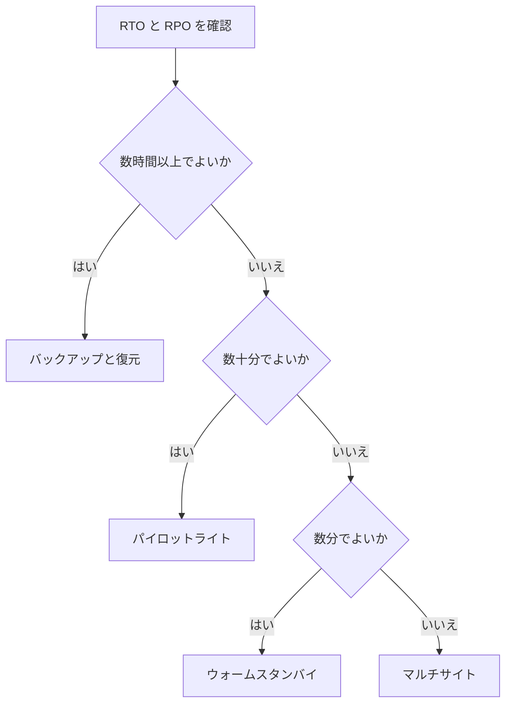

### 6.7 Task 3.4 の試験での考え方

| 問題文のキーワード | 選ぶ方向 |
|---|---|
| AZ 障害時に DB を自動で切り替えたい | RDS Multi-AZ |
| リージョン障害に備えた高速な DB 切り替え | Aurora Global Database |
| 複数リージョンで書き込みたい | DynamoDB グローバルテーブル |
| 上限に達して起動に失敗する | Service Quotas で引き上げ |
| 疎結合にして障害の連鎖を防ぎたい | SQS、SNS、EventBridge |
| 異常なインスタンスを自動で置き換えたい | Auto Scaling のヘルスチェック |
| DNS で異常な宛先を避けたい | Route 53 ヘルスチェックとフェイルオーバー |

出典:
- https://docs.aws.amazon.com/wellarchitected/latest/reliability-pillar/welcome.html
- https://docs.aws.amazon.com/whitepapers/latest/disaster-recovery-workloads-on-aws/disaster-recovery-workloads-on-aws.html
- https://docs.aws.amazon.com/drs/latest/userguide/what-is-drs.html
- https://docs.aws.amazon.com/servicequotas/latest/userguide/intro.html
- https://docs.aws.amazon.com/AmazonRDS/latest/UserGuide/Concepts.MultiAZ.html
- https://docs.aws.amazon.com/AmazonS3/latest/userguide/replication.html
- https://docs.aws.amazon.com/amazondynamodb/latest/developerguide/GlobalTables.html
- https://docs.aws.amazon.com/Route53/latest/DeveloperGuide/dns-failover.html

---

## 7. Task 3.5 コスト最適化の機会を見つける

### 7.1 このタスクで問われること(Exam Guide より)

| 区分 | 内容 |
|---|---|
| Knowledge | コストを意識したアーキテクチャの選択 (例: スポットインスタンス、スケーリングポリシー、ライトサイジング) |
| Knowledge | 料金モデルの採用 (例: リザーブドインスタンス、Savings Plans) |
| Knowledge | ネットワークとデータ転送のコスト |
| Knowledge | コストの管理、アラート、レポート |
| Skills | 使用状況レポートから、使用不足と過剰使用のリソースを分析する |
| Skills | AWS のソリューションで未使用リソースを特定する |
| Skills | 想定される使用パターンに基づいて請求アラームを設計する |
| Skills | AWS Cost and Usage Reports を詳細レベルで調査する |
| Skills | タグを使ってコストの配賦とレポートを行う |

### 7.2 全体像: 見える化から最適化へ

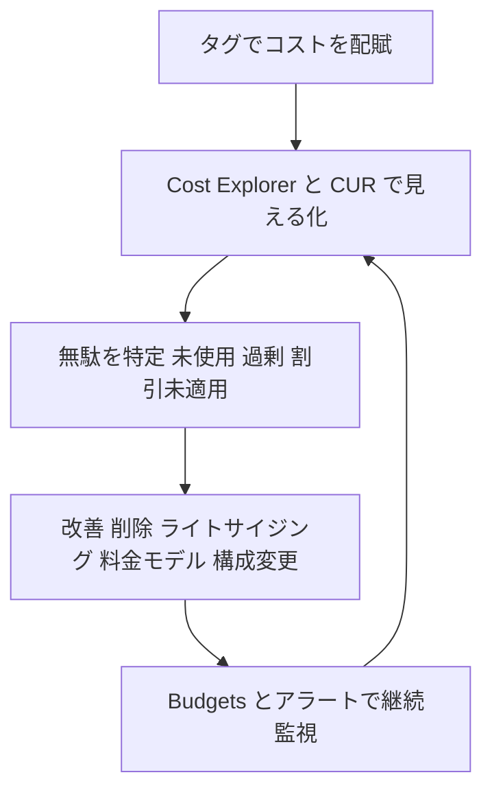

### 7.3 Step 1: 使用状況を分析して無駄を見つける

| 道具 | 何がわかるか | ポイント |
|---|---|---|
| AWS Cost Explorer | サービス別、アカウント別、タグ別のコスト推移。ライトサイジング推奨や RI/Savings Plans の推奨 | 日次と月次で傾向を確認 |
| AWS Cost and Usage Report (CUR) | 最も詳細な請求データ (行単位) | S3 へ出力し、Athena で SQL 分析。リソース ID 単位で分析するには、エクスポート作成時に「リソース ID を含める (Include resource IDs)」を選択する |
| AWS Compute Optimizer | EC2、EBS、Lambda などの過剰と不足を判定 | メモリ指標は CloudWatch エージェントが必要 |
| AWS Trusted Advisor | コスト最適化チェック (低使用率の EC2、アイドル状態のロードバランサー、未関連付けの Elastic IP など) | すべてのチェックは Business Support+、Enterprise Support、Unified Operations の各プランで利用可能。それ以外のアカウントは一部のコアチェックのみ利用可能 |
| Amazon S3 Storage Lens | S3 の使用状況とコスト効率の可視化 | ストレージ層の最適化の起点 |

#### 未使用・低使用リソースの典型例

| リソース | 見つけ方 | 対応 |
|---|---|---|
| アタッチされていない EBS ボリューム | Trusted Advisor、Compute Optimizer | スナップショットを取って削除 |
| 古い EBS スナップショット | Cost Explorer、スナップショット一覧 | ライフサイクル管理で自動削除 |
| アイドル状態のロードバランサー | Trusted Advisor | 削除 |
| 関連付けのない Elastic IP | Trusted Advisor | 解放 |
| 低使用率の EC2 | Compute Optimizer、Trusted Advisor | ライトサイジング、停止、またはスケジュール停止 |
| 使われていない NAT ゲートウェイ | Cost Explorer、VPC メトリクス | 削除、または VPC エンドポイントへ置き換え |
| 長期間アクセスのない S3 データ | S3 Storage Lens、Intelligent-Tiering | 低コストの層へ移行 |

### 7.4 Step 2: コストを意識した構成にする

| 施策 | 内容 | 注意点 |
|---|---|---|
| ライトサイジング | 実使用量に合わせてサイズを下げる | 性能要件を満たすか事前検証 |
| Auto Scaling | 負荷に応じて台数を増減 | 夜間や休日はスケールインさせる |
| スポットインスタンス | 余剰キャパシティを大幅な割引で利用 | 中断される可能性があるため、中断に耐えるワークロード (バッチ、ステートレス処理) に限定 |
| スケジュール停止 | 開発環境を夜間や週末に停止 | Systems Manager Automation や EventBridge スケジューラで自動化 |
| ストレージ階層化 | アクセス頻度に応じた層へ | S3 Intelligent-Tiering やライフサイクルルール |
| マネージドサービス/サーバーレス | 運用コストを含めた総コストを下げる | 呼び出し頻度が非常に高い場合は比較検討 |
| 最新世代や Graviton | 性能あたりの価格が良い | アプリの対応確認が必要 |

### 7.5 Step 3: 料金モデルを選ぶ

| 料金モデル | 概要 | 割引の目安 | 向いている場面 |
|---|---|---|---|
| オンデマンド | 使った分だけ。コミットなし | なし | 予測できない負荷、短期、検証 |
| Compute Savings Plans | 1 時間あたりの利用額を 1 年か 3 年コミット。EC2、Fargate、Lambda に適用。リージョン、ファミリー、OS の変更に柔軟 | 最大約 66% | 構成が変わる可能性があるワークロード |
| EC2 Instance Savings Plans | 特定リージョンの特定ファミリーにコミット | 最大約 72% | 構成が固定されている |
| Standard RI | 特定のインスタンス属性に 1 年か 3 年コミット | 最大約 72% | 変更の少ない安定稼働 |
| Convertible RI | 属性を交換できる RI | 最大約 66% | 将来の変更に備えたい |
| スポット | 余剰キャパシティを利用 | 最大約 90% | 中断に耐えられる処理 |

> 割引率は目安です。リージョン、インスタンスタイプ、支払い方法 (全額前払い、一部前払い、前払いなし) などで変わるため、最新の数値は公式の料金ページで確認してください。

#### 選び方の考え方

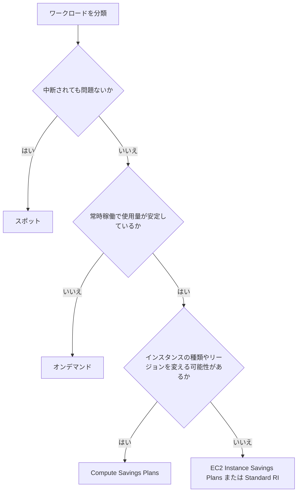

#### ベストプラクティス

| # | プラクティス | 理由 |
|---|---|---|
| 1 | まずライトサイジングしてからコミットする | 過大なサイズをコミットすると無駄が固定される |
| 2 | 安定した最低限の使用量だけをコミットし、変動分はオンデマンドやスポットで賄う | 使い切れない予約を避ける |
| 3 | RI と Savings Plans の使用率とカバレッジを Budgets で監視する | 割引が活きているか確認できる |

### 7.6 Step 4: ネットワークとデータ転送のコストを抑える

| 転送の種類 | コストの傾向 | 削減のヒント |
|---|---|---|
| インターネットからの受信 | 無料 | なし |
| インターネットへの送信 | 課金 | CloudFront を経由 (S3 や EC2 から CloudFront への転送は無料)。CloudFront から配信するほうが割安になることが多い |
| 同一リージョン内の AZ 間 | 課金 | 通信量の多い構成は同じ AZ 内に寄せる (可用性とのバランスに注意) |
| リージョン間 | 課金 | 必要なデータだけを複製し、圧縮する |
| NAT ゲートウェイ経由 | 時間料金とデータ処理料金 | S3 や DynamoDB へは ゲートウェイ型 VPC エンドポイント (無料) を使う |
| AWS サービスへのプライベート接続 | インターフェイス型エンドポイントは時間料金とデータ処理料金 | 通信量と料金を比較して選ぶ |
| オンプレミスとの通信 | Direct Connect は転送単価が安い | 大量の継続通信は Direct Connect を検討 |

| 課題 | 改善策 |
|---|---|
| プライベートサブネットから S3 へ大量アクセスして NAT ゲートウェイ費が高い | S3 のゲートウェイ型 VPC エンドポイント |
| 世界中へ大量の静的コンテンツを配信 | CloudFront |
| AZ をまたぐ通信が多い | 通信の多い構成要素を同じ AZ に配置するか、AZ 内ルーティングを検討 |

### 7.6.1 補足: 料金の変更に注意

データ転送や NAT ゲートウェイなどの料金は改定されることがあります。必ず最新の料金ページで確認します。

- https://aws.amazon.com/ec2/pricing/on-demand/

### 7.7 Step 5: コスト管理、アラート、レポートの仕組み

| 道具 | 役割 | 設定のコツ |
|---|---|---|
| AWS Budgets | コスト、使用量、RI/Savings Plans の使用率やカバレッジに予算を設定し、超過見込みで通知 | 実績だけでなく予測値でもアラートを設定する。しきい値は複数段階 (例: 80% と 100%) |
| 請求アラーム (CloudWatch) | 見積もり請求額のメトリクスにアラームを設定 | 請求メトリクスは米国東部 (バージニア北部) リージョンに保存される。請求アラートを有効にしておく必要がある |
| AWS Cost Anomaly Detection | 通常と異なるコストの急増を検知 | サービスやタグ単位の監視を設定 |
| Cost Explorer のレポート | 定期的なコスト傾向の確認 | チームごとにレポートを保存 |
| CUR | 詳細な利用データの分析 | S3 と Athena で分析し、必要に応じて QuickSight で可視化 |

#### 請求アラームの設計の考え方

| 手順 | 内容 |
|---|---|
| 1 | 想定される月間の使用パターン (固定費と変動費) を把握する |
| 2 | 通常の範囲を少し超える水準と、明らかに異常な水準の 2 段階のしきい値を決める |
| 3 | 通知先 (SNS) を決め、責任者とチームへ届くようにする |
| 4 | 急増の検知は Cost Anomaly Detection も併用する |
| 5 | 必要に応じて Budgets のアクションで自動対応する |

### 7.8 Step 6: タグでコストを配賦する

| 項目 | 内容 |
|---|---|
| コスト配賦タグ | 請求データに反映させるには、請求とコスト管理のコンソールで有効化が必要 |
| タグの種類 | ユーザー定義タグと AWS 生成タグ |
| タグポリシー | Organizations で、タグのキーと値のルールを組織全体で統一 |
| 必須タグの例 | 環境 (prod/dev)、チーム、プロジェクト、コストセンター |
| 補足 | タグ付けできないコストやタグなしのリソースは、アカウント単位の配賦で補う |

> 注意: タグを有効化する前の期間のデータには、タグは遡って反映されません。早めに有効化し、運用ルールを定めます。

### 7.9 Task 3.5 の試験での考え方

| 問題文のキーワード | 選ぶ方向 |
|---|---|
| 中断されてもよいバッチを安く | スポットインスタンス |
| 構成変更の可能性があるが割引を受けたい | Compute Savings Plans |
| 構成が固定で長期稼働 | EC2 Instance Savings Plans または Standard RI |
| リソース単位の詳細な請求分析 | CUR と Athena |
| 予算超過を事前に通知 | AWS Budgets (予測のアラート) |
| 使われていないリソースを探す | Trusted Advisor、Compute Optimizer |
| NAT ゲートウェイの費用を下げたい | S3 や DynamoDB のゲートウェイ型 VPC エンドポイント |
| 部署ごとのコストを知りたい | コスト配賦タグ |

出典:
- https://docs.aws.amazon.com/wellarchitected/latest/cost-optimization-pillar/welcome.html
- https://docs.aws.amazon.com/cost-management/latest/userguide/ce-what-is.html
- https://docs.aws.amazon.com/cost-management/latest/userguide/budgets-managing-costs.html
- https://docs.aws.amazon.com/cur/latest/userguide/what-is-cur.html
- https://docs.aws.amazon.com/awsaccountbilling/latest/aboutv2/cost-alloc-tags.html
- https://docs.aws.amazon.com/awssupport/latest/user/trusted-advisor.html
- https://docs.aws.amazon.com/savingsplans/latest/userguide/what-is-savings-plans.html
- https://docs.aws.amazon.com/AWSEC2/latest/UserGuide/using-spot-instances.html
- https://docs.aws.amazon.com/AmazonCloudWatch/latest/monitoring/monitor_estimated_charges_with_cloudwatch.html
- https://docs.aws.amazon.com/AmazonS3/latest/userguide/storage_lens.html
- https://docs.aws.amazon.com/vpc/latest/privatelink/what-are-vpc-endpoints.html

---

## 8. 横断: 試験問題の読み解き方

### 8.1 SAP-C02 の問題の特徴

| 特徴 | 対処 |
|---|---|
| 長い状況説明 | 「現状の課題」「制約」「求められる結果」に分けて読む |
| 正解になり得る選択肢が複数ある | 制約 (コスト最小、運用負荷最小、ダウンタイム最小など) で絞る |
| 「最も運用負荷が低い」 | マネージドサービス、自動化を優先 |
| 「最もコスト効率が高い」 | 要件を満たす最小構成と適切な料金モデル |
| 「最小限の変更で」 | 既存構成を活かす選択肢 |

### 8.2 選択肢の絞り込み手順

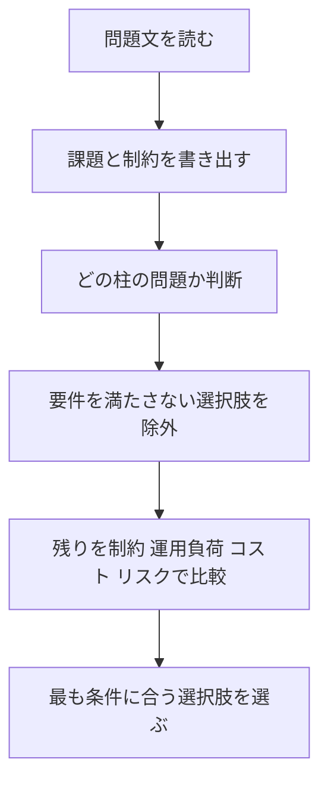

### 8.3 頻出の比較

| 比較 | 違い |
|---|---|
| Secrets Manager と Parameter Store | 自動ローテーションが必要なら Secrets Manager |
| CloudFront と Global Accelerator | キャッシュ向けは CloudFront、固定 IP と TCP/UDP は Global Accelerator |
| Multi-AZ と リードレプリカ | 可用性は Multi-AZ。読み取り分散はリードレプリカ、または Multi-AZ DB クラスターのリーダーインスタンス(Multi-AZ DB インスタンスのスタンバイは読み取り不可) |
| Config と CloudTrail | 設定の状態と履歴は Config、API 操作の履歴は CloudTrail |
| GuardDuty と Inspector | 不審な動きの検知は GuardDuty、脆弱性のスキャンは Inspector |
| Security Hub と GuardDuty | 集約と準拠評価は Security Hub、脅威検知は GuardDuty |
| Savings Plans と RI | 柔軟性は Compute Savings Plans、特定属性への最大割引は RI や EC2 Instance Savings Plans |
| Budgets と Cost Explorer | 予算と通知は Budgets、分析は Cost Explorer |
| Cost Explorer と CUR | 画面での傾向分析は Cost Explorer、最も詳細な行単位の分析は CUR |
| カナリアと リニア | カナリアは少量で先に検証、リニアは一定割合ずつ段階的に移行 |
| State Manager と Automation | 望ましい状態の維持は State Manager、手順の実行は Automation |

---

## 9. 学習チェックリスト

### Task 3.1 運用上の優秀性

- [ ] メトリクス、ログ、トレース、操作履歴の違いを説明できる
- [ ] CloudWatch アラームから自動修復まで、EventBridge と SSM Automation で組み立てられる
- [ ] 7 つのデプロイ戦略の特徴と、CodeDeploy での実現方法を説明できる
- [ ] Systems Manager の主要機能の使い分けを説明できる
- [ ] DR の 4 戦略と、FIS による障害訓練を説明できる

### Task 3.2 セキュリティ

- [ ] Config ルールと自動修復の流れを説明できる
- [ ] Secrets Manager と Parameter Store を使い分けられる
- [ ] Access Analyzer で最小権限へ絞り込む手順を説明できる
- [ ] GuardDuty、Inspector、Security Hub、Macie の役割を区別できる
- [ ] Patch Manager と AWS Backup の運用を設計できる

### Task 3.3 パフォーマンス

- [ ] ビジネス要件を SLI と SLO に変換できる
- [ ] ボトルネックの特定手順と使うツールを説明できる
- [ ] Auto Scaling の 5 つのスケーリングポリシー (シンプルを含む) と、ポリシーとは別機能であるウォームプールの役割、プレイスメントグループの 4 種類 (precision-time を含む) を説明できる
- [ ] CloudFront と Global Accelerator を使い分けられる

### Task 3.4 信頼性

- [ ] 単一障害点を洗い出し、冗長化の方法を提案できる
- [ ] 各サービスのレプリケーション方式を比較できる
- [ ] Service Quotas の管理方法を説明できる
- [ ] RTO と RPO から DR 方式を選べる

### Task 3.5 コスト最適化

- [ ] 未使用と低使用のリソースを見つける道具を説明できる
- [ ] 料金モデルの違いと選び方を説明できる
- [ ] データ転送コストを下げる方法を説明できる
- [ ] Budgets、請求アラーム、CUR、コスト配賦タグを使い分けられる

---

## 10. 参考ソース URL

> 試験範囲の一次情報は AWS 公式 Exam Guide です。サービスの仕様や料金は更新されるため、本文の数値や名称は必ず最新の公式ドキュメントで確認してください。

### 10.1 試験ガイド

| 名称 | URL |
|---|---|
| Exam Guide (SAP-C02) トップ | https://docs.aws.amazon.com/aws-certification/latest/solutions-architect-professional-02/solutions-architect-professional-02.html |
| Exam Guide (SAP-C02) PDF 版 (Domain 3 を含む全体) | https://docs.aws.amazon.com/pdfs/aws-certification/latest/solutions-architect-professional-02/solutions-architect-professional-02.pdf |
| Content Domain 3 (本依頼で指定されたページ) | https://docs.aws.amazon.com/aws-certification/latest/solutions-architect-professional-02/solutions-architect-professional-02-domain3.html |

### 10.2 Well-Architected Framework

| 名称 | URL |
|---|---|
| 運用上の優秀性の柱 | https://docs.aws.amazon.com/wellarchitected/latest/operational-excellence-pillar/welcome.html |
| Evolve (継続的な改善) | https://docs.aws.amazon.com/wellarchitected/2023-10-03/framework/oe-evolve.html |
| セキュリティの柱 | https://docs.aws.amazon.com/wellarchitected/latest/security-pillar/welcome.html |
| 信頼性の柱 | https://docs.aws.amazon.com/wellarchitected/latest/reliability-pillar/welcome.html |
| パフォーマンス効率の柱 | https://docs.aws.amazon.com/wellarchitected/latest/performance-efficiency-pillar/welcome.html |
| コスト最適化の柱 | https://docs.aws.amazon.com/wellarchitected/latest/cost-optimization-pillar/welcome.html |
| DR ホワイトペーパー | https://docs.aws.amazon.com/whitepapers/latest/disaster-recovery-workloads-on-aws/disaster-recovery-workloads-on-aws.html |

### 10.3 サービス別ドキュメント

| カテゴリ | サービス | URL |
|---|---|---|
| 運用 | Amazon CloudWatch | https://docs.aws.amazon.com/AmazonCloudWatch/latest/monitoring/WhatIsCloudWatch.html |
| 運用 | AWS X-Ray | https://docs.aws.amazon.com/xray/latest/devguide/aws-xray.html |
| 運用 | AWS Systems Manager | https://docs.aws.amazon.com/systems-manager/latest/userguide/what-is-systems-manager.html |
| 運用 | AWS CodeDeploy | https://docs.aws.amazon.com/codedeploy/latest/userguide/welcome.html |
| 運用 | AWS Fault Injection Service | https://docs.aws.amazon.com/fis/latest/userguide/what-is.html |
| セキュリティ | AWS Config | https://docs.aws.amazon.com/config/latest/developerguide/WhatIsConfig.html |
| セキュリティ | AWS Secrets Manager | https://docs.aws.amazon.com/secretsmanager/latest/userguide/intro.html |
| セキュリティ | IAM Access Analyzer | https://docs.aws.amazon.com/IAM/latest/UserGuide/what-is-access-analyzer.html |
| セキュリティ | AWS CloudTrail | https://docs.aws.amazon.com/awscloudtrail/latest/userguide/cloudtrail-user-guide.html |
| セキュリティ | Amazon GuardDuty | https://docs.aws.amazon.com/guardduty/latest/ug/what-is-guardduty.html |
| セキュリティ | Amazon Inspector | https://docs.aws.amazon.com/inspector/latest/user/what-is-inspector.html |
| セキュリティ | AWS Security Hub | https://docs.aws.amazon.com/securityhub/latest/userguide/what-is-securityhub.html |
| セキュリティ | AWS Backup | https://docs.aws.amazon.com/aws-backup/latest/devguide/whatisbackup.html |
| パフォーマンス | EC2 Auto Scaling | https://docs.aws.amazon.com/autoscaling/ec2/userguide/what-is-amazon-ec2-auto-scaling.html |
| パフォーマンス | プレイスメントグループ | https://docs.aws.amazon.com/AWSEC2/latest/UserGuide/placement-groups.html |
| パフォーマンス | Amazon CloudFront | https://docs.aws.amazon.com/AmazonCloudFront/latest/DeveloperGuide/Introduction.html |
| パフォーマンス | AWS Global Accelerator | https://docs.aws.amazon.com/global-accelerator/latest/dg/what-is-global-accelerator.html |
| パフォーマンス | AWS Compute Optimizer | https://docs.aws.amazon.com/compute-optimizer/latest/ug/what-is-compute-optimizer.html |
| 信頼性 | AWS Elastic Disaster Recovery | https://docs.aws.amazon.com/drs/latest/userguide/what-is-drs.html |
| 信頼性 | Service Quotas | https://docs.aws.amazon.com/servicequotas/latest/userguide/intro.html |
| 信頼性 | RDS Multi-AZ | https://docs.aws.amazon.com/AmazonRDS/latest/UserGuide/Concepts.MultiAZ.html |
| 信頼性 | Amazon S3 レプリケーション | https://docs.aws.amazon.com/AmazonS3/latest/userguide/replication.html |
| 信頼性 | DynamoDB グローバルテーブル | https://docs.aws.amazon.com/amazondynamodb/latest/developerguide/GlobalTables.html |
| 信頼性 | Route 53 DNS フェイルオーバー | https://docs.aws.amazon.com/Route53/latest/DeveloperGuide/dns-failover.html |
| コスト | Cost Explorer | https://docs.aws.amazon.com/cost-management/latest/userguide/ce-what-is.html |
| コスト | AWS Budgets | https://docs.aws.amazon.com/cost-management/latest/userguide/budgets-managing-costs.html |
| コスト | Cost and Usage Reports | https://docs.aws.amazon.com/cur/latest/userguide/what-is-cur.html |
| コスト | コスト配賦タグ | https://docs.aws.amazon.com/awsaccountbilling/latest/aboutv2/cost-alloc-tags.html |
| コスト | Trusted Advisor | https://docs.aws.amazon.com/awssupport/latest/user/trusted-advisor.html |
| コスト | Savings Plans | https://docs.aws.amazon.com/savingsplans/latest/userguide/what-is-savings-plans.html |
| コスト | スポットインスタンス | https://docs.aws.amazon.com/AWSEC2/latest/UserGuide/using-spot-instances.html |
| コスト | 請求アラーム | https://docs.aws.amazon.com/AmazonCloudWatch/latest/monitoring/monitor_estimated_charges_with_cloudwatch.html |
| コスト | S3 Storage Lens | https://docs.aws.amazon.com/AmazonS3/latest/userguide/storage_lens.html |
| コスト | VPC エンドポイント | https://docs.aws.amazon.com/vpc/latest/privatelink/what-are-vpc-endpoints.html |
| コスト | EC2 の料金 (データ転送を含む) | https://aws.amazon.com/ec2/pricing/on-demand/ |

### 10.4 補足の参考資料

| 名称 | URL |
|---|---|
| SAP-C02 Domain 3 の観点解説 (サードパーティ) | https://www.sailor.sh/blog/sap-c02-continuous-improvement-operational-excellence |
| 書籍 AWS Certified Solutions Architect - Professional Exam Guide (SAP-C02) 第 11 章 (運用上の優秀性の改善) | https://www.oreilly.com/library/view/aws-certified-solutions/9781801813136/B17550_11.xhtml |
