# AWS Certified Solutions Architect - Professional (SAP-C02)
# Content Domain 4: Accelerate Workload Migration and Modernization 完全ガイド(初学者向け)

> 対象試験: AWS Certified Solutions Architect - Professional (SAP-C02)
> 出題比率: Domain 4 は全体の **20%** (スコア対象の約 65 問のうち、おおよそ 13 問前後の目安)
> 根拠資料: 公式 Exam Guide (Version 1.2) の Task 4.1 〜 4.4 と、各サービスの AWS 公式ドキュメント
> 表記ルール: 図解は Mermaid と Markdown のみを使用 (ASCII アートは使いません)

---

## 0. このガイドの使い方

### 0.1 Domain 4 は何を問う分野か

一言でいうと **「今あるシステム (オンプレミスや他クラウド) を、どう選び、どう運び、どう作り変えるか」** を問う分野です。

| Task | テーマ | 一言でいうと | 中心となるサービス |
|---|---|---|---|
| 4.1 | 移行対象の選定 | 何を、どの順番で、どの方針で移すか決める | Migration Hub, Application Discovery Service, 7Rs, TCO |
| 4.2 | 最適な移行方法の決定 | どのツールで、どの回線で、安全に運ぶか決める | DataSync, Transfer Family, Snow Family, MGN, DMS, SCT, Direct Connect, VPN |
| 4.3 | 移行後の新アーキテクチャ決定 | 移した先で何の部品 (計算・保存・DB) を使うか決める | EC2, Beanstalk, ECS, EKS, Fargate, EBS, EFS, FSx, S3, RDS, Aurora, DynamoDB |
| 4.4 | モダナイゼーションの機会発見 | 疎結合・サーバーレス・専用 DB に作り変える | Lambda, SQS, SNS, EventBridge, Step Functions, Aurora Serverless, ElastiCache |

### 0.2 全体像

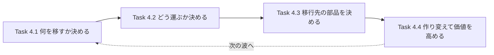

### 0.3 学習の進め方 (おすすめステップ)

1. まず **7Rs** (4.1) を暗記する。ここが Domain 4 の背骨です。
2. 次に **「データ量 × 回線 × 期間」で転送手段を選ぶ思考** (4.2) を身につける。
3. 4.3 は「**どの要件のときにどのサービスか**」の対応表を覚える。
4. 4.4 は「**同期か非同期か、1 対 1 か 1 対多か**」で統合サービスを切り分ける。
5. 最後に第 6 章の早見表で、キーワードから答えを引く練習をする。

> 初学者向けの注意: SAP-C02 は長い文章の中から **「制約条件」(ダウンタイム、予算、期間、運用負荷、既存ライセンス) を拾う力** を試します。サービス名の暗記より「なぜそれを選ぶか」を言えることが重要です。

### 0.4 サービス提供状況に関する重要な注意 (2026 年 10 月時点)

- **AWS Migration Hub は 2025 年 11 月 7 日以降、新規顧客の受付を停止**しています。既存顧客は継続利用でき、AWS が推奨する後継は **AWS Transform** です (出典は第 7 章)。
- ただし公式 Exam Guide (Version 1.2) には Migration Hub が引き続き記載されています。**試験対策としては Migration Hub の役割 (発見・評価・追跡の一元管理) を理解しつつ、実務では AWS Transform も確認する**という姿勢が安全です。
- Snow Family の一部デバイスなどは提供状況が変わることがあります。最新状況は必ず公式ドキュメントで確認してください。

---

## 1. 基礎用語 (まずここから)

| 用語 | やさしい説明 |
|---|---|
| オンプレミス | 自社のデータセンターや社内サーバー室にあるシステム |
| 移行 (Migration) | システムを AWS に移すこと |
| モダナイゼーション | 移すついでに、クラウドの強みを活かすよう作り変えること |
| Lift and Shift | 構成をほぼそのままクラウドに持ち上げて移すこと (Rehost) |
| カットオーバー | 本番の利用先を旧環境から新環境に切り替える瞬間 |
| ウェーブ (Wave) | 一度に移すアプリケーションのまとまり。段階的に複数回に分けて移す |
| RTO / RPO | 復旧までの許容時間 / 失ってよいデータの時間幅。切替計画でも使う |
| ダウンタイム | サービスが止まる時間。小さいほど複雑・高コストになりやすい |
| CDC | Change Data Capture。DB の変更分だけを継続的にコピーする仕組み |
| 同種 / 異種移行 | DB エンジンが同じ (例 MySQL から MySQL) か、違う (例 Oracle から PostgreSQL) か |
| TCO | Total Cost of Ownership。購入・運用・人件費・電力まで含めた総保有コスト |

---

## 2. Task 4.1 移行対象となる既存ワークロードとプロセスの選定

### 2.1 ステップ全体像 (移行の 3 フェーズ)

AWS の大規模移行ガイダンスでは、移行を大きく 3 つのフェーズに分けて考えます。

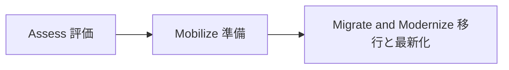

| フェーズ | やること | 関連サービス・手法 |
|---|---|---|
| Assess | 現状把握、移行準備度の評価、ビジネスケース作成 | Application Discovery Service, Migration Evaluator, Pricing Calculator |
| Mobilize | ランディングゾーン整備、移行計画、スキル習得、ポートフォリオ分析 | Control Tower, Organizations, Migration Hub, 7Rs 判定 |
| Migrate and Modernize | ウェーブごとに実移行、移行後の最適化 | MGN, DMS, DataSync, 各種モダナイゼーション |

### 2.2 ステップ 1: 現状の棚卸し (Discovery)

**AWS Application Discovery Service** は、オンプレミスのサーバーを自動的に発見し、構成・性能・依存関係のデータを集めるサービスです。

| 収集方法 | 仕組み | 向いているケース |
|---|---|---|
| Agentless Collector | VMware 環境などに仮想アプライアンスを置き、エージェント導入なしで収集 | 多数の VM を素早く棚卸ししたい、ゲスト OS に触れたくない |
| Discovery Agent | 各サーバーにエージェントをインストールし、より詳細に収集 | **プロセス単位の情報やネットワーク接続 (依存関係)** まで知りたい |

- 収集データ: CPU・メモリ・ディスクの使用状況、実行中プロセス、サーバー間の TCP 接続など
- **依存関係の可視化が超重要**: 「A サーバーを先に移すと B と通信できなくなる」事故を防ぎ、ウェーブ分けの根拠になります
- データは Migration Hub (または後継) に集約し、Amazon Athena で分析することもできます

**ベストプラクティス**

- 稼働の波 (月末処理、四半期バッチなど) を含められるよう、**最低でも数週間から 1 か月程度のデータを集める**
- 性能データは後の **ライトサイジング (適正サイズ選定)** の根拠になるので必ず取得する
- 依存関係が不明なまま移行せず、通信先を洗い出してから移行単位を決める

### 2.3 ステップ 2: 追跡の一元化 (Migration Hub)

**AWS Migration Hub** は、発見・計画・移行状況を一か所で確認する場所です。

| 機能 | 内容 |
|---|---|
| ホームリージョン | 移行の追跡データを保存するリージョン。最初に 1 つ選ぶ |
| 進捗の集約 | MGN や DMS などのツールの進捗状況を集約して表示 |
| 戦略レコメンデーション | アプリごとに 7Rs のどれが適するかの推奨を出す |
| Orchestrator | サーバーやエンタープライズアプリの移行を自動化・ワークフロー化 |
| Refactor Spaces | モノリスを段階的にマイクロサービスへ分解する基盤 |

> 注意: 第 0.4 節のとおり、新規利用は AWS Transform への移行が案内されています。試験では「**複数ツールの移行状況を単一のダッシュボードで追跡する**」という問いに Migration Hub が答えになる点を押さえましょう。

### 2.4 ステップ 3: 7Rs で各アプリの方針を決める (最重要)

| R | 名前 | 意味 | 例 | 工数 | クラウドの恩恵 |
|---|---|---|---|---|---|
| 1 | Retire | 使われていないので廃止 | 利用者のいない古い社内ツール | 最小 | コスト削減 |
| 2 | Retain | 今回は移さず残す | 規制・遅延・最近導入済みで後回し | なし | なし |
| 3 | Rehost | そのまま EC2 に載せ替え (Lift and Shift) | MGN でサーバー丸ごと | 小 | 小〜中 |
| 4 | Relocate | ハイパーバイザー層でまとめて移す | VMware 環境をそのままクラウドへ | 小 | 小 |
| 5 | Repurchase | 製品を乗り換える (SaaS 化) | 自社 CRM から SaaS の CRM へ | 中 | 中 |
| 6 | Replatform | 少しだけ手を入れてマネージド化 | 自前 DB を RDS や Aurora へ | 中 | 中〜大 |
| 7 | Refactor / Re-architect | アーキテクチャを作り直す | モノリスをサーバーレスやマイクロサービスへ | 大 | 最大 |

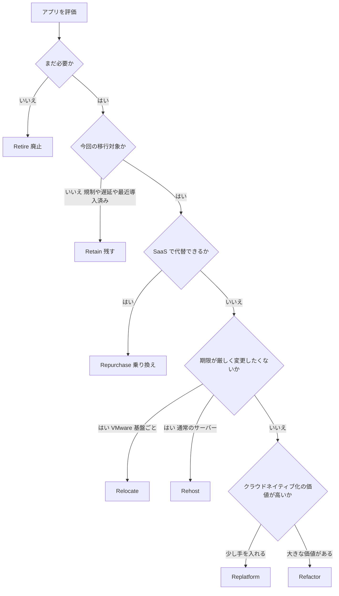

**試験でよく出る判断の目安**

| 問題文のキーワード | 選ぶ R |
|---|---|
| 「コード変更なし」「期限が非常に短い」「データセンター契約の期限が迫る」 | Rehost (必要なら Relocate) |
| 「運用負荷を減らしたい」「パッチ適用をなくしたい」「少しの変更で」 | Replatform |
| 「スケーラビリティの限界」「俊敏性」「長期的に最大の価値」 | Refactor |
| 「ライセンス費用が高い製品を SaaS に」 | Repurchase |
| 「誰も使っていない」「重複している」 | Retire |
| 「メインフレームなどで当面移せない」「データ主権・遅延」 | Retain |

### 2.5 ステップ 4: TCO を評価してビジネスケースを作る

| ツール | 用途 |
|---|---|
| AWS Pricing Calculator | 移行後の AWS 構成の見積もり |
| Migration Evaluator | 現行環境の実使用量データから、移行後コストのビジネスケースを作る |
| Cost Explorer / Budgets | 移行後のコスト可視化と予算管理 |

**TCO に入れるべき項目 (オンプレ側の隠れコスト)**

| カテゴリ | 具体例 |
|---|---|
| ハードウェア | サーバー、ストレージ、ネットワーク機器の購入・更改 |
| 施設 | ラック、電力、冷却、床面積 |
| ソフトウェア | OS、DB、仮想化のライセンスとサポート |
| 人件費 | 運用、保守、パッチ適用、障害対応 |
| 機会損失 | 調達リードタイム、スケールできない損失 |
| 移行コスト | 並行稼働期間、学習コスト、移行ツール費用、データ転送費用 |

**ベストプラクティス**

- **実測値でサイジング**する。オンプレの過剰スペックをそのまま持ち込むと、クラウド側も過剰になる
- 安定稼働するものは **Savings Plans / リザーブドインスタンス**を前提にして比較する
- 既存の **ライセンス持ち込み (BYOL)** やライセンス条件が TCO を大きく左右するので事前に確認する

### 2.6 ステップ 5: ウェーブ計画で優先順位をつける

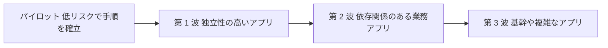

| 方針 | 理由 |
|---|---|
| 最初は **低リスク・依存関係が少ない**アプリ | 手順・体制・ガバナンスを小さく検証して学べる |
| 依存関係のあるアプリは **同じウェーブでまとめる** | 通信遅延 (オンプレとクラウドをまたぐ) を避ける |
| 最も複雑・重要なものは後半 | 経験値が貯まってから挑戦する |
| 各ウェーブに **切り戻し (ロールバック) 計画**を用意 | 失敗時に旧環境へ戻れるようにする |

### 2.7 Task 4.1 のまとめ (試験の着眼点)

| 問われ方 | 答えの方向性 |
|---|---|
| オンプレのサーバー間の通信関係を把握したい | Application Discovery Service の Discovery Agent |
| エージェントを入れずに VM 一覧と性能を取りたい | Agentless Collector |
| 複数の移行ツールの進捗を一元管理したい | Migration Hub (現在は AWS Transform が推奨) |
| どの移行戦略が適切か自動推奨してほしい | Migration Hub 戦略レコメンデーション |
| 現行コストとの比較でビジネスケースを作りたい | Migration Evaluator と Pricing Calculator |

**出典**

- 公式 Exam Guide (Task 4.1): https://d1.awsstatic.com/training-and-certification/docs-sa-pro/AWS-Certified-Solutions-Architect-Professional_Exam-Guide.pdf
- AWS Prescriptive Guidance 大規模移行ガイド: https://docs.aws.amazon.com/prescriptive-guidance/latest/large-migration-guide/welcome.html
- 7Rs (移行戦略): https://docs.aws.amazon.com/prescriptive-guidance/latest/large-migration-guide/migration-strategies.html
- Application Discovery Service: https://docs.aws.amazon.com/application-discovery/latest/userguide/what-is-appdiscovery.html
- Migration Hub: https://docs.aws.amazon.com/migrationhub/latest/ug/whatishub.html
- Migration Hub の提供状況の変更: https://docs.aws.amazon.com/migrationhub/latest/ug/migrationhub-availability-change.html
- AWS Pricing Calculator: https://docs.aws.amazon.com/pricing-calculator/latest/userguide/what-is-pricing-calculator.html
- Migration Evaluator: https://aws.amazon.com/migration-evaluator/

---

## 3. Task 4.2 既存ワークロードに最適な移行アプローチの決定

Task 4.2 は範囲が広いので、**データ → サーバー → データベース → ネットワーク → ID → ガバナンス → セキュリティ**の順に見ていきます。

### 3.1 データ移行: 転送手段の選び方

#### 3.1.1 まず「何日かかるか」を計算する

転送時間の概算は次の式です。**実効帯域は回線速度の 70% 程度**で見積もるのが安全です。

```python
def transfer_days(data_tb: float, link_mbps: float, efficiency: float = 0.7) -> float:
    """データ量(TB)と回線速度(Mbps)から転送日数を概算する"""
    bits = data_tb * 8 * 10**12            # TB を bit に変換 (10 の 12 乗 = 1 TB)
    seconds = bits / (link_mbps * 10**6 * efficiency)
    return seconds / 86400                 # 秒を日に変換

print(round(transfer_days(100, 1000), 1))  # 100 TB を 1 Gbps で送ると約 13 日
print(round(transfer_days(100, 100), 1))   # 100 TB を 100 Mbps で送ると約 132 日
```

| データ量 | 100 Mbps | 1 Gbps | 10 Gbps |
|---|---|---|---|
| 1 TB | 約 1.3 日 | 約 3 時間 | 約 20 分 |
| 10 TB | 約 13 日 | 約 1.3 日 | 約 3 時間 |
| 100 TB | 約 132 日 | 約 13 日 | 約 1.3 日 |
| 1 PB | 約 3.6 年 | 約 132 日 | 約 13 日 |

(実効帯域 70% で計算した概算値です。実環境では他の通信と共有するため、さらに遅くなることがあります)

> 目安: **ネットワークでの転送が 1 週間を大きく超えるなら Snow Family を検討**します。

#### 3.1.2 データ転送サービスの選択フロー

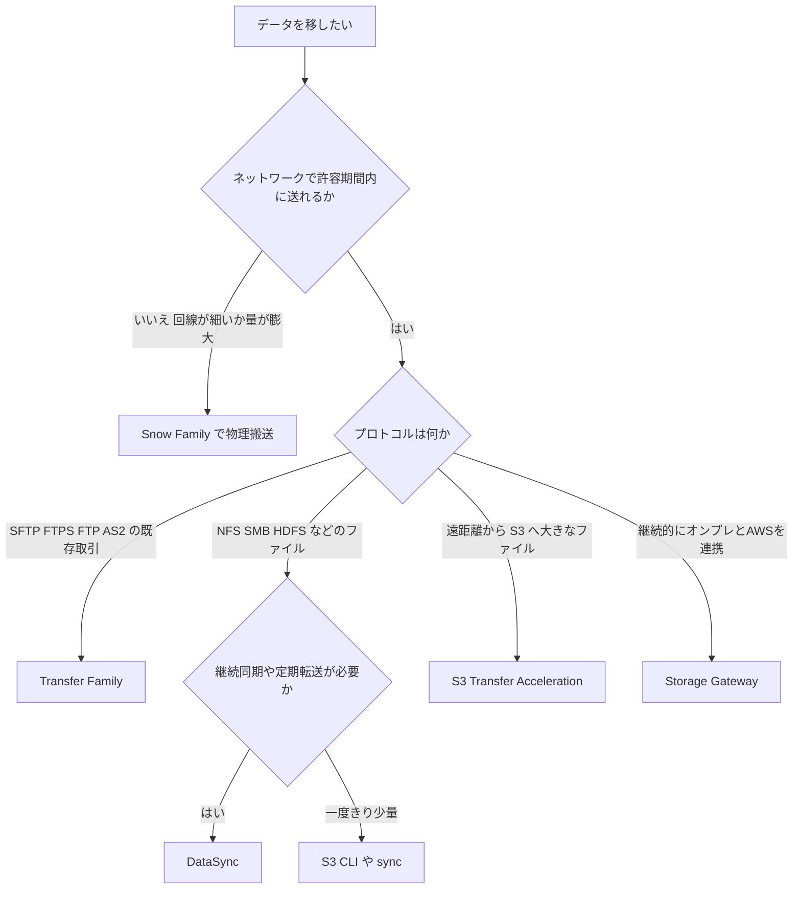

#### 3.1.3 各サービスの詳細

| サービス | 一言でいうと | 主な特徴 | 向いているケース |
|---|---|---|---|
| **AWS DataSync** | 大量ファイルの高速・自動転送 | エージェントでオンプレの NFS/SMB/HDFS から S3・EFS・FSx へ。スケジュール実行、帯域制限、整合性検証、差分転送、メタデータ保持 | 定期的・継続的なファイル移行、NAS の移行 |
| **AWS Transfer Family** | マネージドな FTP 系サーバー | SFTP/FTPS/FTP/AS2 で S3 や EFS に直接入出力。パートナー側の設定を変えずに移行可能 | 既存の取引先が FTP/SFTP でファイルを送ってくる |
| **AWS Snow Family** | 物理デバイスで運ぶ | デバイスを配送してデータをコピー、AWS に返送して取り込み。データは暗号化 | 回線が細い、量が膨大、ネットワークが不安定 |
| **S3 Transfer Acceleration** | 遠距離アップロード高速化 | エッジロケーション経由で AWS のバックボーンを使って S3 へ | 世界中のクライアントから 1 つの S3 バケットへ大きなファイルを送る |
| **Storage Gateway** | ハイブリッドの出入口 | ファイル・ボリューム・テープの形でオンプレから AWS ストレージへ | 段階的移行、バックアップ、クラウドを背後に置く構成 |

**DataSync の使い方 (例)**

```bash
# 毎日 2 時刻に、検証付きで帯域を制限して転送するタスクを作成する例
aws datasync create-task \
  --source-location-arn arn:aws:datasync:ap-northeast-1:111122223333:location/loc-xxxxxxxx \
  --destination-location-arn arn:aws:datasync:ap-northeast-1:111122223333:location/loc-yyyyyyyy \
  --name nas-to-s3-daily \
  --options VerifyMode=ONLY_FILES_TRANSFERRED,BytesPerSecond=125000000 \
  --schedule ScheduleExpression="cron(0 2 * * ? *)"
```

**S3 Transfer Acceleration の有効化 (例)**

```bash
# バケットで有効化
aws s3api put-bucket-accelerate-configuration \
  --bucket my-migration-bucket \
  --accelerate-configuration Status=Enabled

# CLI がアクセラレーションエンドポイントを使うよう設定
aws configure set default.s3.use_accelerate_endpoint true
```

**ベストプラクティス (データ移行)**

- **初回は一括 (Snow または DataSync)、以降は差分同期**で、カットオーバー直前の最終差分を小さくする
- DataSync は **VPC エンドポイント (PrivateLink) 経由**にすると、インターネットを通さずに転送できる
- 転送中は **TLS で暗号化**、保存時は **KMS** で暗号化する。Snow Family はデバイス上のデータが暗号化されている
- **整合性検証 (検証モード)** を有効にして、移行後のデータ欠損を防ぐ
- 回線を業務と共用するなら **帯域制限**をかけて業務影響を避ける
- Snow Family は注文から到着・返送・取り込みまでの **リードタイム (数日〜数週間)** を計画に含める (提供デバイスの種類や状況は公式ドキュメントで確認)

### 3.2 サーバー (アプリケーション) 移行: AWS Application Migration Service (MGN)

**MGN** は Lift and Shift (Rehost) の標準サービスです。物理サーバー・VM・他クラウドのサーバーを、ほぼそのまま EC2 に移します。

#### 3.2.1 仕組み

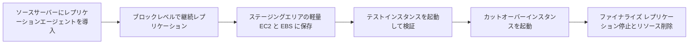

| ステップ | 内容 |
|---|---|
| 1 初期化と設定 | MGN の初期化、レプリケーション設定テンプレート、起動テンプレートを設定 |
| 2 エージェント導入 | ソースサーバーに AWS Replication Agent をインストール |
| 3 初期同期 | ディスク全体をステージングへ複製 (しばらく時間がかかる) |
| 4 継続レプリケーション | 以降は変更分を継続的に複製。ソースの稼働は止めない |
| 5 テスト | 本番を止めずにテストインスタンスを起動して動作確認 |
| 6 カットオーバー | 計画した時間にカットオーバーインスタンスを起動し、DNS などを切り替え |
| 7 ファイナライズ | 切り替え完了後、レプリケーションを止めてリソースを片付ける |

**ポイント**

- **ダウンタイムは「カットオーバーの切替時間」だけ**になり、大幅に短縮できる
- エージェントレスの方式 (vCenter 連携のスナップショットベース) もあるが、**継続的なブロックレベルレプリケーションが基本方式**
- 起動後の設定変更は **ポストローンチアクション** (SSM を利用) で自動化できる
- ステージングエリアは **移行専用のサブネット**に置き、Direct Connect / VPN / PrivateLink を使って**閉域で複製**することもできる

**エージェント導入 (例)**

```bash
# リージョン固有のインストーラーを取得 (リージョンは環境に合わせて変更)
wget -O ./aws-replication-installer-init \
  https://aws-application-migration-service-ap-northeast-1.s3.ap-northeast-1.amazonaws.com/latest/linux/aws-replication-installer-init

# 権限は AWSApplicationMigrationAgentInstallationPolicy を持つ最小権限の認証情報を使う
sudo bash aws-replication-installer-init --region ap-northeast-1
```

**ベストプラクティス (MGN)**

- エージェント用の IAM は **`AWSApplicationMigrationAgentInstallationPolicy` に絞り、一時認証情報を使う**
- **テスト起動を複数回**行い、カットオーバーのリハーサルを必ずする
- 起動テンプレートで **適切なインスタンスタイプ** (ライトサイジング済み) を指定する
- 移行後は不要になったエージェントとステージング資源を **ファイナライズで確実に削除**する

#### 3.2.2 MGN 以外のアプリ移行の選択肢

| 要件 | 選ぶもの |
|---|---|
| サーバーをそのまま EC2 へ (Rehost) | **Application Migration Service (MGN)** |
| オンプレ・他クラウドの災害対策 | **Elastic Disaster Recovery** (MGN と同じレプリケーション技術) |
| コンテナ化して移したい | ECS / EKS / App Runner へ再構築 (Replatform / Refactor) |
| Web アプリを少しの変更でマネージドに | **Elastic Beanstalk** |

### 3.3 データベース移行: AWS DMS と AWS SCT

#### 3.3.1 同種移行と異種移行を見分ける

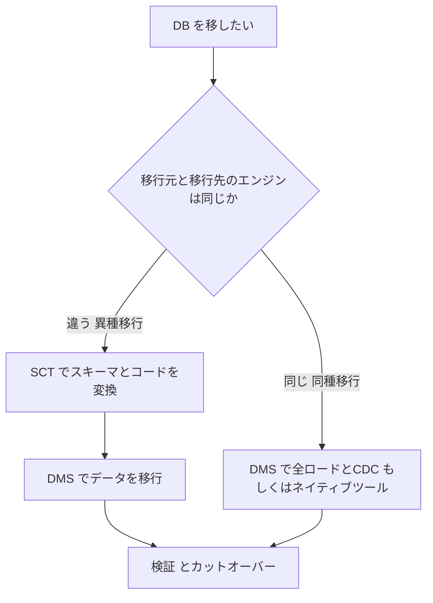

| 種別 | 例 | 使うもの |
|---|---|---|
| 同種 | MySQL から Aurora MySQL, PostgreSQL から RDS PostgreSQL | DMS (または mysqldump、pg_dump、ネイティブレプリケーション) |
| 異種 | Oracle から Aurora PostgreSQL, SQL Server から Aurora MySQL | **SCT でスキーマと SQL コードを変換 → DMS でデータ移行** |

#### 3.3.2 DMS の構成要素

| 要素 | 説明 |
|---|---|
| レプリケーションインスタンス (またはサーバーレス) | 実際にデータを読み書きする計算資源 |
| ソースエンドポイント / ターゲットエンドポイント | 接続先の情報 |
| レプリケーションタスク | 何を、どの方法で移すかの定義 |
| テーブルマッピング | 対象スキーマ・テーブルの選択やルール変換 |

| タスクの種類 | 内容 | 向いている場面 |
|---|---|---|
| Full load | 既存データを一度に全コピー | ダウンタイムを許容できる |
| CDC のみ | 変更分だけ継続コピー | 初期データは別手段で移した後 |
| **Full load + CDC** | 全コピー後、変更を継続反映 | **ダウンタイムを最小にしたい (最頻出)** |

**テーブルマッピングの例 (HR スキーマを全件対象にする)**

```json
{
  "rules": [
    {
      "rule-type": "selection",
      "rule-id": "1",
      "rule-name": "include-hr-schema",
      "object-locator": {
        "schema-name": "HR",
        "table-name": "%"
      },
      "rule-action": "include"
    }
  ]
}
```

#### 3.3.3 AWS SCT (Schema Conversion Tool)

- 異種 DB 間で、**スキーマ、ビュー、ストアドプロシージャ、アプリケーション内の SQL** を変換する
- **評価レポート**で自動変換できる割合と、手作業が必要な項目 (アクションアイテム) を事前に把握できる
- 自動変換できない部分は手動修正が必要。ここが異種移行の工数の大部分になる
- 大規模なデータウェアハウスの移行では、SCT のデータ抽出エージェントと Snowball Edge を組み合わせる方法もある
- 最近は DMS コンソール内にも **DMS Schema Conversion** があるが、Exam Guide に載っているのは SCT なので、役割を押さえておく

**ベストプラクティス (DB 移行)**

| 項目 | 内容 |
|---|---|
| 事前評価 | SCT の評価レポートと DMS の事前評価でリスクを洗い出す |
| ダウンタイム最小化 | Full load + CDC を使い、同期が追いついた時点でカットオーバー |
| 可用性 | レプリケーションインスタンスを **Multi-AZ** にして移行中の障害に備える |
| 検証 | **DMS データ検証**を有効にして、ソースとターゲットの一致を確認 |
| CDC の前提設定 | ソース側でログ設定が必要 (例 MySQL は binlog を ROW 形式、PostgreSQL は論理レプリケーション、Oracle は補足ロギング) |
| LOB の扱い | 大きな LOB は制限付きモードなどで性能とのバランスを調整する |
| 接続 | Direct Connect や VPN の閉域経路で接続し、TLS を使用 |
| ターゲット準備 | 大量ロード前に、ターゲットのインデックスや外部キーを一時的に無効化する検討 |

### 3.4 ネットワークと DNS: 移行を支える通信路

| サービス | 特徴 | 移行での使いどころ |
|---|---|---|
| **AWS Direct Connect** | 専用線。安定した帯域と低遅延。既定では暗号化されない (MACsec や VPN 併用で暗号化) | 大量データの継続転送、長期のハイブリッド運用 |
| **Site-to-Site VPN** | インターネット越しの IPsec。接続ごとに 2 本のトンネルで冗長化。すぐ開通できる | 立ち上げ急ぎ、Direct Connect 開通までの暫定、バックアップ回線 |
| **Direct Connect + VPN** | 専用線の障害時に VPN へフェイルオーバー | 高可用性の接続 |
| **Route 53** | DNS。重み付けルーティングで段階的に切替 | カットオーバー、Blue/Green 的な移行 |

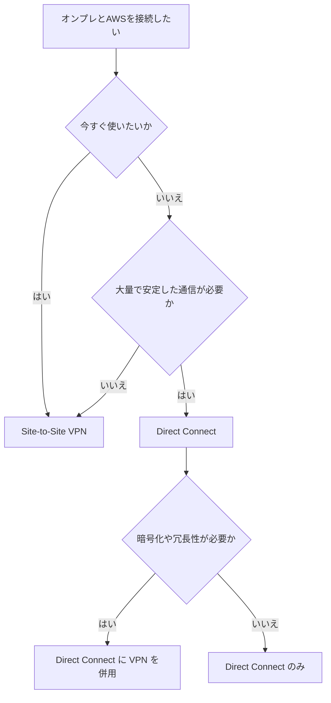

**Route 53 を使った段階的カットオーバー (重み付けルーティング)**

```json
{
  "Comment": "新環境へ10%だけ振り向ける",
  "Changes": [
    {
      "Action": "UPSERT",
      "ResourceRecordSet": {
        "Name": "app.example.com",
        "Type": "CNAME",
        "SetIdentifier": "onprem",
        "Weight": 90,
        "TTL": 60,
        "ResourceRecords": [{ "Value": "app.onprem.example.com" }]
      }
    },
    {
      "Action": "UPSERT",
      "ResourceRecordSet": {
        "Name": "app.example.com",
        "Type": "CNAME",
        "SetIdentifier": "aws",
        "Weight": 10,
        "TTL": 60,
        "ResourceRecords": [{ "Value": "app.aws.example.com" }]
      }
    }
  ]
}
```

**ベストプラクティス (ネットワークと DNS)**

- カットオーバーの **事前に TTL を短く** (例 60 秒) しておき、切り戻しを素早くできるようにする
- 重み付けで **少しずつ新環境へ寄せ (例 10% → 50% → 100%)**、問題があれば重みを戻す
- Direct Connect は **開通に数週間以上かかり得る**ので、早めに手配しつつ暫定で VPN を使う
- 重要な接続は **異なるロケーションで冗長化**する

### 3.5 ID サービス: 移行後も同じ ID でログインできるように

| サービス | 説明 | 向いているケース |
|---|---|---|
| **AWS IAM Identity Center** | 複数アカウントと業務アプリへのシングルサインオン。外部 IdP (SAML と SCIM) や Active Directory と連携 | 社員の AWS アカウントへのアクセス管理 |
| **AWS Managed Microsoft AD** | AWS 上のマネージドな実 Microsoft AD。オンプレ AD と信頼関係を設定できる | AD に依存するアプリ、RDS for SQL Server の Windows 認証、AD 対応ワークロードの移行 |
| **AD Connector** | オンプレ AD への認証要求を中継するプロキシ。AWS 側にディレクトリを持たない | 既存 AD を使い続けたい、シンプルな連携 |
| Simple AD | Samba 互換の小規模ディレクトリ (提供状況は公式で要確認) | 小規模・基本機能のみ |

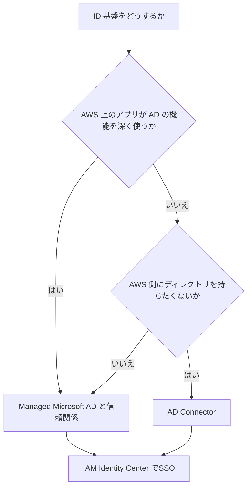

### 3.6 ガバナンス: 移行の土台となるマルチアカウント環境

| サービス | 役割 |
|---|---|
| **AWS Organizations** | 複数アカウントの一元管理、一括請求、**SCP (サービスコントロールポリシー)** による権限の上限設定 |
| **AWS Control Tower** | ベストプラクティスに沿ったランディングゾーンを自動構築。ガードレール (予防は SCP、検出は Config) と Account Factory を提供 |

**ベストプラクティス**

- **移行を始める前にランディングゾーン (アカウント構成、ネットワーク、ログ、セキュリティ) を整える**
- 移行元の部門や環境 (本番、検証) に合わせて **アカウントを分割**し、爆発半径を小さくする
- SCP でリージョン制限などの予防ガードレールをかける

**SCP の例 (許可リージョン以外を拒否。グローバルサービスは除外)**

```json
{
  "Version": "2012-10-17",
  "Statement": [
    {
      "Sid": "DenyOutsideAllowedRegions",
      "Effect": "Deny",
      "NotAction": ["iam:*", "organizations:*", "route53:*", "cloudfront:*", "support:*"],
      "Resource": "*",
      "Condition": {
        "StringNotEquals": {
          "aws:RequestedRegion": ["ap-northeast-1", "ap-northeast-3"]
        }
      }
    }
  ]
}
```

### 3.7 移行ツールのセキュリティ適用

| 観点 | 実践 |
|---|---|
| 認証・認可 | 移行専用の IAM ロールを作り **最小権限**にする。長期アクセスキーを避け一時認証情報を使う |
| 通信の暗号化 | 転送中は TLS、閉域化は Direct Connect、VPN、**VPC エンドポイント (PrivateLink)** を使う |
| 保存時の暗号化 | S3、EBS、RDS を **KMS** で暗号化。DMS のターゲットも暗号化設定を有効にする |
| 監査 | **CloudTrail** で API 操作を記録、Config で構成変更を記録 |
| ネットワーク | ステージングサブネットにセキュリティグループを絞り、必要なポートのみ許可 (MGN は 443 と 1500 など) |
| 機密データ | Macie で S3 の機密データを検出、Secrets Manager で DB 認証情報を管理 |
| 移行完了後 | **一時的な移行用の権限・エージェント・ステージング資源を削除** |

### 3.8 Task 4.2 のまとめ (試験の着眼点)

| 問題文のキーワード | 答えの方向性 |
|---|---|
| 「ダウンタイム最小」「オンプレのサーバーをそのまま」 | **MGN** (継続レプリケーションとテスト起動) |
| 「Oracle から Aurora PostgreSQL」 | **SCT + DMS** (Full load + CDC) |
| 「同じエンジン間で稼働中に移行」 | **DMS (Full load + CDC)** またはネイティブレプリケーション |
| 「回線 100 Mbps、データ 200 TB」 | **Snow Family** |
| 「NFS ファイルを S3 に定期同期、検証あり」 | **DataSync** |
| 「取引先が SFTP でアップロードしている」 | **Transfer Family** |
| 「世界中から S3 へ大きなファイルを速く」 | **S3 Transfer Acceleration** |
| 「今すぐ・暫定で接続」 | **Site-to-Site VPN** |
| 「大量データを安定して継続転送」 | **Direct Connect** |
| 「段階的に切り替え、すぐ戻せる」 | **Route 53 重み付けルーティング** |
| 「AD 対応アプリを AWS に移す」 | **Managed Microsoft AD (信頼関係)** |
| 「複数アカウントの統制を最初に整える」 | **Control Tower と Organizations** |

**出典**

- 公式 Exam Guide (Task 4.2): https://d1.awsstatic.com/training-and-certification/docs-sa-pro/AWS-Certified-Solutions-Architect-Professional_Exam-Guide.pdf
- DataSync: https://docs.aws.amazon.com/datasync/latest/userguide/what-is-datasync.html
- Transfer Family: https://docs.aws.amazon.com/transfer/latest/userguide/what-is-aws-transfer-family.html
- Snow Family (Snowball Edge): https://docs.aws.amazon.com/snowball/latest/developer-guide/whatisedge.html
- S3 Transfer Acceleration: https://docs.aws.amazon.com/AmazonS3/latest/userguide/transfer-acceleration.html
- Storage Gateway: https://docs.aws.amazon.com/storagegateway/latest/vgw/WhatIsStorageGateway.html
- Application Migration Service: https://docs.aws.amazon.com/mgn/latest/ug/what-is-application-migration-service.html
- Database Migration Service: https://docs.aws.amazon.com/dms/latest/userguide/Welcome.html
- DMS ベストプラクティス: https://docs.aws.amazon.com/dms/latest/userguide/CHAP_BestPractices.html
- Schema Conversion Tool: https://docs.aws.amazon.com/SchemaConversionTool/latest/userguide/CHAP_Welcome.html
- Direct Connect: https://docs.aws.amazon.com/directconnect/latest/UserGuide/Welcome.html
- Site-to-Site VPN: https://docs.aws.amazon.com/vpn/latest/s2svpn/VPC_VPN.html
- Route 53: https://docs.aws.amazon.com/Route53/latest/DeveloperGuide/Welcome.html
- IAM Identity Center: https://docs.aws.amazon.com/singlesignon/latest/userguide/what-is.html
- Directory Service: https://docs.aws.amazon.com/directoryservice/latest/admin-guide/what_is.html
- Control Tower: https://docs.aws.amazon.com/controltower/latest/userguide/what-is-control-tower.html
- Organizations: https://docs.aws.amazon.com/organizations/latest/userguide/orgs_introduction.html

---

## 4. Task 4.3 既存ワークロードの新しいアーキテクチャの決定

移行先で **何の部品を使うか** を決める Task です。基本の考え方は「**要件が許す範囲で、できるだけマネージドに寄せる**」(運用負荷の削減) ですが、**既存の制約 (OS 操作・ライセンス・互換性) があれば EC2 や自己管理も正解**になります。

### 4.1 コンピュートの選択

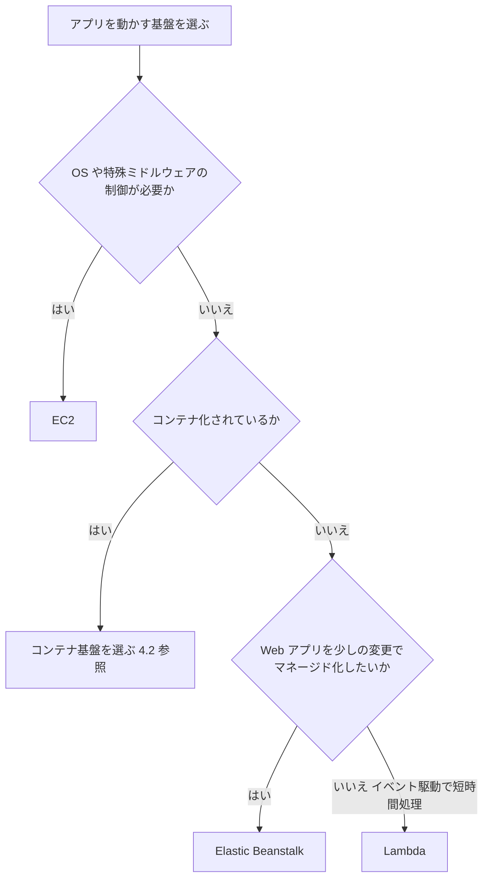

| サービス | 特徴 | 向いているケース |
|---|---|---|
| **Amazon EC2** | 仮想サーバー。OS を含め最大の自由度。専有ホストやライセンス持ち込みも可能 | Rehost、特殊な OS・ドライバ・ライセンス要件、既存の構成を保つ |
| **AWS Elastic Beanstalk** | アプリのコードを置くだけで、プロビジョニング・LB・Auto Scaling・監視を自動構成 (内部は EC2 等) | Java、.NET、PHP、Node.js、Python、Ruby、Go、Docker の Web アプリを **コード変更を最小に** Replatform |
| **AWS App Runner** | コンテナイメージやソースコードから Web アプリ/API を簡単に公開 | インフラ運用をほぼ持たず、コンテナ Web サービスを素早く公開 |
| **AWS Lambda** | イベント駆動のサーバーレス。実行時間は最大 15 分、メモリは 128 MB〜10,240 MB | 短時間の処理、イベント駆動、アイドル時コストゼロ |

**ベストプラクティス**

- EC2 では **Graviton などコスト効率の良いインスタンス**や、実測に基づく **ライトサイジング**を検討する (Compute Optimizer)
- Elastic Beanstalk は **Blue/Green デプロイ**で環境を入れ替えて安全に更新する
- ライセンス条件 (Windows、SQL Server、Oracle など) は **License Manager** で管理する

### 4.2 コンテナホスティングの選択

| サービス | 説明 | 選ぶ理由 |
|---|---|---|
| **Amazon ECS** | AWS ネイティブのコンテナオーケストレーション。シンプル | Kubernetes の知識がなく、AWS の機能と素直に統合したい |
| **Amazon EKS** | マネージド Kubernetes | **Kubernetes 標準を使いたい**、既存の K8s 資産やマルチクラウドの移植性が必要 |
| **AWS Fargate** | ECS/EKS の **サーバーレスな実行基盤**。ノード (EC2) の管理が不要 | クラスターのサーバー運用をなくしたい |
| **Amazon ECR** | コンテナイメージのレジストリ。脆弱性スキャンやレプリケーションに対応 | イメージの安全な保管・配布 |
| ECS Anywhere / EKS Anywhere | オンプレのサーバー上でも同じ管理方式でコンテナを動かす | 一部をオンプレに残すハイブリッド |

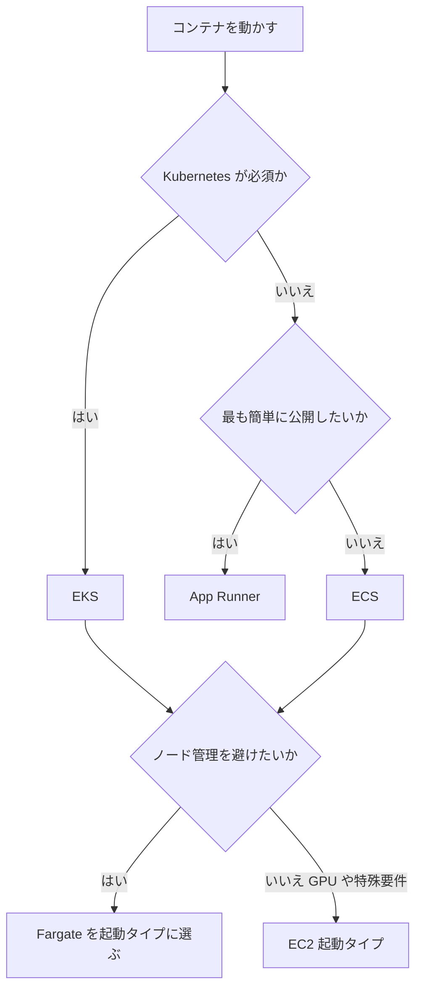

**ベストプラクティス**

- ノード管理をなくしたいなら **Fargate**。GPU や特殊なインスタンスが必要なら EC2 起動タイプ
- タスク単位に **IAM ロール** (ECS のタスクロール、EKS の IRSA または Pod Identity) を付与し、最小権限にする
- 複数 AZ に分散配置し、**ALB** でヘルスチェックを行う
- ECR で **イメージスキャン**を有効にし、脆弱なイメージの展開を防ぐ

### 4.3 ストレージの選択

| サービス | 種類 | 特徴 | 向いているケース |
|---|---|---|---|
| **Amazon EBS** | ブロック | EC2 にアタッチするディスク。基本は 1 つの AZ 内。スナップショットで保護 | OS ディスク、DB のデータ領域 |
| **Amazon EFS** | ファイル (NFS) | Linux 向け共有ファイルシステム。複数 AZ から同時マウント。自動で拡張 | 複数サーバーで共有する Linux のコンテンツ、コンテナの共有ストレージ |
| **FSx for Windows File Server** | ファイル (SMB) | Windows 互換、AD 統合 | Windows ファイルサーバーの移行 |
| **FSx for Lustre** | 高性能ファイル | HPC や機械学習向けの高スループット、S3 と連携 | 大規模計算 |
| **FSx for NetApp ONTAP** | マルチプロトコル | NFS、SMB、iSCSI。NetApp の機能や運用をそのままクラウドへ | オンプレの NetApp 資産の移行 |
| **FSx for OpenZFS** | ファイル (NFS) | OpenZFS 互換、低遅延 | ZFS ベースのファイルサーバー移行 |
| **Amazon S3** | オブジェクト | ほぼ無制限で高耐久。ストレージクラスとライフサイクルで自動階層化 | 静的コンテンツ、バックアップ、データレイク、アーカイブ |
| **Storage Gateway (Volume Gateway)** | iSCSI ブロック (ハイブリッド) | オンプレのアプリに iSCSI ボリュームを提供し、データを S3 経由で AWS に保存 (EBS スナップショット化も可) | オンプレのアプリは残しつつ、バックアップや段階移行をしたい |

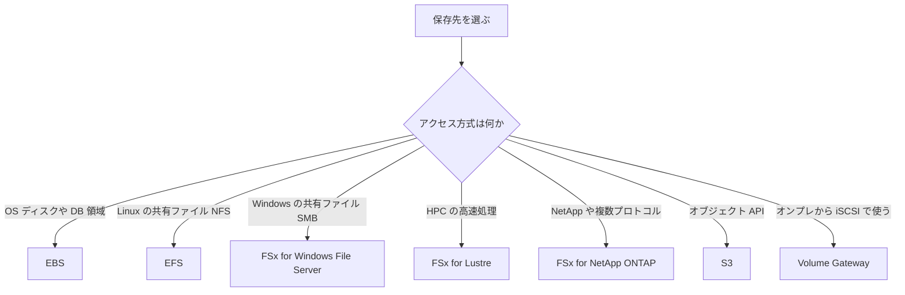

**ベストプラクティス**

- S3 は **ライフサイクルポリシーや Intelligent-Tiering**でアクセス頻度に応じてコストを最適化する
- EBS は **gp3** を基本に、ミッションクリティカルな高 IOPS は io2 を検討、**スナップショット (AWS Backup)** で保護する
- EFS は **ストレージクラスとライフサイクル管理**でアクセス頻度の低いファイルのコストを下げる
- 全サービスで **KMS による保存時暗号化**と **バックアップ戦略**を標準にする

### 4.4 データベースの選択

| サービス | 種類 | 特徴 | 向いているケース |
|---|---|---|---|
| **Amazon RDS** | リレーショナル (マネージド) | MySQL、PostgreSQL、MariaDB、Oracle、SQL Server、Db2。バックアップ、パッチ、Multi-AZ を自動化 | 既存のリレーショナル DB を **Replatform** で運用負荷を下げる |
| **Amazon Aurora** | リレーショナル (クラウドネイティブ) | MySQL/PostgreSQL 互換。3 AZ に 6 コピー、最大 15 のリードレプリカ、Global Database | 高い可用性・性能、スケールが必要な商用 DB の置き換え |
| **Amazon DynamoDB** | NoSQL (キーバリュー/ドキュメント) | 1 桁ミリ秒、ほぼ無制限にスケール、オンデマンド課金、グローバルテーブル | 大規模・高トラフィック、スキーマ柔軟、サーバーレス構成 |
| **Amazon OpenSearch Service** | 検索・ログ分析 | 全文検索、ログ分析、ダッシュボード | Elasticsearch の置き換え、検索機能 |
| **EC2 上の自己管理 DB** | 任意 | OS・DB の完全な制御 | **マネージドで未対応の機能・バージョン・OS アクセスが必須**の場合のみ |
| Amazon RDS Custom | リレーショナル (OS アクセス可) | OS やデータベース環境のカスタマイズが必要なレガシー DB 向け (Oracle、SQL Server) | カスタマイズ必須だがマネージドの利点も欲しい |

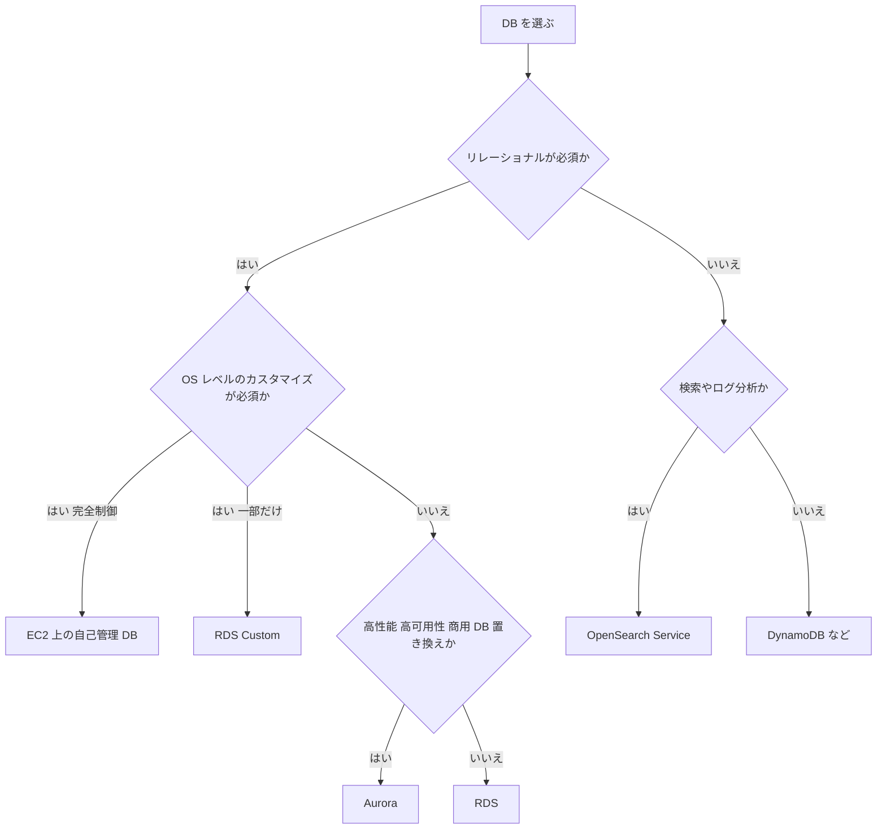

**ベストプラクティス**

- **Multi-AZ** を標準にし、読み取り負荷はリードレプリカで分散する
- RDS のライセンス込み (License Included) と BYOL を比較し、TCO を評価する
- Oracle や SQL Server から **オープンソース互換エンジン (Aurora など) へ**移すと、ライセンス費用を大きく削減できる (SCT と DMS の組み合わせ)
- 接続情報は **Secrets Manager** で管理し、自動ローテーションする

### 4.5 Task 4.3 のまとめ (試験の着眼点)

| 問題文のキーワード | 答えの方向性 |
|---|---|
| 「OS レベルの制御」「特殊なライセンス」 | EC2 (必要なら Dedicated Host) |
| 「コード変更を最小に Web アプリをマネージドで」 | Elastic Beanstalk |
| 「Kubernetes 必須」「移植性」 | EKS |
| 「K8s 不要でシンプル」「AWS ネイティブ」 | ECS |
| 「サーバー (ノード) 管理を避けたい」 | Fargate |
| 「Windows ファイルサーバー、AD 統合」 | FSx for Windows File Server |
| 「複数の Linux サーバーから共有」 | EFS |
| 「NetApp 資産と同じ運用、NFS と SMB 併用」 | FSx for NetApp ONTAP |
| 「オンプレのアプリに iSCSI ボリュームを提供」 | Volume Gateway |
| 「Oracle を安く・高性能に」 | Aurora (SCT + DMS で異種移行) |
| 「OS アクセスが必要な DB をマネージドに近づける」 | RDS Custom |

**出典**

- 公式 Exam Guide (Task 4.3): https://d1.awsstatic.com/training-and-certification/docs-sa-pro/AWS-Certified-Solutions-Architect-Professional_Exam-Guide.pdf
- EC2 インスタンスタイプ: https://docs.aws.amazon.com/ec2/latest/instancetypes/instance-types.html
- Elastic Beanstalk: https://docs.aws.amazon.com/elasticbeanstalk/latest/dg/Welcome.html
- App Runner: https://docs.aws.amazon.com/apprunner/latest/dg/what-is-apprunner.html
- ECS: https://docs.aws.amazon.com/AmazonECS/latest/developerguide/Welcome.html
- EKS: https://docs.aws.amazon.com/eks/latest/userguide/what-is-eks.html
- Fargate: https://docs.aws.amazon.com/AmazonECS/latest/developerguide/AWS_Fargate.html
- ECR: https://docs.aws.amazon.com/AmazonECR/latest/userguide/what-is-ecr.html
- EBS: https://docs.aws.amazon.com/ebs/latest/userguide/what-is-ebs.html
- EFS: https://docs.aws.amazon.com/efs/latest/ug/whatisefs.html
- FSx: https://docs.aws.amazon.com/fsx/
- S3: https://docs.aws.amazon.com/AmazonS3/latest/userguide/Welcome.html
- RDS: https://docs.aws.amazon.com/AmazonRDS/latest/UserGuide/Welcome.html
- Aurora: https://docs.aws.amazon.com/AmazonRDS/latest/AuroraUserGuide/CHAP_AuroraOverview.html
- DynamoDB: https://docs.aws.amazon.com/amazondynamodb/latest/developerguide/Introduction.html
- OpenSearch Service: https://docs.aws.amazon.com/opensearch-service/latest/developerguide/what-is.html

---

## 5. Task 4.4 モダナイゼーションと機能強化の機会の特定

移行後 (または移行と同時に)、**クラウドの強みを活かす作り変え**を検討します。キーワードは次の 4 つです。

| キーワード | 意味 | 得られるもの |
|---|---|---|
| 疎結合 (Decoupling) | 部品同士を直接つながず、キューやイベントで間接的につなぐ | 障害の波及を防ぐ、独立してスケール |
| サーバーレス | サーバー管理をなくし、使った分だけ課金 | 運用負荷とコストの削減 |
| コンテナ | 軽量で移植しやすい実行単位 | 開発速度、可搬性、リソース効率 |
| 専用 DB (Purpose-built) | データの性質に最適な DB を使い分け | 性能向上とコスト最適化 |

### 5.1 モノリスから段階的に分解する (ストラングラーフィグパターン)

一度に作り直すのではなく、**機能を少しずつ新しい実装に置き換え、古い部分を徐々に縮小**する方法です。リスクを小さくできます。

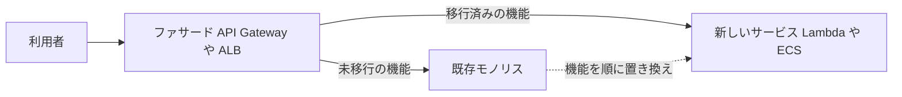

- **API Gateway や ALB のパスベースルーティング**で、機能単位に振り分け先を切り替える
- 新旧を並行稼働しながら、**問題があればすぐ旧側へ戻せる**
- 既存ユーザーに影響を与えずに Refactor を進められる

### 5.2 疎結合: アプリケーション統合サービスの使い分け

| サービス | 方式 | 特徴 | 使いどころ |
|---|---|---|---|
| **Amazon SQS** | キュー (プル型、1 対 1) | 標準 (ほぼ無制限、順序保証なし、少なくとも 1 回) と FIFO (順序保証、重複排除)。DLQ、可視性タイムアウト | 処理の **バッファリング**、負荷の平準化、非同期処理 |
| **Amazon SNS** | Pub/Sub (プッシュ型、1 対多) | 1 つのメッセージを複数の購読者 (SQS、Lambda、HTTP、メール等) へ配信 | **ファンアウト** (通知の一斉配信) |
| **Amazon EventBridge** | イベントバス | ルールによるフィルタとルーティング、SaaS 連携、スケジュール、AWS サービスのイベント受信 | **イベント駆動アーキテクチャ**、SaaS や AWS イベントの連携 |
| **AWS Step Functions** | ワークフロー | 状態遷移でステップを制御。分岐、並列、リトライ、エラー処理。Standard と Express | **複数ステップの業務フロー**のオーケストレーション |
| **Amazon MQ** | マネージドブローカー (ActiveMQ と RabbitMQ) | JMS、AMQP、MQTT などの標準プロトコル対応 | **既存アプリのメッセージブローカーを、コード変更なしで移行** |
| Kinesis Data Streams と Amazon MSK | ストリーミング | 順序付きの大量ストリームをリアルタイム処理 | ログやクリックストリームなどの連続データ (Kafka 互換が必要なら MSK) |

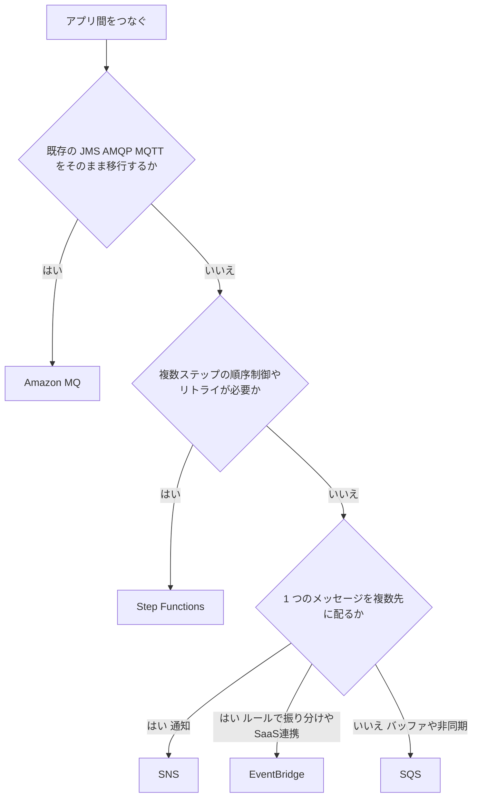

**定番の組み合わせ: SNS + SQS ファンアウト**

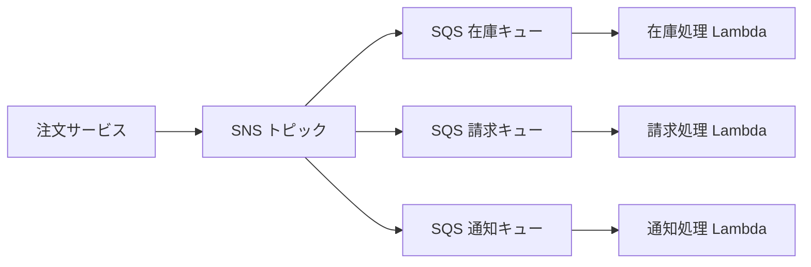

**ベストプラクティス (疎結合)**

- SQS には必ず **デッドレターキュー (DLQ)** を付け、失敗メッセージを隔離して調査する
- メッセージ処理は **冪等 (同じメッセージを複数回処理しても結果が同じ)** に設計する (SQS 標準は少なくとも 1 回配信のため)
- 順序保証や重複排除が必須の場合のみ FIFO を選ぶ (スループットの制約があるため)
- 長い業務フローは **Lambda の連鎖ではなく Step Functions** で表現し、状態を可視化する

### 5.3 サーバーレス化の機会

| 機会 | サービス | 効果 |
|---|---|---|
| 定期バッチ、イベント処理 | Lambda と EventBridge スケジューラ | サーバー不要、アイドル時コストなし |
| REST/HTTP API | API Gateway と Lambda | 管理不要でスケール、認証・スロットリング機能 |
| コンテナ化済みの処理 | Fargate | ノード管理不要 |
| 変動の大きい RDB | **Aurora Serverless v2** | 負荷に応じて自動でキャパシティを調整 |
| 変動の大きい NoSQL | DynamoDB オンデマンド | 事前のキャパシティ設計が不要 |
| 静的サイト、ファイル配布 | S3 と CloudFront | サーバー不要、高耐久・低コスト |

**Lambda の制約 (試験の判断材料)**

| 項目 | 目安 |
|---|---|
| 最大実行時間 | 15 分 |
| メモリ | 128 MB 〜 10,240 MB (CPU はメモリに比例) |
| 向かない処理 | 15 分を超える長時間処理 (→ Fargate や AWS Batch)、常時接続が必要なもの |

### 5.4 専用 DB (Purpose-built databases) の使い分け

| データの性質・要件 | 選ぶサービス |
|---|---|
| 構造化データ、複雑な JOIN とトランザクション | Aurora / RDS |
| キーバリュー、超低遅延、大規模スケール | DynamoDB |
| 読み取りの高速化 (キャッシュ)、セッション管理 | **ElastiCache** (Redis OSS または Memcached 互換) |
| DynamoDB の超低遅延キャッシュ | DynamoDB Accelerator (DAX) |
| ドキュメント (MongoDB 互換) | Amazon DocumentDB |
| グラフ (関係性の探索) | Amazon Neptune |
| 時系列 (IoT、メトリクス) | Amazon Timestream |
| 検索・ログ分析 | OpenSearch Service |
| データウェアハウス (分析) | Amazon Redshift |
| 変動の大きなリレーショナル | Aurora Serverless v2 |

**ベストプラクティス**

- 「**1 つの DB に全部**」ではなく、アクセスパターンごとに DB を選ぶ
- **キャッシュ (ElastiCache)** を DB の前段に入れて、読み取り負荷とレイテンシを下げる
- 性能問題を「DB の大型化」だけで解決せず、**リードレプリカ、キャッシュ、パーティション設計**を併用する

### 5.5 Task 4.4 のまとめ (試験の着眼点)

| 問題文のキーワード | 答えの方向性 |
|---|---|
| 「処理のピーク吸収」「後段の障害から切り離したい」 | SQS (必要なら DLQ) |
| 「1 つのイベントを複数システムに同時通知」 | SNS (+ SQS ファンアウト) |
| 「SaaS やAWSサービスのイベントでワークフロー起動」 | EventBridge |
| 「複数ステップ、分岐、リトライ、人手の承認」 | Step Functions |
| 「既存の ActiveMQ や RabbitMQ をコード変更なしで」 | Amazon MQ |
| 「使用量の変動が大きい RDB、運用なしで」 | Aurora Serverless v2 |
| 「DB の読み取り負荷とレイテンシを下げたい」 | ElastiCache |
| 「モノリスを段階的に分解」 | ストラングラーフィグ + API Gateway/ALB |
| 「ノード管理をしないコンテナ」 | Fargate |

**出典**

- 公式 Exam Guide (Task 4.4): https://d1.awsstatic.com/training-and-certification/docs-sa-pro/AWS-Certified-Solutions-Architect-Professional_Exam-Guide.pdf
- ストラングラーフィグパターン: https://docs.aws.amazon.com/prescriptive-guidance/latest/cloud-design-patterns/strangler-fig.html
- Lambda: https://docs.aws.amazon.com/lambda/latest/dg/welcome.html
- SQS: https://docs.aws.amazon.com/AWSSimpleQueueService/latest/SQSDeveloperGuide/welcome.html
- SNS: https://docs.aws.amazon.com/sns/latest/dg/welcome.html
- EventBridge: https://docs.aws.amazon.com/eventbridge/latest/userguide/eb-what-is.html
- Step Functions: https://docs.aws.amazon.com/step-functions/latest/dg/welcome.html
- Amazon MQ: https://docs.aws.amazon.com/amazon-mq/latest/developer-guide/welcome.html
- Aurora Serverless v2: https://docs.aws.amazon.com/AmazonRDS/latest/AuroraUserGuide/aurora-serverless-v2.html
- ElastiCache: https://docs.aws.amazon.com/AmazonElastiCache/latest/dg/WhatIs.html
- Well-Architected Framework: https://docs.aws.amazon.com/wellarchitected/latest/framework/welcome.html

---

## 6. 試験直前の総まとめ

### 6.1 Well-Architected の 6 つの柱で見る移行の判断軸

| 柱 | 移行・モダナイゼーションでの問い |
|---|---|
| 運用上の優秀性 | 移行手順を自動化・再現できるか (Orchestrator、MGN のポストローンチ、IaC) |
| セキュリティ | 移行中・移行後に最小権限と暗号化が守られているか |
| 信頼性 | カットオーバー失敗時に戻せるか、Multi-AZ か |
| パフォーマンス効率 | 実測値でライトサイジングし、専用サービスを選んだか |
| コスト最適化 | TCO を比較し、Savings Plans とマネージド化で運用費を下げたか |
| サステナビリティ | 過剰リソースをなくし、効率の良い構成を選んだか |

### 6.2 「制約条件」から答えを引く早見表

| 制約条件 | 優先して考える選択肢 |
|---|---|
| 変更を最小に、とにかく早く | Rehost (MGN)、Relocate |
| 運用負荷を下げたい | Replatform (RDS、Aurora、Beanstalk、Fargate) |
| 長期的な俊敏性とスケール | Refactor (サーバーレス、マイクロサービス) |
| ダウンタイムを最小に | MGN の継続レプリケーション、DMS の Full load + CDC、Route 53 の重み付け |
| 回線が細い・量が膨大 | Snow Family |
| 継続的なファイル同期 | DataSync |
| 取引先が FTP/SFTP | Transfer Family |
| 閉域で安全に転送 | Direct Connect、VPN、VPC エンドポイント (PrivateLink) |
| ライセンス費用の削減 | 商用 DB から Aurora 等へ (SCT + DMS)、BYOL の検討 |
| 既存ブローカーをそのまま | Amazon MQ |
| 移行前に統制を整える | Control Tower、Organizations、SCP |

### 6.3 よくある引っかけポイント

| 引っかけ | 正しい理解 |
|---|---|
| 「異種 DB 移行は DMS だけで完結」 | **スキーマ変換 (SCT) が先に必要**。DMS はデータ移行が主 |
| 「Direct Connect は暗号化されている」 | **既定では暗号化されない**。MACsec や VPN 併用で暗号化 |
| 「Snow Family は常に最速」 | 小〜中規模でネットワークが十分なら DataSync の方が早く簡単 |
| 「Fargate = ECS の別名」 | Fargate は **実行基盤**。ECS と EKS の両方で使える |
| 「SNS = キュー」 | SNS は **プッシュ配信 (1 対多)**。バッファは SQS |
| 「Lambda は何でも向く」 | **最大 15 分**。長時間処理は Fargate や Batch |
| 「Rehost では何も改善しない」 | まず移して、その後に Replatform や Refactor へ進める戦略もよくある |
| 「Migration Hub が移行を実行する」 | Migration Hub は **追跡・計画の一元管理**。実移行は MGN や DMS が行う |
| 「レプリケーション完了 = 切替完了」 | 最後に **テストとカットオーバーとファイナライズ** が必要 |

### 6.4 最終チェックリスト

- [ ] 7Rs を、それぞれ具体例つきで説明できる
- [ ] 100 TB を 1 Gbps で送った場合のおおよその日数を計算できる
- [ ] MGN の 7 ステップ (エージェントからファイナライズ) を説明できる
- [ ] 同種・異種 DB 移行で使うツールと手順の違いを説明できる
- [ ] Direct Connect と VPN を、期間・帯域・暗号化の観点で使い分けられる
- [ ] ECS、EKS、Fargate、App Runner の違いを言える
- [ ] EBS、EFS、FSx、S3、Volume Gateway を要件から選べる
- [ ] SQS、SNS、EventBridge、Step Functions、Amazon MQ を使い分けられる
- [ ] ストラングラーフィグパターンを説明できる
- [ ] Migration Hub の提供状況の変更点を説明できる

---

## 7. 参考 URL 一覧 (根拠となるソース)

### 7.1 試験情報

| 資料 | URL |
|---|---|
| SAP-C02 公式 Exam Guide (PDF、Version 1.2) | https://d1.awsstatic.com/training-and-certification/docs-sa-pro/AWS-Certified-Solutions-Architect-Professional_Exam-Guide.pdf |
| AWS 認定資格 SAP-C02 ページ (Domain 2、ご提示の URL) | https://docs.aws.amazon.com/aws-certification/latest/solutions-architect-professional-02/solutions-architect-professional-02-domain2.html |
| AWS Well-Architected Framework | https://docs.aws.amazon.com/wellarchitected/latest/framework/welcome.html |

### 7.2 移行の計画と評価 (Task 4.1)

| サービス・トピック | URL |
|---|---|
| 大規模移行ガイド | https://docs.aws.amazon.com/prescriptive-guidance/latest/large-migration-guide/welcome.html |
| 移行戦略 (7Rs) | https://docs.aws.amazon.com/prescriptive-guidance/latest/large-migration-guide/migration-strategies.html |
| Application Discovery Service | https://docs.aws.amazon.com/application-discovery/latest/userguide/what-is-appdiscovery.html |
| Migration Hub | https://docs.aws.amazon.com/migrationhub/latest/ug/whatishub.html |
| Migration Hub の提供状況の変更 | https://docs.aws.amazon.com/migrationhub/latest/ug/migrationhub-availability-change.html |
| AWS Pricing Calculator | https://docs.aws.amazon.com/pricing-calculator/latest/userguide/what-is-pricing-calculator.html |
| Migration Evaluator | https://aws.amazon.com/migration-evaluator/ |

### 7.3 移行の実行 (Task 4.2)

| サービス・トピック | URL |
|---|---|
| Application Migration Service (MGN) | https://docs.aws.amazon.com/mgn/latest/ug/what-is-application-migration-service.html |
| Database Migration Service (DMS) | https://docs.aws.amazon.com/dms/latest/userguide/Welcome.html |
| DMS ベストプラクティス | https://docs.aws.amazon.com/dms/latest/userguide/CHAP_BestPractices.html |
| Schema Conversion Tool (SCT) | https://docs.aws.amazon.com/SchemaConversionTool/latest/userguide/CHAP_Welcome.html |
| DataSync | https://docs.aws.amazon.com/datasync/latest/userguide/what-is-datasync.html |
| Transfer Family | https://docs.aws.amazon.com/transfer/latest/userguide/what-is-aws-transfer-family.html |
| Snow Family (Snowball Edge) | https://docs.aws.amazon.com/snowball/latest/developer-guide/whatisedge.html |
| S3 Transfer Acceleration | https://docs.aws.amazon.com/AmazonS3/latest/userguide/transfer-acceleration.html |
| Storage Gateway | https://docs.aws.amazon.com/storagegateway/latest/vgw/WhatIsStorageGateway.html |
| Direct Connect | https://docs.aws.amazon.com/directconnect/latest/UserGuide/Welcome.html |
| Site-to-Site VPN | https://docs.aws.amazon.com/vpn/latest/s2svpn/VPC_VPN.html |
| Route 53 | https://docs.aws.amazon.com/Route53/latest/DeveloperGuide/Welcome.html |
| IAM Identity Center | https://docs.aws.amazon.com/singlesignon/latest/userguide/what-is.html |
| Directory Service | https://docs.aws.amazon.com/directoryservice/latest/admin-guide/what_is.html |
| Control Tower | https://docs.aws.amazon.com/controltower/latest/userguide/what-is-control-tower.html |
| Organizations | https://docs.aws.amazon.com/organizations/latest/userguide/orgs_introduction.html |

### 7.4 移行後のアーキテクチャとモダナイゼーション (Task 4.3 / 4.4)

| サービス・トピック | URL |
|---|---|
| EC2 インスタンスタイプ | https://docs.aws.amazon.com/ec2/latest/instancetypes/instance-types.html |
| Elastic Beanstalk | https://docs.aws.amazon.com/elasticbeanstalk/latest/dg/Welcome.html |
| App Runner | https://docs.aws.amazon.com/apprunner/latest/dg/what-is-apprunner.html |
| ECS | https://docs.aws.amazon.com/AmazonECS/latest/developerguide/Welcome.html |
| EKS | https://docs.aws.amazon.com/eks/latest/userguide/what-is-eks.html |
| Fargate | https://docs.aws.amazon.com/AmazonECS/latest/developerguide/AWS_Fargate.html |
| ECR | https://docs.aws.amazon.com/AmazonECR/latest/userguide/what-is-ecr.html |
| EBS | https://docs.aws.amazon.com/ebs/latest/userguide/what-is-ebs.html |
| EFS | https://docs.aws.amazon.com/efs/latest/ug/whatisefs.html |
| FSx | https://docs.aws.amazon.com/fsx/ |
| S3 | https://docs.aws.amazon.com/AmazonS3/latest/userguide/Welcome.html |
| RDS | https://docs.aws.amazon.com/AmazonRDS/latest/UserGuide/Welcome.html |
| Aurora | https://docs.aws.amazon.com/AmazonRDS/latest/AuroraUserGuide/CHAP_AuroraOverview.html |
| Aurora Serverless v2 | https://docs.aws.amazon.com/AmazonRDS/latest/AuroraUserGuide/aurora-serverless-v2.html |
| DynamoDB | https://docs.aws.amazon.com/amazondynamodb/latest/developerguide/Introduction.html |
| OpenSearch Service | https://docs.aws.amazon.com/opensearch-service/latest/developerguide/what-is.html |
| ElastiCache | https://docs.aws.amazon.com/AmazonElastiCache/latest/dg/WhatIs.html |
| Lambda | https://docs.aws.amazon.com/lambda/latest/dg/welcome.html |
| SQS | https://docs.aws.amazon.com/AWSSimpleQueueService/latest/SQSDeveloperGuide/welcome.html |
| SNS | https://docs.aws.amazon.com/sns/latest/dg/welcome.html |
| EventBridge | https://docs.aws.amazon.com/eventbridge/latest/userguide/eb-what-is.html |
| Step Functions | https://docs.aws.amazon.com/step-functions/latest/dg/welcome.html |
| Amazon MQ | https://docs.aws.amazon.com/amazon-mq/latest/developer-guide/welcome.html |
| ストラングラーフィグパターン | https://docs.aws.amazon.com/prescriptive-guidance/latest/cloud-design-patterns/strangler-fig.html |

> 免責: 本ガイドは公式 Exam Guide (Version 1.2) の Task 4.1 〜 4.4 に沿って、AWS 公式ドキュメントを根拠に初学者向けに整理したものです。サービスの仕様・提供状況・制限値は変更されることがあるため、受験前に各公式ドキュメントで最新情報を確認してください。
