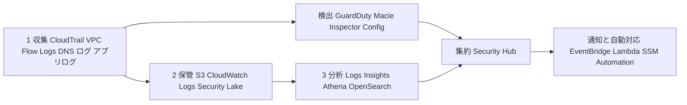
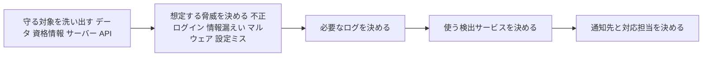
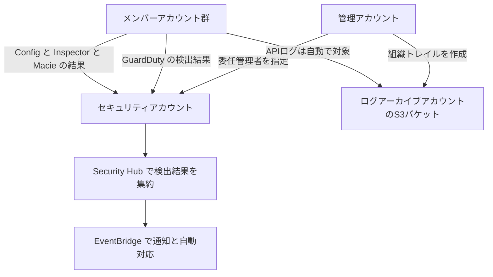
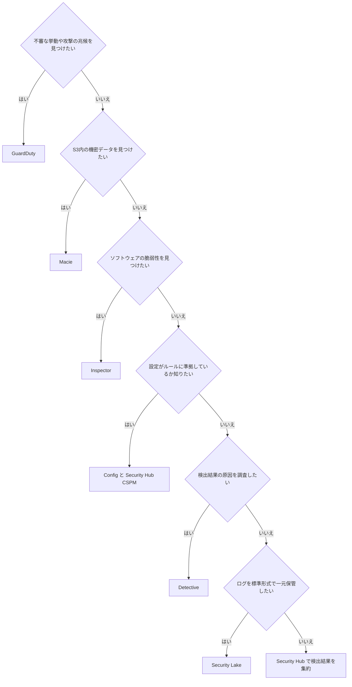
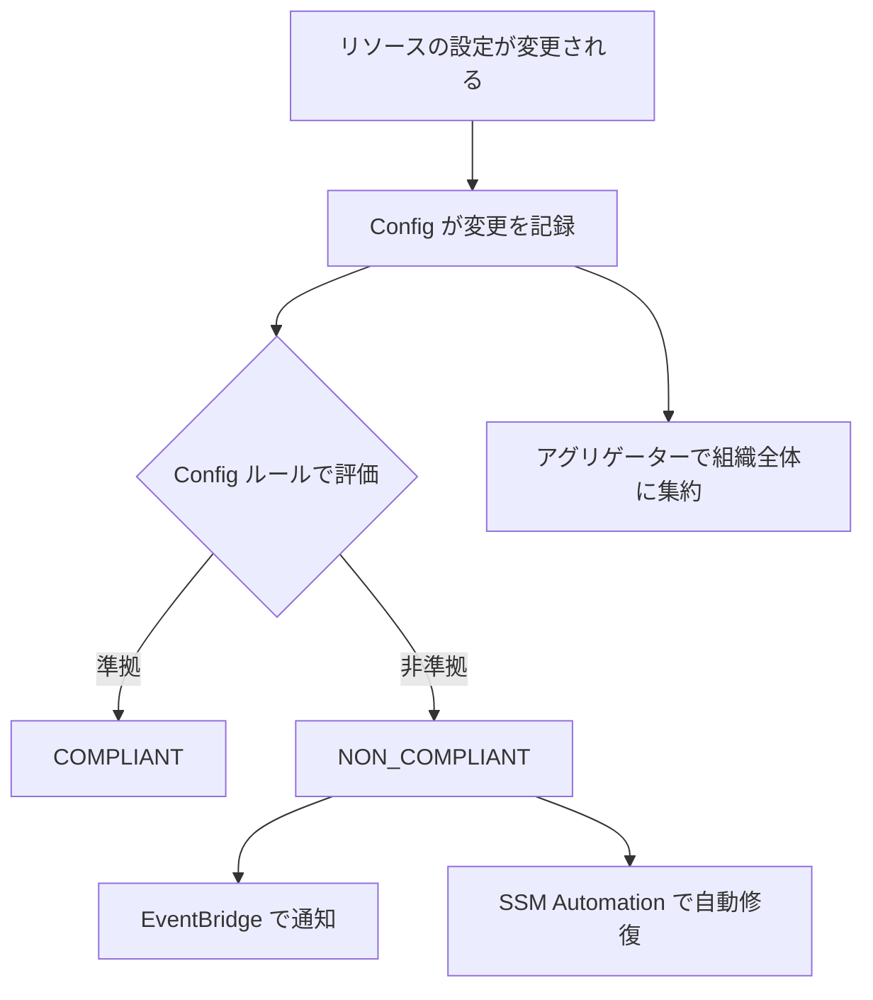
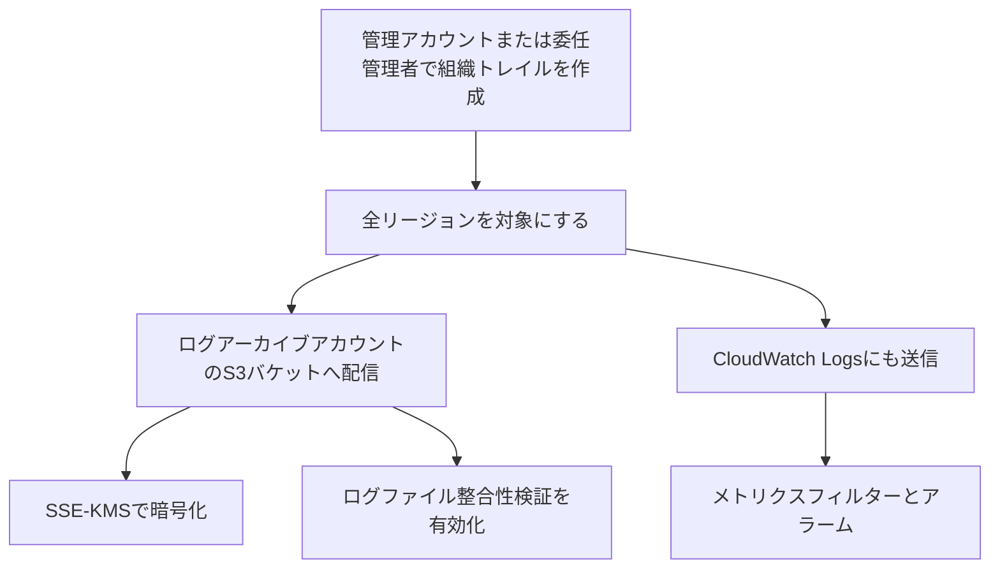
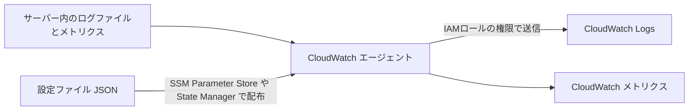
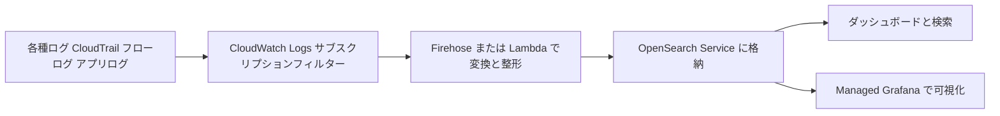
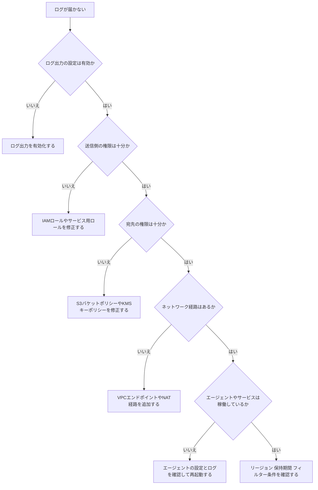

# AWS Certified Security - Specialty (SCS-C03) Content Domain 1: Detection 初学者向けステップバイステップガイド

> 対象試験: AWS Certified Security - Specialty (SCS-C03)
> 対象ドメイン: Content Domain 1: Detection (スコア対象問題の 16%)
> 想定読者: AWS のセキュリティを初めて体系的に学ぶ方
> 作成日: 2026-10-17 (内容は作成時点の公式ドキュメントに基づきます。試験前に必ず最新情報を確認してください)

---

## 目次

0. [このドメインの全体像と試験での位置づけ](#0-このドメインの全体像と試験での位置づけ)
1. [検出の仕組みを 1 枚で理解する](#1-検出の仕組みを-1-枚で理解する)
2. [Task 1.1 監視とアラートの設計・実装](#2-task-11-監視とアラートの設計実装)
3. [Task 1.2 ログ収集・保管・分析の設計・実装](#3-task-12-ログ収集保管分析の設計実装)
4. [Task 1.3 監視・ログ・アラートのトラブルシューティング](#4-task-13-監視ログアラートのトラブルシューティング)
5. [頻出シナリオ早見表](#5-頻出シナリオ早見表)
6. [ベストプラクティス総チェックリスト](#6-ベストプラクティス総チェックリスト)
7. [確認問題](#7-確認問題)
8. [2026年時点で特に注意したい変更点](#8-2026年時点で特に注意したい変更点)
9. [参考URL (ソース一覧)](#9-参考url-ソース一覧)

---

## 0. このドメインの全体像と試験での位置づけ

### 0.1 Detection とは何か (やさしい説明)

家の防犯に例えると、次の 3 つに分けられます。

| 防犯の例え | AWS での役割 | 代表サービス |
|---|---|---|
| 防犯カメラの録画 | 何が起きたかを記録する (ログ) | CloudTrail、VPC Flow Logs、CloudWatch Logs |
| 警備会社の見回り | 怪しい動きを自動で見つける (検出) | GuardDuty、Macie、Inspector、Config |
| 警備室のモニター | 検出結果を 1 か所に集めて見る (集約・通知) | Security Hub、EventBridge、CloudWatch アラーム |

Domain 1 は「記録する」「見つける」「集めて知らせる」「うまく動かないときに直す」の 4 つを問います。

### 0.2 試験ガイド上の構造

公式の試験ガイドでは、Domain 1 は 3 つの Task と 13 の Skill で構成されています。

| Task | 内容 | 含まれる Skill |
|---|---|---|
| 1.1 | 監視とアラートの設計・実装 (アカウント単位または組織単位) | 1.1.1 から 1.1.5 |
| 1.2 | ログソリューションの設計・実装 | 1.2.1 から 1.2.6 |
| 1.3 | 監視・ログ・アラートのトラブルシューティング | 1.3.1 から 1.3.2 |

### 0.3 Skill 一覧 (公式の記述と、本ガイドでの対応章)

| Skill | 公式の内容 (要約) | 本ガイドの章 |
|---|---|---|
| 1.1.1 | ワークロードを分析して監視要件を決める | 2.1 |
| 1.1.2 | ワークロード監視戦略を設計・実装する (例: リソースのヘルスチェック) | 2.2 |
| 1.1.3 | セキュリティイベントと監視イベントを集約する | 2.3 |
| 1.1.4 | 異常なデータやイベントを検出するメトリクス・アラート・ダッシュボードを作る (例: GuardDuty、Security Lake、Security Hub、Macie) | 2.4 |
| 1.1.5 | 定期的な評価や調査を自動化する (例: Config コンフォーマンスパック、Security Hub、Systems Manager State Manager) | 2.5 |
| 1.2.1 | 要件に基づき、ログの取り込み元と保管先を特定する | 3.1 |
| 1.2.2 | AWS サービスとアプリケーションのログ設定 (例: 組織トレイル、CloudWatch 専用ロギングアカウント、CloudWatch Logs エージェント) | 3.2 |
| 1.2.3 | ログ保管とログデータレイク (例: Security Lake) を実装し、サードパーティと連携する | 3.3 |
| 1.2.4 | ログを分析する (例: CloudWatch Logs Insights、Athena、Security Hub の検出結果) | 3.4 |
| 1.2.5 | ログを正規化・解析・相関させる (例: OpenSearch Service、Lambda、Managed Grafana) | 3.5 |
| 1.2.6 | ネットワーク設計や脅威に合わせたログソースを選ぶ (例: VPC Flow Logs、Transit Gateway フローログ、Route 53 Resolver ログ) | 3.6 |
| 1.3.1 | リソースの機能・権限・設定を分析する (例: Lambda ログ、API Gateway ログ、ヘルスチェック、CloudFront ログ) | 4.1 |
| 1.3.2 | 設定ミスを是正する (例: CloudWatch エージェント設定、ログ欠落の調査) | 4.2 |

### 0.4 試験の形式 (公式ガイドより)

| 項目 | 内容 |
|---|---|
| 採点対象の問題数 | 50 問 (これとは別に採点されない 15 問が含まれる) |
| 問題形式 | 択一、複数選択、並べ替え (3 から 5 個の手順)、マッチング |
| 合格スコア | 1,000 点満点中 750 点 |
| 採点方式 | 補償型 (ドメインごとの合格点はなく、全体で合格すればよい) |
| 不正解の扱い | 未回答は不正解。推測で答えても減点はない |

> 学習のコツ: Domain 1 は 16% なので 50 問中およそ 8 問です。他ドメイン (Incident Response、Infrastructure Security など) と密接に関係するため、サービスの「役割分担」を先に頭に入れると効率的です。

出典: https://docs.aws.amazon.com/aws-certification/latest/security-specialty-03/security-specialty-03.html

---

## 1. 検出の仕組みを 1 枚で理解する

最初に全体の流れをつかみます。細かいサービスは後の章で 1 つずつ学びます。



### 1.1 3 つの言葉を区別する

| 言葉 | 意味 | 例 |
|---|---|---|
| ログ | 起きたことの記録 (材料) | CloudTrail のイベント、フローログ |
| 検出 (Finding) | ログなどを分析して見つけた「怪しい点」 | GuardDuty の検出結果 |
| アラート | 人やシステムに知らせる仕組み | EventBridge から SNS や Lambda へ |

### 1.2 共通のベストプラクティス (まず覚える 5 か条)

1. すべてのリージョンで、すべてのアカウントを対象にする (使っていないリージョンも攻撃対象になる)。
2. ログは「ログアーカイブ専用アカウント」に集め、変更・削除できないように守る。
3. 検出サービスは AWS Organizations の委任管理者アカウント (通常はセキュリティアカウント) で一元管理する。
4. 新しいアカウントが増えたら自動で有効化する (自動有効化設定)。
5. 検出結果は Security Hub などに集約し、EventBridge で自動対応につなぐ。

---

## 2. Task 1.1 監視とアラートの設計・実装

### 2.1 Skill 1.1.1 ワークロードを分析して監視要件を決める

#### やさしい説明

「何を守るのか」「どんな攻撃や事故が起きうるのか」を先に整理しないと、必要なログも検出サービスも選べません。まず要件を言語化します。

#### ステップ



#### 要件の決め方 (対応表)

| 守る対象 | 想定する脅威の例 | 必要なログ・データ | 候補となるサービス |
|---|---|---|---|
| IAM ユーザー・ロール | 認証情報の漏えい、権限昇格 | CloudTrail 管理イベント | GuardDuty、CloudTrail Insights、CloudWatch メトリクスフィルター |
| S3 のデータ | 機密データの流出、公開設定ミス | CloudTrail データイベント、S3 の設定 | Macie、GuardDuty S3 Protection、Config |
| EC2 インスタンス | マルウェア、脆弱性、不審な通信 | フローログ、DNS ログ、OS ログ | GuardDuty、Inspector、CloudWatch エージェント |
| コンテナ (EKS/ECS) | コンテナ侵害、不審なプロセス | EKS 監査ログ、ランタイムイベント | GuardDuty EKS Protection、Runtime Monitoring |
| ネットワーク | 外部への不審な通信、DNS トンネリング | VPC フローログ、Route 53 Resolver ログ | GuardDuty、Athena、Logs Insights |
| 設定全般 | 暗号化の無効化、公開設定 | 構成履歴 | AWS Config、Security Hub CSPM |

#### 判断に使う観点 (試験での決め手になりやすい点)

| 観点 | 質問の例 | 選び方の方向性 |
|---|---|---|
| リアルタイム性 | 数秒で検知したいか | CloudWatch Logs のメトリクスフィルター + アラーム、EventBridge |
| 保管期間 | 何年保管する規制か | S3 + ライフサイクル、Security Lake |
| コスト | ログ量が膨大か | S3 保管 + Athena、フローログのカスタム形式で項目を絞る |
| 運用負荷 | 運用人員が少ないか | マネージドな検出 (GuardDuty、Security Hub) を優先 |
| 規制 | 改ざん防止が必須か | ログファイル整合性検証、S3 Object Lock、別アカウント保管 |

#### ベストプラクティス

- 脅威モデル (何が起きたら困るか) から逆算して、ログと検出を選ぶ。
- 「すべてのログを無期限に保存する」ではなく、重要度に応じて保持期間とストレージ階層を分ける。
- コスト、セキュリティ、デプロイの複雑さのトレードオフを説明できるようにする (公式の試験ガイドでも、これらのトレードオフを踏まえた判断が求められると記載されています)。

---

### 2.2 Skill 1.1.2 ワークロード監視戦略の設計と実装 (ヘルスチェックなど)

#### やさしい説明

「サービスが元気か」を常時チェックし、異常があれば知らせる仕組みです。セキュリティの観点では、攻撃による停止や乗っ取りの兆候を早く見つける目的があります。

#### 主要な仕組み

| 仕組み | できること | 試験でのポイント |
|---|---|---|
| CloudWatch メトリクス | CPU、ネットワークなどの数値を記録 | 標準メトリクスに加えて、エージェントでメモリやディスクなどを収集可能 |
| CloudWatch アラーム | しきい値超過で SNS、Auto Scaling、EC2 アクションなどを実行 | 複数アラームを AND/OR で組み合わせる複合アラームもある |
| 異常検出 (Anomaly Detection) | 過去の傾向から「いつもと違う」を自動判定 | 固定しきい値が決めにくい指標に向く |
| メトリクスフィルター | ログ内の特定パターンを数えて、メトリクス化する | 例: コンソールのサインイン失敗の回数をアラーム化 |
| Route 53 ヘルスチェック | エンドポイント、他のヘルスチェック、CloudWatch アラームを監視 | DNS フェイルオーバーと組み合わせる |
| ELB ターゲットのヘルスチェック | 異常なターゲットへの振り分けを停止 | セキュリティグループでヘルスチェック元を許可していないと失敗する |
| CloudWatch Synthetics (カナリア) | 外形監視 (URL を定期的に呼び出す) | ユーザー視点の死活監視 |
| EventBridge ルール | AWS のイベントを条件で拾い、対応先へ送る | API 呼び出し (CloudTrail 経由) や検出結果の通知に使う |

#### セキュリティで定番のメトリクスフィルター + アラーム

次のような操作は、検出して通知する価値が高い代表例です (CIS ベンチマークでも定番として扱われます)。

| 検知したい出来事 | 見る場所 |
|---|---|
| ルートユーザーの使用 | CloudTrail ログ (userIdentity の種別) |
| MFA なしのコンソールログイン | CloudTrail の ConsoleLogin イベント |
| コンソールのサインイン失敗の連続 | CloudTrail の ConsoleLogin イベント |
| IAM ポリシーの変更 | CloudTrail の IAM 関連イベント |
| CloudTrail 自体の停止・設定変更 | CloudTrail の StopLogging や UpdateTrail などのイベント |
| KMS キーの削除予約 | CloudTrail の ScheduleKeyDeletion イベント |
| セキュリティグループ・ネットワーク ACL の変更 | CloudTrail の EC2 関連イベント |

> メトリクスフィルターを使うには、CloudTrail のログを CloudWatch Logs にも送る設定が必要です。S3 だけに送っていると、この方式ではリアルタイムに近い検知ができません。

#### EventBridge で API 呼び出しを検知する例

```json
{
  "source": ["aws.cloudtrail"],
  "detail-type": ["AWS API Call via CloudTrail"],
  "detail": {
    "eventSource": ["cloudtrail.amazonaws.com"],
    "eventName": ["StopLogging", "DeleteTrail", "UpdateTrail"]
  }
}
```

この例では「CloudTrail を止めようとした」操作を検出し、SNS や Lambda に通知・自動対応を接続できます。

#### ベストプラクティス

- 検知対象は「重要度が高く、誤検知が少ないもの」から始める。
- アラームには必ず通知先 (SNS) と対応手順を結びつける。
- ヘルスチェックの失敗が出たら、まず「セキュリティグループや NACL でチェック元を許可しているか」を確認する (4 章で詳述)。
- 固定しきい値が決めにくい指標には異常検出を使う。

出典: https://docs.aws.amazon.com/awscloudtrail/latest/userguide/best-practices-security.html

---

### 2.3 Skill 1.1.3 セキュリティイベントと監視イベントの集約

#### やさしい説明

アカウントやリージョンが増えるほど、見る場所が散らばります。1 か所に集めて見られるようにするのが集約です。

#### 組織での基本構成



#### 集約の方法 (比較表)

| 集約したいもの | 方法 | 補足 |
|---|---|---|
| API ログ (CloudTrail) | 組織トレイル | 管理アカウントまたは委任管理者が作成し、全メンバーアカウントを対象にできる |
| 検出結果 (GuardDuty など) | 委任管理者アカウントへの集約 | 自動有効化で新規アカウントも自動対象にできる |
| 複数サービスの検出結果 | Security Hub | 集約リージョンを使うと、複数リージョンの検出結果を 1 リージョンで見られる |
| CloudWatch のログ・メトリクス | クロスアカウント オブザーバビリティ (OAM) | 同一リージョン内で、監視アカウントがソースアカウントのメトリクス・ログ・トレースを見られる |
| CloudWatch のログ | クロスアカウント・クロスリージョン ログ集約 (centralization) | Organizations と連携し、ルールで複数アカウント・リージョンのログを 1 つの宛先アカウントにコピーする。新しく届くログのみが対象 |
| 標準形式での長期データレイク | Amazon Security Lake | OCSF 形式と Parquet に変換して保管 |
| 他アカウントへのイベント転送 | EventBridge のクロスアカウント・イベントバス | ルールで別アカウントのバスにイベントを転送 |

#### CloudWatch の 2 つの方式の違い (混同しやすい)

| 項目 | クロスアカウント オブザーバビリティ | ログ集約 (centralization) |
|---|---|---|
| 仕組み | ソースアカウントのデータを監視アカウントから「見る」 | ソースのログを宛先アカウントに「コピーする」 |
| リージョン | 同一リージョン内 | クロスリージョンにも対応 |
| 使いどころ | 横断的なトラブルシューティングや可視化 | 1 か所にログの複製を持ちたい、監査・コンプライアンス用 |
| 管理主体 | 監視アカウントとソースアカウントを OAM のリンクで接続 | Organizations の管理アカウントまたは委任管理者がルールを管理 |

> 公式ドキュメントでは、最も豊かな横断体験のためにはクロスアカウント オブザーバビリティの利用が推奨されると説明されています。

#### ベストプラクティス

- 検出サービスの管理は、管理アカウントではなく委任管理者 (セキュリティ専用アカウント) に寄せる。
- 新規アカウントの自動有効化をオンにして、有効化漏れ (抜け穴) をなくす。
- すべてのリージョンで有効化する。使っていないリージョンで不正に作られたリソースも検出できる。
- ログを集めるアカウントは、通常のワークロードアカウントと分離する (管理者権限を持つ人を最小限にする)。

出典:
- https://docs.aws.amazon.com/AmazonCloudWatch/latest/monitoring/CloudWatch-Cross-Account-Methods.html
- https://docs.aws.amazon.com/AmazonCloudWatch/latest/logs/CloudWatchLogs_Centralization.html

---

### 2.4 Skill 1.1.4 異常を検出するメトリクス・アラート・ダッシュボード

ここが Domain 1 の中心です。サービスごとに「何を見て、何を見つけるか」を理解しましょう。

#### 2.4.1 検出サービスの選び方 (フローチャート)



#### 2.4.2 Amazon GuardDuty (脅威検出)

##### やさしい説明

AWS が管理する脅威検出サービスです。ログの収集や解析の仕組みを自分で作る必要がありません。GuardDuty は CloudTrail、VPC フローログ、DNS ログなどを独自に取り込み、脅威インテリジェンスや機械学習で分析します。

> 試験の定番: GuardDuty を使うために、VPC フローログや Route 53 のクエリログを自分で有効化する必要はありません。GuardDuty が独立したデータストリームとして直接参照します。

##### 保護プラン (使いたい用途に応じて有効化する追加の検出機能)

公式ドキュメントによると、GuardDuty は基本の検出に加えて、用途別の保護プランを提供します。

| 保護プラン | 何を見るか | 向いているワークロード |
|---|---|---|
| S3 Protection | S3 のオブジェクトレベルの API (CloudTrail データイベント) | S3 に重要データがある環境 |
| EKS Protection | EKS の Kubernetes 監査ログ | EKS を使う環境 |
| Runtime Monitoring | EKS、EC2、ECS (Fargate 含む) の OS レベルのイベント | コンテナ・インスタンスの実行時の脅威検出 |
| RDS Protection | RDS (Aurora を含む) のログイン活動 | データベースへの不審なログイン検出 |
| Lambda Protection | Lambda のネットワークアクティビティ | Lambda を使う環境 |
| AI Protection | Amazon Bedrock、Amazon Bedrock AgentCore、Amazon SageMaker AI の CloudTrail データイベント | これらの AI サービスを利用する環境 |
| Malware Protection for EC2 | EBS ボリュームのマルウェアスキャン | EC2 を使う環境 |
| Malware Protection for S3 | S3 にアップロードされたオブジェクトのスキャン | ユーザーアップロードを受ける環境 |
| Malware Protection for AWS Backup | バックアップのマルウェアスキャン | バックアップの感染確認 |

- 公式ドキュメントによると、初めて GuardDuty を有効にすると、S3 Protection、EKS Protection、RDS Protection、Lambda Protection、Malware Protection for EC2 (GuardDuty が開始するマルウェアスキャン) が自動で有効になり、GuardDuty 本体の 30 日間の無料トライアルに含まれます。
- Runtime Monitoring は既定では有効にならず、有効化すると個別の 30 日間の無料トライアルがあります。
- Malware Protection for S3、Malware Protection for AWS Backup、Malware Protection for EC2 のオンデマンドスキャンは既定では有効にならず、30 日間の無料トライアルの対象外です (Malware Protection for S3 には別途 Free Tier があります)。
- Malware Protection for S3 は、GuardDuty サービス本体を有効化しなくても単体で使えます。
- 公式ブログは、環境の特性 (EC2 と S3 中心、コンテナ中心、データベース中心) に応じて有効化すべきプランの組み合わせを示しており、適用可能なプランを広く有効化することを勧めています。

##### Extended Threat Detection (拡張脅威検出)

- 複数ステージにまたがる攻撃 (複数のデータソース、複数種類のリソース、時間をまたぐ攻撃) を検出する機能です。
- 公式ドキュメントでは、GuardDuty を有効にすると追加コストなしで自動的に有効になると説明されています。
- S3 に関わる複数ステージの攻撃も検出対象にするには、S3 Protection を有効にしておきます。

##### 運用の基本

| 操作 | 内容 |
|---|---|
| 委任管理者 | Organizations で GuardDuty の委任管理者を指定し、メンバーアカウントを自動有効化する |
| 検出結果のエクスポート | S3 へエクスポートして長期保管 (任意) |
| 通知・自動対応 | EventBridge で検出結果を拾い、SNS、Lambda、SSM Automation につなぐ |
| 抑制ルール (Suppression rules) | 誤検知や想定内の動作の検出結果を自動でアーカイブする |
| 信頼 IP リスト・脅威リスト | 信頼する IP は検出対象外に、既知の悪性 IP は検出対象に追加できる |
| 検出結果のテスト | サンプル検出結果を生成して、通知経路が動くか確認できる |

##### ベストプラクティス

- すべてのリージョン、すべてのアカウントで有効化し、新規アカウントは自動有効化にする。
- ワークロードに合わせた保護プランを有効化する (S3、EKS、Runtime、RDS、Lambda、マルウェア)。
- 検出結果は EventBridge + Security Hub で集約し、自動対応へつなぐ。
- 抑制ルールは、必要以上に広くすると本物の脅威を見逃すため、条件を絞る。

出典:
- https://docs.aws.amazon.com/guardduty/latest/ug/what-is-guardduty.html
- https://aws.amazon.com/blogs/security/navigating-amazon-guardduty-protection-plans-and-extended-threat-detection

#### 2.4.3 AWS Security Hub (検出結果の集約と優先順位付け)

##### 名称の変更に注意 (2026 年時点)

公式 FAQ によると、従来の Security Hub は「AWS Security Hub CSPM」と呼ばれるようになり、新しい AWS Security Hub は、CSPM を中心としたサービスから「統合クラウドセキュリティソリューション」へと進化しています。

| 名称 | 役割 |
|---|---|
| AWS Security Hub CSPM (旧 Security Hub) | セキュリティ標準に基づく設定チェック (コントロール) による態勢管理 |
| AWS Security Hub (新) | GuardDuty、Inspector、Macie、Security Hub CSPM などの結果を集約・相関し、優先順位付けと対応を支援 |

- 両方を同時に使うことができます。
- 新しい Security Hub の機能 (エクスポージャー検出結果、トレンド、リアルタイムなリスク分析など) には、基盤となる Security Hub CSPM と Amazon Inspector の有効化が必要と記載されています。
- 新しい Security Hub は検出結果を OCSF (Open Cybersecurity Schema Framework) 形式で扱います。

##### 主な機能

| 機能 | 説明 |
|---|---|
| 検出結果の集約 | GuardDuty、Inspector、Macie、Security Hub CSPM などの結果を集める |
| エクスポージャー検出結果 | 複数サービスの結果を相関させ、攻撃経路になりうる露出を優先度付きで提示 (対象は EC2 インスタンスや Lambda 関数など。対応リソースタイプは公式ドキュメントで確認) |
| セキュリティ標準とコントロール (CSPM) | AWS 基礎セキュリティのベストプラクティス、CIS、PCI DSS、NIST などの標準に基づく自動チェック |
| 自動化ルール | 検出結果の条件に応じて、重大度の変更や抑制などを自動適用 |
| EventBridge 連携 | 検出結果を Lambda、SSM Automation などへ送る |
| クロスリージョン集約 | 集約リージョンを指定し、複数リージョンの結果を 1 か所で確認 |

> 試験の定番: Security Hub CSPM のコントロールの多くは AWS Config のルールを基に評価されます。そのため、AWS Config のレコーダーを有効にし、コントロールが必要とするリソースタイプを記録します。記録していないリソースタイプを必要とするコントロールは正しく評価されず、WARNING を報告することがあります (それ以外のコントロールは引き続き結果を出せます)。Security Hub CSPM と Security Hub の両方を有効にしている場合、Security Hub CSPM はサービスリンクされたレコーダーを管理します。

##### ベストプラクティス

- 委任管理者を指定し、組織全体で有効化する。
- 集約リージョンを設定して、リージョンをまたいだ検出結果を 1 か所で見る。
- 適用する標準は、組織の要件に合うものを選ぶ (すべてを入れると誤検知とノイズが増える)。
- 自動化ルールで定型的な調整を自動化し、人は重要な検出結果に集中する。

出典:
- https://docs.aws.amazon.com/securityhub/latest/userguide/what-is-securityhub-v2.md
- https://aws.amazon.com/security-hub/faqs
- https://aws.amazon.com/de/blogs/security/how-to-prioritize-security-risks-using-aws-security-hub-exposure-findings/

#### 2.4.4 Amazon Macie (S3 の機密データ検出)

| 項目 | 内容 |
|---|---|
| 何をするか | S3 バケット内の機密データ (個人情報、認証情報など) を検出し、バケットのセキュリティ状態も評価する |
| 検出の種類 | ポリシー検出結果 (バケットの公開設定や暗号化設定の問題など) と、機密データ検出結果 (オブジェクト内の機密データ) |
| 識別子 | AWS が管理する識別子と、独自の正規表現などで作るカスタムデータ識別子 |
| 自動化 | 機密データの自動検出 (継続的なサンプリング)、検出ジョブ (指定した範囲を詳細にスキャン) |
| 連携 | EventBridge、Security Hub に検出結果を送れる |

ベストプラクティス:
- 組織で委任管理者を指定し、全アカウントで有効化する。
- 重要なバケットは検出ジョブで詳細スキャン、それ以外は自動検出でコストを抑える。
- 検出結果を EventBridge で通知し、公開設定の修正などを自動化する。

出典 (トップページ): https://docs.aws.amazon.com/macie/latest/user/what-is-macie.html

#### 2.4.5 Amazon Inspector (脆弱性管理)

| 項目 | 内容 |
|---|---|
| 何をするか | EC2、ECR のコンテナイメージ、Lambda 関数のソフトウェア脆弱性を継続的にスキャン。ネットワーク到達性の検出結果は EC2 インスタンスだけが対象 |
| 特徴 | 新しい CVE が公開されると自動で再評価する。Inspector スコアで優先度を示す |
| 連携 | Security Hub、EventBridge。新しい Security Hub のエクスポージャー分析の基盤にもなる |

出典 (トップページ): https://docs.aws.amazon.com/inspector/latest/user/what-is-inspector.html

#### 2.4.6 Amazon Detective (原因調査)

| 項目 | 内容 |
|---|---|
| 何をするか | CloudTrail、フローログ、GuardDuty の検出結果などから、リソース間の関係を示す「ビヘイビアグラフ」を作り、調査を助ける |
| 使いどころ | GuardDuty の検出結果が出たあとに、「いつから」「誰が」「どのリソースに」何をしたか、を深掘りする |
| ポイント | 検出 (GuardDuty) と調査 (Detective) は役割が違う、と覚える |

出典 (トップページ): https://docs.aws.amazon.com/detective/latest/userguide/what-is-detective.html

#### 2.4.7 IAM Access Analyzer (外部公開・未使用権限の検出)

- 外部 (組織外など) に共有されているリソース (S3 バケット、IAM ロール、KMS キーなど) を検出する。
- 未使用のアクセス権限を検出し、最小権限への見直しを助ける (新しい Security Hub では、未使用権限の検出結果に対して、絞り込んだ置き換えポリシーの推奨を生成できると説明されています)。

#### 2.4.8 サービス比較表 (試験直前の見直し用)

| サービス | 一言で | 主な入力 | 主な出力 | よくある誤答 |
|---|---|---|---|---|
| GuardDuty | 脅威を見つける | CloudTrail、フローログ、DNS ログ ほか | 脅威の検出結果 | 設定ミスの検出には使わない (Config や Security Hub CSPM) |
| Security Hub | 結果を集めて優先順位付け | 各サービスの検出結果 | 集約された結果、エクスポージャー | 自分でログを分析するわけではない |
| Config | 設定の履歴と準拠状況 | リソース構成の変更 | 構成履歴、準拠・非準拠 | 脅威検出ではない |
| Macie | S3 の機密データ | S3 オブジェクト | 機密データ・ポリシー検出結果 | S3 以外のデータは対象外 |
| Inspector | 脆弱性 | EC2、ECR、Lambda | 脆弱性の検出結果 | マルウェア検出は GuardDuty |
| Detective | 調査 | CloudTrail、フローログ、GuardDuty 結果 | 関係グラフ | 検知そのものはしない |
| Security Lake | セキュリティデータレイク | 各種ログ (OCSF に正規化) | Parquet データ、サブスクライバー経由の提供 | ログ分析ツールそのものではない (Athena などで分析する) |

---

### 2.5 Skill 1.1.5 定期的な評価と調査の自動化

#### 2.5.1 AWS Config (構成の記録と評価)

##### やさしい説明

「いつ、誰が、どのリソースの設定をどう変えたか」を記録し、「設定がルールに合っているか」を自動で評価するサービスです。

| 用語 | 意味 |
|---|---|
| 構成レコーダー | リソースの設定変更を記録する部品 |
| Config ルール | 設定が準拠しているかを評価するルール (AWS 管理ルール、カスタムルール) |
| 修復 (Remediation) | 非準拠のリソースを、SSM Automation のドキュメントで自動修復する |
| コンフォーマンスパック | 複数の Config ルールと修復アクションをまとめた 1 つの配布単位 (YAML テンプレート) |
| 組織コンフォーマンスパック | 組織内の全アカウントにパックを展開する。管理アカウントまたは委任管理者から作成できる |
| アグリゲーター | 複数アカウント・リージョンの Config データを 1 か所に集約して見る |

##### 自動修復の流れ



##### 組織コンフォーマンスパックの展開例

```bash
aws configservice put-organization-conformance-pack \
  --organization-conformance-pack-name "CISPack" \
  --template-body "file://CISConformancePack.yaml" \
  --delivery-s3-bucket "awsconfigconforms-your-bucket"
```

- 委任管理者から実行する場合は、事前に管理アカウントで Config の委任管理者を登録しておく必要があります。
- 配信先 S3 バケット名は `awsconfigconforms` で始まる必要があります。

##### ベストプラクティス

- すべてのリージョンで Config を有効化し、グローバルリソースの記録方法も決めておく。
- 組織コンフォーマンスパックで、全アカウントに同じルールを一括展開する。
- 修復は「自動修復」と「手動承認」を、リスクの大きさに応じて使い分ける。
- Config ルール `multi-region-cloud-trail-enabled` で、CloudTrail が全リージョンで有効かを継続的に確認する (CloudTrail の公式ベストプラクティスでも推奨されています)。

出典:
- https://aws.amazon.com/blogs/mt/deploy-aws-config-rules-and-conformance-packs-using-a-delegated-admin
- https://docs.aws.amazon.com/config/latest/developerguide/multi-region-cloudtrail-enabled.html

#### 2.5.2 Systems Manager State Manager (望ましい状態の維持)

| 項目 | 内容 |
|---|---|
| 何をするか | 「アソシエーション」として、対象 (タグなどで指定) に対して、SSM ドキュメントを定期的または 1 回実行し、望ましい状態を維持する |
| セキュリティでの用途 | CloudWatch エージェントの導入・設定配布、SSM エージェントの更新、パッチ適用、ウイルス対策の導入、設定のドリフト修正 |
| 特徴 | アソシエーションの準拠状況 (成功・失敗) を確認できる |

ベストプラクティス:
- CloudWatch エージェントの導入と設定配布を State Manager で自動化し、「ログを送っていないインスタンス」を作らない。
- タグでターゲットを指定して、新規インスタンスも自動で対象にする。

出典 (トップページ): https://docs.aws.amazon.com/systems-manager/latest/userguide/systems-manager-state.html

#### 2.5.3 自動化の組み合わせパターン

| やりたいこと | 組み合わせ |
|---|---|
| 非準拠リソースを自動修復 | Config ルール + 修復アクション (SSM Automation) |
| 全アカウントに同じルールを配る | 組織コンフォーマンスパック |
| 検出結果を条件で自動加工 | Security Hub の自動化ルール |
| 検出結果から Lambda で隔離 | GuardDuty または Security Hub → EventBridge → Lambda |
| 定期的な設定の強制 | State Manager アソシエーション |

---

## 3. Task 1.2 ログ収集・保管・分析の設計・実装

### 3.1 Skill 1.2.1 ログの取り込み元と保管先の特定

#### ログソース一覧 (これだけは覚える)

| ログソース | 内容 | 標準の出力先 | 主な用途 |
|---|---|---|---|
| CloudTrail | AWS API の呼び出し履歴 (誰が何をしたか) | S3、CloudWatch Logs、EventBridge | 監査、不正操作の検知 |
| VPC フローログ | ネットワークトラフィックのメタデータ (パケットの中身は含まない) | CloudWatch Logs、S3、Firehose | 不審な通信、接続確認 |
| Transit Gateway フローログ | Transit Gateway を通る IP トラフィックの情報 | CloudWatch Logs、S3、Firehose | VPC 間・オンプレ間の通信分析 |
| Route 53 Resolver クエリログ | VPC 内からの DNS クエリ | CloudWatch Logs、S3、Firehose | DNS トンネリング、C2 通信の検知 |
| ELB (ALB/NLB) アクセスログ | ロードバランサーへのリクエスト | S3 | アクセス分析 |
| AWS WAF ログ | WAF が検査したリクエスト | CloudWatch Logs、S3、Firehose | 攻撃パターンの分析 |
| CloudFront ログ | CDN のリクエスト | S3、CloudWatch Logs、Firehose など | 配信・攻撃の分析 |
| API Gateway ログ | アクセスログと実行ログ | CloudWatch Logs、Firehose | API の利用・エラー分析 |
| Lambda ログ | 関数の標準出力 | CloudWatch Logs | アプリケーション解析 |
| S3 サーバーアクセスログ | バケットへのリクエスト | S3 | アクセス分析 (網羅性や即時性は CloudTrail データイベントの方が高い) |
| Config | リソースの構成履歴 | S3、Config コンソール | 構成の変更追跡 |
| EKS コントロールプレーンログ | Kubernetes のログ (監査など) | CloudWatch Logs | クラスター内の操作分析 |
| OS・アプリのログ | サーバー内のログ | CloudWatch エージェント経由で CloudWatch Logs | ホスト内の調査 |

#### 保管先の選び方

| 保管先 | 得意なこと | 注意点 |
|---|---|---|
| S3 | 低コストで長期保管。ライフサイクルで安価な階層へ移行。Object Lock で改ざん防止 | 検索にはAthenaなど別ツールが必要 |
| CloudWatch Logs | 検索、メトリクスフィルター、アラーム、リアルタイムに近い処理 | 大量・長期保管はコストが高くなりがち。保持期間の設定が必要 |
| Security Lake | OCSF 形式に正規化して一元保管。サードパーティ連携 | 事前に Organizations の委任管理者などの準備が必要 |
| OpenSearch Service | 高速な全文検索、ダッシュボード | クラスターの運用・サイジングが必要 |

#### ベストプラクティス

- ログの保持期間は、法令・社内規程から逆算して決める。
- ログ保管バケットは、ワークロードとは別の「ログアーカイブ専用アカウント」に置く。
- ログの暗号化 (SSE-KMS)、アクセス制御、改ざん防止をセットで設計する。

---

### 3.2 Skill 1.2.2 AWS サービスとアプリケーションのログ設定

#### 3.2.1 CloudTrail (最重要)

##### イベントの種類

| 種類 | 内容 | 初期状態 | 補足 |
|---|---|---|---|
| 管理イベント | リソースの作成・変更など、コントロールプレーンの操作 | 記録される (イベント履歴で確認可能) | 読み取りと書き込みを区別できる |
| データイベント | S3 オブジェクトの取得、Lambda の実行など、データプレーンの操作 | 記録されない (有効化が必要) | 量が多く、コストに影響。高度なイベントセレクターで対象を絞れる |
| Insights イベント | API 呼び出しの異常なパターン (急増など) を自動検出 | 無効 (有効化が必要) | 管理イベントの異常検出に加え、データイベントの異常検出にも対応 |
| ネットワークアクティビティイベント | VPC エンドポイント経由の API アクティビティ | 無効 (有効化が必要) | データ境界 (data perimeter) の強化に使える |

##### 組織トレイルの設計



##### 作成の例 (AWS CLI)

```bash
aws cloudtrail create-trail \
  --name organization-audit-trail \
  --s3-bucket-name my-central-cloudtrail-bucket \
  --is-organization-trail \
  --is-multi-region-trail \
  --enable-log-file-validation \
  --kms-key-id arn:aws:kms:ap-northeast-1:111122223333:key/EXAMPLE-KEY-ID

aws cloudtrail start-logging --name organization-audit-trail
```

##### 整合性の検証

```bash
aws cloudtrail validate-logs \
  --trail-arn arn:aws:cloudtrail:ap-northeast-1:111122223333:trail/organization-audit-trail \
  --start-time 2026-10-01T00:00:00Z
```

- ログファイル整合性検証を有効にすると、CloudTrail がログファイルのハッシュを含む署名付きダイジェストファイルを配信します。ログが削除・改ざんされたかを検証できます。

##### ベストプラクティス (公式ドキュメントに基づく)

| ベストプラクティス | 理由 |
|---|---|
| マルチリージョントレイルを作る | 全リージョンの操作を記録するため。使っていないリージョンの不正も検知できる |
| Config ルール `multi-region-cloud-trail-enabled` で継続確認 | トレイルの抜け漏れを検出するため |
| ログファイル整合性検証を有効化 | 改ざん・削除の検知のため |
| 組織トレイルを作る (Organizations 利用時) | 全メンバーアカウントを漏れなく対象にするため |
| SSE-KMS で暗号化し、KMS キーポリシーに `aws:SourceArn` 条件を付ける | CloudTrail が指定したトレイルにのみキーを使えるようにするため (混乱した代理問題の対策) |
| Config ルール `cloud-trail-encryption-enabled` で暗号化を確認 | 暗号化の継続的な強制のため |
| CloudWatch Logs にも送る | メトリクスフィルターとアラームで、ほぼリアルタイムに検知するため |
| 高度なイベントセレクターでデータイベントを選別 | 必要なものだけを記録してコストを制御するため |
| Security Hub で CloudTrail の設定を監視 | 設定ミスの継続的な検出のため |

> CloudTrail Lake については、8 章の「2026年時点の注意点」を必ず確認してください。

出典:
- https://docs.aws.amazon.com/awscloudtrail/latest/userguide/best-practices-security.html
- https://aws.amazon.com/blogs/mt/aws-cloudtrail-best-practices/
- https://docs.aws.amazon.com/prescriptive-guidance/latest/encryption-best-practices/cloudtrail.html
- https://docs.aws.amazon.com/awscloudtrail/latest/userguide/logging-network-events-with-cloudtrail.html

#### 3.2.2 CloudWatch Logs と専用ロギングアカウント

| 設計要素 | 内容 |
|---|---|
| 専用ロギングアカウント | 各アカウントのログを集める専用の CloudWatch アカウント。権限を絞り、改ざんされにくくする |
| ログ集約ルール | Organizations と連携して、ルールで複数アカウント・リージョンのログを宛先アカウントにコピー (新規に届くログのみ対象) |
| 暗号化 | ロググループは常に暗号化される。KMS キーを指定する場合、集約先でも KMS のキーポリシーが正しくないと配信に失敗する |
| 保持期間 | ロググループごとに設定する。未設定だと無期限になり、コストが増える |
| メトリクスフィルター | ログのパターンをメトリクス化してアラーム化 |
| サブスクリプションフィルター | ログをほぼリアルタイムで Kinesis、Firehose、Lambda などへ転送 |

> 集約されたログには、元のアカウントとリージョンを識別するシステムフィールド (`@aws.account` と `@aws.region`) が付与されると公式発表にあります。

出典: https://aws.amazon.com/about-aws/whats-new/2025/09/amazon-cloudwatch-cross-account-cross-region-log-centralization

#### 3.2.3 CloudWatch エージェント (EC2 やオンプレミスのログ収集)

##### 仕組み



##### 設定ファイルの例

```json
{
  "logs": {
    "logs_collected": {
      "files": {
        "collect_list": [
          {
            "file_path": "/var/log/secure",
            "log_group_name": "/ec2/linux/secure",
            "log_stream_name": "{instance_id}",
            "retention_in_days": 365
          }
        ]
      }
    }
  }
}
```

##### 必要な権限

- EC2 インスタンスにアタッチする IAM ロールに、CloudWatch エージェント用の権限 (AWS 管理ポリシー `CloudWatchAgentServerPolicy` など) が必要です。
- オンプレミスや他環境のサーバーでは、IAM ロールの代わりに認証情報の設定が必要になります。

##### ベストプラクティス

- 設定ファイルは Systems Manager Parameter Store に置き、State Manager で配布する (台数が増えても設定が揃う)。
- 収集するログと保持期間を、要件に合わせて必要最小限にする。
- ログに機密データが含まれる場合は、CloudWatch Logs のデータ保護ポリシーでのマスキングを検討する。

#### 3.2.4 その他のサービスのログ設定 (要点)

| サービス | 設定の要点 |
|---|---|
| Lambda | 実行ロールにログ書き込み権限 (`logs:CreateLogGroup`、`logs:CreateLogStream`、`logs:PutLogEvents`) が必要。AWS 管理ポリシー `AWSLambdaBasicExecutionRole` が使える |
| API Gateway | ステージごとにアクセスログと実行ログを有効化。アカウントレベルで CloudWatch Logs 用の IAM ロールの ARN を設定する必要がある |
| CloudFront | 標準ログの出力先 (S3、CloudWatch Logs、Firehose) を設定する。出力先のバケットや権限の設定が必要 |
| S3 | セキュリティ監査には CloudTrail データイベントを使う。S3 サーバーアクセスログは補助的 |
| ALB/NLB | アクセスログを S3 に出力。バケットポリシーで配信を許可する |
| WAF | ログの宛先 (CloudWatch Logs、S3、Firehose) を設定 |

---

### 3.3 Skill 1.2.3 ログ保管とデータレイク (Security Lake) とサードパーティ連携

#### 3.3.1 S3 でのログ保管のベストプラクティス

| 対策 | 目的 |
|---|---|
| ログアーカイブ専用アカウントに保管 | ワークロードの管理者によるログ削除を防ぐ |
| S3 バケットポリシーで書き込み元サービスだけを許可 | 不正な書き込み・削除を防ぐ |
| バージョニングと MFA Delete、または Object Lock | 削除・上書きを防ぐ (規制対応) |
| SSE-KMS による暗号化 | 機密性の確保 |
| ライフサイクルルール | 古いログを低コストの階層に移し、期限後に削除する |
| S3 ブロックパブリックアクセス | 公開事故を防ぐ |

#### 3.3.2 Amazon Security Lake

##### やさしい説明

AWS、SaaS、オンプレミス、自社アプリなどのセキュリティデータを、共通の形式 (OCSF) に変換して、あなたのアカウントの S3 に集める「セキュリティ専用のデータレイク」です。

| 特徴 | 内容 |
|---|---|
| データ形式 | OCSF (標準スキーマ) と Apache Parquet に自動変換 |
| 収集元 | 対応する AWS サービス (例: Route 53 Resolver クエリログなど)、サードパーティ、カスタムソース |
| 集約範囲 | 複数アカウント・複数リージョン。ロールアップリージョンで複数リージョンのデータを 1 つのリージョンにまとめられる (データ所在地の要件にも有効) |
| 基盤 | S3、Lake Formation (アクセス制御)、Glue (データカタログ) |
| 更新通知 | 新しいオブジェクトが書き込まれるとき、EventBridge でサブスクライバーに通知 |

##### サブスクライバーの 2 つのアクセス方式 (試験で出やすい)

| 方式 | 仕組み | 向いている用途 |
|---|---|---|
| データアクセス | 新しいオブジェクトが S3 に書き込まれたとき通知を受け、オブジェクトを取得する | SIEM などの外部ツールにデータを取り込む |
| クエリアクセス | Lake Formation のテーブルを Athena などで直接クエリする | その場で調査・分析する |

##### 独自データを取り込む (カスタムソース)

- 自社アプリやサードパーティのログを Security Lake に取り込めます。
- 取り込むデータは、OCSF に準拠し、Parquet 形式で、決められたパーティション構造に合わせる必要があります。
- 変換には Lambda や Glue ジョブがよく使われます。

##### ベストプラクティス

- Organizations の委任管理者 (セキュリティアカウント) で有効化し、全アカウント・全リージョンを対象にする。
- データ所在地の要件がある場合は、ロールアップリージョンを設計する。
- サードパーティ SIEM とはサブスクライバー (データアクセス) で連携する。
- 調査は Athena でのクエリアクセスを利用する。

出典:
- https://docs.aws.amazon.com/security-lake/latest/userguide/what-is-security-lake.html
- https://aws.amazon.com/security-lake/features/

#### 3.3.3 サードパーティのセキュリティツールとの連携パターン

| 連携方法 | 使いどころ |
|---|---|
| Security Lake のサブスクライバー | OCSF で標準化されたデータを外部ツールに渡す |
| CloudWatch Logs のサブスクリプションフィルター + Firehose | ログをほぼリアルタイムで外部 (HTTP エンドポイントなど) に送る |
| S3 バケット + S3 イベント通知 | バッチで外部ツールが取り込む |
| EventBridge のパートナー連携・API 宛先 | 検出結果を外部サービスに通知する |

---

### 3.4 Skill 1.2.4 ログの分析 (Logs Insights、Athena、Security Hub)

#### 分析ツールの使い分け

| ツール | データの置き場 | 得意なこと |
|---|---|---|
| CloudWatch Logs Insights | CloudWatch Logs | 直近のログを素早く検索・集計。インシデント対応の初動に向く |
| Amazon Athena | S3 (CloudTrail、フローログ、Security Lake など) | 大量・長期のログを SQL で分析。クエリした分だけ課金 |
| Security Hub の検出結果 | Security Hub | 複数サービスの検出結果を横断して確認 |
| OpenSearch Service | OpenSearch クラスター | 高速な全文検索、ダッシュボード、相関分析 |

#### CloudWatch Logs Insights のクエリ例

CloudTrail のログを CloudWatch Logs に送っている場合の例です。アクセス拒否エラーを、操作主体と操作名で集計します。

```sql
fields @timestamp, userIdentity.arn, eventName, sourceIPAddress, errorCode
| filter errorCode like /AccessDenied|UnauthorizedOperation/
| stats count(*) as errorCount by userIdentity.arn, eventName
| sort errorCount desc
| limit 20
```

VPC フローログ (CloudWatch Logs に送信している場合) で、拒否された通信の上位を見る例です。

```sql
fields @timestamp, srcAddr, dstAddr, dstPort, action
| filter action = "REJECT"
| stats count(*) as rejects by srcAddr, dstPort
| sort rejects desc
| limit 20
```

#### Athena のクエリ例 (CloudTrail ログのテーブルを作成済みの場合)

```sql
SELECT eventtime, useridentity.arn, eventname, sourceipaddress, errorcode
FROM cloudtrail_logs
WHERE eventname = 'ConsoleLogin'
  AND errorcode IS NOT NULL
ORDER BY eventtime DESC
LIMIT 50;
```

> 大量のログを分析するときは、パーティションを使ってスキャン量を減らします (日付などで絞る)。Parquet などの列指向形式も、コストと速度の面で有利です。

#### ベストプラクティス

- 直近の調査は Logs Insights、長期・大量の調査は Athena、と使い分ける。
- Athena は、パーティションと列指向形式でスキャン量を抑える。
- 調査クエリは保存し、チームで共有して再利用する。

出典 (トップページ):
- https://docs.aws.amazon.com/AmazonCloudWatch/latest/logs/AnalyzingLogData.html
- https://docs.aws.amazon.com/athena/latest/ug/cloudtrail-logs.html

---

### 3.5 Skill 1.2.5 ログの正規化・解析・相関 (OpenSearch、Lambda、Managed Grafana)

#### やさしい説明

サービスごとにログの形式はバラバラです。共通の形に揃え (正規化)、必要な項目を取り出し (解析)、複数のログを結びつけて (相関) 初めて、攻撃の全体像が見えます。

#### ログ処理パイプラインの例



#### サービスの役割

| サービス | 役割 | 補足 |
|---|---|---|
| AWS Lambda | ログの変換・整形・エンリッチ (補足情報の追加)。カスタムソースを OCSF に変換 | Firehose の変換処理や、サブスクリプションフィルターの宛先としても使う |
| Amazon Data Firehose | ログのストリーミング配信、バッファリング、変換 | 宛先に S3、OpenSearch Service、外部の HTTP エンドポイントなど |
| Amazon OpenSearch Service | ログの全文検索、集計、ダッシュボード、相関分析 | クラスター設計とサイジングが必要 |
| Amazon Managed Grafana | 複数のデータソース (CloudWatch、Athena、OpenSearch など) を 1 つのダッシュボードで可視化 | 運用チーム向けの横断ダッシュボードに向く |
| Amazon Athena | S3 上のログを SQL で解析。複数ログを JOIN して相関 | 例: CloudTrail の操作と、フローログの通信を結びつける |
| Security Lake (OCSF) | 共通スキーマで正規化済みのため、ソースをまたいだ相関がしやすい | 3.3 を参照 |

#### 相関の考え方 (例)

| 手がかり | 結びつけるログ | わかること |
|---|---|---|
| 不審な IP アドレス | CloudTrail の sourceIPAddress とフローログの srcaddr | その IP が API 操作と通信の両方で何をしたか |
| 侵害された可能性のあるインスタンス | GuardDuty の検出結果、フローログ、DNS クエリログ | 外部との不審な通信の内容と時期 |
| 不審な IAM ロールの使用 | CloudTrail の AssumeRole と、その後の API 呼び出し | 権限を得たあとの行動の連鎖 |

#### ベストプラクティス

- 標準スキーマ (OCSF) を採用し、ソースごとの変換処理を減らす。
- 変換処理は、再実行できるように冪等 (べきとう) に設計する。
- 可視化は、「誰がどの画面を見て、何を判断するか」から逆算して作る。

---

### 3.6 Skill 1.2.6 ネットワーク設計と脅威に合わせたログソースの選択

#### 3.6.1 どの通信を、どのログで見るか

| 見たい通信 | 使うログ | 補足 |
|---|---|---|
| VPC 内のネットワークインターフェイスの通信 | VPC フローログ | VPC、サブネット、ENI の各レベルで作成可能 |
| Transit Gateway を通る通信 (VPC 間、オンプレ接続) | Transit Gateway フローログ | Transit Gateway の所有者のみ作成可能 |
| VPC 内からの DNS クエリ | Route 53 Resolver クエリログ | VPC のフローログには DNS リゾルバーへの通信は記録されない |
| インターネットからのアプリへの HTTP/HTTPS リクエスト | ALB アクセスログ、WAF ログ、CloudFront ログ | L7 の内容を見るならこちら |
| NLB の TLS リスナーへの接続 | NLB アクセスログ | TLS リスナーの接続の詳細だけを記録し、L7 のリクエスト内容は含まない |
| ファイアウォールでの許可・拒否 | Network Firewall のログ (アラート・フロー) | 検査ルールに一致した通信を記録 |
| VPC エンドポイント経由の API 操作 | CloudTrail ネットワークアクティビティイベント | データ境界の監視 |
| パケットの中身まで見たい | トラフィックミラーリング | 試験ガイドでは、パケットレベルの分析は対象外と記載されている |

#### 3.6.2 VPC フローログ

##### 基本

- IP トラフィックのメタデータを記録します。パケットのペイロード (中身) は記録されません。
- 出力先は、CloudWatch Logs、S3、Data Firehose の 3 つです。
- 既定の形式のほか、必要な項目だけを選ぶカスタム形式を指定できます (コストと分析のしやすさに効く)。

##### 出力先の選び方

| 出力先 | 向いている用途 |
|---|---|
| CloudWatch Logs | メトリクスフィルターとアラームでほぼリアルタイムに検知、Logs Insights で調査 |
| S3 | 低コストな長期保管、Athena での大規模分析 |
| Data Firehose | SIEM や OpenSearch などへのストリーミング |

##### 記録されない通信の例 (試験で狙われる)

- Amazon が提供する DNS サーバーへの DNS トラフィック (Route 53 Resolver クエリログで補う)
- インスタンスメタデータサービス (169.254.169.254) への通信
- DHCP、Windows ライセンス認証、Amazon Time Sync Service への通信 など

##### ベストプラクティス

- 重要な VPC は、VPC レベルでフローログを有効化する (後から追加されたサブネットも対象になる)。
- カスタム形式で、分析に必要な項目だけを記録する。
- 拒否 (REJECT) の急増など、検知したいパターンは CloudWatch Logs のメトリクスフィルターでアラーム化する。
- 長期保管は S3 に出力し、Athena で分析する。

#### 3.6.3 Transit Gateway フローログ

- Transit Gateway を通る IP トラフィックの情報を取得できます (CloudWatch Logs、S3、Firehose に出力可能)。
- 作成できるのは Transit Gateway の所有者です。
- カスタム形式で、送信元・宛先 VPC などの Transit Gateway 固有の項目を選べます。
- ハブ・アンド・スポーク構成で、VPC 間やオンプレミスとの通信を一元的に把握するときに有効です。

出典: https://docs.aws.amazon.com/vpc/latest/tgw/tgw-flow-logs.html

#### 3.6.4 Route 53 Resolver クエリログ

| 項目 | 内容 |
|---|---|
| 何を記録するか | VPC 内のリソース (EC2、Lambda、ECS、EKS など) が Route 53 Resolver に送った DNS クエリと応答 |
| 出力先 | CloudWatch Logs、S3、Data Firehose |
| 設定 | クエリログ設定を作り、対象の VPC に関連付ける |
| 何がわかるか | DNS トンネリング、ドメイン生成アルゴリズム (DGA) による通信、C2 サーバーへの名前解決など |

ベストプラクティス:
- 全 VPC に関連付ける。組織全体で共有する場合は、AWS RAM などでクエリログ設定を共有する方法がある。
- 独自の DNS サーバーを使う場合、そのサーバーのログも別途収集する (Resolver のログには載らない)。
- Security Lake に取り込み、他のログと相関分析する。

出典 (トップページ):
- https://docs.aws.amazon.com/vpc/latest/userguide/flow-logs.html
- https://docs.aws.amazon.com/Route53/latest/DeveloperGuide/resolver-query-logging.html

#### 3.6.5 脅威ごとの選び方 (早見表)

| 脅威 | まず見るログ |
|---|---|
| 認証情報の不正利用 | CloudTrail、GuardDuty |
| データ流出 (S3) | CloudTrail データイベント、GuardDuty S3 Protection、Macie |
| 不審な外部通信 | VPC フローログ、Resolver クエリログ、GuardDuty |
| Web アプリへの攻撃 | WAF ログ、ALB アクセスログ、CloudFront ログ |
| コンテナの侵害 | EKS 監査ログ、GuardDuty Runtime Monitoring |
| 設定ミスによる露出 | Config、Security Hub CSPM、Access Analyzer |

---

## 4. Task 1.3 監視・ログ・アラートのトラブルシューティング

### 4.1 Skill 1.3.1 リソースの機能・権限・設定の分析

#### 基本の考え方: 「ログが届かない」ときの確認順序



#### サービス別の典型的な原因と対処

| 対象 | よくある症状 | 原因 | 対処 |
|---|---|---|---|
| Lambda | CloudWatch に「ロググループが存在しない」と出る | 実行ロールにログ書き込み権限がない。または、まだ一度も実行されていない | 実行ロールに `logs:CreateLogGroup`、`logs:CreateLogStream`、`logs:PutLogEvents` を許可 (`AWSLambdaBasicExecutionRole`)。リソース ARN のリージョンと関数名も確認 |
| Lambda (VPC 内) | ログが出ない | CloudWatch Logs への経路がない、またはコードや拡張が直接 API を呼ぶ場合にエンドポイントがない | VPC エンドポイント (CloudWatch Logs) やルートを確認 |
| API Gateway | ログが一切出ない | 既定ではログは出力されない。ステージのログ設定が無効、またはアカウントレベルの CloudWatch Logs 用ロール ARN が未設定 | ステージでアクセスログと実行ログを有効化し、アカウントの設定に IAM ロール ARN を登録 |
| CloudFront | ログが S3 に出ない | 出力先バケットの権限や設定の不備 | 標準ログの出力先と、バケットポリシー (または必要な設定) を確認 |
| ヘルスチェック (Route 53、ELB) | 正常なのに不健全と判定される | セキュリティグループや NACL がヘルスチェック元を許可していない。ヘルスチェックのパス・ポートが誤り | チェック元からの通信を許可し、パス・ポート・期待する応答コードを確認 |
| VPC フローログ | レコードが出ない | IAM ロール (CloudWatch Logs 宛て) や S3 バケットポリシーの不備、対象トラフィックがない | 出力先と権限を確認 |
| CloudTrail | S3 にログが届かない | バケットポリシー、KMS キーポリシーが CloudTrail を許可していない | バケットポリシーとキーポリシー (`aws:SourceArn` 条件を含む) を確認 |
| CloudTrail | CloudWatch Logs に届かない | CloudTrail 用の IAM ロールの権限不足、またはロググループの指定違い | 配信用ロールの権限を確認 |
| CloudWatch Logs 集約 | 宛先にログが届かない | KMS キーのポリシーが集約を許可していない。ルール作成前のログは対象外 | 宛先と KMS キーポリシーを確認。新しく届くログのみが対象である点に注意 |

出典:
- https://repost.aws/knowledge-center/lambda-cloudwatch-log-streams-error
- https://docs.aws.amazon.com/AmazonCloudWatch/latest/logs/CloudWatchLogs_Centralization.html

---

### 4.2 Skill 1.3.2 設定ミスの是正 (CloudWatch エージェント、ログ欠落)

#### CloudWatch エージェントのトラブルシューティング

| 症状 | 確認すること |
|---|---|
| ログもメトリクスも出ない | エージェントのプロセスが動いているか。IAM ロール (またはオンプレ用の認証情報) があるか |
| 一部のログだけ出ない | 設定ファイルの `logs` セクションの `file_path` が正しいか。ファイルの読み取り権限があるか |
| 設定を変えたのに反映されない | 設定の再読み込みや再起動をしたか。複数の設定ファイルが競合していないか |
| 権限エラー | IAM ロールに `logs:PutLogEvents`、`logs:CreateLogStream` などの権限があるか |
| 経路の問題 | プライベートサブネットで、CloudWatch Logs へのエンドポイントまたは NAT があるか |

確認コマンドの例 (Linux):

```bash
# エージェントが稼働しているか
sudo systemctl status amazon-cloudwatch-agent

# エラーの確認
grep -i "error\|fail\|denied" /opt/aws/amazon-cloudwatch-agent/logs/amazon-cloudwatch-agent.log | tail -20

# 再起動
sudo systemctl restart amazon-cloudwatch-agent
```

#### 「ログ欠落」の調査チェックリスト

| チェック項目 | 確認の観点 |
|---|---|
| リージョン | 違うリージョンを見ていないか。トレイルや GuardDuty が全リージョンで有効か |
| 時間範囲 | CloudTrail の配信は通常数分かかる。表示範囲が適切か |
| イベントの種類 | データイベントやネットワークアクティビティイベントを有効化しているか (初期状態では記録されない) |
| 保持期間 | ロググループの保持期間が短すぎて、削除されていないか |
| フィルター | メトリクスフィルターやサブスクリプションフィルターのパターンが正しいか |
| 暗号化 | KMS キーが無効化・削除予約されていないか。キーポリシーがサービスを許可しているか |
| 組織の設定 | 新規アカウントが組織トレイルや GuardDuty、Security Hub の対象になっているか (自動有効化) |
| Config | 構成レコーダーが有効か (Security Hub CSPM のコントロールには必須) |

#### 設定ミスを防ぐ仕組み (予防と検出)

| 手段 | 効果 |
|---|---|
| Config ルール (例: マルチリージョントレイル、暗号化) | 設定ミスを継続的に検出し、修復につなげる |
| Security Hub CSPM のコントロール | CloudTrail、Config、GuardDuty などの有効化状況をチェック |
| Systems Manager State Manager | エージェント設定のドリフトを自動で修正 |
| IaC (CloudFormation など) と StackSets | ログ設定を全アカウントに同じ形で展開 |

---

## 5. 頻出シナリオ早見表

| シナリオ (キーワード) | 答えの方向性 |
|---|---|
| 全アカウントの API 操作を漏れなく記録したい | 組織トレイル + マルチリージョン + ログアーカイブアカウントの S3 |
| ログが改ざんされていないことを証明したい | ログファイル整合性検証 (CloudTrail) + S3 Object Lock または別アカウント保管 |
| CloudTrail の停止を即座に検知したい | EventBridge ルール (StopLogging など) または CloudWatch Logs メトリクスフィルター |
| ルートユーザーのログインを検知して通知したい | CloudTrail → CloudWatch Logs → メトリクスフィルター → アラーム → SNS |
| 暗号化されたログの配信が失敗する | KMS キーポリシーが配信元サービスを許可しているか確認 |
| 脅威検出を全アカウントで自動的にオンにしたい | GuardDuty の委任管理者 + 自動有効化 |
| S3 の機密データを検出したい | Macie |
| EC2 の脆弱性を継続的にスキャンしたい | Inspector |
| EKS の不審な動作を検出したい | GuardDuty の EKS Protection と Runtime Monitoring |
| S3 にアップロードされるファイルのマルウェアを検査したい | GuardDuty Malware Protection for S3 |
| 設定が非準拠になったら自動で直したい | Config ルール + SSM Automation による修復 |
| 全アカウントに同じ Config ルールを展開したい | 組織コンフォーマンスパック (委任管理者から) |
| 複数サービスの検出結果を 1 か所で優先度付けして見たい | Security Hub (新) |
| 複数リージョンの検出結果を 1 リージョンで見たい | Security Hub の集約リージョン |
| ログを OCSF で標準化してデータレイクに集めたい | Security Lake |
| SIEM にセキュリティデータをリアルタイム連携したい | Security Lake のデータアクセスサブスクライバー |
| 長期・大量のログを SQL で調査したい | S3 + Athena |
| 直近のログを素早く検索・集計したい | CloudWatch Logs Insights |
| DNS トンネリングを検知したい | Route 53 Resolver クエリログ + GuardDuty |
| VPC 間・オンプレ間の通信を把握したい | Transit Gateway フローログ |
| 複数アカウントの CloudWatch データを横断して見たい | クロスアカウント オブザーバビリティ |
| 複数アカウント・リージョンのログを 1 か所にコピーしたい | CloudWatch Logs のログ集約 (centralization) |
| Lambda のログが出ない | 実行ロールの権限 (`AWSLambdaBasicExecutionRole`) を確認 |
| API Gateway のログが出ない | ステージのログ設定とアカウントの CloudWatch Logs 用 IAM ロールを確認 |
| ヘルスチェックが失敗する | セキュリティグループ・NACL でチェック元を許可しているか確認 |

---

## 6. ベストプラクティス総チェックリスト

### 6.1 組織・アカウント設計

- [ ] ログアーカイブ専用アカウントとセキュリティ専用アカウントを分離している
- [ ] 検出サービスの委任管理者をセキュリティアカウントに指定している
- [ ] 新規アカウントの自動有効化を設定している
- [ ] すべてのリージョンで有効化している

### 6.2 ログ

- [ ] 組織トレイル (マルチリージョン) がある
- [ ] ログファイル整合性検証が有効
- [ ] CloudTrail のログが SSE-KMS で暗号化され、キーポリシーに `aws:SourceArn` 条件がある
- [ ] CloudWatch Logs にも CloudTrail を送り、重要操作のアラームを設定している
- [ ] 必要に応じて、データイベントとネットワークアクティビティイベントを有効化している
- [ ] 重要な VPC にフローログ、DNS クエリログを有効化している
- [ ] ログの保持期間とライフサイクルを要件に合わせている

### 6.3 検出

- [ ] GuardDuty を全リージョンで有効化し、ワークロードに合う保護プランを選んでいる
- [ ] Macie、Inspector を必要な範囲で有効化している
- [ ] Security Hub で検出結果を集約し、集約リージョンを設定している
- [ ] Config を有効化し、コンフォーマンスパックで組織全体にルールを展開している

### 6.4 自動化・運用

- [ ] 検出結果を EventBridge で通知・自動対応につなげている
- [ ] 抑制ルールや自動化ルールは条件を絞っている
- [ ] State Manager で CloudWatch エージェントの導入と設定を自動化している
- [ ] ログ欠落を検知する仕組み (Config ルールや Security Hub のコントロール) がある

---

## 7. 確認問題

各問題の下の「答えを見る」を開くと解答と解説が表示されます。

### 問題 1

組織内の全アカウント、全リージョンの API アクティビティを漏れなく記録し、ワークロードアカウントの管理者が削除できないようにしたい。最も適切な構成はどれか。

<details>
<summary>答えを見る</summary>

答え: 管理アカウントまたは委任管理者で、マルチリージョンの組織トレイルを作成し、ログアーカイブ専用アカウントの S3 バケットに配信する。ログファイル整合性検証を有効にし、SSE-KMS で暗号化する。

解説: 組織トレイルなら新規アカウントも自動で対象になります。ログを別アカウントに集めることで、ワークロード管理者による削除を防げます。

</details>

### 問題 2

GuardDuty を使うために、VPC フローログと Route 53 のクエリログを自分で有効化する必要があるか。

<details>
<summary>答えを見る</summary>

答え: 必要ない。

解説: GuardDuty は CloudTrail、VPC フローログ、DNS ログなどを、独立したデータストリームとして直接参照します。自分でフローログを有効化しなくても検出できます。ただし、自分での調査や長期保管のためにフローログを有効化するのは別の話です。

</details>

### 問題 3

CloudTrail の StopLogging 操作が実行されたら、ただちに通知したい。どうするか。

<details>
<summary>答えを見る</summary>

答え: EventBridge ルールで、CloudTrail 経由の API 呼び出しイベント (eventName が StopLogging など) を検出し、SNS などに通知する。または、CloudTrail を CloudWatch Logs に送り、メトリクスフィルターとアラームで通知する。

</details>

### 問題 4

Lambda 関数を実行したが、CloudWatch Logs にロググループが作られない。最初に確認すべきことは何か。

<details>
<summary>答えを見る</summary>

答え: Lambda の実行ロールに、`logs:CreateLogGroup`、`logs:CreateLogStream`、`logs:PutLogEvents` の権限があるか (`AWSLambdaBasicExecutionRole` がアタッチされているか)。

解説: Lambda はログの送信に実行ロールの権限を使います。権限がないと、ログが書き込まれません。

</details>

### 問題 5

API Gateway のステージでログを有効にしたのに、ログが出力されない。見落としがちな設定は何か。

<details>
<summary>答えを見る</summary>

答え: アカウントレベルで、API Gateway が CloudWatch Logs に書き込むための IAM ロールの ARN を設定していない可能性がある。

</details>

### 問題 6

Security Hub CSPM のコントロールの評価結果が表示されない。最も可能性の高い原因は何か。

<details>
<summary>答えを見る</summary>

答え: AWS Config の構成レコーダーが有効になっていない (リソースの記録がされていない)。

解説: Security Hub CSPM の多くのコントロールは、Config のルールを基に評価されます。

</details>

### 問題 7

複数のアカウント・リージョンにあるセキュリティログを OCSF に正規化して 1 か所に集め、既存の SIEM にもほぼリアルタイムで連携したい。適切なサービスと設定は何か。

<details>
<summary>答えを見る</summary>

答え: Amazon Security Lake を委任管理者で有効化し、ロールアップリージョンで集約する。SIEM にはデータアクセスのサブスクライバーを作成し、新しいオブジェクトの書き込み通知を受けて取り込む。

</details>

### 問題 8

ELB のヘルスチェックが失敗し続けるが、アプリケーションは正常に動作している。まず何を確認するか。

<details>
<summary>答えを見る</summary>

答え: ターゲットのセキュリティグループ (と NACL) が、ヘルスチェックの通信 (ロードバランサーなどからの通信) を許可しているか。あわせて、ヘルスチェックのパス、ポート、期待するレスポンスコードも確認する。

</details>

---

## 8. 2026年時点で特に注意したい変更点

試験問題はこれらの最新の仕様変更を踏まえている可能性があります。必ず公式ドキュメントで最新情報を確認してください。

| 変更点 | 内容 | 学習への影響 |
|---|---|---|
| Security Hub の名称と位置づけ | 従来の Security Hub は「AWS Security Hub CSPM」となり、新しい「AWS Security Hub」は、GuardDuty、Inspector、Macie、CSPM の結果を集約・相関する統合ソリューションになった。検出結果は OCSF 形式 | 「Security Hub」と「Security Hub CSPM」を区別して理解する。ASFF と OCSF の違いも意識する |
| CloudTrail Lake の新規受付終了 | 2026 年 5 月 31 日以降、新規顧客には提供されない。CloudTrail の証跡、Insights、集計イベントは影響を受けない。公式は CloudWatch に類似機能があると案内している | 新規設計では、S3 + Athena、Security Lake、CloudWatch を軸に考える。既存の環境が出題される場合に備えて概念は理解しておく |
| CloudTrail ネットワークアクティビティイベントの拡充 | 対象サービスが増え、VPC エンドポイント経由の API アクティビティの記録が一般提供されている | データ境界の監視に使えることを覚える |
| CloudTrail Insights のデータイベント対応 | 管理イベントに加え、データイベントの異常検出にも対応 | Insights の対象範囲が広がったことを理解する |
| CloudWatch Logs のログ集約 | Organizations と連携したクロスアカウント・クロスリージョンのログ集約が 2025 年 9 月に登場 | OAM (横断的に見る) との違いを整理する |
| GuardDuty の機能拡張 | Extended Threat Detection、カスタム検出ルール、AI 向けの保護、Malware Protection for AWS Backup など | 保護プランの種類と、各プランが見るデータソースを整理する |

---

## 9. 参考URL (ソース一覧)

凡例: 「確認済」は、本ガイドの作成時に内容を実際に確認したページです。「トップ確認用」は、サービスの公式ドキュメントの入口として挙げたもので、本セッションでは個別の内容までは確認していません。試験前に最新の内容を確認してください。

### 9.1 試験ガイド

| 内容 | URL | 確認 |
|---|---|---|
| SCS-C03 試験ガイド | https://docs.aws.amazon.com/aws-certification/latest/security-specialty-03/security-specialty-03.html | 確認済 |
| Content Domain 1: Detection | https://docs.aws.amazon.com/aws-certification/latest/security-specialty-03/security-specialty-03-domain1.html | 確認済 |

### 9.2 検出サービス

| 内容 | URL | 確認 |
|---|---|---|
| GuardDuty とは | https://docs.aws.amazon.com/guardduty/latest/ug/what-is-guardduty.html | 確認済 |
| GuardDuty 保護プランと Extended Threat Detection (AWS セキュリティブログ) | https://aws.amazon.com/blogs/security/navigating-amazon-guardduty-protection-plans-and-extended-threat-detection | 確認済 |
| Security Hub とは (新) | https://docs.aws.amazon.com/securityhub/latest/userguide/what-is-securityhub-v2.md | 確認済 |
| Security Hub FAQ | https://aws.amazon.com/security-hub/faqs | 確認済 |
| Security Hub エクスポージャー検出結果 (AWS セキュリティブログ) | https://aws.amazon.com/de/blogs/security/how-to-prioritize-security-risks-using-aws-security-hub-exposure-findings/ | 確認済 |
| Macie とは | https://docs.aws.amazon.com/macie/latest/user/what-is-macie.html | トップ確認用 |
| Inspector とは | https://docs.aws.amazon.com/inspector/latest/user/what-is-inspector.html | トップ確認用 |
| Detective とは | https://docs.aws.amazon.com/detective/latest/userguide/what-is-detective.html | トップ確認用 |

### 9.3 構成管理と自動化

| 内容 | URL | 確認 |
|---|---|---|
| 委任管理者から Config ルールとコンフォーマンスパックを展開する (AWS ブログ) | https://aws.amazon.com/blogs/mt/deploy-aws-config-rules-and-conformance-packs-using-a-delegated-admin | 確認済 |
| Config ルール multi-region-cloudtrail-enabled | https://docs.aws.amazon.com/config/latest/developerguide/multi-region-cloudtrail-enabled.html | 確認済 (検索結果内のリンク) |
| Systems Manager State Manager | https://docs.aws.amazon.com/systems-manager/latest/userguide/systems-manager-state.html | トップ確認用 |

### 9.4 ログとデータレイク

| 内容 | URL | 確認 |
|---|---|---|
| CloudTrail のセキュリティベストプラクティス | https://docs.aws.amazon.com/awscloudtrail/latest/userguide/best-practices-security.html | 確認済 |
| CloudTrail ベストプラクティス (AWS ブログ) | https://aws.amazon.com/blogs/mt/aws-cloudtrail-best-practices/ | 確認済 |
| CloudTrail の暗号化ベストプラクティス (規範的ガイダンス) | https://docs.aws.amazon.com/prescriptive-guidance/latest/encryption-best-practices/cloudtrail.html | 確認済 |
| CloudTrail ネットワークアクティビティイベント | https://docs.aws.amazon.com/awscloudtrail/latest/userguide/logging-network-events-with-cloudtrail.html | 確認済 (検索結果内のリンク) |
| CloudTrail Lake の提供状況の変更 | https://docs.aws.amazon.com/awscloudtrail/latest/userguide/cloudtrail-lake-service-availability-change.html | 確認済 |
| CloudTrail ドキュメント履歴 | https://docs.aws.amazon.com/awscloudtrail/latest/userguide/cloudtrail-document-history.md | 確認済 |
| Security Lake とは | https://docs.aws.amazon.com/security-lake/latest/userguide/what-is-security-lake.html | 確認済 |
| Security Lake の機能 | https://aws.amazon.com/security-lake/features/ | 確認済 |
| Athena での CloudTrail ログのクエリ | https://docs.aws.amazon.com/athena/latest/ug/cloudtrail-logs.html | トップ確認用 |

### 9.5 CloudWatch とネットワークログ

| 内容 | URL | 確認 |
|---|---|---|
| CloudWatch クロスアカウント・クロスリージョンの監視方式 | https://docs.aws.amazon.com/AmazonCloudWatch/latest/monitoring/CloudWatch-Cross-Account-Methods.html | 確認済 |
| CloudWatch Logs のログ集約 (centralization) | https://docs.aws.amazon.com/AmazonCloudWatch/latest/logs/CloudWatchLogs_Centralization.html | 確認済 |
| ログ集約の発表 (What's New) | https://aws.amazon.com/about-aws/whats-new/2025/09/amazon-cloudwatch-cross-account-cross-region-log-centralization | 確認済 |
| CloudWatch Logs Insights | https://docs.aws.amazon.com/AmazonCloudWatch/latest/logs/AnalyzingLogData.html | トップ確認用 |
| Transit Gateway フローログ | https://docs.aws.amazon.com/vpc/latest/tgw/tgw-flow-logs.html | 確認済 |
| VPC フローログ | https://docs.aws.amazon.com/vpc/latest/userguide/flow-logs.html | トップ確認用 |
| Route 53 Resolver クエリログ | https://docs.aws.amazon.com/Route53/latest/DeveloperGuide/resolver-query-logging.html | トップ確認用 |

### 9.6 トラブルシューティング

| 内容 | URL | 確認 |
|---|---|---|
| Lambda のロググループが存在しないエラーの解決 (AWS re:Post) | https://repost.aws/knowledge-center/lambda-cloudwatch-log-streams-error | 確認済 |
| API Gateway のログ設定 | https://docs.aws.amazon.com/apigateway/latest/developerguide/set-up-logging.html | トップ確認用 |
| CloudFront のログ | https://docs.aws.amazon.com/AmazonCloudFront/latest/DeveloperGuide/logging.html | トップ確認用 |
| CloudWatch エージェントの導入と設定 | https://docs.aws.amazon.com/AmazonCloudWatch/latest/monitoring/Install-CloudWatch-Agent.html | トップ確認用 |

---

### 補足: 本ガイドの記述に関する注意

- フローログで記録されない通信の一覧、Config 修復の細かい手順、各サービスの画面操作などは、AWS の一般的な仕様に基づいた説明です。仕様は変わるため、個別の URL で最新情報を確認してください。
- 実際の試験は、サービスの追加・変更に合わせて更新されます。公式の試験ガイドと、「In-Scope AWS Services」一覧 (試験ガイドの付録) も併せて確認してください。